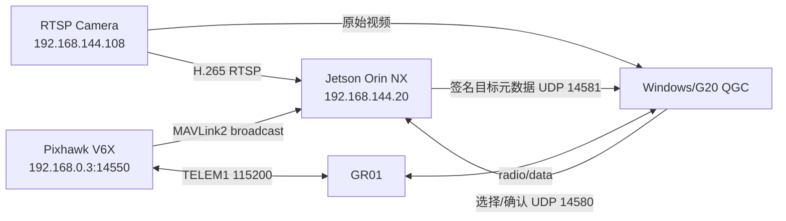
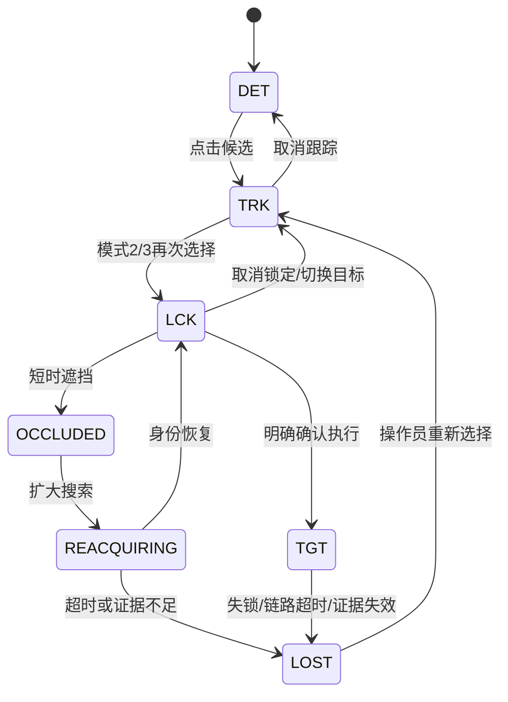
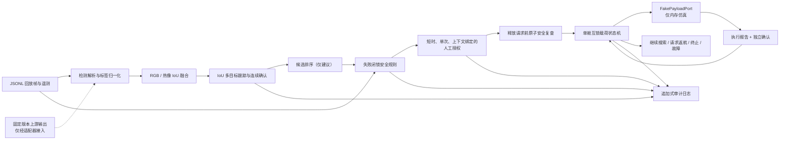
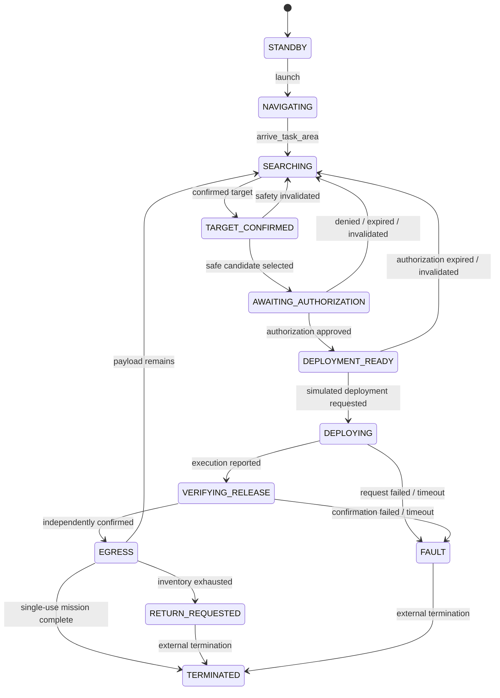

# Multi-Detect

## 现场会话目标身份门

现场验证窗口代表一个选定目标：只要 GPS/RANGE 样本携带目标 ID，验证器就要求两类来源的 ID 集合完全一致且唯一。仅有部分交集（例如 GPS 记录了 `a,b`、RANGE 只记录 `a`）会被标记为 `cross_record_mismatches` / `multiple_target_ids` 并保持 `gate_passed=false`；多个目标请拆成独立会话。

Multi-Detect 是一个面向多旋翼、垂起固定翼（VTOL）和固定翼的机载视觉、目标跟踪、地面站交互和飞控联动工程。系统把感知候选、多目标跟踪、TRK/LCK/TGT、人工确认、固定相机视轴控制和审计串成同一条实时链路。

三模式统一多目标跟踪、模式 3 固定翼视轴控制、多模态测距和轻量单目避障的需求与验收指标见 [三模式统一多目标感知与任务系统](docs/three-mode-multitarget-system.md)。

> 模式 3 已加入真实 PX4 `SET_ATTITUDE_TARGET` 控制路径；只有 Mode 3、主 LCK、目标绑定确认、PX4 固定翼身份、已解锁、新鲜姿态/目标、最低空速和最低高度同时成立时才预发送 setpoint 并切入 `OFFBOARD`。失锁或任一门限失效后停止控制并恢复进入前的飞行模式（取不到时回退 `AUTO`）。物理载荷释放仍是独立链路，当前实现不发送释放动作。

## 当前开发版本

| 项目 | 当前状态 |
|---|---|
| 开发版本 | **v0.3.0-pre.8** |
| 最终目标版本 | **v0.3.0（尚未发布）** |
| 发布通道 | prerelease |
| Python / wheel 版本 | `0.3.0rc8` |
| QGC CMake / PE 数值版本 | `0.3.0` |
| 机器可读版本清单 | [`configs/product-version.json`](configs/product-version.json) |
| 已验证回退基线 | v0.2.0 Windows portable |

### 2026-09-05 v56 Gazebo 相机挂载、行序与候选检测三控（pre.8）

三个组合机型的 `mono_cam` include 现在都显式使用 `pose relative_to="base_link"`。这修复了 merge include
默认按组合 model frame 解释、导致 x500 相机实际落到地面以下的问题。Gazebo sensor 源帧与 `MDGZSIM2`
wire 均固定为 `top_to_bottom`，桥接仅执行 RGB → BGR/stride 处理，不再重复做垂直翻转；如果 frame-set
声明 bottom-to-top、缺少成组行序字段或声称发生 flip，候选评估器会在创建推理 session 前 fail-closed。

hash-pinned disposable PX4/Gazebo v21 实际采集 3/3 帧，首帧为天空在上、地面在下、完整车辆纹理正立的
1280×960 BGR24 画面。runtime 证据为
[`gazebo-car-positive-control-camera-row-fix-v56-pre8-v21.json`](artifacts/evaluation/terminal-continuation-v56/gazebo-car-positive-control-camera-row-fix-v56-pre8-v21.json)，
46,503 bytes，SHA-256 `3FBF2BDE258718EC9287703CDC5905F5B6766A1A60301145A5EB99BCD182643D`；
[首帧预览](artifacts/evaluation/terminal-continuation-v56/previews/gazebo-car-positive-control-camera-row-fix-v21/frame-000000-wire-top-to-bottom.png)
SHA-256 为 `98C980BE9A3C0BBAC889A3D95D4545D1DA1CE15F5232631E290DD3C1DF787559`。容器已 stop/rm，
无残留；该画面是 headless Gazebo 像素证据，不是 QGC 人工视觉验收。

在任何模型推理之前，v21 首帧又由仓库源纹理标注与 billboard 四角平面投影生成独立、帧摘要绑定的
[`frame-000000.annotation.json`](artifacts/evaluation/terminal-continuation-v56/gazebo-car-positive-control-camera-row-fix-wire-v2-frames-v56-pre8-v21/frame-000000.annotation.json)。
隔离候选 ONNX（SHA-256 `7FF7B97CAD2FBB68D4FC6A74ED5DAD67BEB91F535E8CC25D5F0D97AE42D2E410`）
随后只接收像素并运行 present / zero-blank / annotation-occluded 三控：present 得到唯一 `car`，置信度
`0.8012787104`、独立标注 IoU `0.8882733111`；blank 与 occluded 都是 0 检测。机器证据为
[`candidate-detector-controls-gazebo-car-camera-row-fix-v56-pre8-v22.json`](artifacts/evaluation/terminal-continuation-v56/candidate-detector-controls-gazebo-car-camera-row-fix-v56-pre8-v22.json)，
5,908 bytes，SHA-256 `D48865EC9296C2778D7CF7D6C486D632410689EF1B23BAFC99BEE04A55365BC9`，
CLI 退出码 `0`。本轮相关聚焦回归为 `326 passed`，Ruff/compileall 通过。

相机 model-root / stack provenance 改变后，旧 v54 三机型证据被当前 verifier 正确拒绝；没有复用或放宽。
当前 fixed-wing / multirotor / VTOL deterministic preflight 已重生并绑定到
[`simulator-3d-control-binding-v56-camera-frame-pre8.json`](artifacts/evaluation/terminal-continuation-v56/simulator-3d-control-binding-v56-camera-frame-pre8.json)，
2,371 bytes，SHA-256 `7DAB627CC1211EFDD60A98C71575EE697E5062B9CB1020AB905B7A0CFFF896B2`。
[`configs/release-parity.json`](configs/release-parity.json) 与当前共享源码重新一致，5,098 bytes，SHA-256
`893E55ED8BDADE76DF85A5F50ADB3471D517237DE6F7B5F094C07AFE278C3397`。最终全量严格回归共
3,199 tests：`3198 passed, 1 skipped, 0 failed, 0 errors`，退出码 `0`；当前 E7 更新后的 JUnit
[`full-regression-v56-e7-current-final-20260905.xml`](artifacts/evaluation/terminal-continuation-v56/full-regression-v56-e7-current-final-20260905.xml)
464,558 bytes，SHA-256 `2799FCA4C87F095F0218CC73FB65B03B7E6BD8C63978CE8C470B6ED5911CBBBC`。
唯一跳过仍是 Windows 当前账户缺少 symlink 能力，不是 runtime 或安全门失败。

E7 默认 wrapper 也已切换到 v56 三机型 source。旧 v52 external join 在当前 parity 下重新计算时按设计
失败（`gate_passed=false`，原因是 stored summary 与 source recomputation 不一致）；该失败记录 SHA-256 为
`46EB3D11336985DB8F2A608011E17C862D8794C9485DDD0F5EC1722FCB771704`。随后从原六份不可变
runtime/live-AI source 和当前 parity 新建 join，再独立重算，join / revalidation SHA-256 分别为
`D5120A0F72D6BE3236D74BFFAAC89644F8022881C76EAF08B32E95B67404327F` /
`AA925E65C0501C6A159EDE440391704B912D75F7B0690A988AB18D818BF96D46`，两者均通过。这是旧
software-only source 的当前 parity 重绑定，不是重新运行外部 Gazebo，也不增加硬件声明。

当前 E7 report-only manifest/report SHA-256 为
`94C38CF64B1B53B862758D516CDA8DDB04952110BB5A53C4C3A6F20D6DD6492D` /
`AD14941F7D0726EC2AFEC3329EAC82B0D7CE72350659395A73B7E4EC700B0D87`；report-only 退出 `0`，
但 `gate_passed=false`、`release_allowed=false`。同输入 strict 退出 `2`，manifest/report/strict SHA-256
依次为 `526A8FC34632D89D62269450CA2D7C032F18BC23B7C0935480E32350C0F5C205`、
`E75E423072E4A5EE92C692A869AA67319D0CB03376412CEF831821DFDF7066CB`、
`B4BE420E2E8C0D9F9008E7AF74BED1C9849AC8789E8A3CA1E0FDEE2FB52F87DF`。32 条 blocker 继续覆盖
部署域 replay 精度/覆盖、真实链路 freshness/readiness、四模式人工视觉与 Mission、HIL/REAL 硬件控制，
以及 prerelease 版本面。v22 候选没有作为 model-review 输入，`model_review` 仍 absent，避免把单帧 smoke
冒充生产批准。E7 wrapper/外部证据/三维/发布门聚焦回归为 `153 passed`。

这个结果只关闭单帧、三控、software/SIM candidate smoke 子门。候选 manifest 继续保持
`status=quarantined`、`production_approved=false`、`accuracy_validated=false`，没有启用物理控制；完整
数据集精度、共享测距与目标落图闭环、人工 QGC Fly View、真实 Jetson/相机/Pixhawk、室外 GNSS、HIL、
REAL 和实飞仍未验收。v56 未修改 QGC C++/QML，不生成新 EXE；最终 `v0.3.0` 继续不发布。

### 2026-09-05 v55 一次性 PX4 SITL/Gazebo 模拟机体位置响应机器门（pre.8）

`scripts/run_simulator_docker_ai_acceptance.py` 新增显式
`--exercise-flight-seconds 1..30` 和 `--minimum-flight-displacement-m`。flight exercise 必须同时启用
`--execute --exercise-arm --exercise-target`；默认调用仍保持无外部 I/O 的 fixture，基础
`run_simulator_docker_acceptance.py` 也仍是只发 GCS heartbeat 的被动 telemetry gate。唯一受测控制链为：

```text
truth-free synthetic target refresh
  -> SimulatorTelemetryBridge.ingest_perception
  -> SimulatorAiExecutor
  -> SimulatorMavlinkControlAdapter / shared authority + watchdog
  -> loopback MAVLink MANUAL_CONTROL
  -> disposable PX4 SITL / Gazebo
  -> PX4 GLOBAL_POSITION_INT
  -> shared WGS-84 displacement calculation
```

flight exercise 只在 hash-pinned 一次性容器中追加 `COM_RC_IN_MODE=1`，再通过同一个 loopback MAVLink
control socket 发送 `SET_MODE(POSCTL)` 并等待 PX4 heartbeat 确认当前仍为 armed POSCTL。它不会调用
Gazebo `set_pose`、teleport、truth topic 或第二条 simulator-only controller。第一个真正被接受的 TRACK
才原子锁定位置基线；之后必须在请求时长内持续刷新，最大 gap `<=0.5 s`，且全程没有 target/AI rejection、
failsafe、watchdog、heartbeat continuity failure 或模式丢失。轮询次数与真实 MAVLink frame 数已分离，
默认真实帧容量提高到 100,000；失败路径在 DISARM/neutral/容器清理前冻结 observation end time，避免把
cleanup 时间伪装成飞行证据。

当前 canonical v4：

| 字段 | 实测结果 |
|---|---|
| 证据 | [`terrain-ai-flight-response-v55-pre8-v4.json`](artifacts/evaluation/terminal-continuation-v55/terrain-ai-flight-response-v55-pre8-v4.json)；661,936 bytes；SHA-256 `B56F20AB40B3E8AF9DF169FAAED9D4F326FFCDFDD052ED0FC6FF804FD7C44073` |
| 独立 gate | runtime / AI policy / target policy / flight response 全部 `true` |
| 持续目标 | `8.172 s` observation；68 accepted、0 rejected；coverage `8.062 s`；最大 gap `0.485 s` |
| PX4 mode / heartbeat | 当前 armed POSCTL；custom-mode enabled；mode loss `0`；最大 heartbeat gap `2.844 s < 3.0 s` |
| PX4 reported response | `GLOBAL_POSITION_INT` 171 samples；最大 WGS-84 水平位移 `0.818282 m`，门限 `0.5 m`；最终位移 `0.305928 m` |
| AI / safety | 557 accepted policy/control steps；0 AI rejection；0 failsafe；0 watchdog failsafe |
| 退出与清理 | `observe_exit_reason=accepted`；frame limit 未触发；DISARM 已发送；container stop/rm 均成功且无残留 |
| 容器日志 | [`terrain-ai-flight-response-v55-pre8-v4.container.log`](artifacts/evaluation/terminal-continuation-v55/terrain-ai-flight-response-v55-pre8-v4.container.log)；2,200,000 bytes；SHA-256 `04F57BBF9F7A9FEB7EF5C6990DBAF4187D2AE8B5E3C49E922E3919B568B10EBD` |

当前代码全量回归共 2,907 tests：`2906 passed, 1 skipped, 0 failed, 0 errors`，退出码 `0`；唯一跳过为
Windows 当前账户缺少 symlink 能力。JUnit 为
[`full-regression-v55-px4-position-response-final-20260905.xml`](artifacts/evaluation/terminal-continuation-v55/full-regression-v55-px4-position-response-final-20260905.xml)，
411,702 bytes，SHA-256 `A2C2595C49D0B663468D09274D22976CC1B4D9128425BB23458445B1C5397F51`。

三处 flight elapsed（telemetry / AI / 顶层）均固定为 `8.172 s`。v1、v3 失败记录继续保留：v1 暴露
AUTO.LOITER/heartbeat 条件下位移不足；v3 虽达到 `0.748596 m`，但旧实现把 36 次空 poll 和 4,060 个
真实帧一起耗尽 4,096 配额，使 refresh coverage 只有 `5.469/8.0 s`，因此正确保持失败。v2 是修复
POSCTL 后首次成功诊断，但生成后代码继续收紧证据和安全门，所以不是当前 canonical。

可重复运行命令：

```powershell
python .\scripts\run_simulator_docker_ai_acceptance.py `
  --scenario-manifest .\configs\scenarios\validation\terrain_ranging_validation_001.scenario.json `
  --evidence .\artifacts\evaluation\terminal-continuation-v55\terrain-ai-flight-response-v55-pre8-v4.json `
  --container-name multidetect-v55-flight-v4 `
  --control-port 15340 --telemetry-port 15341 `
  --execute --exercise-arm --exercise-target `
  --exercise-flight-seconds 8 --minimum-flight-displacement-m 0.5 --timeout 120
```

该 machine gate 证明的是单个 x500 disposable PX4/Gazebo 进程通过共享 AI/MAVLink 链产生了
PX4-reported position response。synthetic target 没有经过 Gazebo camera 检测、共享测距、
`TARGET_GEOLOCATION`、地图落点或人工 Fly View；它也不证明 actuator telemetry、airborne flight、
fixed-wing/VTOL 动态对等、真实 Pixhawk/Jetson/相机、室外 GNSS、HIL 或 REAL。v55 未修改 QGC
C++/QML，因此没有产生新的 EXE；E7 最近一次 strict 仍是 v54 的 exit `2` / 32 blockers，最终
`v0.3.0` 继续不发布。

### 2026-09-05 v54 Gazebo wire-v2、3-D Odometry 与 DEM 派生 AGL（pre.8）

Gazebo 传感器桥不再只传图像和 NavSat。三个仓库机型 `x500_mono_cam`、
`standard_vtol_mono_cam`、`rc_cessna_mono_cam` 均启用官方
[OdometryPublisher](https://gazebosim.org/api/sim/8/classgz_1_1sim_1_1systems_1_1OdometryPublisher.html)
的 3-D `/model/<model>/odometry_with_covariance`，频率为 50 Hz。`scripts/gazebo_sensor_stream.py`
使用固定 `204`-byte header 的 `MDGZSIM2` wire v2；只有 image、CameraInfo、NavSat 和完整 pose/velocity
Odometry 在有界 source-skew 内齐备时才发帧，并对 header 与 BGR24 payload 的完整记录做 SHA-256。
启动事件保持 `full_odometry_pose_velocity_fusion_claimed=false`，只有全部请求帧真正写出后，结束事件才会
把该 claim 置为 true。

`GazeboSimBackend` 将 Gazebo world ENU / body FLU 严格转换为产品侧 NED / FRD。世界坐标的 local-up
只用于 `local_down_m`，**绝不作为 AGL**。SIM AGL 只允许由通过 canonical GPS 质量门的 NavSat MSL
高度减去当前 WGS-84 位置的 scenario DEM MSL 高程得到，reference 固定为
`GAZEBO_NAVSAT_MSL_MINUS_SCENARIO_DEM_MSL`。DEM 缺失、scenario ID 不匹配、GPS 降级、位置越界、
datum 非法或高度非正时，AGL/reference/timestamp 原子变为 unavailable；不会回退到 Gazebo local-up。
SIM 的 `fix_type=3`、12 satellites、`hAcc=1.5 m`、`vAcc=2.5 m` 是显式模拟假设并进入 sensor binding，
不能作为室外 GNSS 质量证据。

非平地资产现在还有完整但隔离的 runtime scenario：
[`configs/scenarios/validation/terrain_ranging_validation_001.scenario.json`](configs/scenarios/validation/terrain_ranging_validation_001.scenario.json)
分别 hash 绑定 runtime、truth 和 expectations；运行时只读取 runtime channel。对应地图是
[`simulation/maps/terrain_ranging_validation_001.geojson`](simulation/maps/terrain_ranging_validation_001.geojson)，
SDF/DEM 继续使用 v53 的同名资产。它位于 `configs/scenarios/validation/`，不会改变默认三机型发布矩阵，
但可以被 CLI 或 Docker acceptance 显式选择。

| v54 证据 | 结果 |
|---|---|
| [`gazebo-wire-v2-terrain-agl-runtime-acceptance-v54-pre8-v3.json`](artifacts/evaluation/terminal-continuation-v54/gazebo-wire-v2-terrain-agl-runtime-acceptance-v54-pre8-v3.json) | VTOL 外部容器与 3/3 wire-v2 帧通过；27,570 bytes；SHA-256 `224F79095247521ED6AE320299CD1E428C4E49072375C8BB2647950E464A8525` |
| [`terrain-ranging-validation-runtime-scenario-v54-pre8-v1.json`](artifacts/evaluation/terminal-continuation-v54/terrain-ranging-validation-runtime-scenario-v54-pre8-v1.json) | validation scenario 的 8 步 AI/authority/watchdog 确定性运行通过且 repeat hash 一致；4,215 bytes；SHA-256 `FB1F532E340F7E468DE0002824AC374C12C5960391F1EC3B1A6BBE6871CAD2D2` |
| [`terrain-ranging-validation-gazebo-runtime-v54-pre8-v2.json`](artifacts/evaluation/terminal-continuation-v54/terrain-ranging-validation-gazebo-runtime-v54-pre8-v2.json) | 非平地 SDF + x500 外部 PX4/Gazebo、3/3 image/NavSat/Odometry 帧与 DEM AGL 通过；27,089 bytes；SHA-256 `8FB0FE4338EEA71021C7CCD8515ACFB2577847A2517297126C921AE4D825C4B0` |
| [`simulator-3d-control-binding-v54-odometry-pre8.json`](artifacts/evaluation/terminal-continuation-v54/simulator-3d-control-binding-v54-odometry-pre8.json) | 当前 Odometry SDF 字节的 fixed-wing / multirotor / VTOL 确定性控制与资产绑定通过；2,359 bytes；SHA-256 `78066C298A9B9EEDB012B7596D9B7DA66E334DE7449EACDF1CCD59513181B00C`；external runtime/视觉/硬件不宣称 |
| [`full-regression-v54-gazebo-wire-v2-terrain-runtime-e7-final-20260905.xml`](artifacts/evaluation/terminal-continuation-v54/full-regression-v54-gazebo-wire-v2-terrain-runtime-e7-final-20260905.xml) | 2,889 tests：`2888 passed, 1 skipped, 0 failed, 0 errors`；409,003 bytes；SHA-256 `C3D01A9F3A157A3B57225319A67FA7EE79883AAB70C025DA14E896F0C1EA4532` |

最后一份记录实测 `altitude_agl_m=0.2303031043`，并机器可读写明
`odometry_local_up_used_as_agl=false`；容器 stop/rm 均退出 `0`，无残留。Docker 只收到 GCS heartbeat，
`flight_control_commands_sent=0`。当前跨 Gazebo/backend/Docker/terrain/integrated-SIM/document/parity 的
聚焦回归 `265 passed`，三维控制/E7 wrapper 专项 `22 passed`，Ruff/compileall 通过；
[`configs/release-parity.json`](configs/release-parity.json) 重算后仍为 5,098 bytes、SHA-256
`C28AC3C300DDACAD7B97097EC80987AED78E8EB8B19101AD98FD8D66F7985739`，说明五组共享产品契约未变，
QGC C++/QML 也未变，因此本轮不重复链接 EXE。

三个 model SDF 加入 OdometryPublisher 后，v52 三机型预检里的 model SHA 按设计失效；校验器没有放宽，
而是重新生成并绑定当前 v54 文件。E7 默认 wrapper 现保留 v52 的 parity-valid external 六源记录，但三份
3-D control 输入已固定切换到 v54。最新 manifest/report/strict report 分别为 21,042 / 54,912 / 54,910
bytes，SHA-256 `913CB8FE13245A25FA5BEA73F19ACF3294CE90A42C6EE0CF419E8EE9D34349D7` /
`7212733034F21994D20D1A41F2B4CF789A213B67981DA379A63D731124CB1900` /
`E20D2523E771D203698D8EB35462D83279CA2B2E350A9BA936361A2C150D8B84`。report-only 正常生成，strict
精确退出 `2` 并保留 32 个现场/发布阻断，未把当前工作误写成最终发布通过。

本门证明的是 v54 headless software SIM sensor transport 与非平地 world 能真实运行，且 altitude reference
不再混淆；v54 这次 sensor runtime 没有让飞机飞越坡面，也没有执行目标检测/测距闭环或人工查看 Fly View。
真实 Jetson/相机/Pixhawk、
室外 GNSS 与距离 survey、HIL/REAL、实飞和人工视觉仍为 pending，最终 `v0.3.0` 继续不发布。

### 2026-09-05 v53 非平坦 3-D 地形资产真值（pre.8）

新增独立验证场景
[`terrain_ranging_validation_001.sdf`](simulation/gazebo/worlds/terrain_ranging_validation_001.sdf)
和对应的
[`terrain_ranging_validation_001.dem.json`](simulation/terrain/terrain_ranging_validation_001.dem.json)。
Gazebo 使用 ENU 坐标；SDF 平面以 `atan(0.1)` 滚转，因此解析后的北向坡度精确为
`+0.1 m/m`、东向坡度为 `0 m/m`，MSL 地形为 `25.0 + 0.1 * north_m`。该 world 完全使用本地
SDF 几何，并放置两个贴合坡面的高对比目标，供后续真实 Gazebo/PX4 飞行与人工视觉验收使用。

`src/multidetect/simulator/terrain_truth.py` 不读取 DEM 公式，也不启动模拟器；它从 SDF 的
`Rz * Ry * Rx` 姿态独立恢复世界平面法向、坡度、有限覆盖范围与解析射线交点，再与共享
`LocalDemGrid` 比较全部 `25` 个网格节点、`16` 个单元中心和 `7` 条 NED 射线，其中 `6` 条实际跨越
网格边界、`1` 条为垂直基准。最大高程误差
`3.553e-15 m`，最大坡度误差 `1.388e-17 m/m`，最大射线斜距/北向误差均
`5.684e-14 m`，低于 `1e-9 / 1e-12 / 1e-7` 的分层门限。篡改 DEM 高程、SDF 坡度或 WGS-84
原点的回归均会使 gate 失败；DTD/entity、外部 URI、嵌套 transform 和歧义 collision/visual 也被拒绝。

正式证据为
[`simulator-terrain-ranging-asset-truth-v53-pre8-v2.json`](artifacts/evaluation/terminal-continuation-v53/simulator-terrain-ranging-asset-truth-v53-pre8-v2.json)
（11,952 bytes，SHA-256
`CCB34D5AE3088DE1A66CCF4E6D521C7E009DEF1CD25051E6DDA61DC4A526FB9B`）；专项回归
`107 passed`。证据 schema 明确记录 `gate_scope=deterministic_simulator_asset_truth`、
`external_gazebo_runtime_gate_passed=false`，人工 QGC 视觉、硬件、室外 GNSS、HIL/REAL 均为
`not_claimed`。本轮只增加验收基础设施和场景资产，没有改四模式共享产品契约；
`configs/release-parity.json` 仍为 5,098 bytes、SHA-256
`C28AC3C300DDACAD7B97097EC80987AED78E8EB8B19101AD98FD8D66F7985739`。QGC C++/QML 未变，
无需重新构建 EXE。完整回归共 2,866 tests：`2865 passed, 1 skipped, 0 failed, 0 errors`；唯一跳过是
当前 Windows 账户没有创建 symlink 的权限（WinError 1314）。JUnit 为 404,145 bytes、SHA-256
`2E54AD65923CDB93D1BD570A0C726FCBFD32316FB3A0EB5A8D3B13A116205092`，文件为
[`full-regression-v53-terrain-asset-truth-final-20260905.xml`](artifacts/evaluation/terminal-continuation-v53/full-regression-v53-terrain-asset-truth-final-20260905.xml)。

### 2026-09-05 v52 共享 DEM/GNSS 坡地测距核心（pre.8）

户外目标测距现在可以使用真实地形面，而不是固定“飞机下方是一张水平面”。新增的
`src/multidetect/terrain_dem.py` 严格读取 WGS-84 / MSL 局部高程网格，在每个网格单元内做双线性高程与
坡度采样，并用逐单元精确二次方程求相机射线与地形面的最近有效交点。DEM 必须覆盖自己的 WGS-84 原点，
局部零点高程必须与 MSL 原点一致，超出 100 km 局部域、越界、非下降射线、无有限交点或无界不确定度都
直接 fail-closed。

同一份实现已接入 `MultiModalRangingEngine`、实时 `LiveRangingConfig`、REPLAY/SIM/HIL/REAL 共用
telemetry 和命令行 `--ranging-dem`。`GPS_RAW_INT` 同一样本现在保存绝对 MSL 高度
`gps_absolute_altitude_m`；只有 canonical GPS 质量和 freshness 合格时才建立 `dem_gps` 地形观测。
GPS/DEM 时间错位、位置越界或地形交点失败时，不会偷偷回退到平地 camera-ground 假点；直接深度仍可按
既有质量门作为明确的 degraded 候选。DEM 路径把 GPS 水平/垂直误差、DEM 高程/坡度误差、相机杆臂和
三轴射线误差共同传播到距离区间，同时不再重复融合由同一 GNSS 派生的相对 AGL 高度。

当前 [`configs/release-parity.json`](configs/release-parity.json) 为 5,098 bytes、SHA-256
`C28AC3C300DDACAD7B97097EC80987AED78E8EB8B19101AD98FD8D66F7985739`；五组 hash 为
`core=e90559d121468097f9378790e15902002aca8e6cdacd80c8d5bb8bb5426a93a1`、
`px4=18023962f68a61fdfb14c44e5f0a6a5bb713c782166386bd2b1f2bf7b567651d`、
`safety=b4627350ba8d0eea675e56d7dec3a5c26cf4b00583b18d5c92ce5c527f4a3f82`、
`task=b3c4aa6bd6bde2ba73707c8d2edae459daf58af0d4a1c70f2a8a6e54ebd63dab`、
`ui=c46a0727a854371cfd01a3b1eba0d56a1b5774a6e12dc00331e0a17afc11d3a7`。地形、实时、回放、协议、
stack、三机型与 parity 的聚焦回归为 `458 passed`。完整回归共 2,856 tests：
`2855 passed, 1 skipped, 0 failed, 0 errors`；JUnit 为 402,544 bytes、SHA-256
`E82F4F8FCF3C0639B272ECCECC06B8BFE85B8D946B78C3E8B29A1F1BFEDCE077`，文件为
`artifacts/evaluation/terminal-continuation-v52/full-regression-v52-dem-terrain-ranging-final-20260905.xml`。

v52 三机型确定性证据绑定为
`artifacts/evaluation/terminal-continuation-v52/simulator-3d-control-binding-v52-dem-ranging-pre8.json`
（2,368 bytes，SHA-256 `2B886AEF69197268A8658E1A5C8AA24D753DE4E560934CC245A667D7AA49948B`）；
fixed-wing / multirotor / VTOL 记录 SHA-256 分别为
`EC8ADB9BB538F37B49FA89511302155A818E71CC22648C0B203DA837BB346D54`、
`9D4C72A598DB44E6D7640AD7D0A92978B364A868F2147C00753F1820A57C2E81`、
`BB5AE46021881C7DB081EB0B5C839247B19E3731C90072F8294513E3DFA0F9EA`。这些记录只证明确定性协议、
资源和共享控制预检；`external_runtime_gate_passed=false`，人工视觉与硬件均为 `not_claimed`。

既有三机型 Docker/PX4/Gazebo 六源按 v52 parity 做了文件级重绑和独立重算；join / revalidation 分别为
5,491 / 569 bytes，SHA-256
`3B82910E3122DF3A929DA24E5D4C119916B0BE22035BBEB3C25208CE491F7A79` /
`CE6A3E4DE25D3E60466BA20FFF70C9FC51B59A7455AC5506935E2A3C3AD460B6`，两项均通过。这是已有
software-only 源证据的当前算法绑定，不是本轮重跑 Docker。v52 阶段的 E7 wrapper 固定引用 v52 join 和
当时的三机型记录；report-only 退出 `0`，strict 原生退出 `2`，保留 32 项阻断。该历史 strict manifest/report/strict
SHA-256 分别为 `897EFDFE8EA0F3A6DD50136D957804548870FE9A1A2E69AD93C7959DAA7B999D`、
`4F968E128B72CFFC89BE4E2214A947D01696DBED970F90B2C7704B6A526E244D`、
`87DCEC746D2D2B6B33369A11405F5AF1398770B50A90799DE9F0A33A666DA899`。

v52 记录生成时的三个机型 DEM 与对应平坦 Gazebo world 对齐；后续 v53 已增加独立非平坦验证资产，
但外部 Gazebo 运行、室外测量真值、真实 GNSS/Pixhawk、HIL/REAL 仍待验收。v52 未改 QGC C++/QML，
canonical portable 继续使用 v51 已验证的 EXE 指纹。

### 2026-09-05 v51 测距失败语义与真实 SIM 地图/DEM 绑定（pre.8）

本轮关闭了两条会产生“看起来可用、实际证据不完整”的缝隙。第一，三轴安装角传播产生的
`target_ray_uncertainty_unavailable`、`target_ray_uncertainty_crosses_horizon` 和
`camera_offset_uncertainty_unbounded` 继续保留在 Python 内部诊断中，但进入认证
`RANGE_STATUS` 时统一映射为协议 bit 31 的
`target_geometry_uncertainty_unbounded`。Python 编码/解码与 QGC C++ 解码使用同一注册表；几何
不确定性跨越地平线时会得到可显示的 `INVALID` 状态，不会因“未注册 reason”异常而中断状态链。

第二，三个 3-D 场景的 `builtin://maps/...` 与 `builtin://terrain/...` 不再只校验字符串。stack
resolver 现在要求仓库内真实、非符号链接的 GeoJSON 和 `.dem.json` 文件，严格验证 scenario ID、
WGS-84、世界原点、坐标/高程/不确定性边界以及无网络引用，并把文件路径、大小和 SHA-256 纳入
stack identity。VTOL acceptance 的 `map_cache_available` / `dem_available` 也改为来自已解析文件，
不存在的 URI 不能再伪装成资源可用。

当前三个 DEM 为与现有平坦 Gazebo world 一致的平面网格；它们证明资源身份和输入契约闭合，**不代表**
坡地交点算法或坡地 3-D 场景验收已经完成。下一阶段仍需把 DEM 坡度采样接入共享 ranging 核，并用坡地
场景、室外测量真值和真实 GNSS 分别验收。

当前 [`configs/release-parity.json`](configs/release-parity.json) 为 4,860 bytes、SHA-256
`FA7EF5D6B1E8042F88F119D0FB9832540A1517B2320784956BD990567F77DD43`；五组 hash 分别为
`core=f5ae7dca...6044`、`px4=54407990...e1`、`safety=100f5954...c92`、
`task=3fe92424...ba04`、`ui=c46a0727...d3a7`。release-parity 专项 `24 passed`，测距协议/状态专项
`97 passed`，stack/scenario/VTOL 资源专项 `45 passed`；QGC 增量构建和原生 operator protocol
self-test 均退出 `0`。当前 Release 与 canonical portable EXE 字节一致，均为 46,576,128 bytes，
SHA-256 `06E7B1BBEC1B96DC6E5A231B12B88725122476075ED86A24BBEF554CB899E5FE`。真实 Jetson/Pixhawk、
室外 GNSS/距离真值、坡地、人工 Fly View、HIL/REAL 与最终 `v0.3.0` 仍保持 pending。

### 2026-09-05 v50 室外定位三轴安装角不确定性（pre.8）

目标测距/落图的相机安装误差现在使用真实几何传播：同一个 `boresight_sigma_deg` 明确定义为安装
pitch/yaw/roll 三个独立测量轴各自的共同 `1σ`，三轴分别做正负端点中心差分，再把方位分量按平方和
合并。所有端点也进入斜距和地面距离误差预算；固定翼滚转、俯仰或目标离轴时，yaw/roll 对 NED 地面
交点的影响不再被遗漏。任一三轴 `1σ` 端点越过地平线即返回 `INVALID`，不会发布有限距离或过小
不确定性圆。REPLAY/SIM/HIL/REAL 继续调用同一个 `MultiModalRangingEngine`，没有模拟器专用算法。

确定性软件探针使用 `roll=18°`、`pitch=-7°`、离轴目标和三轴共同 `2°` 安装误差：旧 pitch-only/
固定方位标量模型给出 `bearing_sigma=2.000°`、地面距离 95% 区间宽约 `10.804 m`；三轴模型给出
`2.630°` 和 `11.659 m`。这证明误差预算按预期变得更保守，不是室外精度实测结论。另有一个
“pitch 两端仍向下但 yaw 正端越过地平线”的回归，验证该场景 fail-closed。

当前 parity 为 4,678 bytes、SHA-256
`0DA306BCD0A635DF70584BB14514153FB05433A452F52F7D58FB32F7B1C46336`，其中相机标定 schema
也已纳入 core，`core_algorithm_hash=f5ae7dca085db1556ad2c63ad6b08c1f155b229eb72ad78fb6bc6653e7b46044`；UI 与 PX4
Mission path hash 未变。v50 software-only external join/revalidation 均通过，SHA-256 为
`7ACCEDDF5B218BEACFB38C42B2814605FD3127420BFA90837E968BE906676A86` /
`E7CC9B6A5C28A0D7E5671516933DE232145BC254D0B7BF8C0249C5B9F802AAEB`。完整回归共 2,829 tests：
`2828 passed, 1 skipped, 0 failed, 0 errors`；JUnit SHA-256
`862C80D0D1AAF52AA8F9ABEE2FF4E8691C6A771FD45EE5F54A2B9E49ED08577E`。汇总证据为
`artifacts/evaluation/terminal-continuation-v50/three-axis-boresight-geolocation-acceptance-v50-schema-bound.json`
（5,594 bytes，SHA-256 `9400FF54A6347A9F7D0FCE116CAA497E01438EFEC9D4DF39E824BD3C408536DD`）。

本轮只修改 Python 核心几何、测试、schema 和文档，QGC UI/协议/C++ 未改变，所以不做无意义的重复
链接；当前推荐 portable EXE 仍为 v49 已验证的 46,575,616-byte 文件，SHA-256
`EE2A6A5E7B4561D56D6130FE9D81AEAC8F7093EB1A352792CB85AB353133F57D`。v50 E7 strict 按预期退出
`2`，仍有 32 项现场/人工/发布阻断；室外真值、真实 GNSS、HIL/REAL 和最终 `v0.3.0` 均未宣称通过。

### 2026-09-05 v49 模式 3 输出锁定状态如实显示（pre.8）

QGC 的模式 3 横幅现在使用与实际 provider 相同的动态权限结论：
`fixedWingAimActive` 必须同时满足 approach 状态为 active 和
`fixedWingAimControlEnabled=true`。目标已经 LCK、但实际 provider 尚未完成 live attestation 或已经撤销
权限时，Fly View 显示“模式 3 目标已确认 · 飞控输出锁定”和“仅显示姿态建议；不会发送姿态或模式命令”，
不再把只读建议误写成“正在瞄准”。stale、abort、cancel 和等待接管也有彼此独立的 fail-closed 文案。
该横幅继续复用 QGC 原生 `Rectangle`、`QGCLabel`、`QGCButton`、`QGCPalette` 与 `ScreenTools`，没有增加
SIM 专用界面或第二套控制逻辑。

本轮已重新链接并部署 portable。Release 与 portable EXE 均为 `46,575,616` bytes，字节一致，SHA-256
`EE2A6A5E7B4561D56D6130FE9D81AEAC8F7093EB1A352792CB85AB353133F57D`；隐藏 offscreen
`--offline --simple-boot-test` 退出 `0`。operator protocol、replay RTSP wire 以及 44 分片
Python→C++ depth-grid wire 三项原生自测全部退出 `0`，结构化记录在
`artifacts/evaluation/terminal-continuation-v49/qgc-native-selftests-v49.json`（2,016 bytes，SHA-256
`FFE34FF1B6CF7D3D933C56DB7F2BCFCE0C2D789A3B487F8E5D045C254A839667`）。汇总软件验收为
`qgc-mode3-output-lock-acceptance-v49.json`（4,935 bytes，SHA-256
`91D8B4800E21A7523F9E909C51C4E113D10D469310A97D9E85EDB70D59FDAE30`），其中仍明确
`operator_visual_acceptance=not_claimed`。

当前 parity 为 4,622 bytes、SHA-256
`B8D2918DBC3040596A86BB6B9FC8FB7843E660929DBCD2D677C70D3592F69167`，
`ui_contract_hash=1dc7e2ae6edbb7ed2f4b212232ebf24fcb2fd54cf84373e4e2941af0dc88c992`；PX4 Mission path hash
保持 `544079908cbb34f9b6a28fe02e344153595cb1b983271aaa027c50d1e2247ce1`。v49 software-only
external join/revalidation 均通过，SHA-256 为
`217BBC60F506D82E5159164C7A17D06345843B1A7BFD539FCAD42F4344FACC28` /
`302969731360683BEDD629BF54CE7ED365D39BC9BC45D6B8296EEB12E9280C29`。完整回归共 2,827 tests：
`2826 passed, 1 skipped, 0 failed, 0 errors`；JUnit 为 398,541 bytes、SHA-256
`79083F9262E924559B84C117D494D84533CAFFD47857648C19DB869250C39764`。

v49 E7 report-only 退出 `0`，strict evaluator 按预期退出 `2`，仍有 32 项真实阻断；external 子门通过，
但 PX4 Mission feedback 六叶 absent，现场链路、人工 Fly View、HIL/REAL、室外 GNSS/距离真值和最终
release channel 尚未通过。因此版本继续为 `v0.3.0-pre.8`，不发布最终 `v0.3.0`。

### 2026-09-05 v48 运行 provider 独立实时再认证（pre.8）

v47 已阻止 firmwareless legacy profile 取得 REAL 输出权限；v48 继续关闭 probe 与实际控制连接之间的
TOCTOU 缝隙。launcher 的只读 probe 只负责验证静态签名 profile 与当时观察到的车辆/固件/端点，随后
创建的 `ProfileBoundFlightControlProvider` **不会继承 probe 的 freshness**：即使静态 profile 已授权，
新 provider 也必须从锁定状态开始，并由自己的 receive-only snapshot 或显式 refresh 重新观察新鲜
heartbeat 与同源 `AUTOPILOT_VERSION`，才会置
`live_binding_attested=true`。任何输出命令都不能充当第一次认证事件。

未完成实时再认证时，姿态/模式输出以及测距、RC stream request 全部保持零发送。heartbeat 超时、稳定
身份变化、transport 关闭或固件身份不一致会立即撤销 attestation、清除已缓存固件身份并恢复
`flight_control_enabled=false` / `output_locked=true`；即便同一 source 重连，也必须重新收到版本帧。
`FixedWingAimExecutor`、`LiveApproachHilCoordinator` 与 CLI 状态现在都读取动态权限，而不是复制 launcher
启动时的静态布尔值。启动事件分别报告 configured、静态 authorized、实时 attested、当前 enabled 与
locked，避免把“配置好了”显示成“现在可以输出”。

当前 parity 为 4,622 bytes，SHA-256
`49D9B243A26591784DA0651A0B8789C5AEC0E162911199EC447C38EE370152D6`；
`px4_mission_path_hash=544079908cbb34f9b6a28fe02e344153595cb1b983271aaa027c50d1e2247ce1`，并首次把
`approach_live.py` 与 `fixed_wing_aim_control.py` 纳入 PX4 Mission path。v48 software-only external
join/revalidation 均通过，SHA-256 分别为
`65CCC80DC09CA1094884D82D24CC499BAD12AA382986572E75EA69CC2BDAECC6` 与
`E26B5149CBECB877529B85A0DD51B32864670110412EA62D0B3EADD056604B2F`；它们只是对既有
Docker/SITL 来源按当前源码重算。

完整回归共 2,826 tests：`2825 passed, 1 skipped`、失败/错误为 0；唯一跳过仍是当前 Windows 账户没有
symlink 权限。JUnit 位于
`artifacts/evaluation/terminal-continuation-v48/full-regression-v48-live-provider-attestation-20260905.xml`
（398,376 bytes，SHA-256
`59D78D2D621C4EE6395E4EE341D3101E3CC7424531B4C2950C3D0165D9749267`）。v48 E7 report-only 返回
`0`，strict evaluator 按预期返回 `2`；strict 仍列出 32 项真实阻断，明确
`simulator_external_evidence.passed=true`、`px4_mission_feedback.present=false`、
`gate_passed=false`、`release_allowed=false`。首次因 expected release 拼写错误产生的失败 revalidation
被保留为诊断 provenance，canonical 绑定只引用后缀为 `-v2.json` 的成功重验。真实 V6X、HIL/REAL
六源、室外 GNSS/测距真值、人工 Fly View 和最终 `v0.3.0` 继续 pending。本轮没有修改 QML/C++，现有
pre.8 portable 不需要因 v48 重新构建。

### 2026-09-05 v47 REAL 输出固件身份硬锁（pre.8）

v46 已经把 `AUTOPILOT_VERSION` 固件身份接入新签发 profile 与 E7，但泛用
`load_runtime_profile_document()` 的历史兼容入口仍允许调用方在读取 legacy REAL `flight` profile 时传入
输出 opt-in。v47 把“历史文档可诊断读取”和“当前运行可取得输出权限”彻底分开：未带
`firmware_identity_hash` 的 legacy profile 在无输出请求时仍可打开；一旦请求 REAL flight-control
output，profile hash、实时观测 hash 及二者精确一致性全部成为强制条件，缺失或不匹配都会令
`profile_valid=false`、`flight_control_enabled=false`、`output_locked=true`。

实际 HIL/REAL launcher 现在始终启用 `require_firmware_identity_binding`；REAL `observer` profile 仍固定
只读，绕过 launcher 直接构造 `ProfileBoundFlightControlProvider` 也会拒绝 firmwareless flight
profile。这样 legacy 文件只保留取证/诊断价值，不能成为旧格式输出旁路；现有 QGC Fly View、任务契约
和 PX4 Mission 路径没有新增平行实现。

当前 parity 为 4,529 bytes，SHA-256
`B40053E5EE74D09FA890E506BEACF7392288778AAE22F449016FC88D1563BBCF`，其中
`px4_mission_path_hash=63674e1adedc5884561ffa62f6c6b4f35d1e4a067bb5114e29ab3a6d305917c5`。v47
software-only external join/revalidation 均通过，SHA-256 分别为
`456524B74F70F8431C186557255E067C6F70DFB4A8E6C42D93F2C16622DA1890` 和
`F4000DF499E8DEE33C4D795D49B6CE177347DEA5E661959118277E450692907C`；它们只是对既有
Docker/SITL 来源按当前源码重新计算，不代表新的设备运行。

v47 完整回归共 2,821 tests：`2820 passed, 1 skipped`、失败/错误为 0；唯一跳过仍是当前 Windows
账户没有 symlink 权限。JUnit 位于
`artifacts/evaluation/terminal-continuation-v47/full-regression-v47-runtime-firmware-output-lock-20260905.xml`
（397,695 bytes，SHA-256
`557FA4D8D306193388DB3D5600A8E5AD4228C2C2E494112F4857EB201EDD8934`）。E7 report-only 退出 `0`，
strict 按预期退出 `2`；strict run 的 manifest/report/strict-report SHA-256 分别为
`88C4E86F007F92F9ABC5BB9D8D507BEF3E4933B9A1374F059025EE2B351C92C6`、
`2E871C79E3F58C7520B0EF70993AF7C2B1BFE29FEB8E2BCDD75CBB58B9F72155`、
`CC62CD5D4BBFCB026022DEDE23483746AF7E9C76C32AFF31BAD16603FF5CC931`。报告确认
`simulator_external_evidence.passed=true`，同时保持 `px4_mission_feedback.present=false`；真实 V6X、
HIL/REAL 六源、室外 GNSS、人工 Fly View 和最终 `v0.3.0` 继续 pending。本轮没有修改 QML/C++，现有
pre.8 portable 不需要因 v47 重新构建。

### 2026-09-05 v46 PX4 固件身份进入 RuntimeProfile 与 E7（pre.8）

v45 的被动 `AUTOPILOT_VERSION` 身份现在已经进入签名 RuntimeProfile 和 PX4 Mission-feedback
发布链。新的 HIL/REAL `provision` 不再只接受 heartbeat：它必须在**本次 provision 自己的探测窗口**内，
从已接受 heartbeat 的同一 system/component 收到完整版本帧，并把隐私保护的
`firmware_identity_hash` 写入 profile。版本帧缺失、来自其他 source、时间早于探测开始、时间位于未来，
或运行期间发生身份不一致时均不写 profile；整个过程继续要求 `read_only=true` 和
`messages_transmitted=0`。

泛用 RuntimeProfile reader 仍可读取 v45 以前没有 firmware hash 的已签名 HIL/REAL 文档，避免破坏历史
诊断；但这种 legacy profile 不能通过新的 Mission-feedback E7。v2 observer 会分别检查 profile 与实时
观测到的 firmware hash，六叶聚合器也要求每个 HIL/REAL × fixed-wing/multirotor/VTOL 叶节点携带并与
重开的 report 完全一致。缺失和不一致分别以
`runtime_profile_firmware_identity_missing`、`observed_firmware_identity_missing`、
`runtime_profile_firmware_identity_mismatch` fail-closed。

当前 parity 为 4,529 bytes，SHA-256
`3A85B02436CD545E1409B842D28AC3A600DC02749B5F4A5D2130A525D4A21F95`，其中
`px4_mission_path_hash=3639c0a56d8d9ab3e799242ff190838a8f9959d07a938996b36e5e86ab775e5a`。v46
external join/revalidation 已按该源码重新绑定并通过，SHA-256 分别为
`31079BDC34DA919613C130B5466C13C0003D4401DD7B2CC030DE4847A15E23F0` 和
`EBAB5126102B511A31614273C83F1DDF6D149D15344A8108A20AFE3C807F00B5`；它们是对既有 Docker/SITL
software-only 来源的重验，不是新的硬件运行。真实 V6X、HIL/REAL 六源、室外 GNSS、人工 Fly View 和
最终 `v0.3.0` 继续 pending。

v46 完整回归共 2,817 tests：`2816 passed, 1 skipped`、失败/错误为 0；唯一跳过是当前 Windows 账户
没有 symlink 权限。JUnit 位于
`artifacts/evaluation/terminal-continuation-v46/full-regression-v46-firmware-profile-binding-20260905.xml`
（397,164 bytes，SHA-256
`18EDEF1953C0F4E4EA452AF210185B5074C4D61C3E02F331B368E802806401F1`）。当前 E7 report-only
退出 `0`，strict 按预期退出 `2`；strict run 的 manifest/report/strict-report SHA-256 分别为
`CC1BB8BF9F68AD904CA90049293D7C5526005217F199EE9C3ECB369AF5778C33`、
`CA5601CB7D3BB18CE0387E9AD8809ED3087EC55A0751544EBD6303738069AC00`、
`F413957547B5AE31A3F5E48AA1B68BC5D1A8EA155EE4E1C51FE7B9CA54831020`。报告确认 external binding
通过，但 `px4_mission_feedback.present=false`，未虚构六份现场固件身份。

### 2026-09-04 v45 PX4 固件与飞控板被动身份（pre.8）

`pixhawk-check` 现在会被动解析来自当前 PX4 heartbeat 同一 system/component 的
`AUTOPILOT_VERSION`。报告包含 flight/middleware/OS 版本、三组 8-byte custom-version、board/vendor/
product、capabilities 和一个规范化身份 SHA-256；飞控的 `uid2`（缺失时回退 `uid`）只进入带 domain
separator 的 SHA-256，原始 UID 永不进入对象、JSON 或控制台。

```powershell
$env:PYTHONPATH = 'src'
$python = '.\ground-control\MultiDetectGCS\.venv\Scripts\python.exe'

& $python -m multidetect pixhawk-check `
  --endpoint 'udp:0.0.0.0:14550' `
  --samples 50 `
  --interval-seconds 0.1 `
  --require-fresh-link `
  --require-autopilot-version
```

该命令仍严格保持 `messages_transmitted=0`。MAVLink 的版本帧通常由飞控响应
[`MAV_CMD_REQUEST_MESSAGE`](https://mavlink.io/en/messages/common.html#AUTOPILOT_VERSION) 后发出；因此被动
门应在已经把版本帧路由到该 endpoint 的现场链路上使用。未收到、字段越界/截断、来源 system/component
不等于已接受 heartbeat、观察时钟倒退，或后续 heartbeat 身份改变时都会 fail-closed。v45 增量只建立
可复用的隐私保护固件证据输入；真实 V6X 当时尚未连接。其 RuntimeProfile/E7 软件绑定已在 v46 完成，
真实设备采集仍未完成。

本轮完整 Python 回归为 `2808 passed, 1 skipped`（2,809 tests，失败/错误均为 0）；唯一跳过仍是
Windows 当前账户没有 symlink 权限。JUnit 证据位于
`artifacts/evaluation/terminal-continuation-v45/full-regression-v45-autopilot-version-20260904.xml`
（395,570 bytes，SHA-256
`E1EB8D218E039A59D6A9084D837B17C965DC9D67A44330A39DA2A6B0333646B3`）。当前 parity 文件 SHA-256
为 `02BF3559EDE0C955A700B743436EA9AEA652DA29F1FCCCEC8E4C7D3A1F642DF6`，其中
`px4_mission_path_hash=9dfcd64df28141ad9f08f439bf839b7a49e2b0ebdefb9cd8367d9a720e2a91f8`；v45
external join/revalidation 都已按该 hash 重算通过。E7 report-only 仍 `gate_passed=false`；strict 按预期返回
`2`，因为真实六源、现场链路、deployment replay/accuracy/review 和最终 release 通道仍未通过。

### 2026-09-04 v44 现场 RuntimeProfile 自动签发（pre.8）

v43 已把 HIL/REAL Mission feedback 绑定到签名 RuntimeProfile，但现场原本仍要人工计算 vehicle、
endpoint 和 airframe 三组 SHA-256。v44 在同一个
[`px4_mission_feedback_cli.py`](src/multidetect/px4_mission_feedback_cli.py) 增加 `provision` 子命令，
从本次连接的新鲜 PX4 heartbeat 与实际 resolved endpoint 自动生成签名 profile：

```powershell
$env:PYTHONPATH = 'src'
$env:MULTIDETECT_RUNTIME_PROFILE_HMAC_KEY = '<secure 32-byte-or-longer key>'

python -m multidetect.px4_mission_feedback_cli provision `
  --mission .\missions\fixed-wing.json `
  --endpoint udpin:0.0.0.0:14550 `
  --runtime-mode hil `
  --runtime-profile-hmac-key-env MULTIDETECT_RUNTIME_PROFILE_HMAC_KEY `
  --runtime-profile-key-id field-runtime-profile-2026-09 `
  --out .\profiles\hil-fixed-wing.json
```

也可直接运行安装后的 `multidetect-px4-runtime-profile-provision`。命令从 Mission 的当前 adapter
自动识别 fixed-wing/multirotor/VTOL，并要求 heartbeat 的 system/component、PX4 autopilot、MAV_TYPE、
MAVLink version 与 `STANDBY/ACTIVE` 状态匹配；endpoint 必须已解析、heartbeat 必须新鲜、provider 必须
只读且 `messages_transmitted=0`。HIL 禁止 signing identity；REAL 还需
`--runtime-signing-identity-hash` 或 `--runtime-signing-key-hex-env`。HMAC 与 signing key 只从环境变量
读取，profile/控制台摘要只含签名、key ID 和不可逆 hash。

输出先写临时文件，再用同一 observed identity/HMAC 重新加载，并确认
`profile_valid=true`、`output_locked=true`、`flight_control_enabled=false` 后原子替换；默认拒绝覆盖旧
profile，只有显式 `--overwrite` 才更新。profile 只是后续 v2 observer 的能力输入，生成成功本身不声明
Pixhawk/HIL/REAL/硬件通过。

v44 parity 为 4,529 bytes，SHA-256
`BB5D6285E81B813494BF56432F76FB045F7F4DAC454553F43B4041728F8C2F62`，其中
`px4_mission_path_hash=a8d5a95d18e7efb5c829f53a8402c0d8bc3019d6012186351196a20c553b1f87`；其余
core/task/safety/UI hash 未变化。保存的 software-only 三机型六源仅针对新 parity 重算，join/revalidation
SHA-256 为 `3F01945CAC2E79295279418154D6DFF3F490DEF09FFE0F3AB71A2580FA2F28E8` /
`D6240C13461B2633DE80D431CD5877AF6694703F71EDFD4E28FC7AA6BAA8B4EE`，不是新 Docker 或硬件运行。

当前 v44 E7 manifest/report/strict-report 为 21,036 / 54,830 / 54,830 bytes，SHA-256 分别为
`432A9835B2D061B15E8CB9D54759FBF36D9D1E511F0FD09E26E14953DB0DACDF`、
`423D15645792457F7107BF7E1C9A59F0D1ED125F87733A72B62B80DF26CB4527`、
`2D5510308BC3CB49C517F69C86EEE09F2941274A41193489970520F6972D72BC`。快照仍明确记录
`px4_mission_feedback.present=false`、总门关闭，strict 按预期返回 `2`；没有用 fake profile 或历史
报告填充六个现场叶节点。

profile provision、Mission feedback 与 current-release wrapper 聚焦回归为 `47 passed`；CLI
`provision --help` 退出 `0`。完整 Python 回归为 `2793 passed, 1 skipped`、退出码 `0`，最终汇总日志为
[`full-regression-v44-runtime-profile-provision-final-20260904.log`](artifacts/evaluation/terminal-continuation-v44/full-regression-v44-runtime-profile-provision-final-20260904.log)，
3,226 bytes，SHA-256
`C437BD893FF13E5E161161F6A762A821B661CC1C44A7534FF5D27573A4938C5F`。跳过项仍是当前 Windows
账户无法创建 symlink 的 release parity 环境限制；本轮未改 QML/C++，无需重建现有 QGC portable。

### 2026-09-04 v43 HIL/REAL 反馈绑定运行身份（pre.8）

v42 的六机型/模式反馈矩阵现在升级为 observation schema v2。每个 E7 叶节点不再只是
`Mission + MAVLink feedback`，而是下面五个直接来源：

```text
MODE + VEHICLE + EXECUTABLE_MISSION + SIGNED_RUNTIME_PROFILE + FEEDBACK_REPORT_V2
```

[`src/multidetect/px4_mission_feedback_runtime.py`](src/multidetect/px4_mission_feedback_runtime.py)
把报告绑定到签名 RuntimeProfile 文档 SHA-256/canonical profile hash/key ID、完整 PX4 heartbeat
`system/component/autopilot/vehicle_type/mavlink_version`、由 heartbeat 派生的车辆身份、实际解析端点与
baud、Mission airframe profile 和输出锁决定。HIL 只接受精确 `hil` profile，且拒绝 REAL signing
identity；REAL 只接受精确 `flight` profile，但采集器用
`allow_flight_control_output=false` 加载，所以 `flight_control_enabled=false`、`output_locked=true` 始终是
该 receive-only 子门的硬条件。profile HMAC 与 REAL MAVLink signing key 只从环境变量读取，报告只保存
hash/key ID，不序列化密钥。

现场采集必须使用 v2 参数，并在独立验证时重新提供同一 profile 文件：

```powershell
$env:PYTHONPATH = 'src'
$env:MULTIDETECT_RUNTIME_PROFILE_HMAC_KEY = '<secure 32-byte-or-longer key>'

python -m multidetect.px4_mission_feedback_cli `
  --mission .\missions\fixed-wing.json `
  --endpoint udpin:0.0.0.0:14550 `
  --runtime-mode hil `
  --runtime-profile .\profiles\hil-fixed-wing.json `
  --runtime-profile-hmac-key-env MULTIDETECT_RUNTIME_PROFILE_HMAC_KEY `
  --runtime-profile-key-id field-runtime-profile-2026-09 `
  --expected-system-id 1 `
  --expected-component-id 1 `
  --duration-seconds 30 `
  --out .\feedback\hil-fixed-wing-v2.json

python -m multidetect.px4_mission_feedback_cli verify `
  .\feedback\hil-fixed-wing-v2.json `
  --mission .\missions\fixed-wing.json `
  --runtime-profile .\profiles\hil-fixed-wing.json
```

REAL 采集还必须提供 `--runtime-signing-identity-hash <sha256>`，或把十六进制 key 放入安全环境变量并
提供 `--runtime-signing-key-hex-env <ENV_NAME>`。旧 schema v1 仍可读取、验证和保存，用于历史诊断；
它不能绑定 profile，也不能进入最终 HIL/REAL E7 矩阵。

发布清单的六个五元组为：

```powershell
python scripts\create_release_gate_manifest.py `
  --out .\artifacts\field\release-gate.json `
  --px4-mission-feedback-evidence hil fixed-wing .\missions\fixed-wing.json .\profiles\hil-fixed-wing.json .\feedback\hil-fixed-wing-v2.json `
  --px4-mission-feedback-evidence hil multirotor .\missions\multirotor.json .\profiles\hil-multirotor.json .\feedback\hil-multirotor-v2.json `
  --px4-mission-feedback-evidence hil vtol .\missions\vtol.json .\profiles\hil-vtol.json .\feedback\hil-vtol-v2.json `
  --px4-mission-feedback-evidence real fixed-wing .\missions\fixed-wing.json .\profiles\real-fixed-wing.json .\feedback\real-fixed-wing-v2.json `
  --px4-mission-feedback-evidence real multirotor .\missions\multirotor.json .\profiles\real-multirotor.json .\feedback\real-multirotor-v2.json `
  --px4-mission-feedback-evidence real vtol .\missions\vtol.json .\profiles\real-vtol.json .\feedback\real-vtol-v2.json `
  <其余既有 E7 参数>
```

六份签名 profile 和六份报告都必须解析为不同文件；Mission 可按同一机型在 HIL/REAL 间复用。
PowerShell wrapper 使用六个
`MODE|VEHICLE|MISSION_JSON|SIGNED_RUNTIME_PROFILE_JSON|REPORT_JSON` 字符串。任一 profile/报告后改、
端点/heartbeat/airframe/source 错配、缺签名身份、输出解锁、旧 v1 报告或 parity 漂移都会 fail-closed。

当前 v43b parity 文件为 4,529 bytes，SHA-256
`B4E080286DAEA35AF55734DE1C3B0AF05427373A10F90A5E186712AF5E6E7D5B`；
`px4_mission_path_hash=c5cb36fed3a1c8576178a1021908529ea7d8e12dd3035a39ab4ee5bd5d1f3ccb`，其余四个
core/task/safety/UI hash 未变化。保存的 software-only 三机型六源只针对新 parity 重新 join/revalidate，
文件 SHA-256 为
`DC56F383B41D9042F0ED0B385762C78DC9987F1BF2C2E3E6A1FAD5625370159C` /
`C58FB2F3ACB6DF8668776C01633499385896ABE25940CD8603C0C300E9230467`；这不是新 Docker、HIL 或硬件运行。

当前 report-only/strict E7 快照位于
`artifacts/evaluation/terminal-continuation-v43/release-gate-current/`。最终一组 manifest/report/strict-report
分别为 21,038 / 54,833 / 54,833 bytes，SHA-256 为
`C649E62BF1E4C88DEB5CE6BE173B2987DF55826DF9799812934477981CDFF996`、
`89E9A82B4675C0DBB4F1FB36301C9F98BDC6BEBF9CE31F49808F3B470FAFD06B`、
`C609F0BA2E1B7F8E7886797FFD8A1AEE3B7812B85F72AEEDD92CF1DCB3211814`。它明确记录
`px4_mission_feedback.present=false`、`passed=false`、总门 `gate_passed=false`、
`release_allowed=false`，严格检查按预期返回 `2`。完整 Python 回归为
`2772 passed, 1 skipped`、退出码 `0`；汇总日志
`artifacts/evaluation/terminal-continuation-v43/full-regression-v43b-runtime-profile-feedback-binding-summary-20260904.log`
为 3,163 bytes，SHA-256 `399453AB6E33089442CDB13795F242683777C0D2A15D948AB4BF5963BDD7EA95`。
跳过项仍是当前 Windows 账户不能创建 symlink 的既有环境差异。
本轮没有 QML/C++ 变化，现有 portable QGC 无需重建；真实 Pixhawk/Jetson、室外 GNSS、HIL/REAL、
实飞和人工 Fly View 仍是最终 `v0.3.0` 的未完成发布门。

### 2026-09-04 v42 HIL/REAL 三机型 PX4 Mission 反馈发布绑定（pre.8）

E7 发布清单新增直接的 `px4_mission_feedback` 子门，不再用一个额外的“成功摘要”代替原始现场证据。
发布清单生成器必须一次收到且只收到下面六个 `Mission + receive-only report` 组合：

```text
HIL  × fixed-wing / multirotor / VTOL
REAL × fixed-wing / multirotor / VTOL
```

[`src/multidetect/px4_mission_feedback_binding.py`](src/multidetect/px4_mission_feedback_binding.py)
会逐对重新打开 Mission 和 v41 观测报告，并复算 Mission 文件/报告文件 SHA-256 与字节数、Mission
ID/canonical hash/item count、当前机型 adapter ID/hash、报告 runtime mode、MAVLink system/component
来源、feedback/evidence hash、`read_only=true`、`messages_transmitted=0` 和
`feedback_gate_passed=true`。六份报告必须是不同文件；同一机型的 Mission 可以在 HIL/REAL 复用，
但每份报告都必须绑定当前四模式一致的 `px4_mission_path_hash`。任何来源文件后改、机型错配、换源、
布尔值冒充整数、缺组合或重复组合都会 fail-closed。

CLI 可重复提供六次四元组：

```powershell
$env:PYTHONPATH = 'src'
python scripts\create_release_gate_manifest.py `
  --out .\artifacts\field\release-gate.json `
  --px4-mission-feedback-evidence hil fixed-wing .\missions\fixed-wing.json .\feedback\hil-fixed-wing.json `
  --px4-mission-feedback-evidence hil multirotor .\missions\multirotor.json .\feedback\hil-multirotor.json `
  --px4-mission-feedback-evidence hil vtol .\missions\vtol.json .\feedback\hil-vtol.json `
  --px4-mission-feedback-evidence real fixed-wing .\missions\fixed-wing.json .\feedback\real-fixed-wing.json `
  --px4-mission-feedback-evidence real multirotor .\missions\multirotor.json .\feedback\real-multirotor.json `
  --px4-mission-feedback-evidence real vtol .\missions\vtol.json .\feedback\real-vtol.json `
  <其余既有 E7 参数>
```

标准 PowerShell wrapper 也接受六个
`MODE|VEHICLE|MISSION_JSON|REPORT_JSON` 字符串组成的 `-Px4MissionFeedbackBinding` 数组。
最终 `v0.3.0` 现在强制要求该矩阵存在且通过；prerelease 可以暂时不带它，但一旦提供，失败结果在
任何通道都具有约束力。

当前 v42 report-only E7 快照故意没有填入伪造的 HIL/REAL 记录，所以报告为
`px4_mission_feedback.present=false`、`passed=false`、总门 `gate_passed=false`、
`release_allowed=false`。manifest/report/strict-report 位于
`artifacts/evaluation/terminal-continuation-v42/release-gate-current/`，SHA-256 分别为
`9F8330CEC3D4175E314F78C00C99A3D6CCFBCE711D08F0D6C5E4A0417B859A2A`、
`8CBBD0DD0468796EDAF596C6A6359EF4A7A9D27CA32168DD1F953D5F55C8FB7E`、
`27E5A41035A6D31251F85F0913CB0B25256B15B3FD7DC762E93F07F95167BE5C`；严格检查按预期返回 `2`。
当前 parity SHA-256 为
`C2BAC5A77719B24B9F899B278053DE5CC3526FEDB2C46371AF6D94090DDAB8E9`，其中
`core_algorithm_hash=19d5e6c4e22e491affce746acb566d179ffff5975e3128a3bf997209ee4b93f8`、
`px4_mission_path_hash=9ff62c8ac9daea498732a9f5690ef195b8091dd94e621947e5d2ea3fb11500e8`。

完整 Python 回归为 `2764 passed, 1 skipped`、退出码 `0`；带精确汇总的日志
`artifacts/evaluation/terminal-continuation-v42/full-regression-v42-px4-feedback-release-binding-summary-20260904.log`
为 3,203 bytes，SHA-256
`310EA89D0414C068B6D06196152863E0B6003E19A3CF2D8BB2E8253FEA19ABAC`。v42 external join/revalidation
已按当前 parity 从保存的六份 software-only 源重新计算，SHA-256 为
`4843163B46915F42553144C2388F95329C8B28A89C3EBDA34938ECF3297955B3` /
`BC0CBFED82D24DC9C970EBAB11726D0C708ECD4480FB21C9815D697E4966DD40`；这不是新 Docker 运行，也不
升级真实 Pixhawk、Jetson、室外 GNSS、HIL/REAL、实飞或人工 Fly View。没有 QML/C++ 变更，QGC
portable EXE 无需重建，版本继续保持 `v0.3.0-pre.8`。

### 2026-09-04 v41 PX4 Mission 实机反馈契约（pre.8）

新增 `Px4MissionFeedbackTracker`，把 Pixhawk/SITL 的只读 `MISSION_CURRENT` 与
`MISSION_ITEM_REACHED` 绑定到一份明确的 `ExecutableMission` ID、canonical hash、任务项数量、
MAVLink system/component 来源和单调接收时钟。反馈年龄上限固定为 `1.5 s`；来源变化、序列回退、
越界项、reached 超前、未来/倒退时间戳或 stale 数据都会锁成不合格，必须显式 reset 后才能开始新
观察窗口。它只消费反馈，不上传 Mission、不改变模式、不解锁、不发送姿态或载荷命令。

`PixhawkReadOnlyTelemetryProvider` 现在分别记录当前项与 reached 项的观测时间，缓存游标会按 provider
超时自动失效，不再因 HEARTBEAT 仍新鲜而永久保留旧 `MISSION_CURRENT`。调用方可显式注入上述
hash-bound tracker，并把同一决策时刻生成的 snapshot 交给 `MissionProgressTracker`；启用
`require_px4_feedback` 后，缺失、过期、换源或未绑定来源的反馈会让已启动任务保持 `blocked`，但反馈
本身不会替代几何/GPS 进度算法。严格契约见
[`configs/schemas/px4-mission-feedback.schema.json`](configs/schemas/px4-mission-feedback.schema.json)，
并作为可选嵌套对象进入 mission-progress/3-D scene-stream schema。

现场只读采集入口 `multidetect-px4-mission-feedback`（或
`python -m multidetect.px4_mission_feedback_cli`）可直接读取裸 `ExecutableMission`、
`CompiledPx4Mission` 或完整 `PlannedMissionCompilation`，在限定时间窗内监听 PX4 feedback，并原子写出
带双层 SHA-256 的观测报告。验证器会重算 Mission 绑定、feedback hash、总 evidence hash、消息计数、
只读状态和 gate reasons；报告固定把 release/hardware/HIL/REAL/人工视觉 claims 保持为 `false`：

```powershell
$env:PYTHONPATH = 'src'
python -m multidetect.px4_mission_feedback_cli `
  --mission .\compiled-mission.json `
  --endpoint udpin:0.0.0.0:14550 `
  --runtime-mode hil `
  --expected-system-id 1 `
  --expected-component-id 1 `
  --duration-seconds 30 `
  --out .\artifacts\field\px4-mission-feedback.json

python -m multidetect.px4_mission_feedback_cli verify `
  .\artifacts\field\px4-mission-feedback.json `
  --mission .\compiled-mission.json
```

未收到合格反馈时采集命令返回 `1`，但仍保存可诊断证据；显式 `--report-only` 只把该采集过程的退出码
改为 `0`，不会把 `feedback_gate_passed` 改真。报告契约见
[`configs/schemas/px4-mission-feedback-observation.schema.json`](configs/schemas/px4-mission-feedback-observation.schema.json)。
本机无飞控数据的 provider 冒烟报告为
`artifacts/evaluation/terminal-continuation-v41/px4-mission-feedback-report-only-smoke-20260904.json`
（2,253 bytes，文件 SHA-256 `D34FB2237628BF7367F178E42EE8640B43EA4FEDD537FC75253A755655EED6E1`）：
schema 与独立 verifier 均通过，但按预期保留 `feedback_gate_passed=false`、
`reason=mission_feedback_unavailable`、`read_only=true`、`messages_transmitted=0`。这只是 CLI/fail-closed
软件冒烟，不是 SIM、HIL 或硬件通过证据。

旧 raw/post-detection replay 没有这些新字段时继续省略它们，历史 `recording_hash` 不变；真实观测到
时间戳后才写入 canonical JSON，包含“有时间戳但游标被拒绝”的 fail-closed `null` 状态。完整回归为
`2756 passed, 1 skipped`、退出码 `0`；日志在
`artifacts/evaluation/terminal-continuation-v41/full-regression-final4-px4-mission-feedback-module-verify-20260904.log`
（SHA-256 `079ECE9B161174A42BFEAA4B53E270E7B13C0F577CD9622759F750C25E9B9961`）。当前
`configs/release-parity.json` SHA-256 为
`B5FE05726534F5781995E56C85D3CA7043553B766C548B17083711FCAFF53776`，其中
`core_algorithm_hash=19d5e6c4e22e491affce746acb566d179ffff5975e3128a3bf997209ee4b93f8`、
`px4_mission_path_hash=1fa6bfe715ace25dc0e1c0818571e25af113d4ab1e104d40da002e5a5c765b7b`。

这些结果只证明软件契约、解析、兼容性和 provider 注入路径；尚未接通的真实 Jetson/Pixhawk、室外
GNSS、HIL/REAL、实飞和人工 Fly View 仍保持 pending，版本继续是 `v0.3.0-pre.8`。本轮没有改动
QML/C++，因此无需重新构建 QGC portable EXE。

### 2026-09-04 v40 3-D 场景流携带 Mission 进度（pre.8）

启用 `record_scene_stream=True` 后，`SimulatorSceneSnapshot` 会把 runner/closed-loop 同一份
hash-bound `MissionProgressSnapshot` 作为可选字段写入 3-D replay stream（省略表示无 Mission，出现
时必须是完整对象）。字段包含 Mission ID/hash、
当前与已完成序列、WGS-84 距离/高度误差、盘旋驻留、GPS age/quality、链路与安全门状态；没有绑定
Mission 的历史流不写该字段，因此旧流的 canonical hash 和重放字节保持兼容。场景 schema 已内联
该契约，读取器会再次执行严格进度解析和比例/序列校验；同一条流内各帧的 Mission ID/hash
也必须一致，避免回放时混入不同任务。

`scene_state` CLI 现在可以直接生成带 Mission 进度的场景流：

```powershell
$env:PYTHONPATH = 'src'
python -m multidetect.simulator.scene_state `
  --scenario .\configs\scenarios\river_rescue_vtol_001.scenario.json `
  --mission .\compiled-mission.json `
  --start-mission --frames 120 `
  --out .\artifacts\sim\river-mission.scene-stream.json
```

`--start-mission` 仍是显式动作；省略它时场景流只记录 `ready` 进度，不上传、不启动 Mission，
也不绕过 authority/adapter/MAVLink sink。该增强只关闭 truth-free software/SIM 回放子门，真实
GNSS、PX4 `MISSION_CURRENT`、Pixhawk、HIL/REAL、人工 Fly View 和最终 `v0.3.0` 发布门仍按总门
保持 pending。

本轮 VTOL Mission scene-stream smoke 已独立验证通过：
`artifacts/evaluation/terminal-continuation-v40/scene-stream-mission-smoke-20260904.json`
（2 帧，文件 SHA-256 `C7A413D9755B9379E6EB32ED4330115928563615201DA1E904F9DA95D34ED9B2`）。全量
Python 回归为 `2727 passed, 1 skipped`、退出码 `0`，日志在
`artifacts/evaluation/terminal-continuation-v40/full-regression-final-20260904.log`。

### 当前 Windows portable EXE（pre.8）

直接运行完整 portable 目录中的
[`MultiDetectGCS.exe`](build/windows-v0.3.0-pre.8-release/portable-v0.3.0-pre.8/bin/MultiDetectGCS.exe)：

```text
D:\Projects\Multi-Detect\build\windows-v0.3.0-pre.8-release\portable-v0.3.0-pre.8\bin\MultiDetectGCS.exe
```

当前磁盘实测大小为 `46,575,616` bytes，SHA-256 为
`4D7A024F80157E5EB8671B77D6E1817FB960ECE8A8A97D0F470A222E7F7C8E40`；Release 链接产物与
portable 主 EXE 字节一致。不要把 `build/windows-v0.3.0-pre.8-release/Release/MultiDetectGCS.exe`
单独复制出去：它缺少相邻的 Qt/QML/GStreamer 运行时。该 EXE 是已验证的 pre.8 QGC 构建；本轮
v32/v34/v35/v37 只更新 Python 核心、编译契约和证据，不需要重新链接 QGC，离线 simple-boot 已通过。

### 2026-09-04 v38 编译 Mission 的同核进度观测（pre.8）

编译出的 `ExecutableMission` 现在可以直接绑定到 SIM/HIL/REAL 共用的进度契约
`MissionProgressSnapshot`。`src/multidetect/mission_progress.py` 只读取遥测，不发送任何
MAVLink 或执行器命令；它按 WGS‑84 inverse 计算活动项距离，按相对高度和任务项的接受半径
推进起飞、航点、盘旋驻留、VTOL 转换、返航和降落。GPS 只有在 `fix_type>=3`、卫星数 `>=6`、
水平/垂直精度满足统一上限且样本年龄 `<=1.5s` 时才允许推进坐标项；链路未知/断开和未解锁
分别保持 `waiting_for_link` / `blocked`，不会拿旧坐标冒充任务进度。

`SimulatorClosedLoop` 可通过 `mission=` 在构造时绑定，也可以在运行中调用
`bind_mission()`；`start_mission()` 仍走原有 `MAV_CMD_MISSION_START` sink。每个闭环 tick 的
`mission_progress` 和总 evidence 都携带同一份 snapshot 与 SHA-256，便于把 SIM 结果、PX4
SITL/HIL 回读和 REAL 遥测接到同一验证器。契约 schema 在
[`configs/schemas/mission-progress.schema.json`](configs/schemas/mission-progress.schema.json)，
专项回归在 [`tests/test_mission_progress.py`](tests/test_mission_progress.py)。
v38 parity 已把该模块和 schema 收进 `core_algorithm`：当前
`configs/release-parity.json` SHA-256 为
`A95880A967954CFD4F8F11A6C8C35B12C5F1AFB1E0A1FE5D656DBA31012A8CD0`，
`core_algorithm_hash=0f29c28f30c581f292fe9496ca5f14b7ee3b12bfd6ae72bc19300b82cf67031e`。

```powershell
$env:PYTHONPATH = 'src'
python -m pytest -q tests\test_mission_progress.py tests\test_simulator_closed_loop.py
```

这项能力仍是 observation-only 软件闭环；真实 GNSS、Pixhawk、HIL/REAL、人工 Fly View 和
最终 `v0.3.0` 发布门继续按总门定义保持 pending。

### 2026-09-04 v39 场景运行器接入编译 Mission 进度（pre.8）

`SimulatorScenarioRunner` 现在可以接收同一份 hash-bound `ExecutableMission`，并把
`mission_progress_config` 原样交给 `SimulatorClosedLoop`。运行前可用 `bind_mission()` 绑定或
用构造器传入；`start_mission()` 是显式动作，仍沿用现有 `MAV_CMD_MISSION_START` sink。未显式
启动时快照保持 `ready`，不会因为 authoring artifact 存在就隐式上传或产生控制输出。

每个 scenario step 现在同时携带 `mission_progress`，总 evidence 与 closed-loop evidence
继续重算同一份 snapshot canonical hash；场景 runner、closed-loop、SIM fallback、HIL/REAL
适配器因此可以消费一致的进度契约。新增回归覆盖 runner 构造绑定、显式启动后的完成状态、步骤
证据和无 Mission 时的配置闭锁。该改动仍是 truth-free/observation-only 软件边界；PX4 SITL
真实 `MISSION_CURRENT`、室外 GNSS、Pixhawk、HIL/REAL、人工 Fly View 与最终 `v0.3.0` 门保持
pending。

命令行也支持直接加载 `ExecutableMission` 或 `PlannedMissionCompilation` artifact：

```powershell
$env:PYTHONPATH = 'src'
python -m multidetect.simulator scenario `
  --scenario .\configs\scenarios\river_rescue_vtol_001.scenario.json `
  --mission .\compiled-mission.json `
  --start-mission --frames 120 --no-ai
```

省略 `--start-mission` 只会记录 `ready` 进度，不会隐式开始任务。

### 2026-09-04 v37 文件化 Planner → PX4 Mission 编译入口（pre.8）

在 v36 typed seam 之上，现在有一个可供 REPLAY/SIM/HIL/REAL authoring 共用的文件入口：
`MissionCompileRuntime v1` 把 runtime home、机型 geometry 和 safety policy 放进同一个严格
JSON 文档。解析器会拒绝未知字段、`truth`/`expectations` 通道和 runtime/request 的机型错配；
geometry/policy 的全部字段都支持严格 `to_mapping()` / `from_mapping()` round-trip。输入契约见
[`configs/schemas/autonomy-mission-compile-runtime.schema.json`](configs/schemas/autonomy-mission-compile-runtime.schema.json)。

命令行 `multidetect-mission-compile`（或 `python -m multidetect.mission_compile_cli`）读取
`ResolvedTaskSpec`、`ContextSnapshot` 和 runtime JSON，复用同一个 Planner → VTOL/fixed-wing/
multirotor PX4 compiler，输出可由 `PlannedMissionCompilation.from_mapping()` 重新打开的
hash-bound artifact：

```powershell
$env:PYTHONPATH = 'src'
python -m multidetect.mission_compile_cli `
  --task .\task.json `
  --context .\context.json `
  --runtime .\mission-runtime.json `
  --vehicle-class fixed-wing `
  --airframe-profile-hash <64-hex-sha256> `
  --out .\compiled-mission.json
```

该入口只做严格 authoring/compile 和审计，不打开端口、不上传 PX4、不产生飞控输出；输出同时
绑定 platform plan、executable mission 与 `MISSION_ITEM_INT` wire hash。三机型 runtime/policy
round-trip 和 CLI 重载回归位于 `tests/test_mission_planning.py`。真实 GNSS、Pixhawk、HIL/REAL、
人工 Fly View 和最终 `v0.3.0` 发布门仍按总门定义保持 pending。

v37 VTOL CLI smoke 已实际生成并重载：
`artifacts/evaluation/terminal-continuation-v37/mission-compile-smoke-20260904.json`，文件
SHA-256 为 `BEA3FFBE5D42464534E366FF3BEEAB661EA474A6AEC9CB281D959E93E7ED0B1C`；artifact
包含 8 步 platform plan、7 个 `MISSION_ITEM_INT`，plan/executable/wire hash 分别为
`45a6fe09ed774887fe52d8f7cfd93b7b46f0e49912c80f22394f6e98f4cef523`、
`d3b073fe68f87b7227659a689e800edb8cd41451eb542184f6b1ac16fcddf7a6`、
`e0c1e705d351939aab3d54d00f1dbb13863e3836eb75f70be93395f065ed1a24`。当前 parity 文件
SHA-256 为 `AD1ED71E79A8E048D5F50365F6BE9B80F69AB505917C7CA476B66B1B57A91310`，其中
`px4_mission_path_hash=e533372c6b49bdfa05760f02328305e5ec012777487a8e708a829773a4f22ada`。
同一 v37 源码的完整 Python 回归为 `2713 passed, 1 skipped`，退出码 `0`；日志
`artifacts/evaluation/terminal-continuation-v37/full-regression-v37-mission-compile-20260904-rerun3-summary.log`
（SHA-256 `7A02B4E7C4D10D5E7656FA3B91234A5766B5D0A8D0FBECA681902EF55A534BB8`）。
同日只读现场链路预检保存在
`artifacts/evaluation/terminal-continuation-v37/field-link-preflight-20260904.json`
（SHA-256 `3807E51123850D250D73193ACC5288CCDBB3473AEC9AA5D4F8A5D7E39D78C9A6`）：本机
`192.168.1.13` 未落在期望的 `192.168.144.0/24`，Jetson/GR01/RTSP 均不可达，故
`hardware_link_ready=false`；两个本机 UDP 监听端口可用。该结果只记录当前网络状态，不改变
SIM/HIL/REAL 或最终发布门。

### 2026-09-04 v36 Planner → PX4 Mission typed seam（pre.8）

`multidetect.mission_planning.compile_planned_task_mission(...)` 现在把同一份严格
`ResolvedTaskSpec`/`ContextSnapshot` 先编译成 platform-neutral plan，再选择 VTOL、fixed-wing
或 multirotor 的现有 PX4 Mission compiler；返回的 `PlannedMissionCompilation` 可通过
`to_mapping()` / `from_mapping()` 严格 round-trip，重算 executable mission hash 与
`MISSION_ITEM_INT` wire hash，并拒绝未知字段、跨上下文绑定和被篡改的声明 hash。该 seam 不
打开链路、不上传 PX4、不产生飞控输出；其源文件已分别绑定到当前 parity 的
`core_algorithm` / `px4_mission_path` 组。v36 阶段软件回归为 `2709 passed, 1 skipped`，日志和
planner CLI 证据见 `artifacts/evaluation/terminal-continuation-v36/`；现场 GNSS、真实硬件、
HIL/REAL、人工 Fly View 和最终 `v0.3.0` 仍保持 pending。
v36 阶段 parity 文件 SHA-256 为
`66DB8D58198B183E8322D4CE2575DA98FD940F56120F05CF3326F5DCB41F22E2`；Planner CLI smoke 清单
SHA-256 为 `CD1FC9418EF6A9199210F0663A9E53836A288261B472848E3C3806061232DAEB`，全量日志
SHA-256 为 `D531C53B29FB887FB612E9064E9EC6F6DC53632809641F9B40EEA8E55651ABFB`。

### 2026-09-04 v35 加速度预算完整性门与 parity 重绑（pre.8）

当目标帧与 GPS 时间对齐时，如果 telemetry 提供了水平加速度误差包络却缺少完整 N/E 速度，
投影现在直接 fail-closed，不再静默丢掉 `0.5·dt²·σa` 的预算。这样固定翼转弯、垂起转换和多旋翼
急停不会因为不完整运动样本而显示过窄的落图圆。当前 parity 已按生成器重算：
`configs/release-parity.json` SHA-256 为
`D9CF6D9E625E6B0ADB56084628CCB39ED358E2156AF89201633C2F6E1F2B9AEF`，
`core_algorithm_hash=7D35526D63E3BFE247776F1ED2CC14F2950E0E61AB72E10A170C5C41BB930CF3`。

为避免覆盖 v34 历史证据，当前 parity-valid external SIM/runtime + AI join/revalidation 写入
`artifacts/evaluation/terminal-continuation-v35/`，SHA-256 分别为
`B459F6CDA7E6BD60EE5BED486E56F25870D388E31650F54333AC2FA3741CD12B` /
`D825A2A8A1D8E3F152C35C6C8C70C3D847D9C26E3329A4F8A7EE2D27974B338C`，两者独立重算通过且仍是
software-only。wrapper 默认已切到 v35 external 输入；新的 report-only E7 manifest/report
位于 `artifacts/evaluation/terminal-continuation-v35/release-gate-current/`，SHA-256 分别为
`B4801000CCF23B3243ADCBAA4788C00539973A0BA1A3D6D48233758782A728E4` /
`2E4CCE1FA23899958BBF05E5F399171CA462B83745D6435509BF5AEEC2FE71E7`。parity/external 子门
通过，但 replay-set 合成精度、现场硬件、人工 Fly View、HIL/REAL 和 prerelease channel 仍使
总门保持 `gate_passed=false` / `release_allowed=false`，版本继续为 `v0.3.0-pre.8`。

### 2026-09-04 v34 运动补偿不确定度与 replay-set 校验重绑（pre.8）

目标落图现在可以接收可选的 `VehicleTelemetry.acceleration_uncertainty_mps2`（水平加速度一
西格玛包络）。投影均值继续采用恒速模型；误差预算把
`0.5·|dt|²·σa` 与速度项按平方和合并，从而覆盖固定翼转弯、垂起转换和急加减速时恒速假设的
未建模误差。该字段必须是有限、非负数，非法值在 live/replay 两条路径 fail-closed；如果给了加速度
包络却没有完整 N/E 速度也会 fail-closed，避免静默丢失误差预算。省略字段的旧 telemetry 仍保持历史
结果，wire 协议、QGC UI 和飞控/载荷输出均未改变。专项测试覆盖数值、非法
输入、operator-status 转发和旧 JSONL 兼容。

本轮从同一个已保存的 Gazebo camera capture 重新生成了 v34 replay-set 副本，修复 telemetry
schema 扩展导致历史 `recording_hash` 无法按当前 identity 重算的问题。原始
`artifacts/replay-sets/sim-gazebo-2026/` 不变；当前 wrapper 使用的副本位于
`artifacts/evaluation/terminal-continuation-v34/replay-set-sim-gazebo-2026/`：manifest 为
4,965 bytes，SHA-256 `F577BF8085F33311D20AE27BB882C5C5F0F7225FC6F86B379A5384982E1FEDFF`，
canonical hash `F2834DC4CD03C95DC6502C137EAA66430A3F68CC2F145498889156621FA32E4C2`；新的 raw
recording hash 为 `F1C3841E80889AFD39631CDE5AD4C341A243CA9055EEC4DEDA98FE19DB7E829`。六个分层
仍是 `synthetic_demo`、空真值/预测基线，因此 `accuracy_validated=false`、`gate_passed=false`
是预期的未发布状态，不是室外 GNSS 或真实相机精度。

v34 当时按其 parity 重绑的 external SIM/runtime + AI join 与独立重算均通过（仍为 software-only）：
join SHA-256 `80599422FD5D39E3445F8D3ADA5473CAC0F62D184023A2B2F2BD4CFF6E46C1FE`，revalidation
SHA-256 `06D4C67C5A095661F5D54A691C334C8F6D2576E5821CB365166C8CE2E28E1BAE`。v34 阶段无参数
`scripts/run_current_release_gate_pre8.ps1` 默认使用 v34 replay-set、accuracy/calibration
和 v34 external join/revalidation；这些是 v35 之前的历史输入，本次 E7 report-only 快照位于
`artifacts/evaluation/terminal-continuation-v34/release-gate-current/`，manifest/report SHA-256
分别为 `7C08D3254C49DB9531D1B1032939FF1D4C01426164299C0EEF212A0B6C661FBF` /
`12C8C52A9F58EEA97EC6AF863295BAAA73605CC65D1AC0B83408BD48D75156C5`。它明确记录 replay-set、
现场硬件、人工 Fly View、Mission、HIL/REAL 和 prerelease channel 仍关闭；`v0.3.0-pre.8` 不变。

### 2026-09-04 v32 导航速度残差不确定度膨胀（pre.8）

`NavigationVelocityFusionEngine` 现在对 GPS/VIO/空速候选在通过成对一致性门后继续计算
两轴（North/East）残差 `χ² / (2*(N-1))`。当来源仍在 `3.5σ` 硬门内、但实际分歧超过
声明协方差时，融合速度 `σ` 按 Birge ratio 保守放大，结果保持 `DEGRADED`、
`advisory_only=true`，并追加 `navigation_velocity_uncertainty_inflated`；任何路径都不会
直接开启飞控输出。GPS 默认质量门与全局定位一致（`fix_type>=3`、卫星数 `>=6`，`255`
未知哨兵拒绝），避免室外速度源在质量未知时被误当成可控导航输入。

可重算软件验收记录：
[`navigation-residual-inflation-acceptance-20260904.json`](artifacts/evaluation/terminal-continuation-v32/navigation-residual-inflation-acceptance-20260904.json)
（3,351 bytes，SHA-256
`AA1E0EF13A40F9EDBD777B5D214F1601299E280DFF8E4B2B40353FF5037D47C7`）。nominal `(10.0,10.1)`
m/s 保持 valid；spread `(10.0,10.8)` m/s 仍在硬一致性门内但被降级，速度 `σ` 从
`0.2121` m/s 放大到 `0.2828` m/s。专项 `pytest` 为 18 passed。

新增验收记录自身的绑定测试后，v32 严格全量回归为 `2670 passed, 1 skipped`，退出码 `0`，
日志 `artifacts/evaluation/terminal-continuation-v32/full-regression-v32-navigation-residual.log`
（3,078 bytes，SHA-256
`F1B63141BC7B6B05B897711C30EF97BB2230F779633CA71833537B62EE360656`）。

新 parity：`configs/release-parity.json` SHA-256
`723CC760FE277DB378BB3FA55BDB0D54149F72AF38C29D2EEC67EC95BA434B4B`，core hash
`354d6a61f1dc986eca15e30fefff7ee820e7d83d0c3a18f4071904fc2a194d35`。基于它重新绑定的
三机型六源 external SIM/runtime + AI 证据位于 `terminal-continuation-v32`：

- VTOL 新鲜 live-AI 源：`simulator-external-runtime-ai-evidence-20260904-current.json`，
  118,148 bytes，SHA-256 `081B922CD725ACD1F42ED218F142E7AE1E8E5A684CA02F622B4AECE738E12DA`，
  `ai_steps=2`、armed heartbeat、truth-free `TRACK` 均通过；
- 六源 join：`simulator-external-runtime-ai-join-20260904-current-pre8.json`，5,491 bytes，
  SHA-256 `7AA749EB13AA18A42A734D890401588B9885A7805969CEE2BAF3AB500923E392`，`gate_passed=true`；
- 独立重算：`simulator-external-runtime-ai-revalidation-20260904-current-pre8.json`，561 bytes，
  SHA-256 `F5D1F057D85498C8E1A8BC563D950419E2D5AAAA9FDBBB28D13DF768D8A7348F`，
  `source_recomputed=true`、`gate_passed=true`。

当前 wrapper report-only E7 快照：
`artifacts/evaluation/terminal-continuation-v32/release-gate-current-20260904T070708Z/`，manifest
20,885 bytes / SHA-256 `064FD23D88A0FA65280D4493A6AB9330748DC8D23C1FA261557DC8E7E515EBA4`，
report 54,111 bytes / SHA-256
`87D0D7F61FC802DBA66D54A592D3ED0AB30EB83115ADEBB091162D1E580D9187`。external SIM、
scene-stream set 和 parity 子门均通过；总门仍为 `gate_passed=false`、`release_allowed=false`
（31 条阻断），因为 replay-set、现场 Jetson/GR01/相机与 `192.168.144.0/24` route、真实
GNSS/Pixhawk、HIL/REAL、人工 QGC Fly View 以及最终 release channel 尚未验收。所有 Docker
证据仍只表示 software-only PX4/Gazebo/AI 链路，不升级为真实硬件、室外 GNSS 或实飞。

Windows 构建脚本已用 `-SkipConfigure -BuildSelfTests -InstallPortable -Parallel 4` 复核，
退出码 `0`（`ninja: no work to do`），Release 与 portable EXE 仍为 46,575,616 bytes、
SHA-256 `4D7A024F80157E5EB8671B77D6E1817FB960ECE8A8A97D0F470A222E7F7C8E40`，
`fc /b` 无差异。构建后的 `--offline --simple-boot-test` 退出码 `0`，日志
`artifacts/evaluation/terminal-continuation-v32/qgc-simple-boot-v32.log`（350 bytes，SHA-256
`FA85CF0BA419D1335A2695DF9C9E44FAB4F2BA19C4EB1CBFA08DA60D3CF762F7`）。

### 2026-09-04 v33 现场链路只读预检刷新（pre.8）

本轮在台式机上重新执行了只读现场链路预检（Ethernet、协议探测、被动 route probe，2/2
样本），并生成接口诊断。诊断自身结构/哈希校验通过，但当前 `Ethernet=192.168.1.13/24`
不在期望的 `192.168.144.0/24`，没有候选 aircraft 网卡或目标 route；Jetson `192.168.144.20:22`、
GR01 `192.168.144.11:5760`、相机 `192.168.144.108:554` 的 TCP/协议探测均超时，故
`hardware_link_ready=false`。本次没有改 IP、路由、网卡或飞控状态，也没有登录、请求 MAVLink
stream、启动 RTSP 或发送控制数据。

- 现场报告：`artifacts/evaluation/terminal-continuation-v33/field-link-preflight-live-20260904T-current.json`
  （12,923 bytes，SHA-256 `2B3694E74332B96B3257F405842B3584A44AE07D5FCEA8EC5E47B07DF31E651A`）；
- 接口诊断：`artifacts/evaluation/terminal-continuation-v33/field-link-interface-diagnostic-live-20260904T-current.json`
  （4,412 bytes，SHA-256 `9800D930FD0FAF1D945420BF3849175F165DC463AEBD3308411143BDD99E9D68`）；
- 用这份新鲜现场报告重新绑定的 E7 report-only 快照在
  `artifacts/evaluation/terminal-continuation-v33/release-gate-current/`，manifest 20,915 bytes、
  SHA-256 `C66DB565A12DC664C28F4DB12E38AD7E6611E28A14F650839362A18EDB817C19`，report 54,097 bytes、
  SHA-256 `340CE3C01968194B77010A808AE8A09BD62F269D9D56C786224E88099A3827D1`。报告结构通过，
  但总门仍 `gate_passed=false`、`release_allowed=false`、31 条阻断；`v0.3.0-pre.8` 不变。

`scripts/run_current_release_gate_pre8.ps1` 无参数默认已切换到 v33 现场报告；v32 external
SIM/runtime+AI join/revalidation 仍是当前 parity-valid 的默认软件输入。接通飞机专用网段后，
先确认实际 Jetson/GR01/相机 IP，再重新运行 `scripts/run_field_link_preflight.ps1`；在此之前
不升级真实 GNSS/Pixhawk、HIL/REAL 或最终 `v0.3.0` 发布门。

无参数 wrapper 烟测也已实际执行，输出目录为
`artifacts/evaluation/terminal-continuation-v33/default-wrapper-smoke/`；manifest 与上方相同，
report 为 54,098 bytes、SHA-256
`ABAA3EE7AFE0387DBABB9F34CED6C8C8B6CECDF91851DC13C4AFB5DE85D15C1C`，其中明确绑定 v33
现场报告且 `hardware_link_ready=false`。

### 2026-09-04 v31 多源测距残差方差膨胀（pre.8）

> 历史条目：v32 导航残差更新已在上方重新生成 parity、external join 与 E7 快照；本节
> 的 v31 hash 和路径仅保留演进 provenance，不是当前默认输入。

`MultiModalRangingEngine` 现在对通过硬一致性门的多源绝对距离继续计算加权残差
`χ²/(N-1)`。如果相机地面交点、激光或带绝对尺度的 VIO 的实际分歧已经超出各自声明的
协方差，融合 `σ` 会按 Birge ratio 保守放大，结果原因记录为
`absolute_range_uncertainty_inflated`；无垂直参考的 direct 路径记录
`direct_range_uncertainty_inflated`。该结果保持 `DEGRADED`，并把放大的不确定度传递到
`slant_range_ci95_m`、`ground_range_ci95_m` 和后续 WGS-84 目标落图误差预算，避免“仍在
一致性门内”被误读为“精度很高”。单一来源及残差符合声明协方差的正常多源结果保持兼容，
本修正仍只作用于态势感知/证据，不会产生飞控或载荷动作。

本轮算法验收记录为
[`artifacts/evaluation/terminal-continuation-v31/ranging-residual-inflation-acceptance-20260904.json`](artifacts/evaluation/terminal-continuation-v31/ranging-residual-inflation-acceptance-20260904.json)
（3,165 bytes，SHA-256
`88516D2203D168C894945EDC5F1D7DFA6569F07B8DF9DD8ED910058BC27FA2DA`）。它由同一实现重算
100/100 m 与 100/110 m 两组 direct-range 输入，确认后一组仍在硬一致性门内但触发
`direct_range_uncertainty_inflated`，95% 距离区间从 13.86 m 扩大到 19.60 m，且两组都保持
`advisory_only=true`、无飞控/物理释放输出。

由于该算法改动刷新了 `configs/release-parity.json`，本轮用当前 core hash 重新执行了
三机型 external SIM/live-AI 运行。Docker Desktop 服务可用（CLI：
`C:\Program Files\Docker\Docker\resources\bin\docker.exe`，Server `28.4.0`），
VTOL 的新鲜 AI 记录为 `ai_steps=2`、armed heartbeat 与 truth-free `TRACK` 均通过；它与
fixed-wing、multirotor 的现有 runtime/AI 源记录组成六源 join，并由独立重算复核通过：

- join：
  [`simulator-external-runtime-ai-join-20260904-current-pre8.json`](artifacts/evaluation/terminal-continuation-v31/simulator-external-runtime-ai-join-20260904-current-pre8.json)
  （5,491 bytes，SHA-256 `0681A9BC24883DBE284793217E9DBC79C62B40A920B2372625714A53010EE1DD`，`gate_passed=true`）；
- revalidation：
  [`simulator-external-runtime-ai-revalidation-20260904-current-pre8.json`](artifacts/evaluation/terminal-continuation-v31/simulator-external-runtime-ai-revalidation-20260904-current-pre8.json)
  （561 bytes，SHA-256 `DDF73895D5D8E6B4E7B51670E7644972248F41B17286E32AA84507369D6C9C6E`，
  `source_recomputed=true`、`gate_passed=true`）；
- 本轮 VTOL live-AI 源记录：
  [`simulator-external-runtime-ai-evidence-20260904-current.json`](artifacts/evaluation/terminal-continuation-v31/simulator-external-runtime-ai-evidence-20260904-current.json)
  （107,147 bytes，SHA-256 `770A0C5186582135017D23A21A6596DC36EAD1A0D3560649077F12F028D35B93`）。

当前标准 wrapper 生成的 report-only E7 快照为
[`release-gate-pre.8-current-20260904T065500Z-v6-bound.json`](artifacts/evaluation/terminal-continuation-v31/release-gate-current-20260904T065500Z/release-gate-pre.8-current-20260904T065500Z-v6-bound.json)
（20,856 bytes，SHA-256
`CA97AE02767F93B691A3CB2B41F823FA0E53EB1D5D6B726C657D086861F523E1`）及报告
[`release-gate-pre.8-current-20260904T065500Z-v6-bound-report.json`](artifacts/evaluation/terminal-continuation-v31/release-gate-current-20260904T065500Z/release-gate-pre.8-current-20260904T065500Z-v6-bound-report.json)
（54,109 bytes，SHA-256
`2E66751A6D7E0DEB16276431C5F9DECE74969D783C3EC78461EDD95FE0EC9B6E`）。快照已绑定 core
hash `4ed386e9eaf91952b7c7be56d3d272efeaca4bb70a50e78ed57e04aa5307f5ad`，external SIM 子门
和 scene-stream set 子门均为 `passed`，但总门仍为 `gate_passed=false`、
`release_allowed=false`（31 条阻断原因）：现场 Jetson/GR01/相机与
`192.168.144.0/24` route 仍不可达，真实 GNSS/Pixhawk、HIL/REAL、人工 QGC Fly View、
replay-set review/accuracy 和最终 release channel 仍未验收。版本继续是 `v0.3.0-pre.8`；
external 证据只证明 software-only PX4/Gazebo/AI 进程与共享协议门，不升级为硬件或视觉通过。
当前绑定的现场只读 preflight 为
`artifacts/evaluation/terminal-continuation-v31/field-link-preflight-live-20260904T145200Z.json`
（18,174 bytes，SHA-256 `04FD7C8C13C39369FF75203223BDDBF97FDC48C5D16C30CDC81D31A3230A66A5`）；
freshness 通过但 `hardware_link_ready=false`。本轮严格全量回归为 `2668 passed, 1 skipped`，
退出码 `0`；日志为
`artifacts/evaluation/terminal-continuation-v31/full-regression-v31-external-rebind-20260904.log`
（3,078 bytes，SHA-256 `837E9E87D8B5F40EB93001BDB8F674CF151B97D0E4DEFD0DD291934FD15A86F8`）。

### 2026-09-04 v30 运行身份快照与 fail-closed provenance（pre.8）

`AutonomyRuntime` 在读取第一帧前锁定 `RuntimeDescriptor.canonical_hash` 与 backend
`input_hash`，并在 iterator/backend 关闭后重新校验。若处理期间后端被切换到另一份
descriptor 或输入流，运行报告直接失败，不会把结束状态误写成输入身份；这条边界由
REPLAY、SIM、HIL、REAL 共用的 runtime contract 覆盖。新增回归测试验证交换后仍会关闭
backend；iterator 创建阶段失败时也会执行 cleanup，避免长生命周期 launcher 在模式切换时
留下半关闭状态。

本轮全量 Python 回归：`2663 passed, 1 skipped`，退出码 `0`。日志：
`artifacts/evaluation/terminal-continuation-v30/full-regression-scene-stream-set-determinism-20260904.log`
（3,521 bytes，SHA-256
`95DEB2C9EE32624D9B117F026D34BD169F30320E6D735A298B0D66FC6404865B`）。版本仍为
`v0.3.0-pre.8`；现场硬件、室外 GNSS、HIL/REAL 与人工 Fly View 发布门没有被本地回归
自动升级。

结构化摘要见
[`runtime-provenance-acceptance-20260904.json`](artifacts/evaluation/terminal-continuation-v30/runtime-provenance-acceptance-20260904.json)
（1,939 bytes，SHA-256
`FCA1733F94EDBCFCFD31CB612955595A5EBE4E38105235A2637E9BAEDE906654`）；其中
`software_status=pass_with_environment_gap`、`hardware_status=offline_pending`、
`release_allowed=false` 与当前发布门保持一致。

随后用当前 pre.8 默认输入重跑 report-only E7 wrapper：
[`release-gate-pre.8-current-20260904T115800Z-v6-bound.json`](artifacts/evaluation/terminal-continuation-v30/release-gate/release-gate-pre.8-current-20260904T115800Z-v6-bound.json)
（18,010 bytes，SHA-256
`402565280E94540A5F5A2E84DE3DBE7F45F3AA3E5B0AD825936BD64B0D60DFC`）与报告
（48,589 bytes，SHA-256
`E2014A9B6C992057D257899551CF35E2418BD97942DA5C6201B89EC8E6CA3794`）均成功生成，
但明确保持 `gate_passed=false`、`release_allowed=false`，并保留 32 条 replay-set、现场链路、
人工视觉、Mission、HIL/REAL 和 prerelease channel 阻断原因。

为消除旧现场报告的时间歧义，又执行了一次当前台式机只读 preflight（3/3 samples、协议检查
开启）：[`field-link-preflight-live-20260904T120100Z.json`](artifacts/evaluation/terminal-continuation-v30/field-link-preflight-live-20260904T120100Z.json)
（18,177 bytes，SHA-256
`3F9D1F06FA6021DA9228213B076D12169D58865491324983585A4D3F8EE4FB48`），绑定的接口快照为
[`field-link-interface-diagnostic-live-20260904T120100Z.json`](artifacts/evaluation/terminal-continuation-v30/field-link-interface-diagnostic-live-20260904T120100Z.json)
（4,411 bytes，SHA-256
`6D801CA49A4DC3C7F7BC21DB779B0C66F58C72C7DF5D94CF45DDB665BA083458`）。结构 verifier 退出
`0` 且 freshness 通过，但三个现场端点仍超时，操作系统为它们选择的源地址均为
`192.168.1.13`，因此 `hardware_link_ready=false`。用这份新鲜报告重算的 E7 manifest/report
分别为 17,922/48,467 bytes，SHA-256 分别为
`99CF86290FDEE4FFCA82FF24B4BB458A7C325F6BBDAAA878166DA518E37E8686` /
`AE30959E4366CD069804FD33651ABB4EC52E5892BEC9719D74ABC13730CCA425`；stale 阻断被正确移除，
剩余 31 条 replay-set、现场硬件、人工视觉、Mission、HIL/REAL 和 prerelease 阻断仍保持。

现场 preflight、E7 wrapper 与 runtime backend 专项回归：`66 passed`，退出码 `0`。日志：
[`field-runtime-release-focused-v2-20260904.log`](artifacts/evaluation/terminal-continuation-v30/field-runtime-release-focused-v2-20260904.log)
（101 bytes，SHA-256
`0651EAAEBAB70DBE258889DDADA0AFDAFE4C77BEA1F38F840369B234D1A02232`）。

### 2026-09-04 v30c 现场链路只读刷新（pre.8）

台式机又执行了一次只读现场预检：`run_field_link_preflight.py --protocol-checks --samples 1
--timeout-s 0.5 --expected-source-cidr 192.168.144.0/24 --require-route`。当前快照为
[`field-link-preflight-terminal-20260904-125150.json`](artifacts/evaluation/terminal-continuation-v30/field-link-preflight-terminal-20260904-125150.json)
（4,570 bytes，SHA-256
`D3511368A646821965A6B6A7E16895E5547FCCE964CDB57CD1AB28B0C1347C78`）。
`verify_field_link_preflight.py --allow-unready` 的结构校验退出 `0`，但原始 readiness 仍为
`hardware_link_ready=false`：Jetson/GR01/相机 TCP 与协议探测全部超时，三个被动 route probe
均选择 `192.168.1.13`，而不是期望的 `192.168.144.0/24`；本地 UDP 端口可用。该快照只刷新
当前网卡和端点事实，不选择设备、不发送飞控指令，也不关闭现场、GNSS、HIL/REAL 或最终
`v0.3.0` 发布门。

### 2026-09-04 v30d scene-stream set 正式接入 E7 release-gate（pre.8）

本轮把三机型 `scene_stream_set` 从旁路 provenance 证据接入正式 E7 清单：
`build_release_gate_manifest()` / `create_release_gate_manifest.py` 新增可重复的
`--simulator-scene-stream-set-evidence` 参数，Windows wrapper
`run_current_release_gate_pre8.ps1` 默认绑定 fixed-wing、multirotor、VTOL 三条源流；
`configs/schemas/release-gate-manifest.schema.json` 增加严格的
`simulatorSceneStreamSetRecord` 与每条 `simulatorSceneStreamRecord` 定义。

读取清单时 evaluator 会重新打开 aggregate 和三条 source stream，重算 source/canonical/
scenario-manifest 哈希、bytes、release label、机型唯一性、deterministic、truth-free 和
snapshot checks。缺少该 binding 在最终 `release` channel 会明确阻断；prerelease 可以保持
兼容，但显式提供的 binding 一旦篡改或漂移就会让总门 fail-closed。新增的 bound manifest/report
为 [`release-gate-pre.8-current-20260904T133400Z-v6-bound.json`](artifacts/evaluation/terminal-continuation-v30/release-gate-continuation-20260904T133400Z/release-gate-pre.8-current-20260904T133400Z-v6-bound.json)
（20,828 bytes，SHA-256
`98A301DA0147010CBF6F927122304E3AE1F47B08B095B8E9D89D535A2C37547C`）和
[`release-gate-pre.8-current-20260904T133400Z-v6-bound-report.json`](artifacts/evaluation/terminal-continuation-v30/release-gate-continuation-20260904T133400Z/release-gate-pre.8-current-20260904T133400Z-v6-bound-report.json)
（52,806 bytes，SHA-256
`1A8B3A8402132B02788217787D564B32F87E2552506152232843B8D528C61EE8`）。报告确认
`simulator_scene_stream_set.present=true`、`passed=true`、3 条记录、9 项 checks 全 true；
总 `gate_passed=false` / `release_allowed=false`，仍保留 31 条 replay-set、现场、人工视觉、
Mission、HIL/REAL 和 prerelease channel 阻断原因。

本轮绑定使用的新鲜现场只读快照为
[`field-link-preflight-continuation-20260904-133250.json`](artifacts/evaluation/terminal-continuation-v30/field-link-preflight-continuation-20260904-133250.json)
（17,366 bytes，SHA-256
`F5E12FB3A202F87B0102FBBB0DEE122538D1328FEB292CCDF4FE68E4ADAF4B1F`）。本次请求 3 个样本且
实际收集 3 个；Jetson/GR01/相机仍不可达，route 源地址仍为 `192.168.1.13`，
`hardware_link_ready=false`，所以没有升级真实 GNSS/Pixhawk/相机/HIL/REAL。

结构化摘要为
[`scene-stream-set-release-gate-acceptance-20260904-v3.json`](artifacts/evaluation/terminal-continuation-v30/scene-stream-set-release-gate-acceptance-20260904-v3.json)
（2,858 bytes，SHA-256
`3FAAEF71A53E303B56EFBA550EDCD57A41C704894F860FA6DD3D080EF7D81214`；v3 绑定本次 3/3
现场样本并保留 v1/v2 历史，专项回归计数为 85）。专项 release-gate/
scene-stream 回归 `85 passed`，全量严格回归 `2667 passed, 1 skipped`，退出码均为 `0`；最终日志
[`full-regression-scene-stream-set-release-gate-final-20260904.log`](artifacts/evaluation/terminal-continuation-v30/full-regression-scene-stream-set-release-gate-final-20260904.log)
（3,700 bytes，SHA-256
`BEB6A74BC7CCB083F3B7AD3D93A99F0932FD9850D0E1684D5057F8BB45C4F8BF`）。

### 2026-09-04 v30b 三机型 scene-stream set 绑定（pre.8）

新增 `scene_stream_set` 聚合边界：把各自已经通过 `scene_state` verifier 的 120 帧
truth-free scene stream 按 scenario manifest、release label、canonical stream hash、源文件
SHA-256 和机型一一绑定。绑定器要求恰好一份 fixed-wing、multirotor、VTOL，重开每个源文件
并重新计算所有检查；重复场景、重复机型、版本漂移、源文件篡改或记录字段不一致都会
保持 `gate_passed=false`。入口为
`scripts/verify_simulator_scene_stream_set.py`（安装后的
`multidetect-sim-scene-stream-set-verify`），schema 为
`configs/schemas/simulator-scene-stream-set.schema.json`。

当前聚合证据：
[`scene-stream-set-20260904.json`](artifacts/evaluation/terminal-continuation-v30/scene-stream-set-20260904.json)
（2,785 bytes，SHA-256
`A2141EE7115483885C717EE9944749609A83FC5B64872D5867EC149C4BCC76A5`）；独立重验输出
[`scene-stream-set-20260904.verify.json`](artifacts/evaluation/terminal-continuation-v30/scene-stream-set-20260904.verify.json)
（2,628 bytes，SHA-256
`A3A34A9C19FC96C7A40031B67909E0C77E7DC5E0E9C90A0E1971C7CDDAFED2E3`）。三份源流均为
120 snapshots、`gate_passed=true`，聚合 checks 全为 true，且 `external_runtime_acceptance`、
`visual_acceptance`、`hardware_acceptance` 明确保持 `not_claimed`。该绑定只关闭软件/SIM
场景流集合的 provenance 子门，不替代外部 Gazebo/PX4、QGC 人工 Fly View、真实
GNSS/Pixhawk/Jetson、HIL、REAL 或室外实飞验收。

聚合器、单流 verifier 和 runtime provenance 的专项回归为 `31 passed`，退出码 `0`；日志
[`scene-stream-set-runtime-focused-20260904-v3.log`](artifacts/evaluation/terminal-continuation-v30/scene-stream-set-runtime-focused-20260904-v3.log)
（101 bytes，SHA-256
`54F52A6D3F11141977876DDB2D6A7AF00DE6FB7FFCFE2AB8883643877CD9964D`）。新增的顺序无关性
回归确认同一组三机型源流以任意输入顺序生成完全一致的绑定字节。
本轮结构化摘要见
[`scene-stream-set-acceptance-20260904-v2.json`](artifacts/evaluation/terminal-continuation-v30/scene-stream-set-acceptance-20260904-v2.json)
（2,198 bytes，SHA-256
`DD528AC09A8C006CF7EEF4ABC2346DE8937A42B7A7C270968CEB2755E7806D3F`）。

### 2026-09-04 v29 三机型外部 SIM/live-AI parity 重新绑定（pre.8）

上一轮 release-gate 使用的历史外部 join 仍绑定旧的
`core_algorithm_hash=434b86c6...`；当前 canonical parity 已是
`994ae1dffb3856eac5d71b479a7377f3f1b1c5beda2d154d6c2ee3b733c15af3`，因此 wrapper
按 fail-closed 规则拒绝了旧 join。本轮没有修改 parity 哈希，而是用当前 manifest 重新生成
VTOL、fixed-wing、multirotor 各一份被动 PX4/Gazebo runtime 和一份 live-AI runtime，共六份
独立源记录；三份 AI 记录均包含 `ai_steps>0`、armed heartbeat、target exercise accepted，
并且六份记录都使用同一个 digest-pinned image：
`px4io/px4-sitl-gazebo@sha256:bcf8278e3321948be2266568528107dbfd94eb6fa703171cb013bc4d54dc8ef8`。
所有容器均为 loopback 端口、只读场景挂载、运行后 cleanup 完成，软件安全边界仍为
truth-free、未接触真实 Pixhawk/执行器。

当前 join 与独立复验：

- `artifacts/evaluation/terminal-continuation-v29/simulator-external-runtime-ai-evidence-20260904-current.json`：5,479 bytes，SHA-256 `1CD106451833C2CABBDFF3873DBF2893BB23D98C1D4EF0266ACAAD879AAFBE2E`，`gate_passed=true`。
- `artifacts/evaluation/terminal-continuation-v29/simulator-external-runtime-ai-revalidation-20260904-current.json`：560 bytes，SHA-256 `2848B8D8663DAB23AA8226E68876A513994D1F8BC1C59FC550432DFF3B443F8C`，`source_recomputed=true`、`gate_passed=true`。
- 三个 AI 源记录：VTOL `32B40512764C51B181B9614010A4AC768EFC2C53F1CA8FB14C51A78C33EE5333`，fixed-wing `B942DD099F36A9FCABCC5327319B4DF44A8964DEE64E28302850F3D526B5273B`，multirotor `A963A915CE5A5E9596867A1236601D182E89995CA0472B16924DBFAC3A46B846`。
- 三个被动 runtime 源记录：VTOL `07FDADCA5C6DACA14D951E58D9F961D317F3C72AA87E7FF11DAFCE3B4E9402C9`，fixed-wing `90F37C153141FF62B9CDE816EF77F85E6097EAC7CBBD86A8C5197B11F2D5557F`，multirotor `1A7DF45E9CC5A257760DC608304E6826F75E7BD958403DF15D2600121F76198F`。
- 当前源码严格回归 `python -W error -m pytest --assert=plain` 为 `2639 passed, 1 skipped`，
  退出码 `0`；日志 `artifacts/evaluation/terminal-continuation-v29/full-regression-strict-current.log`
  为 3,041 bytes，SHA-256 `2615E7E55929F6AF229DD98CDBF0AA25798BFAFA0C676D3F13D94B7622B3EA37`。
  `multidetect.simulator_external_evidence` 同时补齐了 `python -m` 的显式入口，避免模块
  调用静默 no-op；console script 和模块 `--help` 均退出 `0`。随后对 release-gate 懒加载
  收口后的源码再次执行同一严格回归，日志
  `artifacts/evaluation/terminal-continuation-v29/full-regression-strict-after-lazy-root.log`
  为 3,041 bytes，SHA-256 `F858F0C8FDC90706353EC0E9AADBF0B723D5F01BA129AC204B9D4C1645C3C778`，
  结果仍为 `2639 passed, 1 skipped`、退出码 `0`，且 `python -W error -m
  multidetect.simulator_external_evidence --help` 不再触发 runpy warning。

绑定当前 join 后的 report-only release-gate 清单：
`artifacts/evaluation/terminal-continuation-v29/release-gate-pre.8-current-20260904T014510Z-v6-bound-report.json`
（47,012 bytes，SHA-256 `4BC6D27971AF76F9D100D5CE2C5C03C6613D811260CC58AF916CC4076A50BEB8`），
对应 manifest 为 17,793 bytes，SHA-256
`4A494D154E582B99A8FADF0137E68EE01AEF804C2AFE91FFC4177BCDA8E06DFB`。外部 SIM join 子门
现在为 `passed`，但总清单仍为 `gate_passed=false` / `release_allowed=false`：replay-set
准确度与 review、现场链路、REAL 目标精度/状态、人工 Fly View、mission-path/HIL/REAL 和
最终 release channel 仍未满足。现场 preflight
`artifacts/evaluation/terminal-continuation-v29/field-link-preflight-live-20260904d.json`
（3,710 bytes，SHA-256 `68D2867325DB0B618DC539B3D15FBAD3B744140AE164F8E6CABED7467EF09B58`）
显示当前以太网 `192.168.1.13/24` 不在预期 `192.168.144.0/24`，Jetson/GR01/相机端点均
不可达，`hardware_link_ready=false`。这些 artifact 只证明 software-only 外部 SIM/PX4
进程和 AI 协议门，不构成真实硬件、室外 GNSS、视觉精度或最终 `v0.3.0` 发布证据；版本
继续保持 `v0.3.0-pre.8`。

现场预检的 route 摘要现在会按端点记录操作系统实际选择的源地址
（`summary.route_source_addresses`），并由保存报告 verifier 重新从 `route_probes` 投影校验。
因此迁移后的常见故障会直接显示为 `jetson-ssh-route=192.168.1.13`、
`gr01-mavlink-route=192.168.1.13`、`camera-rtsp-route=192.168.1.13`，不会只留下一个
难以定位的 `route_checks_passed=false`。该字段是诊断信息，不会替代端点可达性、GNSS、
RANGE_STATUS 或硬件 readiness 门。当前台式机最新一次只读报告为
`artifacts/evaluation/terminal-continuation-v29/field-link-preflight-live-20260904e.json`
（3,886 bytes，SHA-256 `8A5DF5874723819A2B5754061A42C682C7230A51CCCCA1E9AD55A59EEBD54A73`），
结构 verifier 在 `--allow-unready` 下退出 `0`，但 `hardware_link_ready=false`。
迁移后可让 wrapper 在同一次只读调用中生成并绑定新快照：
`powershell.exe -NoProfile -ExecutionPolicy Bypass -File scripts\run_field_link_preflight.ps1
-GenerateInterfaceDiagnostic -InterfaceDiagnostic artifacts\evaluation\field-link-interface-diagnostic-live.json`
；该开关只写诊断 JSON，不修改网卡地址、路由或 DNS。
该改动后的严格全量回归为 `2654 passed, 1 skipped`，退出码 `0`；唯一跳过仍是 Windows
符号链接权限，最终日志 `artifacts/evaluation/terminal-continuation-v29/full-regression-route-source-wrapper-final-20260904.log`
为 3,521 bytes，SHA-256 `20BD8EF8F756B47224CEB090BC985F5DDAF2E7E9901D87C1518CEEAD292A421F`。

本轮新增模型审核 envelope：`scripts/create_model_review_bundle.py` 会把候选模型 manifest、
`model-check` 报告、部署域 accuracy 报告和 provenance/dataset-rights/security/quality 四类
独立审核决策绑定到同一个 artifact SHA-256。它只写新的审核证据，不修改候选 manifest；
只有四类审核、post-NMS `N x 6`/fire+smoke contract、部署域精度和精确模型 hash 全部通过时
才会给出 `production_approval_eligible=true`，输出中的 `production_approved`、
`flight_control_enabled` 和 `physical_release_enabled` 永远为 `false`。synthetic HIL 模型
即使指标为正也会保持关闭。

当前用已有 synthetic HIL 模型生成的诊断 envelope 为
`artifacts/evaluation/terminal-continuation-v29/model-review-synthetic-20260904.json`，
2,915 bytes，SHA-256
`52C72DB0C562D7317E3BEBE85E6A8E8E69DB63B0C68414F7024B093B2C487002`；它明确记录
`status=synthetic_hil`、模型检查/部署精度证据缺失和 `production_approval_eligible=false`，
不能替代真实部署模型或关闭 REPLAY/HIL/REAL 发布门。未来接入真实候选时，可先让 evaluator
用 `--model-artifact/--model-id/--model-version` 绑定指标，再生成审核包：

```powershell
$env:PYTHONPATH = 'src'
python scripts/evaluate_replay_set.py `
  artifacts\replay-sets\fire-smoke-2026\replay-set.manifest.json `
  --model-artifact models\fire-smoke.onnx `
  --model-id fire-candidate --model-version candidate-v1 `
  --reviewed --reviewer qa-team `
  --out artifacts\replay-sets\fire-smoke-2026\accuracy-report.json

python scripts/create_model_review_bundle.py `
  models\fire-smoke.manifest.json models\fire-smoke.onnx `
  --model-check-report artifacts\replay-sets\fire-smoke-2026\model-check.json `
  --accuracy-report artifacts\replay-sets\fire-smoke-2026\accuracy-report.json `
  --provenance-review passed --dataset-rights-review passed `
  --security-review passed --quality-review passed `
  --reviewer qa-team --out artifacts\replay-sets\fire-smoke-2026\model-review.json
```

生成 E7 四模式清单时，把同一审核包显式绑定到顶层 `model_review`：

```powershell
# 在既有 create_release_gate_manifest 命令中追加（其余四模式 evidence/parity 参数不变）
--model-review-bundle artifacts\replay-sets\fire-smoke-2026\model-review.json `
--allow-incomplete
```

Windows 预发布 wrapper 使用同一绑定时传 `-ModelReviewBundle`（例如
`& .\scripts\run_current_release_gate_pre8.ps1 -ModelReviewBundle artifacts\replay-sets\fire-smoke-2026\model-review.json`）；
wrapper 默认已切到当前 v32 parity-valid 的外部 SIM join/revalidation 与 v33 现场 preflight，
v29/v31 和 `20260903-current-provider-fallback-parity` 文件只保留为历史证据。

writer 和 `multidetect-release-gate` 都会重新计算审核包 SHA-256 并复核模型 manifest、
精确模型 artifact、model-check、部署域 accuracy 与四类治理审核；只修改清单里的摘要字段
不会改变结果。`v0.3.0-pre.8` 可以记录 pending/synthetic 诊断，但最终 `release` channel
要求 `model_review.gate_passed=true` 且 `production_approval_eligible=true`。审核包内的
`production_approved`、`flight_control_enabled`、`physical_release_enabled` 始终为 `false`，
所以模型审核不会直接打开飞控或物理载荷路径。

模型审核接线后的当前源码严格回归为 `2653 passed + 1 skipped`，退出码 `0`；唯一跳过是
Windows 账户没有创建符号链接的权限。完整日志
`artifacts/evaluation/terminal-continuation-v29/full-regression-model-review-wrapper-v2-summary-20260904.log`
为 452,125 bytes，SHA-256
`DCE90748ABBFD8E1A370D8CE285D603C9BFEC9BDAA23A0EAED9DBAF9671CD0FC`。该回归只证明源码
与审核器一致性，不改变 synthetic、现场硬件/GNSS、HIL/REAL 或最终 `v0.3.0` 发布门状态。

Windows wrapper 的 report-only smoke 保存在
`artifacts/evaluation/terminal-continuation-v29/wrapper-model-review-smoke-b2a16a4739ad4ed79a655893500ddf5d/`：
manifest SHA-256 `A71D4384550A551D229A06FD36E78149C2FD02E2ACD0994A8510EC529B23A70F`、report
SHA-256 `887FBB62121CCE48A30A9CC65C2127D68D6AC4CCC15775F234CF77301B563B81`，退出码 `0`；
报告明确为 `model_review.present=true`、`model_review.passed=false`、
`gate_passed=false`，synthetic 审核没有被误报成可发布。

同一轮又生成了一个独立的正向 replay evaluator 诊断夹具，目录为
`artifacts/evaluation/terminal-continuation-v29/replay-set-positive-synthetic/`。它从已校验
raw replay 记录派生 `day`、`night`、`haze`、`reflection`、`smoke_only` 五个正例层和
`no_fire` 负例层，逐帧提供确定性真值/预测，用于验证 IoU、延迟、帧对齐和正例分层分母。
manifest 为 4,975 bytes、SHA-256
`61E69B979C33F88B1E044F6192292E2CC55BF5EF6928645A7F28E16F5172BF46`；未复核基线 accuracy
report 为 12,143 bytes、SHA-256
`0BA9EB8D1EDDD371FFA247FE172BA5799216B5EAA3A852EA227F282AB32077D6`。

随后用 `--reviewed --reviewer qa-team` 做了独立 evaluator 重算：reviewed report 为
12,649 bytes、SHA-256
`6EF07FAFE7BA56E696498A856532BF46FE35227F22ADDC5C048FE4DE8C8048F2`，五层正例覆盖为真，
aggregate IoU precision/recall 为 `1.0/1.0`、45 个 true positives、0 个 false positives 和
0 个 false negatives；但 `deployment_domain_evidence_complete=false`，所以
`metrics_gate_passed=false`、`accuracy_validated=false`、`gate_passed=false` 仍是预期状态。
readiness 复核为 10,940 bytes、SHA-256
`1EB519C6A5350007973742593A60F669F94AECFD646E2CEED5730BD4E507C13C`，明确保留
`synthetic_demo` 来源、未独立标注复核和部署覆盖阻断。该夹具只证明 evaluator plumbing，
不绑定 canonical `sim-gazebo-2026`，不进入 REPLAY/SIM/HIL/REAL 发布门，也不能替代真实
部署录像、独立标注和现场模型输出。

为确认迁移后的当前网段没有可替代端点，又在明确限定的 `192.168.1.0/24` 做了一次只读
发现：扫描 254 台主机，5 台仅有 SSH 端口响应，MAVLink `5760` 和 RTSP `554` 命中均为
`0`；发现报告
`artifacts/evaluation/terminal-continuation-v29/field-link-discovery-live-20260904.json`
（8,526 bytes，SHA-256 `479732E9D458CA620DCB658B485FB2F4675EBD279BB1B8B2B65E51838A367369`）
的结构 verifier 在 `--allow-unready` 下退出 `0`，但 `hardware_link_ready=false`。发现结果
不会自动替换 Jetson/GR01/相机配置，也不改变 release-gate 的现场门状态。

### 2026-09-04 simulator orchestrator 资源句柄收口（pre.8）

修复 `SimulatorOrchestrator._launch_process()` 的父进程日志句柄生命周期：日志流交给
`Popen`/进程工厂后立即关闭 orchestrator 持有的副本，启动失败路径也会释放句柄。这样不会
在 Windows 上把日志文件锁到整个 SIM 会话结束，也不会在垃圾回收阶段产生
`ResourceWarning`/unraisable exception。新增回归断言验证进程启动后父句柄已关闭，控制网关、
交互路由和 readiness 生命周期均保持原有语义。

严格警告全量回归命令为
`python -W error -m pytest -q --assert=plain`，结果 `2639 passed + 1 skipped`、退出码 `0`；
日志 `artifacts/evaluation/terminal-continuation-v28e/full-regression-warnings.log`
（3,005 bytes，SHA-256 `57F43D18293A2E93B1B18642BEEC0C71D1E55DD0E55ED0F65B3E690C11287F21`）。
带 pytest 跳过摘要的复核日志为
`artifacts/evaluation/terminal-continuation-v28e/full-regression-with-counts.log`
（3,485 bytes，SHA-256 `807A392CC092389C8E1F51361A1C7922671E32111473F760F65347D13D0566C6`）。
`--assert=plain` 仅绕过当前 pytest 自身 assertion-rewrite 的 AST deprecation，不改变项目
测试内容。版本仍为 `v0.3.0-pre.8`；本轮只改善本地 SIM 生命周期资源管理，不提升外部
PX4/Gazebo、真实硬件、室外 GNSS、人工 Fly View、HIL/REAL 或最终 `v0.3.0` 发布门。

### 2026-09-04 authenticated UDP header type hardening（pre.8）

告警数据链的 signed UDP 头部现在严格区分 JSON 布尔值、整数和浮点值：`version` 必须是
整数 `1`，`sent_at_unix_s` 拒绝布尔值、非数值、NaN/Infinity。此前 Python 中
`bool` 属于 `int` 的兼容规则可能让伪造的 `true`/`1.0` 通过浅层头部检查；现在 sender、
receiver 和离线验证共用同一 fail-closed 校验。新增 3 个回归向量覆盖版本/时间字段，未改变
合法 UDP wire format、ACK 关联、重试或任何飞控/载荷路径。

本轮当前源码全量回归为 `2638 passed + 1 skipped`，`ruff`/`compileall` 均退出 `0`；
带完整 pytest 汇总的日志 `artifacts/evaluation/terminal-continuation-v28d/full-regression-with-counts.log`
（305,776 bytes，SHA-256 `D8769517FA595283741E7129ABBD96AB2CC5B868B83CED54117953B441B2B068`）。
同一校验下的 20 轮 localhost authenticated UDP baseline 位于
`artifacts/evaluation/terminal-continuation-v28d/alert-link-software-baseline.json`
（20/20 ACK、关联/HMAC 通过、丢包 0、`simulation_only=true`，SHA-256
`6F0FAABAF3554C07D1070D5A02C1B91CC4D028BF8724B197A2E40E334DE579A6`）；它只证明软件
socket 边界，不是 GR01/真实无线链路证据。
当前 release-gate 清单重新 report-only 评估仍为 `gate_passed=false`、`release_allowed=false`：
replay accuracy/review、现场链路、REAL 目标精度/状态、人工 Fly View 与 HIL/REAL 证据仍缺失。
复核输出保存在 `artifacts/evaluation/terminal-continuation-v28d/release-gate-current-report.json`
（47,292 bytes，SHA-256 `5236032C53AF6C0437512C7D23DFDF2956AF18DEEBFD2727C6537ACD7F83586E`）。
版本仍为 `v0.3.0-pre.8`；这只收紧软件告警协议输入边界，不提升真实数据链、室外 GNSS、
人工 Fly View、HIL/REAL 或最终 `v0.3.0` 发布门。

### 2026-09-04 simulator scene-state lazy import 与全量回归（pre.8）

为去掉 `python -m multidetect.simulator.scene_state` 启动时的 `runpy RuntimeWarning`，
`multidetect.simulator` 现在惰性导出 scene-state 类型和 verifier；scenario runner 只在显式
`record_scene_stream=true` 时加载 scene-state 模块。默认 runner、SIM matrix、native QGC
路径和 canonical parity 均不变。editable venv 已重新安装，console script 位于
`ground-control/MultiDetectGCS/.venv/Scripts/multidetect-sim-scene-stream-verify.exe`，
`--help` 和 120 帧 VTOL stream 复核均退出 `0`。

当前源码全量回归为 `2635 passed + 1 skipped`，`ruff`/`compileall` 均退出 `0`；日志
`artifacts/evaluation/terminal-continuation-v28c/full-regression-summary.log`（2,997 bytes，
SHA-256 `3FAF04E313E44E1EBBE4C5FADD85E17CF247EA35AC36A255B77B4DF530336811`）。本轮仍只
增强 truth-free software/SIM 的启动和验证边界，不提升外部 PX4/Gazebo、真实硬件、室外
GNSS、人工 Fly View、HIL/REAL 或最终 `v0.3.0` 发布门。

### 2026-09-04 可重放 3-D 场景状态流（pre.8）

在现有三机型 deterministic SIM 闭环上新增了可选的 `record_scene_stream` 记录契约。
它把同一帧中的场景身份、仓库内 WGS-84 世界原点、实测 3-D 位姿（纬度/经度/高度与
局部 N/E 偏移）、telemetry、传感器 observation、AI/manual/authority/watchdog 状态和
活动故障绑定到逐帧 SHA-256；读取器会拒绝真值通道、极点坐标、断裂序列、时间倒退和
篡改后的嵌套 hash。契约定义在
`configs/schemas/simulator-scene-stream.schema.json`，不会创建第二套 UI：native QGC
`Fly View`、外部渲染器和 headless replay 读取同一条状态流。

可用以下入口生成一份 truth-free SIM 状态流（默认仍不记录，避免改变历史 runner/matrix
hash）：

```powershell
$env:PYTHONPATH = 'src'
python -m multidetect.simulator.scene_state `
  --scenario configs/scenarios/river_rescue_vtol_001.scenario.json `
  --frames 120 `
  --out artifacts/evaluation/scene-stream.json
```

本轮三个机型各生成 120 帧并通过 JSON Schema、逐帧 hash、stream hash 和 round-trip
replay 校验：

- `artifacts/evaluation/terminal-continuation-v27-scene-stream-vtol.json`：570,361 bytes，
  SHA-256 `F5D3BB2674E52871CC8729AD05C108768A8B759E9AC3023E163C9CE922DD0A22`。
- `artifacts/evaluation/terminal-continuation-v27-scene-stream-fixed-wing.json`：565,205 bytes，
  SHA-256 `D149453D429E2336FE217F075953C70B8897721B1A645A9DC7CE137C4E679D6A`。
- `artifacts/evaluation/terminal-continuation-v27-scene-stream-multirotor.json`：573,651 bytes，
  SHA-256 `0A1792FE46A7D2544FB0D14794EFC0DFBB801204A76D9776C9D12E05712DF7E1`。

这些 artifact 只证明 truth-free software/SIM 状态可重放，不是外部 PX4/Gazebo 画面、人工
Fly View、真实 Pixhawk/Jetson/GNSS、HIL、REAL 或实飞证据；最终 `v0.3.0` 仍未发布。

本轮全量 Python 回归收集 `2634` 项，结果为 `2633 passed + 1 skipped`（Windows 当前
账户无 symlink 权限），退出码 `0`；`ruff check src tests scripts` 与 `compileall` 均为
`0`。最新日志位于 `artifacts/evaluation/terminal-continuation-v27c/full-regression.log`
（3,477 bytes，SHA-256
`79204B900F8FBAC1F6E48B4670A1B0C008975689933B6091CA63EE9E3A989D37`）。此前一次因
parity 未同步而失败的原始日志保留在 `terminal-continuation-v27/full-regression.log`，未被
覆盖；修正为读取既有模型状态后 canonical parity 测试已恢复通过。

### 2026-09-04 场景流 parser/schema fail-closed hardening（pre.8）

在不改变默认 runner 输出和 canonical parity 的前提下，`SimulatorSceneStream.load_json()`
现在使用严格 JSON 解码，重复键、NaN/Infinity、非字符串嵌套键、重复 fault ID 以及
`pose/world_origin` 中的 evaluator truth 字段都会被拒绝；schema 同步禁止运行时对象中的
保留真值字段。三份既有 120 帧 stream 重新通过 schema、stream hash 与 round-trip replay，
没有重写历史 artifact。最新全量回归位于
`artifacts/evaluation/terminal-continuation-v28/full-regression-summary.log`（3,522 bytes，
SHA-256 `997AF8F7E50D96A699342ACE72EFBF8D778D247B5110AF5C2787D9E93EF1C171`），结果为
`2634 passed + 1 skipped`，退出码 `0`；`ruff` 与 `compileall` 仍为 `0`。这仍只关闭
truth-free software/SIM 状态流子门，不改变外部 PX4/Gazebo、人工 Fly View、真实硬件、
室外 GNSS、HIL/REAL 或最终 `v0.3.0` 发布门。

独立复核入口为 `scripts/verify_simulator_scene_stream.py <stream.json>`（或安装后的
`multidetect-sim-scene-stream-verify`）；它同时输出文件 SHA、canonical stream SHA、帧数、
schema 结果和 `gate_passed`，并支持 `--expected-release-label 0.3.0-pre.8` 与 `--out`。

接入独立 verifier 后的当前源码全量回归为 `2635 passed + 1 skipped`，退出码 `0`；最新日志
位于 `artifacts/evaluation/terminal-continuation-v28b/full-regression-summary.log`（3,521
bytes，SHA-256 `B04577D8AE62918985336F718DAB039B38C7819304B4D119A340CA828615C5D8`），
`ruff check src tests scripts` 与 `compileall` 仍为 `0`。

### 2026-09-04 三机型 deterministic SIM v26 复核（pre.8）

本轮在不调用桌面控制、不启动外部 PX4/Gazebo 的条件下，重新执行三种机型共用的
`ManualClock → RuntimeBackend → flight model → AI → shared authority → watchdog` 回放，
并通过故障尾段覆盖校验。矩阵输出为
`artifacts/evaluation/terminal-continuation-v26-scenario-matrix.json`（13,300 bytes，
SHA-256 `06C8E829CCA2321C5D10F2F700E04D2469772E0C9C6E7711738B160DBC110FC1`）。

矩阵事实：`release_label=0.3.0-pre.8`、`scenario_count=3`，机型为
`fixed-wing`、`multirotor`、`vtol`；三场景的 `completed_frames=2611`、故障覆盖率均为
`1.0`，重复执行 hash 一致，`gate_passed=true`、`deterministic_gate_passed=true`。
该证据的 `truth_loaded=false`，并且 `external_3d_runtime`、`hardware_acceptance`、
`qgc_visual_acceptance`、`real_flight_acceptance` 均保持 `not_claimed`；它只关闭软件/SIM
确定性子门，不替代外部 Gazebo 画面、人工 Fly View、真实 Pixhawk/Jetson/GNSS、HIL 或 REAL。

同一版本还重新执行 native-QGC 交互 fixture，输出为
`artifacts/evaluation/terminal-continuation-v26-interactive-acceptance.json`
（113,273 bytes，SHA-256
`041B882EA4A9C3CB44A3AF2A74E61D3F216C99C4D3AE24B924D74E300BBFBAB8`）。三种机型的
AI 控制、人工接管、AI 抑制/恢复、watchdog neutral/failsafe、loopback/identity 计数和
Mission write 阻断均在同一 authority/adapter 路径中通过，`gate_passed=true`。该 fixture
仍是 truth-free software evidence，不提升为外部 PX4/Gazebo、桌面视觉、硬件、HIL/REAL
或最终 `v0.3.0` 发布证据。

本轮随后执行全量 Python 回归，日志为
`artifacts/evaluation/terminal-continuation-v26/full-regression.log`（3,477 bytes，
SHA-256 `A70388821B0E7A4B8BE782162681BD3FDEFB5F710F40701A8A24C08617BC596E`），结果为
`2624 passed + 1 skipped`，退出码 `0`；ruff、compileall 和 v26 专项 verifier 同样通过。

### 2026-09-04 v25 现场链路 freshness-bound wrapper 复核（pre.8）

在 v24 总验收之后，使用新的现场 watch 报告重新执行当前 E7 wrapper，验证
`max_age_s` 与 `report_timestamp_epoch_s` 的成对绑定不会依赖旧清单。现场报告为
`artifacts/evaluation/terminal-continuation-v25/field-link-preflight-live-20260904a.json`
（16,808 bytes，SHA-256
`53E45C0C4D7B6EB7942BB7438A90F29BC422893E3E6259F97A8A4C33EF74AB39`）；wrapper 写入的
manifest 位于
`artifacts/evaluation/terminal-continuation-v25/e7-freshness-bound-900/release-gate-pre.8-current-20260903T221559Z-v6-bound.json`
（17,902 bytes，SHA-256
`6C854C43E932FF4CC010B099A44ACED2CF62749C3A86D8405F27C6CFB6271CA4`），对应 report 为
47,074 bytes，SHA-256
`E192B4E7BED44B2B13660F58A019CF2CCAE572DB12D8C2F2012E4FCC67AD6B84`。

该次 wrapper 显式使用 `-RealFieldLinkMaxAgeSeconds 900`，清单中两字段均存在且源时间戳
一致，schema 校验为 `MANIFEST_SCHEMA_ERRORS=0`；绑定时现场报告年龄约 `157.1 s`，但
`hardware_link_ready=false`、`gate_passed=false`（Jetson、GR01/Pixhawk、相机和期望网段仍
不可达）。wrapper 退出码为 `0` 只表示 report-only 复核完成，不表示 REAL/HIL 或最终
`v0.3.0` 通过；旧 v24/v23 证据仍保留为历史记录。随后在同一工作树执行全量 Python
回归，当前收集 `2625` 项，结果为 `2624 passed + 1 skipped`（Windows symlink 权限），日志
`artifacts/evaluation/terminal-continuation-v25/full-regression-final.log` 为 3,492 bytes，
SHA-256 `74CCDE8D3C72276B8122DFB03579D1E76CAF98AAD0F5030F6F7AEB7DD3CDC0B7`；ruff 与
compileall 均以退出码 `0` 完成。

同一份 v25b 现场报告随后被绑定到完整 goal-acceptance：快照
`artifacts/evaluation/terminal-continuation-v25/goal-acceptance/multidetect-goal-acceptance.json`
为 46,791 bytes，SHA-256
`4514AF0836C0E33117475B3BD1C272F24D94A857B215C253BAFE05CFCE16F5D7`；运行日志为 58,812
bytes，SHA-256 `78342FAA5DDC8B43BBDDDC1EAC986A1F494F693E87AFED36366479CE03A56F59`。快照
确认 `software_status=pass`、`hardware_status=offline_pending`、核心收集 `2625`、QGC
custom `66`、三机型 SIM 与 external join 子门通过；现场 freshness 在绑定时约 `45.2 s`，
但 `hardware_link_ready=false`，REPLAY、真实设备、人工 Fly View、HIL/REAL 六项 live gate
仍未关闭。

随后又用同一 v25b 报告执行当前 E7 wrapper，独立输出位于
`artifacts/evaluation/terminal-continuation-v25/e7-freshness-bound-900-b/`：manifest
17,901 bytes、SHA-256
`7946161569981FD367820A54C45D7EDA51EDB8D9FDF581D7921089DEB4560CA7`，report 47,074 bytes、
SHA-256 `79EB13C0B1132E81D48E86DB6EAF2ED2A7CAF320044A29F63005429D1379AC3D`；成对 freshness
字段仍完整，report-only wrapper 退出码为 `0`，但 `gate_passed=false` 原样保留。

### 2026-09-04 goal-acceptance v24 最新快照（pre.8）

本轮把现场链路报告的 freshness 绑定继续收口到发布门，并重新执行完整
`goal-acceptance`。最新快照为
`artifacts/evaluation/terminal-continuation-v24/multidetect-goal-acceptance.json`，
46,146 bytes，SHA-256
`5E5820365FD95E8BBC3987E8559A88878922CC3E3CD478D3A60AB6272C53E3C3`；原始日志
`artifacts/evaluation/terminal-continuation-v24/goal-acceptance-rerun.log` 为 58,167 bytes，
SHA-256 `CB4541FEAF9030022B4ADDAB7D7BEF9F06E4A9073E9D671D5399EB0860B33BF7`。
快照确认 `software_status=pass`、核心收集 `2624`、QGC custom `66`，三机型确定性
3-D SIM、QGC 协议/QML 和软件安全子门通过；`hardware_status=offline_pending`，六项
现场/REPLAY live gates 仍未关闭。

本轮现场 watch 报告为
`artifacts/evaluation/terminal-continuation-v24/field-link-preflight-live-20260904e.json`
（16,810 bytes，SHA-256
`2341C97D1146CC33D0734D7947A5A543D05A6D96C7E6C8B0896E1C974EA6B5F2`）。离线 verifier
输出为 `artifacts/evaluation/terminal-continuation-v24/field-link-verification.json`
（1,799 bytes，SHA-256
`C489A288FA478E01C980238149FB26FDD0BE81BBC7A50C2E6B0FF94A356DFB6F`）：报告年龄约
`27.2 s`、窗口 `900 s`、freshness 通过，但 `hardware_link_ready=false`，因为
Jetson、GR01/Pixhawk 和相机端点仍不可达。`release_gate_manifest` 写入并由 evaluator
重新校验 `max_age_s` 与源报告时间戳；`run_current_release_gate_pre8.ps1` 也支持
`-RealFieldLinkMaxAgeSeconds` 显式覆盖该窗口；`max_age_s` 与
`report_timestamp_epoch_s` 现在必须成对出现，禁止半绑定。缺失、未来或过期报告会保持 fail-closed，旧
prerelease 清单仍可读取，最终 `v0.3.0` 仍要求 freshness-bound REAL 记录。

实际 Windows wrapper 写入→重读验证的样本保存在
`artifacts/evaluation/terminal-continuation-v24/e7-freshness-bound-1200/`：manifest
`release-gate-pre.8-current-20260904T062000Z-v6-bound.json` 为 17,903 bytes、SHA-256
`3A8F97E45F7A9F17E1ED88762AD4E029C9C3CF1425CF1CEA60FDBE330BDDFFC0`，report 为 47,077
bytes、SHA-256 `74E9AC9FC1144127FC800C755D43C01EB1082E693954945535C774309C2D62B5`；命令显式
使用 `-RealFieldLinkMaxAgeSeconds 1200`，输出中的 `max_age_s=1200` 与源时间戳一致，
`hardware_link_ready=false` 仍如实保留。

重点回归日志 `artifacts/evaluation/terminal-continuation-v24/final-regression-summary.log`
为 841 bytes，SHA-256
`B9424480C9EFC6120221B7F47DD9C325A17048A8FD6528936ADAB01F4B215C2F`，结果为 `276 passed`；
这只证明当前软件/契约回归，不代表室外 GNSS、真实硬件、人工 Fly View、HIL/REAL 或最终
`v0.3.0` 已通过。

wrapper freshness 参数补齐后又执行了一次独立全量 Python 回归：
`artifacts/evaluation/terminal-continuation-v24/full-regression-post-wrapper-no-warning.log`
退出码为 `0`，共 `2624 passed + 1 skipped`（唯一跳过项是 Windows symlink 权限），
文件 4,429 bytes，SHA-256
`35998142C17A898BCA90BBB93926E9C48722DCF8DB8E44CCF1B64506DCF10B4F`；ruff 与
compileall 同样返回 `0`。pytest 6.2.5 的 Python 3.12 deprecation warning 来自测试框架本身，
不再有项目配置的 `pythonpath` unknown-option 噪声。

### 2026-09-04 goal-acceptance v23 最新快照（pre.8）

在 freshness verifier 增加“缺失时间戳”回归后，重新生成当前现场 watch 报告并执行完整
`goal-acceptance`。最新快照为
`artifacts/evaluation/terminal-continuation-v23/multidetect-goal-acceptance.json`，
46,003 bytes，SHA-256
`ABB54E58F04C12330E37B3F2574DF73979B8C6224DC8D8F5EDDEF9BDE2D35DEB`；原始日志
`artifacts/evaluation/terminal-continuation-v23/goal-acceptance-rerun.log` 为 58,072 bytes，
SHA-256 `D26E844E778D53AB926077935E8980464C565109CCA9445DF4859B0D90F68762`。
本快照确认 `software_status=pass`、核心收集 `2623`、QGC custom `66`、三机型确定性
3-D SIM 子门通过；现场报告 freshness 通过（约 18.3 秒，窗口 900 秒），但设备端点仍不可达，
所以 `hardware_status=offline_pending`、`field_link_ready=false` 和六项 live gates 继续保留。
它不代表室外 GNSS、真实硬件、人工 Fly View、HIL/REAL 或最终 `v0.3.0` 已通过。
现场 verifier、目标验收脚本、文档、版本、发布门 manifest 和三机型 SIM 回归共 `108` 项
通过，日志 `artifacts/evaluation/terminal-continuation-v23/final-regression.log` 的
SHA-256 为 `08321BCC6DFDEBCC3713EB62156CA65C4E934D67FED1540BBC413A0C0427FFB7`；ruff、
compileall 和 `git diff --check` 均返回 `0`。

### 2026-09-04 field-link freshness 收口与 goal-acceptance v22（pre.8）

现场预检报告现在支持显式 freshness 窗口：单次报告使用
`generated_at_epoch_s`，多采样 watch 使用 `finished_at_epoch_s`；缺失、未来或超过窗口的
时间戳会让 verifier 保持 fail-closed。`scripts/run_goal_acceptance.ps1` 默认以
`-FieldLinkMaxAgeSeconds 900`（15 分钟）绑定现场报告，仍可由调用者显式收紧或放宽到
`1..86400` 秒。该窗口只判断证据是否新鲜，不会把端口不可达升级成硬件就绪。

随后用刚生成的现场 watch 报告重新运行完整 `goal-acceptance`。最新快照为
`artifacts/evaluation/terminal-continuation-v22/multidetect-goal-acceptance.json`，
46,003 bytes，SHA-256
`B2569EAF162AD9E33266DE25ABC1D61EEFB7A214C9021807A02A80C7078CD8B2`；现场预检为
`artifacts/evaluation/terminal-continuation-v22/field-link-preflight-live-20260904c.json`
（16,807 bytes，SHA-256
`0F211E23FD0C2671C8424C276E41993EB7DABB15059A4585A044B000D3F1D682`），离线 verifier
输出为 `artifacts/evaluation/terminal-continuation-v22/field-link-verification.json`
（1,797 bytes，SHA-256
`4E58BF188B0D99D10CBCCFE1DBCA18E0A04B4E655E7BE2541A2D1090F50BFF94`）。总验收原始日志
`goal-acceptance-rerun.log` 为 58,072 bytes，SHA-256
`4F57F20702EC1CDE80228C66DB2D4BD6E03C0B2C2A9ACCB20058590C0CE70D35`。
快照确认 `software_status=pass`、核心收集 `2622`、QGC custom `66`、三机型确定性
3-D SIM 子门通过，现场报告 freshness 通过但 `hardware_link_ready=false`，因此
`hardware_status=offline_pending` 和六项 live gates 继续保留。该证据不代表室外 GNSS、
真实硬件、人工 Fly View、HIL/REAL 或最终 `v0.3.0` 已通过。
freshness/现场/文档/版本/三机型回归共 `107` 项通过，日志
`artifacts/evaluation/terminal-continuation-v22/final-regression.log` 的 SHA-256 为
`CBB3706472BC99CDB39412F0A4283DEDB3C58B5B08466BB086B244352367A02E`；ruff、compileall
和 `git diff --check` 同样返回 `0`。

### 2026-09-04 goal-acceptance v21 当前台式机快照（pre.8）

在三机型 3-D SIM 控制绑定之后，当前台式机重新执行了完整
`goal-acceptance`。最新快照为
`artifacts/evaluation/terminal-continuation-v21/multidetect-goal-acceptance.json`，
45,234 bytes，SHA-256
`78498FAA088110E49B640BF3BA605B23B133142BC10AAFC6B184E1091F53D089`；原始运行日志为
`artifacts/evaluation/terminal-continuation-v21/goal-acceptance-rerun.log`，57,303 bytes，
SHA-256 `F23336F60FE289A63DDAE65E9551180A5B594B28EE4924FD2181352D1913292F`。
该快照确认 `software_status=pass`、核心收集 `2619`、QGC custom `66`、QML parse 和
协议 self-test 通过，并把当前三机型确定性 3-D SIM 证据验证为 `gate_passed=true`。
现场网卡仍不是飞机网段，故 `hardware_status=offline_pending`、`field_link_ready=false`；
六项现场/REPLAY live gates 仍保持阻断。该记录是当前 prerelease 的软件/证据快照，
没有把 SIM、离线网卡或静态证据升级成室外 GNSS、真实硬件、人工 Fly View、HIL/REAL 或最终
`v0.3.0` 发布通过。

### 2026-09-04 goal-acceptance v19 重新绑定（pre.8）

刚修复的 PowerShell 构建/验收 wrapper 已在当前台式机重新跑过完整
`goal-acceptance`，并将现场链路只读预检重新绑定到同一份快照。最新证据为
`artifacts/evaluation/terminal-continuation-v19/multidetect-goal-acceptance.json`，
45,234 bytes，SHA-256
`5C6E0618F0C25A04A52832F7B00CB5113EF21BC3C2C1375F658899A8B2A04066`；原始运行日志为
`artifacts/evaluation/terminal-continuation-v19/goal-acceptance-rerun.log`，57,255 bytes，
SHA-256 `CF2EC57CE361AD811733986F96BA7606005EF4BE347E80BE0F78E444FA4EC392`。
该快照确认 `software_status=pass`、`core_tests_collected=2619`、QGC custom `66`，同时
如实保留 `hardware_status=offline_pending`、`field_link_ready=false` 和六项现场/REPLAY
live gates；它没有把离线网卡、SIM 或静态证据升级成室外 GNSS、真实硬件、HIL/REAL 或最终
`v0.3.0` 发布通过。

### 2026-09-04 三机型 3-D SIM 控制绑定（pre.8）

在 v19 总验收之后，重新对当前 `pre.8` 运行了仓库自带的三机型 3-D 控制资产预检：
VTOL、固定翼和多旋翼分别生成独立的哈希绑定证据，再用 verifier 绑定成一个三机型记录。
三份单机型记录和绑定结果位于
`artifacts/evaluation/terminal-continuation-v20/`；绑定文件
`simulator-3d-control-binding.json` 为 2,284 bytes，SHA-256
`967C162D4B996C4CA709B678732A8690FFA18256B6AD958CDCC08EE6CAC61B4E`，
其中 `all_airframes=true`、`all_deterministic_gate_passed=true`、
`records_hash_bound=true`、`external_runtime_acceptance=not_claimed`。
单机型证据的 SHA-256 分别为：VTOL
`11E0D790D7697E2F557C7861CC86CEEC661213611957FF456E7473A2AC1DEE4A`、固定翼
`8731052699FDD206B72756B601EC150B8EBD4C4B9AD9405483DAF89FD218A60B`、多旋翼
`C24BE98F5C14632DF6818E4A1E0B1EE3571A9CA5417C15AF007CA877939A0F6E`。
这次证据证明三机型使用同一 manual/AI/authority/watchdog 控制契约和仓库 SDF 资产，
不等于外部 PX4/Gazebo 进程、GPU 画面、人工 Fly View 或真实硬件已经通过；外部运行时门
仍保持关闭。

### 2026-09-04 GNSS→相机杆臂校正（pre.8）

室外目标落图现在支持把相机光心相对于飞控/GNSS 导航参考点的安装平移纳入同一条测距链。
`CameraCalibration` 可声明 body-NED 的 `camera_offset_forward_m`、
`camera_offset_right_m`、`camera_offset_down_m` 和各向同性测量不确定度
`camera_offset_sigma_m`；`MultiModalRangingEngine.solve/solve_direct` 会按当前
roll/pitch/heading 旋转杆臂，先用光心高度与视线求地面交点，再把完整 N/E 偏移交给 WGS-84
投影。这样相机前后/左右的固定安装偏差不会在地图上变成系统性目标偏差，杆臂测量误差还会
保守地扩大地面距离和绝对方位预算。

旧标定 JSON 省略这些字段时全部按 `0.0` 处理，保持历史结果和 wire 结构兼容；ChArUco
标定 CLI、输出 JSON 和 `mount_survey` 报告都保留同一组字段，使用方式见
[`configs/calibration/README.md`](configs/calibration/README.md)。本轮新增的安装校正回归覆盖
航向旋转、下偏移高度变化、杆臂不确定度和严格加载；该修正只改变几何估计与证据卡，不产生
飞控指令，也不把离线数据升级成室外 GNSS/REAL 验收。

### 2026-09-04 goal-acceptance PowerShell 退出码收口（pre.8）

`scripts/run_goal_acceptance.ps1` 的原生命令结果现在统一通过 `Get-NativeExitCode` 读取，
兼容 `Set-StrictMode` 与嵌套 `powershell.exe -File` 宿主在“无输出命令”时不创建
`$LASTEXITCODE` 的情况。缺失变量只对尚未设置过结果的命令采用 `0`；已有非零码仍保持失败，
因此不会放宽任何验收门槛。该改动已通过 PowerShell AST、goal-acceptance/wrapper/field-link
专项回归和全量 Python 回归（系统 Python fallback 完整日志
`artifacts/evaluation/terminal-continuation-v18/pytest-full-20260904-after-goal-exitcode.log`，
SHA-256 `E688279FEF98088AD9874A63B65D4477E3AC176B8808CFEC95B6E155FDB357FA`，
`2616 passed / 1 skipped`）；它只修复脚本稳定性，不构成硬件、室外 GNSS、HIL/REAL 或最终
`v0.3.0` 发布证据。

用于 QGC/goal-acceptance 的 canonical venv 也已完成全量回归：
`artifacts/evaluation/terminal-continuation-v18/pytest-full-venv-after-goal-exitcode-v2.log`，
SHA-256 `4FBA774CEB187D57C2C27E7A50F03B25502352B395D014B97BC512293CA5C616`，收集 `2619` 项、
退出码 `0`，输出中 1 个 skip、没有失败标记。

同一 helper 已在 Windows PowerShell 5.1 宿主中跑过完整 goal-acceptance 流程；独立输出目录为
`artifacts/evaluation/terminal-continuation-v18/goal-acceptance-after-goal-exitcode/`，总快照
SHA-256 为 `C5B41616636DC9668314BCB934BBF0637F0E4E23C8CCE5110E4AFB24AE4D6851`，
`software_status=pass`、`hardware_status=offline_pending`、核心收集 `2619`、QGC custom
  `66`。Windows PowerShell 原始日志 SHA-256 为
  `C56ECD6682D15E096BFA2E815F369ED523F0D6DB574445609EEEF713604FE002`；六项现场/REPLAY
  live gates 仍原样保留。

### 2026-09-04 Windows 构建 wrapper 哈希收口（pre.8）

`scripts/build_multidetect_windows.ps1` 的构建收尾现在使用 .NET `SHA256::Create()` 流式计算
EXE 指纹，不依赖可选的 PowerShell 哈希模块；因此 Windows PowerShell 5.1、嵌套
`powershell.exe -File` 和 pwsh 的构建输出路径一致。以下命令在已配置的构建树上完整执行并返回
退出码 `0`：

```powershell
Set-Location D:\Projects\Multi-Detect
& .\scripts\build_multidetect_windows.ps1 -SkipConfigure -BuildSelfTests -InstallPortable -Parallel 4
```

原始构建日志 [`build-wrapper-after-sha256-fix.log`](artifacts/evaluation/terminal-continuation-v18/build-wrapper-after-sha256-fix.log)
为 142,536 bytes，SHA-256 `F28147F8FEBEF709936A31BEFD88EA7B6243AB294A00C1CF447E9AFBD2752E23`；日志包含
`PORTABLE_OUTPUT`、`BUILD_OUTPUT`、Release SHA-256 和 portable/helper 路径，未出现哈希命令错误。
同一命令在 pwsh 宿主下也返回退出码 `0`，日志
`artifacts/evaluation/terminal-continuation-v18/build-wrapper-pwsh-after-sha256-fix.log` 的大小和
SHA-256 与上面完全一致。
同轮 canonical QGC venv 全量回归日志
`artifacts/evaluation/terminal-continuation-v18/pytest-full-venv-after-build-wrapper-fix.log` 为
2,997 bytes、SHA-256 `4FBA774CEB187D57C2C27E7A50F03B25502352B395D014B97BC512293CA5C616`，
退出码 `0`。
当前 Release 与 canonical portable 主 EXE 均为 46,575,616 bytes、SHA-256
`4D7A024F80157E5EB8671B77D6E1817FB960ECE8A8A97D0F470A222E7F7C8E40`，字节级一致；RTSP helper
为 95,744 bytes、SHA-256 `DE94D5404BEF48B80919BFC06465BD53EBFD50A8B65A50F38DA3BCDDADB58312`。
构建后 portable `--offline --simple-boot-test` 退出码为 `0`，日志
`artifacts/evaluation/terminal-continuation-v18/qgc-simple-boot-after-sha256-fix.log` 为 220
bytes、SHA-256 `946D08771ACF7DE07C43218D395CC514F16CDB253A34C9AC5D4601F70299BEA9`。
这只修复构建 wrapper 的跨宿主稳定性，不改变硬件、室外 GNSS、HIL/REAL 或最终 `v0.3.0` 门。

### 2026-09-04 室外定位误差椭圆评估（pre.8）

WGS-84 真值评估器现在把估计坐标与独立真值的残差转换到真值点局部 `N/E` 米制坐标，
同时输出北/东 bias、`2×2` 样本协方差、`1σ` 主轴/次轴/真北顺时针方向，以及二维
`95%` 椭圆（`χ²(0.95,2)=5.991464547`）。运行时/QGC 继续使用原有保守
`horizontal_sigma_m` 圆，wire 格式没有变化；新增段只增强室外多距离精度证据，不会把
SIM/Docker 样本升级成现场 GNSS 验收。

本轮用 4 个 WGS-84 已知偏移的离线 fixture 验证报告生成、JSON Schema 和篡改重算：

- [`geolocation-ellipse-report.json`](artifacts/evaluation/terminal-continuation-v11/geolocation-ellipse-report.json)，
  3,765 bytes，SHA-256 `64969C4A26E5994C22598A31FAA301072A880BE72403866B30379CF3D99C611E`；
- [`geolocation-ellipse-verification.json`](artifacts/evaluation/terminal-continuation-v11/geolocation-ellipse-verification.json)，
  294 bytes，SHA-256 `1EA396681722D0297F7F0840C2CD13A33A1B21E4BB7F665B7DFD0FA510604F92`，
  `passed=true`、`recomputed_gate_passed=true`；
- fixture [`geolocation-ellipse-fixture.csv`](artifacts/evaluation/terminal-continuation-v11/geolocation-ellipse-fixture.csv)，
  326 bytes，SHA-256 `1659DF045DAB2CC1C310D7F517A6E1FC85251AE354ACC3767C6BDDBDA1BEFB13`。

历史没有 `error_ellipse` 段的 v1 报告仍按旧字段验证；现场 RTK/测量仪真值、部署域 replay、
HIL/REAL 和最终 `v0.3.0` 发布门状态不变。

### 2026-09-04 杆臂校正后的 parity 与 E7 重绑状态（pre.8）

杆臂校正改变了 canonical `core_algorithm`，因此先重算共享契约再处理外部 SIM 证据。
当前 [`configs/release-parity.json`](configs/release-parity.json) 的 SHA-256 为
`BFE773CE40773A9AFA651E29FC2BA80FB1119B6B2519424A7A2A2348302BED24`，其中
`core_algorithm_hash=994ae1dffb3856eac5d71b479a7377f3f1b1c5beda2d154d6c2ee3b733c15af3`。
全量 Python 回归重新收集 `2617` 项，结果为 `2616 passed / 1 skipped / 0 failed`，退出码为
`0`；日志 [`pytest-full-20260904-lever-arm-summary.log`](artifacts/evaluation/terminal-continuation-v14/pytest-full-20260904-lever-arm-summary.log)
为 3,536 bytes，SHA-256
`0194FF54B0A24456B1CF045698602C428F0D4FDE3DD4AB1AB7D9B63773329B1C`。专项测距/标定/旧
parity 兼容回归为 `38 passed`，schema、ruff、compileall 也通过。

旧的六源 external SIM join
[`simulator-external-runtime-ai-evidence-20260903-current-provider-fallback-parity.json`](artifacts/evaluation/simulator-external-runtime-ai-evidence-20260903-current-provider-fallback-parity.json)
（5,365 bytes，SHA-256
`EF0631BF43B11DF6AC170C2F2A6A68C7CFF26AF800FD16260DC861C2EDF07557`）仍绑定旧 parity
`0AFF3DF8913E8C99C8495FAD743F1E85D68716DE86719E1D91BA628F47343DF7`，不能把旧运行结果
冒充杆臂校正后的当前源码证据。用当前 parity 做独立重算后，
[`external-join-revalidation-current-parity.json`](artifacts/evaluation/terminal-continuation-v15/external-join-revalidation-current-parity.json)
（625 bytes，SHA-256
`5F874F6BDE9FBD62F17226465D46C2242C786EC3020B0C342E29B2793430E283`）明确为
`gate_passed=false`，原因是 `join: stored summary does not match source recomputation`。
随后严格 E7 wrapper 在写 manifest 之前因 parity mismatch 停止；原始日志
[`e7-rebind-attempt-20260904T023000Z.log`](artifacts/evaluation/terminal-continuation-v15/e7-rebind-attempt-20260904T023000Z.log)
（776 bytes，SHA-256
`F3DF0617A033997169741B4F4BFBBBB9076FB042393BD7F556343210BC6D7721`）记录退出码 `1`，
该目录没有生成新的 manifest/report。当时的 PATH-only 探测未发现 `docker.exe`；后续在本机
Docker Desktop 运行时目录中发现 CLI 和已运行 daemon，详见下方 v17 重绑记录。

本轮只改 Python/标定/文档与契约文件，没有重编译 QGC；已验证的 canonical portable EXE
仍保持原路径与 SHA-256，见下方历史启动记录。

### 2026-09-04 外部 PX4/Gazebo + live-AI 六源重绑（当前 pre.8）

用 Docker Desktop 4.46.0 的直接 CLI 路径
`C:\Program Files\Docker\Docker\resources\bin\docker.exe`，固定镜像
`px4io/px4-sitl-gazebo@sha256:bcf8278e3321948be2266568528107dbfd94eb6fa703171cb013bc4d54dc8ef8`，
按当前 `configs/release-parity.json` 重新执行了 fixed-wing、VTOL、multirotor 三份 runtime
和三份 live-AI source。六个 source 均为 `gate_passed=true`；runtime 的 PX4 容器/GPS/
loopback/只读挂载/自动清理通过，AI source 的 arm/disarm、`ai_policy_gate_passed=true`、
`target_policy_gate_passed=true`、`target_exercise_accepted=true` 均通过，且六次运行都是
truth-free，未接触真实 Pixhawk/Jetson/相机。

六源 join 证据为
[`simulator-external-runtime-ai-evidence-20260904-current-pre8.json`](artifacts/evaluation/terminal-continuation-v17/simulator-external-runtime-ai-evidence-20260904-current-pre8.json)
（5,287 bytes，SHA-256
`E0B2BA71345D6C046CA9EEFAA42DA45325B8712069CB2000DDAEEF3E7B3D858C`），其中
`external_runtime_gate=passed`、`ai_target_policy_gate=passed`、`hardware_acceptance=not_claimed`、
`operator_visual_acceptance=not_claimed`。独立重验
[`external-join-revalidation-current-parity.json`](artifacts/evaluation/terminal-continuation-v17/external-join-revalidation-current-parity.json)
（565 bytes，SHA-256
`0BEF11653C13933E10F27E6A63F0DB3A1E89DCBC4438F53FE56CEF1EE58FD688`）重新计算 source，
`gate_passed=true`、`source_recomputed=true`、`reasons=[]`。

随后以新 join 运行严格 E7 wrapper，生成
[`release-gate-pre.8-current-20260904T030000Z-v6-bound.json`](artifacts/evaluation/terminal-continuation-v17/e7-rebind/release-gate-pre.8-current-20260904T030000Z-v6-bound.json)、
[`release-gate-pre.8-current-20260904T030000Z-v6-bound-report.json`](artifacts/evaluation/terminal-continuation-v17/e7-rebind/release-gate-pre.8-current-20260904T030000Z-v6-bound-report.json)
和 [`release-gate-pre.8-current-20260904T030000Z-v6-bound-strict.json`](artifacts/evaluation/terminal-continuation-v17/e7-rebind/release-gate-pre.8-current-20260904T030000Z-v6-bound-strict.json)。E7 报告已经接受这份新 external join（`simulator_external_evidence.present=true`、
`passed=true`），但总门仍为 `gate_passed=false`、`release_allowed=false`，保留 31 项真实阻断：
REPLAY accuracy/deployment coverage、现场 field-link、HIL/REAL 硬件/真实控制、人工 Fly View
视觉、prerelease channel 和最终版本面。该重绑只关闭当前 software-only external SIM/runtime/AI
子门，不把它提升为真实飞行或最终发布。

随后把同一现场预检显式绑定到新的
`artifacts/evaluation/terminal-continuation-v17/e7-rebind-fieldlink/`（不覆盖先前 E7 证据）。
manifest `release-gate-pre.8-current-20260903T184551Z-v6-bound.json` 为 17,774 bytes，SHA-256
`E8841054FB71BD5FC0374ED6C12A5E3485444C161869AE627C29673CC1506A0C`；report-only
`release-gate-pre.8-current-20260903T184551Z-v6-bound-report.json` 为 46,662 bytes，SHA-256
`9E40DC8A46E7235504A244D8B00697B0D0D2C13AD5A6E986EDC3ECFB19F1B3D9`；strict report
`release-gate-pre.8-current-20260903T184551Z-v6-bound-strict.json` 为 46,662 bytes，SHA-256
`0840AD72023A877BB258B2A7975ACC8002DF1A5C0F89502CE972A307961EC92D`。严格 wrapper 退出码为
`2`，31 项阻断保持不变，并明确绑定 `hardware_link_ready=false`。

同一时间做了现场链路只读预检：
[`field-link-preflight-current-20260904.json`](artifacts/evaluation/terminal-continuation-v17/field-link-preflight-current-20260904.json)
（3,434 bytes，SHA-256
`C64890B38EC040FD365C8AB9D6BA3D31620F7442F256A7BF812CBE803009039F`）。默认 aircraft
网段 `192.168.144.0/24` 下，Jetson SSH `192.168.144.20:22`、GR01 MAVLink
`192.168.144.11:5760`、相机 RTSP `192.168.144.108:554` 均超时；本机 metadata/QGC
UDP `14580/14581` 可绑定，故 `hardware_link_ready=false`。该预检仅证明当前网络可达性，
不发送 MAVLink/RTSP 控制、不认证、不改变设备状态；接通飞机 Ethernet 后按同一命令重跑。

本轮在保留上述历史输入的前提下又用显式 `Ethernet` 做了 3 样本只读 watch：
[`field-link-preflight-live-20260904b.json`](artifacts/evaluation/terminal-continuation-v18/field-link-preflight-live-20260904b.json)
为 16,807 bytes，SHA-256 `AC62A886C3723A5209D9C4F441537C4D7D82B0AC530DF90AE52D340F02B7238A`；
wrapper/verifier 退出码均为 `0`，但三次 Jetson SSH、GR01 MAVLink 和相机 RTSP 均超时，
路由源 `192.168.1.13` 不在期望 `192.168.144.0/24`，本地 `14580/14581` 可绑定，故
`all_passed=false`、`hardware_link_ready=false`。原始日志
`field-link-preflight-live-20260904b.log` 为 18,533 bytes，SHA-256
`362095D6D841613B338CF8268445A3C3FCB3D596152261FDFCD10B54D4475C92`。带
`-AutoSelectInterface` 的尝试在没有期望网段活动地址时按设计以退出码 `1` 停止且不写假报告；
随后显式接口诊断成功写出上述 fail-closed 报告。

为排除台式机迁移后飞机 IP 改到当前 LAN 的情况，又做了有界只读发现：
[`field-link-discovery-192.168.1-20260904.json`](artifacts/evaluation/terminal-continuation-v18/field-link-discovery-192.168.1-20260904.json)
（8,525 bytes，SHA-256
`79D3AA8F6E873D7C682DF3C719E941F25E5172EBEBC517BA01410651B0B89A92`）扫描
`192.168.1.0/24` 共 254 个地址，5 个 SSH 端口响应，但 MAVLink `5760` 与 RTSP `554`
均为 0 命中。发现结果只用于诊断，永远不自动选择端点、不登录未知 SSH 主机，也不改变
`hardware_link_ready`。

本轮随后运行完整 goal-acceptance（所有输出写入独立的
`artifacts/evaluation/terminal-continuation-v18/`，不覆盖历史 `latest`）：
[`multidetect-goal-acceptance-20260904-current-pre8.json`](artifacts/evaluation/terminal-continuation-v18/multidetect-goal-acceptance-20260904-current-pre8.json)
（60,087 bytes，SHA-256
`CB6A884DFA76E52DCB8EB34F8EF678C58EA137361C31D08FDF01F3D991306507`）。脚本退出码 `0`，
`software_status=pass`、`hardware_status=offline_pending`，核心测试收集 `2617`、QGC 自定义
测试 `66`、QGC protocol self-test 和 QML parse 均通过；当前六源 external gate 已绑定并通过。
快照明确保留 `replay_set_readiness.gate_passed=false`、现场链路未就绪，剩余 live gate 为：
六分层 deployment replay/accuracy、ChArUco 现场标定、无桨舵面/取消/失锁回归、真实 DET→TRK→LCK→TGT、
Jetson soak，以及三种外部 PX4/Gazebo 场景的人工 QGC Fly View 验收。

### 2026-09-04 E7 wrapper 健壮性修复与当前现场绑定刷新（pre.8）

严格模式下，`scripts/run_current_release_gate_pre8.ps1` 的 `Invoke-Python` 现在通过
`Get-Variable -Name LASTEXITCODE` 读取原生 Python 状态；当某些 PowerShell 主机没有创建
`$LASTEXITCODE` 时使用确定性的 `0`，避免 `Set-StrictMode` 在 manifest 写入前中止。该修复只
改变 wrapper 的错误处理，不放宽任何 release-gate 条件；回归 `test_current_release_gate_wrapper.py`
与 goal-acceptance 接线测试共 `15 passed`；包含 product-version、parity、external-binding 的
完整 E7 专项集合为 `56 passed`，原始日志
[`e7-wrapper-regression-20260904.log`](artifacts/evaluation/terminal-continuation-v18/e7-wrapper-regression-20260904.log)
（618 bytes，SHA-256 `762CEA25A1B6F793DECC8B945CEF2FE81D7EB780B44CD689FB57CE3FAA594C12`）。

随后用当前六源 external SIM join、v18 现场预检、replay-set、三机型 3-D control、SIM safety、
actuator safety 和 PX4 Mission transaction 输入重新绑定 E7，输出保存在独立目录
[`artifacts/evaluation/terminal-continuation-v18/e7-rebind-current-v5/`](artifacts/evaluation/terminal-continuation-v18/e7-rebind-current-v5/)，
不覆盖前序 v17/v18 证据：

| 文件 | 大小 | SHA-256 | 结论 |
|---|---:|---|---|
| `release-gate-pre.8-current-20260903T190334Z-v6-bound.json` | 17,702 bytes | `1C88F8C7EC0F087126C3B274C17CFF23412969C213A158BA261DB6B8EB498CC8` | manifest，external join 已按当前 parity 接受 |
| `release-gate-pre.8-current-20260903T190334Z-v6-bound-report.json` | 46,713 bytes | `04D04E9B822935DB0150F7AC0CE93BAE209E5C7D0674B24244B6E173DA9ECDFA` | `gate_passed=false`、31 个阻断 |
| `release-gate-pre.8-current-20260903T190334Z-v6-bound-strict.json` | 46,713 bytes | `2F9A7CD22BEA34C12832316759A8147BAC08E7F5E9F6415B4DF99A4ED0C394EF` | strict evaluator 退出 `2`，保持 fail-closed |

报告中 `simulator_external_evidence.passed=true`、六源 source hash 和独立 revalidation 均通过；
`real_field_link.hardware_link_ready=false`、REPLAY accuracy/deployment coverage、人工 Fly View、
HIL/REAL 硬件与真实控制、prerelease channel 等 31 项阻断保持原样。当前 portable QGC 源码未变，
无需重编译 EXE；最终 `v0.3.0` 仍未发布。

同一轮还收口了现场链路 wrapper 的 PowerShell 主机兼容性：
`scripts/run_field_link_preflight.ps1` 对 Python 探测和 `prepare_field_link.ps1 -VerifyOnly`
都使用 `Get-Variable -Name LASTEXITCODE -ErrorAction SilentlyContinue` 读取退出状态，缺失时
采用确定性 `0`，因此 `Set-StrictMode` 不会因为空输出管道而提前中止。只读冒烟记录
[`field-link-wrapper-smoke-20260904b.json`](artifacts/evaluation/terminal-continuation-v18/field-link-wrapper-smoke-20260904b.json)
（7,861 bytes，SHA-256
`C437051B274C76ED4732FD0019FF20EC67FCCA16824900D9609193E1891CA0C`）验证 wrapper 和
verifier 均能完成；该诊断仍明确 `all_passed=false`、`hardware_link_ready=false`，不会放宽
现场、HIL 或 REAL 门。对应脚本/wrapper/field-preflight 回归为 `51 passed`，原始日志
[`field-link-wrapper-regression-20260904.log`](artifacts/evaluation/terminal-continuation-v18/field-link-wrapper-regression-20260904.log)
（565 bytes，SHA-256
`5ED87FCDFDBE91521B726EDEBBC270047EA6F0DE4FA104749D72A3D0F5DEDBEF`）；随后完整 Python
回归为 `2616 passed / 1 skipped`（共收集 2617，退出码 `0`），日志
[`pytest-full-20260904-after-field-wrapper.log`](artifacts/evaluation/terminal-continuation-v18/pytest-full-20260904-after-field-wrapper.log)
（3,481 bytes，SHA-256
`29AD92466E928C6DEC1CFBF1EC4D58C14AFF4190A74C11D1D2C976D372ABC5C0`）。

### 2026-09-04 三机型确定性 SIM 场景矩阵续验（pre.8）

使用当前 `v0.3.0-pre.8` 源码运行
[`run_simulator_scenario_matrix.py`](scripts/run_simulator_scenario_matrix.py)，发现并执行
`coastal_patrol_fixed_wing_001`、`river_rescue_vtol_001`、`urban_inspection_multirotor_001`
三个仓库自有场景；开启 AI、arm、重复运行和故障覆盖后，三份 evidence hash 均重复一致，
声明的 GPS dropout/drift、camera dropout、airspeed freeze、wind gust、battery drop 故障全部
实际触发，`gate_passed=true`、`deterministic_gate_passed=true`、`repeatability_checked=true`，
共执行 `5221` 帧/场景且 AI accepted `5221` 步/场景。证据为
[`simulator-scenario-matrix-20260904-current-pre8.json`](artifacts/evaluation/terminal-continuation-v16/simulator-scenario-matrix-20260904-current-pre8.json)
（13,302 bytes，SHA-256
`6F39876CE26EFF7B8E4DCFF9E4E083E3A450441BA97F63439B62392BFB29A2FF`），独立
`verify_simulator_scenario_matrix.py` 退出码 `0`。该矩阵是 truth-free、进程内 deterministic
SIM 证据；`external_3d_runtime`、QGC 人工视觉、硬件和 REAL 仍为 `not_claimed`，不会替代
Docker/PX4/Gazebo、现场 GNSS、HIL/REAL，也不会单独重开 E7。

上述 error-ellipse 证据所属的 terminal-continuation-v11 历史快照当时共收集 `2613` 项，
`2612 passed / 1 skipped / 0 failed`，退出码为 `0`；唯一
跳过项是 Windows 当前账户没有创建符号链接的权限（`WinError 1314`）。原始日志
[`pytest-full-20260904-ra-v2.log`](artifacts/evaluation/terminal-continuation-v11/pytest-full-20260904-ra-v2.log)
大小 `3,521` bytes，SHA-256
`7E483B78BBE5A3F54A6F23CBAA3851991FA852E707A747CC8622CA82650B016E`；汇总证据为
[`regression-summary.json`](artifacts/evaluation/terminal-continuation-v11/regression-summary.json)，
大小 `3,599` bytes，SHA-256
`B29AF9BA05737C6BB6FA0D56F415315F10003B87C8C4B5F5F3A9B22A732ACF0D`。

同一 portable runtime 的 `--offline --simple-boot-test` 启动烟测退出码为 `0`；当前 EXE
仍为 `46,575,616` bytes、SHA-256
`4D7A024F80157E5EB8671B77D6E1817FB960ECE8A8A97D0F470A222E7F7C8E40`。可复核的机器可读
记录是 [`qgc-simple-boot-20260904.json`](artifacts/evaluation/terminal-continuation-v11/qgc-simple-boot-20260904.json)
（`922` bytes，SHA-256
`DF63D0A3F8B84E4471DAE070D7B427FAD1CA05A8FB11CFD159D60ED95F25D9AE`）；该烟测只覆盖本机
portable 启动和 QML 初始化，不替代人工 Fly View、PX4、Pixhawk、Jetson、GNSS、HIL 或 REAL。

2026-09-04 又做了一次只读现场链路 watch：`Ethernet` 当前地址为 `192.168.1.13/24`，
期望飞机网段为 `192.168.144.0/24`；Jetson `:22`、GR01 `:5760` 和相机 RTSP `:554` 的
两次探测均超时，本地 `14580/14581` UDP 端口可用，`hardware_link_ready=false`。原始报告
[`field-link-preflight-20260904.json`](artifacts/evaluation/terminal-continuation-v12/field-link-preflight-20260904.json)
大小 `11,755` bytes，SHA-256
`5A37F4B7E379FA650BE90DDB9D8D6DB49E0AA3ABA6AE90723D6D4517F048A84C`；该结果更新了当前
现场事实，但不会把网络不可达写成通过。

这份现场快照随后被重新绑定到新的 pre.8 E7 清单
[`release-gate-pre.8-current-20260903T174000Z-v6-bound.json`](artifacts/evaluation/terminal-continuation-v13/release-gate-pre.8-current-20260903T174000Z-v6-bound.json)：
清单 `17,797` bytes、SHA-256
`A3B33B94C11FB6C9BBFF16D3921FB894911F903E40DA904163C8D2877AD09A22`；report-only 报告
`46,666` bytes、SHA-256
`BD45E67AE34BCADC947B7B45E70B689DA2E337867A5221CE34486E20F8BA8284`；严格报告
[`release-gate-pre.8-current-20260903T174000Z-v6-bound-strict.json`](artifacts/evaluation/terminal-continuation-v13/release-gate-pre.8-current-20260903T174000Z-v6-bound-strict.json)
同为 `46,666` bytes、SHA-256
`C8327E6D988DDD7F21B0E7CBD3A7A37EEF6A0DCC932063CF3484FA00875E6334`，退出码 `2`，
`gate_passed=false`、`release_allowed=false`，仍有 `31` 个阻断项。这个 rebind 只更新最新
现场 provenance，不放宽发布门。

### 2026-09-03 当前 E7 release-gate 绑定（terminal continuation v6，pre.8）

本轮使用当前 `v0.3.0-pre.8` 默认清单，在独立目录
`artifacts/evaluation/terminal-continuation-v6/` 生成 report-only E7 绑定；既有
`latest` 和历史证据均未覆盖。清单
[`release-gate-pre.8-current-20260903T160000Z-v6-bound.json`](artifacts/evaluation/terminal-continuation-v6/release-gate-pre.8-current-20260903T160000Z-v6-bound.json)
大小 `17,839` bytes，SHA-256
`8D86A97CD4C8CB099CB852EA11FE3C325AB783936A00F1E5EDC77EEE58DCC619`；报告
[`release-gate-pre.8-current-20260903T160000Z-v6-bound-report.json`](artifacts/evaluation/terminal-continuation-v6/release-gate-pre.8-current-20260903T160000Z-v6-bound-report.json)
大小 `47,799` bytes，SHA-256
`86EC0A976FB5AD1D4968805BF21AE270A561F77017D25BAF0B22CDD674ADD572`。

这份清单把 v5 的三机型 3-D control 记录和 S4 safety 证据按路径、字节数与 SHA-256
重新绑定：fixed-wing `8731052699FDD206B72756B601EC150B8EBD4C4B9AD9405483DAF89FD218A60`、
multirotor `C24BE98F5C14632DF6818E4A1E0B1EE3571A9CA5417C15AF007CA877939A0F6E`、VTOL
`11E0D790D7697E2F557C7861CC86CEEC661213611957FF456E7473A2AC1DEE4A`，S4 safety 为
`7293321BF87CD10E15199847BB9AEC5CCBFBE083FDD2DC0665F8071E95FC38F6`。聚合器确认
`simulator_3d_control.gate_passed=true`、`deterministic_gate_passed=true`、三种机型和
三种场景全部 hash-bound；外部 PX4/Gazebo、视觉和硬件仍明确为 `false/not_claimed`。

E7 总报告仍为 `gate_passed=false`、`release_allowed=false`。当前阻断项是部署域
REPLAY/accuracy 覆盖与人工复核未完成、现场 `hardware_link_ready=false`、三模式人工
Fly View/Mission 未签字、HIL/REAL 硬件与真实控制未声明，以及产品仍在 `prerelease`
通道（最终版本面未切到 `v0.3.0`）。wrapper report-only 退出码为 `0` 只表示阻断结果
已完整写盘；它不代表最终发布通过。当前 canonical portable EXE 未改变，仍以
[`build/windows-v0.3.0-pre.8-release/portable-v0.3.0-pre.8/bin/MultiDetectGCS.exe`](build/windows-v0.3.0-pre.8-release/portable-v0.3.0-pre.8/bin/MultiDetectGCS.exe)
（`46,575,616` bytes，SHA-256
`4D7A024F80157E5EB8671B77D6E1817FB960ECE8A8A97D0F470A222E7F7C8E40`）及完整 portable
运行时为准。随后直接用同一清单执行严格 verifier，退出码为 `2`，再次确认
`gate_passed=false` / `release_allowed=false`。

### 2026-09-04 当前 E7 绑定刷新（terminal continuation v8，pre.8）

在不覆盖 `latest` 或历史产物的前提下，使用当前默认输入再次运行
`scripts/run_current_release_gate_pre8.ps1 -Strict`，输出写入独立目录
`artifacts/evaluation/terminal-continuation-v8/`。manifest
[`release-gate-pre.8-current-20260903T161008Z-v6-bound.json`](artifacts/evaluation/terminal-continuation-v8/release-gate-pre.8-current-20260903T161008Z-v6-bound.json)
为 `17,786` bytes，SHA-256 为
`9A4F03F02A49A69DA47DC6C0BE7B15A8849FA9DE230A05A1B37B70207C3C83B9`；report
[`release-gate-pre.8-current-20260903T161008Z-v6-bound-report.json`](artifacts/evaluation/terminal-continuation-v8/release-gate-pre.8-current-20260903T161008Z-v6-bound-report.json)
为 `47,742` bytes，SHA-256 为
`C3A86200F591941473CF8B684C128AAC1B7FE837F3A8BA2882ED03E2BB40173D`；独立严格输出
[`release-gate-pre.8-current-20260903T161008Z-v6-bound-strict.json`](artifacts/evaluation/terminal-continuation-v8/release-gate-pre.8-current-20260903T161008Z-v6-bound-strict.json)
同为 `47,742` bytes，SHA-256 为
`FC498FF3ED174E0F740409AC988139E2664D694875247C900E8B835EFDEB9382`。

本次严格命令退出码为 `2`，report 与 strict 均明确记录
`gate_passed=false`、`release_allowed=false`，共 31 个阻断项。三机型 3-D control 的
`gate_passed`、`deterministic_gate_passed`、`records_hash_bound` 与 S4 safety 仍为真；
阻断仍来自合成/未复核的 REPLAY accuracy、现场 `hardware_link_ready=false`、人工
Fly View/Mission、HIL/REAL 硬件与真实控制，以及 `prerelease` 通道（最终版本面未切到
`v0.3.0`）。该刷新只更新可审计软件 provenance，不改变最终发布条件，也不把桌面或
Docker/SITL 证据写成真实设备验收。

### 2026-09-04 正例 replay readiness 刷新（terminal continuation v7，pre.8）

独立正例 evaluator fixture 的 readiness 复核保存在
[`terminal-continuation-v7-replay-readiness.json`](artifacts/evaluation/terminal-continuation-v7-replay-readiness.json)，
大小 `11,263` bytes，SHA-256 为
`E3FA53E95FA566BC9816FD4D9CFFC3902949B3D5176BC974E1A5F0ADFBA50EFC`。它绑定的 synthetic
fixture manifest 为 `4,982` bytes、SHA-256
`854BE67B34940C9937A61AE8EC9AA19DA56B0BEC11E536EB5DE2EA8AF217A32E`，accuracy report
为 `12,367` bytes、SHA-256
`2023CA574B3384080FE7D61C7572335D896EB5F7F40EAC7AFEF7E3E356789972`。

该 readiness 报告确认六个 strata 的正例真值/预测覆盖、manifest/canonical hash binding
和 evaluator 重算均通过，但来源仍是 `synthetic_demo`、标注未独立复核，故
`manifest_gate_passed=false`、`accuracy_gate_passed=false`、总 `gate_passed=false`（20 个
阻断项）。它只是评估器接线与哈希链路证据；必须替换为真实部署录像、完成独立标注复核并
重新生成 accuracy report，才能进入最终 REPLAY 门。

### 2026-09-04 台式机现场链路只读续检（terminal continuation v9）

迁移后的台式机再次用 `scripts/run_field_link_preflight.ps1` 做三样本、协议级、要求路由和
就绪的只读预检，报告
[`field-link-preflight-20260903T161925Z.json`](artifacts/evaluation/terminal-continuation-v9/field-link-preflight-20260903T161925Z.json)
为 `16,804` bytes，SHA-256 为
`15AA28819D7B1D94AE082C4EE3EA458D64A4BCBFC2CF05F299EEED07586B992E`；原始 wrapper 日志
[`field-link-preflight-20260903T161925Z.log`](artifacts/evaluation/terminal-continuation-v9/field-link-preflight-20260903T161925Z.log)
为 `18,593` bytes，SHA-256 为
`0E33C3ED1C14E2071F68D7BC9AD7D67C88780ABD4A6F03020337644977836914`。

三个样本均记录 Jetson `192.168.144.20:22`、GR01 `192.168.144.11:5760` 和相机
`192.168.144.108:554` TCP/协议超时；路由探测选择的源地址是
`192.168.1.13`，不属于期望的 `192.168.144.0/24`，所以 `route_checks_passed=false`、
`hardware_link_ready=false`，wrapper/verifier 均退出 `1`。本机 QGC/Jetson metadata UDP
`14581/14580` 端口均可绑定，配置本身有效。该结果只刷新当前网络事实，不登录、不发
MAVLink/RTSP 控制数据，也不替代接通飞机 Ethernet 后对实际地址重跑的 GNSS、测距、相机和
执行器验收。

### 2026-09-04 外部 SIM 运行时与 AI 控制闭环续验（terminal continuation v10，pre.8）

本轮把外部运行时预检从“工具是否在 PATH”扩展为可执行候选契约：
`python -m multidetect.simulator runtime-preflight` 现在可以用
`--repository-root`、`--scenario` 和 `--px4-workdir` 只读解析仓库场景、世界/模型资产哈希和
PX4 `etc/init.d-posix/rcS` 启动锚点，并额外写出 `asset_preflight`、
`px4_workdir_preflight` 与 `external_runtime`。其中 `external_runtime.gate_passed` 和
`external_runtime_gate_passed` 在预检阶段始终为 `false`；`ready_to_attempt` 只表示候选运行时
满足工具、资产和启动前置条件。确定性 flight model 的回退策略被标记为
`automatic=false/used=false`，不会被外部运行时静默替换。

当前台式机使用 `river_rescue_vtol_001` 场景完成了只读资产绑定：
[`runtime-preflight-scenario.json`](artifacts/evaluation/terminal-continuation-v10/runtime-preflight-scenario.json)
为 `7,188` bytes，SHA-256 为
`1E243FBA41273CA94FBB6B349573FB4206B4A26CEED5C55778CF545A3A2590E1`；Docker client/daemon
候选为 `ready_to_attempt=true`，但预检没有启动进程或打开外部 I/O。

随后使用固定 digest 的 `px4io/px4-sitl-gazebo` 容器执行了真实 Docker/SITL（非硬件）AI
闭环：[`simulator-docker-ai-acceptance-external.json`](artifacts/evaluation/terminal-continuation-v10/simulator-docker-ai-acceptance-external.json)
为 `114,687` bytes，SHA-256 为
`DF58B68B40D34683DFE1309A4A45965FCD26EC40887B7077DBBA6BB65752C1FF`。该快照记录
`gate_passed=true`、`preflight_gate_passed=true`、`runtime_gate_passed=true`、
`telemetry.qualified=true`、`ai_policy_gate_passed=true`、`ai_policy_steps=2`、
`target_policy_gate_passed=true`，容器真实启动并在结束后 `cleanup.removed=true`。
它只关闭 Docker/SITL 软件运行时与共享 AI/MANUAL_CONTROL 适配器子门；QGC Fly View 视觉、
真实 Pixhawk/Jetson/相机、室外 GNSS、执行器、HIL/REAL 和最终 `v0.3.0` 发布门仍保持
`not_claimed`/blocked。

同一晚继续完成了外部 PX4/Gazebo + 原生 QGC Fly View + VTOL Mission 的组合 SIM 重跑。
首轮 300 帧故意保留为失败 provenance：
[`combined-evidence.json`](artifacts/evaluation/combined-sim-qgc-20260903T164006Z-39412/combined-evidence.json)
在 QGC type-24 序列 `300` 处没有余量，严格超时并保持 `gate_passed=false`，没有被覆盖。
随后按脚本要求把帧预算提升到 900，成功快照为
[`combined-evidence.json`](artifacts/evaluation/combined-sim-qgc-20260903T164443Z-4900/combined-evidence.json)，
`249,113` bytes，SHA-256
`0DC4044DB459888D4DC1648CC8266B545FBEF86D346FF45E8199C75909911762`；独立
[`combined-evidence-verification.json`](artifacts/evaluation/combined-sim-qgc-20260903T164443Z-4900/combined-evidence-verification.json)
为 `1,956` bytes，SHA-256
`A31188E69D6EAA5A8752CA11CEF06D2CFE63AAB8601A3ABCEC2F980B536CF0CF`，40 项检查全部通过。
随后为该 source 单独生成了
[`release-mode-sim-combined-qgc-20260903T164443Z-4900.json`](artifacts/evaluation/terminal-continuation-v10/release-mode-sim-combined-qgc-20260903T164443Z-4900.json)
信封（542 bytes，SHA-256
`80AB0572968BE5992E523BDD8ED2E402D996FAA772A9ED70AB0974769FF1EB52`），并以
`--require-release-mode` 再复核一次；复核文件为
`combined-evidence-verification-release-mode.json`（2,596 bytes，SHA-256
`BDD55C221332DDB27599433AF09B58F078C26CC95399EA88B97D84EC5D1489F9`），40/40 checks 仍全部通过。
该 source/envelope 随后写入独立 E7 report-only/strict 绑定目录
`artifacts/evaluation/terminal-continuation-v10/e7-combined-qgc-rerun/`：manifest
（17,864 bytes，SHA-256
`D2A4FE349CB45D0AC872ACA589532B6A3E2586EB1196856791647BE708FA9207`）、report-only
（47,873 bytes，SHA-256
`DA99390FE22DFFD8D3280DCAA94B3A5B89E5755BAB23DA2C0A661E14A4D71B18`）和 strict report
（47,873 bytes，SHA-256
`D71E6AB91BEEE570A5F321ED3A9309D9AADCE9433B197D2E0CE9CC03A023E3D5`）。清单中的
`simulator_combined.passed=true` 且 source/envelope 40 项复核通过；E7 总门仍按当前真实
缺口为 `gate_passed=false`/`release_allowed=false`，strict 退出码 `2`，没有把 SIM 子门
升级为最终发布。

这次成功运行绑定了同一 `v0.3.0-pre.8` portable QGC（EXE SHA-256
`4D7A024F80157E5EB8671B77D6E1817FB960ECE8A8A97D0F470A222E7F7C8E40`）、固定 digest
`px4io/px4-sitl-gazebo@sha256:bcf8278e3321948be2266568528107dbfd94eb6fa703171cb013bc4d54dc8ef8`、
仓库场景和 Mission journal。Gazebo camera/CameraInfo/NavSat 三个必需 publisher 稳定检查
`2/2`；动态 loopback 端口 9 个互不重复、保护 UDP `14550` 未改变且全部释放；容器真实启动、
停止并移除。共享 RTSP/type-23/type-24 屏障为 900/900/900，QGC type-24 在 Mission-ready
时为 `569`，目标 `574`，捕获后达到 `579`。VTOL Mission 结果为 `gate_passed=true`：
`MC → FW → MC`、7 个 `MISSION_ITEM_INT` 全部 readback/reached、最大距离 `231.25 m`、
最大相对高度 `23.783 m`、飞行 `129.485 s`，最终 landed/disarmed。

该组合快照只关闭 software-only 外部 SIM/QGC/Mission machine 子门；QGC 原生 QQuickItem
像素与传输绑定机器证明为真，但 `operator_visual_acceptance=not_claimed`，不等同于人工画面、
真实 Pixhawk/Jetson/相机、室外 GNSS、执行器、HIL/REAL 或最终 `v0.3.0` 发布。重跑日志为
[`combined-qgc-run-rerun-900.log`](artifacts/evaluation/terminal-continuation-v10/combined-qgc-run-rerun-900.log)，
`249,395` bytes，SHA-256
`32F4BFE2E1A9D90BB231514C678DB2FCB3F17EBA4B13211A4F0A45B32A0EC6AE`。

### 2026-09-03 REPLAY / 现场证据解析收口（当前 pre.8）

REPLAY manifest、accuracy report 以及参与 IoU 的 `ground-truth.jsonl` / `predictions.jsonl`
现在都采用 fail-closed JSON 解析：重复对象成员、`NaN/Infinity` 与 accuracy report 符号链接
会直接拒绝；Windows 工具产生的 UTF-8 BOM 仍然兼容。这样后出现的字段不能覆盖已记录的部署
来源、正例覆盖、门限或 `gate_passed`，报告仍须通过原始/规范 SHA-256 绑定和 evaluator 重算。
release-gate、release-mode-evidence 和 release-gate-manifest 的通用证据读取入口也采用同一
套严格 JSON 解析；模式证据、校准报告、目标精度、SIM combined/external、安全证据、场景矩阵、
三维控制、integration 与 zone evidence 中的重复 key 或 `NaN/Infinity` 会保持 fail-closed，
Windows UTF-8 BOM 仍兼容。

现场会话 JSONL、现场捕获报告、室外目标真值（JSON/JSONL）、相机标定文档和室外深度
标定样本现在也复用 `autonomy.serialization.strict_json_loads()`：首行 BOM 可读，重复对象
成员和 `NaN/Infinity` 会在进入 `DET → TRK → LCK → TGT`、捕获验证、WGS-84 真值连接或
距离标定前被拒绝。捕获器把这些输入错误记录为带行号的 `invalid_json`，报告 verifier
重新解析复制输出，因此篡改后的行不能借助旧的 `gate_passed` 或旧摘要重新打开现场门。

ONNX Runtime 的 provider 选择现在也收口为同一份可审计策略：默认按
`TensorRT → CUDA → CPU` 的确定顺序尝试；只有未显式指定 provider 时，session 构造失败才会
按后缀继续尝试，显式 provider 列表保持严格失败，不会静默换成 CPU。TensorRT cache 选项只
在实际尝试 TensorRT 时注入；`model-check` 和 `jetson-bench` 输出每次尝试的 provider、
可用 provider、异常摘要和最终选择，便于在真实 Orin 上复核而不把软件回退冒充硬件加速。

REPLAY evaluator 现在还有一个独立的正例 fixture 生成器：
`scripts/create_replay_set_positive_fixture.py` 从已校验的 raw replay 记录派生五个带有
确定性正例框的五个分层和一个 `no_fire` 负例层；其中 `day/night/haze/reflection` 含
`flame+smoke`，`smoke_only` 只含 `smoke`，用来真实跑通帧对齐、IoU、延迟
和正例分层覆盖。输出明确保持 `synthetic_demo`、未独立复核和
`accuracy_validated=false`，因此只验证评估器接线，不会把 SIM 合成数据升级为部署域精度或
最终 release 证据。当前确定性快照位于
`artifacts/replay-sets/synthetic-positive-evaluator-pre8-deterministic-v3/`；生成摘要为
`artifacts/evaluation/synthetic-positive-replay-fixture-20260903-deterministic-v3.json`
（SHA-256 `B0CC92DC3FE20A69228E9451396AB56459F2B2CD86DFD97BAD2703F6AFFE75E6`）。

2026-09-04 修正了该夹具的 `smoke_only` 类别语义，并重新生成当前 pre.8 快照
`artifacts/replay-sets/synthetic-positive-evaluator-pre8-deterministic-v5/`：manifest SHA-256
`2F1305E7BA634B49932186EF5E04088285587D6A8702ECA3CDD0EC61BE2F4BF5`，accuracy report SHA-256
`37E2958D9BC5AC3221F641BC6E40278CFBA48D724E1FA450B61051E5B336C63D`。独立重算确认五层
正例覆盖、IoU precision/recall `1.0` 和 `smoke_only` 只含 smoke；其 synthetic/unreviewed
边界保持 `accuracy_validated=false`，不进入 REPLAY 或最终 release gate。

本轮还为该正例 fixture 生成了 hash-bound threshold calibration 与独立 verification：
`threshold-calibration-20260903-pre.8-positive-fixture.json`（SHA-256
`4CF5D9831729B692867D243203C7CF9F2B6935BA2E8050DB4372725597049E4C`）和
`threshold-calibration-20260903-pre.8-positive-fixture-verification.json`（SHA-256
`BE978504F28A6D7553438E1FA2E93E81BAE37B02699C9445B0D073427E026557`）。verification
`gate_passed=true` 只证明报告与 manifest/canonical 哈希、重算结果一致；`promotion_ready`
仍为 `false`。同一 accuracy report/calibration verification 绑定到独立诊断 E7
`artifacts/evaluation/release-gate-pre.8-current-20260903T131700Z-v6-bound-report.json`
（SHA-256 `46E1D0BBAAED0F0C321DF025F7CB7156B7A98F846CC5AE17CD84CCDB607844BC`）后，
五个正例层的覆盖为真、aggregate IoU precision/recall 为 `1.0`，但 replay/SIM 仍保持
`synthetic_demo`、未独立复核，E7 `gate_passed=false` / `release_allowed=false`。严格输出
`release-gate-pre.8-current-20260903T131700Z-v6-bound-strict.json`（SHA-256
`80C4E0370891004613B58CCCE00369F35480E898B9F5EEF75FFCD0F5FE9FF673`）同样 fail-closed；
它是 evaluator 接线诊断，不替换 canonical replay-set，也不能作为部署域、室外、HIL/REAL
或最终 v0.3.0 证据。

本轮新增严格解析、provider 回退、正例 replay evaluator fixture、跨目录确定性回归和
authenticated alert-link bench 与 E7 `real_alert_link` 绑定后，全量 Python pytest 共收集 `2605` 项，`2604 passed / 1 skipped`
（Windows 账户缺少 symlink 特权的路径回归自动跳过），ruff、compileall、schema 校验和新增源码/脚本/测试的
尾随空白检查也通过；完整运行日志为
[`pytest-full-20260903-rtsp-multiclient-v4.log`](artifacts/evaluation/pytest-full-20260903-rtsp-multiclient-v4.log)
（3,481 bytes，SHA-256
`1CF6757BB855F7D0F51B311D2BA7E528D210550A26EC73399A1B298A68028B69`）。

随后用项目自带的 `ground-control/MultiDetectGCS/.venv`（pytest `9.1.1`）重新收口开发依赖：
`[dev]` 现在显式包含 `jsonschema>=4.20`，`uv.lock` 已同步，`uv lock --check` 通过；
新增的跨 replay-set manifest 校准绑定回归确认“有效但绑定到另一份 manifest”的 verification
会被拒绝。该 venv 全量回归共收集 `2606` 项，`2605 passed / 1 skipped`（唯一跳过仍是
Windows symlink 权限路径），日志为
[`pytest-full-20260903-dev-dependency-v1.log`](artifacts/evaluation/pytest-full-20260903-dev-dependency-v1.log)
（2,997 bytes，SHA-256
`B4F17F1B835467D0338B82EC7FBF825B756D4F611163A2CEFAE703001994CC91`）。
同时重装 editable package，清除了迁移后残留的 `multi-detect 0.1.0` metadata；当前
`pip show`、`importlib.metadata` 和 `multidetect.__version__` 均为 `0.3.0rc8`，
`PRODUCT_VERSION.release_label` 为 `0.3.0-pre.8`，`pip check` 无 broken requirements。
当前 canonical parity 为 [`configs/release-parity.json`](configs/release-parity.json)
（3,469 bytes，SHA-256
`0AFF3DF8913E8C99C8495FAD743F1E85D68716DE86719E1D91BA628F47343DF7`，
`core_algorithm_hash=434b86c6a8b677e60a4ae5766586b603855609e43cc0521695aa1e21995963f9`）。

随后在不覆盖既有 `latest` 或历史文件的前提下，使用同一个项目 venv 运行了一轮完整的
terminal continuation 验收。新快照为
[`multidetect-goal-acceptance-20260903-terminal-continuation-v1.json`](artifacts/evaluation/terminal-continuation-v1/multidetect-goal-acceptance-20260903-terminal-continuation-v1.json)
（44,931 bytes，SHA-256
`9E207A3B7E6C03BF69C9EB28E3568F56438EA9ACB8C66C60CC1E5FCCD46065DD`）。该轮收集核心
pytest `2606` 项、QGC 自定义测试 `66` 项，ruff、QML 解析、协议自测、SIM 三机型故障覆盖、
PX4 Mission 事务和 git diff 检查均通过；版本仍为 `v0.3.0-pre.8`。快照确认当前网卡为
`Ethernet=192.168.1.13/24`，飞机网段没有匹配接口，Jetson `192.168.144.20` 与相机
`192.168.144.108` 均不可达，因此 `hardware_status=offline_pending`，剩余现场门保持真实
状态，不把软件验收升级为 HIL/REAL 或人工 Fly View 通过。

同一 portable 入口随后完成无界面 `--offline --simple-boot-test` 烟测，退出码为 `0`：
[`qgc-simple-boot-20260903T135047Z.log`](artifacts/evaluation/terminal-continuation-v1/qgc-simple-boot-20260903T135047Z.log)
（220 bytes，SHA-256
`83437047EDDDE232A7E6F6AA3C7727CB0B6C6555D62ED0C19FA84D62E3F135D9`）。日志只有 Qt Multimedia
FFmpeg 版本和点尺寸提示，没有 QML 初始化失败、断言或崩溃；这仍是 headless smoke，
不等价于人工 Fly View 验收。

22:00 后又对同一运行窗口做了句柄级 `PrintWindow` 观察：
[`qgc-flyview-window-20260903T141750Z.png`](artifacts/evaluation/terminal-continuation-v1/qgc-flyview-window-20260903T141750Z.png)
（1,163,366 bytes，SHA-256
`5645F55713060EB8D8C2D51F97D73F609DE5B08DFCB19FBE60193827CFE772E6`）。截图可见原生 QGC Fly View、
`M1·DET`、视频/地图表面以及设备断开时的“等待 Jetson 深度网格”状态；对应元数据为
[`qgc-flyview-capture-20260903T141750Z.json`](artifacts/evaluation/terminal-continuation-v1/qgc-flyview-capture-20260903T141750Z.json)。
这是工程观察证据，`operator_visual_acceptance` 继续为 `not_claimed`，不替代人工 Fly View 签字。

本轮只读 E7 重算产物为
[`release-gate-pre.8-current-20260903T084500Z-v6-bound.json`](artifacts/evaluation/release-gate-pre.8-current-20260903T084500Z-v6-bound.json)
（17,723 bytes，SHA-256
`818A77FAB6F7C5AC6735726438CB16E447D16A7058A7C17E7611E8CC4438ED9D`）及其
最新 report-only 复核为
[`release-gate-pre.8-current-20260903T103906Z-v7-alert-link-bound-report.json`](artifacts/evaluation/release-gate-pre.8-current-20260903T103906Z-v7-alert-link-bound-report.json)
（47,716 bytes，SHA-256
`BD79B0B83FB46C2A531327B273AC5E40A8566FBF52A9F0D49780D497FEA4FF64`）。报告仍明确
`gate_passed=false` / `release_allowed=false`，本次复核没有硬件告警链路输入，不改变最终发布门。当前绑定同时换用
当前 parity 的六源 external SIM join
`simulator-external-runtime-ai-evidence-20260903-current-provider-fallback-parity.json`
（SHA-256 `EF0631BF43B11DF6AC170C2F2A6A68C7CFF26AF800FD16260DC861C2EDF07557`）和独立
revalidation（SHA-256 `EE0B97095738CEBB37BC3AC6435385D22B51FBD63FB4EE6645662392A4D2CC95`）。结果仍为
`gate_passed=false` / `release_allowed=false`：SIM 空基线、真实网卡/设备、HIL/REAL 和人工
Fly View 仍未满足，版本保持 `v0.3.0-pre.8`。

### 2026-09-03 当前 parity 的 external SIM 续验（terminal continuation v2）

本轮没有重新生成或覆盖六源 external SIM join，而是把与当前
`configs/release-parity.json`（SHA-256 `0AFF3DF8913E8C99C8495FAD743F1E85D68716DE86719E1D91BA628F47343DF7`、
`core_algorithm_hash=434b86c6a8b677e60a4ae5766586b603855609e43cc0521695aa1e21995963f9`）一致的
`simulator-external-runtime-ai-evidence-20260903-current-provider-fallback-parity.json`
重新做 source hash、版本和 freshness 校验。校验退出码为 `0`，`source_recomputed=true`、
`gate_passed=true`、`release_label=0.3.0-pre.8`；输入 join 的 SHA-256 为
`EF0631BF43B11DF6AC170C2F2A6A68C7CFF26AF800FD16260DC861C2EDF07557`。

独立续验输出为
[`simulator-external-runtime-ai-revalidation-current-provider-fallback-parity.json`](artifacts/evaluation/terminal-continuation-v2/simulator-external-runtime-ai-revalidation-current-provider-fallback-parity.json)
（558 bytes，SHA-256
`5576A33BE03572344825430CE78DDF4B2F7FB03087F1DE025DAFC8325E9E6D35`）。随后将同一份
external evidence 和续验文件绑定进新的完整 acceptance：
[`multidetect-goal-acceptance-20260903-terminal-continuation-v2.json`](artifacts/evaluation/terminal-continuation-v2/multidetect-goal-acceptance-20260903-terminal-continuation-v2.json)
（45,325 bytes，SHA-256
`B4B3E9C3F2566FAF6313FE7D42CD7E8706C8FAEB3AB3B4E715491287D8491589`）。该快照收集核心
pytest `2606` 项、QGC 自定义测试 `66` 项，`software_status=pass`，并确认
`simulator_external_evidence.provided/verified/source_recomputed/gate_passed=true`。

这次绑定只收口 software-only 的外部 PX4/Gazebo 三机型运行子门；三机型证据仍为
truth-free、无物理输出、`operator_visual_acceptance=not_claimed`。因此总门的剩余 live gates
现在明确为：部署域六分层 replay 与 accuracy、20+ 视角 ChArUco 合格标定、断推进器执行器
方向/限位/取消/失锁回退、真实检测 `DET → TRK → LCK → TGT`、Jetson soak，以及三机型的
人工 QGC Fly View 视觉验收。当前网卡和设备仍离线，`hardware_status=offline_pending`，
最终 `v0.3.0` 继续保持未发布。

### 2026-09-03 现场链路续检（terminal continuation v3）

在同一台式机上再次运行只读现场 preflight，未登录 Jetson、未请求 MAVLink 流、未启动 RTSP、
未发送任何飞控或执行器数据。新报告为
[`field-link-preflight-20260903-terminal-continuation-v3.json`](artifacts/evaluation/terminal-continuation-v3/field-link-preflight-20260903-terminal-continuation-v3.json)
（6,686 bytes，SHA-256
`CD8D3819670444803DD793E1B7F13258E5101CCA8E7CFD71F8428D7BBC6B665D`）。网卡仍是
`Ethernet=192.168.1.13/24`，目标 `192.168.144.0/24` 没有匹配接口；Jetson `:22`、GR01
`:5760` 和相机 RTSP `:554` 均超时，本地 UDP `14580/14581` 可绑定，源地址路由仍选为
`192.168.1.13`。因此 wrapper/verifier 均返回 `1`，`hardware_link_ready=false`，这次只刷新
现场事实，不改变 v2 acceptance 的软件通过状态，也不关闭室外 GNSS、真实检测、执行器、Jetson
soak、HIL/REAL 或人工 Fly View 门。

随后把该报告作为输入绑定到新的完整 acceptance：
[`multidetect-goal-acceptance-20260903-terminal-continuation-v3.json`](artifacts/evaluation/terminal-continuation-v3/multidetect-goal-acceptance-20260903-terminal-continuation-v3.json)
（45,914 bytes，SHA-256
`A112A891F52B137EF293673DF7A4F1CC7FDC4F6DFE2DA9B09042D8737F8BA8C8`）。该快照重新收集核心
pytest `2606` 项和 QGC 自定义测试 `66` 项，`software_status=pass`；现场 preflight
`provided=true`、`verified=true`，但 `hardware_link_ready=false`、verifier 退出码 `1`，所以
`hardware_status=offline_pending` 且剩余六项 live gates 不变。

另外对仓库内三机型 deterministic SIM 做了独立的长帧故障覆盖跑：
[`simulator-scenario-matrix-fault-covered-pre8.json`](artifacts/evaluation/terminal-continuation-v4/simulator-scenario-matrix-fault-covered-pre8.json)
（13,298 bytes，SHA-256
`7AB2CB409B27FB9AB94B95CD9F450700CA79B9814C827B66DD56F7A70AABCAF3`）。`--cover-faults`
自动将帧预算扩到 `2651`，`--require-fault-coverage` 与重复运行均通过；fixed-wing、VTOL、
multirotor 的声明故障覆盖率都是 `1.0`，每个 fault 都至少被观测一次。这个报告仍是
truth-free、software-only SIM，不提升外部 Gazebo、真实飞行或人工 Fly View 状态。

随后用当前源码重新跑了共享 3-D 控制和 S4 safety 子门。控制证据为
[`simulator-3d-control-pre8.json`](artifacts/evaluation/terminal-continuation-v5/simulator-3d-control-pre8.json)
（83,252 bytes，SHA-256
`493AE72466F1BDEC1F5C8AD225B41B86D1B4A94A5E4DC1AD0F7791E77059C7BD`），
`gate_passed=true`、`deterministic_gate_passed=true`，覆盖 QGC manual、AI authority takeover、
watchdog neutral/failsafe、人工接管期间抑制 AI、释放后恢复、原生 QGC-only path、Mission/flight
write block 和 loopback 隔离；由于当前没有 PX4/Gazebo 可执行文件，`external_runtime_gate_passed=false`
且视觉/硬件仍为 `not_claimed`。S4 safety 证据为
[`simulator-safety-pre8.json`](artifacts/evaluation/terminal-continuation-v5/simulator-safety-pre8.json)
（6,991 bytes，SHA-256
`7293321BF87CD10E15199847BB9AEC5CCBFBE083FDD2DC0665F8071E95FC38F6`），
`gate_passed=true`、`truth_free=true`，目标取消隔离、非法 GPS fail-closed、failsafe 后控制阻断和
终态 Mission event 拒绝均通过。这两份仍只关闭 software/SIM 子门，不替代真实 Pixhawk、Jetson、
相机、执行器、HIL/REAL 或人工 Fly View。

为验证同一控制契约覆盖三种机型，又分别运行 fixed-wing、VTOL、multirotor 场景并做 hash-bound
binding。绑定报告为
[`simulator-3d-control-binding-pre8.json`](artifacts/evaluation/terminal-continuation-v5/simulator-3d-control-binding-pre8.json)
（2,380 bytes，SHA-256
`6C5F4DD6F65490A13ACDC3B19887233EFFDC1FD27F5ACD6611A6AD85B1CA73BF`）。verifier 确认三份记录
的 `all_airframes`、`all_gate_passed`、`all_deterministic_gate_passed`、`records_hash_bound`、
`unique_modes` 和 `unique_scenarios` 全部为 `true`；三份记录均保留
`external_runtime_gate_passed=false`，所以这只是 software/SIM control contract 证据。
同一 verifier 输入连续运行两次，binding 输出逐字节一致，两个输出的 SHA-256 都是
`6C5F4DD6F65490A13ACDC3B19887233EFFDC1FD27F5ACD6611A6AD85B1CA73BF`。

### 2026-09-03 RTSP 多客户端扇出与 SDP 协商（当前 pre.8）

`MultiDetectReplayRtspPublisher` 对默认单客户端路径使用非共享
`GstRTSPMediaFactory`，维护完整的 `appsrc` generation 集合：同一份已校验的 BGR24 帧会以
独立引用送入每个活动媒体管线；断线重连只重试失败或新 generation，不会把旧 generation
的成功 push 重复送帧。`--minimum-client-count 1..64` 是 fail-closed 的活动客户端下限；
当下限大于 1 时，helper 自动切换到 GStreamer 原生 shared media fan-out，避免多个并发
`DESCRIBE` 被非共享编码器串行化；单客户端仍保持非共享代际隔离。两种模式都只在帧达到
实际客户端/媒体下限后产生 `frame_accepted`。

RTSP SDP 需要正的 nominal frame rate 才能在首帧前完成协商；helper 现在只在 caps 中
声明 `30/1`，回放 wire 的 `captured_at_ns` 仍是唯一的 `GST_BUFFER_PTS/DTS` 来源，
不会把真实回放 cadence 改写成 30 Hz。

软件验收脚本
[`scripts/verify_replay_rtsp_multiclient.py`](scripts/verify_replay_rtsp_multiclient.py)
使用并发 raw RTSP/TCP 客户端完成 `OPTIONS → DESCRIBE → SETUP → PLAY`，校验 H.264 SDP、
RTPv2/PT96 和每个客户端的包增量，避免本机 GStreamer GUI/插件依赖把传输问题伪装成
媒体失败。先前 Release helper 的双客户端、3 帧稳态（另含 1 帧首帧解锁）证据为
[`replay-rtsp-multiclient-20260903-pre.8-v3.json`](artifacts/evaluation/replay-rtsp-multiclient-20260903-pre.8-v3.json)
（2,781 bytes，SHA-256
`C22A0EAFBF9915CBC61B65E583BB4CCB333B6E1E4B9433784E914743C3F81989`），其
`gate_passed=true`、`source_kind=software_only_local_rtsp`、`hardware_claim=none`，
对应 schema 为
[`configs/schemas/replay-rtsp-multiclient-bench.schema.json`](configs/schemas/replay-rtsp-multiclient-bench.schema.json)。
这是本机软件传输证据，不关闭真实相机/Jetson、室外 GNSS、Pixhawk、HIL/REAL 或人工
Fly View 发布门；最终版本仍保持 `v0.3.0-pre.8`。

历史双客户端 portable 验收（修复前 helper）为：
[`replay-rtsp-multiclient-20260903-pre.8-v4-portable.json`](artifacts/evaluation/replay-rtsp-multiclient-20260903-pre.8-v4-portable.json)
（2,798 bytes，SHA-256
`96199FF2CF802B42E3A3CEDA4BFD44A8BAF328798F7C32D27ECCAC35C8BF3456`）。该记录绑定
portable helper
`build/windows-v0.3.0-pre.8-release/portable-v0.3.0-pre.8/bin/MultiDetectReplayRtspPublisher.exe`
（95,232 bytes，SHA-256
`7C888E545E3EA74011518683305F216E212F20004D54225B514761863E14864A`），并验证两个并发
raw RTSP/TCP 客户端均完成 `OPTIONS → DESCRIBE → SETUP → PLAY`、H.264/正帧率 SDP、
RTPv2/PT96 包增量、3 个稳态 frame fan-out、EOS 和 helper summary。`gate_passed=true`
仍只表示 software-only local RTSP transport；该证据不提升硬件、室外 GNSS、HIL/REAL 或
人工 Fly View 发布门。

修复多客户端 DESCRIBE 串行化后，canonical portable helper 又完成了四客户端验收：
[`replay-rtsp-multiclient-20260903-pre.8-v9-portable-4clients-shared.json`](artifacts/evaluation/replay-rtsp-multiclient-20260903-pre.8-v9-portable-4clients-shared.json)
（3,299 bytes，SHA-256
`994818A9FE96AD5D1BF1C02286E8A1FF67181F63F203C89B7FB6CE75076308B2`）。该记录绑定当前
Release/portable helper（95,744 bytes，SHA-256
`DE94D5404BEF48B80919BFC06465BD53EBFD50A8B65A50F38DA3BCDDADB58312`），四个并发 raw
RTSP/TCP 客户端均完成 `OPTIONS → DESCRIBE → SETUP → PLAY`，并在两个稳态帧上收到
RTPv2/PT96 增量、EOS 和 helper summary。`shared_media=true` 只描述显式多客户端软件路径；
该证据仍是 `software_only_local_rtsp`，不关闭真实相机/Jetson、室外 GNSS、Pixhawk、
HIL/REAL 或人工 Fly View 发布门。

### 2026-09-03 SIM 证据迁移稳定性（历史子门，当前绑定见顶部）

SIM runner 与三机型矩阵现在把证据中的世界、manifest 和场景目录路径统一序列化为仓库根相对
POSIX 路径；运行时仍使用解析后的绝对路径访问本地资产。这样把仓库从笔记本迁移到台式机、
另一块磁盘或临时 checkout 后，同一场景的 `evidence_hash` 与矩阵 `sha256` 不会被盘符污染。
等价 checkout 回归已通过，且保留了 `truth_free=true` 与三机型共享 AI/authority/watchdog
契约。

当前便携路径矩阵为
[`simulator-scenario-matrix-20260903-portable-paths-pre8.json`](artifacts/evaluation/simulator-scenario-matrix-20260903-portable-paths-pre8.json)
（13,512 bytes，文件 SHA-256
`06C8E829CCA2321C5D10F2F700E04D2469772E0C9C6E7711738B160DBC110FC1`，嵌入 canonical
SHA-256 `CE87333B43B3D6E5964C031E27AE57EA3F682787EB54FE2F202DCD5FAD1FF95E`）。
独立 verifier 退出码为 `0`，三机型 9 个声明故障事件覆盖率均为 `1.0`、重复 evidence hash
一致；它替换的是当前 E7 的 SIM source 绑定，不覆盖旧的绝对路径 provenance 文件。
本次路径收口后的全量 Python pytest 共收集 `2549` 项并全部通过；PowerShell wrapper 解析与
独立矩阵 verifier 也均返回 `0`。

该迁移子门当时的 report-only E7 绑定为
[`release-gate-pre.8-current-20260903T054500Z-v6-bound.json`](artifacts/evaluation/release-gate-pre.8-current-20260903T054500Z-v6-bound.json)
（17,699 bytes，SHA-256 `6BED228D980FE08248F764DE3DDCFAA3B0D31D560939DD5270BFFB6BA6218B99`）及
其报告（46,311 bytes，SHA-256
`21A634283F817179499C76A44CE97AB1CAFAD77BBB23031F8581DBFF4DC53FD4`）。矩阵子门已绑定且
verifier 退出码为 `0`，总 E7 仍按定义 `gate_passed=false` / `release_allowed=false`，
因为 REPLAY 正向真值、现场硬件链路、人工 Fly View 和 HIL/REAL 尚未完成。

### 2026-09-03 台式机迁移后的网卡诊断（当前）

现场链路的第一步现在有独立的只读入口
[`scripts/inspect_field_link_interfaces.ps1`](scripts/inspect_field_link_interfaces.ps1)。它会
枚举物理接口（含 `Disconnected`）、IPv4 地址和目标飞机网段的直连 route，输出结构化的
`selection.status=ready|ambiguous|missing`；不会修改 IP、route、DNS，也不会把扫描候选自动
写入 Jetson/GR01/相机配置。此前台式机基线只读复核（2026-09-03 15:00 本地时间）为
[`field-link-interface-diagnostic-20260903-150022.json`](artifacts/evaluation/field-link-interface-diagnostic-20260903-150022.json)
（4,378 bytes，SHA-256
`472E36A2D912D5B95F9B975B1F1025E35ACEF475D706C0CF71F6076850F8B628`）：`Ethernet` 虽然
`Up`，但只有 `192.168.1.13/24`；`Ethernet 2` 与 Wi-Fi 为 `Disconnected`；
`192.168.144.0/24` 没有候选接口或直连 route，`selection.status=missing`。这解释了当前
field-link 预检的网卡层阻断，但不等于 Jetson、Pixhawk、相机或 GNSS 已就绪；接通飞机网后
先重跑该诊断，再把唯一明确的接口通过 `-InterfaceAlias` 传给严格预检。
本轮新增诊断回归后，直接运行的全量 Python pytest 已收集 `2554` 项并全部通过；已有的
goal-acceptance 快照仍按其生成时的测试计数和源码哈希保存，不用新诊断结果覆盖历史证据。

本轮继续在迁移后的台式机上做了只读复核（2026-09-03 20:44 本地时间）。最新接口快照为
[`field-link-interface-diagnostic-20260903-desktop-pre8.json`](artifacts/evaluation/field-link-interface-diagnostic-20260903-desktop-pre8.json)
（4,384 bytes，SHA-256
`CAB5758FA853649A74CAD3E9F7D7D3B5F718DA1F2BA8118CE58302635CFFCC6D`）。结果仍为
`selection.status=missing`：活动 `Ethernet` 只有 `192.168.1.13/24`，`Ethernet 2` 与 Wi-Fi
断开，`192.168.144.0/24` 没有候选接口或直连 route。对应的三采样 fail-fast 预检绑定报告为
[`field-link-preflight-20260903-desktop-pre8-interface-bound.json`](artifacts/evaluation/field-link-preflight-20260903-desktop-pre8-interface-bound.json)
（6,658 bytes，SHA-256
`913F6E0BB79EA0F5831B6998F8F7F9415CD380DAC6C9F00F5CA1F5A0D5A10584`）：首个样本即记录
Jetson `192.168.144.20:22`、GR01 `192.168.144.11:5760`、相机 `192.168.144.108:554`
超时，route probe 选到 `192.168.1.13`，本地 `14580/14581` 仍可绑定，
`samples_requested=3`、`samples_collected=1`、`hardware_link_ready=false`。离线
`verify_field_link_preflight.py --allow-unready` 退出 `0`，只代表报告结构、哈希和绑定完整，
不代表飞机链路就绪。

该最新现场报告已显式绑定到一次新的 pre.8 report-only E7 重算：清单
[`release-gate-pre.8-current-20260903T124800Z-v6-bound.json`](artifacts/evaluation/release-gate-pre.8-current-20260903T124800Z-v6-bound.json)
（17,735 bytes，SHA-256 `80BEDA6B77D76B5E3F050B3DDC7D7A035A232438B7FCBAC18159ECD2BDD0CF8F`），
报告
[`release-gate-pre.8-current-20260903T124800Z-v6-bound-report.json`](artifacts/evaluation/release-gate-pre.8-current-20260903T124800Z-v6-bound-report.json)
（47,754 bytes，SHA-256 `D073D15CA04C46EE02DB0B06E3704C6DC2E25F64C32C275825DAA7F820B4C464`）。
E7 仍如实为 `gate_passed=false` / `release_allowed=false`；这次只刷新现场 provenance，
不把桌面网络诊断升级成真实 Jetson、GNSS、Pixhawk、HIL/REAL 或最终 `v0.3.0` 证据。

随后用 Windows wrapper 以 `-ProtocolChecks -RequireRoute -RequireReady -StopOnFailure` 做了
一次严格实跑，验证“严格门失败但报告仍完整保留”的语义。报告为
[`field-link-preflight-20260903-desktop-pre8-wrapper-strict-r2.json`](artifacts/evaluation/field-link-preflight-20260903-desktop-pre8-wrapper-strict-r2.json)
（7,449 bytes，SHA-256
`A3F2037643363DCCBDC5BFC83000073AB12EA382E5385F5C0CBA56A7C815EA36`），wrapper 输出
`Preflight exit=1; verifier exit=1; require_ready=True`，但报告文件仍可离线复核。
该严格报告已绑定到更新的 E7 report-only 清单
[`release-gate-pre.8-current-20260903T125900Z-v6-bound.json`](artifacts/evaluation/release-gate-pre.8-current-20260903T125900Z-v6-bound.json)
（17,737 bytes，SHA-256 `D0D71A48E44358D919E24179B1262ACDF47471D353E0AA9FF0630F746D3455F8`）及报告
[`release-gate-pre.8-current-20260903T125900Z-v6-bound-report.json`](artifacts/evaluation/release-gate-pre.8-current-20260903T125900Z-v6-bound-report.json)
（47,758 bytes，SHA-256 `8CB65C5C607B069C4DDC9FBE9A3976C8A7F85453726A93F11B57FBC9918B5F2E`）。
严格 wrapper 的返回 `1` 和 E7 的 `gate_passed=false` 都是预期的现场 fail-closed 结果。

网卡诊断现在可以通过 `run_field_link_preflight.ps1 -InterfaceDiagnostic <json>` 显式绑定到
同一份现场预检。wrapper 会记录诊断文件 SHA-256、规范化 CIDR、候选接口和显式 alias，
`verify_field_link_preflight.py` 会离线重开原文件并逐字段复核；`missing`/`ambiguous` 只保留
为诊断结果，不会提升 `hardware_link_ready`。直接使用当前快照的示例：

```powershell
$diag = "artifacts/evaluation/field-link-interface-diagnostic-20260903-150022.json"
$out = "artifacts/evaluation/field-link-preflight-$(Get-Date -Format yyyyMMdd-HHmmss).json"
powershell.exe -NoProfile -ExecutionPolicy Bypass `
  -File .\scripts\run_field_link_preflight.ps1 -InterfaceAlias Ethernet `
  -InterfaceDiagnostic $diag -ExpectedSourceCidr 192.168.144.0/24 `
  -JetsonHost 192.168.144.20 -Gr01Host 192.168.144.11 -CameraHost 192.168.144.108 `
  -Samples 3 -IntervalSeconds 0.5 -TimeoutSeconds 2 `
  -ProtocolChecks -RequireRoute -RequireReady -Output $out
```

此前台式机已用迁移基线 `field-link-interface-diagnostic-20260903.json` 做过一次绑定 smoke：
[`field-link-preflight-interface-binding-smoke-20260903.json`](artifacts/evaluation/field-link-preflight-interface-binding-smoke-20260903.json)
（4,463 bytes，SHA-256
`E96AD6241C976F85E9FCE1CFE07DCD7A6A73ADEEA0CD0B2817C09A15357278D`）的接口诊断子校验为通过，
但三端点/路由仍不可达，`hardware_link_ready=false`；它只证明 provenance 绑定生效，不能
代替真实 Jetson、Pixhawk、相机、GNSS 或执行器验收。

预检 verifier 读取主报告时会拒绝重复 JSON key、`NaN/Infinity` 和符号链接，并仍接受
Windows 编辑器常见的 UTF-8 BOM。这样报告内后出现的重复字段不能覆盖早先的
`hardware_link_ready`、probe 或 interface binding；发现格式异常时保持 fail-closed，且不会触网重跑。

本轮严格解析回归后，全量 Python pytest 共收集 `2555` 项并全部通过。最新 E7 report-only
重算为 [`release-gate-pre.8-current-20260903T062700Z-v6-bound-report.json`](artifacts/evaluation/release-gate-pre.8-current-20260903T062700Z-v6-bound-report.json)
（47,441 bytes，SHA-256
`B6D5C4048316F7B7D56556AAE7324572FCAEFD5916B1A04585B0D3DDA7D9CE4B`）；清单内容与现有
绑定输入一致（SHA-256 `138C5A6997B10742BF20567D983D0196A76E40FC0511C441E1AD836BFB5FF585`）。
该重算仍如实保留 `gate_passed=false` / `release_allowed=false`：现场端点、REPLAY 精度、
人工 Fly View、HIL/REAL 和最终 release channel 尚未满足。

### 2026-09-03 E7 现场链路绑定重算（当前 pre.8）

默认 `run_current_release_gate_pre8.ps1` 已切换到上述带接口诊断的现场报告，并完成一次
唯一时间戳的 report-only 重算：清单
[`release-gate-pre.8-current-20260903T061300Z-v6-bound.json`](artifacts/evaluation/release-gate-pre.8-current-20260903T061300Z-v6-bound.json)
为 17,699 bytes，SHA-256
`138C5A6997B10742BF20567D983D0196A76E40FC0511C441E1AD836BFB5FF585`；对应报告为 47,412
bytes，SHA-256 `427AA13F1F2FB0C552A6B4CDACCB70164989B01F6D05479407E13526E182E0C6`。
`real_field_link` 已包含 `interface_diagnostic` 的复核结果；接口诊断子门通过，但现场端点
仍未接通，所以 E7 继续 `gate_passed=false` / `release_allowed=false`，不改变 HIL、REAL、
人工 Fly View 和最终 `v0.3.0` 的阻断状态。

### 2026-09-03 导航 GPS 质量门收口（历史子门，当前状态见顶部）

`NavigationFusionConfig` 的 GPS 速度源现在和目标落图共用
`MAVLINK_QUALIFIED_FIX_TYPE_MIN=3`、`MAVLINK_QUALIFIED_SATELLITES_MIN=6` 的 canonical
最低质量门；配置只允许提高阈值，不能放宽到 2-D fix 或未知卫星数。速度一致性仍采用独立的
`GPS age <= 0.75 s` 严格窗口，目标落图坐标门保持 `1.5 s`。这条收口只影响观测/降级判断，
不会产生飞控指令。

本节记录导航 GPS 质量门的独立子门；其后新增相机/室外深度标定严格解析并重新生成
canonical parity，当前值以本页顶部的 REPLAY/现场证据收口为准。此前的完整 goal acceptance 快照
仍作为独立历史 provenance 保留：
[`multidetect-goal-acceptance-20260903-navigation-gps-floor.json`](artifacts/evaluation/multidetect-goal-acceptance-20260903-navigation-gps-floor.json)
（57,678 bytes，SHA-256 `CB1CE2EC05DADA49E2666E62720D71C47ECC7AA77835C264F0AA090A54D57638`，
核心测试收集 `2538`，`software_status=pass`）；它绑定的是当时的 parity，不作为当前 hash-bound
发布输入。当前 parity、external SIM join/revalidation 和 E7 report-only 产物已在本页顶部
列出，现场、REPLAY accuracy、HIL/REAL 和人工 Fly View 仍然阻断最终 `v0.3.0`。

### 2026-09-03 当前 pre.8 入口复核

本轮没有重新编译 QGC（源码构建产物未变），而是从仓库根目录使用默认 accuracy/evidence
输入、显式绑定 continuation 现场预检并传入唯一 UTC 时间戳，实际运行
`scripts/run_current_release_gate_pre8.ps1`；这确认 wrapper 仍固定绑定当前 external
join/revalidation，不会按文件时间扫描旧证据。新生成的 report-only 清单为
[`release-gate-pre.8-current-20260903T123000Z-v6-bound.json`](artifacts/evaluation/release-gate-pre.8-current-20260903T123000Z-v6-bound.json)
（17,686 bytes，SHA-256
`5BD9E2800DC4DC2C4440880347AD2C7A5D95A915B03FBFC274CED8B6CE9470D3`），对应报告为
[`release-gate-pre.8-current-20260903T123000Z-v6-bound-report.json`](artifacts/evaluation/release-gate-pre.8-current-20260903T123000Z-v6-bound-report.json)
（46,296 bytes，SHA-256
`D66D22FEF31E29BCF9347D9AC3AF4DB41E14AC782D1AB0EE952C479B0F6BBD07`）。报告退出码为 `0`，
但 `gate_passed=false`、`release_allowed=false`；Replay-set、现场链路、HIL/REAL、人工
Fly View 和最终 release channel 仍按 fail-closed 规则阻断。
wrapper 的默认现场输入现在是带网卡诊断绑定的
[`field-link-preflight-20260903-interface-bound.json`](artifacts/evaluation/field-link-preflight-20260903-interface-bound.json)，
其 `interface_diagnostic.gate_passed=true` 但 `hardware_link_ready=false`，会继续原样进入无参数
E7；旧的 desktop-recheck 文件保留为历史 provenance，不会覆盖当前绑定。

### 2026-09-03 回放正向分层与原始 NavSat 收口（当前）

REPLAY accuracy 现在要求五个正向部署条件 `day`、`night`、`haze`、`reflection`、
`smoke_only` 各自同时拥有独立复核真值对象和 pinned detector 预测；`no_fire` 是负例控制层，
只用于误报回归。评估报告新增 `positive_strata`、`positive_stratum_coverage` 和
`positive_strata_coverage_passed`，readiness 对应输出
`positive_truth_by_stratum` / `positive_prediction_by_stratum`，E7 对声称通过的报告执行同样
的非零计数和分层列表校验。只在白天有正例的聚合 1.0 报告会继续保持 fail-closed。

当前 SIM/Gazebo 空基线已生成新的独立诊断：
[`accuracy-report-20260903-positive-strata.json`](artifacts/replay-sets/sim-gazebo-2026/accuracy-report-20260903-positive-strata.json)
（SHA-256 `7DE80E0E43D669A3D8DD0D0A4D625CBDCF86B23C25B7580C2ABDEBF0848500CF`）和
[`replay-set-readiness-20260903-positive-strata.json`](artifacts/evaluation/replay-set-readiness-20260903-positive-strata.json)
（SHA-256 `38EFF80B758CBDED613FA6A882DB20AE97A00FA9A00A7DB76B1328CBF32C4018`）。两者均为
`gate_passed=false`，因为六层仍是 `synthetic_demo`，没有人工正例/预测；这不是硬件或室外
GNSS 验收结果。

当前 E7 wrapper 也已用这份新格式报告重新绑定：
[`release-gate-pre.8-current-20260903T123000Z-v6-bound.json`](artifacts/evaluation/release-gate-pre.8-current-20260903T123000Z-v6-bound.json)
（SHA-256 `5BD9E2800DC4DC2C4440880347AD2C7A5D95A915B03FBFC274CED8B6CE9470D3`）及其
[`report`](artifacts/evaluation/release-gate-pre.8-current-20260903T123000Z-v6-bound-report.json)
（SHA-256 `D66D22FEF31E29BCF9347D9AC3AF4DB41E14AC782D1AB0EE952C479B0F6BBD07`）。命令退出码为
`0`（report-only），但 `gate_passed=false` / `release_allowed=false`；新分层契约已进入
总门，未改变现场、HIL/REAL 或最终版本的 pending 状态。

Gazebo raw replay 转换器现在校验每帧 NavSat 的 WGS-84 域（纬度 `(-90,90)`、经度
`[-180,180]`、海拔 `[-1000,100000] m`）。越界样本计入 `invalid_navsat_count` 并降为
`position_healthy=false` 的未知遥测，不会落成假 GPS 点。现场链路、真实 GNSS/Jetson/相机、
HIL/REAL、人工 Fly View 和最终 `v0.3.0` 发布门仍按现有状态保持 pending。

随后用这份新分层 accuracy report 重跑了一次独立总验收：
[`multidetect-goal-acceptance-20260903-positive-strata-v1.json`](artifacts/evaluation/multidetect-goal-acceptance-20260903-positive-strata-v1.json)
（52,222 bytes，SHA-256
`ADF74A58DCF7804C3DA4D0C02A8DBFC878F06B450BBF2660E0601D06E2C2760D`）。本次核心测试收集
`2544` 项、QGC custom `66/66`、软件门 `pass`；REPLAY readiness 仍为
`gate_passed=false`（新增五层正向覆盖阻塞项已显式列出），现场链路为 `offline_pending`，
external SIM 与三机型确定性控制子门保持通过。对应独立 readiness 为
[`replay-set-readiness-goal-acceptance-20260903-positive-strata-v1.json`](artifacts/evaluation/replay-set-readiness-goal-acceptance-20260903-positive-strata-v1.json)
（13,246 bytes，SHA-256
`38EFF80B758CBDED613FA6A882DB20AE97A00FA9A00A7DB76B1328CBF32C4018`），external SIM 重验证
为 `simulator-external-runtime-ai-revalidation-20260903-positive-strata-v1.json`
（SHA-256 `084B08A7B72F7651C22C8E6FA25B1802ADB761FBC8186C071F713B0865821457`）。该快照仍是
report-only 证据，不改变现场、HIL/REAL、人工 Fly View 或最终版本的 pending 状态。最新现场只读
预检为 [`field-link-preflight-20260903-continuation.json`](artifacts/evaluation/field-link-preflight-20260903-continuation.json)
（16,803 bytes，SHA-256 `98E3D9BA1ECEBB6D41E61CBB54B6DE1E0B648BC86D4554C683E4D1526D2EFF98`），
三次 watch 均失败，`hardware_link_ready=false`。

现有 `v0.3.0-pre.8` portable 主 EXE 继续通过字节一致性复核：Release 与 portable 都是
`46,575,616` bytes、SHA-256
`4D7A024F80157E5EB8671B77D6E1817FB960ECE8A8A97D0F470A222E7F7C8E40`；离线启动冒烟
[`qgc-simple-boot-20260903-provider-fallback.log`](build/windows-v0.3.0-pre.8-release/qgc-simple-boot-20260903-provider-fallback.log)
退出码为 `0`，未发现 QML 初始化、断言或崩溃错误。全量 Python `pytest`、QGC custom
测试、compileall 与 ruff 均通过；验收脚本使用 `core.whitespace=cr-at-eol` 的 CRLF-aware
diff-check 通过，但未把未配置的全局 `git diff --check` 当作干净工作树证明；本轮未调用 computer-use。

### 2026-09-03 室外视线不确定度与 SIM/WGS-84 endpoint 收口

多模态测距现在把相机内参、姿态、安装俯仰和目标像素中心的 one-sigma 视线扰动传播到
`ground_range_ci95_m`；直接激光/VIO 路径也不再只用斜距误差乘水平分量。固定翼滚转/俯仰会通过
NED 射线端点中心差分折算为绝对方位 `σ`，因此 banked/pitched 状态不会继续显示虚假的过窄
置信区间。目标落图把角度 `σθ` 转为 WGS-84 地面弧长 `r·σθ(rad)`，不再使用会低估宽方位门的
弦长近似。若任一扰动穿过地平线，或非法校准/像素不确定度无法生成合法端点，结果会明确
`INVALID`，避免室外目标落图显示过窄的不确定性圆。对应回归覆盖近地平线 fail-closed、姿态耦合
和弧长传播。

本轮把 `src/multidetect/multimodal_ranging.py` 纳入 [`configs/release-parity.json`](configs/release-parity.json)
的 `core_algorithm`，并同步姿态耦合与地面弧长投影；当前
`core_algorithm_hash=338981686f2142144f438ce34b4f91a18f6cab76b9f3d8efd238ac1e3fd525e7`。
现场 GNSS、真实 Jetson/相机、HIL/REAL、室外真值和最终 `v0.3.0` 发布门仍保持原状态。

同一条室外定位路径现在还支持时间对齐：当 GPS 观测时刻、目标帧时刻、N/E 速度及速度观测时刻都存在时，
先用 WGS-84 直解把飞机参考点推进/回推到目标帧，再投影目标偏移；对齐时间或速度样本距离超过 `1.5 s`
会 fail-closed，速度模型误差按默认 `0.5 m/s`/秒并入水平 `1σ`。如果时间补偿路径带了部分或非有限
N/E 速度样本，也会 fail-closed，不会静默退回一个没有运动误差预算的旧 GPS 点；历史回放完全缺少这些可选
字段时保持原有坐标结果，绝不以猜测速度补点。

本轮随后用更新后的核心、严格 operator credentials 和当前六源 external join 重跑软件验收，
最新快照为
[`multidetect-goal-acceptance-20260903-bearing-uncertainty.json`](artifacts/evaluation/multidetect-goal-acceptance-20260903-bearing-uncertainty.json)
（45,571 bytes，SHA-256
`04AFC8C6C61E340020FB7E89483D00111B00C8D61B799289EEDF7F2B4B2BF459`），退出码 `0`，核心
测试收集 `2536`、QGC custom `66`、`software_status=pass`、credentials `ready=true` /
`gate_overridden=false`；该快照的 external binding 为 `provided=true`、
`source_recomputed=true` / `gate_passed=true`。六源 join 为
[`simulator-external-runtime-ai-evidence-20260903-bearing-uncertainty.json`](artifacts/evaluation/simulator-external-runtime-ai-evidence-20260903-bearing-uncertainty.json)
（5,365 bytes，SHA-256 `403785A43DACE03E2E9C029EBB6FE060E382001ABC32C59CD9987C43D2FFBB36`），
独立 revalidation 为
[`simulator-external-runtime-ai-revalidation-20260903-bearing-uncertainty-acceptance.json`](artifacts/evaluation/simulator-external-runtime-ai-revalidation-20260903-bearing-uncertainty-acceptance.json)
（545 bytes，SHA-256 `9DAC947BE5A24AEB1722677B51880D6F9EC8513CCC3F784B9D1684272CC4210B`）。此前
快照继续作为独立历史 provenance 保留。E7 随后按同一 parity 重新绑定为
[`release-gate-pre.8-current-20260903T024500Z-v6-bound.json`](artifacts/evaluation/release-gate-pre.8-current-20260903T024500Z-v6-bound.json)
（SHA-256 `3D379F24C67F438A287D5F714CD4AEE79C6877DE67B6691EE49AF2D012258BEC`），其
report SHA-256 为 `C8749E0D7B5AB8C976477CF244586E734DFCEEBD5C07A8047689F62D5BCE040C`；E7 仍明确
`gate_passed=false` / `release_allowed=false`，现场链路、Replay-set、HIL/REAL 和人工
验收继续 fail-closed，未把软件结果升级为现场或最终发布。

### 2026-09-03 SIM/WGS-84 geodetic endpoint 收口

`DeterministicFlightModel` 的局部控制积分仍使用 `east_m`/`north_m`，但 telemetry
endpoint 已改为调用与目标落图相同的 `wgs84_forward_from_ned()` 椭球直解。高纬度的
metres/degree、跨日期变更线归一化和极点穿越因此统一为同一套规则；固定
`111,320 m/degree` equirectangular 近似已从 SIM 位置输出移除。极点穿越会在 geodesy
入口 fail-closed，不会返回绕极后的伪本地点。

这次同步把 `src/multidetect/simulator/flight_model.py` 纳入
[`configs/release-parity.json`](configs/release-parity.json) 的 `core_algorithm` 清单，
当前 `core_algorithm_hash=338981686f2142144f438ce34b4f91a18f6cab76b9f3d8efd238ac1e3fd525e7`。
新增高纬度、日期变更线和极点穿越回归；软件/SIM 子门可重算，现场 GNSS、真实
Pixhawk/Jetson、HIL/REAL、人工 Fly View 和最终 `v0.3.0` 发布门仍保持原状态。

### 2026-09-03 三机型 native-QGC interactive authority 复核

当前 deterministic interactive fixture 已按 `--mode all` 重跑：
[`simulator-interactive-acceptance-20260903-followup.json`](artifacts/evaluation/simulator-interactive-acceptance-20260903-followup.json)
（113,273 bytes，SHA-256
`041B882EA4A9C3CB44A3AF2A74E61D3F216C99C4D3AE24B924D74E300BBFBAB8`）。VTOL、fixed-wing
和 multirotor 三个 mode 的 machine gate 均为 `gate_passed=true`；AI 与人工接管经过同一
`MANUAL_CONTROL` adapter，watchdog 进入 neutral/failsafe，`literal_loopback_only=true`，
QGC flight-command/mission-write allowlist 仍关闭。该证据只证明共享 authority、协议和
确定性 flight-model fixture；`visual_acceptance`、外部 PX4/Gazebo、Pixhawk/Jetson/相机、
REAL/HIL 字段继续保持 `not_claimed`，不能替代人工 Fly View 或真实飞行验收。

### 2026-09-03 SIM 故障覆盖重跑（当前 pre.8）

使用 `scripts/run_simulator_scenario_matrix.py --cover-faults --fault-tail 1` 对
fixed-wing、VTOL、multirotor 三个场景执行确定性重跑。故障覆盖模式把公共预算从 `120`
帧自动扩展到 `2,611` 帧，确保每个 manifest 声明的有限时长故障都真正进入时间轴：三种
机型合计 `9` 个事件，覆盖率均为 `1.0`，`all_declared_faults_exercised=true`，并且每个
场景第二次运行的 `evidence_hash` 与首轮一致。

当前机器证据为
[`simulator-scenario-matrix-20260903-fault-coverage-pre8.json`](artifacts/evaluation/simulator-scenario-matrix-20260903-fault-coverage-pre8.json)
（13,512 bytes，SHA-256
`026EDF1BA4A4D436C9BEDF2AA61F88A2C86BD645EE632D292567E5E7C8F66307`）。顶层
`fault_coverage_required=true`、`fault_coverage_auto_extended=true`、`gate_passed=true`、
`deterministic_gate_passed=true`；独立 verifier 传入 `--expected-release-label
0.3.0-pre.8` 后退出码为 `0`。该文件与 WGS-84 严格矩阵字节一致，是本轮运行的 provenance
别名，不新增算法 hash。证据仍是 `truth_free` / software-only SIM，不代表外部 Gazebo
3-D、人工 Fly View、室外 GNSS、真实 Pixhawk/执行器、HIL/REAL 或最终 `v0.3.0`。

### 2026-09-03 E7 绑定故障覆盖矩阵（当前 pre.8）

使用 `scripts/run_current_release_gate_pre8.ps1` 显式指定上述故障覆盖矩阵后，E7 重新生成
了 report-only 清单
[`release-gate-pre.8-current-20260903T133500Z-v6-bound.json`](artifacts/evaluation/release-gate-pre.8-current-20260903T133500Z-v6-bound.json)
（17,699 bytes，SHA-256
`52208E7C3EAA781369C304B1525EFA8D1FD2CEC99F2A1AE28A05B5D538656E42`）和报告
[`release-gate-pre.8-current-20260903T133500Z-v6-bound-report.json`](artifacts/evaluation/release-gate-pre.8-current-20260903T133500Z-v6-bound-report.json)
（46,311 bytes，SHA-256
`3A9182A4E9576FF81FD248859C552DD4A5F971A996E667497B5FB0DEDC257780`）。清单内的
`simulator_scenario_matrix` 已绑定本轮故障覆盖文件，`verifier_exit_code=0`，矩阵
`gate_passed=true`；E7 总结果仍是 `gate_passed=false`、`release_allowed=false`，因为
REPLAY accuracy、现场网段/设备、人工 Fly View、HIL/REAL 和最终 release channel 仍未齐全。

### 严格 goal acceptance 与当前 E7 绑定（2026-09-03）

本轮使用当前 `v0.3.0-pre.8` parity、严格 operator credential 模式和最新
WGS-84 三机型场景矩阵重跑了总验收：
[`multidetect-goal-acceptance-20260903-wgs84-geodetic-strict.json`](artifacts/evaluation/multidetect-goal-acceptance-20260903-wgs84-geodetic-strict.json)
（56,577 bytes，SHA-256
`E322E7A7CB8C81EED2DE49D89281261B31BFC4EB1F06CA9AA0B286A4CFDA9D9A`）。脚本退出码为
`0`，`software_status=pass`、核心测试收集 `2516`、QGC custom `66/66`，operator
credentials 为 `ready=true` 且 `gate_overridden=false`；external runtime/AI、SIM
场景矩阵、三机型 3-D 控制和 PX4 Mission transaction 子门均通过。现场链路仍是
`hardware_status=offline_pending`，Replay-set accuracy、室外 GNSS/Jetson/Pixhawk、真实
执行器、HIL/REAL 和人工 Fly View 继续按 fail-closed 规则保持 pending。

对应的 truth-free/software-only 场景矩阵为
[`simulator-scenario-matrix-20260903-wgs84-strict.json`](artifacts/evaluation/simulator-scenario-matrix-20260903-wgs84-strict.json)
（13,512 bytes，SHA-256
`026EDF1BA4A4D436C9BEDF2AA61F88A2C86BD645EE632D292567E5E7C8F66307`，三机型、故障覆盖、
重复运行和 WGS-84 endpoint 校验均通过）。它只绑定软件/SIM 证据，不代表真实飞行或室外
定位精度。

E7 writer 随后用同一 parity 和现场只读 bundle 重新生成当前绑定：
[`release-gate-pre.8-current-20260902T221518Z-v6-bound.json`](artifacts/evaluation/release-gate-pre.8-current-20260902T221518Z-v6-bound.json)
（16,077 bytes，SHA-256
`E1108579B8D20695812112096FF12DB14E43609ADD2426EA9C01F9D45EE0EC44`），report/strict
报告为
[`release-gate-pre.8-current-20260902T221518Z-v6-bound-report.json`](artifacts/evaluation/release-gate-pre.8-current-20260902T221518Z-v6-bound-report.json)
（65,062 bytes，SHA-256
`382EC288174553A2239675C1B437880E59220D879A00AB0177F6E80E618CFC21`）；严格输出
[`release-gate-pre.8-current-20260902T221518Z-v6-bound-strict.json`](artifacts/evaluation/release-gate-pre.8-current-20260902T221518Z-v6-bound-strict.json)
与 report-only 字节和 SHA-256 相同。报告明确
`gate_passed=false`、`release_allowed=false`，阻断项仍是 Replay-set、现场链路、HIL/REAL
和人工验收；这次只更新 provenance/hash 绑定，不把任何软件证据升级为实机通过。

### 2026-09-03 当前 parity 的三机型 Docker/PX4/Gazebo + live-AI 复核

在台式机 Docker Desktop 上，按当前 `configs/release-parity.json` 重新执行了六个相互独立的
external source：VTOL、fixed-wing、multirotor 各一份被动 runtime 和一份
`--exercise-arm --exercise-target` live-AI 报告。六份 source 都使用同一 digest-pinned
`px4io/px4-sitl-gazebo@sha256:bcf8278e3321948be2266568528107dbfd94eb6fa703171cb013bc4d54dc8ef8`，
`gate_passed=true`，telemetry `qualified=true`、`GPS fix_type=3`、`satellites_visible=10`，
容器 stop/remove 均完成且无 cleanup error。AI source 的 `ai_steps=2`、AI policy gate、
target policy gate 和 target exercise 均通过；输出仍来自共享 `SimulatorMavlinkControlAdapter`
的本机 loopback `MANUAL_CONTROL`，不打开任意飞控命令或真实硬件控制。

六份 source 及其哈希由 verifier 重新计算并绑定到：

| 机型 | runtime source（bytes / SHA-256） | live-AI source（bytes / SHA-256） |
|---|---|---|
| VTOL | `simulator-external-runtime-20260903-current-vtol.json`（22,028 / `e1de21c92e5ebde71b403035ece6d7ec6b78c72fa0e8a437dd94b358dd1f5427`） | `simulator-external-runtime-ai-20260903-current-vtol.json`（116,120 / `38a6dcda920559bc66b9a7187e47d28946d9bf3ba0a11a720178366e752b7c7e`） |
| fixed-wing | `simulator-external-runtime-20260903-current-fixed-wing.json`（22,213 / `f34f6a0af2420eaf2f2bce324b45572e22dccf9d2f71af556952efadcd018316`） | `simulator-external-runtime-ai-20260903-current-fixed-wing.json`（114,502 / `73e916b7631e7c123b0e9e1f317af3223b95e04f4d19328287721548be4bc3e5`） |
| multirotor | `simulator-external-runtime-20260903-current-multirotor.json`（22,217 / `a4b9991f6fd30fa0b87f64198be32dfc1e15acac1b2c7e044a21625d59670a1d`） | `simulator-external-runtime-ai-20260903-current-multirotor.json`（104,292 / `97d68e2c5147436e58c7e60404143df1670311d94d9c22c29f8f2e2b4df17d1a`） |

当前六源 join 报告为
[`simulator-external-runtime-ai-evidence-20260903-bearing-uncertainty.json`](artifacts/evaluation/simulator-external-runtime-ai-evidence-20260903-bearing-uncertainty.json)
（5,365 bytes，SHA-256
`403785A43DACE03E2E9C029EBB6FE060E382001ABC32C59CD9987C43D2FFBB36`），独立 `--join`
重验证为
[`simulator-external-runtime-ai-revalidation-20260903-bearing-uncertainty-acceptance.json`](artifacts/evaluation/simulator-external-runtime-ai-revalidation-20260903-bearing-uncertainty-acceptance.json)
（545 bytes，SHA-256
`9DAC947BE5A24AEB1722677B51880D6F9EC8513CCC3F784B9D1684272CC4210B`）。两份结果均为
`source_recomputed=true`、`gate_passed=true`、`release_label=0.3.0-pre.8`，并重新绑定
当前 parity SHA-256
`CCDCA6FA7FBE5512200B9A4DCE40F7303E6591ED43BDC33D009AE93075441C2D`。

本轮总验收快照为
[`multidetect-goal-acceptance-20260903-bearing-uncertainty.json`](artifacts/evaluation/multidetect-goal-acceptance-20260903-bearing-uncertainty.json)
（45,571 bytes，SHA-256
`04AFC8C6C61E340020FB7E89483D00111B00C8D61B799289EEDF7F2B4B2BF459`），核心测试收集
`2536`、QGC custom `66`、`software_status=pass`，并记录 external binding
`provided=true` / `verified=true` / `source_recomputed=true` / `verification_exit_code=0`。
这组证据仍是 Docker/PX4/Gazebo
software-only provenance：真实 Jetson、相机、室外 GNSS、Pixhawk/执行器、HIL/REAL、人工
Fly View 和真实视觉精度保持 `not_claimed`，因此最终 `v0.3.0` 发布门继续关闭。

### 六层现场证据预检（新增）

现场 bring-up 现在有一个统一的只读 join 入口：
[`scripts/check_field_evidence_bundle.py`](scripts/check_field_evidence_bundle.py)。它把
链路预检、raw GNSS、严格目标态会话、目标事件媒体、raw recording/telemetry 时间轴和
独立 WGS-84 精度报告绑定到同一组输入哈希，并在每一层重新调用现有 verifier。缺文件、
过期 GPS/RANGE、sidecar 漂移、未来 telemetry、跨会话 ID、场景 provenance 或真值行不守恒
都会 fail-closed；不会扫描目录猜文件，也不会打开网络或发送飞控数据。

```powershell
Set-Location D:\Projects\Multi-Detect
$env:PYTHONPATH = 'src'
$py = '.\ground-control\MultiDetectGCS\.venv\Scripts\python.exe'
# 先将下面七个变量设置为同一现场窗口的实际文件路径
# $fieldSessionReport / $gnssCaptureReport / $targetEventManifest /
# $recordingManifest / $telemetrySidecar / $linkPreflightReport / $accuracyReport
& $py scripts\check_field_evidence_bundle.py `
  --field-session-report $fieldSessionReport `
  --gnss-capture-report $gnssCaptureReport `
  --target-event-manifest $targetEventManifest `
  --recording-manifest $recordingManifest `
  --telemetry-sidecar $telemetrySidecar `
  --link-preflight $linkPreflightReport `
  --accuracy-report $accuracyReport `
  --out artifacts\evaluation\field-evidence-bundle-$(Get-Date -Format yyyyMMdd-HHmmss).json
```

默认严格模式通过返回 `0`，缺件或任一层失败返回 `2`；现场尚未接通时加
`--report-only` 可返回结构化待办。SIM scenario-bound 录像仅能用
`--allow-sim-domain` 做诊断。报告固定 `release_eligible=false`、真实硬件状态
`not_claimed` 且无飞控输出，不会把软件/SIM 证据升级为 HIL/REAL 或最终 `v0.3.0`。
数据契约见 [`configs/schemas/field-evidence-bundle.schema.json`](configs/schemas/field-evidence-bundle.schema.json)。
本次台式机迁移后的 report-only 起点已保存为
[`artifacts/evaluation/field-evidence-bundle-20260903-desktop-pending.json`](artifacts/evaluation/field-evidence-bundle-20260903-desktop-pending.json)，
8,858 bytes，SHA-256
`A551FA06762C4BE8697AB358D6109F54DCBDCDAE62FC60B2943AD4468251A57B`，六层总门仍为
`gate_passed=false`；它只记录当前链路断开和待采集文件，不代表现场 GNSS 或 REAL 通过。

本轮台式机复核又生成了新的只读链路报告
[`field-link-preflight-20260903-desktop-recheck.json`](artifacts/evaluation/field-link-preflight-20260903-desktop-recheck.json)
（5,892 bytes，SHA-256
`3C6BF75D5D352129A77212FB284400E396EF36282317BC5C9F14F982FF96830E`）和重新绑定的
[`field-evidence-bundle-20260903-desktop-recheck.json`](artifacts/evaluation/field-evidence-bundle-20260903-desktop-recheck.json)
（8,966 bytes，SHA-256
`CFC201B338A2E8A11B02CF582755E4AF1F0C062F04468B3EA070A3CD29EB88FE`）。本机 Ethernet
仍为 `192.168.1.13/24`，目标 `192.168.144.0/24` 路由和 Jetson/GR01/相机 TCP 探测均未就绪；
新 bundle 的完整性重验证为 `passed=true`，现场六层门仍为 `gate_passed=false`，因此没有升级
任何 REAL/HIL 状态。

需要把同一现场窗口纳入 E7 provenance 时，给 `scripts/create_release_gate_manifest.py`
增加 `--field-evidence-bundle <bundle.json>`。写入器和 `scripts/check_release_gate.py`
都会按 bundle 内的七个输入重新验证并比对六层摘要；预发布待办报告可配合
`--allow-incomplete` 保存，最终 `v0.3.0` 要求 `real_domain_required=true` 且六层
`gate_passed=true`。这个绑定仍保持 `release_eligible=false`、硬件 `not_claimed` 和
无飞控输出，不会把软件/SIM 证据升级成真实现场验收。日常固定输入封装器也支持
`-FieldEvidenceBundle <bundle.json>`，会把同一 bundle 传给 manifest writer，且不覆盖
历史清单；不传该参数时保持旧版 pre.8 输入集合。

本轮已用该参数生成新的 E7 绑定快照
[`release-gate-pre.8-current-20260902T213355Z-v6-bound.json`](artifacts/evaluation/release-gate-pre.8-current-20260902T213355Z-v6-bound.json)
（15,978 bytes，SHA-256
`DD14E6263DA6329754B90903658B765BFDFC64D0000BA0F8285680FE9173EC52`）及 report-only 结果
[`release-gate-pre.8-current-20260902T213355Z-v6-bound-report.json`](artifacts/evaluation/release-gate-pre.8-current-20260902T213355Z-v6-bound-report.json)
（64,963 bytes，SHA-256
`44220D50A64C73D8A0C831896C05E011E9E9D3156FB0A19498098DB8AC367E3F8`）。清单已同时绑定
新的链路预检和六层 bundle；bundle `verifier_passed=true` 但 `gate_passed=false`，总体
`release_allowed=false` 为预期 fail-closed 结果。

### 最新 goal-acceptance 快照（2026-09-03，REPLAY + external SIM + strict credentials）

总验收现在同时绑定六分层回放集 readiness、三机型 external runtime/live-AI join 和
combined SIM/QGC/Mission 证据，避免软件快照漏掉任何一个子门：
[`multidetect-goal-acceptance-20260903-replay-readiness-v6-strict.json`](artifacts/evaluation/multidetect-goal-acceptance-20260903-replay-readiness-v6-strict.json)
（56,347 bytes，SHA-256
`CD979D0C0E6DE1FC6C777D0592049DDB289DE7E3DEAB1D2D4DCDA4AA36937AAD`）。本轮使用
当前 SIM manifest、最新只读现场 follow-up、已重算的 software-only SIM 证据和用户级严格凭据，
`software_status=pass`、核心测试 `2486`、QGC custom `66/66`，
`simulator_external_evidence.gate_passed=true`、`source_recomputed=true`、
`simulator_combined_acceptance.gate_passed=true`、`operator_credential_readiness.gate_overridden=false`，但
`hardware_link_ready=false`、`hardware_status=offline_pending`。
`replay_set_readiness` 已记录 manifest/readiness 哈希、`verification_exit_code=2`、逐项
`blocking_reasons` 和 `next_actions`；当前 SIM readiness 报告为
[`replay-set-readiness-goal-acceptance-20260903-v6.json`](artifacts/evaluation/replay-set-readiness-goal-acceptance-20260903-v6.json)
（9,379 bytes，SHA-256
`77D65F2EF5596DAAA7135B7E91CD9927DF5EF70BF43C97CC6F64BB67D7EF6414`），其
`gate_passed=false` 是预期结果。该快照只证明软件/SIM 证据链完整，不替代真实
Jetson/相机/GNSS/Pixhawk、部署域精度、HIL/REAL 或人工 Fly View。当前 remaining live gates
只保留部署域 REPLAY 精度、真实标定/执行器/检测链、Jetson soak 和人工 Fly View；旧的
[`multidetect-goal-acceptance-20260903-followup.json`](artifacts/evaluation/multidetect-goal-acceptance-20260903-followup.json)
继续作为未绑定 REPLAY 的历史现场快照保留。

### 当前 E7 证据绑定快照（2026-09-03，pre.8）

当前四模式 E7 清单已重新绑定最新软件/SIM 子门、WGS-84 场景矩阵、现场 follow-up 和
六源 external runtime/live-AI provenance：
[`release-gate-pre.8-current-20260903T084500Z-v6-bound.json`](artifacts/evaluation/release-gate-pre.8-current-20260903T084500Z-v6-bound.json)
（17,723 bytes，SHA-256
`818A77FAB6F7C5AC6735726438CB16E447D16A7058A7C17E7611E8CC4438ED9D`）。顶层
`simulator_external_evidence` 已绑定 join、独立 revalidation、六份 source SHA/字节数和
当前 parity，并在 writer/evaluator 两侧重算通过；三机型 3-D 控制、scenario matrix、
SIM safety、执行器安全、PX4 Mission 事务和 combined SIM/QGC/Mission 仍保持
software-only 边界。Replay-set 精度、现场硬件链路、人工 Fly View/Mission、HIL/REAL 仍按
fail-closed 规则关闭。

固定时间 report-only 复核（10:39:06Z）为
[`release-gate-pre.8-current-20260903T103906Z-v7-alert-link-bound-report.json`](artifacts/evaluation/release-gate-pre.8-current-20260903T103906Z-v7-alert-link-bound-report.json)
（47,716 bytes，SHA-256
`BD79B0B83FB46C2A531327B273AC5E40A8566FBF52A9F0D49780D497FEA4FF64`）；报告明确
`gate_passed=false`、`release_allowed=false`，未宣称最终 `v0.3.0`。需要严格退出码时，
对同一 manifest 运行封装器的 `-Strict` 会生成独立 `*-strict.json` 并返回 `2`。

手工调用 E7 writer 时也要显式传入同一组六源文件；否则旧清单仍可用于 prerelease
report-only 兼容检查，但不会满足最终 `release` channel 的 external 绑定要求：

```powershell
python scripts\create_release_gate_manifest.py `
  ...四模式 evidence、parity 和其他子门参数... `
  --simulator-external-evidence `
    artifacts\evaluation\simulator-external-runtime-ai-evidence-20260903-current-provider-fallback-parity.json `
  --simulator-external-evidence-revalidation `
    artifacts\evaluation\simulator-external-runtime-ai-revalidation-20260903-current-provider-fallback-parity.json `
  --allow-incomplete
```

writer 会在写入时验证 join/revalidation、六个 source 的独立路径和 SHA-256；
`scripts\check_release_gate.py` 读取 manifest 时再次重算。日常使用
`scripts\run_current_release_gate_pre8.ps1` 已自动带上这两个参数。

`simulator_external_evidence` 的 verifier 已兼容 `v0.3.0-pre.N` 与最终 `v0.3.0` 两种
`release_status` 标签；最终标签只解除解析层兼容，不会跳过 parity、六源重算或
REPLAY/SIM/HIL/REAL 发布门。

后续现场复核可直接运行仓库封装器，自动绑定同一组显式 pre.8 输入、生成 UTC 时间戳并
拒绝覆盖已有清单：

```powershell
Set-Location D:\Projects\Multi-Detect
& .\scripts\run_current_release_gate_pre8.ps1
```

需要严格退出码时加 `-Strict`；它会额外写出 `*-strict.json`，当前现场未接通时返回 `2`
是预期的 fail-closed 结果。封装器不扫描 `artifacts/`，也不会把旧的 SIM/Docker 证据升级
成 REAL 或室外 GNSS 通过。

### 台式机迁移后的有界现场网段发现（2026-09-03）

为确认“飞机只是换了网段”而不是凭默认地址猜测，已在当前台式机 Ethernet 的
`192.168.1.0/24` 上执行一次有界、只读的服务发现：扫描 `254` 个地址、并发 `64` 个 worker、
单连接超时 `0.25 s`；随后追加只读 SSH banner、被动 MAVLink 帧和 RTSP `OPTIONS` 协议检查。
最新原始报告为
[`field-link-discovery-20260903-093500-protocol.json`](artifacts/evaluation/field-link-discovery-20260903-093500-protocol.json)
（8,436 bytes，SHA-256
`E10B84D77128E4C0FE64FB41C9805D5757C7F5F5832086C451ABB4B653193EC4`）。独立
`verify_field_link_preflight.py --allow-unready` 结构/来源校验退出码为 `0`。

结果是 `4` 台主机仅响应普通 SSH（`192.168.1.1`、`.62`、`.63`、`.77`），
banner 分别为 Debian、Ubuntu、Windows OpenSSH、Ubuntu；`5760/MAVLink=0`、
`554/RTSP=0`，且协议级检查未通过目标端点。本地 `14580/14581` UDP 端口可用，但
`hardware_link_ready=false`。SSH 响应主机可能是路由器、开发机或其他设备，不能直接当作
Jetson；发现结果不会自动写入端点、不会切换网卡，也不会发送 MAVLink、RTSP 或飞控控制数据。
接通飞机 Ethernet 后，必须把实际 Jetson/GR01/相机地址显式传给普通预检，再采集 GNSS、
`RANGE_STATUS`、执行器和现场目标态证据。

### pre.8 执行器安全软件契约（2026-09-02）

固定翼执行链现在额外生成可重算的执行器安全证据：
[`artifacts/evaluation/actuator-safety-software-acceptance-20260902-pre8.json`](artifacts/evaluation/actuator-safety-software-acceptance-20260902-pre8.json)。
它使用同一套有界语义命令映射验证左右舵面方向、绝对 PWM 行程、取消/失锁回到中立、
失锁恢复进入模式，以及 watchdog 只发一次中立帧并锁住后续命令。当前证据为 2,226 bytes、
SHA-256 `8AD952BF8EBFDDFCF716EE11F212161B2869EDFA929CFED549657C3D8F58C2CC`，并且
`gate_passed=true`、`software_only=true`、`physical_outputs_present=false`；验证器为
[`scripts/verify_actuator_safety_evidence.py`](scripts/verify_actuator_safety_evidence.py)，
实现位于 [`src/multidetect/actuator_safety.py`](src/multidetect/actuator_safety.py)。
该软件门只证明映射和状态机契约，不能替代推进器断开后的真实舵机方向/限位、失锁回退、
watchdog 和掉电恢复见证；`HIL/REAL` 与最终 `v0.3.0` 仍保持 pending。
本轮加入执行器契约后的全仓库回归为 `2467` 项，退出码 `0`；其中新增测试覆盖命令域、
通道绑定、篡改复算和 watchdog 锁存。

E7 发布门现在也能把这份执行器契约作为顶层 `actuator_safety` 绑定：

```powershell
$py = 'D:\Projects\Multi-Detect\ground-control\MultiDetectGCS\.venv\Scripts\python.exe'
& $py scripts\create_release_gate_manifest.py `
  --actuator-safety-evidence `
    artifacts\evaluation\actuator-safety-software-acceptance-20260902-pre8.json `
  ...四个模式 evidence 与 parity 参数...
```

writer 会保存相对路径、源文件 SHA-256、HIL/software-only 边界、neutral/failsafe 八项
check 和 verifier 事件；`multidetect-release-gate` 每次读取清单都会重新哈希并重算源文件。
预发布清单可以省略该字段以兼容旧证据，但最终 `release` channel 会强制要求通过的
`actuator_safety`。该绑定仍是无物理输出的 HIL 软件子门，不会把它写成真实舵机、推进器、
Pixhawk 或实飞验收。

2026-09-02 台式机完成三机型 Docker/PX4/Gazebo external runtime + live-AI 验收，并将
runtime 与 live-AI 拆成六个独立 source：VTOL、fixed-wing、multirotor 分别使用
`river_rescue_vtol_001`、`coastal_patrol_fixed_wing_001`、`urban_inspection_multirotor_001`。
每个 runtime source 都记录 `telemetry.qualified=true`（`fix_type=3`、
`satellites_visible=10`）、external process/cleanup；每个 AI source 都记录新鲜 armed
heartbeat、`ai_steps=2`、`ai_policy_gate_passed=true`、`target_policy_gate_passed=true`。
六份 source 共用 digest-pinned image
`px4io/px4-sitl-gazebo@sha256:bcf8278e3321948be2266568528107dbfd94eb6fa703171cb013bc4d54dc8ef8`。
当前 join 为
[`simulator-external-runtime-ai-evidence-20260902-final-six-sources-independent-v2.json`](artifacts/evaluation/simulator-external-runtime-ai-evidence-20260902-final-six-sources-independent-v2.json)
（5,353 bytes，SHA-256
`79DBB81E4BB85366FFB7114DB2B3E9E6F921E8027133EE64603A680184B10440`）。六个 runtime/AI
路径经过 verifier 的 distinct-file 检查；若同一路径被同时用作 runtime 和 AI source，验证器
会 fail-closed。独立 `--join` 复核为
[`simulator-external-runtime-ai-revalidation-20260902-final-six-sources-independent-v2.json`](artifacts/evaluation/simulator-external-runtime-ai-revalidation-20260902-final-six-sources-independent-v2.json)
（558 bytes，SHA-256
`95A4CC58EDE1723E51B0DEBDFFECC261B6150A5374BBA49CD6B2BDEDBFFF783A`），两者均为
`source_recomputed=true`、`gate_passed=true`。原始六份 source、容器日志和 digest 均保留在
`artifacts/evaluation/`，旧的三源合并记录继续作为历史证据。

这批独立证据已强制绑定到最新完整软件验收快照
[`multidetect-goal-acceptance-20260902-external-three-airframes-v7-independent-source-credentials-strict.json`](artifacts/evaluation/multidetect-goal-acceptance-20260902-external-three-airframes-v7-independent-source-credentials-strict.json)
（42,100 bytes，SHA-256
`F69398FDC88D14AFA4FF0D182D0F6717108904CEDD2865DC6680CA9AD4EA5EC0`）。该快照收集
`core_tests_collected=2459`、QGC custom `66/66`，`software_status=pass`，
`simulator_external_evidence.gate_passed=true`、`source_recomputed=true`，三机型 3-D
deterministic binding 也为 `gate_passed=true`；总验收重新生成的 revalidation 为
[`simulator-external-runtime-ai-revalidation-20260902-final-six-sources-independent-v2-goal-v7.json`](artifacts/evaluation/simulator-external-runtime-ai-revalidation-20260902-final-six-sources-independent-v2-goal-v7.json)
（558 bytes，SHA-256
`DD60719E8969FA5F4D62680CBD545E9EF0A6F231CC6AA8FCEBDAAC3CF8D3FBF2`）。严格凭据模式下
`operator_credential_readiness.ready=true` 且 `gate_overridden=false`。快照仍明确记录
`hardware_status=offline_pending`、`operator_visual_acceptance=not_claimed`、
`real_control_acceptance=not_claimed`；Docker/SITL 的 truth-free machine gate 不等同于
真实 Jetson/相机/室外 GNSS/Pixhawk、HIL/REAL 或人工 QGC Fly View 验收。当前
`remaining_live_gates` 只保留 ChArUco 实采标定、真实伺服/失锁、真实 DET→TRK→LCK→TGT、
Jetson soak 和三机型人工 Fly View 验收，不再重复要求已经通过的 external runtime。

执行器安全契约接入后的严格总验收复跑为
[`multidetect-goal-acceptance-20260902-actuator-safety-external-strict.json`](artifacts/evaluation/multidetect-goal-acceptance-20260902-actuator-safety-external-strict.json)
（43,745 bytes，SHA-256
`68F4B7565197E58B9346B668CE27234896D32DFA44A9E909FD03355C7B5B6C26`）。该快照收集
`core_tests_collected=2467`、QGC custom `66/66`，`software_status=pass`，六源
external runtime/live-AI 与三机型 3-D deterministic binding 均保持通过；严格凭据为
`ready=true`、`gate_overridden=false`，现场预检已验证但仍是
`hardware_link_ready=false`。其 `actuator_safety_acceptance.gate_passed=true`，同时明确
`software_only=true`、`physical_outputs_present=false`；剩余现场门仍是 ChArUco 实采、
推进器断开后的真实舵机/失锁见证、真实 DET→TRK→LCK→TGT、Jetson soak 和三机型人工
Fly View，最终 `v0.3.0` 不提前发布。

同日重新生成了当前 pre.8 的 E7 发布门清单
[`release-gate-pre.8-current-20260902-v7-independent-source.json`](artifacts/evaluation/release-gate-pre.8-current-20260902-v7-independent-source.json)
（14,068 bytes，SHA-256
`5FCF05088BD73F03231BB8B0FDD49B74F79BC1C2849D2D4292BF98913794A8AB`）。清单绑定当前
REPLAY/SIM/HIL/REAL envelope、现场 field-link、三机型 3-D control、SIM safety/matrix、
combined SIM/QGC/Mission 和 PX4 airframe transaction；它本身通过
`release-gate-manifest.schema.json` 校验。固定当前时间的 report-only 复核为
[`release-gate-pre.8-current-20260902-v7-independent-source-report.json`](artifacts/evaluation/release-gate-pre.8-current-20260902-v7-independent-source-report.json)
（40,740 bytes，SHA-256
`AF5DBA49793813E3B1A52F40814CDEB2DFCE1727B246D4DAFC8BE4A89EE8281A`，退出码 `0`）；
同一清单的严格复核为
[`release-gate-pre.8-current-20260902-v7-independent-source-strict.json`](artifacts/evaluation/release-gate-pre.8-current-20260902-v7-independent-source-strict.json)
（40,740 bytes，SHA-256
`568E8F34073CD31A3096C6A51DECCB70222CC462047DA32E329C7CA12DC0C441`，退出码 `2`）。
两份报告均明确 `gate_passed=false`、`release_allowed=false`，共列出 `31` 条阻断原因，
包括 REPLAY 精度、现场硬件链路、HIL/REAL、人工 Fly View 和 prerelease channel；这轮 E7
清单不重复承载六源 external join，六源的 source provenance 仍以 goal acceptance 的
`simulator_external_evidence` 绑定为准。

执行器安全契约随后被提升为 E7 顶层绑定。当前最新清单为
[`release-gate-pre.8-current-20260903-actuator-bound.json`](artifacts/evaluation/release-gate-pre.8-current-20260903-actuator-bound.json)
（14,980 bytes，SHA-256
`393A329AE46944E20035D899FCF5BD7686183B71E172B132F62137CCA1071F65`），report-only/严格
复核均为 42,498 bytes、SHA-256
`94878B1D5230D26CAC56B5049251603F7BA7787FCD4D3ADC1345A021AE2F4355`，退出码分别为 `0`/`2`。
新清单中的 `actuator_safety.present=true`、`passed=true`、八项 check 全真，同时保留
`runtime_mode=HIL`、`software_only=true`、`physical_outputs_present=false`；整体仍按
31 条 prerelease/现场/REPLAY/HIL/REAL 阻断原因保持 `release_allowed=false`。

同一快照绑定了 22:00 后的只读现场复核
[`field-link-preflight-20260902-after-2200.json`](artifacts/evaluation/field-link-preflight-20260902-after-2200.json)
（6,692 bytes，SHA-256
`37D68E88AB7433898BE77FED696009564F558274B7824EB0D3164D5FC563200A`）。报告结构和本地
14580/14581 UDP 端口检查通过，但 Jetson `192.168.144.20:22`、GR01
`192.168.144.11:5760`、相机 `192.168.144.108:554` 及 `192.168.144.0/24` route 均超时/不匹配，
所以 `hardware_link_ready=false`、`field_link_preflight.gate_passed=false`；这条失败事实被
保留为当前硬件门状态，不被软件 SIM 证据覆盖。

2026-09-03 00:25 在迁移后台式机当前 `Ethernet=192.168.1.13/24` 上又完成了一次
有界、只读服务发现：
[`field-link-discovery-20260903-ethernet.json`](artifacts/evaluation/field-link-discovery-20260903-ethernet.json)，
SHA-256 `C1D655F4A8639FF1C1469B40BC8DBC61AA439D0607733B74047074E07D3BDCE4`。扫描 254
台主机，4 台仅命中普通 SSH，`5760/MAVLink` 与 `554/RTSP` 均为 0；发现结果不替换
显式端点，`hardware_link_ready=false` 保持不变。普通 SSH 候选不能当作 Jetson；接通飞机
网络后仍需用实际三端点执行 `-ProtocolChecks -RequireRoute -RequireReady`。

现场发现报告中的可选 `discovery` 对象现在也由
`scripts/verify_field_link_preflight.py` 做离线一致性复核：它重算 CIDR 主机数、
响应主机数、SSH/MAVLink/RTSP 命中数和候选地址，并拒绝越界地址、端口/传输类型漂移
或任何 `hardware_link_ready` 伪造字段。发现结果只用于诊断，绝不会替代显式端点预检
或升级硬件链路状态。
本次源报告的离线复核输出为
[`field-link-discovery-20260903-ethernet-verified.json`](artifacts/evaluation/field-link-discovery-20260903-ethernet-verified.json)，
2,378 bytes，SHA-256
`6C0AD7F2BCC97568A719DFADD8FA3BE4E0B596E8F0D0493FB5E60CEE4CC3FE73`，退出码为 `0`。

接线准备阶段的高分辨率 ChArUco 校准板也已固定为仓库内可追踪的独立输入资产：
[`charuco-7x5-40mm-20mm-4200px.png`](configs/calibration/charuco-7x5-40mm-20mm-4200px.png)
（4200×3000，88,844 bytes，SHA-256
`66AAF16F10689E9EDFF68B4684128E028AD89B09AABC55AB9CDC4D02521B23AC`）。仓库内兼容
OpenCV 探测器可从该原图识别 24 个 ChArUco corners；真实相机仍需采集至少 20 个多姿态
有效视图并通过重投影误差、覆盖率、焦距稳定性、距离尺度和姿态倾角等质量门，板资产自检
不会自动关闭室外标定或 REAL 门。

2026-09-02 台式机当前全量回归已补齐 CPU `onnxruntime`（`1.29.0`，`protobuf=4.25.8`），
并包含 distinct-source 回归：goal acceptance 共收集 `2459` 个核心测试，QGC custom
`66/66`，软件状态 `pass`。此前 `pytest --disable-warnings -ra` 的 `2449 passed` 日志仍作为
历史环境证据保留；当前新增测试的原始完整日志为
[`pytest-full-20260902-onnxruntime.log`](artifacts/evaluation/pytest-full-20260902-onnxruntime.log)
（2,879 bytes，SHA-256 `4F5360DEC8E64B9C8B71CDF9BEF3ACEF7FB8C7FE87C7CD4FF7361B4B2C296012`）。
该软件回归只证明代码与契约一致，不替代室外 GNSS、真实 Pixhawk、HIL/REAL 或人工 Fly View 验收。

当前 canonical parity（2026-09-03）为
[`configs/release-parity.json`](configs/release-parity.json)，文件 SHA-256 为
`CCDCA6FA7FBE5512200B9A4DCE40F7303E6591ED43BDC33D009AE93075441C2D`；其中
`core_algorithm_hash=338981686f2142144f438ce34b4f91a18f6cab76b9f3d8efd238ac1e3fd525e7`，
`safety_policy_hash=f781b90021938e5b9d45056eb48c6367599401ee65f2f8f0279f0aaa03bab2d3`，
包含 interactive QGC `MANUAL_CONTROL` freshness fail-safe 和共享 WGS-84 SIM geodetic
endpoint。旧章节中的 parity 指纹属于对应历史源码快照，不能覆盖这份当前清单。

手动 watchdog 收口后的首份 E7 绑定快照（v1）为
[`release-gate-pre.8-current-20260902-manual-watchdog-v1.json`](artifacts/evaluation/release-gate-pre.8-current-20260902-manual-watchdog-v1.json)
（SHA-256
`55D5D65E7E4574D11BA77EF4DA1AD92EBA056CCB32ACF7242B7E1560D84381E6`），固定时间
report-only 输出为
[`release-gate-pre.8-current-20260902-manual-watchdog-v1-report.json`](artifacts/evaluation/release-gate-pre.8-current-20260902-manual-watchdog-v1-report.json)
（23,063 bytes，SHA-256
`28F678330DECF412CECD30BF3073060A2113BA648F8C25D2BD79DA29E49DF4AA`）。五项 parity 均为
`true`；E7 仍按门定义保持 `gate_passed=false`/`release_allowed=false`，因为 REPLAY 正样本
 与独立复核、现场链路、人工视觉和 HIL/REAL 尚未完成。

在重新生成三机型 external runtime/AI join 后，当前完整软件验收快照更新为
[`multidetect-goal-acceptance-20260902-manual-watchdog-v2.json`](artifacts/evaluation/multidetect-goal-acceptance-20260902-manual-watchdog-v2.json)
（39,946 bytes，SHA-256
`13467799B7924BED99E72DAFCEA214FBA4FFBE96C246C160B4C37772DDCE6929`）。本次收集核心测试
`2431`、QGC custom `66/66`，`software_status=pass`；external join
[`simulator-external-runtime-ai-evidence-20260902-manual-watchdog-v2.json`](artifacts/evaluation/simulator-external-runtime-ai-evidence-20260902-manual-watchdog-v2.json)
（5,407 bytes，SHA-256
`6701803509C4DE7322B553034B6ABAC72D4C04836C6289C85B51C61F88652770`）与独立
revalidation
[`simulator-external-runtime-ai-revalidation-20260902-manual-watchdog-v2.json`](artifacts/evaluation/simulator-external-runtime-ai-revalidation-20260902-manual-watchdog-v2.json)
（544 bytes，SHA-256
`A1C653C53E71F22186D2216858628575C3020200E2949C38653D8996510078D0`）均为
`source_recomputed=true`、`gate_passed=true`。新的 E7 清单与固定时间报告分别为
[`release-gate-pre.8-current-20260902-manual-watchdog-v2.json`](artifacts/evaluation/release-gate-pre.8-current-20260902-manual-watchdog-v2.json)
（10,481 bytes，SHA-256
`AAC4FDA23C6F47CC23D856F8B5C06F59E164B4C3222538B9B0A5D2F847D05572`）和
[`release-gate-pre.8-current-20260902-manual-watchdog-v2-report.json`](artifacts/evaluation/release-gate-pre.8-current-20260902-manual-watchdog-v2-report.json)
（21,863 bytes，SHA-256
`040EC28064A4C4BCA17BA7273DB1E929B661E029A7786F7CC62D8B9846AEB848`）。E7 仍保持
`gate_passed=false`/`release_allowed=false`：REPLAY 正样本、现场链路、人工视觉、HIL/REAL
和最终 `v0.3.0` channel 仍未满足；这次刷新只修正了当前 parity 与 external evidence 的
哈希绑定。

本次 `field-link` 预检收口后又重新执行了完整软件验收：
[`multidetect-goal-acceptance-20260902-field-link-watch-v3.json`](artifacts/evaluation/multidetect-goal-acceptance-20260902-field-link-watch-v3.json)
（31,941 bytes，SHA-256
`528436C7B4538FE103DF6C0D91CB603CAAB9398793250003098B4E33B5265793`）。当前核心测试收集
`2432`、QGC custom `66/66`，`software_status=pass`；它绑定的 external revalidation
为
[`simulator-external-runtime-ai-revalidation-20260902-field-link-watch-v3.json`](artifacts/evaluation/simulator-external-runtime-ai-revalidation-20260902-field-link-watch-v3.json)
（544 bytes，SHA-256
`BEE6E410AFAEEA72F648CC97F2DDF60DC78C7898EC979773565F86EE3CBE0ABC`），并保持
`source_recomputed=true`、`gate_passed=true`。这次软件快照仍明确
`hardware_status=offline_pending`，不把断链诊断升级为 REAL。

台式机当前 fail-fast 现场基线为
[`field-link-preflight-20260902-stop-on-failure-v3.json`](artifacts/evaluation/field-link-preflight-20260902-stop-on-failure-v3.json)
（6,684 bytes，SHA-256
`D06796570C08FC8DB5342788D6578EEC95B1DA5FAD598FC0DA1B4A51D0AAEE5E`）：
`samples_requested=3`、`samples_collected=1`、`stop_reason=failure`、
`route_checks_passed=null`、`hardware_link_ready=false`。`--allow-unready` 结构 verifier
返回 `0`，严格 `--require-ready` 仍会关闭设备门；当前 Ethernet 仍为
`192.168.1.13/24`，Jetson/GR01/RTSP 端点不可达，接线后必须用真实端点重跑完整窗口。

该现场报告已绑定到当前 pre.8 E7 清单
[`release-gate-pre.8-current-20260902-field-link-watch-v3.json`](artifacts/evaluation/release-gate-pre.8-current-20260902-field-link-watch-v3.json)
（10,336 bytes，SHA-256
`E498B45064682280DE3F82A9BA479CD5B4BBD261BABB56D16B45CCB00638AFBA`），固定时间
report-only 复核为
[`release-gate-pre.8-current-20260902-field-link-watch-v3-report.json`](artifacts/evaluation/release-gate-pre.8-current-20260902-field-link-watch-v3-report.json)
（20,260 bytes，SHA-256
`5CF73EA62905AD41F3FABEC0C904A5C558681AB978589051C9512BAF15EE9254`）。复核结果明确
`gate_passed=false`、`release_allowed=false`；`route_checks_passed=null` 只表示 fail-fast
watch 尚未观察完请求窗口，硬件门仍由 `hardware_link_ready=false` 阻断。

补齐 CPU `onnxruntime=1.29.0` 后，最新 goal-acceptance 已重新执行并落盘：
[`multidetect-goal-acceptance-20260902-onnxruntime.json`](artifacts/evaluation/multidetect-goal-acceptance-20260902-onnxruntime.json)
（31,162 bytes，SHA-256
`8F4DA9CDC38EF65CF069620FF70871C5806BA3246AD0CEE04CE3A7188488D27D`）。该快照记录
`core_tests_collected=2449`、`qgc_custom_tests=66`、`software_status=pass`，并保留
`hardware_status=offline_pending`、`operator_visual_acceptance=not_claimed`；它是当前软件
基线，不把完整回归升级为现场、HIL/REAL 或最终发布证据。

随后在不使用 `--AllowMissingOperatorCredentials` 覆盖的严格模式下重新执行 goal-acceptance：
[`multidetect-goal-acceptance-20260902-onnxruntime-credentials.json`](artifacts/evaluation/multidetect-goal-acceptance-20260902-onnxruntime-credentials.json)
（31,175 bytes，SHA-256
`F17D535362B2F18351178A7F9865766A3EAA3D015AC3392C2C437129C0750A52`）。该快照确认
`operator_credential_readiness.ready=true`、`gate_overridden=false`，并记录
`core_tests_collected=2449`、`qgc_custom_tests=66`、`software_status=pass`；硬件仍为
`offline_pending`，人工 Fly View 仍为 `not_claimed`。这份无覆盖快照是当前最严格的软件
验收基线，不能替代真实现场、HIL/REAL 或最终发布门。

仓库已迁移到 `D:\\Projects\\Multi-Detect`。下方按日期保留的旧验收日志可能出现
`C:\\Users\\TT\\Documents\\GitHub\\QGroundControl-MultiDetect` 或
`../QGroundControl-MultiDetect` 路径；这些是迁移前的历史证据指针，不是当前可运行入口。

接通飞机 Ethernet 后的只读接线、路由、协议预检和证据留存步骤见
[`docs/field-bringup.md`](docs/field-bringup.md)。该 runbook 不会自动选择端点或发送飞控数据。

### pre.8 三机型 3-D SIM 证据绑定（2026-09-02）

当前源码已把 VTOL、fixed-wing、multirotor 的 3-D 控制预检接入同一发布门。三份
deterministic 证据分别为：

| 机型 | artifact | bytes | SHA-256 | 结果 |
| --- | --- | ---: | --- | --- |
| VTOL | `simulator-3d-control-acceptance-20260902-current-pre8.json` | 83,212 | `3733B2E02F4751B5E9262451EC6C7BF73FC5EDEC94E57B6F3F4755A603ADB1F7` | `gate_passed=true` |
| fixed-wing | `simulator-3d-control-acceptance-20260902-current-fixed-wing-pre8.json` | 83,903 | `336CFABAB3CC88E4419F5FD3744890D4F789F3EAFA1C571D063F98515881C6EE` | `gate_passed=true` |
| multirotor | `simulator-3d-control-acceptance-20260902-current-multirotor-pre8.json` | 83,866 | `2F99FBCDE6457EE634EA65FB5D58988B90628CF38E7A74C83EB3CEA5D470EDE0` | `gate_passed=true` |

对应的 hash-bound E7 manifest 是
[`release-gate-pre.8-current-20260902-3d-bound.json`](artifacts/evaluation/release-gate-pre.8-current-20260902-3d-bound.json)
（13,373 bytes，SHA-256
`967F8C5CFE4DBF16EAFF88503BBF18C497BAEA4ECE8190DF2D5602F1D7B8D206`）。它要求三份源文件
重新计算 SHA-256/字节数，重新打开场景、world/model、PX4 launch、手动/AI authority、
watchdog 和 QGC-only contract，并且精确覆盖三种机型各一次。该 manifest 的聚合结果仍为
`gate_passed=false`、`release_allowed=false`：REPLAY/HIL/REAL 状态、现场链路和人工 Fly View
状态没有被伪造或自动升级。

可用独立脚本复核单份文件，或一次绑定三种机型：

```powershell
Set-Location D:\Projects\Multi-Detect
$env:PYTHONPATH = 'src'
python scripts\verify_simulator_3d_control_evidence.py `
  artifacts\evaluation\simulator-3d-control-acceptance-20260902-current-pre8.json `
  --expected-release-label 0.3.0-pre.8

python scripts\verify_simulator_3d_control_evidence.py --bind `
  --expected-release-label 0.3.0-pre.8 `
  --manifest-directory artifacts\evaluation `
  artifacts\evaluation\simulator-3d-control-acceptance-20260902-current-pre8.json `
  artifacts\evaluation\simulator-3d-control-acceptance-20260902-current-fixed-wing-pre8.json `
  artifacts\evaluation\simulator-3d-control-acceptance-20260902-current-multirotor-pre8.json
```

`scripts/run_goal_acceptance.ps1` 现在默认重新生成这三份 3-D artifact，再调用同一独立绑定
验证器；也可用 `-Simulator3dVtolOutput`、`-Simulator3dFixedWingOutput`、
`-Simulator3dMultirotorOutput` 指定输出，或用 `-RequireSimulator3dControlEvidence` 把绑定
提升为硬前置。证据的 `external_runtime_gate_passed=false` 和 `not_claimed` 字段保持不变，
因此不会把本地确定性预检写成已启动外部 PX4/Gazebo、Pixhawk、室外 GNSS 或实飞。

本轮完整 `run_goal_acceptance.ps1` 也已实际调用上述三机型生成器和绑定验证器，结果为
[`multidetect-goal-acceptance-20260902-3d-binding.json`](artifacts/evaluation/multidetect-goal-acceptance-20260902-3d-binding.json)
（41,392 bytes，SHA-256
`57F9B416A8E4FF4EC20D395F905A87DAA4290304B930EF1DA448CFBAEE8197E9`）。该快照记录
`core_tests_collected=2456`、QGC custom `66`、`software_status=pass`、
`simulator_3d_control_acceptance.verified=true`/`gate_passed=true`，现场仍为
`hardware_status=offline_pending`。基于同一批 latest source 的 E7 绑定清单为
`artifacts/evaluation/release-gate-pre.8-current-20260902-3d-bound-rerun.json`
（13,328 bytes，SHA-256
`BA87F55307793069A04BC941E3F62586AE64476EE5BD86A27C1B52AF8CA97187`）；其
`simulator_3d_control.passed=true`，总 `release_allowed=false` 的原因仍是 REPLAY、人工/现场、
HIL/REAL 等未完成门。

本次继续把台式机最新现场只读预检绑定到总验收：
[`field-link-preflight-20260902-final-continuation.json`](artifacts/evaluation/field-link-preflight-20260902-final-continuation.json)
（3,713 bytes，SHA-256
`476AB14F0E48887A33AA4107D86A6782F13B8A7B4334B95954681F99A3A48E52`）。报告确认
Ethernet `192.168.1.13/24` 与期望 `192.168.144.0/24` 不匹配，Jetson `:22`、GR01
MAVLink `:5760`、相机 RTSP `:554` 均超时；本地 `14580/14581` UDP 端口可用，
`hardware_link_ready=false`。这是当前机器事实，不会被解释成真实设备已连接。

绑定该报告并强制复核三机型 source 的最新总验收为
[`multidetect-goal-acceptance-20260902-final-continuation.json`](artifacts/evaluation/multidetect-goal-acceptance-20260902-final-continuation.json)
（41,681 bytes，SHA-256
`6F6388CA393F49FEADC6B95693A0CB7AC93959A2AA9E17236B8BC7DC7DF3AB9C`）。该快照记录
`core_tests_collected=2456`、QGC custom `66/66`、`software_status=pass`、
`hardware_status=offline_pending`，且 `simulator_3d_control_acceptance` 的
`verified=true`、`gate_passed=true`、验证器退出码为 `0`。本批绑定使用的三份 source 为：

| 机型 | artifact | bytes | SHA-256 |
| --- | --- | ---: | --- |
| VTOL | `simulator-3d-control-acceptance-final-vtol.json` | 83,240 | `50B8E18B1A7B7D85CF4D37AF48BD5DB1B51534C57F709B864E2FB8827A1BEF5F` |
| fixed-wing | `simulator-3d-control-acceptance-final-fixed-wing.json` | 83,931 | `715A3437101846271A901CC90140DAC9969D459361D7FEE6EF438F75DE945208` |
| multirotor | `simulator-3d-control-acceptance-final-multirotor.json` | 83,894 | `98B1971CC17F9EF3190EB83759329C1BFDDE1EF64F2E2383B9ED4DA036641E19` |

这三份 source 的独立绑定报告为
[`simulator-3d-control-binding-final-continuation.json`](artifacts/evaluation/simulator-3d-control-binding-final-continuation.json)
（2,278 bytes，SHA-256
`262C659B1860FAA2098AC48B211588A2CE523604A4C45A465E7F530C6F3F0C96`），其
`all_airframes`、`records_hash_bound`、`all_gate_passed` 和
`external_runtime_not_claimed` 均为 `true`。

三机型 source 的 deterministic 3-D 控制子门全部通过，但外部 PX4/Gazebo、人工 Fly View、
室外 GNSS、真实 Pixhawk/Jetson/相机、HIL/REAL 仍未声明；因此最终 `v0.3.0` 发布门继续
保持关闭，版本仍为 `v0.3.0-pre.8`。

### pre.8 目标态传感器证据门（2026-09-02）

现场会话验证器现在可用 `--require-target-state-evidence` 强制目标态证据闭环。每条合格
GPS/RANGE_STATUS 样本会记录最近的 `DET/TRK/LCK/TGT` 状态上下文；取消事件会清除上下文，
避免把取消前或旧目标的传感器数据继续用于落图。启用该开关后，`TGT` 上下文内必须同时存在
一条新鲜合格 GPS 和一条新鲜合格 `RANGE_STATUS`；capture report 会持久化这个开关，
`verify_field_session_capture.py` 会按同一开关重算，旧版报告仍按原语义兼容校验。

E7 清单可用 `--real-target-state-evidence-report <capture.capture.json>` 绑定这份现场会话。
清单会保存 capture report 的 SHA-256、状态路径以及 `TGT` 内 GPS/RANGE 合格记录索引；
`check_release_gate.py` 每次重新打开并复核 capture report。最终 `v0.3.0` 同时要求这份
严格目标态证据、REAL 链路预检和独立 WGS-84 精度报告；缺任一项都保持发布门关闭。该绑定
只证明会话契约完整，不把软件 fixture 伪装成真实 Jetson、室外 GNSS 或实飞硬件。

### pre.8 3-D SIM 控制预检与现场网段发现（2026-09-02）

VTOL `river_rescue_vtol_001` 的 3-D SIM 控制预检已用当前源码重新执行。固定的
Gazebo world/model、hash-bound PX4 stack plan、原生 QGC Fly View 手动控制、共享 AI
控制路径、人工接管和 watchdog/failsafe 均通过确定性门；证据为
[`simulator-3d-control-acceptance-20260902-continue.json`](artifacts/evaluation/simulator-3d-control-acceptance-20260902-continue.json)
（82,463 bytes，SHA-256
`56099CE79D65DF7D240BFC633E3479EA848053E4665F62AA0B6157F2509A82AC`）。该证据的
`external_runtime_gate_passed=false`、`ready_to_launch=false`、视觉与 Pixhawk 硬件字段为
`not_claimed`；它证明的是确定性控制/资产契约，不是已经启动 PX4/Gazebo 或完成真实飞行。

为迁移后的台式机寻找实际机载网段，又对显式的 `192.168.1.0/24` 做了有界只读发现：
254 个地址中有 4 个 SSH 响应，MAVLink `5760` 和 RTSP `554` 没有命中。期望的
`192.168.144.0/24` 路由仍由本机 `192.168.1.13/24` 选择，现场报告保持
`hardware_link_ready=false`。完整报告见
 [`field-link-preflight-20260902-discovery-continue.json`](artifacts/evaluation/field-link-preflight-20260902-discovery-continue.json)
 （8,542 bytes，SHA-256
 `6974A7410B5779E71CDDF39C158F2356BF6C67A394E29433C528EEB16062607C`）。发现结果只
 用于定位接线/网段，不会自动把候选主机当成 Jetson、GR01 或相机。

随后在同一范围启用 `-ProtocolChecks` 做了第二份只读复核：
[`field-link-preflight-20260902-discovery-protocol-continue.json`](artifacts/evaluation/field-link-preflight-20260902-discovery-protocol-continue.json)
（9,402 bytes，SHA-256
`3D8CBBF0E6F2A2B40966BB31694700C394FBFF49050FA57B5DB2A792B63D95CF`）。4 个响应主机
只返回 SSH banner（`192.168.1.1/.62/.63/.77`），MAVLink `5760` 与 RTSP `554` 仍为
0 命中；显式 Jetson/GR01/相机端点以及 `192.168.144.0/24` route 均未通过，
`protocol_checks_passed=false`、`hardware_link_ready=false`。该报告是未绑定的诊断
provenance，不会自动选择端点，也没有进入 goal acceptance/E7 的硬件门。

### pre.8 PX4/Gazebo/QGC 联合 Mission 完整窗口重跑（2026-09-02）

在上述确定性控制预检之后，使用当前 portable `MultiDetectGCS.exe` 完成了一次完整的
900 帧 PX4/Gazebo/QGC 联合运行。证据为
[`combined-evidence.json`](artifacts/evaluation/combined-sim-qgc-20260902T071623Z-66836/combined-evidence.json)
（250,024 bytes，SHA-256
`38E179075340A41CF040406DC89F7CF106EC1282374AD3B6376329C17CB6191B`），独立验证结果为
[`combined-evidence-verification.json`](artifacts/evaluation/combined-sim-qgc-20260902T071623Z-66836/combined-evidence-verification.json)
（2,567 bytes，SHA-256
`DC06C1CC646EE37C94FC644AD59DF49074A688ECB361F69A206E475354430419`），两者的严格 combined
SIM gate 均为 `true`。

这次使用 `MissionTimeoutSeconds=240` 和 `RouterDurationSeconds=420`，Mission 在
`117.938 s` 内完成 `armed → MC 起飞 → FW 转换 → 7 项 INT Mission → MC 降落 → disarmed`；
观测到多旋翼、固定翼、空中和着陆状态，最大相对高度 `25.423 m`、最大离家距离
`127.632 m`，Mission reached 序列完整为 `0,1,2,3,4,5,6`，current telemetry 观察到
`0,2,3,4,5,6`（transition item `1` 在 transaction/journal 中确认）。同一 QGC 进程还生成了
原生 fixed-wing `videoContent` 抓帧、transport proof 和 AUTO Mission Fly View 截图；没有
创建 simulator-only 窗口。

对应的 pre.8 SIM envelope 是
[`release-mode-sim-20260902-pre.8-combined-qgc-v5.json`](artifacts/evaluation/release-mode-sim-20260902-pre.8-combined-qgc-v5.json)
（579 bytes，SHA-256
`7434FE3E3C47A947B58C53F49AE1E083CEFBF871F3B03A06A0417E21EFBE6493`），E7 清单为
[`release-gate-pre.8-current-20260902-combined-qgc-v5.json`](artifacts/evaluation/release-gate-pre.8-current-20260902-combined-qgc-v5.json)
（10,879 bytes，SHA-256
`1340AC8CCCB62CB02F4F82B20DBAEA8C570353C10C18D719D951A430DD46402A`）。固定时间
`2026-09-02T07:30:00Z` 的 report-only/strict 报告退出码为 `0`/`2`；SIM combined、SIM
safety、三机型矩阵和 PX4 Mission 子门通过，但 REPLAY 精度、现场硬件、HIL/REAL、人工
视觉和最终 `v0.3.0` channel 仍保持关闭。

同一输入还完成了独立 goal acceptance 续跑：
[`multidetect-goal-acceptance-20260902-combined-qgc-v5.json`](artifacts/evaluation/multidetect-goal-acceptance-20260902-combined-qgc-v5.json)
（39,499 bytes，SHA-256
`75340E0AACCFBF41538DA7B024C9484BA757090862867E92D6CDC4C62D10B169`）。核心测试收集
`2421`、QGC custom `66/66`、QGC protocol self-test、ruff、compileall 和 diff-check 全部
通过，`software_status=pass`；它保留真实现场 `hardware_status=offline_pending`、
`hardware_link_ready=false`，不会把新 SIM 证据提升为室外 GNSS、真实 Pixhawk 或实飞。

随后对台式机现场网卡做了最新的只读复探（2026-09-02 15:40，2 个样本，启用
`ProtocolChecks`）。报告为
[`field-link-preflight-20260902-154000-continue.json`](artifacts/evaluation/field-link-preflight-20260902-154000-continue.json)
（11,758 bytes，SHA-256
`1F9A30F4407C1B31435F57155D675CB7BD09EC781BB3734E848D81BB4904F4FC`）：Ethernet 仍为
`192.168.1.13/24`，期望 `192.168.144.0/24` route 未命中，Jetson SSH、GR01 MAVLink 和
相机 RTSP 均超时，`hardware_link_ready=false`。该报告已经绑定到最新 E7
[`release-gate-pre.8-current-20260902-combined-qgc-v7.json`](artifacts/evaluation/release-gate-pre.8-current-20260902-combined-qgc-v7.json)
（10,895 bytes，SHA-256
`1E16B731CBF6E9252986210266785CE68A505E380065978699A7A421B00A58D2`）；固定时间
`2026-09-02T07:50:00Z` 的 report-only/strict 报告均保持 `gate_passed=false`、
`release_allowed=false`，不会把本机局域网主机误认成机载设备。

17:30 的第二次两样本只读复探已保存为
[`field-link-preflight-20260902-173000-manual-watchdog.json`](artifacts/evaluation/field-link-preflight-20260902-173000-manual-watchdog.json)
（11,757 bytes，SHA-256
`5ABE546780E703740B8C1A3866F38691ADF7F8CCDF7FB60E2C8C6D7DD3A4E428`）。结构/路由/watch
一致性 verifier 通过，但两个样本的远端服务均不可达，Ethernet `192.168.1.13` 仍不在
期望 `192.168.144.0/24`，所以 `hardware_link_ready=false`；接线后需对实际三端点重新
执行严格预检。

同一现场复探结果也绑定到
[`multidetect-goal-acceptance-20260902-combined-qgc-v7.json`](artifacts/evaluation/multidetect-goal-acceptance-20260902-combined-qgc-v7.json)
（39,850 bytes，SHA-256
`082E33BEA216460271BDB44435AC6281A1F5E3F3C3F0FEC2BDDD03B9E95CD2D1`）；核心测试收集
`2421`、QGC custom `66/66`、`software_status=pass`，硬件保持
`offline_pending`。剩余现场门仍是 ChArUco 多视角标定、推进器断开下舵机方向/限位/取消/失锁
回归、真实 `DET→TRK→LCK→TGT` 以及 Jetson soak。

### pre.8 三机型 external runtime + live-AI 证据重新绑定（历史 parity 快照，2026-09-02）

将 VTOL、fixed-wing、multirotor 的六份 runtime/AI source 按当时的
`configs/release-parity.json` 做文件级重算后，当时的 join 为
[`simulator-external-runtime-ai-evidence-20260902-pre.8-continue-v2.json`](artifacts/evaluation/simulator-external-runtime-ai-evidence-20260902-pre.8-continue-v2.json)
（5,407 bytes，SHA-256
`1F834FC5A86409E3BD338B349C9D3FC188D4FEDDEBB725E1CCBAB1DFB99722B2`）。独立
`--join` revalidation 为
[`simulator-external-runtime-ai-revalidation-combined-qgc-v7.json`](artifacts/evaluation/simulator-external-runtime-ai-revalidation-combined-qgc-v7.json)
（543 bytes，SHA-256
`206E667E1996C4E530BF5988E85F396E1824A407E565B97D445963AF4F9A49A0`），
`source_recomputed=true`、`gate_passed=true`。

这份 join 曾绑定到当时的 goal acceptance
[`multidetect-goal-acceptance-20260902-combined-qgc-v7.json`](artifacts/evaluation/multidetect-goal-acceptance-20260902-combined-qgc-v7.json)
（39,850 bytes，SHA-256
`082E33BEA216460271BDB44435AC6281A1F5E3F3C3F0FEC2BDDD03B9E95CD2D1`）。该快照记录
`software_status=pass`、核心测试 `2421`、QGC custom `66/66`，并明确写入
`simulator_external_evidence.provided/verified/source_recomputed/gate_passed=true`。
external runtime 与 AI/target policy 子门属于 disposable PX4/Gazebo、truth-free、无物理
输出的软件证据；`hardware_status=offline_pending`，因此不替代真实 Jetson、室外 GNSS、
Pixhawk、HIL/REAL、人工 Fly View 或最终 `v0.3.0` 发布门。

回放评估器现在还会检查指标分母：聚合 precision 或 recall 为 `null` 的全空/全负基线会明确
保持 `metrics_gate_passed=false`，并给出 `aggregate metrics precision/recall are undefined`。
`no_fire` 仍可用于误报回归，但最终精度门必须补齐含正例的部署记录、预测和独立复核。

本次规则已纳入新的 goal-acceptance 快照
[`multidetect-goal-acceptance-20260902-replay-guard-v8.json`](artifacts/evaluation/multidetect-goal-acceptance-20260902-replay-guard-v8.json)
（39,850 bytes，SHA-256
`C0CF30A37C028B3E526C0068EE10DC5A8DBDAE276F2EBCD3C6FC7B9BBD849391`）：核心测试 `2423`、
QGC custom `66/66`、`software_status=pass`，硬件仍为 `offline_pending`。当前空基线报告为
[`accuracy-report-20260902-precision-gate.json`](artifacts/replay-sets/sim-gazebo-2026/accuracy-report-20260902-precision-gate.json)
（9,178 bytes，SHA-256
`F474454CEE1A11F553C1A1C7EDA31D11E07D518AC1F2E898D2380FE3EC919553`），明确保持
`gate_passed=false`。

这份空基线已经绑定到当前 pre.8 E7 清单
[`release-gate-pre.8-current-20260902-replay-guard-v8.json`](artifacts/evaluation/release-gate-pre.8-current-20260902-replay-guard-v8.json)
（10,913 bytes，SHA-256
`8B62437E85583F244047F4CFA18D34C724F5E0C4C51DA39A66C01096EF1CE6E9`）；固定时间
report-only 报告为
[`release-gate-pre.8-current-20260902-replay-guard-v8-report.json`](artifacts/evaluation/release-gate-pre.8-current-20260902-replay-guard-v8-report.json)
（23,034 bytes，SHA-256
`1E5B1FAFA11D8058DC0C21A3FF0435CD92E7D30CF1BCDEE40C7D79DBBD8E5823`）。report-only
退出码 `0`、严格退出码 `2`，两者都保持 `gate_passed=false`、`release_allowed=false`；
verifier 会重新计算 manifest 与 accuracy artifact，手工声明不会绕过 undefined
precision/recall 门。

同一 portable 构建的 `--offline --simple-boot-test` 退出码为 `0`，日志为
[`qgc-simple-boot-20260902-combined-qgc-v7.log`](artifacts/evaluation/qgc-simple-boot-20260902-combined-qgc-v7.log)
（220 bytes，SHA-256
`0F5A2E14AF4A8B13F1FD7BDBF49C778091C3F09C9E920958C990F12EA9DFE545`）。

本轮使用项目 venv 完成 `pytest -q` 全量回归（退出码 `0`）；现场捕获/GNSS sidecar、
QGC custom `66/66`、首次 armed heartbeat 桥接回归、Docker AI/external evidence 和
三机型 SIM scenario matrix verifier 均通过。真实 Jetson、室外 GNSS、Pixhawk、HIL/REAL、
人工 Fly View 与最终 `v0.3.0` 发布门仍需现场接通后单独验收。

本次网段发现报告已绑定进新的完整 goal acceptance：
[`multidetect-goal-acceptance-20260902-discovery-continue-pre8.json`](artifacts/evaluation/multidetect-goal-acceptance-20260902-discovery-continue-pre8.json)
（31,413 bytes，SHA-256
`83B90A14ADFCDEF7456F87B1F3357D25EB17D95830FB2570F75E696050E8D099`）。该快照的
`software_status=pass`、`hardware_status=offline_pending`、核心测试 `2421`、QGC custom
`66`；现场报告经过结构和哈希复核，但 `hardware_link_ready=false`，所以候选 SSH 主机和
dry-run SIM 都不会被当成真实飞控、GNSS、相机或实飞证据。

goal acceptance 重跑后，PX4 Mission artifact 的新 SHA 已同步到对应 E7 清单
[`release-gate-pre.8-current-20260902-discovery-continue.json`](artifacts/evaluation/release-gate-pre.8-current-20260902-discovery-continue.json)
（10,855 bytes，SHA-256
`372EA72BAB5B116A394F5168BF46FFE61827A1BFA4B3B934C2DFF8DA9BF12BB8`）。固定时间
`2026-09-02T06:50:00Z` 的 report-only/strict 报告均为 22,905 bytes、SHA-256
`1020954A94282AB4C3A8399A50DC3F74664C1262E610C921AB8E29ACD9EEA3F8`，退出码为 `0`/`2`；
PX4 Mission、SIM safety、三机型矩阵和 combined SIM 子门通过，但整体
`gate_passed=false`、`release_allowed=false`，真实硬件/室外 GNSS/HIL/REAL/人工 Fly View
以及 REPLAY 精度门仍保持关闭。

本轮严格门代码、全套回归和 QGC custom 回归已重新聚合到
[`goal-acceptance-20260902-target-state-evidence-v1.json`](artifacts/evaluation/goal-acceptance-20260902-target-state-evidence-v1.json)，
31,511 bytes，SHA-256
`BA96AA7ACED29AEFE8D9E61C4C56BBD876558BE0715877E53110BB3EAC0235FC`；脚本退出码 `0`，核心
测试收集 `2358`、QGC custom `66/66`、`software_status=pass`。对应的 pre.8 E7 清单为
[`release-gate-pre.8-current-20260902-target-state-evidence-v1.json`](artifacts/evaluation/release-gate-pre.8-current-20260902-target-state-evidence-v1.json)，
10,895 bytes，SHA-256
`AC50DC5E5114FB54EECB9566E27CE8FC91F92806D92F79C29722A74446EB668A`；固定时间 report-only
退出 `0`、strict 退出 `2`，两份报告均保持 `release_allowed=false`。当前真实网卡/Jetson/相机/
室外 GNSS/Pixhawk/HIL/人工 Fly View 门仍待现场接通，版本继续保持 `v0.3.0-pre.8`。

### pre.8 录像/GNSS 回放接线与当前构建（2026-09-02）

`gnss_capture_sidecar.py` 与 `replay_telemetry_join.py` 现在把只读
`GPS_RAW_INT/GPS2_RAW` capture 严格接入录像回放：先校验 capture report，再按显式
monotonic origin/offset 生成 sidecar；每帧采用 latest-at-or-before telemetry，拒绝未来、
重复键、非有限数值和 stale 覆盖，并按 canonical GPS quality 逐帧重算。源录像如果已有
`scenario_id`、`scenario_manifest_hash`、`scenario_seed`，joined manifest 和新的 recording
identity 会原样保留这组三元组。整个流程仍保持
`deployment_domain_evidence_complete=false`、`accuracy_validated=false`、`gate_passed=false`，
不会把软件回放写成室外实飞或最终版本证据。

当前全量 Python 回归为 `2418 tests collected`、退出码 `0`，`ruff`/`compileall` 均为 `0`。
Release/portable 构建已完成；可运行入口为
`build/windows-v0.3.0-pre.8-release/portable-v0.3.0-pre.8/bin/MultiDetectGCS.exe`，
`46,575,616` bytes，SHA-256
`4D7A024F80157E5EB8671B77D6E1817FB960ECE8A8A97D0F470A222E7F7C8E40`，Release 目录 EXE
与 portable 字节一致，simple-boot 退出码为 `0`。最新三采样现场 watch
`artifacts/evaluation/field-link-preflight-20260902-131515.json` 仍因实际设备端点超时、
route 选择 `192.168.1.13`（不在期望 `192.168.144.0/24`）而保持
`hardware_link_ready=false`；真实 Jetson/相机/Pixhawk、室外 GNSS、HIL/REAL 和人工 Fly View
仍待现场接通，版本继续是 `v0.3.0-pre.8`。

本轮在上述输入上重跑了完整 goal acceptance，快照为
[`multidetect-goal-acceptance-20260902-continue-pre8.json`](artifacts/evaluation/multidetect-goal-acceptance-20260902-continue-pre8.json)
（39,771 bytes，SHA-256
`CEC975A754E7F4F918C50F76F92EB46D0B85D7F41645FE35BDC8F9F5E75CF7CC`）。项目测试收集
`2418`、QGC custom `66/66`、`ruff`/`compileall`/`git diff --check` 和 QGC protocol
self-test 全部通过；combined SIM 与三机型 external live-AI join 也均为
`gate_passed=true`。快照同时重新绑定了上述现场预检，故 `software_status=pass`、
`hardware_status=offline_pending`、`field_link_ready=false` 保持真实状态；REPLAY 精度、
室外 GNSS、HIL/REAL、人工 Fly View 和最终 release channel 仍未满足，不能发布最终
`v0.3.0`。该快照中的 operator key/MAVLink key 仅表示当前开发机环境变量已存在，
不替代现场设备、执行器或实飞验收。

同一批 mode evidence 又重新生成了 E7 清单
[`release-gate-pre.8-current-20260902-continue-pre8.json`](artifacts/evaluation/release-gate-pre.8-current-20260902-continue-pre8.json)
（10,844 bytes，SHA-256
`8470F5AE136154D264D273D1E7D3446370B7A83CCC3BC0ECB809291E4A37D0AA`），并以固定时间
`2026-09-02T05:40:00Z` 生成 report-only/strict 复核；两份报告均为 22,921 bytes、SHA-256
`29DF553263AC38AC944C9209ABB5C56CFCEBD8298FAAB1B843C65BBD8BA776EE`。report-only 退出
`0`，strict 退出 `2`，两者明确给出 `gate_passed=false`、`release_allowed=false`，并保留
31 条可审计阻断原因（REPLAY 精度/覆盖、现场链路、HIL/REAL 状态和 prerelease channel）。

### pre.8 直接测距安全门与最新总验收（2026-09-02）

多模态测距的无高度 `solve_direct()` 路径现在与带垂向参考的路径使用同一组
fail-closed 约束：评估时间必须是有限非负值；同一来源不能重复出现；目标射线必须具有
足够的向下 NED 分量并能安全与地面相交。重复来源、未来/非法时间和水平或向上的射线都会
返回明确的无效原因，不会生成看似有效的地面距离或目标坐标。对应回归覆盖
`duplicate_direct_range_source`、`target_ray_does_not_intersect_ground_safely` 和非法时间，
实现位于 [`src/multidetect/multimodal_ranging.py`](src/multidetect/multimodal_ranging.py)，
测试位于 [`tests/test_multimodal_ranging.py`](tests/test_multimodal_ranging.py)。

加入该安全门后重新执行的总验收快照为
[`multidetect-goal-acceptance-20260902-direct-range-safety-pre8.json`](artifacts/evaluation/multidetect-goal-acceptance-20260902-direct-range-safety-pre8.json)
（39,808 bytes，SHA-256
`CEEBFAF6B0D0006C64E337A98FB9E30D153FCB1127C4B8A9CE38D0AFCFAC295`）。快照记录
`software_status=pass`、核心测试收集 `2421`、QGC custom `66/66`、SIM/external-AI
子门通过，并继续准确保留 `hardware_status=offline_pending`；Jetson、相机、Pixhawk、室外
GNSS、HIL/REAL、人工 Fly View 与 REPLAY 精度门仍未完成。因此版本仍是 `v0.3.0-pre.8`，
该快照不构成最终 `v0.3.0` 发布授权。

同一轮复核还重新装配了 E7 清单
[`release-gate-pre.8-current-20260902-direct-range-safety.json`](artifacts/evaluation/release-gate-pre.8-current-20260902-direct-range-safety.json)
（10,870 bytes，SHA-256
`87B88E5FAF2AB25435CD74272B4F9EB9F52D5F24FFC9D57F51523D79A11E7A6E`），修正了三机型
PX4 Mission journal 在总验收重跑后产生的旧 hash 绑定。以固定时间
`2026-09-02T06:25:00Z` 复核的 report-only 与 strict 报告均为 22,936 bytes、SHA-256
`165BF83E476FE9F9CA79186950EAD49FF1E9EAFEE405E275D71AD5A1F35FA60C`，退出码为 `0`/`2`；
`gate_passed=false`、`release_allowed=false`，阻断原因仍为 31 条。清单 provenance 现在与
当前 `px4-airframe-mission-transaction-acceptance-latest.json` 的
`99AFC6FEA5BA0CD19F1FA6DB23570C316FE23F0F92002BEF053E4C3C08B3F0A9` 完全一致。

端点 wrapper 修复后又重新绑定了一份总验收快照
[`multidetect-goal-acceptance-20260902-wrapper-endpoint-continue-pre8.json`](artifacts/evaluation/multidetect-goal-acceptance-20260902-wrapper-endpoint-continue-pre8.json)
（39,814 bytes，SHA-256
`3C3F036E62FDA5C7314AE142F0714F502C6E40599013E81EFD1D5ACCA95A8ED5`）。该快照仍是
`software_status=pass`、核心测试 `2418`、QGC custom `66/66`，并准确绑定
`field-link-preflight-20260902-wrapper-explicit-after-acceptance.json`；现场端点未接通，
`hardware_status=offline_pending`，所以 REPLAY/室外 GNSS/HIL/REAL/人工视觉和最终
`v0.3.0` 发布门没有被误关闭。

端点 wrapper 修复后的 E7 清单已重新绑定显式端点报告：
[`release-gate-pre.8-current-20260902-wrapper-endpoint-continue-pre8.json`](artifacts/evaluation/release-gate-pre.8-current-20260902-wrapper-endpoint-continue-pre8.json)
（10,870 bytes，SHA-256
`8FE2FAC78FFAC69140C3693CA902B32F8BEEA2CAEABF9456464F75FD96616CE4`）。固定时间
`2026-09-02T06:05:00Z` 的 report-only 与 strict 输出均为 22,947 bytes、SHA-256
`24B8247077C2CBC9DB6E85FA688712FB62D0CDC38E337FD02544A08C62C07C9F`，退出码为 `0`/`2`；
`gate_passed=false`、`release_allowed=false` 和 31 条阻断原因保持不变。

### 联合 SIM 聚合证据的有界写入（2026-09-02）

Windows PowerShell 的联合 SIM runner 现在在写顶层 JSON 前执行有界 JSON-safe 投影：混合
`PSCustomObject`/字典/集合会被转换为纯 JSON 图，活动引用环写成 `<cycle>`，单个集合最多
保留 `4096` 项，每个顶层字段最多 `20,000` 个投影节点并记录截断标记。来自
`Get-Content -Raw` 的 `PSPath`/`PSProvider`/`ReadCount` ETS 扩展会先被复制成普通
`System.String`；文件哈希使用带共享读锁的 .NET 流，顶层 `$null` 统一写成 JSON `null`。
字段逐个序列化后再拼装，避免 Windows PowerShell 5.1 对混合对象图进行无界遍历。子验收的
原始 stdout/stderr、截图和 JSON 仍按路径单独保存，所以聚合器不会因历史诊断对象图耗尽内存，
也不会牺牲可追溯证据。实现位于
[`scripts/run_px4_gazebo_qgc_combined_sim_acceptance.ps1`](scripts/run_px4_gazebo_qgc_combined_sim_acceptance.ps1)，
对应静态回归在
[`tests/test_px4_gazebo_qgc_combined_sim_acceptance_script.py`](tests/test_px4_gazebo_qgc_combined_sim_acceptance_script.py)。

每次运行同时写出 `combined-stage-progress.jsonl` 和
`combined-evidence.json.serialization-progress.jsonl` 诊断旁路；它们只记录哈希、清理、
证据对象与逐字段投影进度，不参与飞控、QGC 控制或发布门。

顶层 envelope 通过 `Write-Utf8NoBomText` 使用显式 BOM-free UTF-8 写入，不再依赖
Windows PowerShell 5.1 的 `Set-Content -Encoding utf8` 默认行为；这样 Python、Node.js
和其他严格 JSON 解析器可以直接读取新生成的证据。已有历史 artifact 的原始字节和 SHA-256
保持不变，复核器仍按 `utf-8`/`utf-8-sig` 兼容策略读取它们。

QGC 桌面屏障还增加了一个严格的句柄恢复路径：当 Qt 的 `Process.MainWindowHandle` 短暂回零时，
脚本只从同一 PID 的可见、非最小化、非 DWM-cloaked 顶层窗口中接受**唯一**候选；候选为零或
多于一个时继续 fail-closed，不使用猜测坐标，也不把其他窗口当成 QGC。恢复过程写入
`combined-stage-progress.jsonl`，但不进入控制路径或门禁判定。

### v0.3.0-pre.8 联合 SIM/QGC/Mission v4 通过（2026-09-02）

在修复 QGC 主窗口句柄短暂回零的严格回退路径后，使用同一份 `v0.3.0-pre.8` portable
EXE 完成了 900 帧 Docker PX4/Gazebo/QGC 联合重跑。源证据为
[`combined-sim-qgc-20260902-hwnd-fallback-v4.json`](artifacts/evaluation/combined-sim-qgc-20260902-hwnd-fallback-v4.json)
（249,689 bytes，SHA-256
`8F90EAB7232A29382451CF99BB5B3CF0E4D44674E9BC4B027C0962120C46D692`），顶层
`gate_passed=true`；独立 verifier 报告为
[`combined-evidence-verification.json`](artifacts/evaluation/combined-sim-qgc-20260902T030210Z-77524/combined-evidence-verification.json)
（1,941 bytes，SHA-256
`8913C015977B1C879E07A76A48E9F9D2AD86E0F2F8784F1D81AC68FAE9C71055`），退出码 `0`。

这次 run 的关键结果是：集成 SIM、VTOL attach、VTOL Mission、900/900 RTSP/传感器帧、
动态 loopback 端口、Docker stop/rm 和 hash-chain Mission journal 全部通过；Mission
路径观察到 `AUTO.MISSION`、armed、in-air、multicopter、fixed-wing、landed 和 disarmed，
持续约 `116.078 s`，最远距离 `142.571 m`、相对高度 `26.587 m`，请求的 Mission item
`0..6` 均收到 `MISSION_ITEM_REACHED`。journal 保留 13 条记录，终态为
`start_permitted`，并由 verifier 重新检查 JSONL 字节数、SHA-256、链完整性和请求序列。

QGC 原生 `videoContent` 的 fixed-wing QQuickItem 抓帧也已通过：
[`qgc-native-video-item-fixed-wing.png`](artifacts/evaluation/combined-sim-qgc-20260902T030210Z-77524/qgc-native-video-item-fixed-wing.png)
（10,616 bytes，SHA-256
`7D979E65F7AD0D90219E1D9882F240C5769DF0FF5FDF51C893F69E4EEB560B0C`），native video
proof 的 `native_qquickitem_video_pixels_proved=true` 和
`transport_bound_native_qquickitem_video_surface_proved=true`。原生工具栏 indicator/drawer
机器烟测同样通过；由于桌面 BitBlt/GPU 合成诊断仍为黑色或静态 ROI，
`desktop_capture_gpu_surface_proved=false`、`operator_visual_acceptance=not_claimed` 继续
保持，不能把机器证据升级成人工 Fly View 视觉验收。

可重复命令（任务窗口必须足够长，不能使用 10 秒短超时）：

```powershell
Set-Location D:\Projects\Multi-Detect
powershell.exe -NoProfile -ExecutionPolicy Bypass `
  -File scripts/run_px4_gazebo_qgc_combined_sim_acceptance.ps1 `
  -Frames 900 -FixedWingHoldSeconds 2 -RouterDurationSeconds 300 `
  -MissionTimeoutSeconds 240 -MissionSetupAllowanceSeconds 60 `
  -EvidencePath artifacts/evaluation/combined-sim-qgc-20260902-hwnd-fallback-v4.json

$env:PYTHONPATH = 'src'
& '.\ground-control\MultiDetectGCS\.venv\Scripts\python.exe' `
  scripts/verify_combined_sim_evidence.py `
  artifacts/evaluation/combined-sim-qgc-20260902-hwnd-fallback-v4.json `
  --expected-release-label 0.3.0-pre.8 `
  --out artifacts/evaluation/combined-sim-qgc-20260902T030210Z-77524/combined-evidence-verification.json
```

v4 是 software-only SIM 证据，只关闭对应的 SIM/QGC/Mission 子门；安全字段仍明确
`real_pixhawk_contacted=false`、`real_jetson_contacted=false`、无物理执行器、
`operator_visual_acceptance=not_claimed`。因此现场 Ethernet/Jetson/室外 GNSS/真实
Pixhawk、HIL、REAL、人工视觉和最终 `v0.3.0` 发布门继续保持 fail-closed。此前 v2/v3 的
失败证据原样保留，未被覆盖。

为让 E7 消费当前 v4 source，又生成了同版本的 SIM envelope：
[`release-mode-sim-20260902-pre.8-combined-qgc-v4.json`](artifacts/evaluation/release-mode-sim-20260902-pre.8-combined-qgc-v4.json)
（562 bytes，SHA-256
`65B96C6DF3BC66BD77B13D56BE8D5019210B6C52C6638BECA0162980DE9D7CC8`）。它的
`source.path`、`source.sha256` 和 `runtime_mode=sim` 均绑定到 v4 source；带
`--require-release-mode` 的独立 verifier 输出为
[`combined-evidence-verification-v4-bound.json`](artifacts/evaluation/combined-sim-qgc-20260902T030210Z-77524/combined-evidence-verification-v4-bound.json)
（2,535 bytes，SHA-256
`5BDAB531DD120645BFE5AF4A8D9816A222EE21B458C020F3EECBA48FE7E1D415`），`gate_passed=true`。
该 envelope 只更新当前 SIM provenance，不提升现场、HIL/REAL、室外 GNSS 或人工视觉门。

### 当前 E7 预发布清单绑定（2026-09-02，pre.8）

为了让发布门消费当前的 v4 联合 SIM source，本轮重新生成了统一的 pre.8 E7 清单
[`release-gate-pre.8-current-20260902-combined-qgc-v4.json`](artifacts/evaluation/release-gate-pre.8-current-20260902-combined-qgc-v4.json)
（10,852 bytes，SHA-256
`EAACCA3F40A4B9A6734C550EFFC435A0A13B2F1FC4E08FA12FA0C2F613B66D9F`）。清单绑定了
当前 v4 SIM source、SIM release-mode envelope、S4 simulator safety、三机型 scenario matrix、
PX4 airframe transaction、REPLAY accuracy provenance 和严格现场链路报告；其中
`simulator_combined.passed=true`、`simulator_safety.passed=true`、
`simulator_scenario_matrix.passed=true`、`px4_airframe_transaction.passed=true`。

固定时间 report-only/strict 复核输出为
[`release-gate-pre.8-current-20260902-combined-qgc-v4-report.json`](artifacts/evaluation/release-gate-pre.8-current-20260902-combined-qgc-v4-report.json)
（22,896 bytes，SHA-256
`F7AEC221A979F03D0AED6FC3B5E983B6458A84CE2C89FCBCB9439546CFC22F19`）和
[`release-gate-pre.8-current-20260902-combined-qgc-v4-strict.json`](artifacts/evaluation/release-gate-pre.8-current-20260902-combined-qgc-v4-strict.json)
（同为 22,896 bytes、同一 SHA-256）。report-only 退出 `0`，strict 退出 `2`；两者都明确
`gate_passed=false`、`release_allowed=false`。当前阻断项是 REPLAY 精度/部署覆盖未完成、
严格现场报告 `hardware_link_ready=false`、四模式人工/硬件/真实控制状态仍为
`not_claimed`、产品仍在 `prerelease` channel，以及最终版本 surfaces 尚未切换到 release。
这份清单只收口 provenance，不把 software-only SIM、Docker、静态测试或历史证据写成室外
GNSS、HIL、REAL 或人工 Fly View 通过。

### 台式机 live-AI 三机型 continuation v2（2026-09-02，pre.8）

在 v4 联合 SIM/QGC/Mission 通过后，又用同一 pinned PX4/Gazebo digest 在台式机重跑了
VTOL、fixed-wing、multirotor 三个 external runtime，并对每个机型执行
`--execute --exercise-arm --exercise-target`。三组 AI source 都在新鲜 armed heartbeat
后完成 ARM，记录 `ai_steps=2`、`target_exercise.accepted=true`、`decision.action=track`；
三组 runtime 都记录 `GPS_RAW_INT fix_type=3/satellites=10`、loopback UDP I/O 和容器
stop/rm 清理。输入仍是 truth-free synthetic perception，硬件控制保持关闭。

| 机型 | live-AI source | bytes | SHA-256 |
|---|---|---:|---|
| VTOL | `simulator-docker-ai-acceptance-20260902-pre.8-vtol-continue-v2.json` | 133,609 | `284A2C56A0698C0DF537300BAA7CCB0DF6B538FC1EFE401328D3923E210BC362` |
| fixed-wing | `simulator-docker-ai-acceptance-20260902-pre.8-fixed-wing-continue-v2.json` | 104,297 | `FE87A9C3DC356D74AFFF2D24ABDF340054224AF74FD34D453017335DC25D539B` |
| multirotor | `simulator-docker-ai-acceptance-20260902-pre.8-multirotor-continue-v2.json` | 110,065 | `4BE8C2F263C48FEE6C9B87B246A1BD56DA86A4C4C8FAD48F565CE87DD87DDFF4` |

六份 runtime/AI source 重新按 `configs/release-parity.json` 做文件级 join，当前 join 为
[`simulator-external-runtime-ai-evidence-20260902-pre.8-continue-v2.json`](artifacts/evaluation/simulator-external-runtime-ai-evidence-20260902-pre.8-continue-v2.json)
（5,407 bytes，SHA-256
`1F834FC5A86409E3BD338B349C9D3FC188D4FEDDEBB725E1CCBAB1DFB99722B2`），
`gate_passed=true`。join 的 `--join` 重算输出为
[`simulator-external-runtime-ai-revalidation-20260902-pre.8-continue-v2.json`](artifacts/evaluation/simulator-external-runtime-ai-revalidation-20260902-pre.8-continue-v2.json)
（543 bytes，SHA-256
`9066B558F5F9047A0DE210AFBD5895DD66DEC395BFE38229037DC398CA1829DD`），
`source_recomputed=true`、`gate_passed=true`。

这次 join 已重新接入总验收：
[`multidetect-goal-acceptance-20260902-live-ai-continue-v2.json`](artifacts/evaluation/multidetect-goal-acceptance-20260902-live-ai-continue-v2.json)
（16,939 bytes，SHA-256
`BB371E3B1242E991CC6539D64961C7F4321ADCDC1F1539C3B3C39E842A9ECEF9`）。快照记录
`simulator_external_evidence.provided=true`、`verified=true`、`source_recomputed=true`、
`gate_passed=true`，核心测试 `2400`、QGC custom `66/66`、`software_status=pass`；
同时绑定了严格现场预检
[`field-link-preflight-20260902-continue-strict.json`](artifacts/evaluation/field-link-preflight-20260902-continue-strict.json)
（4,401 bytes，SHA-256
`2D1F71C74B7B5F13516C29D3C8BF900A3B3F3B54D8EDAB9E0463595749B5D1F6`），其
`hardware_link_ready=false`，所以 `hardware_status=offline_pending` 保持不变。

对应的 deterministic 3-D 控制资产为
[`simulator-3d-control-20260902-continue-v2.json`](artifacts/evaluation/simulator-3d-control-20260902-continue-v2.json)
（82,463 bytes，SHA-256
`56099CE79D65DF7D240BFC633E3479EA848053E4665F62AA0B6157F2509A82AC`），
`gate_passed=true`、`deterministic_gate_passed=true`，但
`external_runtime_gate_passed=false`、`visual_acceptance=not_claimed`、
`hardware_acceptance=not_claimed`。上述 Docker 与 deterministic 证据只关闭 software/SIM
子门，不代表真实 Jetson、相机、Pixhawk、室外 GNSS、HIL/REAL、人工 Fly View 或实飞通过，
也不改变最终 `v0.3.0` 发布门。

重复当前 external join 与总验收绑定：

```powershell
Set-Location D:\Projects\Multi-Detect
$python = '.\ground-control\MultiDetectGCS\.venv\Scripts\python.exe'

& $python scripts\verify_simulator_external_evidence.py `
  --vtol-runtime artifacts\evaluation\simulator-docker-acceptance-20260902-pre.8-desktop-v2.json `
  --vtol-ai artifacts\evaluation\simulator-docker-ai-acceptance-20260902-pre.8-vtol-continue-v2.json `
  --fixed-wing-runtime artifacts\evaluation\simulator-docker-acceptance-20260902-pre.8-fixed-wing-v1.json `
  --fixed-wing-ai artifacts\evaluation\simulator-docker-ai-acceptance-20260902-pre.8-fixed-wing-continue-v2.json `
  --multirotor-runtime artifacts\evaluation\simulator-docker-acceptance-20260902-pre.8-multirotor-v1.json `
  --multirotor-ai artifacts\evaluation\simulator-docker-ai-acceptance-20260902-pre.8-multirotor-continue-v2.json `
  --parity-json configs\release-parity.json `
  --out artifacts\evaluation\simulator-external-runtime-ai-evidence-20260902-pre.8-continue-v2.json

& $python scripts\verify_simulator_external_evidence.py `
  --join artifacts\evaluation\simulator-external-runtime-ai-evidence-20260902-pre.8-continue-v2.json `
  --expected-release-label 0.3.0-pre.8 `
  --out artifacts\evaluation\simulator-external-runtime-ai-revalidation-20260902-pre.8-continue-v2.json

& powershell.exe -NoProfile -ExecutionPolicy Bypass `
  -File .\scripts\run_goal_acceptance.ps1 `
  -SimulatorExternalEvidence artifacts\evaluation\simulator-external-runtime-ai-evidence-20260902-pre.8-continue-v2.json `
  -SimulatorExternalRevalidationOutput artifacts\evaluation\simulator-external-runtime-ai-revalidation-20260902-pre.8-continue-v2.json `
  -RequireSimulatorExternalEvidence `
  -CombinedSimEvidence artifacts\evaluation\combined-sim-qgc-20260902-hwnd-fallback-v4.json `
  -CombinedSimReleaseModeEvidence artifacts\evaluation\release-mode-sim-20260902-pre.8-combined-qgc-v4.json `
  -RequireCombinedSimEvidence `
  -FieldLinkPreflight artifacts\evaluation\field-link-preflight-20260902-continue-strict.json `
  -EvidencePath artifacts\evaluation\multidetect-goal-acceptance-20260902-live-ai-continue-v2.json `
  -AllowMissingOperatorCredentials -ComputerUseOperatorAuthorized
```

### pre.8 parity 越界回归与全量测试（2026-09-02）

`tests/test_release_parity.py` 的仓库越界回归现在优先使用文件 symlink；当 Windows 账户没有
symlink 特权时，会创建同一临时树内的目录 junction（`mklink /J`）作为等价测试载体，再由
`Path.resolve()` 检查目标是否逃逸仓库根目录。该回退不改变生产代码或 parity 规则，只消除了
环境权限造成的 coverage skip。当前台式机全量 Python 回归收集 `2400` 项并全部通过，
`ruff` 与 `compileall` 也均退出 `0`；没有把这个测试状态扩写成硬件、室外 GNSS、HIL 或 REAL
验收。

本机三次重跑都成功落盘顶层证据：
[`combined-sim-qgc-20260902-bounded-evidence.json`](artifacts/evaluation/combined-sim-qgc-20260902-bounded-evidence.json)
（72,135 bytes，SHA-256 `9FDFD6526900078AA755282545CC24E7CE836155B60EBFD4E3D8C1C3971A42BC`）、
[`...-r2.json`](artifacts/evaluation/combined-sim-qgc-20260902-bounded-evidence-r2.json)
（70,928 bytes，SHA-256 `55C36F6E52F59592D073DC70D9942571F48BD4178ACD7F43B18B4429B18C4382`）和
[`...-r3.json`](artifacts/evaluation/combined-sim-qgc-20260902-bounded-evidence-r3.json)
（71,440 bytes，SHA-256 `9D065FA5DF2CAE3A30E643BB1354E7ACAB5DED7DF1D53E4496343B568690FD69`）。
三份都严格保留 `gate_passed=false`：当前桌面 PER_MONITOR_V2 会话把 QGC 精确 toolbar
中心请求 `(1960,432)` 读回为 `(1960,480)`，因此 drawer 没有被误点，
`operator_visual_acceptance=not_claimed`。这是桌面输入会话缺口，不是产品几何或 QML 语义
通过；换到可控前台会话后直接重跑同一脚本即可复核。该修复不改变 `v0.3.0-pre.8`，也不
关闭室外 GNSS、真实硬件、HIL/REAL 或最终 `v0.3.0` 发布门。

随后使用同一脚本做了 `120` 帧台式机复核，生成了可重载的失败分支聚合样本：
[`combined-evidence.json`](artifacts/evaluation/combined-sim-qgc-20260902T022832Z-50960/combined-evidence.json)
（31,347 bytes，SHA-256
`EC3B88DC55CDCB460CEF80ACA3D4C672C71AA12A608F098F4F11DE22CEBF8756`）。该次运行的
`serialization.mode=per_top_level_field`、26 个顶层字段和 `gate_passed=false` 均已由 BOM-aware
JSON 重载确认；该历史文件保留 Windows PowerShell 5.1 写出的 BOM，新的运行会走上面的
无 BOM 写入器。失败原因是当前桌面会话在后续步骤未取得 QGC 主 HWND，初始精确窗口捕获、QGC
日志、容器清理以及两份进度旁路仍完整保留。它继续保持 `operator_visual_acceptance=not_claimed`，
不能替代可控前台会话的联合 SIM 视觉门。

随后用 `scripts/run_field_link_preflight.ps1` 做了当前台式机的有界只读复核：
[`field-link-preflight-20260902-next.json`](artifacts/evaluation/field-link-preflight-20260902-next.json)
（4,397 bytes，SHA-256
`5223C913DF97BA3F7E48FF4D0BB28C020D43302F93BC5EFF600CEA2DC9D0C627`）。网卡仍为
`Ethernet=192.168.1.13/24`，而 `192.168.144.20:22`（Jetson）、`192.168.144.11:5760`
（GR01）和 `192.168.144.108:554`（RTSP）均超时；三个 route probe 也选到
`192.168.1.13`，不在期望的飞机网段。metadata/QGC 本机 UDP `14580/14581` 可绑定，
但 `tcp_reachable=false`、`protocol_checks_passed=false`、`route_checks_passed=false`、
`hardware_link_ready=false`。普通诊断 wrapper 和 `--allow-unready` verifier 都是退出 `0`，
这只表示报告结构有效；硬件门仍保持 `offline_pending`，接通飞机 Ethernet 后必须用
`-RequireReady` 重新采集。

本次继续在同一台式机上做了双样本只读 watch：
[`field-link-preflight-20260902-continue.json`](artifacts/evaluation/field-link-preflight-20260902-continue.json)
（11,755 bytes，SHA-256
`B779A8D4CCD3FAD11DEDDF03E9E691E0C53552E82381440490814058E14850EB`）。两次样本都确认
`Ethernet=192.168.1.13/24`，Jetson/GR01/RTSP、协议检查和 `192.168.144.0/24` route
均失败；本机 UDP `14580/14581` 可绑定，`passed_samples=0`、`failed_samples=2`、
`stability_ratio=0.0`、`hardware_link_ready=false`。同批又执行了严格单样本：
[`field-link-preflight-20260902-continue-strict.json`](artifacts/evaluation/field-link-preflight-20260902-continue-strict.json)
（4,401 bytes，SHA-256
`2D1F71C74B7B5F13516C29D3C8BF900A3B3F3B54D8EDAB9E0463595749B5D1F6`），在
`-RequireReady` 下 wrapper/verifier 均退出 `1`。这两份报告只刷新当前网络事实；接通飞机
Ethernet 后仍须对实际 IP 重新执行 `-ProtocolChecks -RequireRoute -RequireReady`，不能用
诊断模式的结构校验退出 `0` 关闭硬件、室外 GNSS、HIL/REAL 或最终版本门。

同一取消/重捕获 fixture 已用 strict 开关重新采集并交接复核：
[`field-session-software-contract-20260902-target-state-evidence.capture.json`](artifacts/evaluation/field-session-software-contract-20260902-target-state-evidence.capture.json)
（5,849 bytes，SHA-256
`00D02947741E0FE677F5BAF91E7EA2F177E97EA7F797C498F186B916D647029D`），复制的 7 条记录状态为
`DET → TRK → LCK → TGT → cancel_trk → DET → TRK`，capture 与 verifier 的 `--require-gate`
均退出 `0`。该文件是 software-contract fixture，不代表室外 GNSS 或真实飞行硬件。

本轮还用该 fixture 生成了不覆盖历史文件的 hash-bound E7 诊断清单
[`release-gate-pre.8-current-20260902-target-state-evidence-v1-bound.json`](artifacts/evaluation/release-gate-pre.8-current-20260902-target-state-evidence-v1-bound.json)
（SHA-256 `6AB1053D1DE5EE49BC81BE593210918186650990B28493F190DD33E7DC8A33DC`）。清单内
`real_target_state_evidence.passed=true`，绑定完整状态路径和 `TGT` 中 GPS/RANGE 索引；重算后的
report-only 报告为
[`release-gate-pre.8-current-20260902-target-state-evidence-v1-bound-report.json`](artifacts/evaluation/release-gate-pre.8-current-20260902-target-state-evidence-v1-bound-report.json)
（25336 bytes，SHA-256 `A45B53D259158123352454AE33AD4AD6A444A4BF2AA7244B4788E18F98E33D58`），总体
`release_allowed=false` 仍保持不变，因为 replay/REAL/HIL/人工验收等现场门尚未通过。

随后在台式机上按当前工作树继续执行了 route-aware 现场预检和总验收，最新快照为
[`multidetect-goal-acceptance-20260902-desktop-continue.json`](artifacts/evaluation/multidetect-goal-acceptance-20260902-desktop-continue.json)
（31,412 bytes，SHA-256
`9E7347F288151F53245DD103242993183C38F6ED363079F4C53C63A3EC2A9E66`）。它收集 2,366 项核心测试、
QGC custom `66/66`，`software_status=pass`；现场报告
[`field-link-preflight-20260902-desktop-continue.json`](artifacts/evaluation/field-link-preflight-20260902-desktop-continue.json)
（16,806 bytes，SHA-256
`98C6039B2E6988E066DA82C549530AB25C160DE6EFDAA0FEC50F21396D2A68BC`）确认当前网卡仍在
`192.168.1.13/24`，飞机端 `192.168.144.0/24` route/Jetson/GR01/RTSP 均未就绪，故
`hardware_status=offline_pending` 和 `release_allowed=false` 继续保持 fail-closed。
同一批证据已重新绑定到当前 E7 清单
[`release-gate-pre.8-current-20260902-desktop-continue.json`](artifacts/evaluation/release-gate-pre.8-current-20260902-desktop-continue.json)
（11,459 bytes，SHA-256
`29729C9201B2A755C4E4017B11958944B5DCB3C4AEEE73CB660F78468370B327`），并由聚合器输出
[`release-gate-pre.8-current-20260902-desktop-continue-report.json`](artifacts/evaluation/release-gate-pre.8-current-20260902-desktop-continue-report.json)
（25,312 bytes，SHA-256
`AC6A50DDAD83783FE3FED5F0984F5A9E04C306B9C510CB6782AF93A9B1B6E19E`）。报告仍为
`gate_passed=false`、`release_allowed=false`，但 `real_field_link` 已明确绑定上述最新现场
报告，而不是更早的 route snapshot。

随后把共享 GNSS 质量策略变更重新跑进总验收，当前快照为
[`multidetect-goal-acceptance-20260902-gnss-policy.json`](artifacts/evaluation/multidetect-goal-acceptance-20260902-gnss-policy.json)
（31,407 bytes，SHA-256
`4892878FEBFA17E2473002293296762B950009FB2060C3EFD69A93DBFD44B24D`）。它收集 2,393 项核心测试、
QGC custom `66/66`，`software_status=pass`；最新 field-link 仍绑定
`field-link-preflight-20260902-continue-v3.json`（16,803 bytes，SHA-256
`388FFB6AE7A0DC9C6399A8CCD24F4353B5ACCE6A9C64E175270C9A2BCE52A09E`），当前网卡/飞机网段与
Jetson、GR01、RTSP 端点仍未就绪，故 `hardware_status=offline_pending`。
对应的 GNSS-policy E7 清单与 report-only 报告分别为
[`release-gate-pre.8-current-20260902-gnss-policy.json`](artifacts/evaluation/release-gate-pre.8-current-20260902-gnss-policy.json)
（11,454 bytes，SHA-256
`1BD1DD7B207C2C439EBF0F5F1940661E1D1724BE757C6AEA5771ABEA852C1A65`）和
[`release-gate-pre.8-current-20260902-gnss-policy-report.json`](artifacts/evaluation/release-gate-pre.8-current-20260902-gnss-policy-report.json)
（25,297 bytes，SHA-256
`42A51E7B893C69FDF27C4D2AF4297DB001794452ECC202F08C71C51CE3FD0EDD`）。两者都保持
`gate_passed=false`、`release_allowed=false`；新清单的四个模式 parity 已统一到
`core_algorithm_hash=ab0593e3f986d49e72645340a0f2e2f0fa81f3fc4bafab004f2507d1d39fec9a`；这份
清单保留为共享 GNSS policy 的历史绑定。

随后又把同一套 GNSS 规范下沉到 SIM AI 返航门：`SimulatorTelemetrySnapshot.gps_quality_valid`
现在直接执行 hAcc `<=6 m`、vAcc `<=10 m` 的 canonical ceiling，`_return_gps_valid()` 同时把
旧的单一 accuracy 配置按轴收窄，并把可放宽的 GPS age 再钳回 `1.5 s`。因此配置文件、回放
或旧 bridge 即使传入更宽阈值，也不会让低质量修复进入 RETURN；新增回归覆盖 hAcc/vAcc 边界和
宽松旧配置的 fail-closed 行为。最新软件验收快照为
[`multidetect-goal-acceptance-20260902-ai-gps-accuracy.json`](artifacts/evaluation/multidetect-goal-acceptance-20260902-ai-gps-accuracy.json)
（31,407 bytes，SHA-256
`074DE9C2C8551C3B3CEF7E8462BDF05DFD2CD8AFC70A598BFDF800FA8468F03E`），核心测试收集 `2,397`、
QGC custom `66/66`，`software_status=pass`。重新生成的 parity 文件为 3,317 bytes，SHA-256
`6D0CDBD3D376FBE1AF46A51C721AF3785528CA6BF22016DCD4216979769D7FDF`，当前
`core_algorithm_hash=6c2d186e8b6c31330b16fae096c4d90302797bdf5d697e28ff4efbc55fbdc06d`。
对应的 E7 清单和固定时间 report-only 报告分别为
[`release-gate-pre.8-current-20260902-ai-gps-accuracy.json`](artifacts/evaluation/release-gate-pre.8-current-20260902-ai-gps-accuracy.json)
（11,454 bytes，SHA-256
`47C5C9DA6E0F00B8B6CF4F000D1B693AEE71E632847ABD1F7C6380F06AABFE42`）和
[`release-gate-pre.8-current-20260902-ai-gps-accuracy-report.json`](artifacts/evaluation/release-gate-pre.8-current-20260902-ai-gps-accuracy-report.json)
（25,301 bytes，SHA-256
`42A18B5929122FFB4F09ABC5638757F44F99587054D2827B2D2C16BEDB4A24F1`）。两者继续明确
`gate_passed=false`、`release_allowed=false`，因为现场链路、室外 GNSS、REPLAY 精度、HIL/REAL
和人工 Fly View 门仍未完成。

当前树又重跑了一次 3-D SIM 控制/资产门：
[`simulator-3d-control-20260902-continue.json`](artifacts/evaluation/simulator-3d-control-20260902-continue.json)
（82,463 bytes，SHA-256
`56099CE79D65DF7D240BFC633E3479EA848053E4665F62AA0B6157F2509A82AC`）。同一原生 QGC
Fly View 路径下，人工输入、AI 输入、权限接管和 watchdog neutral/failsafe 均通过；VTOL
世界、模型、WGS-84 原点、场景哈希和 loopback 端口隔离均通过。该机没有 `px4`/`gz` 外部
可执行文件，所以证据中的 `external_runtime_gate_passed=false`、
`external_3d_runtime_acceptance=not_claimed` 是预期结果；它只刷新 deterministic SIM
子门，不替代外部 Gazebo 渲染、人工 QGC 视觉验收、真实 Pixhawk/Jetson/GNSS、HIL、REAL
或最终 `v0.3.0` 发布门。

### 三机型离线 SIM 场景矩阵（pre.8）

新增 `scenario-matrix` 入口把仓库内 fixed-wing、VTOL 和 multirotor 场景用同一个
deterministic runner 一次跑完，并默认重复运行比较 evidence hash。它记录每个场景的
AI 尝试/接受/拒绝/failsafe 和控制消息计数，验证 shared clock、SIM runtime descriptor、
world-origin、关闭状态和 truth-free 边界；`--no-arm`/`--no-ai` 的 fail-closed 运行不会
把 AI 控制路径写成已执行。

SIM fallback 的局部控制积分仍保留 `east_m`/`north_m` 状态，但 telemetry endpoint 已和
目标落图共用 WGS-84 `wgs84_forward_from_ned()` 直解；高纬度 metres/degree、日期变更线
归一化和极点穿越因此与 REAL geolocation 采用同一边界，不再依赖固定
`111,320 m/degree` 近似。

```powershell
Set-Location D:\Projects\Multi-Detect
$python = '.\ground-control\MultiDetectGCS\.venv\Scripts\python.exe'
$env:PYTHONPATH = 'src'
& $python -m multidetect.simulator scenario-matrix `
  --frames 120 --dt 0.1 `
  --out artifacts/evaluation/simulator-scenario-matrix.json
```

脚本包装器 `scripts/run_simulator_scenario_matrix.py` 和 console entry
`multidetect-sim-scenario-matrix` 等价。默认发现全部三种机型，也可重复 `--scenario`
选择清单；退出码为 `0` 表示矩阵通过，`1` 表示场景门失败，`2` 表示输入/运行错误。
证据中的 `external_3d_runtime`、`qgc_visual_acceptance`、`hardware_acceptance` 和
`real_flight_acceptance` 保持 `not_claimed`，所以该命令是 software-only SIM 子门，不
替代 PX4/Gazebo 外部渲染、人工 QGC、真实 GNSS/Pixhawk、HIL、REAL 或实飞。

本轮三机型矩阵证据为
[`simulator-scenario-matrix-20260901-pre.8.json`](artifacts/evaluation/simulator-scenario-matrix-20260901-pre.8.json)，
11,494 bytes，SHA-256
`95847C56FB0AAB7FA4CE459B4C43CA15B73D46B8F4F6834455A7CD61E73323E9`，
`gate_passed=true`、`deterministic_gate_passed=true`。

验收脚本还支持故障时间轴覆盖：`--cover-faults` 会读取每个 runtime channel 的最后一个
声明事件，自动扩展共同 frame budget，并要求每个 `FaultEvent` 至少作用于一帧真实观测；
有限时长与无限时长故障都在 `fault_coverage` 中记录 `fired_event_ids`、覆盖率和未覆盖
事件，未覆盖时矩阵保持 `gate_passed=false`。当前三机型覆盖证据为
[`simulator-scenario-matrix-20260901-pre.8-fault-coverage.json`](artifacts/evaluation/simulator-scenario-matrix-20260901-pre.8-fault-coverage.json)，
13,512 bytes，SHA-256
`8DD6171CB60528B800BEEF98021E7C83AC00580792016A14EF27AFB94D531A7E`；共同预算自动从
120 扩展到 2,611 帧，三种机型共 9 个声明故障的覆盖率均为 `1.0`，独立 verifier 退出码
`0`。上一轮 v5 goal acceptance 绑定快照为：
[`multidetect-goal-acceptance-20260901-fault-coverage-v5.json`](artifacts/evaluation/multidetect-goal-acceptance-20260901-fault-coverage-v5.json)，
36,169 bytes，SHA-256
`7DC28AA4A36204C82C58680E7637C873859B93F1298762F6BC3EB2A072B72C41`，脚本退出码 `0`，
核心测试收集 `2337`、QGC custom `66/66`，软件状态 `pass`；快照中逐场景绑定了 4/4、2/2、
3/3 的故障覆盖摘要，并且强制绑定已通过独立 verifier 的联合 SIM source
[`combined-sim-qgc-20260901-continue-recovery-v9/combined-evidence.json`](artifacts/evaluation/combined-sim-qgc-20260901-continue-recovery-v9/combined-evidence.json)
（333,051 bytes，SHA-256
`75265742413146EA78AB88CCBD30B22ACFCC0C5DC7EC48780F4A9D25F649F7FB`，`gate_passed=true`）和
release-mode envelope
[`release-mode-sim-20260901-pre.8-combined-dynamic-ports-v3.json`](artifacts/evaluation/release-mode-sim-20260901-pre.8-combined-dynamic-ports-v3.json)
（730 bytes，SHA-256
`ACDFB988D7BE669FFEEC4846BDA6F66837B7892CF402DA1D25B01DB84D92A045`）。该 v5 快照同时绑定现场只读预检
[`field-link-preflight-20260901-continue-v2.json`](artifacts/evaluation/field-link-preflight-20260901-continue-v2.json)
（4,987 bytes，SHA-256 `13BB57F062F2C9DA687EECBAC3616A1C73291B837FE134DAFBEA20505EEE6328`）。
预检 source 已验证但 Jetson/GR01/相机端点仍不可达，`hardware_link_ready=false`、
`gate_passed=false`、`verification_exit_code=1`，所以这仍是 truth-free software/SIM 证据；
外部 3-D 视觉、真实 GNSS、Jetson/Pixhawk、HIL/REAL 和人工 Fly View 状态不变。

2026-09-03 在台式机上按同一 `v0.3.0-pre.8` 源码重新执行了带故障覆盖的三机型矩阵；
最新证据为
[`simulator-scenario-matrix-20260903-pre.8-fault-coverage.json`](artifacts/evaluation/simulator-scenario-matrix-20260903-pre.8-fault-coverage.json)，
13,512 bytes，SHA-256
`C2A2D906263F0271A0873A1D42EAF25FA184423840DC0E050A3361E16BE6817A`。
固定翼、VTOL 和多旋翼均完成 2,611 帧，9 个声明故障覆盖率均为 `1.0`，重复运行
`evidence_hash` 一致；独立 `verify_simulator_scenario_matrix.py` 退出码为 `0`。
该证据仍是 truth-free、software-only SIM 子门，`external_3d_runtime`、真实硬件、
人工 QGC 视觉、HIL/REAL 和最终 `v0.3.0` 发布门继续保持未宣称。
同一轮完整 goal acceptance 已重新绑定这份矩阵：
[`multidetect-goal-acceptance-20260903-sim-matrix.json`](artifacts/evaluation/multidetect-goal-acceptance-20260903-sim-matrix.json)
（43,118 bytes，SHA-256
`0FA334AA6824A6E965DB686A0CF5E5CADAD007840EE8C182AA872B70DDB90BA5`，脚本退出码 `0`）。
该快照收集 `core_tests_collected=2480`、QGC custom `66/66`，
`software_status=pass`、`hardware_status=offline_pending`；矩阵绑定的 SHA-256 为
`C2A2D906263F0271A0873A1D42EAF25FA184423840DC0E050A3361E16BE6817A`，验证器退出码为 `0`。
它仍明确 `operator_visual_acceptance`、真实 GNSS/Pixhawk/Jetson、HIL/REAL 和最终发布门
未宣称；`remaining_live_gates` 继续以现场 ChArUco、断推进器舵机见证、真实 DET→TRK→LCK→TGT、
Jetson soak 和人工 Fly View 为准。

2026-09-03 又在台式机 Docker Desktop 上按三种机型重新执行了 external PX4/Gazebo + live-AI
运行：VTOL、fixed-wing、multirotor 的新鲜 AI/telemetry source 分别为
[`simulator-docker-ai-acceptance-20260903-vtol.json`](artifacts/evaluation/simulator-docker-ai-acceptance-20260903-vtol.json)、
[`simulator-docker-ai-acceptance-20260903-fixed-wing.json`](artifacts/evaluation/simulator-docker-ai-acceptance-20260903-fixed-wing.json)
和 [`simulator-docker-ai-acceptance-20260903-multirotor.json`](artifacts/evaluation/simulator-docker-ai-acceptance-20260903-multirotor.json)。
三份文件的 SHA-256 依次为
`D646C94C309A853641600D8AD5479E3BDF21176FA8B9B016A214987B99EC7193`、
`23468BA7A59C446F7A1D5FA212D0A981A04CCB131982EC003B05013646760375`、
`00E8428A5214383FC9D762F38B7126A973D314759A02FE6BC9EB2DD9A9106E5D`；三者均为
`gate_passed=true`、`runtime.status=passed`、GPS `fix_type=3/satellites_visible=10`、
`ai_steps=2/ai_accepted=2`、target exercise accepted，并在结束时完成容器 stop/remove。
机型心跳值分别为 MAVLink `vehicle_type=22/1/2`。这些运行仍使用同一 digest-pinned
镜像，不接触真实飞控、相机或室外 GNSS。

为避免把一份文件同时当 runtime 与 AI source，新的 distinct join 使用 2026-09-02
独立 runtime source 加上这三份 2026-09-03 新鲜 AI source；join 为
[`simulator-external-runtime-ai-evidence-20260903-final-fresh-ai-v1.json`](artifacts/evaluation/simulator-external-runtime-ai-evidence-20260903-final-fresh-ai-v1.json)
（5,338 bytes，SHA-256
`FE00BB61023738E3F3F1CEE98CA5ECA7D194A26585EFF06044140A1AEDA6FBA4`），独立 `--join`
revalidation 为
[`simulator-external-runtime-ai-revalidation-20260903-final-fresh-ai-v1.json`](artifacts/evaluation/simulator-external-runtime-ai-revalidation-20260903-final-fresh-ai-v1.json)
（543 bytes，SHA-256
`A03F66998AB62558595A52201847E927D0676C78D4F4D7E996C7C955212FAD42`）；两者均为
`source_recomputed=true`、`gate_passed=true`。严格凭据模式下重新绑定的总验收为
[`multidetect-goal-acceptance-20260903-fresh-ai-evidence-strict.json`](artifacts/evaluation/multidetect-goal-acceptance-20260903-fresh-ai-evidence-strict.json)
（43,480 bytes，SHA-256
`8971E0D996AD39A12DE2EEC822D338B4A03E70049730BE11B74AF98534AF8903`），其
`core_tests_collected=2480`、QGC custom `66/66`、`software_status=pass`、
`hardware_status=offline_pending`、`simulator_external_evidence.gate_passed=true`、
`source_recomputed=true`，并记录 `operator_credential_readiness.gate_overridden=false`。
goal acceptance 使用的 revalidation 为
[`simulator-external-runtime-ai-revalidation-20260903-final-fresh-ai-goal-strict.json`](artifacts/evaluation/simulator-external-runtime-ai-revalidation-20260903-final-fresh-ai-goal-strict.json)
（543 bytes，SHA-256
`5E3BE5A9A99B93F1C71AB38F92612F93DF4AFF6AA362D0217983D2EBC0F95F95`）。这次刷新只更新
software/SIM provenance；Docker truth-free machine gate 仍不等价于真实 Jetson、相机、
室外 GNSS、Pixhawk、HIL/REAL 或人工 QGC Fly View，最终 `v0.3.0` 继续保持未发布。

同一轮还重新采集并绑定了台式机的只读现场链路报告
[`field-link-preflight-20260903-current.json`](artifacts/evaluation/field-link-preflight-20260903-current.json)
（6,686 bytes，SHA-256
`8A6F3624D84FF11B94F8C65B87F2BDF5CABB7A6AF3A4B6075EAA39439A4E3798`）。报告使用明确的
`192.168.144.0/24` aircraft CIDR 和协议检查：本机实际 source 为 `192.168.1.13`，Jetson
`192.168.144.20:22`、GR01 `192.168.144.11:5760`、相机 `192.168.144.108:554` 全部超时，
route/protocol 均为 `false`，本地 `14580/14581` UDP bind 可用；因此
`hardware_link_ready=false`、`stop_reason=failure`。严格 verifier 按 ready 模式返回 `1`，
使用 `--allow-unready` 做结构/来源复核返回 `0`，这是预期的 fail-closed 现场事实。
该报告已绑定到新的严格总验收
[`multidetect-goal-acceptance-20260903-fresh-ai-field-preflight.json`](artifacts/evaluation/multidetect-goal-acceptance-20260903-fresh-ai-field-preflight.json)
（43,758 bytes，SHA-256
`1553655AEFCCC504F0C4111F265A36C39FAD29728523EB5ECE11729ABA3080B7`）。该快照收集
`core_tests_collected=2480`、QGC custom `66/66`，`software_status=pass`、
`hardware_status=offline_pending`，external join/revalidation 仍为通过，且
`field_link_preflight.provided=true/verified=true`、`hardware_link_ready=false`、
`gate_passed=false`、`route_checks_passed=false`；凭据 `gate_overridden=false`。现场链路
恢复后沿用同一端点和 verifier 重跑即可，不需要改写 SIM 证据。

现场网卡迁移现在支持显式的自动选择入口：

```powershell
powershell.exe -NoProfile -ExecutionPolicy Bypass `
  -File scripts\run_field_link_preflight.ps1 `
  -AutoSelectInterface `
  -ProtocolChecks -RequireRoute -RequireReady `
  -Samples 3 -IntervalSeconds 0.5 -TimeoutSeconds 2
```

该开关只会在目标飞机网段内找到**恰好一个**活动物理网卡时采用它；没有候选或出现多个候选
都会立即失败并打印候选地址，不会猜测 `Ethernet`、修改 IP/路由或覆盖显式端点。默认不带
`-AutoSelectInterface` 的行为完全不变。当前台式机的 fail-closed 烟测明确返回
`192.168.1.13/24` 不属于 `192.168.144.250/24`，所以没有误选家庭网卡。

同一批 source 已重新写入上一轮 pre.8 E7 清单
[`release-gate-pre.8-current-20260902-fault-coverage-v5-bound.json`](artifacts/evaluation/release-gate-pre.8-current-20260902-fault-coverage-v5-bound.json)
（10,219 bytes，SHA-256
`C5892E0515D1C6C26199E35CBC80CB405880D5D6C35A0AB045F70EAA7E121393`）。报告
[`release-gate-pre.8-current-20260902-fault-coverage-v5-bound-report.json`](artifacts/evaluation/release-gate-pre.8-current-20260902-fault-coverage-v5-bound-report.json)
（19,841 bytes，SHA-256
`988A88232C325B3FE787FAAA314AC5AFA1AEA0446D031B6DA3FAF2E88AE8EBFD`）确认联合 SIM、S4、
三机型场景矩阵和 PX4 Mission transaction 子门均为 `passed=true`；严格模式退出码 `2`，
`release_allowed=false` 仍由现场链路、REAL/replay-set、人工视觉/硬件和 prerelease 渠道门
准确阻断。严格输出保留在
[`release-gate-pre.8-current-20260902-fault-coverage-v5-bound-strict.json`](artifacts/evaluation/release-gate-pre.8-current-20260902-fault-coverage-v5-bound-strict.json)
（19,841 bytes，SHA-256
`09212FD35D096BBDAD045DEAD74BA727037A38F74F1100169D9C0CFB143A1B26`）。
2026-09-02 台式机继续执行同一命令得到当前 v6 快照：
[`multidetect-goal-acceptance-20260902-fault-coverage-v6.json`](artifacts/evaluation/multidetect-goal-acceptance-20260902-fault-coverage-v6.json)，
36,169 bytes，SHA-256
`0F59CEC1C31B2B30669598E064F71F217051E86BBD300304BB4B3CA3A4402AE1`，脚本退出码 `0`，
核心测试收集 `2337`、QGC custom `66/66`、软件状态 `pass`。v6 绑定了当前日现场预检
[`field-link-preflight-20260902-continue-v1.json`](artifacts/evaluation/field-link-preflight-20260902-continue-v1.json)
（3,038 bytes，SHA-256
`64C06112A967BC0C3BABE904C0588143C182F2A221262A0D97C062E6077119AD`）；报告结构和哈希
校验通过，但 Jetson/GR01/相机仍不可达，`hardware_link_ready=false`、`gate_passed=false`、
`verification_exit_code=1`，因此没有把现场链路、室外 GNSS、Pixhawk、HIL 或 REAL 写成通过。
v6 继续绑定同一份已独立复核的组合 SIM source 与 release-mode envelope；组合 SIM、S4、三机型
故障矩阵和 PX4 Mission transaction 子门均为 `passed=true`。
对应当前 pre.8 E7 清单为
[`release-gate-pre.8-current-20260902-fault-coverage-v6-bound.json`](artifacts/evaluation/release-gate-pre.8-current-20260902-fault-coverage-v6-bound.json)
（10,219 bytes，SHA-256
`48A3D463A05FC30896B8651CB698E88FF242700A56B6CFEDFE83CB34BD78F648`）；报告
[`release-gate-pre.8-current-20260902-fault-coverage-v6-bound-report.json`](artifacts/evaluation/release-gate-pre.8-current-20260902-fault-coverage-v6-bound-report.json)
（19,798 bytes，SHA-256
`647C0F2EE4514DDBF60F11AC83E14B01C339D39F484E683103C4C44050D3292F`）和严格输出
[`release-gate-pre.8-current-20260902-fault-coverage-v6-bound-strict.json`](artifacts/evaluation/release-gate-pre.8-current-20260902-fault-coverage-v6-bound-strict.json)
（19,798 bytes，SHA-256
`12A3DDE12D57FF78FF0C5C5B22D4E880A122B2AD18F0230A99FDB293E8B49CB9`）分别由 report-only
退出码 `0` 和严格退出码 `2` 生成，`release_allowed=false` 仍准确保留现场、REAL、
replay-set、人工视觉/硬件和 prerelease 渠道阻断。v5 文件仍保留作历史 provenance。
同日还对仓库内现场会话契约 fixture 执行了只读 capture + provenance verify：
[`field-session-software-contract-20260902-cancel-reacquire.capture.json`](artifacts/evaluation/field-session-software-contract-20260902-cancel-reacquire.capture.json)
绑定 7 条记录，状态路径为 `DET → TRK → LCK → TGT → cancel_trk → DET → TRK`，取消后重捕获、GPS/RANGE
样本和源/输出哈希均通过，verifier 退出码为 `0`。该文件明确是 software-contract fixture，
不代表真实相机、室外 GNSS 或现场飞行验收。
同一轮对六分层 SIM replay-set 做了 report-only 重算，报告
[`replay-set-accuracy-20260902-pre.8-report-only.json`](artifacts/evaluation/replay-set-accuracy-20260902-pre.8-report-only.json)
（9,043 bytes，SHA-256
`3DAAECBC63AC5BB512B60D9817DF5B1CFF0F0FA8995930D8749583A8C242B319`）确认结构、帧覆盖和预测
完整性有效，但部署域证据与独立精度复核仍未完成，因此 `accuracy_validated=false`、
`gate_passed=false`；空基线不作为检测精度声明。
新的补充 E7 清单已绑定该 replay-set：
[`release-gate-pre.8-current-20260902-replay-bound-v7.json`](artifacts/evaluation/release-gate-pre.8-current-20260902-replay-bound-v7.json)
（10,812 bytes，SHA-256
`F4D3831F024D0714934C248425C4B758C6AF557D58BD5F3FA1F10CA488C272C1`），report-only 与严格报告
分别为 `E4C9048133FB17018361A9BE414DDFDCB92F879983B7DD007A81DF513573DD49` 和
`F6BA612293DE59CD44CB3ADD29BF7F1FADE0FEA6B36E981FBAABC7BCEB31BA7C`；聚合器现在显示
`replay_set.present=true`，但 `replay_set.passed=false` 保持真实阻断。
同日又对默认 Jetson/GR01/相机端点执行了三样本现场 watch，报告为
[`field-link-preflight-20260902-continue-v2.json`](artifacts/evaluation/field-link-preflight-20260902-continue-v2.json)
（12,064 bytes，SHA-256
`F7133D83E89F758A6C4819E71D185F228404DCCAC1A4BC713C7C61C4306F253D`）。三次远端 TCP/协议
探测全部超时，本地 UDP 14580/14581 均可绑定，`passed_samples=0`、`failed_samples=3`、
`hardware_link_ready=false`；结构 verifier 的 `--allow-unready` 退出码为 `0`，严格 ready
校验仍保持失败。补充 E7 清单已更新为
[`release-gate-pre.8-current-20260902-replay-bound-v8.json`](artifacts/evaluation/release-gate-pre.8-current-20260902-replay-bound-v8.json)
（10,813 bytes，SHA-256
`A3052885BDDF7AB8513441E513A08AC57AE855F39C75E26EA59A5B1B9686BA7A`），对应 report-only 和
strict SHA-256 分别为 `F26255A39D99D8E722697E70C214ACEA7545268E1B0110BEDEBA749E47976922` 和
`5D41DF02CB1654DE080BBD6CD97C9E2E55F34760731F4C0AD4684FF4BB7675AF`。
同一现场 watch 已重新绑定到当前日总验收快照
[`multidetect-goal-acceptance-20260902-field-watch-v7.json`](artifacts/evaluation/multidetect-goal-acceptance-20260902-field-watch-v7.json)
（36,154 bytes，SHA-256
`B240A5999B64C3EEE582EB74CDBCE75A90012FDD0BD470F91CFF30AFCBA2077A`），脚本退出码 `0`，核心
测试 `2337`、QGC custom `66`、软件状态 `pass`；`hardware_status=offline_pending` 且现场
预检严格结果为 `1`，所以 HIL/REAL/最终发布门仍关闭。

本轮把现场预检补成了可选的本机路由证据。使用
`--require-route --expected-source-cidr <aircraft-cidr>` 时，程序通过 UDP
`connect` 让操作系统选择到 Jetson、GR01 和相机的本地源接口（不发送应用数据），并把
`source_address`、目标网段和哈希绑定到同一份 JSON；源地址不在指定飞机网段时，
`route_checks_passed=false`，`hardware_link_ready` 继续 fail-closed。这样可以直接发现
VPN/TAP 抢路由或台式机迁移后网卡没有切到飞机 Ethernet 的情况。当前台式机的诊断报告为
[`field-link-preflight-20260902-route-v1.json`](artifacts/evaluation/field-link-preflight-20260902-route-v1.json)
（4,396 bytes，SHA-256
`21DAD57EA9CF8AD1FA9996F8110193BEA3535E270F7E87C5D7A100A4BA699B13`）。脚本接入总验收后
生成的最新绑定快照为
[`multidetect-goal-acceptance-20260902-route-v2.json`](artifacts/evaluation/multidetect-goal-acceptance-20260902-route-v2.json)
（29,706 bytes，SHA-256
`C7DECB029209C4CA6D05CB74D1B951E89811424C884FA0F051D1F5378E87BEE4`），其中
`route_checks_requested=true`、`route_checks_passed=false`、`route_source_cidr=192.168.144.0/24`；三个远端端点均选择
`192.168.1.13`，而不是期望的 `192.168.144.0/24`，所以严格命令退出 `1`；结构 verifier
在 `--allow-unready` 下退出 `0`。连接飞机 Ethernet 后，用同一命令重新生成报告，先确认
三个 route probe 都落在实际机载网段，再继续 SSH/MAVLink/RTSP、GNSS 和执行器验收。

在 2026-09-02 继续执行了完整三样本 route/protocol watch：
[`field-link-preflight-20260902-025107-route-continue.json`](artifacts/evaluation/field-link-preflight-20260902-025107-route-continue.json)
（16,803 bytes，SHA-256
`0F2743810B7DC5CA6554A960B38C8876110FD980B21B062248BC2E76029F77FE`）。三次远端
SSH/MAVLink/RTSP 均超时，三个 route probe 仍选择 `192.168.1.13`，本地 UDP `14580/14581`
均可绑定；`passed_samples=0`、`failed_samples=3`、`hardware_link_ready=false`。结构
verifier 的 `--allow-unready` 退出码为 `0`，严格 ready 门仍为 `1`。

这次 route watch 已绑定到新的总验收快照
[`goal-acceptance-20260902-025359-route-continue.json`](artifacts/evaluation/goal-acceptance-20260902-025359-route-continue.json)
（29,845 bytes，SHA-256
`601FAA324BE21B309EC378302114150B142635B66C1F989453EE5A1721B3D6EB`）。脚本退出码 `0`，
核心测试收集 `2352`、QGC custom `66/66`、软件状态 `pass`；external-SIM source
revalidation 为 `gate_passed=true`，而现场 `field_link_ready=false`、
`route_checks_passed=false`、`hardware_status=offline_pending`，所以 HIL/REAL、室外 GNSS
和最终 `v0.3.0` 发布门继续保持关闭。

```powershell
Set-Location D:\Projects\Multi-Detect
$python = '.\ground-control\MultiDetectGCS\.venv\Scripts\python.exe'
& $python scripts\run_field_link_preflight.py `
  --protocol-checks `
  --require-route `
  --expected-source-cidr 192.168.144.0/24 `
  --samples 3 --interval-s 0.5 --require-all `
  --out artifacts\evaluation\field-link-preflight-$(Get-Date -Format yyyyMMdd-HHmmss)-route.json
```

本轮已将该 route-enabled 报告绑定到上述 v2 快照。总验收脚本退出 `0`，核心测试 `2348`、
QGC custom `66/66`、软件门为 `pass`，但
`hardware_status=offline_pending`，所以 route 诊断也没有把室外 GNSS、真实 Pixhawk、HIL 或
REAL 写成通过。
该次快照同时绑定了
`simulator-external-runtime-ai-revalidation-acceptance-20260902-pre.8-v2.json`
（534 bytes，SHA-256
`B5D08D43A9C74B67C12A6BF70798BCE04557E316E4BBD1418253DE69AA4E7A8C`），其
`source_recomputed=true`、`gate_passed=true` 仍属于 software-only provenance。
同一 route-enabled 报告如果用于 E7 `real_field_link`，发布 manifest 也会保留
`route_checks_requested`、`route_checks_passed`、`route_source_cidr`，并在每次重算时与报告
逐字段比对；历史无 route 字段的 prerelease manifest 仍保持兼容，但最终 `release` 通道
强制要求三个字段分别为 `true`、`true` 和非空飞机 CIDR。

已用当前现场报告实际生成并重算端到端 E7 绑定样本：
[`release-gate-pre.8-current-20260902-route-bound.json`](artifacts/evaluation/release-gate-pre.8-current-20260902-route-bound.json)
（10,924 bytes，SHA-256
`E9DCE9776A50C6957479D26992576146A3DA1E9378CF976892FB11F85B3F1449`）。对应 report-only 文件为
[`release-gate-pre.8-current-20260902-route-bound-report.json`](artifacts/evaluation/release-gate-pre.8-current-20260902-route-bound-report.json)
（22,755 bytes，SHA-256
`A174F8A999777737C5737C5B91E4908A08B12F7741CDFC5A52405AA5EA96A1AD`），严格文件为
[`release-gate-pre.8-current-20260902-route-bound-strict.json`](artifacts/evaluation/release-gate-pre.8-current-20260902-route-bound-strict.json)
（22,755 bytes，SHA-256
`73251284191B662184E4E9BF6E3BB8B18B64DE9968D7FB3B91E458C0B7B128FD`）。report-only 退出 `0`、
strict 退出 `2`，结果明确是 `gate_passed=false`、`release_allowed=false`、
`real_field_link.passed=false`；绑定的 route 摘要为
`route_checks_requested=true`、`route_checks_passed=false`、
`route_source_cidr=192.168.144.0/24`。这证明 E7 已逐字段绑定和重验 route provenance，当前本机
`192.168.1.13` 选路不在飞机网段，故硬件/REAL 门继续保持关闭。

为让报告可长期复核，本轮用固定
`--evaluated-at-utc 2026-09-02T00:00:00Z` 生成了确定性副本
[`release-gate-pre.8-current-20260902-route-bound-reproducible-report.json`](artifacts/evaluation/release-gate-pre.8-current-20260902-route-bound-reproducible-report.json)
（22,755 bytes，SHA-256
`765F2752F9394953D799D23BC06B3323A400710A7CC06FBC94201280C11DCA9A`）。同一清单、证据和
时间戳重复执行会得到完全相同的字节与哈希；该副本仍保持
`gate_passed=false`、`release_allowed=false`，不提升为硬件/REAL 通过。

随后将最新 route watch、三机型 SIM/HIL 产物和 external-SIM revalidation 重新聚合到
[`release-gate-pre.8-current-20260902-route-continue.json`](artifacts/evaluation/release-gate-pre.8-current-20260902-route-continue.json)
（10,925 bytes，SHA-256
`4F389AEE91ADEEB79F4CDC9E200643F4DDB5F52D9E1A770C8D84148F9EECA9F2`）。固定时间戳
`2026-09-02T00:00:00Z` 的 report-only 与严格报告均为 22,816 bytes、SHA-256
`3A4DD9D10BDB34FAD12EF2878633DC956D315FFB4784D0B25FDE40507419EC35`；report-only
退出 `0`、严格退出 `2`，`simulator_safety.passed=true`、
`simulator_scenario_matrix.passed=true`，但 `real_field_link.passed=false`、
`release_allowed=false`，阻断原因仍是现场 route/GNSS、replay-set 精度、人工视觉、HIL/REAL
和 prerelease channel。

### 3-D SIM 与三机型交互控制验收（2026-09-02，pre.8）

本轮重新执行了 3-D 场景资产/控制协议门和 native QGC 交互控制门。3-D 证据
[`simulator-3d-control-20260902-pre.8-continue-v1.json`](artifacts/evaluation/simulator-3d-control-20260902-pre.8-continue-v1.json)
（82,463 bytes，SHA-256
`56099CE79D65DF7D240BFC633E3479EA848053E4665F62AA0B6157F2509A82AC`）绑定
`river_rescue_vtol_001`、Gazebo world/model 资产、WGS-84 原点和 pre.8 runtime manifest；
`gate_passed=true`、`deterministic_gate_passed=true`。它还验证了 QGC 手动输入、AI
`TRACK`、手动接管时 AI 抑制、释放后恢复以及 watchdog neutral/failsafe 都经过同一
`SimulatorMavlinkControlAdapter`/flight-model 链路，QGC 是唯一操控 UI，未创建第二个
simulator 窗口，且传输保持 loopback-only。

三机型交互证据
[`simulator-interactive-20260902-pre.8-continue-v1.json`](artifacts/evaluation/simulator-interactive-20260902-pre.8-continue-v1.json)
（111,844 bytes，SHA-256
`24B57DAA77551CBE9970D95A7A93C5AC6209269F044285F5DD7B551467B313BE`）使用
`--mode all` 一次覆盖 `vtol`、`fixed-wing`、`multirotor`，每种机型均通过 manual-priority、
AI resume 和 watchdog gate。两份证据的 `visual_acceptance`、外部 PX4/Gazebo runtime、
Pixhawk/Jetson/相机、室外 GNSS、HIL/REAL 和实飞字段都保持 `not_claimed`；当前桌面运行
验证仍是 deterministic/software 子门，不能替代现场连接或人工 Fly View 验收。

同日按相同 `v0.3.0-pre.8` 源码又刷新了一组可审计证据（`-continue-v2`），作为当前
provenance 引用；deterministic 输出内容未改变，因此交互 artifact 与 v1 保持相同哈希：

- 三机型 native QGC 交互：
  [`simulator-interactive-20260902-pre.8-continue-v2.json`](artifacts/evaluation/simulator-interactive-20260902-pre.8-continue-v2.json)，
  111,844 bytes，SHA-256
  `24B57DAA77551CBE9970D95A7A93C5AC6209269F044285F5DD7B551467B313BE`，顶层
  `gate_passed=true`，`vtol`、`fixed-wing`、`multirotor` 子门均通过。
- VTOL 3-D 控制：
  [`simulator-3d-control-20260902-pre.8-continue-v2.json`](artifacts/evaluation/simulator-3d-control-20260902-pre.8-continue-v2.json)，
  82,435 bytes，SHA-256
  `1D4F90E0C631BCB42A7F9DF5BD6F9C4B7468CD37AAA891BF96AF8CF11DD64177`。
- fixed-wing 3-D 控制：
  [`simulator-3d-control-20260902-fixed-wing-continue-v2.json`](artifacts/evaluation/simulator-3d-control-20260902-fixed-wing-continue-v2.json)，
  83,126 bytes，SHA-256
  `FB879AE4F627474B24D3397739A6E3ECC60F92891CCF671CC846414D02697982`。
- multirotor 3-D 控制：
  [`simulator-3d-control-20260902-multirotor-continue-v2.json`](artifacts/evaluation/simulator-3d-control-20260902-multirotor-continue-v2.json)，
  83,089 bytes，SHA-256
  `84419C67A853D6467A900CC76154EE1699052123B456C0C1D0BC66B006ABFCFE`。

四份 v2 证据均为 `gate_passed=true`；三份 3-D 文件同时为
`deterministic_gate_passed=true`、`external_runtime_gate_passed=false`，并将
`external_3d_runtime_acceptance`、`visual_acceptance`、Pixhawk/Jetson/相机、室外 GNSS、
HIL/REAL 和实飞字段保持 `not_claimed`。这次刷新只更新 deterministic SIM provenance，
不等价于外部 PX4/Gazebo 渲染、人工 Fly View 或真实硬件验收。

复跑命令：

```powershell
Set-Location D:\\Projects\\Multi-Detect
$python = '.\\ground-control\\MultiDetectGCS\\.venv\\Scripts\\python.exe'
& $python scripts\\run_simulator_3d_control_acceptance.py `
  --out artifacts\\evaluation\\simulator-3d-control-20260902-pre.8-continue-v1.json
& $python scripts\\run_simulator_interactive_acceptance.py `
  --mode all `
  --out artifacts\\evaluation\\simulator-interactive-20260902-pre.8-continue-v1.json
& $python -m pytest tests\\test_simulator_3d_control_acceptance.py `
  tests\\test_simulator_interactive_acceptance.py `
  tests\\test_simulator_interactive_router.py `
  tests\\test_simulator_external_evidence.py -q --disable-warnings
```

### 台式机 Docker external PX4/Gazebo 与 live-AI 三机型 join（2026-09-02，pre.8）

在上述确定性资产/协议门之后，本轮使用固定 digest 镜像重新执行了三种机型的
disposable PX4/Gazebo external runtime，并分别通过 `--execute --exercise-arm
--exercise-target` 验证 live AI 的 ARM/目标 `TRACK` 路径。三组 runtime/AI source
均观察到新鲜 `GPS_RAW_INT`（`fix_type=3`、10 颗卫星）、armed heartbeat、loopback UDP I/O、
`ai_steps=2`、`target_exercise.accepted=true` 和 `decision.action=track`，容器 stop/rm
清理完成；输入仍是 truth-free synthetic perception。

当前三机型 source evidence：

- VTOL `river_rescue_vtol_001`：runtime
  [`simulator-docker-acceptance-20260902-pre.8-desktop-v2.json`](artifacts/evaluation/simulator-docker-acceptance-20260902-pre.8-desktop-v2.json)
  （21,895 bytes，SHA-256 `E9A95A852BBB91171E88281616A896AC8277D151C57B81DBCBE0E51A8B2802B3`），
  AI
  [`simulator-docker-ai-acceptance-20260902-pre.8-desktop-v1.json`](artifacts/evaluation/simulator-docker-ai-acceptance-20260902-pre.8-desktop-v1.json)
  （108,917 bytes，SHA-256 `1C12C3699348C18AEF29321975511F08C281A8C26D827EFB5992D88ECB7E04F0`）；
- fixed-wing `coastal_patrol_fixed_wing_001`：runtime
  [`simulator-docker-acceptance-20260902-pre.8-fixed-wing-v1.json`](artifacts/evaluation/simulator-docker-acceptance-20260902-pre.8-fixed-wing-v1.json)
  （22,090 bytes，SHA-256 `B5D46C2C8820CF5BFC552015AD8522AE5A53AF272749A882693D017B41BF9385`），
  AI
  [`simulator-docker-ai-acceptance-20260902-pre.8-fixed-wing-v1.json`](artifacts/evaluation/simulator-docker-ai-acceptance-20260902-pre.8-fixed-wing-v1.json)
  （104,476 bytes，SHA-256 `1A9A62C2089D4866928036AF2BCCA38A567E36156823AFD9794B4F310A2B88F7`）；
- multirotor `urban_inspection_multirotor_001`：runtime
  [`simulator-docker-acceptance-20260902-pre.8-multirotor-v1.json`](artifacts/evaluation/simulator-docker-acceptance-20260902-pre.8-multirotor-v1.json)
  （22,091 bytes，SHA-256 `7E2338F0CA45E7886A5294DEE1E612C0B1315C8A5F6A0660A113C4E8AB775F26`），
  AI
  [`simulator-docker-ai-acceptance-20260902-pre.8-multirotor-v1.json`](artifacts/evaluation/simulator-docker-ai-acceptance-20260902-pre.8-multirotor-v1.json)
  （157,637 bytes，SHA-256 `F7E1466DFE29B20912EF4FD57DE5D3AF358B118D3D9F0EC741CB27C478F289B9`）。

六份 source 被校验器按同一 `configs/release-parity.json` 做文件级 join，输出
[`simulator-external-runtime-ai-evidence-20260902-pre.8-v2.json`](artifacts/evaluation/simulator-external-runtime-ai-evidence-20260902-pre.8-v2.json)
（5,383 bytes，SHA-256 `656531912FC0FCF8AF975469CBB0C340136CF4D8515BECE5BFC1827858BDDC35`），
`gate_passed=true`。join 重新绑定三种场景 manifest、同一 digest 镜像、pre.8 版本、GPS
质量、truth-free perception、AI policy/target、armed heartbeat、硬件控制关闭和清理状态。
本轮同时修复了自定义 job telemetry 端口与 PX4 canonical `14541` 的映射：每个 job 使用
独立 loopback 端口，`stack-plan` 记录 `sensor_port_bindings`，避免动态端口被错误判为
非法来源；对应回归覆盖在 `tests/test_simulator_stack.py`。该 join 只关闭 external
runtime 与 AI/target policy 机器子门，QGC 人工视觉、真实 Pixhawk/Jetson/相机、室外 GNSS、
HIL/REAL 和实飞仍保持 `not_claimed`，最终 `v0.3.0` 发布门不变。

复跑 join：

```powershell
Set-Location D:\\Projects\\Multi-Detect
$python = '.\\ground-control\\MultiDetectGCS\\.venv\\Scripts\\python.exe'
& $python scripts\\verify_simulator_external_evidence.py `
  --vtol-runtime artifacts\\evaluation\\simulator-docker-acceptance-20260902-pre.8-desktop-v2.json `
  --vtol-ai artifacts\\evaluation\\simulator-docker-ai-acceptance-20260902-pre.8-desktop-v1.json `
  --fixed-wing-runtime artifacts\\evaluation\\simulator-docker-acceptance-20260902-pre.8-fixed-wing-v1.json `
  --fixed-wing-ai artifacts\\evaluation\\simulator-docker-ai-acceptance-20260902-pre.8-fixed-wing-v1.json `
  --multirotor-runtime artifacts\\evaluation\\simulator-docker-acceptance-20260902-pre.8-multirotor-v1.json `
  --multirotor-ai artifacts\\evaluation\\simulator-docker-ai-acceptance-20260902-pre.8-multirotor-v1.json `
  --parity-json configs\\release-parity.json `
  --out artifacts\\evaluation\\simulator-external-runtime-ai-evidence-20260902-pre.8-v2.json
```

现有 join 还可以做二次重算验证：`--join` 会读取 join 中记录的六个 source path 和 parity
path，重新计算全部 source 摘要并逐字段比较，任何 source 被替换、移动或摘要被编辑都会
fail-closed。当前 revalidation 证据为
[`simulator-external-runtime-ai-revalidation-20260902-pre.8-v1.json`](artifacts/evaluation/simulator-external-runtime-ai-revalidation-20260902-pre.8-v1.json)
（534 bytes，SHA-256 `8366977C0F3800D09C348DCA629DA43FD8DFC9815DD9009D03F0FB2E3CAC8C18`），
`source_recomputed=true`、`gate_passed=true`；schema 位于
`configs/schemas/simulator-external-evidence-revalidation.schema.json`。

```powershell
& $python scripts\\verify_simulator_external_evidence.py `
  --join artifacts\\evaluation\\simulator-external-runtime-ai-evidence-20260902-pre.8-v2.json `
  --expected-release-label 0.3.0-pre.8 `
  --out artifacts\\evaluation\\simulator-external-runtime-ai-revalidation-20260902-pre.8-v1.json
```

总验收脚本现在可以直接绑定这份 external join：传入
`-SimulatorExternalEvidence` 后，`scripts/run_goal_acceptance.ps1` 会调用同一个
`--join` revalidator，把 source join 的路径、字节数、SHA-256、release label、
`source_recomputed` 和 `gate_passed` 写入输出的 `simulator_external_evidence` 节点；
传入 `-RequireSimulatorExternalEvidence` 时，join 或重算任一失败都会让总验收立即
fail-closed。当前重算绑定后的总验收为
[`multidetect-goal-acceptance-20260902-external-revalidation-v1.json`](artifacts/evaluation/multidetect-goal-acceptance-20260902-external-revalidation-v1.json)
（29,246 bytes，SHA-256
`73F85C769FDE560294575DC22140C67A85CD6D82717F6475088F40396C31F506`），脚本退出码
`0`，核心测试收集 `2343`、QGC custom `66/66`，其中
`simulator_external_evidence.provided=true`、`verified=true`、
`source_recomputed=true`、`gate_passed=true`；软件状态为 `pass`，硬件仍为
`offline_pending`。复跑命令：

#### 当前台式机重跑（2026-09-02，pre.8）

本次构建后确认 Docker Desktop CLI 实际可用（`C:\\Program Files\\Docker\\Docker\\resources\\bin\\docker.exe`，server `28.4.0`），
并用同一 pinned PX4/Gazebo digest 重新执行了三机型 runtime 与 live-AI target exercise。
三组 runtime 均 `external_process_started=true`、`telemetry.qualified=true`、收到
`GPS_RAW_INT fix_type=3/satellites=10`，三组 AI 均在新鲜 armed heartbeat 后完成 ARM、
`ai_steps=2`、`target_exercise.accepted=true`、`decision.action=track`，且每个容器均完成
stop/rm 清理。最新 source 和文件摘要如下：

| 机型 | runtime source | live-AI source |
|---|---|---|
| VTOL | `simulator-docker-acceptance-20260902-pre.8-continue-v1.json` · `A5BE4FED118F4ED2DA43381D5D8755348CBB1C584099DC0BE43395B4D8CAF15D` | `simulator-docker-ai-acceptance-20260902-pre.8-vtol-continue-v1.json` · `301B411CB3C8238EE5B42D7BD076BBA8B62967B0646F5064FCB621D64911D423` |
| fixed-wing | `simulator-docker-acceptance-20260902-pre.8-fixed-wing-continue-v1.json` · `C3EA37E71BDD249D619CEF7683F70A20DF74A6C4E06E0D83C1FF48BF9CCD628D` | `simulator-docker-ai-acceptance-20260902-pre.8-fixed-wing-continue-v1.json` · `83571B30700A602AB02073FDA95872CC4B1A7FC71FA6B395C7F169E84FF23F10` |
| multirotor | `simulator-docker-acceptance-20260902-pre.8-multirotor-continue-v1.json` · `82D592C783BB6A50D8B6A6F40913AB59F0CBD69D5EEBDBCB2DE61A700F99B707` | `simulator-docker-ai-acceptance-20260902-pre.8-multirotor-continue-v1.json` · `23A5A79C2B50582A2B9C048F03EC34739776DB4E74E3F0390EFAD0AE9F2D4794` |

六份 source 用当前 `configs/release-parity.json` 重新 join 为
`simulator-external-runtime-ai-evidence-20260902-pre.8-continue-v1.json`
（5,426 bytes，SHA-256 `1A3D7F99BC0E6C21E68BDFA57B9DFA77856C030E3DC3DE406CB4ED3A78FD63B5`，
`gate_passed=true`）。该证据只关闭 headless external-SIM runtime 与 truth-free AI/target
policy 子门；`hardware`、`visual`、真实 Pixhawk/Jetson/相机、室外 GNSS、HIL/REAL 和实飞
仍保持 `not_claimed`，所以最终 `v0.3.0` 发布门不变。

这份 join 已重新接入总验收：
[`multidetect-goal-acceptance-20260902-docker-ai-continue-v1.json`](artifacts/evaluation/multidetect-goal-acceptance-20260902-docker-ai-continue-v1.json)
（31,778 bytes，SHA-256 `CDDD0C7E6F2DFA7C4160AC88DA9CC393C372371F5B3D1204D8C30C5666CFFB28`）记录
`simulator_external_evidence.provided/verified/source_recomputed/gate_passed=true`，核心测试
`2,397`、QGC custom `66/66`、软件状态 `pass`。总验收仍显示
`hardware_status=offline_pending`，因为现场 Ethernet/Jetson/相机/室外 GNSS/Pixhawk、人工
Fly View、HIL/REAL 和实飞尚未完成。

该快照引用的 revalidation 输出为
`simulator-external-runtime-ai-revalidation-20260902-pre.8-continue-v1.json`（543 bytes，
SHA-256 `50262ECE3F26907ED69F038134888120089CB6F63CB9B9F5931F8D5FC2C7F12F`）。

### 当前现场预检 v4 绑定（2026-09-02，pre.8）

现场 Ethernet 仍未接入飞机，因此重新生成了一份带显式 route/protocol 检查的严格预检：
[`field-link-preflight-20260902-continue-v4.json`](artifacts/evaluation/field-link-preflight-20260902-continue-v4.json)
（4,396 bytes，SHA-256
`0438D61B311BBA94150CF59F580DBC4A29E6B31999310E33238A1E52F1A3506C`）。三个远端端点的
TCP/SSH/MAVLink/RTSP 探测均超时，route probe 选择本机 `192.168.1.13` 而不是期望的
`192.168.144.0/24`；本地 metadata/QGC UDP `14580/14581` 绑定成功，故
`hardware_link_ready=false`、严格预检退出码为 `1`。该报告只读、不登录、不发送 MAVLink 或
飞控控制数据。

这份最新现场证据已绑定到
[`multidetect-goal-acceptance-20260902-field-preflight-v4.json`](artifacts/evaluation/multidetect-goal-acceptance-20260902-field-preflight-v4.json)
（31,777 bytes，SHA-256
`250824C312DD0CD8326721C0B27B3B10F05F53E9644FA82CC00EC87F668905F7`）。总验收重新收集
`2,397` 项核心测试、QGC custom `66/66`，`software_status=pass`、
`hardware_status=offline_pending`；external-SIM/live-AI join 仍为
`verified=true`/`source_recomputed=true`/`gate_passed=true`。总验收脚本退出码为 `0` 仅表示
软件聚合完成，不表示现场链路或最终发布门通过。

本次运行还重新写入了同一 join 的 revalidation 文件
`simulator-external-runtime-ai-revalidation-20260902-pre.8-continue-v1.json`（543 bytes，
SHA-256 `54CB1001F907F8D612411579E863CFA2F8D166C71702A707C29B8105ABBA4589`）；它的
`source_recomputed=true`、`gate_passed=true` 只覆盖 disposable PX4/Gazebo 与 truth-free AI
子门。接通飞机 Ethernet 后，必须用新的现场报告重新采集 GNSS/RANGE_STATUS、目标态、执行器
和人工 Fly View 证据，最终 `v0.3.0` 仍保持未发布。

同时生成了直接绑定 v4 现场报告的 E7 清单
`release-gate-pre.8-current-20260902-field-preflight-v4.json`（11,453 bytes，SHA-256
`0E8DB97FDA3157967FB567F8EA5DB91088C52BD2D45FB345A5A04A5BA9CC7AE3`）。使用固定时间
`2026-09-02T00:00:00Z` 复核后，report-only 与严格报告均为 25,259 bytes、SHA-256
`55805E813C3DC2FCC8120341C9D5B153EAACFD081AC2F6CB4E5DCFE15A3B3E3`；前者退出 `0`、
后者退出 `2`，两者都保持 `gate_passed=false`、`release_allowed=false`。这份清单把现场
route 失败、REPLAY 精度缺口、人工视觉和 HIL/REAL 缺口完整保留下来，供接线后增量复核。

```powershell
Set-Location D:\\Projects\\Multi-Detect
powershell.exe -NoProfile -ExecutionPolicy Bypass `
  -File .\\scripts\\run_goal_acceptance.ps1 `
  -SimulatorExternalEvidence artifacts\\evaluation\\simulator-external-runtime-ai-evidence-20260902-pre.8-v2.json `
  -SimulatorExternalRevalidationOutput artifacts\\evaluation\\simulator-external-runtime-ai-revalidation-acceptance-20260902-pre.8-v1.json `
  -EvidencePath artifacts\\evaluation\\multidetect-goal-acceptance-20260902-external-revalidation-v1.json `
  -AllowMissingOperatorCredentials -ComputerUseOperatorAuthorized
```

矩阵现在也能直接纳入 E7：
`scripts/verify_simulator_scenario_matrix.py <matrix.json> --expected-release-label 0.3.0-pre.8`
会重算 canonical `sha256` 与三机型摘要；生成四模式清单时传入
`--simulator-scenario-matrix-evidence <matrix.json>`，release-gate 会绑定文件 SHA-256、字节数、
模式覆盖、AI/arm/repeatability 和 verifier checks。该绑定在 prerelease 可选，最终 `release`
通道要求通过；最终通道还要求 `fault_coverage_required=true` 和
`fault_coverage_auto_extended=true`，因此旧的 nominal-only 矩阵不能被提升。它仍不改变
外部 3-D、人工 QGC、真实 GNSS/Pixhawk、HIL/REAL 或实飞门。

现场链路继续保持只读诊断。当前活动网卡为 `Ethernet=192.168.1.13/24`；对明确限定的
`192.168.1.0/24` 做服务发现后扫描了 254 台主机，仅发现 4 个 SSH banner，`5760` MAVLink
和 `554` RTSP 均没有命中，未找到可替代默认端点。原始发现报告为
[`field-link-discovery-20260901-continue-v1.json`](artifacts/evaluation/field-link-discovery-20260901-continue-v1.json)
（8,045 bytes，SHA-256 `03EBA28A99C34420B987ADAB2AC29CED54A5363FE9E4D0C0934AC00FF203CE30`）；
结构 verifier 在 `--allow-unready` 下退出码 `0`，但 `hardware_link_ready=false`。发现结果只
用于定位飞机网段，永远不会自动替换 Jetson/GR01/相机配置，也不会提升 REAL/HIL 门。

### 台式机 Docker 外部 PX4/Gazebo + AI TRACK 重跑（2026-09-01）

当前台式机的 Docker Desktop 已用固定 digest 镜像完成一次真实外部进程/UDP I/O 的
PX4/Gazebo SIM 重跑。runtime source evidence 为
[`simulator-docker-acceptance-20260901-desktop.json`](artifacts/evaluation/simulator-docker-acceptance-20260901-desktop.json)，
21,876 bytes，SHA-256
`C4D191D46604BF86D1BD2BBA64F3907E2C35AB3F1F3369BEFFFCCA709305A045`；
`gate_passed`、`preflight_gate_passed`、`runtime_gate_passed`、`telemetry.qualified` 和
容器 stop/rm 清理均为 `true`。该 run 观察到 PX4 HEARTBEAT 与 `GPS_RAW_INT`
（`fix_type=3`、10 颗卫星），并确认外部进程和 loopback I/O 已打开。

同一场景、同一镜像随后执行 `--execute --exercise-arm --exercise-target` 的 live AI
闭环，source evidence 为
[`simulator-docker-ai-acceptance-real-20260901-desktop.json`](artifacts/evaluation/simulator-docker-ai-acceptance-real-20260901-desktop.json)，
106,789 bytes，SHA-256
`B53ECA7F8D8F0C4D830C656FA22D3C1C39BD6DAA1E0C8D5719CDE3A6C68733B7`。AI policy 与
target policy 均通过：等待新鲜 armed heartbeat 后 ARM 重试 3 次并成功，2 个 AI policy
step 经共享 `SimulatorMavlinkControlAdapter` 发出 `MANUAL_CONTROL`，truth-free 目标观测
被接受为 `TRACK`，随后 DISARM，容器清理无错误。

把本次台式机 VTOL pair 与已通过的 fixed-wing/multirotor pair 按同一
`release-parity.json` 重新做三机型文件级 join，输出
[`simulator-external-runtime-ai-evidence-20260901-desktop-v2.json`](artifacts/evaluation/simulator-external-runtime-ai-evidence-20260901-desktop-v2.json)，
5,370 bytes，SHA-256
`C2FFB02152A96026B639CCA7EE50C243B22BEC94A5FF41A0421A6A409DEA2382`，
`gate_passed=true`。join 重新校验了三机型场景/manifest、固定镜像 digest、pre.8 版本、GPS
质量、truth-free 输入、AI `TRACK`、armed heartbeat、硬件控制关闭和容器清理。

随后执行增量 Windows Release/portable 构建，Ninja 返回 `no work to do`，构建脚本退出码为
`0`；portable `--offline --simple-boot-test --allow-multiple --no-windows-assert-ui --log-output`
也以退出码 `0` 完成。当前 Release 与 portable 主 EXE 均为 `46,575,616` bytes，SHA-256
`4D7A024F80157E5EB8671B77D6E1817FB960ECE8A8A97D0F470A222E7F7C8E40`；本次启动日志为
`artifacts/evaluation/qgc-simple-boot-20260901-desktop-rerun.log`（220 bytes，SHA-256
`CC8B17466CA7D567A21E56563650BA8A69EDEFB4290A7BFD0857582D86767051`）。

按当前工作树重新执行的完整 goal acceptance 为
[`multidetect-goal-acceptance-20260901-desktop-v11.json`](artifacts/evaluation/multidetect-goal-acceptance-20260901-desktop-v11.json)，
14,892 bytes，SHA-256
`2323A780DA7D62EC3AE267A4871B2D51FB7EBDF757294783FD300336D658158C`；核心测试收集
`2319`，QGC custom `66/66`，软件状态 `pass`，操作员凭据 `ready=true`，现场链路
`field_link_ready=false` / `hardware_status=offline_pending`。该快照只刷新当前软件/静态
门，未把桌面或 Docker 结果提升为 REAL/HIL/人工验收。

随后将上述现场预检以可选 source 绑定到新的总验收快照
[`multidetect-goal-acceptance-20260901-desktop-v12.json`](artifacts/evaluation/multidetect-goal-acceptance-20260901-desktop-v12.json)，
23,195 bytes，SHA-256
`D57149544BFA4CE614F42B8751E93CA5156DFE328D279EF48F793B994FC91F6A`。该快照重新收集
核心测试 `2319`、QGC custom `66/66`，`field_link_preflight.provided=true`、
`verified=true`，并准确保留 `hardware_link_ready=false` / `gate_passed=false`（因为现场
端点未就绪）；整体软件状态仍为 `pass`，没有把失败的硬件 readiness 伪装成通过。

随后执行了一次有界、只读的现场链路预检，证据为
[`field-link-preflight-20260901-desktop-rerun.json`](artifacts/evaluation/field-link-preflight-20260901-desktop-rerun.json)，
4,982 bytes，SHA-256
`0A9C8561E2E91886A1555CE6F2BCE4AF2E1F720DCEC4AC969FFD5561F4A9586B`。Jetson
`192.168.144.20:22`、GR01 `192.168.144.11:5760` 和相机
`192.168.144.108:554` 均超时；本机 `14580/14581` 可绑定。`--require-all` 在首个失败样本
后按 fail-closed 停止（`samples_requested=3`、`samples_collected=1`），因此
`hardware_link_ready=false`。该预检只记录当前网络事实，不改路由、不发送飞控/RTSP 控制，
也不改变已通过的软件/SIM 子门。

这两份文件关闭的是 software-only SIM external runtime、AI/target policy 子门；目标输入
仍是无真值合成 perception。它们不声称人工 QGC Fly View、相机识别精度、Jetson、室外
GNSS、真实 Pixhawk/执行器、HIL、REAL 或实飞已通过，版本仍为 `v0.3.0-pre.8`，最终
`v0.3.0` 发布门保持关闭。复跑命令见
[`scripts/run_simulator_docker_acceptance.py`](scripts/run_simulator_docker_acceptance.py)
和 [`scripts/run_simulator_docker_ai_acceptance.py`](scripts/run_simulator_docker_ai_acceptance.py)。

### Mode 2/3 HIL 契约复核（2026-09-02）

在当前 `v0.3.0-pre.8` 源码上重新执行了两条可重复的 software/HIL-contract 验收：

- Mode-2 payload 选择、连续滑动、独立授权和 HMAC/MAVLink2 签名回路：
  [`mode2-payload-hil-20260902-024833.json`](artifacts/evaluation/mode2-payload-hil-20260902-024833.json)，
  1,195 bytes，SHA-256
  `C1F4CDA12388EB44E89063EE857A13366167AD9BEF2298AF0A3D35999FD77387`。
  人员、普通车辆、目标切换和过期滑动按策略拒绝；确认火情路径收到 payload 状态，
  物理释放仍关闭，`real_payload_interface_present=false`。
- Mode-3 任意目标接近建议和失锁/遮挡/避障失败闭锁：
  [`mode3-approach-hil-20260902-024833.json`](artifacts/evaluation/mode3-approach-hil-20260902-024833.json)，
  2,515 bytes，SHA-256
  `4A71CAA628553427AEB428EC5AE89640D72E6882144334528281B2FA4F4FDD0E`。
  人与车辆共用同一 centering→aiming 路径；旧确认、目标切换、遮挡、丢失和 avoidance
  无效均不会继续盲进近，恢复必须使用新挑战值，`advisory_only=true`。

两份报告均由仓库脚本直接生成，`model_inference_executed=false`、`flight_control_enabled=false`、
`physical_release_enabled=false`，不代表真实相机、室外 GNSS、Jetson、Pixhawk、HIL 台架、
REAL 或人工 Fly View 验收。复跑命令：

```powershell
Set-Location D:\Projects\Multi-Detect
$env:PYTHONPATH = 'src'
python scripts\run_mode2_payload_hil_acceptance.py --project-root (Get-Location) `
  --out artifacts\evaluation\mode2-payload-hil-<timestamp>.json
python scripts\run_mode3_approach_hil_acceptance.py `
  --out artifacts\evaluation\mode3-approach-hil-<timestamp>.json
```

本轮已经把两条 HIL-contract runner 接入总验收 `scripts/run_goal_acceptance.ps1`，不再只是
单独执行后人工拼接。每次总验收都会重新生成并校验 `hil_contract_acceptance` 节点：Mode 2
必须保持 `flight_control_enabled=false`、`physical_release_enabled=false`、
`real_payload_interface_present=false`；Mode 3 必须保持 `advisory_only=true`、
`flight_control_enabled=false`、`physical_release_enabled=false`、
`real_actuator_interface_present=false`。因此 HIL 合约通过不会把软件证据升级为真实执行器或
真实台架验收。

本次总验收快照为
[`goal-acceptance-20260902-030411-hil-contract-route-v1.json`](artifacts/evaluation/goal-acceptance-20260902-030411-hil-contract-route-v1.json)，
31,989 bytes，SHA-256
`BDDF745A9586E67242DCDBD242AB2BFAF6CE86CDEB21C30F03BEBC03E91B737D`；脚本退出码 `0`，核心
测试收集 `2352`、QGC custom `66/66`、`software_status=pass`，且
`hil_contract_acceptance.all_contracts_passed=true`。总验收绑定的两份新 HIL 合约为：

- Mode 2：[`goal-acceptance-20260902-030411-hil-contract-route-v1-mode2-payload.json`](artifacts/evaluation/goal-acceptance-20260902-030411-hil-contract-route-v1-mode2-payload.json)，
  1,195 bytes，SHA-256
  `8948429D6884D32AED11D47296A3D49055A98049831FC90ACC095C9487777997`。
- Mode 3：[`goal-acceptance-20260902-030411-hil-contract-route-v1-mode3-approach.json`](artifacts/evaluation/goal-acceptance-20260902-030411-hil-contract-route-v1-mode3-approach.json)，
  2,513 bytes，SHA-256
  `F9A1351A9C777E4F29229DD8BF9FD476FC68FD6080ECC60AA696D7447A7364D5`。

现场 route watch 仍明确失败：三个远端端点均选择本机 `192.168.1.13`，不在期望的
`192.168.144.0/24`，所以 `hardware_link_ready=false`、`hardware_status=offline_pending`；
室外 GNSS、真实 Pixhawk/执行器、HIL 台架和最终 `v0.3.0` 发布门继续保持关闭。完整快照中的
SIM safety、三机型场景矩阵、PX4 Mission transaction 与 external-SIM revalidation 子门仍为
通过状态。

### 最新总验收快照（2026-09-02 03:15，pre.8）

在加入现场 Ethernet 辅助脚本和回归测试后，重新执行了完整总验收。最新快照为
[`goal-acceptance-20260902-031536-field-link-tool-v1.json`](artifacts/evaluation/goal-acceptance-20260902-031536-field-link-tool-v1.json)，
31,965 bytes，SHA-256
`08D0CEF2EEEDED68B79E28F7E40BA09337987D443DBDD2F5E50A9E23DFC23EF5`；脚本退出码 `0`，核心
测试收集 `2353`、QGC custom `66/66`、`software_status=pass`。

该快照的 `hil_contract_acceptance.all_contracts_passed=true`，并重新绑定：Mode 2
`...-mode2-payload.json`（1,194 bytes，SHA-256
`0E5BE4437D25B9BA97D4B21C6FC76CDDA506CA727C1E956032C51C3912CA2FD4`）和 Mode 3
`...-mode3-approach.json`（2,515 bytes，SHA-256
`B731E41D9E9A9C23AB11FD912F80544E5158029F393340BA84E8D71BE7C65248`）。两份仍严格保持
advisory/software-only 边界：不打开飞控、不释放物理载荷、不连接真实 payload/actuator 接口。

同一快照继续绑定三样本 route watch：三个远端端点选择 `192.168.1.13` 而不是
`192.168.144.0/24`，所以 `hardware_link_ready=false`、`hardware_status=offline_pending`；
新增 `prepare_field_link.ps1` 只读/可回滚工具的验证已进入代码回归，但没有把现场网卡配置成功
写成硬件通过。室外 GNSS、真实 Pixhawk/执行器、HIL 台架、人工 Fly View 和最终 `v0.3.0`
发布门仍保持关闭。

### 现场 Ethernet UAC 提权刷新（2026-09-02）

这次继续验收新增了显式 UAC 入口。最新总验收快照为
[`goal-acceptance-20260902-033125-field-link-uac-v3.json`](artifacts/evaluation/goal-acceptance-20260902-033125-field-link-uac-v3.json)，
31,491 bytes，SHA-256
`1292D7CB4A059DA47CA8BCCFC723855284998ED2D05627D84571C9334F627030`；退出码 `0`，核心测试
`2353`、QGC custom `66/66`、`software_status=pass`，HIL contract aggregate 仍为
`all_contracts_passed=true`。对应 HIL envelope 为
[`release-mode-hil-20260902-field-link-uac-v3.json`](artifacts/evaluation/release-mode-hil-20260902-field-link-uac-v3.json)，
539 bytes，SHA-256
`363954C63B419A1F479A4452A6617EDD708D959E3883E235A396169BA2648F29`。

当前 pre.8 E7 清单为
[`release-gate-pre.8-current-20260902-field-link-uac-v3.json`](artifacts/evaluation/release-gate-pre.8-current-20260902-field-link-uac-v3.json)，
10,888 bytes，SHA-256
`2AB23A691DD3B7B54899760C01A2445D207F5310693EA4382DB7A53E0C08B5D3`；固定时间 report-only/strict
报告均为 22,782 bytes、SHA-256
`672533CA780DED8A37183FC8D3CEC267AA3CA586D9B3F3134252FA911DD28973`，退出码分别为 `0` 和 `2`。
E7 明确保持 `gate_passed=false`、`release_allowed=false`：现场 route 仍未就绪、REPLAY/HIL/REAL
视觉/硬件门仍 `not_claimed`、replay-set 精度尚未通过，版本仍是 `v0.3.0-pre.8`。

随后对当前 `192.168.1.0/24` 做了有界协议发现：
[`field-link-discovery-20260902-033839-desktop-uac-protocol.json`](artifacts/evaluation/field-link-discovery-20260902-033839-desktop-uac-protocol.json)，
8,437 bytes，SHA-256
`C5BB3A87128F452F8C9A7269CCDE44376AF77889B90AD5373EED61EED9A1F2E5`。扫描到 4 个 SSH banner
（`.1` Debian、`.62` Ubuntu、`.63` Windows、`.77` Ubuntu），但 `5760/MAVLink=0`、
`554/RTSP=0`；没有证据表明其中任何一个是 Jetson/飞机链路，因此显式的
`192.168.144.20/.11/.108` 端点和硬件门不变。

### 现场 Ethernet 附加地址工具

同一批当前 source 还重新生成了 HIL release-mode envelope
[`release-mode-hil-20260902-031536-field-link-tool-v1.json`](artifacts/evaluation/release-mode-hil-20260902-031536-field-link-tool-v1.json)，
622 bytes，SHA-256
`1171756830158D276BEF0EE9FD8E4354F394A174C1CAB5589637D19991F6BE3A`；它绑定最新固定翼软件/HIL
contract source 的 SHA-256，但 envelope 仍只表示 source gate，不自动填充人工视觉、物理台架或真实
控制状态。对应的 pre.8 E7 清单为
[`release-gate-pre.8-current-20260902-field-link-tool-v1.json`](artifacts/evaluation/release-gate-pre.8-current-20260902-field-link-tool-v1.json)，
10,957 bytes，SHA-256
`428A2E78B25C0FDFB9EC247D6DD9A4882077DF6A1A73A0D21DB6D2090CE442A8`；固定时间的 report-only 与
strict 报告均为 22,852 bytes、SHA-256
`A0D4073B90166D34DD1515C79B43E68F57D5CA2D14B46D58A2C1FA7E401EAE24`，退出码分别为 `0` 和 `2`，
`release_allowed=false` 保持不变。

当前台式机的 `Ethernet` 只有 `192.168.1.13/24`，而飞机服务在 `192.168.144.0/24`。仓库新增
[`scripts/prepare_field_link.ps1`](scripts/prepare_field_link.ps1) 处理这一步：它只在指定网卡上
增加一个无网关、无 DNS、`SkipAsSource` 的二级 IPv4 地址，随后由 Windows 自动生成同网段直连路由；
不会改默认网关、不会探测或发送 MAVLink/RTSP/飞控数据。默认地址 `192.168.144.250/24` 可通过
`-IpAddress` 换成现场确认过的空闲地址。

先用普通 PowerShell 查看状态（不改系统）：

~~~powershell
Set-Location D:\Projects\Multi-Detect
powershell.exe -NoProfile -ExecutionPolicy Bypass -File scripts\prepare_field_link.ps1 -VerifyOnly
~~~

接好飞机 Ethernet 后，在管理员 PowerShell 应用并复核：

~~~powershell
powershell.exe -NoProfile -ExecutionPolicy Bypass -File scripts\prepare_field_link.ps1 -IpAddress 192.168.144.250
$env:PYTHONPATH = 'src'
& .\ground-control\MultiDetectGCS\.venv\Scripts\python.exe scripts\run_field_link_preflight.py `
  --protocol-checks --require-route --expected-source-cidr 192.168.144.0/24 `
  --samples 3 --interval-s 0.5 --require-all `
  --out artifacts\evaluation\field-link-preflight-$(Get-Date -Format yyyyMMdd-HHmmss)-route.json
~~~

如果当前窗口不是管理员，可以显式加 `-Elevate` 让脚本通过 UAC 拉起自身的管理员副本；
子进程退出码会原样传回，网卡、IP 和前缀参数也会原样传递：

~~~powershell
powershell.exe -NoProfile -ExecutionPolicy Bypass -File scripts\prepare_field_link.ps1 `
  -IpAddress 192.168.144.250 -Elevate
~~~

撤销本次附加地址使用同一脚本的 `-Remove`；它只删除脚本指定的 IP/前缀，不碰原有
`192.168.1.13/24`：

~~~powershell
powershell.exe -NoProfile -ExecutionPolicy Bypass -File scripts\prepare_field_link.ps1 -IpAddress 192.168.144.250 -Remove
~~~

撤销也可以使用同一提权入口：

~~~powershell
powershell.exe -NoProfile -ExecutionPolicy Bypass -File scripts\prepare_field_link.ps1 `
  -IpAddress 192.168.144.250 -Remove -Elevate
~~~

本机当前尝试因 PowerShell 非管理员而返回 `Access denied`，所以现场 route watch 仍保持
`route_checks_passed=false`；必须由现场操作者在提升窗口执行后重新生成报告。

### 现场链路一键预检（只读）

现场接线后可直接使用 [`scripts/run_field_link_preflight.ps1`](scripts/run_field_link_preflight.ps1)。
它先调用 `prepare_field_link.ps1 -VerifyOnly` 显示指定网卡状态，再运行同一份 Python
预检与独立 verifier；脚本本身不增加或删除 IP、不设置网关/DNS，也不发送 MAVLink、RTSP
或控制数据。默认报告路径带时间戳，避免覆盖既有证据：

~~~powershell
Set-Location D:\Projects\Multi-Detect
powershell.exe -NoProfile -ExecutionPolicy Bypass `
  -File scripts\run_field_link_preflight.ps1 `
  -InterfaceAlias Ethernet `
  -JetsonHost 192.168.144.20 -Gr01Host 192.168.144.11 `
  -CameraHost 192.168.144.108 `
  -JetsonPort 22 -Gr01Port 5760 -RtspPort 554 `
  -MetadataPort 14580 -QgcPort 14581 `
  -ProtocolChecks -RequireRoute `
  -Samples 3 -IntervalSeconds 0.5 -TimeoutSeconds 2
~~~

普通诊断运行即使飞机未接通也会返回 `0`，但报告和 verifier 会保留
`hardware_link_ready=false`；需要把链路未就绪当作 CI/验收硬失败时追加 `-RequireReady`
（`-RequireAll` 是同义别名）。`-Output <path>` 可指定新的绝对路径或相对仓库路径，之后
可把该 JSON 交给 `scripts/run_goal_acceptance.ps1 -FieldLinkPreflight` 进行 hash-bound
绑定。真正配置附加地址仍单独执行上面的 `prepare_field_link.ps1 -Elevate`，这样只读预检
与系统网络变更保持分离且可回滚。

换电脑或飞机网段未知时，PowerShell 入口也支持显式范围内的有界服务发现。下面的调用只
扫描指定 CIDR 的 SSH/MAVLink/RTSP 端口；候选地址只进入 `discovery.service_candidates`，
不会自动替换三个运行端点或关闭硬件门：

~~~powershell
powershell.exe -NoProfile -ExecutionPolicy Bypass `
  -File scripts\run_field_link_preflight.ps1 `
  -InterfaceAlias Ethernet `
  -DiscoverCidr 192.168.1.0/24 `
  -DiscoverMaxHosts 256 -DiscoverWorkers 32 `
  -DiscoverTimeoutSeconds 0.20 -TimeoutSeconds 0.20 `
  -Output artifacts\evaluation\field-link-discovery-$(Get-Date -Format yyyyMMdd-HHmmss).json
~~~

发现出的 `ssh` 主机必须再分别填入 `-JetsonHost`，`mavlink` 和 `rtsp` 为空时不能把
通用 SSH 设备当成飞机服务。当前台式机 wrapper 复核文件为
[`field-link-preflight-wrapper-discovery-20260902.json`](artifacts/evaluation/field-link-preflight-wrapper-discovery-20260902.json)，
5679 bytes，SHA-256
`CF9C2B0C8238631C5E8BA662A3EEC63F550BB9284AFE32B9C5201C04DDE8AA04`；它只发现通用 SSH
候选，`5760/MAVLink` 与 `554/RTSP` 均为 `0`，故 `hardware_link_ready=false`。

随后使用同一个 PowerShell wrapper 对整个当前 `/24` 做了有界复核，证据为
[`field-link-preflight-wrapper-discovery-lan-20260902-r1.json`](artifacts/evaluation/field-link-preflight-wrapper-discovery-lan-20260902-r1.json)
（8,540 bytes，SHA-256
`44E30678D5CB354A54FDA8EF4FBFC11376DE289274384FC828BD7B26918EF52C`）。扫描
`192.168.1.0/24` 的 254 台主机，命中 4 个 SSH banner，`5760/MAVLink` 与 `554/RTSP`
均为 `0`；发现结果只用于诊断，不替换显式 Jetson/GR01/相机端点，也不提升
`hardware_link_ready`。接通飞机 Ethernet 后，仍需将实际地址显式传给普通预检，并打开
`-ProtocolChecks -RequireRoute -RequireReady`。

继续复核时使用严格单样本预检保存了当前时刻的对照证据
[`field-link-preflight-current-20260902-continue.json`](artifacts/evaluation/field-link-preflight-current-20260902-continue.json)，
4,397 bytes，SHA-256
`0D3F411D80F01F7D5B4D3CFA63FF1427ABBBFE9A5FC5360BB19E4BDA3B18BA36`。
当前 Ethernet 仍为 `192.168.1.13/24`；Jetson `192.168.144.20:22`、GR01
`192.168.144.11:5760`、相机 `192.168.144.108:554` 的 TCP/协议探测和三组 route
检查均失败，本机 UDP `14580/14581` 可绑定，所以严格 wrapper 退出码为 `1`，
`hardware_link_ready=false` 仍然是正确结果。该文件是接线后的复跑基线，不是硬件通过证据。

本次还验证了 wrapper 的显式端点/端口转发：
[`field-link-preflight-20260902-wrapper-explicit-after-acceptance.json`](artifacts/evaluation/field-link-preflight-20260902-wrapper-explicit-after-acceptance.json)
（3,712 bytes，SHA-256
`6A5689AF656F6FB51DCD781A7110F296F74A4E38EA1A3492CA47FB3B251CD326`）。报告 `target` 与命令
中的 Jetson/GR01/相机 host 及 `22/5760/554/14580/14581` 完全一致；当前设备未接通，
严格模式仍返回 `1`，没有改变硬件门。

本机于 2026-09-02 保存的最新三样本 route/protocol 基线是
[`field-link-preflight-20260902-desktop-continue.json`](artifacts/evaluation/field-link-preflight-20260902-desktop-continue.json)，
16,806 bytes，SHA-256
`98C6039B2E6988E066DA82C549530AB25C160DE6EFDAA0FEC50F21396D2A68BC`。
报告 verifier 结构检查通过（诊断模式退出码 `0`），但 Jetson `192.168.144.20:22`、
GR01 `192.168.144.11:5760`、相机 `192.168.144.108:554` 三组 TCP/协议探测均超时，
route source 都是 `192.168.1.13` 而非期望的 `192.168.144.0/24`，因此
`hardware_link_ready=false`；这份文件是接线后复跑的对比基线，不是硬件通过证据。

继续复跑的三样本报告为
[`field-link-preflight-20260902-continue-v3.json`](artifacts/evaluation/field-link-preflight-20260902-continue-v3.json)，
SHA-256 为 `388FFB6AE7A0DC9C6399A8CCD24F4353B5ACCE6A9C64E175270C9A2BCE52A09E`；
它同样保留 `samples_collected=3`、`passed_samples=0`、`route_checks_passed=false` 和
`hardware_link_ready=false`。链路通过后再使用只读
[`scripts/capture_gnss_samples.py`](scripts/capture_gnss_samples.py) 记录
`GPS_RAW_INT`/`GPS2_RAW` 与 `GLOBAL_POSITION_INT`，并用
[`scripts/verify_gnss_capture.py`](scripts/verify_gnss_capture.py) 复核 JSON；该采集器只接收
MAVLink，不发送心跳、stream request、任务或控制帧，GNSS 质量子门仍不会替代真实目标真值、
RANGE_STATUS、HIL 或 REAL 验收。

该基线已绑定到完整总验收快照
[`multidetect-goal-acceptance-20260902-desktop-continue.json`](artifacts/evaluation/multidetect-goal-acceptance-20260902-desktop-continue.json)，
31,412 bytes，SHA-256
`9E7347F288151F53245DD103242993183C38F6ED363079F4C53C63A3EC2A9E66`。本次收集核心测试
2,366 项、QGC 自定义测试 66 项，软件门为 `pass`；现场 verifier 对未就绪报告返回 `1`，
总验收保留 `hardware_status=offline_pending`，没有把桌面诊断写成 REAL/HIL 通过。

### 离线 HIL/飞行器契约复核（2026-09-01）

在同一 `v0.3.0-pre.8` 源码上又复核了多条可重复的软件/HIL-contract 路径：

- Mode-3 目标接近与失锁 fail-closed：
  [`mode3-approach-hil-20260901-continue.json`](artifacts/evaluation/mode3-approach-hil-20260901-continue.json)，
  2,512 bytes，SHA-256
  `E7BFC8717F9B5BE4CCACCDB31C834ABCE0D1602F703D208F8F35B733F2690634`。任意目标保持
  advisory-only；丢失、遮挡、切换和 avoidance 失败均停止盲进近，恢复必须使用新挑战值。
- Mode-2 payload 选择、连续滑动与签名授权：
  [`mode2-payload-hil-20260901-continue.json`](artifacts/evaluation/mode2-payload-hil-20260901-continue.json)，
  1,194 bytes，SHA-256
  `CE623AE49803339E60A1E1A545C4F1757FF825303011507195F97314212BF351`。HMAC/MAVLink2
  签名回路通过；人、普通车辆、目标切换和过期滑动按策略拒绝，物理释放保持关闭。
- 固定翼 DET→TRK→LCK→TGT、姿态限幅、RC 取消和失锁恢复：
  [`fixed-wing-software-20260901-continue.json`](artifacts/evaluation/fixed-wing-software-20260901-continue.json)，
  1,950 bytes，SHA-256
  `7B9737AD76275FF85B9E8F9BCB59420E0A75A414D46F35EF6417E4D03AFC6FE8`。`gate_passed=true`，
  四元数与姿态限幅通过，取消后绑定锁存，未打开 Pixhawk，也未发送物理 MAVLink。
- 多旋翼 `MISSION_ITEM_INT` 编译契约：
  [`multirotor-mission-compile-20260901-continue.json`](artifacts/evaluation/multirotor-mission-compile-20260901-continue.json)，
  1,320 bytes，SHA-256
  `ADF8BAB8D4887697A1CF09E54AB8C21CEBDD9ACA0312B0A89514FA613F14DAB2`。
  `takeoff→waypoint→loiter→land`、序列连续性、计划/协议哈希和物理输出关闭均通过。
- 固定翼 `MISSION_ITEM_INT` 编译契约：
  [`fixed-wing-mission-compile-20260901-continue.json`](artifacts/evaluation/fixed-wing-mission-compile-20260901-continue.json)，
  1,263 bytes，SHA-256
  `EBC526DEEFD443E06A4F2B782A71D0520BCD59C193DB50282064C129FCE1EA3D`；同一
  journalized upload/readback/commit/start-permit 路径的 VTOL、固定翼、多旋翼复核为
  [`px4-airframe-transaction-20260901-continue.json`](artifacts/evaluation/px4-airframe-transaction-20260901-continue.json)，
  11,947 bytes，SHA-256
  `5B644637B85C8284EDF7120696F7DA81A85DEABA439039B10F231FE232513811`，三机型检查均通过。
- SIM S4 安全门：
  [`simulator-safety-20260901-continue.json`](artifacts/evaluation/simulator-safety-20260901-continue.json)，
  6,990 bytes，SHA-256
  `021D627162F99A836AD1C7C7724AF1DB56FF7901F7298381457EA0B91BB32DEC`。该证据重新验证
  target-specific cancel、旧目标证据清理、假 GPS/地理围栏 fail-closed、watchdog neutral、
  failsafe 后禁止 AI 控制、loopback allow-list 和三机型 interactive authority。
- 当前 portable `v0.3.0-pre.8`、现场预检与三机型 combined SIM 证据已经绑定到新的总验收快照：
  [`multidetect-goal-acceptance-20260901-desktop-v13.json`](artifacts/evaluation/multidetect-goal-acceptance-20260901-desktop-v13.json)，
  23,188 bytes，SHA-256
  `93F3124E1372FAA769856E919FA1A214D78358F9AF15F7BD55AB502CC62B99E8`。核心测试收集
  `2319`、QGC custom `66/66`、`git_diff_check=pass`、操作员密钥 `ready=true`，软件状态为
  `pass`；现场端点仍为 `hardware_link_ready=false` / `hardware_status=offline_pending`，
  发布门没有被提前打开。

当前台式机 `Ethernet=192.168.1.13/24` 又完成了一次显式、只读的服务发现：
[`field-link-discovery-20260901-desktop-continue.json`](artifacts/evaluation/field-link-discovery-20260901-desktop-continue.json)，
7,181 bytes，SHA-256
`0BD37CB16B5B7E1AD6B7BA4700FBEF5CBEF49AA951863A39DC17F7964DD22692`。254 个地址中有 4 个
SSH 响应主机，但 `5760` MAVLink 和 `554` RTSP 均无服务命中；发现结果只用于定位网络，
不会替换端点、修改路由、改变 `hardware_link_ready=false` 或发送控制数据。

旧 E7 清单曾绑定上一份 PX4 transaction SHA；现在已换绑当前三机型 transaction、S4、
combined SIM 和现场预检，并生成新的 pre.8 清单
[`release-gate-pre.8-current-20260901-desktop-v13.json`](artifacts/evaluation/release-gate-pre.8-current-20260901-desktop-v13.json)，
7,901 bytes，SHA-256
`B5BD654F325A2F15018142E4C1D9E913345C28306E4E38D59C7266B2BC4A6485`。对应聚合报告为
[`release-gate-pre.8-current-20260901-desktop-v13-report.json`](artifacts/evaluation/release-gate-pre.8-current-20260901-desktop-v13-report.json)，
16,480 bytes，SHA-256
`501C653D2F8DE7EA880C9ED1DE8BE17EC285DC651C18A3A57E68C3B2A6FB87DD`。报告显示 replay/sim/HIL、
combined SIM、S4 和三机型 transaction 子门均通过；剩余阻断准确收敛到
`hardware_link_ready=false`、REAL source、replay-set/目标精度绑定和 prerelease channel，
陈旧 transaction 哈希错误已消失。

同一清单再执行严格检查（不带 `--report-only`）返回退出码 `2`，输出
[`release-gate-pre.8-current-20260901-desktop-v13-strict.json`](artifacts/evaluation/release-gate-pre.8-current-20260901-desktop-v13-strict.json)，
16,480 bytes，SHA-256
`6BDCCD4BF9BB45B879C82F28D7C631203B50604587367C968489EB35474BBE00`。这证明当前发布门
在现场端点未就绪、REAL source 未通过、replay-set/目标精度未绑定且仍为 prerelease 时会
真实返回失败，而不是只在文档里标注 pending。

上述离线证据只刷新软件/HIL-contract 子门，不能替代真实相机、Jetson、室外 GNSS、Pixhawk、
执行器、HIL 台架、REAL 或人工 Fly View 验收；当前发布通道仍为 `v0.3.0-pre.8`。

pre.8 的 Windows Release/portable 已在 GPS/目标回放时间新鲜度、QGC source-age/frame-hold、
WGS-84 QGC 落图、SIM world-origin、证据快照 fail-closed 和测距 source-age/data-freshness 门
修复后完成增量重建。当前增量主 EXE 为 `46,575,616` bytes，SHA-256 为
`4D7A024F80157E5EB8671B77D6E1817FB960ECE8A8A97D0F470A222E7F7C8E40`，Release 与
`portable-v0.3.0-pre.8/bin/MultiDetectGCS.exe` 字节一致；RTSP helper 为
`79,872` bytes，SHA-256 为 `50F17CF7E19542748035329585DBE59526D2739CB7BC41B65A72003C84C1F6A4`。
QA22 记录的旧 EXE 指纹仍作为历史验收 provenance 保留，不能与本次增量制品混淆。
构建目录中的 canonical portable 闭包已重新由该 Release 产物部署，运行入口统一为
`D:\Projects\Multi-Detect\build\windows-v0.3.0-pre.8-release\portable-v0.3.0-pre.8\bin\MultiDetectGCS.exe`；
它与 `Release\MultiDetectGCS.exe` 字节一致（`46,575,616` bytes，SHA-256
`4D7A024F80157E5EB8671B77D6E1817FB960ECE8A8A97D0F470A222E7F7C8E40`）。不要从裸 `Release`
目录复制 EXE 单文件运行，必须保留同级 `plugins/`、`qml/`、`translations/`、GStreamer 与 Qt 运行时闭包。
本次 QGC 增量还在原生 Fly View toolbar drawer 中加入只读的 `GPS/GNSS` 与 `RANGE_STATUS`
质量行：无目标时也显示定位门原因、source age 和 data age；它们不产生飞控指令，也不新增
独立 simulator-only 窗口。

### pre.8 统一 GPS/GNSS 质量门

SIM、HIL、REAL 和离线回放现在共用同一份 MAVLink GPS 质量契约（实现入口为
[`src/multidetect/mavlink_gps.py`](src/multidetect/mavlink_gps.py) 与
[`assess_gps_quality()`](src/multidetect/adaptive_ranging.py)）：

- 只有 `GPS_FIX_TYPE≥3`、已知 `6..254` 颗卫星、有限且非负的 `hAcc≤6 m` / `vAcc≤10 m`、
  合法高度和未过期时间戳才会进入室外定位门；`satellites_visible=255` 是 unknown，不是
  255 颗卫星。
- 纬度严格使用 `(-90°, 90°)`，经度使用 `[-180°, 180°]`；缺失/非法 `GPS_RAW_INT.alt`、
  `eph`、坐标、fix、卫星数或未来时间会原子清除 raw freshness。精确南北极不落图、不复制、
  不保存为可定位快照。
- `GLOBAL_POSITION_INT` 可以提供独立的融合位置，但不能替 raw GPS 质量门背书；旧坐标不能
  和新但不完整的质量字段拼接。QGC 目标落图、1σ 圆、返回策略、现场会话验证和 SIM bridge
  都从同一门读取结果。
- 实时 `AdaptiveRangingConfig` 与只读 GNSS capture 共用
  `mavlink_gps.py` 中的 canonical 阈值；配置把 `hAcc`、`vAcc` 或 GPS age 放宽到
  `6 m`、`10 m`、`1.5 s` 之外会直接被拒绝，避免调用方在融合层绕过室外定位质量门。
- RGB-SLAM 的相机帧、姿态、本地 NED、速度和空速现在也采用 past-only freshness：未来时间戳
  不会再通过绝对时间差检查，位置失鲜后的 dead-reckoning 只有在速度/空速样本仍新鲜时才会
  继续。重复/倒序相机帧同样会在 source-frame 边界丢弃，不会把旧三角化结果重新计入融合。
  这样可避免户外设备时钟 skew 把相机光线与尚未发生的机体状态拼接成错误距离；它仍是软件
  输入门，不代表室外 GNSS、真实飞行或 REAL 已验收。

本轮又补上了 RGB-SLAM 非单调帧回归：`artifacts/evaluation/multidetect-goal-acceptance-20260901-rgb-slam-duplicate-contract.json`
（15,084 bytes，SHA-256 `1E1A7156A24517513759F4640F44B8120A1891F273A3C3112E3E9D65A945C733`）收集
`2,314` 项核心测试（`2,311 passed / 3 skipped`），QGC 自定义回归仍为 `66/66`。该次验收
重新生成的三机型 Mission artifact 为 `11,971` bytes、SHA-256
`C60BD72039D2E4DCC7056D47CDD6CB6857047C05C98DDF7204ECE869A8B6030E`；对应 pre.8 E7 清单
（SHA-256 `92CA956279C4C5321B5C90FA8FBEE9B8956FA854C883E606F9B65E7D8FE2B4D7`）和聚合报告
（SHA-256 `CAACDE3AFF159101B0CACE91864F6C91B1F3944058F54195B309955F76DC5F60`）已同步刷新，
三机型子门为真，整体仍因现场链路、最终精度和 prerelease channel
保持 `release_allowed=false`。

室外真值验收也已固定为独立离线工具：
[`scripts/validate_target_geolocation_accuracy.py`](scripts/validate_target_geolocation_accuracy.py)
使用 WGS-84 Vincenty 逆解比较估计坐标与 RTK/测量真值，输出水平误差 P95、RMSE、北/东偏差
和 `1σ/2σ` 覆盖率。默认至少 10 条样本，`--maximum-p95-m` 与覆盖率阈值需显式指定；报告
只作为 REAL/field evidence，不进入实时控制链，也不能把 SIM truth-free 数据变成现场精度
结论。若坐标已经在已验证的 target-event replay bundle 中，可用
[`scripts/build_target_geolocation_accuracy.py`](scripts/build_target_geolocation_accuracy.py)
按 `event_id/frame_id` 直接和独立真值表配对；入口会重验事件/媒体哈希并跳过 stale/unknown
GPS，避免人工复制导致错帧。E7 清单可用 `--real-target-accuracy-report` 将报告按路径、字节数
和 SHA-256 绑定；聚合器会重算报告，最终 `release` 通道要求该绑定通过。报告 schema、完整
字段与命令见
[`docs/qgc-target-geolocation.md`](docs/qgc-target-geolocation.md) 和
[`docs/release-gate.md`](docs/release-gate.md)。

replay 生成的 accuracy report 现在还保留 `selection` 诊断（源 manifest SHA-256、选中/可用/
匹配/跳过计数、未匹配事件 ID、未使用真值 ID 和过滤器）；verifier 会校验这些计数守恒关系，
让审计可以区分“样本少”与“事件被 stale GPS 跳过”。旧报告没有该可选对象时仍按 v1 读取。

现场采集真值时可先运行
[`scripts/create_target_geolocation_survey_template.py`](scripts/create_target_geolocation_survey_template.py)：
它先验证 replay bundle，只导出 fresh/qualified 事件，并把估计坐标、`1σ`、源帧和 GPS
年龄写入可填写的 CSV/JSON/JSONL；独立 RTK/测量真值列保持空白，源帧使用
`source_frame_id` 避免和 `event_id` 形成冲突标识。模板及可选摘要明确标记
`contains_truth=false`、`gate_passed=false`，无 fresh 事件返回 `1`，不会被误当成 REAL
精度证据。填完两列真值后继续使用上面的 WGS-84 验收命令；安装入口为
`multidetect-target-survey-template`。

本轮版本化验收快照为
[`multidetect-goal-acceptance-20260901-gps-contract-v4.json`](artifacts/evaluation/multidetect-goal-acceptance-20260901-gps-contract-v4.json)，
SHA-256 `1EB9D735CEB9FD9400F780074278952EFF81E20990AD83769E2AF6BD11620002`；核心测试收集
`2271`（实际 `2268 passed / 3 skipped`），QGC 自定义回归 `66/66`，Combined SIM 绑定通过。
本次 QGC toolbar 诊断行已随同一 portable 构建进入 EXE。对应的全量 pytest 输出保存在
`artifacts/evaluation/pytest-gps-contract-v3-final.log`（SHA-256
`40DDFF3936D73E74A53A289CEB031E7906BC2082A0FD60383EA734CFA96A8F40`）。
本轮固定翼软件子证据为
`artifacts/evaluation/fixed-wing-software-acceptance-20260901-gps-contract-v4.json`（SHA-256
`1EE64A535A1C64FD41A4EA02F3164F5A62514B0ADF9006DF5CBE0C5D9215FF4C`），SIM 安全子证据为
`artifacts/evaluation/simulator-safety-acceptance-20260901-gps-contract-v4.json`（SHA-256
`021D627162F99A836AD1C7C7724AF1DB56FF7901F7298381457EA0B91BB32DEC`）。本次快照绑定的最新
只读现场预检为 `artifacts/evaluation/field-link-preflight-20260901-v3.json`（12,082 bytes，
SHA-256 `C5C4F0405FE9D61E373550FBEE9DB929580838FAEF417BCCEB99E11D19AF0D05`）；三采样均显示
本机 UDP 端口可用但 Jetson/GR01/相机端点超时。快照保持 `software_status=pass_with_environment_gap`、
`hardware_status=offline_pending`；该结果不代表室外 GNSS、真实硬件、HIL/REAL、人工 Fly View
或实飞已经通过。

2026-09-01 在同一台式机上又用已知 `192.168.144.0/24` 机载端点做了一次短超时、只读协议复检：
[`field-link-preflight-20260901-journal-followup.json`](artifacts/evaluation/field-link-preflight-20260901-journal-followup.json)
（3,035 bytes，SHA-256 `B817AA9CD558EA13255F8B459BE42913DB2F5F63C29A7D88FB6F31C71477700A`）。
Jetson `192.168.144.20:22`、GR01 `192.168.144.11:5760`、相机 `192.168.144.108:554`
仍超时，本机 `14580/14581` 可绑定，`--require-all` 退出 `1`；这份报告只刷新现场事实，
不改变 `hardware_link_ready=false`，也不把软件/SIM 结果写成室外 GNSS、真实设备、HIL/REAL
或人工 Fly View 通过。

### 最新联合 SIM 重跑（2026-09-01）

在同一份 `v0.3.0-pre.8` portable EXE 上，900 帧 Docker PX4/Gazebo/QGC 联合 runner 已完成
一次带传感器发布器稳定屏障、QGC 原生 VideoOutput/type-24 绑定、VTOL 转换、Mission journal
和动态 loopback 端口的完整重跑。权威 source evidence 为
[`combined-evidence.json`](artifacts/evaluation/combined-sim-qgc-20260901-continue-recovery-v9/combined-evidence.json)，
333,051 bytes，SHA-256
`75265742413146EA78AB88CCBD30B22ACFCC0C5DC7EC48780F4A9D25F649F7FB`，`gate_passed=true`。
独立复核为
[`combined-evidence-verification.json`](artifacts/evaluation/combined-sim-qgc-20260901-continue-recovery-v9/combined-evidence-verification.json)，
40 项（含 release-mode envelope）全部通过；envelope 为
[`release-mode-sim-...-v3.json`](artifacts/evaluation/release-mode-sim-20260901-pre.8-combined-dynamic-ports-v3.json)，
SHA-256 `ACDFB988D7BE669FFEEC4846BDA6F66837B7892CF402DA1D25B01DB84D92A045`。

本轮还修正了 QGC 精确客户端抓帧在 Windows 前台/Explorer 瞬时竞争下的有界重试、Gazebo
image/CameraInfo/NavSat 连续发布器屏障、PX4 ARM/DISARM 后新鲜 HEARTBEAT 等待，以及 Mission
journal 的 `resume_plan()` 调用。由此生成的 pre.8 E7 清单/报告是
[`release-gate-pre.8-current-20260901-combined-qgc-v5.json`](artifacts/evaluation/release-gate-pre.8-current-20260901-combined-qgc-v5.json)
（SHA-256 `629237034B84498537C07CB7885BCB6F28D20FCD4E8EEA4CAD5D43ACD9618A6A`）和
[`...-report.json`](artifacts/evaluation/release-gate-pre.8-current-20260901-combined-qgc-v5-report.json)
（SHA-256 `59C6A45CCC08084683485E39F3D38EFE7869645640C51E7427C41E8ADF5958BD`）。最新 goal
acceptance 为
[`multidetect-goal-acceptance-20260901-combined-qgc-v5.json`](artifacts/evaluation/multidetect-goal-acceptance-20260901-combined-qgc-v5.json)，
SHA-256 `E4690933BC325D1CE2828DDAAC63C65689832AB8E1AFD07AB42AA9D397DE2447`，核心测试收集
`2315` 项、QGC custom `66/66`、脚本退出码 `0`，软件/硬件状态仍为
`pass_with_environment_gap` / `offline_pending`。该快照绑定最新只读现场预检
[`field-link-preflight-20260901-final-continue.json`](artifacts/evaluation/field-link-preflight-20260901-final-continue.json)
（SHA-256 `59F85CEF567B198E12464B306E74DC36177CB5441F997B41A9034F3728025D54`）；Jetson/GR01/相机
三处远端端点仍超时。桌面 BitBlt 黑色 ROI 只作为 GPU 合成诊断；
规范原生 `videoContent` QQuickItem 像素和 transport binding 已通过，未声称人工视觉验收。
该结果只关闭 software-only SIM 子门，仍不关闭真实 Jetson/GNSS/Pixhawk、室外链路、HIL/REAL
或最终 `v0.3.0` 发布门。

### 签名 live-control 的用户级密钥配置器

现场接线前可用 [`scripts/provision_multidetect_operator_keys.ps1`](scripts/provision_multidetect_operator_keys.ps1)
生成并校验两个 Windows 当前用户环境变量，避免手工生成弱密钥或把密钥放入仓库：

```powershell
Set-Location D:\Projects\Multi-Detect
powershell.exe -NoProfile -ExecutionPolicy Bypass `
  -File .\scripts\provision_multidetect_operator_keys.ps1 -PassThru
```

配置器只写 `User` scope；`MULTIDETECT_OPERATOR_KEY` 至少 32 个 UTF-8 字节，
`MULTIDETECT_OPERATOR_MAVLINK_KEY_HEX` 固定为 64 个十六进制字符。已有合法值默认复用，
显式 `-Force` 才轮换；输出仅含创建/复用状态、长度和 SHA-256 指纹，原始密钥不会打印。
执行后重启终端和 QGC。该步骤只是签名凭据准备，不能替代现场网络、室外 GNSS、真实
Pixhawk/执行器、HIL/REAL 和人工 Fly View 验收。

配置器与验收序列化修复后的最新 goal acceptance 为
`artifacts/evaluation/multidetect-goal-acceptance-20260901-key-provisioning-v8.json`
（23,276 bytes，SHA-256 `094ECA0E16A33D4C3F81171B6AF2A7366BA296FDE1491DF2912247ED16A464CA`）。
该快照不带 `-AllowMissingOperatorCredentials`，收集核心测试 `2318`、QGC custom `66/66`，
两项用户级签名凭据 readiness 为 `true`，并确认 `remaining_live_gates` 不再产生空对象。
现场报告仍为 `hardware_link_ready=false`、`hardware_status=offline_pending`；因此这次只关闭
软件凭据/序列化缺口，不改变 Jetson、室外 GNSS、真实 Pixhawk/执行器、HIL/REAL 或人工
Fly View 门。

### 现场会话目标身份门收紧（2026-09-01）

现场验收窗口现在代表一个选定目标：只要 GPS 或 RANGE 样本带有 `target_id`，两类来源的
目标 ID 集合就必须完全一致且只包含一个目标。仅有部分交集（例如 GPS 记录 `target-a,target-b`
而 RANGE 只记录 `target-a`）会写入 `target_binding.cross_record_mismatches` 和
`target_binding.multiple_target_ids`，并保持 `gate_passed=false`，防止把不同目标的证据拼成一条；
多个目标必须拆成独立现场会话。

该修复的最新总验收快照为
[`multidetect-goal-acceptance-20260901-target-binding-v9.json`](artifacts/evaluation/multidetect-goal-acceptance-20260901-target-binding-v9.json)
（23,268 bytes，SHA-256 `7CC6B274EE6CA188A718B7DBBD306A514A92750882D5FC7D75C19B61056A6538`）。
快照收集核心测试 `2319`、QGC custom `66/66`，软件状态为 `pass`，用户级签名凭据
`ready=true`；现场链路仍为 `hardware_link_ready=false` / `hardware_status=offline_pending`，
因此没有提升 Jetson、室外 GNSS、真实 Pixhawk/执行器、HIL/REAL 或人工 Fly View 门。

### 最新 900 帧 Docker PX4/Gazebo/QGC 联合 SIM 验收

在当前 `v0.3.0-pre.8` 源码和最新 portable EXE 上，已重新执行一次完整的外部
Docker PX4/Gazebo、Gazebo 传感器流、同核 router、原生 QGC Fly View、VTOL 转换和
PX4 Mission 联合门。权威 source evidence 为
[`combined-evidence.json`](artifacts/evaluation/combined-sim-qgc-20260901T074256Z-48728/combined-evidence.json)，
大小 `772,736` bytes，SHA-256
`4A50E88770FF1B2084A92D72E228C4C1913E49E69BAAFE46BA43B742939D774F`，`gate_passed=true`。
本次 run 使用九个 `30000..60000` 动态 loopback 端口，900 帧传感器流、VTOL
`MC→FW→MC`、7 项 INT-only Mission upload/readback/active、Mission-ready 后 type-24
barrier、原生 QGC toolbar drawer 与 VideoOutput/PiP/fixed-wing machine smoke 均通过；
Docker 容器 stop/rm、端口释放和 `14550` 保护快照也通过。独立 33/33 契约复核输出为
[`combined-evidence-verification.json`](artifacts/evaluation/combined-sim-qgc-20260901T074256Z-48728/combined-evidence-verification.json)，
SHA-256 `B2855FD4C7B64DA178676A00B01EFB3E05969681ED01B9DE597D130883D1FCD7`。

该 source 的 pre.8 envelope 为
[`release-mode-sim-20260901-pre.8-combined-dynamic-ports-v2.json`](artifacts/evaluation/release-mode-sim-20260901-pre.8-combined-dynamic-ports-v2.json)，
SHA-256 `F608493C7F1385D070B8CCAE903444F4028B78FF21AB30152C9C05958BC8ABC0`；对应的
E7 预发布清单与聚合报告分别为
[`release-gate-pre.8-current-20260901-combined-qgc-v3.json`](artifacts/evaluation/release-gate-pre.8-current-20260901-combined-qgc-v3.json)
（SHA-256 `8B78B49D7F857051FB171C5A64C2DC6D920990B926004291A7472C9745F0B1D7`）和
[`release-gate-pre.8-current-20260901-combined-qgc-v3-report.json`](artifacts/evaluation/release-gate-pre.8-current-20260901-combined-qgc-v3-report.json)
（SHA-256 `8DECBFB949C2B250311A9489CB781EC7BBA8376FF1D1C2B137F934BA14E67F99`）。
清单中的五组 parity 与当前 `configs/release-parity.json` 一致，SIM/S4 子门通过；整体
`gate_passed=false`、`release_allowed=false`，原因仍是 REAL 现场链路未就绪、REPLAY
最终精度/人工视觉/HIL/REAL 门和产品 release channel 未完成。

联合入口的当前源码还会把 `vtol_sitl_mission_acceptance.py` 的 durable Mission journal 绑定到
同一 run directory：source evidence 会同时记录 `vtol_mission_journal`、`hashes.mission_journal`
和 `artifacts.mission_journal`，独立 verifier 在新 artifact 上重新校验 JSONL hash-chain、恢复
状态、最终 `start_permitted` 和所有 `MISSION_REQUEST_INT` sequence。上面这份已封存的 900 帧
artifact 生成于 journal 接入前，因此仍按历史 33/33 结果读取；重跑联合 SIM 后才会产生带 journal
摘要的新证据，不能用源码改动倒推历史文件已经包含该字段。

本轮最新完整总验收快照为
[`multidetect-goal-acceptance-20260901-combined-qgc-v3.json`](artifacts/evaluation/multidetect-goal-acceptance-20260901-combined-qgc-v3.json)，
大小 `20,870` bytes，SHA-256 `64E92ADB8B99033520EE27703BAC442505828E1EA12B3E56D211864C66EC7882`；
核心测试收集 `2271`（`2268 passed / 3 skipped`），QGC custom `66/66`，Combined SIM
verifier、QML parse、协议 self-test、portable smoke 与 parity 均通过，状态仍为
`software_status=pass_with_environment_gap` / `hardware_status=offline_pending`。
这组 Docker/SITL 证据只关闭 software-only SIM 子门，不升级为真实 Pixhawk、Jetson、相机、
室外 GNSS、执行器、HIL/REAL、人工 Fly View 或实飞；最终版本继续保持 `v0.3.0-pre.8`。

### 当前 S4 SIM 安全证据

S4 将取消语义、控制权限、watchdog、围栏/GPS fail-closed 和 Mission 终态放到同一条生产
算法路径中做 deterministic 验收。它覆盖 VTOL、固定翼和多旋翼，并专门回归
`CANCEL_TRK` 后不残留目标框：单目标取消只移除被选目标，全量取消会清空
active/tracked/locked/primary/evidence，只有新的 SELECT 才能重新捕获。

```powershell
Set-Location D:\Projects\Multi-Detect
$env:PYTHONPATH = 'src;.'
python scripts\run_simulator_safety_acceptance.py `
  --out artifacts\evaluation\simulator-safety-acceptance-latest.json
python scripts\verify_simulator_safety_evidence.py `
  artifacts\evaluation\simulator-safety-acceptance-latest.json
```

当前 deterministic artifact 为 [`simulator-safety-acceptance-latest.json`](artifacts/evaluation/simulator-safety-acceptance-latest.json)，
机器契约为 [`simulator-safety-evidence.schema.json`](configs/schemas/simulator-safety-evidence.schema.json)。
验证器会重新计算六个 check，拒绝篡改后的布尔门、计数器、坐标、取消身份或硬件/人工验收声明。
`run_goal_acceptance.ps1` 已把该 runner 和 verifier 纳入总验收；S4 通过仍只代表软件/SIM
门，真实 Pixhawk/Jetson/相机、室外 GNSS、HIL/REAL 和人工 Fly View 继续单独等待现场证据。

本轮完整总验收快照为
[`multidetect-goal-acceptance-20260901-s4-safety-v11.json`](artifacts/evaluation/multidetect-goal-acceptance-20260901-s4-safety-v11.json)，
SHA-256 为 `38627B36E6522DFFF76ED7B7BFECC0E2C7F795938C1C45FD48CFD25CBFA0BCDE`；
核心测试收集 `2209`，QGC 自定义回归 `66/66`，脚本退出码 `0`。其中 S4 artifact SHA-256
为 `021D627162F99A836AD1C7C7724AF1DB56FF7901F7298381457EA0B91BB32DEC`，verifier 退出码
为 `0`。由于台式机当前没有飞机网段，快照仍为 `software_status=pass_with_environment_gap`、
`hardware_status=offline_pending`，不把该软件证据写成室外 GNSS、真实 Pixhawk/Jetson/相机、
HIL/REAL 或人工 Fly View 通过。

本次回放集精度证据链接入后的 pre.8 goal acceptance 快照为
`artifacts/evaluation/multidetect-goal-acceptance-20260901-replay-accuracy.json`（SHA-256
`F1A10EE040DD045764A7CD37FFF655AAE3DF3E86B429B4A215422A5B698D5432`）。脚本退出码为 `0`，核心测试收集
`2128`，QGC 自定义回归 `66/66`，Ruff、compileall、CRLF-aware diff check、协议自测和 portable headless
smoke 均通过；软件状态为 `pass_with_environment_gap`、硬件状态为 `offline_pending`。该快照只证明
evaluator、回放集哈希绑定和 E7 集成可运行，真实 Jetson/GNSS/Pixhawk、室外真值、HIL/REAL、人工 Fly View
和实飞门仍未关闭。

本轮将现场链路预检报告独立复核 CLI、会话采集 provenance 绑定以及总验收脚本的可选预检绑定全部接通后的
pre.8 goal acceptance 快照为
`artifacts/evaluation/multidetect-goal-acceptance-20260901-field-link-bind.json`（SHA-256
`5842826C15783B55A662CA4A81F73096BFFA31EB0D343E97A40255A666E0CAA6`）。脚本退出码为 `0`，核心测试收集
`2137`、QGC 自定义回归 `66/66`，Ruff、compileall、CRLF-aware diff check、协议自测和 portable headless
smoke 均通过；软件状态仍为 `pass_with_environment_gap`、硬件状态为 `offline_pending`。快照记录了
`field_link_preflight` 的绝对路径、字节数、SHA-256、验证退出码和 readiness；总验收可用
`-FieldLinkPreflight <report.json>` 绑定该证据，并用 `-RequireFieldLinkPreflight` 把未就绪报告变成硬失败。
当前台式机的三采样现场 watch 仍为 `hardware_link_ready=false`，所以这份快照不升级
Jetson/GNSS/Pixhawk、室外真值、执行器、HIL/REAL、人工 Fly View 或实飞状态。

在此基础上，E7 release-gate 已增加顶层 `real_field_link` 绑定：
`scripts/create_release_gate_manifest.py --real-field-link-preflight <report.json>` 会记录现场报告的相对路径、
SHA-256、字节数和严格 verifier 结果，`scripts/check_release_gate.py` 每次重新哈希并复核该报告；报告替换、
摘要漂移或 `hardware_link_ready=false` 都保持 fail-closed。预发布清单可暂时省略该字段以兼容旧证据，
最终 `release` 通道则强制要求通过的 `real_field_link`，不会因 REAL mode 自报 `hardware_acceptance=passed`
而放行。

E7 同时支持顶层 `simulator_safety` 哈希绑定：
`scripts/create_release_gate_manifest.py --simulator-safety-evidence <simulator-safety.json>`
会先执行 S4 verifier，再记录相对路径、SHA-256、六个 check、verifier 事件和退出码；
`scripts/check_release_gate.py` 每次读取时重新哈希并复核源文件与声明。pre-release 可省略该
字段以兼容旧清单，但最终 `release` 通道必须提供通过的 S4 绑定；该字段只表示 SIM 软件
安全门，不提升为室外 GNSS、真实硬件、HIL/REAL 或人工 Fly View 通过。
当前 pre.8 接线快照为
`artifacts/evaluation/release-gate-pre.8-current-20260901-s4-bound.json`（SHA-256
`A00EAA2EC6AA8CCEF3A05692998932C77FE060667E42AFA72DD21B8326B448FF`），其聚合报告为
`artifacts/evaluation/release-gate-pre.8-current-20260901-s4-bound-report.json`（SHA-256
`38357A92648DC07D1597B76AE912F6BCC61930D4B8E13AF18A666260EFDAF224`）；S4 绑定本身通过，
但 REAL 现场链路仍未就绪，因此整体发布门继续关闭。
绑定实现后的完整 goal acceptance 重跑为
`artifacts/evaluation/multidetect-goal-acceptance-20260901-s5-release-gate-safety-v12.json`
（SHA-256 `C1FED75A38FAD315AE167FA47457F44D7D882E64A50CA1AFE63DBAE79A795DEA`），核心测试
收集 `2215`、QGC 自定义回归 `66/66`，脚本退出码 `0`；`software_status` 仍为
`pass_with_environment_gap`，`hardware_status=offline_pending`。这次重跑只验证 E7/S4 接线
和回归完整性，不改变室外 GNSS、真实设备、HIL/REAL 或人工 Fly View 的现场门状态。
最后一次健壮性修复后的全量重跑为
`artifacts/evaluation/multidetect-goal-acceptance-20260901-s5-release-gate-safety-v13.json`
（SHA-256 `20C790F384918B8457CC3A2BA54401B20FF55B7786214D82A2CF385864308134`），核心测试
仍为 `2215`、QGC 自定义回归 `66/66`、脚本退出码 `0`，软件/现场状态仍分别为
`pass_with_environment_gap`/`offline_pending`。

随后在当前台式机上对两个显式 IPv4 CIDR 做了短超时、只读服务发现。报告
`artifacts/evaluation/field-link-discovery-20260901-10-8-8.json`（SHA-256
`9D3294DD03D365E2D8AC6081EDBB91F0A92A4AB010F59F133BB91440A9D56281`）扫描
`10.8.8.0/24` 的 `254` 个地址，响应主机、SSH、MAVLink、RTSP 均为 `0`。报告
`artifacts/evaluation/field-link-discovery-20260901-192-168-1.json`（SHA-256
`0A510A0D9036C9E1146345CEC4D928AC9D543F088A5A2E7CD6B90BE70E3DDE8F`）扫描
`192.168.1.0/24` 的 `254` 个地址，仅有 `192.168.1.1`、`192.168.1.62`、`192.168.1.77`
返回 TCP/22 响应，`5760` MAVLink 和 `554` RTSP 仍为 `0` 命中。它们只是诊断候选，未被当作
Jetson/GR01/相机，未改写端点，也未提升 `hardware_link_ready`；真实飞机网接通后还要对实际地址
重跑普通 field-link preflight。

基于上述最新 `192.168.1.0/24` 诊断报告重新执行的完整总验收为
`artifacts/evaluation/multidetect-goal-acceptance-20260901-network-discovery-v14.json`（SHA-256
`A6CEAEDFA6AE583B118E8E69BF39102E13FB903A0E1BE0542379970C4C952D25`）。脚本退出码为 `0`，核心测试
收集 `2215`、QGC 自定义回归 `66/66`、S4 verifier 退出码 `0`；软件状态为
`pass_with_environment_gap`，现场为 `hardware_link_ready=false`/`offline_pending`。这份快照只更新
现场诊断 provenance，仍不关闭 REAL/HIL、室外 GNSS、人工 Fly View 或最终 `v0.3.0` 发布门。

同一份现场报告和 S4 证据已写入新的 E7 pre.8 清单
`artifacts/evaluation/release-gate-pre.8-current-20260901-network-discovery-s4-bound.json`
（SHA-256 `D4E9412EED3F6CF2EA8E6DB11D1F81AC4A35826B7F343C682C4EFEAF619E631D`），其聚合报告为
`artifacts/evaluation/release-gate-pre.8-current-20260901-network-discovery-s4-bound-report.json`
（SHA-256 `98BD437EEBEB0383901403B377E3B04C69D4DDDF2EAADDDC2AA97DCDAA52E66A`）。五组 parity 和
S4 六项 check 均通过，但现场链路和最终 release channel 仍使 `release_allowed=false`。

重新执行总验收后的最新 pre.8 快照为
`artifacts/evaluation/multidetect-goal-acceptance-20260901-real-field-link-gate.json`（SHA-256
`00F4A58B2CC809665F1580CAB5E143251387ABE671EC7D6BBC793240C97610E2`）。脚本退出码为 `0`，核心测试收集
`2140`、QGC 自定义回归 `66/66`；软件状态为 `pass_with_environment_gap`，硬件状态为 `offline_pending`。
该快照绑定同一台式机三采样 watch（`verified=true`、`verification_exit_code=1`、
`hardware_link_ready=false`），因此仍不关闭 Jetson、室外 GNSS、Pixhawk、执行器、HIL/REAL、人工 Fly View
或实飞门。

随后为 E7 发布门的 `real_field_link` hash-bound 绑定重新执行总验收，最新 pre.8 快照为
`artifacts/evaluation/multidetect-goal-acceptance-20260901-real-field-link-gate-v2.json`（SHA-256
`7075D414DEF8A809AFEB7FB5BDD41DFE8008F80C4FE08C0228596546D01386C0`）。脚本退出码为 `0`，核心测试收集
`2141`、QGC 自定义回归 `66/66`；软件状态仍为 `pass_with_environment_gap`、硬件状态为 `offline_pending`。
这份快照的 `field_link_preflight` 绑定保持 `verified=true`、`verification_exit_code=1`、
`hardware_link_ready=false`、`gate_passed=false`，确保失败现场报告不会被发布门提升。

加入受限现场网段发现器并重新执行总验收后的最新 pre.8 快照为
`artifacts/evaluation/multidetect-goal-acceptance-20260901-field-discovery-v3.json`（SHA-256
`6E093A020AD2B8E18128E1EAF2A96812A7D103B10235975543AC0406A022D4A0`）。脚本退出码为 `0`，核心测试收集
`2143`、QGC 自定义回归 `66/66`；软件状态仍为 `pass_with_environment_gap`、硬件状态为 `offline_pending`。
快照继续绑定失败的三采样现场 watch，不把局域网 SSH 候选当成 Jetson/飞机，也没有关闭 GNSS、Pixhawk、
执行器、HIL/REAL 或人工 Fly View 门。

补充端口参数回归后再次复核的当前快照为
`artifacts/evaluation/multidetect-goal-acceptance-20260901-field-discovery-v4.json`（SHA-256
`56F32DE50577E6A171CF963E32F87EF2DB2D130E20315DBEF7531A713AEF6968`）。脚本退出码仍为 `0`，核心测试
`2143`、QGC 自定义回归 `66/66`；它与 v3 的功能证据一致，只更新了本轮源码状态的 provenance。

加入 Docker backend 运行时诊断和 Windows stdout 编码回归后，项目规定的 `.venv` 总验收再次通过，
最新 pre.8 快照为
`artifacts/evaluation/multidetect-goal-acceptance-20260901-runtime-diagnostics.json`（SHA-256
`3169F3E8A6E48C6B06BB9D55299913833F5F46A2E25C61EEC076777B116753D3`）。脚本退出码为 `0`，核心测试
收集 `2146`、QGC 自定义回归 `66/66`，Ruff、compileall、QML 解析、协议自测和 portable headless
smoke 均通过；软件=`pass_with_environment_gap`、硬件=`offline_pending`。快照绑定的三采样现场
watch 仍 `verified=true` 但 `hardware_link_ready=false`，当前 Ethernet 只有 `192.168.1.13/24`，
没有 `192.168.144.x` 飞机网段或串口设备；因此 Jetson/GNSS/Pixhawk/执行器、HIL/REAL、人工
Fly View 和实飞门继续保持未关闭。其对应的 SIM 外部运行时预检为
`artifacts/evaluation/simulator-runtime-preflight-20260901-diagnostics-v4.json`，Docker backend
根因为陈旧 `dockerInference` reparse/socket 条目无法删除，`ready_to_attempt=false`。

随后新增陈旧 socket 恢复脚本并重新执行总验收，最新 pre.8 快照为
`artifacts/evaluation/multidetect-goal-acceptance-20260901-docker-recovery.json`（SHA-256
`597EA3B619FECD5F38B8E92697EB69252D2CCC9349F99257909996616DD0FF6E`）。脚本退出码为 `0`，核心测试
收集 `2150`、QGC 自定义回归 `66/66`；新增 `recover_docker_desktop_stale_socket.ps1` 的默认只读、
精确路径/reparse 校验、可逆移动优先和显式清理开关均通过。该快照仍保持
`software_status=pass_with_environment_gap`、`hardware_status=offline_pending`，不把恢复脚本或
确定性 fixture 升级为外部 PX4/Gazebo、室外 GNSS、HIL/REAL 或人工 Fly View 通过。
随后将联合入口的 runtime-preflight fail-fast 静态回归纳入总验收，最新快照为
`artifacts/evaluation/multidetect-goal-acceptance-20260901-docker-recovery-v2.json`（SHA-256
`2CF2F1F653E7E5B586114F9878255DBE582F8CE150C4C4272DE8FC129756ED75`）。脚本退出码为 `0`，核心测试
`2151`、QGC 自定义回归 `66/66`；软件/硬件状态与外部 runtime 诊断保持不变。
随后用 Windows PowerShell 对联合入口做了当前环境烟测：它在约 4 秒内因
`ready_to_attempt=false` fail-fast，没有创建容器、QGC、RTSP 或飞控进程；留下的只读预检为
`artifacts/evaluation/combined-sim-qgc-20260831T213201Z-74784/runtime-preflight.json`
（文件 SHA-256 `40C947334A08C6CEFFB7F5F8EEDF699FF66E342D49C3BCD5878162D8008A3FE3`，canonical
digest `b75146423ce09c9ebccd14f5acc391e79dedec8f9674b030c7d3b3b6edfe9147`）。这证明 Windows
PowerShell/.NET Framework 的参数传递 fallback 和诊断 fail-fast 可运行，但不改变外部 3-D 或
硬件门状态。

在补上 Windows PowerShell 5.1 参数兼容回归后再次执行总验收，当前源码状态快照为
`artifacts/evaluation/multidetect-goal-acceptance-20260901-docker-recovery-v3.json`（SHA-256
`D5242D8B09C9108BC47ADE2F92CD9D26450EF56F04F9445C2B4B8A39AD7A3BE9`）。脚本退出码为 `0`，核心测试
`2152`、QGC 自定义回归 `66/66`；软件=`pass_with_environment_gap`、硬件=`offline_pending`，
仅更新启动器兼容性与验收 provenance，未关闭任何真实设备门。

随后在同一台式机上再次执行只读现场协议预检，并将最新原始报告绑定到当前四模式清单：
`artifacts/evaluation/field-link-preflight-20260901-continue-latest.json`（2351 bytes，SHA-256
`67FAD84F26C1DDC0301CD0197284AC70FE93281BC7773A9597093B58EFF68AC2`）。Jetson
`192.168.144.20:22`、GR01 `192.168.144.11:5760` 和相机 `192.168.144.108:554` 仍全部超时，
本机 `14580/14581` 可绑定，`hardware_link_ready=false`，`--require-all` 退出码为 `1`。
绑定后的当前 pre.8 清单/报告为
`artifacts/evaluation/release-gate-pre.8-current-20260901-field-rerun.json`
（SHA-256 `A13D0223504221C986645F7EE73C6F3B15F8B1656687CE66421FCA8BD80F0A94`）和
`artifacts/evaluation/release-gate-pre.8-current-20260901-field-rerun-report.json`
（SHA-256 `746FBF1CD8D144D532E67B7AAF0E0E615A03B11397801DC190A88E5767F4AD43`）；报告继续保持
`gate_passed=false`、`release_allowed=false`。这次刷新只更新现场 provenance，不提升
Jetson/GNSS/Pixhawk、执行器、HIL/REAL、人工 Fly View 或实飞门。

台式机迁移后的完整 Python 回归再次通过：`2166 passed / 1 skipped`（唯一跳过为 Windows 账户
无法创建 symlink），Ruff、compileall 与 CRLF-aware `git diff --check` 均为退出码 `0`；Windows
Release/Ninja 增量构建显示 `ninja: no work to do`，portable simple-boot smoke 退出码为 `0`。
当前 portable EXE SHA-256 为
`61F16B6A13247316E356C7B626E79BB1033A6AC03C54D4DD676F75BCCD4CE497`。

随后修复组合验收中预检文档被后续变量初始化覆盖的问题，并再次执行总验收，最新快照为
`artifacts/evaluation/multidetect-goal-acceptance-20260901-field-refresh-20260901-054426.json`
（SHA-256 `0B1A8F418281C7AC04B32EAB857E0D34B57C80B4F7B976D56F7DCA5D9DB2DA14`）。脚本退出码为 `0`，
核心测试仍为 `2152`、QGC 自定义回归 `66/66`；组合入口现在会保留 `runtime_preflight.readiness` 与
`docker_diagnostics` 到最终证据，而不是只保留路径和哈希。软件=`pass_with_environment_gap`、
硬件=`offline_pending`，真实设备门仍保持关闭。

此前仅包含独立 CLI/会话绑定的 `multidetect-goal-acceptance-20260901-preflight-cli.json` 保留为历史 provenance；
它的旧 SHA-256 不代表当前总验收脚本状态。

现场会话验收、一键采集与交接复核改动后的最新软件门快照为
`artifacts/evaluation/multidetect-goal-acceptance-20260831-field-capture-verify-v14.json`（SHA-256
`68C9F93C90D3790F3AA8D2F9F11EC8715795F6A0C6CD39A46E091207C264F7EA`）。该脚本快照收集了
`2055` 项核心测试、`66/66` 项 QGC 自定义测试并以 `software_status=pass_with_environment_gap`
和 `hardware_status=offline_pending` 结束；它没有把当前台式机网络可达性、Docker/SITL、静态检查或
便携 EXE 启动结果升级为 Jetson、室外 GNSS、真实 Pixhawk/执行器、HIL/REAL 或人工 Fly View 证据。

多旋翼路径接入后的最新 pre.8 goal acceptance 快照为
`artifacts/evaluation/multidetect-goal-acceptance-20260831-multirotor-v17.json`（SHA-256
`8F075110292816249F107463571447CD0E7E8C7A84FC326114C1065AD4CBDE1F`）：核心测试 `2064` 项、
QGC 自定义测试 `66/66`、`software_status=pass_with_environment_gap`、
`hardware_status=offline_pending`，并绑定当前 portable EXE 指纹与 `v0.3.0-pre.8` 版本。
该快照仍明确保留 Jetson/相机/GNSS、真实 Pixhawk/执行器、HIL/REAL 和人工 Fly View 的未完成门；
此前的 v15/v16 快照保留为同一源码状态的历史 provenance。

本次 v6 构建还收口了离线启动的 depth-grid 初始化：没有 HMAC 凭据时不创建 UDP receiver，避免
`invalid depth-grid receiver configuration` 噪声；配置完整时仍保留端口范围、端口冲突和签名校验的
fail-closed 路径。`artifacts/evaluation/qgc-simple-boot-20260831-depth-grid-fix.log`（SHA-256
`AED8F43CD039490BA5B775C3A3FE4A7DBAC957FE228B5BEC6FE7A20B5E6AD80F`）记录了新 portable EXE 的
`--offline --simple-boot-test` 退出码 `0`，日志未出现 depth-grid bind failure。
同一构建的三个 C++ 自检均退出 `0`：Python 生成的 44-fragment depth-grid fixture 完成
`MultiDetectDepthGridProtocolSelfTest` 往返，`MultiDetectOperatorProtocolSelfTest` 与
`MultiDetectReplayRtspWireSelfTest` 也全部通过。

本轮还重新执行了同一控制/安全链路的 SIM 回归：
`artifacts/evaluation/simulator-3d-control-acceptance-20260831-followup.json`
（SHA-256 `56099CE79D65DF7D240BFC633E3479EA848053E4665F62AA0B6157F2509A82AC`）、
`simulator-ai-acceptance-20260831-followup.json`
（SHA-256 `121FEA672C027C299A3B40B9D7F249EC15DD3FB46CA17C2FC6D18BE3221AC84E`）和
`simulator-closed-loop-acceptance-20260831-followup.json`
（SHA-256 `11195BBC7B8E28082A446524040A32F8D026B7B9C87164F85389771C17ECA949`）均为
`gate_passed=true`。这些历史证据确认 shared manual/AI authority、truth-free 输入、VTOL/fixed-wing
闭环和仓库内 3-D asset binding；3-D 外部 PX4/Gazebo 工具当前不可用，故
`external_runtime_gate_passed=false`、视觉与硬件验收仍为 `not_claimed`，不升级为真实飞行结论。

2026-09-01 依据当前 pre.8 源码重新执行了三条 SIM 闭环：
`artifacts/evaluation/simulator-closed-loop-acceptance-20260901-pre.8-v2.json`
（SHA-256 `11195BBC7B8E28082A446524040A32F8D026B7B9C87164F85389771C17ECA949`）、
`simulator-ai-acceptance-20260901-pre.8-v2.json`
（SHA-256 `6E0F467B2947C8E1AED0DA333D9520F324B61AF8A53EEF4EC12BE595FE1F84CE`）和
`simulator-3d-control-acceptance-20260901-pre.8-v2.json`
（SHA-256 `56099CE79D65DF7D240BFC633E3479EA848053E4665F62AA0B6157F2509A82AC`）均为
`gate_passed=true`。本轮证据确认当前代码的 manual/AI authority、watchdog、truth-free 输入和
native QGC sole-UI 路径仍然一致；外部 PX4/Gazebo、GPU 渲染、人工 Fly View、Pixhawk/Jetson/相机、
室外 GNSS、HIL/REAL 仍分别保持 `not_claimed` 或 `offline_pending`。

同一轮 `interactive-acceptance --mode all` 还覆盖了 `vtol`、`fixed-wing`、`multirotor` 三种机型：
`artifacts/evaluation/simulator-interactive-acceptance-20260901-pre.8-v2.json`
（SHA-256 `24B57DAA77551CBE9970D95A7A93C5AC6209269F044285F5DD7B551467B313BE`）报告
`gate_passed=true`、`qgc_is_sole_operator_ui=true` 和 `shared_ai_manual_authority=true`；
外部 PX4/Gazebo、GPU 渲染、人工画面与硬件字段仍按契约保持未声明。

本机外部 3-D 运行时的只读预检已统一为 `runtime-preflight` 命令。当前证据为
`artifacts/evaluation/simulator-runtime-preflight-20260901-pre.8.json`（文件 SHA-256
`E973A4F3B93B255F61D8F600E4D90F8EE251D9D106F010D83A12BB93538506C3`；文档内 canonical
digest 为 `bef94984df6580a3caf062ee503697aceca2fb0f5924442c17fa8d643f0e7c9a`）：native PX4/Gazebo
命令缺失，Docker 客户端存在但 daemon 探针超时，WSL 的 `docker-desktop` 发行版仍在运行，
因此 `ready_to_attempt=false`、`execution_mode=unavailable`。该证据只记录工具/daemon/WSL
状态，明确 `process_started=false`、`telemetry_observed=false`、视觉与硬件为
`not_claimed`，不会把“客户端安装”写成外部 SIM 通过。环境恢复后可直接复跑：

```powershell
cd D:\Projects\Multi-Detect
$env:PYTHONPATH = 'src;.'
python -m multidetect.simulator runtime-preflight `
  --out artifacts\evaluation\simulator-runtime-preflight-$(Get-Date -Format yyyyMMdd-HHmmss).json
```

为下一阶段的部署域精度验收，新增了严格的分层回放集清单：`ReplaySetManifest` 将
`day/night/haze/reflection/smoke_only/no_fire` 六类目录中的 raw recording、人工真值和可选
预测 JSONL 逐文件绑定 SHA-256，并检查帧 ID 与类别集合；缺少分层、未复核标注或非
`deployment_recording` 数据会保持 `gate_passed=false`，不会被写成真实现场结论。创建/检查命令和
目录约定见 [`docs/replay-set-manifest.md`](docs/replay-set-manifest.md)，机器可读契约为
[`configs/schemas/replay-set-manifest.schema.json`](configs/schemas/replay-set-manifest.schema.json)：

```powershell
$env:PYTHONPATH = 'src;.'
python scripts/create_replay_set_manifest.py artifacts\replay-sets\fire-smoke-2026 `
  --out artifacts\replay-sets\fire-smoke-2026\replay-set.manifest.json `
  --dataset-id fire-smoke-field-2026 --dataset-version v1 --allow-incomplete
python -m multidetect validate-replay-set `
  artifacts\replay-sets\fire-smoke-2026\replay-set.manifest.json --require-complete
```

`create_replay_set_manifest.py` wrapper 支持 clean checkout 直接运行，会自动定位仓库内的
`src/`；`python -m multidetect` 形式仍建议保留上面的 `PYTHONPATH=src;.`，确保使用当前源码。

采集阶段可用 `scripts/check_replay_set_readiness.py` 生成可审计的 readiness 报告。它会重新
校验 manifest 的 raw/canonical hash、逐层 `source_kind`、独立标注、预测流和正例分母；追加
`--accuracy-report` 时还会按报告中的门限重跑 evaluator，手工改写 `gate_passed` 不会被接受：

```powershell
python scripts/check_replay_set_readiness.py `
  artifacts\replay-sets\sim-gazebo-2026\replay-set.manifest.json `
  --report-only `
  --out artifacts\evaluation\replay-set-readiness-20260903-pre.8.json
```

当前 SIM 空基线的 readiness 结果保持 `gate_passed=false`：六层结构完整，但仍是
`synthetic_demo`、未完成独立标注且没有正例真值/预测。报告中的 `blocking_reasons` 与
`next_actions` 给出现场替换和复核顺序；当前报告为 9,379 bytes、SHA-256
`77D65F2EF5596DAAA7135B7E91CD9927DF5EF70BF43C97CC6F64BB67D7EF6414`。它不会生成标签、
预测或真实部署声明。报告契约为
[`replay-set-readiness.schema.json`](configs/schemas/replay-set-readiness.schema.json)。

2026-09-03 的只读现场链路 follow-up 报告为
[`field-link-preflight-20260903-followup.json`](artifacts/evaluation/field-link-preflight-20260903-followup.json)
（5,895 bytes，SHA-256
`951CAC7DD09775904F6E56CDC9D70D00C916B0D803EABBB77F040F6A0DD00BB4`）。当前 Ethernet
为 `192.168.1.13/24`，与期望的 `192.168.144.0/24` 不同；Jetson/GR01/RTSP 端点均未连通，
所以 `hardware_link_ready=false`。该报告是在 `--allow-unready` 下做结构复核，不能替代
接线后的 `-ProtocolChecks -RequireRoute -RequireReady` 现场门。

六分层预测齐全后，可用 `scripts/calibrate_replay_set.py` 复用同一 IoU evaluator 做类别阈值
扫描和分层稳定性对照：

```powershell
python scripts/calibrate_replay_set.py `
  artifacts\replay-sets\fire-smoke-2026\replay-set.manifest.json `
  --thresholds 0.10:0.90:0.02 `
  --current-thresholds flame=0.72,smoke=0.60 `
  --minimum-recall 0.70 --beta 0.5 --iou-threshold 0.5 `
  --stability-tolerance 0.10 `
  --out artifacts\replay-sets\fire-smoke-2026\threshold-calibration.json `
  --report-only
```

输出绑定 manifest 的 raw/canonical SHA-256，包含 aggregate 与六个 strata 的推荐值；它是
调参证据，不会自动改模型或线上配置。只有完整 `deployment_recording`、全部预测以及
`--reviewed --reviewer <id>` 才会将 `promotion_ready` 置为真；SIM 合成和 camera-only
数据仍保持 pending，不能关闭室外部署精度门。报告结构见
[`replay-set-calibration-report.schema.json`](configs/schemas/replay-set-calibration-report.schema.json)。
其中 `stability` 汇总每个类别跨 strata 的推荐覆盖率、缺失层、阈值 min/max/mean/range
和 `stable_at_tolerance`；`--stability-tolerance`（默认 `0.10`）定义允许的最大跨层跨度。
没有正例的条件层会进入 `missing_recommendation_strata`，不会被当成零阈值，从而保持
调参与发布门的 fail-closed 语义。
生成报告后可用独立复核器重新加载 manifest、核对 raw/canonical SHA-256，并重跑报告中
编码的完整校准请求：

```powershell
python scripts/verify_replay_set_calibration.py `
  artifacts\replay-sets\fire-smoke-2026\threshold-calibration.json `
  --out artifacts\replay-sets\fire-smoke-2026\threshold-calibration-verification.json
```

复核器的 `gate_passed=true` 只代表报告与当前哈希绑定文件及确定性重算一致，不会把
`promotion_ready=false` 升级成发布通过。复核输出 schema 为
[`replay-set-calibration-verification.schema.json`](configs/schemas/replay-set-calibration-verification.schema.json)。
生成 E7 清单时，可用同一个验证 artifact 追加哈希绑定：

```powershell
python scripts/create_release_gate_manifest.py `
  ... `
  --replay-set-manifest artifacts\replay-sets\fire-smoke-2026\replay-set.manifest.json `
  --replay-set-calibration-verification `
    artifacts\replay-sets\fire-smoke-2026\threshold-calibration-verification.json `
  --allow-incomplete
```

writer 和 evaluator 都会重跑报告中编码的校准请求，并核对 replay-set 的 raw/canonical
SHA-256；`replay_set.calibration_verification.gate_passed=true` 只表示校准报告完整性
通过，`report_promotion_ready` 可以继续为 `false`，不会替代独立 IoU 精度门。
当前 SIM/Gazebo 空基线的 report-only 校准快照为
[`threshold-calibration-20260902-pre.8-report-only.json`](artifacts/replay-sets/sim-gazebo-2026/threshold-calibration-20260902-pre.8-report-only.json)
（32,703 bytes，SHA-256
`CA32418F6C253D42800C4DCA4218EA9C0425DB4B87F712C054FA456A0275517D`），其中
`promotion_ready=false` 是预期结果。
该快照的独立复核结果为
[`threshold-calibration-20260902-pre.8-verification.json`](artifacts/replay-sets/sim-gazebo-2026/threshold-calibration-20260902-pre.8-verification.json)
（856 bytes，SHA-256
`BDAB5475B2683A801B6DB43CA1CB55CDE416493D3128D7020C7AFE8D6446B0F7`），复核
`gate_passed=true` 且 `report_promotion_ready=false` 保持不变。

该 replay-set 也已显式绑定到新的 pre.8 E7 清单
[`release-gate-pre.8-current-20260902-replay-set-bound-v1.json`](artifacts/evaluation/release-gate-pre.8-current-20260902-replay-set-bound-v1.json)
（10,680 bytes，SHA-256
`0661B9DF660613C038AD967D07EF3892325C1A44D4AB7E1E13CE9BB19A671762`），固定时间复核为
[`release-gate-pre.8-current-20260902-replay-set-bound-v1-report.json`](artifacts/evaluation/release-gate-pre.8-current-20260902-replay-set-bound-v1-report.json)
（21,523 bytes，SHA-256
`045E7160950B123EB559FC8C89C250147D3F0AB173648BCA30B56C5A199A91FB`）。该复核确认
`replay_set.present=true`、六层 coverage 和 raw/canonical hash 均可重算；由于当前来源仍为
SIM 合成数据，`replay_set.gate_passed=false`、`release_allowed=false` 保持 fail-closed。
随后又生成了带 `replay_set.calibration_verification` 子绑定的诊断清单
[`release-gate-pre.8-current-20260902-replay-set-bound-v2-calibration.json`](artifacts/evaluation/release-gate-pre.8-current-20260902-replay-set-bound-v2-calibration.json)
（11,490 bytes，SHA-256
`04ACDA079F66B3ECCB387124FA66BDE3DE8959A43328BBC8D8618C67DC908A92`）及固定时间复核
[`release-gate-pre.8-current-20260902-replay-set-bound-v2-calibration-report.json`](artifacts/evaluation/release-gate-pre.8-current-20260902-replay-set-bound-v2-calibration-report.json)
（23,554 bytes，SHA-256
`E77388B10F71E13245AEE15CFEC04C3D8AEEAB9A1488C019FAD22DC3F82046DA`）。新增子绑定的
`passed=true` 与 `report_promotion_ready=false` 均被独立复核；SIM replay-set 的
`gate_passed=false` 和最终 `release_allowed=false` 继续保持不变。

普通录制视频也能接入同一 raw replay 管线：
`scripts/create_video_replay_recording.py` 会逐帧生成 PNG、严格单调的
`events.jsonl`、哈希绑定的 `recording.manifest.json` 和摘要，示例：

```powershell
$py = '.\ground-control\MultiDetectGCS\.venv\Scripts\python.exe'
& $py scripts\create_video_replay_recording.py `
  .\field\day.mkv `
  .\artifacts\replay-sets\fire-smoke-2026\day `
  --recording-id field-day-001 --started-at-utc 2026-09-02T03:00:00Z `
  --fps 30 --frame-limit 300
```

转换结果明确是 `camera_only_unknown_navigation`：`position_healthy=false`、GPS 未绑定、
没有真值/预测，也不会关闭部署域、室外 GNSS、HIL/REAL 或最终版本门。需要定位和精度验收
时，必须把独立通过质量门的 raw-sensor/MAVLink 记录、人工真值和模型预测加入同一层，再以
`source_kind=deployment_recording` 重新生成并复核回放集；普通录像本身不能被改标成现场证据。

现场 `scripts/capture_gnss_samples.py` 产出的 raw MAVLink 报告可以先转换成严格 telemetry
sidecar，再与录像绑定。`scripts/gnss_capture_to_replay_telemetry.py` 会重新验证报告，只保留
`GPS_RAW_INT`/`GPS2_RAW`，不把 `GLOBAL_POSITION_INT` 冒充 raw GPS，并把未知姿态、AGL、围栏、
任务和执行器谓词保持为未知或关闭：

```powershell
& $py scripts\gnss_capture_to_replay_telemetry.py `
  .\field\gnss-capture.json `
  .\field\day-telemetry.jsonl `
  --time-origin-monotonic-s 18342.500 `
  --time-offset-s 0.250
```

默认用第一条 raw GPS 样本作为回放 `t=0`；分开启动相机/GNSS 时显式传入时间 origin/offset。
转换器拒绝篡改报告、无 raw GPS、负数或重复时间戳，输出格式见
[`raw-replay-telemetry-sidecar.schema.json`](configs/schemas/raw-replay-telemetry-sidecar.schema.json)。
这份 sidecar 只提供可复现导航样本，仍保持 `deployment_domain_evidence_complete=false`、
`accuracy_validated=false`、`gate_passed=false`，不会单独关闭室外精度、HIL/REAL 或最终版本门。

要把录像和独立采集的 GNSS/raw telemetry 绑定到同一时间轴，使用
`scripts/join_raw_replay_telemetry.py`。它读取已经校验过的 `recording.manifest.json` 和
严格 JSONL sidecar，每个视频帧只匹配其时间戳之前最新的 telemetry；禁止未来样本、插值和
超过最大年龄的旧样本，并按 canonical adaptive-ranging GPS 质量策略逐帧重算质量：

```powershell
& $py scripts\join_raw_replay_telemetry.py `
  .\artifacts\replay-sets\fire-smoke-2026\day\recording.manifest.json `
  .\field\day-telemetry.jsonl `
  .\artifacts\replay-sets\fire-smoke-2026\day-joined `
  --recording-id field-day-001-joined `
  --maximum-telemetry-age-s 1.0
```

joined recording 会重新复制并验证图像、事件流和 recording hash，并在摘要中写入匹配年龄、
GPS 合格帧数与失败原因。即使每一帧都满足 fix、卫星数、hAcc、vAcc 和 GPS freshness 门，
这一步仍只证明“录像与独立遥测可复现绑定”：`deployment_domain_evidence_complete=false`、
`accuracy_validated=false`、`gate_passed=false`，仍需人工真值、部署域复核和对应发布门。源录像
manifest 如果已有 `scenario_id`、`scenario_manifest_hash`、`scenario_seed`，join 会原样保留
这组三元组并把它纳入新的 recording identity，保证同一 SIM/HIL 场景在补入 GNSS 后仍能被
runtime descriptor 校验；没有源绑定时不会生成伪 scenario。

为验证 SIM 的 raw-sensor 回放接线，新增 `scripts/create_sim_replay_set_fixture.py`。它把已通过
Gazebo/Harmonic 相机捕获门的
`artifacts/evaluation/gazebo-sitl-camera-20260826T042127Z-18016` 复制成六个条件分层，生成
显式空基线真值/预测并写入 `source_kind=synthetic_demo`：

```powershell
$py = '.\ground-control\MultiDetectGCS\.venv\Scripts\python.exe'
& $py scripts\create_sim_replay_set_fixture.py `
  artifacts\evaluation\gazebo-sitl-camera-20260826T042127Z-18016 `
  artifacts\replay-sets\sim-gazebo-2026 `
  --dataset-id multidetect-sim-gazebo-2026 `
  --dataset-version v0.3.0-pre.8 --frame-limit 5
& $py scripts\evaluate_replay_set.py `
  artifacts\replay-sets\sim-gazebo-2026\replay-set.manifest.json `
  --report-only --out artifacts\replay-sets\sim-gazebo-2026\accuracy-report.json
```

当前 SIM staging 产物的 replay-set manifest SHA-256 为
`C2078C778BE12E688CD903339C1CA46E698AE5BCAF83675FD01BDC9AFDC537D3`，六层各 5 帧，
结构校验通过但 `deployment_domain_evidence_complete=false`、`accuracy_validated=false`。
对应报告 SHA-256 为 `3DAAECBC63AC5BB512B60D9817DF5B1CFF0F0FA8995930D8749583A8C242B319`。
该数据集只证明 SIM replay 的文件哈希、帧对齐和 evaluator/release-gate 接线；它不含人工
标注，不代表室外 GNSS、真实相机精度或最终 `v0.3.0` 发布门通过。新的四模式中间清单
`artifacts/evaluation/release-gate-pre.8-current-20260901-replay-staging.json` 已绑定该
manifest，报告为 `release-gate-pre.8-current-20260901-replay-staging-report.json`，因此现在
聚合器会明确显示 `replay_set.present=true` 但 `passed=false`，而不是把 replay-set 缺失和
合成数据混为一谈。

随后又生成了一份把同一 replay-set 直接绑定到四模式清单的补充快照：
`artifacts/evaluation/release-gate-pre.8-current-20260901-field-rerun-replay-bound.json`
（SHA-256 `261CB2755E55013278E9BDEA698AC80D110B55A09F79193C52DD91A4AB27B75C`）及聚合报告
`artifacts/evaluation/release-gate-pre.8-current-20260901-field-rerun-replay-bound-report.json`
（SHA-256 `DDE5D24A785D07AE1F40D21EBA8D27B379EBD0B5CAE5CBC9633786D50FDA96C8`）。该补充清单
明确记录 `replay_set.present=true`、`replay_set.passed=false`，原因仍是合成数据未完成人工
标注/独立准确率复核；现场链路也仍为 `hardware_link_ready=false`。它用于补齐证据绑定，
不替换当前 field-rerun 权威清单，也不改变发布门或版本。

随后按台式机当前网络状态重新执行了一次完整 goal-acceptance，最新快照为
`artifacts/evaluation/multidetect-goal-acceptance-20260901-network-refresh.json`（SHA-256
`7D070D0F49547D0569308959E8184E944FEDDAB7831C4A13B9BF659D2CC18458`）。本次收集
`2167` 项核心测试（`2166 passed / 1 skipped`）、QGC 自定义回归 `66/66`，Ruff、compileall、
QML/C++/portable smoke 和现场报告校验均通过；软件状态为 `pass_with_environment_gap`，
硬件状态仍为 `offline_pending`。快照记录当前物理 `Ethernet` 为 `Up`、IPv4
`192.168.1.13/24`，没有 `192.168.144.0/24` 路由，`Ethernet 2` 为断开的 VeryKuai TAP，
Jetson/GR01/相机端点均未就绪；因此 REAL、HIL、室外 GNSS、真实执行器和人工 Fly View
门继续保持关闭。该快照只刷新 provenance，不改变四模式发布门或版本 `v0.3.0-pre.8`。

同日尝试执行便携 QGC 的 exact-client 桌面捕获，QGC 已正常启动并在脚本结束时退出，
但当前桌面有 Task Manager 覆盖 QGC 客户区，`scripts/capture_qgc_native_style.ps1` 按
单一原生界面规则安全停止。观察报告为
`artifacts/evaluation/qgc-native-style-20260901-continue/process-observation.json`（3423 bytes，
SHA-256 `0EDEB12E5BC121BB7AFE86947BC22A75420A7605C9997C9B21FB4B5D61F7F81E`），捕获文件为空、
`single_native_surface_machine_check=false`、`operator_visual_acceptance=not_claimed`，当前没有
残留 `MultiDetectGCS.exe` 进程。捕获脚本支持显式 `-HideStubbornOccluders` 兜底，但本机
Task Manager 属于更高完整性窗口，PowerShell 无法临时隐藏它，仍需手工最小化/关闭后重跑；
这条失败只记录桌面环境，不改变 SIM/REAL 或最终版本门。
随后带 `-HideStubbornOccluders` 的重试仍因同一高完整性窗口 fail-closed；最新观察报告
`artifacts/evaluation/qgc-native-style-20260901-continue-hide-v2/process-observation.json`
（3574 bytes，SHA-256 `4464220068A428BC0DAFCC96CAAE3B60D3C9A1C21A640800FF74627A0521B23B`）记录
`hidden_occluder_count=0`、`single_native_surface_machine_check=false`，没有残留 QGC 进程。

同日 Docker Desktop 后端已恢复可用。`runtime-preflight` 证据
`artifacts/evaluation/simulator-runtime-preflight-20260901-090345.json`（SHA-256
`E529B8EBC1A7695C3563603C7DFE666922394BC262FB78090FF25FC28FAE892E`）确认 Docker
client/daemon `28.4.0` 响应、WSL `docker-desktop` 正在运行，执行模式为 `docker`；本机 PATH
仍没有 native `px4`/`gz`，所以 native 3-D 入口继续保持未就绪。随后用仓库锁定的
`px4io/px4-sitl-gazebo@sha256:bcf8278e3321948be2266568528107dbfd94eb6fa703171cb013bc4d54dc8ef8`
执行真实 disposable container telemetry/AI gate，并在每次运行结束后 stop/rm 清理：

| 场景 | 证据 | SHA-256 | 结果 |
|---|---|---|---|
| VTOL `river_rescue_vtol_001` | `artifacts/evaluation/simulator-docker-ai-acceptance-20260901-090608-arm-exercise.json` | `9E1901FEFC3968EFE8C39B874158AAEB5CD4A3AA5E633AD9E018FEC3D35D2BF4` | `gate_passed=true`, `armed_observed=true`, `ai_policy_gate_passed=true`, `ai_steps=1`, cleanup=true |
| 固定翼 `coastal_patrol_fixed_wing_001` | `artifacts/evaluation/simulator-docker-ai-acceptance-coastal_patrol_fixed_wing_001-20260901-090751-arm-exercise.json` | `DAF53226EE8F8C305BE487F87CA21B50CE17937D02760FF948C84E155BB5292E` | 同上 |
| 多旋翼 `urban_inspection_multirotor_001` | `artifacts/evaluation/simulator-docker-ai-acceptance-urban_inspection_multirotor_001-20260901-090751-arm-exercise.json` | `59F11F3937DB80C5594F45DC0687F1C9370EAFF5BEC8181A635B5FF393E0D37C` | 同上 |

这三次运行都通过 `runtime_gate_passed=true`、`telemetry.qualified=true`、PX4
`GPS_RAW_INT fix_type=3`、共享 `SimulatorMavlinkControlAdapter` 的 AI `MANUAL_CONTROL` 输出，
并用同一 socket 完成 disarm；`visual`、`hardware` 和 `real_control_acceptance` 仍为
`not_claimed`。live bridge 的输入是 PX4 telemetry，因此本次 AI 决策是无目标时的安全
`hover/no_target`；带真实目标的 track 路径仍由同一 executor 在 deterministic perception/
interactive fixture 中验证，不能把“有 AI policy step”写成相机识别精度或实机控制通过。
`--execute` 不带 `--exercise-arm` 时会按 `wait_for_armed_heartbeat=true` 保持
`not_exercised_waiting_for_armed_heartbeat`，这是故意的 fail-closed 行为；可复现命令为：

```powershell
$py = '.\\ground-control\\MultiDetectGCS\\.venv\\Scripts\\python.exe'
$docker = 'C:\\Program Files\\Docker\\Docker\\resources\\bin\\docker.exe'
& $py scripts\\run_simulator_docker_ai_acceptance.py `
  --scenario-manifest configs\\scenarios\\river_rescue_vtol_001.scenario.json `
  --docker $docker --execute --exercise-arm --timeout 90 `
  --out artifacts\\evaluation\\simulator-docker-ai-acceptance-<timestamp>.json
```

本轮又把同一条 live SIM 链路接到显式的合成感知目标夹具：
`SimulatorTelemetryBridge.ingest_perception()` 只复制目标可见性、相对方位、距离和置信度，
不会接受感知帧里的伪造 GPS、armed、链路或姿态字段；目标租约超过 `1.5 s` 自动清空。使用
`--execute --exercise-arm --exercise-target` 后，三种机型均在共享 executor/loopback
`MANUAL_CONTROL` 路径得到 `TRACK` 且 `accepted=true`：

| 场景 | 证据 | SHA-256 | 结果 |
|---|---|---|---|
| VTOL `river_rescue_vtol_001` | `artifacts/evaluation/simulator-docker-ai-target-river_rescue_vtol_001-20260901.json` | `5BD19143E24272243961D36202804275CDB4A1F88027AF05500BB9EC6CF9B50A` | `gate_passed=true`, `target_policy_gate_passed=true`, `TRACK`, cleanup=true |
| 固定翼 `coastal_patrol_fixed_wing_001` | `artifacts/evaluation/simulator-docker-ai-target-coastal_patrol_fixed_wing_001-20260901.json` | `4FB9B384FBA588603BB9AF166E43AF368644F9B35D531D3556FAA16223E5833A` | 同上 |
| 多旋翼 `urban_inspection_multirotor_001` | `artifacts/evaluation/simulator-docker-ai-target-urban_inspection_multirotor_001-20260901.json` | `9E13005E7D722018015B6048DB6F6F3885CF78A6BFB5CFF747C626056A4119AC` | 同上 |

该夹具证明的是“实时 PX4 telemetry + 合成 truth-free perception → 生产 TRACK policy”
闭环，不是相机识别精度、目标真值误差、室外 GNSS、真实执行器、HIL/REAL 或人工 Fly View
验收；默认不加 `--exercise-target` 仍保持无目标 `hover/no_target` 与 armed gate 的
fail-closed 语义。复现命令（替换场景/端口/输出路径即可）：

```powershell
$py = '.\\ground-control\\MultiDetectGCS\\.venv\\Scripts\\python.exe'
& $py scripts\\run_simulator_docker_ai_acceptance.py `
  --scenario-manifest configs\\scenarios\\river_rescue_vtol_001.scenario.json `
  --execute --exercise-arm --exercise-target --timeout 90 `
  --out artifacts\\evaluation\\simulator-docker-ai-target-<timestamp>.json
```

绑定这轮代码与测试后的最新完整 goal-acceptance 为
`artifacts/evaluation/multidetect-goal-acceptance-20260901-target-ai.json`（SHA-256
`8BF5B9B39402196A3F31CBA42C3E966076A90599AD21853E7E6D00D76A9A904A`）：核心测试收集
`2173`、QGC 自定义测试 `66`，软件状态 `pass_with_environment_gap`，硬件状态
`offline_pending`，现场链路 `hardware_link_ready=false`，人工 Fly View 为
`not_claimed`。它绑定当前 `v0.3.0-pre.8` portable EXE（SHA-256
`61F16B6A13247316E356C7B626E79BB1033A6AC03C54D4DD676F75BCCD4CE497`）；新增的 live
synthetic target evidence 只提升 SIM policy 子门，不改变 HIL/REAL 或最终 `v0.3.0` 发布门。

随后又收紧了 live perception 的失败边界：未来、过期、乱序或格式错误的 perception 帧都会
原子清空上一帧目标租约，再返回 `None`，因此旧目标不会跨越拒绝事件继续进入下一次策略快照；
PX4 的 GPS、armed/link、姿态、速度、高度和电量状态保持不变。桥接回归新增“已有目标 → 被拒帧 →
目标已清空”的三类时间序列断言，完整 goal-acceptance 快照更新为
`artifacts/evaluation/multidetect-goal-acceptance-20260901-target-ai-v2.json`（SHA-256
`5D2484A327587D914570416E2BC74227D34E6FFACE60AB6184941D0D2CA8DA78`）：核心测试收集
`2176`、QGC 自定义测试 `66`，脚本退出码 `0`，软件状态仍为
`pass_with_environment_gap`，现场链路 `hardware_link_ready=false`、硬件状态
`offline_pending`、人工 Fly View `not_claimed`。这次只提升 perception fail-closed 的软件门，
不把模拟数据升级为室外 GNSS、真实 Pixhawk/执行器、HIL/REAL 或视觉验收。

随后又把 `SimulatorPerceptionBridge(telemetry_bridge=...)` 的 production 路径收口到同一个
`SimulatorTelemetryBridge.ingest_perception()` 入口：绑定 telemetry bridge 时不再绕过
heartbeat、armed、target-lease、watchdog 和 authority 门直接调用 executor；被 bridge 拒绝的
感知帧会在返回给 runner 前清空目标四元组，并暴露
`bridge_rejection_reason=telemetry_bridge_rejected_perception`，避免 SIM/HIL/REAL 出现两套
感知策略。新增共享入口集成回归后，完整 goal-acceptance 刷新为
`artifacts/evaluation/multidetect-goal-acceptance-20260901-target-ai-v3.json`（SHA-256
`A49DDB605FD90AA04BBFCA7185ECB600FACA52E3BAF3185F262C2B9DE6F3D560`）：核心测试收集
`2178`、QGC 自定义测试 `66`，脚本退出码 `0`，软件状态仍为
`pass_with_environment_gap`，现场链路 `hardware_link_ready=false`、硬件状态
`offline_pending`、人工 Fly View `not_claimed`。本次刷新同时重算了
`configs/release-parity.json`，当前 `core_algorithm_hash` 为
`71e59bb128a652d67827aa3da615af4b8f8af8f0ad8a6358cf7acc6ab16bcd63`；portable EXE
字节和 SHA-256 保持不变，未提前关闭 Jetson、室外 GNSS、真实 Pixhawk/执行器、HIL/REAL
或最终 `v0.3.0` 发布门。

随后把 `SimulatorPerceptionBridge` 的测距接缝也收口到同一条 `RANGE_STATUS` 新鲜度契约：默认
`maximum_range_age_s=1.5` 秒；`RangeSolution` 的 `data_freshness_s`/兼容年龄字段，以及
`RangeStatusMessage` 的 `source_captured_at_s`/兼容源时间字段，都会在进入 SIM/HIL/REAL
共享感知入口前做有限、非负、未来时间和超时校验。过期、未来或显式缺失源时间的样本只保留
视觉目标可见性，原子清空距离、方位和测距置信度；负数/非有限年龄按 malformed 输入计数并
抛出，避免旧距离穿过 perception adapter 伪装成实时户外测距。bridge evidence 同时记录阈值、
字段别名和 fail-closed 状态，便于回放和现场审计。

该改动后的完整 pre.8 goal-acceptance 为
`artifacts/evaluation/multidetect-goal-acceptance-20260901-target-ai-v4.json`（SHA-256
`D4B0EE2E7F274B0904DE2CDB60AC42DA4195CFAFE31D1774418A8180E46DE5CF`）：核心测试收集
`2183`、QGC 自定义测试 `66/66`，脚本退出码 `0`；软件状态仍为
`pass_with_environment_gap`，现场 `hardware_link_ready=false`、硬件状态
`offline_pending`、人工 Fly View `not_claimed`。本轮为 Python-only 接缝修复，canonical
parity 文件已更新为 SHA-256 `CB51D7CDD1AC0CA0D52F21241C88A2630B50D18DAFD88A0B9D4FE01185728BD2`，
`core_algorithm_hash=6f224eb199fd53979648f477e364f30c318c303b6a97d303eae548948f9290f0`；
无需重编 QGC，portable EXE SHA-256 仍为
`61F16B6A13247316E356C7B626E79BB1033A6AC03C54D4DD676F75BCCD4CE497`。

随后把独立 raw-GPS 时间游标接入 SIM AI 的返航门：`SimulatorAiPolicy` 现在要求
`gps_observed_at_s` 存在、非未来且年龄不超过 `maximum_return_gps_age_s=1.5 s`；持续刷新的
心跳或融合位置不会再把停流的旧 `GPS_RAW_INT` 样本当成可返航坐标。缺失、过期和未来时间戳
统一进入 `return_gps_quality_insufficient`/`gps_unqualified_for_return` fail-closed 路径；新鲜度
边界、缺失和反向时间回归已覆盖，SIM AI acceptance 也重新通过。对应脚本证据为
`artifacts/evaluation/simulator-ai-acceptance-20260901-gps-freshness.json`（退出码 `0`），
完整 pre.8 总验收快照为
`artifacts/evaluation/multidetect-goal-acceptance-20260901-field-recheck-v5.json`（SHA-256
`7EAE02CC318160650673508692C8D5F5C6636ADBADA1ACED2BBF098661FAE70`）：核心测试收集 `2183`、
QGC 自定义测试 `66/66`，软件=`pass_with_environment_gap`、硬件=`offline_pending`。本轮把
`src/multidetect/simulator/ai_executor.py` 纳入 canonical `core_algorithm` parity，当前
`configs/release-parity.json` 文件 SHA-256 为
`93269062DFCD4D2EA01E31AA8EE49F0FB4A074B0F8FF7DC63AB3979AD4AD9F70`，
`core_algorithm_hash=da5fe6ff7d1455b85c51bf975e14f2da007e603de5aed69b93470cd3a31de006`。
该改动为 Python-only，不改变现有 portable EXE；现场最新三采样协议预检为
`artifacts/evaluation/field-link-preflight-20260901-101427.json`（SHA-256
`C5365737E54AD4C36114A849B6428F7C054AB397F9771DA42886F0CA570A7E70`），验证器结构通过但
`hardware_link_ready=false`，Jetson/GR01/相机仍未接通，REAL/HIL/室外 GNSS 和最终 `v0.3.0`
发布门保持 pending。

在上述改动落盘后又重跑了同一套完整验收，确保返航 GPS 门进入实际测试快照：
`artifacts/evaluation/multidetect-goal-acceptance-20260901-gps-return-freshness-v6.json`
（SHA-256 `B43DC058C34A7ACEC7E489DEF0BFC55FD8D9A7348FB30D2F5B3F54B256F4189C`），核心测试
收集 `2188`、QGC 自定义测试 `66/66`，脚本退出码 `0`。该快照绑定的现场报告仍为
`hardware_link_ready=false`，因此只关闭了软件回归门；Jetson、GR01、相机、室外 GNSS、真实
Pixhawk/执行器、HIL/REAL、人工 Fly View 和最终 `v0.3.0` 发布门继续保持 pending。

迁移到台式机后又做了一次有界的本地网段发现：
`artifacts/evaluation/field-link-discovery-20260901-continue-protocol.json`（SHA-256
`C4ECDCCE5CF1B35A1E07D80299692632D2FE56135962F291056509D4DA1061D1`）。在显式的
`192.168.1.0/24` 范围内扫描 `254` 个地址，只发现 `192.168.1.1`、`192.168.1.62`、
`192.168.1.77` 的 SSH banner；`5760` MAVLink 和 `554` RTSP 均为 `0` 个协议命中。
这些地址不能据此推断为 Jetson、GR01 或摄像头，发现结果不会替换配置端点，也不会提升
`hardware_link_ready`。接通飞机网后仍需对实际 Jetson/GR01/相机地址重跑显式
`run_field_link_preflight.py --protocol-checks --samples 3 --require-all`。

2026-09-01 在台式机上按同一只读契约再次复核了当前网段，最新证据为
`artifacts/evaluation/field-link-discovery-20260901-continue-subnet.json`（7,052 bytes，
SHA-256 `89F80BD5BD1276D28378484481ACBAF3F8C1865FB12D8605903250FF2D71EBC7`）。本次仍扫描
显式 `192.168.1.0/24` 的 `254` 个主机，只有 `192.168.1.1`、`192.168.1.62`、`192.168.1.77`
返回 SSH banner（`SSH-2.0-OpenSSH_10.0p2 Debian-7+deb13u4`、`10.2p1 Ubuntu`、
`9.6p1 Ubuntu`），MAVLink/RTSP 服务命中仍为 `0/0`。该报告已绑定到最新总验收
`artifacts/evaluation/multidetect-goal-acceptance-20260901-subnet-discovery-v7.json`
（SHA-256 `38AE6A318E53586DBC3ABA33BA4CAA3F4B5C5357BE4697ECC3C1A896CB55D0DB`），但
`hardware_link_ready=false`；SSH 候选不自动当作 Jetson，也不改变现场端点或 REAL/HIL 发布门。

随后用当前 `configs/release-parity.json` 重建了四模式 pre.8 清单并绑定这份现场报告：
`artifacts/evaluation/release-gate-pre.8-current-20260901-subnet-discovery.json`（SHA-256
`93C15C0BE48EF4EAEB1ED259A62321BC4F69998B5B13CD61801594812ABC77EB`），聚合报告为
`artifacts/evaluation/release-gate-pre.8-current-20260901-subnet-discovery-report.json`
（SHA-256 `0416E67F56EE143FC903446E8D18DCEDC2925D0EECE810F939321D1BC5A41BF5`）。五组
parity 均为 `true`，但 `release_gate.gate_passed=false`、`release_allowed=false`，原因仍是
REPLAY 独立标注/精度、人工 Fly View、HIL/REAL、现场链路及最终 release channel 尚未满足；
该清单只刷新当前源码与现场证据的绑定，不提前关闭任何发布门。

本轮随后用当前 portable 构建重新生成完整 goal-acceptance 快照：
`artifacts/evaluation/multidetect-goal-acceptance-20260901-docker-ai-discovery.json`（SHA-256
`0FAA573E8AEDD83AC5A64E5E76B448FC4219D3D37FC560CF111B86FD85044B3C`）。脚本退出码为 `0`，
收集核心测试 `2167` 项、QGC 自定义测试 `66` 项，软件状态为
`pass_with_environment_gap`，硬件状态为 `offline_pending`；它绑定当前
`v0.3.0-pre.8` portable EXE（SHA-256
`61F16B6A13247316E356C7B626E79BB1033A6AC03C54D4DD676F75BCCD4CE497`）和失败的现场
preflight（`hardware_link_ready=false`）。本次为软件迁移验收显式使用
`-AllowMissingOperatorCredentials`，因此不会把缺失的 Windows 运行密钥、室外 GNSS、真实
Pixhawk/执行器、HIL/REAL 或人工 Fly View 视觉验收写成通过。

本轮继续把同一条控制/安全链路扩展到 plain PX4 multirotor：
`DeterministicFlightModel`、`SimulatorClosedLoop`、native QGC interactive fixture、scenario runner
和 stack-plan 现在都接受 `multirotor`（别名 `multicopter`/`quadcopter`/`x500`）。仓库新增
`urban_inspection_multirotor_001` 的 runtime/truth/expectations 分离清单、WGS-84 Gazebo world 和
`x500_mono_cam` 组合模型；确定性 3-D asset/control gate 证据为
`artifacts/evaluation/simulator-3d-control-multirotor-continue.json`（SHA-256
`84419C67A853D6467A900CC76154EE1699052123B456C0C1D0BC66B006ABFCFE`），其中
`gate_passed=true`、`deterministic_gate_passed=true`、`PX4_SYS_AUTOSTART=4001`，但
`external_runtime_gate_passed=false`。该结果只证明协议与仓库资产绑定，不代表 Gazebo 渲染、真实
Pixhawk/Jetson、室外 GNSS、HIL/REAL 或人工 Fly View 验收。
同一控制路径的三机型 native QGC interactive fixture 已以
`artifacts/evaluation/simulator-interactive-acceptance-all-continue.json`（SHA-256
`24B57DAA77551CBE9970D95A7A93C5AC6209269F044285F5DD7B551467B313BE`）重跑，
`modes=[vtol,fixed-wing,multirotor]` 且顶层 `gate_passed=true`；三种机型都经过同一个
AI/manual authority、watchdog、只读转发与 blocked-write 路径，外部 runtime/视觉/硬件字段仍不声称通过。
随后按当前 `v0.3.0-pre.8` 源码分别重跑三份 repository-owned 3-D asset/control gate：VTOL
`river_rescue_vtol_001` 的证据为
`artifacts/evaluation/simulator-3d-control-acceptance-20260901-river_rescue_vtol_001-continue.json`
（SHA-256 `1D4F90E0C631BCB42A7F9DF5BD6F9C4B7468CD37AAA891BF96AF8CF11DD64177`），fixed-wing
`coastal_patrol_fixed_wing_001` 为
`artifacts/evaluation/simulator-3d-control-acceptance-20260901-coastal_patrol_fixed_wing_001-continue.json`
（SHA-256 `FB879AE4F627474B24D3397739A6E3ECC60F92891CCF671CC846414D02697982`），multirotor
`urban_inspection_multirotor_001` 为
`artifacts/evaluation/simulator-3d-control-acceptance-20260901-urban_inspection_multirotor_001-continue.json`
（SHA-256 `84419C67A853D6467A900CC76154EE1699052123B456C0C1D0BC66B006ABFCFE`）。三份报告均为
`gate_passed=true`、`deterministic_gate_passed=true`，并覆盖 manual/AI authority、watchdog、
loopback 与资产哈希绑定；本机 `px4`/`gz` 仍不可用，因此 `external_runtime_gate_passed=false`，
这些证据不升级 Gazebo 视觉、真实 Pixhawk/Jetson/相机、室外 GNSS、HIL/REAL 或人工 Fly View 门。
Docker planner 的 multirotor no-I/O AI preflight 也已通过：
`artifacts/evaluation/simulator-docker-ai-acceptance-multirotor-preflight-continue.json`（SHA-256
`B05B6C247DA3E6C8DA6D6A6AC71424421AC2300E6A587E92CB78AAC8CE3C5D50`）记录
`preflight_gate_passed=true`、`runtime_gate_passed=true`、`ai_policy_gate_passed=true`、
`ai_steps=6`（其中 `ai_policy_steps=5`）、`execution_requested=false`；容器/外部进程、视觉和硬件字段保持
`not_requested`/`not_claimed`，没有把 planner/fixture 当成 Docker runtime。

本轮随后把三机型 Mission 编译入口再收口为统一 dispatcher：
`multidetect.px4_mission.compile_executable_mission(...)` 接受 `vtol`、`fixed-wing`、
`multirotor` 及 simulator 使用的 `x500`/`multicopter` 等别名，严格检查 geometry/policy
的具体类型后，统一返回同一个 `CompiledPx4Mission`，继续走既有
`MISSION_ITEM_INT → upload → readback → commit → AUTO.MISSION` 事务路径。多旋翼验收脚本
现通过 `x500` 别名调用 dispatcher；对应证据为
`artifacts/evaluation/multirotor-mission-compile-acceptance-20260831-dispatcher.json`
（SHA-256 `ADF8BAB8D4887697A1CF09E54AB8C21CEBDD9ACA0312B0A89514FA613F14DAB2`）。

现场协议 watch 收口后的最新整体验收快照为
`artifacts/evaluation/multidetect-goal-acceptance-20260831-field-watch-v29.json`
（SHA-256 `DEF51B47D75987FE948AB6D2639128B2FBC99E68F11591CABF28542C24D9E96D`）：核心测试收集 `2094` 项，QGC 自定义测试 `66/66`，
`software_status=pass_with_environment_gap`、
`hardware_status=offline_pending`。该快照绑定当前 portable EXE、dispatcher/Mission contract、现场预检、协议探测与稳定性 watch 代码；Jetson、相机、室外 GNSS、真实 Pixhawk/执行器、HIL/REAL 及人工 Fly View 仍未完成，
因此版本继续保持 `v0.3.0-pre.8`；v27 作为前一轮 provenance 保留。

目标落图源帧新鲜度收口后的最新完整软件门快照为
`artifacts/evaluation/multidetect-goal-acceptance-20260831-target-geo-age-v30.json`
（SHA-256 `772672FE9FEAAD9369DC8B31E1A6F5B30F1EB2C1A0279ED53A3C51F2A7FD95D1`）：核心测试收集 `2097` 项，QGC 自定义测试 `66/66`，
`software_status=pass_with_environment_gap`、`hardware_status=offline_pending`，脚本退出码为 `0`。
本轮把目标地理位置 `source frame age <=1.5 s` 在生产者、Python 消息模型/编解码器和 QGC C++ 解码器统一为同一门限；合格但过期的坐标会被原子降为“不可定位”或直接拒绝，不会写入地图、复制结果或证据快照。
该证据绑定当时的 `v0.3.0-pre.8` portable EXE（SHA-256 `F847DF0503744BA7B5C2E9446330DB3A39A5BA8CBEA7BB17BA542A133EB7725C`），属于 v31 重建前的历史 provenance；不关闭 Jetson、室外 GNSS、真实 Pixhawk/执行器、HIL/REAL 或人工 Fly View 门。

极点坐标 fail-closed 与协议自测收口后的最新完整软件门快照为
`artifacts/evaluation/multidetect-goal-acceptance-20260901-target-geo-pole-v31.json`
（SHA-256 `CC6371291F416E62E1308C78CF70CC2E08B10854D7B5A5817194E5B5164D18EE`）：核心测试收集 `2101` 项、
QGC 自定义测试 `66/66`、脚本退出码为 `0`，`software_status=pass_with_environment_gap`、
`hardware_status=offline_pending`。本轮把精确 `±90°` 纬度在 Python `TargetGeolocation`、消息模型、
QGC C++ wire 解码器、地图落点、坐标复制、快照保存和 JSONL 重载路径统一为不可用/拒绝，并重新验证
`MultiDetectOperatorProtocolSelfTest`、44-fragment depth-grid C++ 往返和 RTSP wire self-test 均退出 `0`。
该 v31 证据绑定当前 portable EXE（SHA-256 `61F16B6A13247316E356C7B626E79BB1033A6AC03C54D4DD676F75BCCD4CE497`），仍不关闭 Jetson、室外 GNSS、真实 Pixhawk/执行器、HIL/REAL 或人工 Fly View 门。
同一 portable 目录的 `--offline --simple-boot-test --allow-multiple --no-windows-assert-ui --log-output`
冒烟退出码为 `0`，日志证据为 `artifacts/evaluation/qgc-simple-boot-20260901-target-geo-pole.log`
（SHA-256 `E2BF6D1E4317AA721984583578D944B0D7285A8754F7D62C2BC67F91AB73CAB2`）；日志未出现
depth-grid bind failure、QML 初始化失败、断言或崩溃模式。

当前 pre.8 还把室外实际距离标定从单一 affine 比例扩展为可选的单调分段曲线：
`fit_outdoor_depth_calibration.py --model piecewise_linear` 会对多距离真值做重复读数合并、顺序冲突/孤立
错配剔除和 PAVA 单调化，输出 schema v2 标定文档；Jetson/CLI 运行时按曲线映射 raw depth，域外使用最近
线段外推并提升不确定度下限。schema v1 affine 文档保持兼容。该算法已纳入 `core_algorithm` parity，当前
canonical `configs/release-parity.json` 的 `core_algorithm_hash` 为
`b26c8709b2ff52e028852cb2d468da354bfa4f1d41a0c3d77112fce0dceed064`；本机尚无室外真值样本，故不把
分段拟合器回归写成现场距离精度验收。

上面的 hash 属于当时的 v33 历史快照；在 perception bridge 共享入口修复后，canonical
`configs/release-parity.json` 已重新生成，当前 `core_algorithm_hash` 为
`71e59bb128a652d67827aa3da615af4b8f8af8f0ad8a6358cf7acc6ab16bcd63`。历史 evidence 与其
原始 SHA-256 均保留，不用新源码 hash 改写旧 provenance。

该增量的整体验收快照为
`artifacts/evaluation/multidetect-goal-acceptance-20260901-outdoor-piecewise-v33.json`
（SHA-256 `013307F219F289A5D7F2A6CE306E472625E2C08F6FF9F484452C708747D59A57`）：核心测试收集
`2109`、QGC 自定义测试 `66/66`、Ruff/compileall/CRLF-aware diff check 及 portable headless smoke
均通过，软件状态为 `pass_with_environment_gap`，硬件状态为 `offline_pending`。该快照绑定
`61F16B6A13247316E356C7B626E79BB1033A6AC03C54D4DD676F75BCCD4CE497` 的 pre.8 portable EXE；Jetson、
室外 GNSS、真实 Pixhawk/执行器、HIL/REAL 和人工 Fly View 仍未验收。

同一轮现场协议只读预检证据为
`artifacts/evaluation/field-link-preflight-20260831-protocol-v3.json`（SHA-256
`6DC0830C30A675AC13064EE5D3E7F5E31FA5D8BBA28D5E26219CF4E53EB78F30`）：当前三个机载端点均超时，
本机 `14580/14581` 可绑定，`protocol_checks_passed=false`、`hardware_link_ready=false`，命令在 `--require-all` 下退出 `1`；未发送登录、心跳、视频启动或飞控控制数据。

同一 portable EXE 的原生离线启动冒烟也已重新执行：
`artifacts/evaluation/qgc-simple-boot-20260831-field-protocol-v2.log`（退出码 `0`，SHA-256
`1A50D0F3868BC96752CFDC34F6D235D8FF373B88285911BA8D7693512B899027`）。日志只有 Qt multimedia
FFmpeg 版本和点尺寸提示，没有 depth-grid bind failure、QML 初始化失败或崩溃；旧 dispatcher 日志继续保留。

2026-09-01 台式机 Docker Desktop 后端恢复后，使用显式的
`C:\Program Files\Docker\Docker\resources\bin\docker.exe` 和锁定镜像
`px4io/px4-sitl-gazebo@sha256:bcf8278e3321948be2266568528107dbfd94eb6fa703171cb013bc4d54dc8ef8`
重新执行三种机型的 disposable PX4/Gazebo external runtime gate。最新 runtime-preflight
证据为 `artifacts/evaluation/simulator-runtime-preflight-20260901-continue.json`（文件
SHA-256 `0B304D5CCEE184AC25747BD85B08D2310D4A764DF6D253E0C150B9F48746D5D6`），其中
`readiness.execution_mode=docker`、`docker_daemon_ready=true`、`ready_to_attempt=true`，
并记录 native `px4`/`gz` 仍不在 PATH。三份 runtime evidence 均记录
`gate_passed=true`、`preflight_gate_passed=true`、`runtime_gate_passed=true`、
`telemetry.qualified=true`、PX4 `GPS_RAW_INT fix_type=3`，并在退出时完成 stop/rm 清理：

| 场景 | 证据 | SHA-256 | 结果 |
|---|---|---|---|
| VTOL `river_rescue_vtol_001` | `artifacts/evaluation/simulator-docker-acceptance-20260901-continue-vtol.json` | `391BDA5D7832F08174B8260D9B1B43ADC6BB5FB3E67E82AC5EE6F1859905E16D` | runtime/telemetry/cleanup 通过 |
| 固定翼 `coastal_patrol_fixed_wing_001` | `artifacts/evaluation/simulator-docker-acceptance-20260901-continue-fixed-wing.json` | `FC20E7A241E53A7BBE82B4498D86BD06D2AA614D4AD44A1AD57464A3A11F4A22` | runtime/telemetry/cleanup 通过 |
| 多旋翼 `urban_inspection_multirotor_001` | `artifacts/evaluation/simulator-docker-acceptance-20260901-continue-multirotor.json` | `D3CA94B17C3A1461E059D078020BFA1010930257A76A18CE28FA8935040BD75F` | runtime/telemetry/cleanup 通过 |

同一镜像随后执行 `--execute --exercise-arm --exercise-target` live AI acceptance，三种机型都
通过 `ai_policy_gate_passed=true`、`target_policy_gate_passed=true`、`ai_steps=2`，并在共享
`SimulatorTelemetryBridge.ingest_perception()` → executor → authority → loopback
`MANUAL_CONTROL` 路径得到 `target_exercise.accepted=true`、`decision.action=track`；
`ai.armed_observed=true`，disarm 与容器清理均成功：

| 场景 | 证据 | SHA-256 | 结果 |
|---|---|---|---|
| VTOL `river_rescue_vtol_001` | `artifacts/evaluation/simulator-docker-ai-acceptance-20260901-continue-vtol.json` | `C60E759BC99E5BF9D5190CE711B9B93F219880A7A7ED2534D797E394A3CC1B57` | AI/target/arm/disarm/cleanup 通过 |
| 固定翼 `coastal_patrol_fixed_wing_001` | `artifacts/evaluation/simulator-docker-ai-acceptance-20260901-continue-fixed-wing.json` | `99FBF23B71A94A21A9F6EB34A43D7737FEC651DAF5E3E267E837C7A0F0CB4032` | AI/target/arm/disarm/cleanup 通过 |
| 多旋翼 `urban_inspection_multirotor_001` | `artifacts/evaluation/simulator-docker-ai-acceptance-20260901-continue-multirotor.json` | `0633659951E05C9BD5384251AE95D7D834FEE076CE782D6197CF79167A6D032A` | AI/target/arm/disarm/cleanup 通过 |

### SIM external runtime/AI evidence join

为避免把六份外部证据的“都通过”依赖人工对照，新增
`src/multidetect/simulator_external_evidence.py` 与根目录包装器
`scripts/verify_simulator_external_evidence.py`。它只读取已经生成的 JSON，不接触 Docker、PX4、
Gazebo、QGC 或飞机端点，并以 SHA-256 绑定 VTOL、fixed-wing、multirotor 各自的 runtime/AI
文件和 `configs/release-parity.json`。校验内容包括 digest-pinned 镜像一致性、runtime↔AI
场景/manifest 一致性、`GPS_RAW_INT fix_type>=3`/卫星数门、truth-free 与硬件控制关闭、AI
target/armed/decision、容器 stop/rm 清理和同一 `v0.3.0-pre.N` 版本。

当前三机型 join 证据为
`artifacts/evaluation/simulator-external-runtime-ai-evidence-20260901-pre.8.json`（SHA-256
`43D34D1E7697CDB950816B9C1057104EB4F90820C60AF1A5163B081174BC3632`），`gate_passed=true`，
共享镜像为
`px4io/px4-sitl-gazebo@sha256:bcf8278e3321948be2266568528107dbfd94eb6fa703171cb013bc4d54dc8ef8`，
parity 文件 SHA-256 为
`93269062DFCD4D2EA01E31AA8EE49F0FB4A074B0F8FF7DC63AB3979AD4AD9F70`。从仓库根目录可重复执行：

```powershell
Set-Location D:\Projects\Multi-Detect
$python = '.\ground-control\MultiDetectGCS\.venv\Scripts\python.exe'
$out = 'artifacts\evaluation\simulator-external-runtime-ai-evidence-20260901-pre.8.json'
& $python scripts\verify_simulator_external_evidence.py `
  --vtol-runtime artifacts\evaluation\simulator-docker-acceptance-20260901-continue-vtol.json `
  --vtol-ai artifacts\evaluation\simulator-docker-ai-acceptance-20260901-continue-vtol.json `
  --fixed-wing-runtime artifacts\evaluation\simulator-docker-acceptance-20260901-continue-fixed-wing.json `
  --fixed-wing-ai artifacts\evaluation\simulator-docker-ai-acceptance-20260901-continue-fixed-wing.json `
  --multirotor-runtime artifacts\evaluation\simulator-docker-acceptance-20260901-continue-multirotor.json `
  --multirotor-ai artifacts\evaluation\simulator-docker-ai-acceptance-20260901-continue-multirotor.json `
  --parity-json configs\release-parity.json `
  --out $out
```

退出码 `0` 表示六份输入和 parity 全部通过，`1` 表示输入可解析但 join gate 被拒绝，`2`
表示参数、文件或 JSON 无法读取。该 artifact 只关闭 SIM external runtime 与 AI/target policy
子门；输入仍是 truth-free 合成 perception，`operator_visual_acceptance`、室外 GNSS、真实
Pixhawk/Jetson/相机、执行器、HIL/REAL 和最终 `v0.3.0` 发布门继续保持独立状态。

join 之后又执行了一次完整 pre.8 goal acceptance：
`artifacts/evaluation/multidetect-goal-acceptance-20260901-s3-faults-v10.json`（11,177 bytes，
SHA-256 `A3E2CC98F3B3117D3C36E1FEF15DAA2E9CAB41E4ADB31352FA0397CA74BFEDE5`），脚本退出码 `0`，
核心测试收集 `2200`、QGC 自定义回归 `66/66`，软件=`pass_with_environment_gap`、
硬件=`offline_pending`。同一 portable EXE 的本轮 simple-boot 日志为
`artifacts/evaluation/qgc-simple-boot-20260901-external-join-v8.log`（220 bytes，SHA-256
`B329814985CF63C04460E2F8DD9872CFCF2A96D48DB96DF051564578287F0F91`），退出码 `0`；Release/
portable EXE 仍为 `46,575,104` bytes、SHA-256
`61F16B6A13247316E356C7B626E79BB1033A6AC03C54D4DD676F75BCCD4CE497`。

这批证据是 disposable Docker/PX4/Gazebo machine gate，感知目标为 truth-free 合成输入；
它提升了 SIM external runtime 与 AI/target policy 子门，但不等同于 QGC 人工画面、相机识别
精度、Jetson、室外 GNSS、真实 Pixhawk/执行器、HIL 或 REAL。版本继续保持
`v0.3.0-pre.8`，最终 `v0.3.0` 发布门不变。

### SIM 故障时间轴与目标漂移注入

S3 的确定性故障契约现在覆盖 `timestamp_skew`、`target_drift`（径向距离，单位 m/s）和
`target_bearing_drift`（相对方位，单位 deg/s）。它们在 `ScenarioRunner` 的观测层执行：不改
共享 `observed_at_s` 时钟、不读取 truth channel，也不旁路 `perception → executor → authority`
链路。正时间偏移形成 future GPS cursor、负偏移在跨过 t=0 后变为 unavailable，二者都由同一
return-GPS freshness 门拒绝；目标距离漂移在 0 m 处饱和，方位漂移归一到 `[-180, 180)`，避免
跨 ±180° 时产生虚假的大转向。FaultEvent 的 `active_frames`、时间和幅值会落入运行证据，
可用固定 seed 重放。对应实现位于 `src/multidetect/simulation/faults.py` 与
`src/multidetect/simulator/scenario_runner.py`，schema 位于
`configs/schemas/scenario-runtime-input.schema.json`，回归位于
`tests/test_simulator_scenario_runner.py`。
随后用同一构建脚本执行 Release/portable 增量构建，Ninja 返回 `no work to do`、脚本退出码为
`0`；portable `--offline --simple-boot-test --allow-multiple --no-windows-assert-ui --log-output`
再次退出 `0`，日志为 `artifacts/evaluation/qgc-simple-boot-20260901-continue.log`
（SHA-256 `8D6A33F8DE158EEED2E9AB526645953C391F2BD4BB584A8F0917012CC5FDA4DB`）。Release 与
portable 主 EXE 仍为 `46,575,104` bytes、SHA-256
`61F16B6A13247316E356C7B626E79BB1033A6AC03C54D4DD676F75BCCD4CE497`。

### 现场链路预检

进入真实 Jetson/GR01/相机联调前，先运行根目录的现场链路预检器。默认只做 TCP 可达性和本机 UDP 端口占用检查；需要协议级确认时再显式加上 `--protocol-checks`。整个预检不登录 Jetson、不发送 MAVLink/飞控命令、不发送视频或控制数据：

```powershell
Set-Location D:\Projects\Multi-Detect
$env:PYTHONPATH = "src"
python scripts/run_field_link_preflight.py `
  --out artifacts/evaluation/field-link-preflight-$(Get-Date -Format yyyyMMdd-HHmmss).json
```

若现场端口已接通，可追加协议级只读预检：

```powershell
$env:PYTHONPATH = "src"
python scripts/run_field_link_preflight.py `
  --protocol-checks `
  --require-all `
  --out artifacts/evaluation/field-link-preflight-protocol-$(Get-Date -Format yyyyMMdd-HHmmss).json
```
`--protocol-checks` 会在原有端口探测后增加三项检查：被动读取 Jetson SSH identification banner、被动寻找一个完整 MAVLink v1/v2 帧、向相机发送只读 `OPTIONS * RTSP/1.0` 并解析状态行。SSH/MAVLink 不发送登录、心跳或 stream request；RTSP 不执行 `DESCRIBE`、`SETUP`、`PLAY`，因此不会启动视频或控制会话。协议检查失败会令 `protocol_checks_passed=false`，并在 `--require-all` 下保持 `hardware_link_ready=false`。

台式机迁移或存在 VPN/TAP 时，先用可选的本机路由门确认出口网卡。`--require-route` 要求
三个远端端点都有可用的本机 route；再配合 `--expected-source-cidr`，每个 route probe 的
`source_address` 必须属于显式飞机网段。查询使用 UDP `connect` 进行本地路由选择，不发送
应用数据，也不会替代 TCP/SSH/MAVLink/RTSP 检查：

```powershell
$env:PYTHONPATH = "src"
python scripts/run_field_link_preflight.py `
  --protocol-checks `
  --require-route `
  --expected-source-cidr 192.168.144.0/24 `
  --samples 3 --interval-s 0.5 --require-all `
  --out artifacts/evaluation/field-link-preflight-$(Get-Date -Format yyyyMMdd-HHmmss)-route.json
```

当前台式机 route-enabled 证据为
`artifacts/evaluation/field-link-preflight-20260902-route-v1.json`（SHA-256
`21DAD57EA9CF8AD1FA9996F8110193BEA3535E270F7E87C5D7A100A4BA699B13`）：三个飞机端点都选择
本机 `192.168.1.13`，不在期望的 `192.168.144.0/24`，所以严格退出 `1`。接线后先让三个
route probe 落在真实机载网段，再绑定总验收；`verify_field_link_preflight.py --allow-unready`
可在离线诊断阶段复核文件结构和哈希。

换电脑或飞机网段未知时，可显式指定一个小范围 IPv4 CIDR 做只读服务发现。发现会并发检查 SSH、MAVLink TCP 和 RTSP 端口，只保留有服务响应的主机；它不会自动把候选地址写入运行配置，也不会把发现结果提升为 `hardware_link_ready`。发现出的地址必须再用正常的显式端点预检确认：

```powershell
$env:PYTHONPATH = "src"
python scripts/run_field_link_preflight.py `
  --discover-cidr 192.168.1.0/24 `
  --discover-max-hosts 256 `
  --discover-timeout-s 0.20 `
  --protocol-checks `
  --out artifacts/evaluation/field-link-discovery-$(Get-Date -Format yyyyMMdd-HHmmss).json
```

`--discover-cidr` 是强制范围，默认最多扫描 `256` 个主机、最多 `32` 个并发 worker；需要更快或更窄的现场探测可降低 CIDR、`--discover-max-hosts` 或 `--discover-timeout-s`。输出中的 `discovery.hosts[*].services` 只表示服务识别证据，不能替代后续的 Jetson/GR01/相机三端点预检和 GNSS、`RANGE_STATUS`、执行器门。

换机后的本机网段已做一次短超时发现：
`artifacts/evaluation/field-link-discovery-20260901-043102.json`（SHA-256
`2CAA5D70F336E2E2A641B19383EA32658CF062C668DDF7CE13EB7CF1E96BB8DC`）。在
`192.168.1.0/24` 的 `254` 个地址中发现 `192.168.1.1`、`192.168.1.62`、`192.168.1.77`
提供 SSH banner；没有发现 `5760/MAVLink` 或 `554/RTSP` 服务。它们只是局域网候选（也可能是路由器、开发机或其他设备），当前
`hardware_link_ready` 仍为 `false`，不能据此判定 Jetson 或飞机已经接通。接入飞机 Ethernet 后，先根据
`discovery.service_candidates` 选择实际地址，再把三个地址显式传给普通预检：

随后在同一网段用新增 `service_candidates` 字段复核了一次，最新证据为
`artifacts/evaluation/field-link-discovery-20260901-043203.json`（SHA-256
`68BD8F7A1581A494EB3706AF4C5F068761AF8B9A3750C43BDCD69B2DFA413DF2`）。结果仍是
`ssh=[192.168.1.1, 192.168.1.62, 192.168.1.77]`、`mavlink=[]`、`rtsp=[]`；候选地址没有被自动
写入任何运行配置。

```powershell
$env:PYTHONPATH = "src"
python scripts/run_field_link_preflight.py `
  --jetson-host <ssh-candidate> `
  --gr01-host <mavlink-candidate> `
  --camera-host <rtsp-candidate> `
  --protocol-checks --require-all `
  --out artifacts/evaluation/field-link-preflight-$(Get-Date -Format yyyyMMdd-HHmmss).json
```

现场刚接通时建议用有限次数的稳定性 watch，而不是只看一次 TCP 成功。`--samples` 会重复完整预检，
`--interval-s` 控制样本间隔；聚合结果只有在所有请求样本都采集且全部通过时才会将
`hardware_link_ready` 置为 `true`。需要快速定位第一次掉线时可加 `--stop-on-failure`：

```powershell
$env:PYTHONPATH = "src"
python scripts/run_field_link_preflight.py `
  --protocol-checks `
  --samples 12 `
  --interval-s 5 `
  --require-all `
  --out artifacts/evaluation/field-link-watch-$(Get-Date -Format yyyyMMdd-HHmmss).json
```

watch 输出的 `summary` 包含 `samples_collected`、`first_failure_index`、`stability_ratio`、
`max_consecutive_failures` 和 `stop_reason`；任何掉线、协议不匹配或提前停止都会保持 fail-closed。
watch 与单次预检相同，始终不登录、不请求 MAVLink stream、不启动 RTSP 视频，也不发送飞控控制数据。

默认检查：

| 检查项 | 默认地址 | 含义 |
|---|---|---|
| Jetson SSH | `192.168.144.20:22` | 机载主机 TCP 可达性 |
| GR01 MAVLink | `192.168.144.11:5760` | GR01 TCP 入口可达性 |
| 相机 RTSP | `192.168.144.108:554` | RTSP 服务端口可达性 |
| QGC metadata | `127.0.0.1:14581` | 本机 QGC 状态接收端口能否绑定 |
| Jetson metadata | `127.0.0.1:14580` | 本机选择/确认端口能否绑定 |
| 可选协议握手 | 继承上面三个现场端点 | SSH banner、MAVLink v1/v2 帧、RTSP OPTIONS 的只读服务识别 |
| 可选稳定性 watch | `--samples N --interval-s T` | 重复整套预检并统计掉线/协议抖动；所有样本通过才算 `hardware_link_ready` |

需要把预检作为现场证据保存；`--require-all` 会在任一探针失败或 metadata/QGC 两个固定端口相同
时返回退出码 `1`。预检通过也不等价于 GNSS fix、`GPS_RAW_INT` 新鲜度、`RANGE_STATUS` 新鲜度、相机标定、执行器安全或 REAL/HIL 验收通过。
本机台式机的最新 follow-up 证据为
`artifacts/evaluation/field-link-preflight-20260831-followup.json`（SHA-256
`4CE813D240826C6D9304A943D76FDCA675AF65E39B1B6F1688D0DC32ADE90156`）：`14580/14581` 本地端口可绑定，
但 Jetson `192.168.144.20:22`、GR01 `192.168.144.11:5760` 和相机 `192.168.144.108:554` 均超时，
所以 `hardware_link_ready=false`；旧的 `field-link-preflight-20260831-require-all.json` 继续保留为历史快照。协议级检查只在现场网络恢复后显式启用，避免把“TCP 端口开着但服务协议不对”误判成可联调。

2026-09-01 现场网络复核进一步使用 `--protocol-checks --samples 3 --interval-s 1
--stop-on-failure --require-all`，证据为
`artifacts/evaluation/field-link-preflight-20260901-followup.json`（SHA-256
`1873247B49F30856483F22635CC28620458990BC78CA2C2A28BE2BD25355549E`）。首个样本即发现
Jetson SSH、GR01 MAVLink 和相机 RTSP 三个端点超时，`192.168.144.20`、`192.168.144.11`、
`192.168.144.108` 的协议探测均失败；本机 `14580/14581` 仍可绑定，watch 在首个失败样本
安全停止（`samples_collected=1/3`、`hardware_link_ready=false`、退出码 `1`）。当前活动网卡
IPv4 为 `192.168.1.13`，因此下一步是接通飞机 Ethernet 或确认实际机载网段/IP 后重跑同一
预检；这份失败证据不提升任何 GNSS、Pixhawk、执行器、HIL/REAL 或室外飞行状态。

同日的三采样稳定性 watch 证据为
`artifacts/evaluation/field-link-preflight-20260901-watch3.json`（SHA-256
`52C7EC568A4390B3DD334B6E27B67516C9524B4F9B0A5D823B57FCB50869B7C7`）：`samples_collected=3/3`、
`passed_samples=0`、`max_consecutive_failures=3`、`stability_ratio=0.0`；三个现场端点在全部样本中均
超时，本机 `14580/14581` 全部可绑定，`hardware_link_ready=false`，`--require-all` 退出码为 `1`。
该 watch 仍是只读链路证据，不启动登录、MAVLink stream、RTSP 视频或任何飞控控制。

现场交接时可以先单独复核已经保存的链路报告，不会重新连接 Jetson、GR01 或相机：

```powershell
python scripts/verify_field_link_preflight.py `
  artifacts/evaluation/field-link-preflight-<stamp>.json
```

默认要求 `hardware_link_ready=true`，报告未就绪或哈希/摘要不一致时返回退出码 `1`。如果只是要
检查失败报告的结构和 provenance，可显式使用 `--allow-unready`；此选项只放宽诊断命令的返回门，
不会改变现场会话的 `--require-link-preflight` fail-closed 语义。安装项目后对应入口为
`multidetect-field-preflight-verify`。

随后启动已安装的 Docker Desktop 后端并复探，`docker-desktop` WSL 实例虽为 `Running`，但
Docker server named pipe 仍在超时，PX4/Gazebo 原生命令也不在 PATH；最新只读证据为
`artifacts/evaluation/simulator-runtime-preflight-20260901-after-docker-start.json`（文件
SHA-256 `B3159A4C76F0E946B8DBA4C5372989CCABB513EB88BFE941FCB291A5AF59691D`，
`ready_to_attempt=false`）。这只记录当前主机的运行时不可用状态，不把 Docker 进程或 WSL
实例存在写成 PX4/Gazebo、3-D 渲染、HIL/REAL 或硬件通过。

2026-09-01 继续核验时重建了 Docker Desktop 进程并再次运行只读预检，最新证据为
`artifacts/evaluation/simulator-runtime-preflight-20260901-diagnostics-v4.json`（文件 SHA-256
`CF1E9DD6EA07A663C7284504A6200244945DE6BFA989A35B62264D9A5F59D8CB`，文档 canonical
digest `3b91e5e4d0996412f73fca3f1b50ba4bedf23601789db427f47603b178cf8fac`）。Docker 客户端
`28.4.0` 可定位，但 server probe 仍以 `TimeoutExpired` 结束；PX4 与 Gazebo 均未安装到 PATH，
所以 `readiness.ready_to_attempt=false`、`execution_mode=unavailable`，
`process_started/container_started/telemetry_observed/camera_observed` 均为 `false`。新加入的
`docker_diagnostics` 节点从 backend 日志中限量保留错误摘要，并将根因归类为
`stale dockerInference reparse/socket entry blocks backend startup`，不会把整份日志写入证据。
随后从 Docker Desktop 日志确认本机 backend 的直接故障是遗留的
`C:\Users\admin\AppData\Local\Docker\run\dockerInference` reparse/socket 条目无法删除；
这解释了引擎卡死，但不改变任何历史容器/镜像数据，也不构成 3-D 或硬件验收。恢复时应在
Docker Desktop 完全退出后清理该单一陈旧条目，再启动 Desktop 并重新执行上面的
`runtime-preflight`；不要用 factory reset 代替诊断。

停止 Docker Desktop 进程后又做了一次只读复探，最新运行时证据为
`artifacts/evaluation/simulator-runtime-preflight-20260901-continue-20260901-054222.json`
（文件 SHA-256 `F7BA35ACA79E39A225F4CA65841A253E323745244E860EAA661E2BE209DFB5F8`，canonical
digest `351faffb851922ed0643af310727b2135cf192834e2a6771d26c21a4d7635ae4`）。Docker client
仍为 `28.4.0`，server named pipe 当前返回“找不到文件”，PX4/Gazebo 仍不在 PATH，故
`ready_to_attempt=false`；backend 日志归因仍是遗留 `dockerInference` reparse/socket。该复探
只确认故障保持 fail-closed，不改变任何 SIM/HIL/REAL 或硬件门。

仓库现在附带 `scripts/recover_docker_desktop_stale_socket.ps1` 作为可复用恢复入口。它默认只读，
只枚举当前账户 `LocalApplicationData\Docker\run\dockerInference` 并验证 reparse-point 属性；
`-Apply` 会先尝试把该单一条目移动到带时间戳的 `recovery-backup-*` 目录，只有显式追加
`-RemoveStaleEntry` 才允许在 Windows 返回 `WinError 1920` 时执行 `fsutil reparsepoint delete`+
精确删除。`-RestartDocker` 只在 `-Apply` 后启动 Docker Desktop，脚本不触碰镜像、容器、卷或
Docker 数据目录的其它条目。可先做无副作用检查：

```powershell
Set-Location D:\Projects\Multi-Detect
.\scripts\recover_docker_desktop_stale_socket.ps1
```

确认 Docker Desktop 已完全退出后，再由管理员 PowerShell 明确执行：

```powershell
.\scripts\recover_docker_desktop_stale_socket.ps1 -Apply -RemoveStaleEntry -RestartDocker
```

`run_px4_gazebo_qgc_combined_sim_acceptance.ps1` 已在 `docker info`/镜像操作之前调用同一
`runtime-preflight`，并把预检 JSON 放入组合验收目录；`ready_to_attempt=false` 时会在 20 秒内
带着诊断原因 fail-fast，不再盲等 Docker server。外部 runtime 恢复后，直接重跑该联合入口即可，
无需修改端口、场景或 QGC UI 配置。

现场 JSONL 会用同一套门限做离线复核。验证器要求状态路径包含 `DET → TRK → LCK → TGT`，并对每个 GPS/RANGE_STATUS 样本重新计算质量和新鲜度；GPS 还必须有 `position_healthy=true` 与严格 `(-90°,90°) / [-180°,180°]` 的坐标。它同时接受现场采集器的扁平记录和仓库 `AuditLog` 的 `event_type/details` 信封格式（MAVLink `eph/epv` 厘米值会转换为米，测距支持 `slant_range_m`）。为避免乱序日志或串目标被误判为成功，每条记录都必须带有限、非负的事件时间且整体单调不回退；合格 GPS 与测距必须通过同一目标 ID，或在同一条记录内形成明确的样本配对；若记录了取消，还要求取消后出现新的 `DET` 或 `TRK`。现场实测建议追加 `--require-target-state-evidence`：它会把传感器样本绑定到最近的状态上下文，要求在 `TGT` 上下文内至少出现一条新鲜合格 GPS 和一条新鲜合格 `RANGE_STATUS`，取消事件会清除上下文，避免把取消前或旧目标的数据拿来落图：

```powershell
$env:PYTHONPATH = "src"
python scripts/validate_field_session.py `
  artifacts/evaluation/<field-session>.jsonl `
  --require-target-state-evidence `
  --out artifacts/evaluation/<field-session>.validation.json
```

接通现场链路后，建议把同一轮预检报告绑定进会话验证；验证器会复算报告 SHA-256，并要求其
`summary.hardware_link_ready=true`：

```powershell
python scripts/validate_field_session.py `
  artifacts/evaluation/<field-session>.jsonl `
  --link-preflight artifacts/evaluation/field-link-watch-<stamp>.json `
  --require-link-preflight `
  --require-target-state-evidence `
  --out artifacts/evaluation/<field-session>.validation.json
```

验证结果中的 `gate_passed=true` 只表示 JSONL 满足离线会话契约且（若指定）绑定的现场链路报告仍然完整、
通过 readiness 门；它仍不等价于人工 Fly View、真实执行器、HIL 或 REAL 飞行验收。

### 现场会话一键采集

接通 Jetson/GR01 后，把运行时 `AuditLog` 的 JSONL 路径交给只读采集器。它会持续复制已经写完整的记录，保留 `event_type/details` 信封，不打开 MAVLink、不发送控制数据；`--session-id` 可从追加了多个运行的审计流中选出单次会话，`--stop-state TGT` 会在首次目标确认后收口，报告同时写入源文件 SHA-256、筛选/损坏行、停止原因以及上面的共享验收结果：

```powershell
$env:PYTHONPATH = "src"
$stamp = Get-Date -Format yyyyMMdd-HHmmss
$sessionPath = "artifacts/evaluation/field-session-$stamp.jsonl"
$reportPath = "artifacts/evaluation/field-session-$stamp.capture.json"
$linkReport = "artifacts/evaluation/field-link-watch-<link-stamp>.json"
python scripts/capture_field_session.py `
  artifacts/evaluation/live.audit.jsonl `
  --output $sessionPath `
  --report-out $reportPath `
  --link-preflight $linkReport `
  --require-link-preflight `
  --require-target-state-evidence `
  --follow --idle-timeout-s 15 --stop-state TGT
```

实时流可以用 `Ctrl+C` 安全收口；未完成的最后一行、非法 JSON、UTF-8 错误、筛选条件无法解析的记录都会写入 capture report，并使 `gate_passed=false`。指定 `--link-preflight` 后，报告会保存链路预检文件的绝对路径、SHA-256、字节数和 readiness 摘要；预检未通过、文件被改写或 `--require-link-preflight` 缺少路径，都会保持 fail-closed。报告同时记录收口时整份源文件的 `source_sha256`，以及实际已消费前缀的 `source_prefix_sha256/source_prefix_bytes`；后者不会因为停止后继续追加的日志改变。`captured_output_sha256/captured_output_bytes` 则绑定复制出来的证据文件，便于交接后复核。需要把门结果作为脚本退出状态时追加 `--require-gate`；采集文件默认拒绝覆盖已有证据，重复运行请使用新的时间戳路径或显式 `--overwrite`。也可直接使用安装入口 `multidetect-field-capture`。采集器只负责复制与证据闭环，真实 GNSS、相机、执行器、HIL/REAL 和人工 Fly View 仍必须现场单独验收。

交接或归档后可只读复核 capture report。复核器会重新读取复制出的 JSONL，调用同一
`field_session_acceptance`，核对 `captured_output_sha256` 和实际消费的
`source_prefix_sha256`；源日志在收口后新增记录只显示为 `source_changed_after_capture=true`，
不会改变已采集前缀的判断：

```powershell
$env:PYTHONPATH = "src"
python scripts/verify_field_session_capture.py `
  artifacts/evaluation/field-session-<stamp>.capture.json `
  --require-gate
```

安装后同一入口为 `multidetect-field-capture-verify`。输出 hash、前缀 hash、验证结果或报告
字段缺失时，`--require-gate` 返回 `1`；若 capture report 含链路绑定，复核器还会重新读取并哈希
预检报告，检测报告替换或 readiness 摘要漂移。不带该选项可用于诊断并始终输出完整 JSON。

当前工作树又收口了现场会话的证据绑定与 QGC 目标证据的坐标边界：地图、复制、保存和 JSONL 重载统一拒绝精确
`±90°` 纬度（采用严格 `(-90°, 90°)`），经度仍为 `[-180°, 180°]`；这项增量仅有本地静态
回归，并已由最新 `field-capture-verify-v14` goal-acceptance artifact（见上）重新执行软件门；版本号
仍保持 `v0.3.0-pre.8`，不改写下方历史制品结论。
Historical pre.7: pre.7 的 600-frame combined PX4/Gazebo/QGC SIM machine gate 也已通过，权威证据位于
`artifacts/evaluation/combined-sim-qgc-20260826T201913Z-52120/combined-evidence.json`
（`309,608` bytes，SHA-256 `25B91825FE8426450E98D25DF55CDC7FE0641C950092A929B5CDE681E21EACCE`）。
该 gate 覆盖同一原生 QGC Fly View、RTSP/native video、签名 runtime-status ACK、VTOL Mission
和清理检查；`operator_visual_acceptance=not_claimed`、HIL/REAL/室外 GNSS 人工硬件验收仍 pending。
人工 Computer Use/Fly View 视觉验收仍保持 `not_claimed`，所以本开发线继续使用 `v0.3.0-pre.8`，
不是最终 `v0.3.0`。本轮 exact-client machine capture 位于
`build/qgc-native-style-pre.8-cu-authorized-20260826/qgc-native-style.png`，大小 `475,726` bytes，
SHA-256 `32C6461104D01200DF89F35B45C7CE87E58814E0E3273BA2B8596AB62CDD1263`；它只证明
单一原生 QGC surface 的机器捕获，仍不替代人工视觉验收。

2026-08-30 的最新完整 SIM combined machine gate（传感器 transport teardown 修复后）已通过，
权威证据为
`artifacts/evaluation/combined-sim-qgc-20260830T101014Z-56628/combined-evidence.json`
（309,899 bytes，SHA-256
`8423E667A9C9668EF8FE4B1AE5D4166E41F3E21F423ED2FD766EBBECB925C37D`，
`gate_passed=true`）。该 run 使用重建前的 pre.8 portable EXE（SHA-256
`6079B6E567304E3484C664426B549B0067E86D7A40DACF2F09BBDFD87486D829`；当前重建指纹见下方 QA22 制品段），以 pinned disposable
PX4/Gazebo 容器完成 600 帧同核 integrated SIM/RTSP、传感器 helper `exit=0`、signed native
post-adoption runtime-status ACK、VTOL MC→FW→MC、7 项 INT-only Mission upload/readback/active、
端口/容器清理和原生 QGC toolbar 指示器稳定几何映射后的精确点击、抽屉开/关。toolbar 证据为
`artifacts/evaluation/combined-sim-qgc-20260830T101014Z-56628/qgc-native-toolbar-indicator-evidence.json`
（SHA-256 `D7886948F4913A555B1C5F756258D5CB6ED82D35AF5019883C659972A0F0CB63`）。
这仍是 software-only SIM/PX4/Gazebo/Mission machine gate：`operator_visual_acceptance`、
完整 QML/桌面 GPU 视频渲染、真实 Pixhawk/Jetson/相机/室外 GNSS、执行器、HIL/REAL、
实飞和生产检测准确率继续保持 `not_claimed`，最终 `v0.3.0` 仍未发布。

2026-09-01 的上一轮 combined SIM machine gate（动态端口修复前的历史 run）在 Docker Desktop
恢复后重新执行 900 帧并通过：
`artifacts/evaluation/combined-sim-qgc-20260831T234111Z-53232/combined-evidence.json`，
SHA-256 `5194CC77F45572483B6A17A21FC8FC0DBE222BE62B9A8EB1CC14777C1B464F6C`，
`gate_passed=true`。它额外证明 Mission-ready 后仍有 5 个连续 type-24 ACK、原生
QQuickItem VideoOutput/PiP/fixed-wing 抓帧和清理；SIM envelope 与当前 E7 清单的绑定见下方，
该机器证据仍不改变
`operator_visual_acceptance=not_claimed`、室外 GNSS/真实硬件/HIL/REAL pending 的边界。

随后修复端口生命周期并完成最新的动态 loopback 重跑：
`artifacts/evaluation/combined-sim-qgc-20260901T051239Z-76220/combined-evidence.json`，
大小 `772,886` bytes，SHA-256
`4DE2F6AD236EBE65F97CD9A279A101453FA9C938D45E25B9A0FB2DF0D3B7F4F1`，
`gate_passed=true`。wrapper 从 `30000..60000` 有界分配九个互不重复的 host TCP/UDP 端口，
分配前执行双协议 bind 探测，保留容器内 PX4 输入 `18570`，并排除受保护地面站端口 `14550`；
本轮列表为 `38392, 32511, 46147, 30192, 55621, 30275, 49253, 53375, 31727`。
证据记录 `all_test_ports_released=true`、`protected_udp_14550_unchanged=true`，同时验证
900 帧传感器闭环、VTOL MC→FW→MC、7 项 INT-only Mission upload/readback/active、Mission-ready
后的连续 type-24 barrier、原生 QGC VideoOutput/PiP/fixed-wing machine smoke 和容器清理。
Docker inspect 清理路径也有 `20 s` 有界超时，避免 Docker Desktop API 卡住时 wrapper 无界等待。

本轮 SIM envelope 为
`artifacts/evaluation/release-mode-sim-20260901-pre.8-combined-dynamic-ports.json`
（SHA-256 `86B6A7B4E220D7E05C8C9E56A678B22B269587AB758D05DE8BBEE855644FD981`）；对应 E7
动态端口/S4 绑定清单与报告为
`artifacts/evaluation/release-gate-pre.8-current-20260901-combined-dynamic-ports-s4-bound.json`
（SHA-256 `08C3B431C57329855051BDF3D5FF6FD8F8DBE54F8D09E474EB36563ADEF2B13E`）和
`artifacts/evaluation/release-gate-pre.8-current-20260901-combined-dynamic-ports-s4-bound-report.json`
（SHA-256 `5A5D7E0435F8906E692ADB3A44D6D7A972A5CCF381AC960B0E92DB3D7B123298`）。该报告的
SIM/S4 子门通过，但总 `gate_passed=false`、`release_allowed=false`：现场链路仍是
`hardware_link_ready=false`，REAL/室外 GNSS/真实 Pixhawk/Jetson/相机、人工 Fly View、HIL 和
最终 `v0.3.0` 发布门继续保持关闭。

SIM 重跑后最新的只读现场链路预检为
`artifacts/evaluation/field-link-preflight-20260901-post-sim.json`（2,352 bytes，SHA-256
`2B3EF846CE463BDEBABAC4F1246AA08D3D1587E356C0AEB470A0196667FACC63`），脚本退出码为 `0`。
Jetson `192.168.144.20:22`、GR01 `192.168.144.11:5760` 和相机 `192.168.144.108:554`
仍超时；本机 `14580/14581` 可绑定，`all_passed=false`、`hardware_link_ready=false`。
这份报告只刷新现场诊断，不被绑定为通过的 REAL evidence。

绑定该报告后的最新总 goal-acceptance 为
`artifacts/evaluation/multidetect-goal-acceptance-20260901-post-dynamic-ports.json`（12,631
bytes，SHA-256 `BB795D37E03D55FFEC7B4C9EA742BE1F8CC06E81EBCFF4A3475A6E3C52F7738F`）。
脚本退出码为 `0`，核心测试收集 `2216`，QGC 自定义回归 `66/66`，协议/QML/portable smoke
均通过；软件状态为 `pass_with_environment_gap`，硬件状态为 `offline_pending`，现场
`hardware_link_ready=false`。该快照刷新的是当前源码与现场 provenance，不把软件/SIM 结果
升级为真实硬件、室外 GNSS、HIL/REAL、人工 Fly View 或最终 `v0.3.0`。

### Combined SIM 证据的独立契约复核

为避免只相信 wrapper 写出的顶层 `gate_passed`，pre.8 新增
`src/multidetect/simulator_combined_evidence.py` 与
`scripts/verify_combined_sim_evidence.py`。验证器会重新哈希并逐项核对九个动态 loopback
端口（`30000..60000`、唯一、排除 `14550`）、端口释放、Docker 清理、VTOL/Mission/传感器
嵌套门，以及 software-only 的硬件/人工视觉声明；要求时还会解析
`sim_release_mode_evidence_prepared` envelope，并确认其 `source.path` 与 `source.sha256`
绑定到同一个 combined JSON。任一端口、布尔门、路径或摘要漂移都会 fail-closed。

```powershell
Set-Location D:\Projects\Multi-Detect
$env:PYTHONPATH = 'src;.'
python scripts\verify_combined_sim_evidence.py `
  artifacts\evaluation\combined-sim-qgc-20260901T051239Z-76220\combined-evidence.json `
  --expected-release-label 0.3.0-pre.8 `
  --release-mode-evidence artifacts\evaluation\release-mode-sim-20260901-pre.8-combined-dynamic-ports.json `
  --require-release-mode `
  --out artifacts\evaluation\combined-sim-qgc-20260901T051239Z-76220\combined-evidence-verification.json
```

本轮 verifier 输出为
`artifacts/evaluation/combined-sim-qgc-20260901T051239Z-76220/combined-evidence-verification.json`
（2,275 bytes，SHA-256 `E8440B7B4DDD5981A1A8B7FD279CF210AE016E1858D008B9DE8D5DD507BFFCA2`，
33/33 check 通过）。E7 清单生成器现在可用
`--simulator-combined-evidence <combined.json> --simulator-combined-release-mode-evidence <sim.json>`
写入顶层 `simulator_combined` 绑定；`check_release_gate.py` 每次重新计算两个文件的摘要并
复核该契约。接线后的当前清单和报告分别为
`artifacts/evaluation/release-gate-pre.8-current-20260901-combined-dynamic-ports-s4-bound-v2.json`
（SHA-256 `C026AE1A3209BFE4798DDD600A12EBC4F1684DCE49E871DF5F28D80253D5A188`）和
`artifacts/evaluation/release-gate-pre.8-current-20260901-combined-dynamic-ports-s4-bound-v2-report.json`
（SHA-256 `47222082B48FFB8E20AB1264A78CC4C25F6FFBBD9F0321AF17C18E420A65F0FD`）。报告显示
`simulator_combined.passed=true`、SIM/S4 子门通过，但整体 `gate_passed=false`、
`release_allowed=false`，因为 REAL 现场链路和最终 release channel 仍未满足。

总验收脚本可选地把这两个 hash-bound 文件直接写入 goal-acceptance 快照：

```powershell
powershell -NoProfile -ExecutionPolicy Bypass -File .\scripts\run_goal_acceptance.ps1 `
  -CombinedSimEvidence .\artifacts\evaluation\combined-sim-qgc-20260901T051239Z-76220\combined-evidence.json `
  -CombinedSimReleaseModeEvidence .\artifacts\evaluation\release-mode-sim-20260901-pre.8-combined-dynamic-ports.json `
  -RequireCombinedSimEvidence `
  -AllowMissingOperatorCredentials
```

生成的 `simulator_combined_acceptance` 节点会保存 source/envelope 的路径、大小、摘要、
verifier 退出码和完整 checks；默认不传参数时保持兼容，传入 `-RequireCombinedSimEvidence`
时路径缺失会直接 fail-fast（非零退出），文件替换或复核失败也会关闭总快照的 Combined SIM
绑定。`-RequireFieldLinkPreflight` 对现场预检路径采用相同的缺失即失败语义。
如果需要保留 canonical `*-latest` 证据不变，可以额外传入
`-FixedWingAcceptanceOutput <path>` 与 `-SimulatorSafetyOutput <path>`，让本次总验收把固定翼
和 S4 产物写到版本化路径；省略这两个参数时仍使用既有 `*-latest` 默认路径。
本机已用这两个版本化输出参数完成一次实际重跑：
`artifacts/evaluation/multidetect-goal-acceptance-20260901-versioned-combined-binding.json`
（SHA-256 `F8E82527E0F048BE8EC60F244EC75E1B96C4FFE5AD49C5DDCAD50EBB81F12559`，核心测试收集
`2224`、QGC 自定义 `66/66`）。该快照的 `simulator_combined_acceptance.required=true` 且
`gate_passed=true`，现场 `hardware_link_ready=false`，所以软件证据完整但 REAL/室外 GNSS
仍保持 `offline_pending`。

同一台式机随后重跑了独立 live Docker AI armed-heartbeat 闭环：
`artifacts/evaluation/simulator-docker-ai-acceptance-20260901-sim-rerun.json`（SHA-256
`80A21B60271E9AEC9C41AB9346FB01D66C93DD499B6B6AAA45A3FB70170C95FF`，96,607 bytes）。
该 run 的 `runtime_gate_passed=true`、`telemetry.qualified=true`、`armed_observed=true`、
`ai_policy_gate_passed=true`、`ai_steps=1`，沿共享 `SimulatorMavlinkControlAdapter`
发出一个 AI policy `MANUAL_CONTROL`，随后发送 disarm 并完成容器 stop/rm；这只闭合
disposable PX4/Gazebo AI machine gate，不提升真实 Pixhawk/Jetson/GNSS、执行器、HIL/REAL、
实飞或人工 Fly View。

同轮还刷新了确定性控制回归：`artifacts/evaluation/simulator-ai-acceptance-20260901-sim-rerun.json`
（SHA-256 `4AAAE9EB5CCC46CC6399270ABCA09B19EE6F56ACCF9DE8118E1B787A0C6FBE8E`）覆盖
hover/track、manual takeover、AI resume 和 link-loss failsafe；
`artifacts/evaluation/simulator-3d-control-acceptance-20260901-sim-rerun.json`
（SHA-256 `56099CE79D65DF7D240BFC633E3479EA848053E4665F62AA0B6157F2509A82AC`）覆盖 VTOL
manual/AI/watchdog 共享 authority、资产 hash 和 `truth_free`。它们都不把外部 `px4`/`gz`、
桌面视觉或硬件状态写成通过。

台式机迁移后的首个完整 goal acceptance 快照（历史基线）为：
`artifacts/evaluation/multidetect-goal-acceptance-20260830-key-format.json`（SHA-256
`3469C05C8C560BB1EFA52393C43BDA6C04F35759F9F1CB30CABAABA1BD623E84`）。该快照为
`software_status=pass_with_environment_gap`、`hardware_status=offline_pending`，
收集 `1857` 个核心测试，QGC 自定义测试 `63/63`，协议自测、QML 解析和 CRLF-aware
`git diff --check` 均通过；Ethernet 2 断开，Jetson/相机不可达，所以 operator key、
ChArUco 合格标定、舵面安全验证、真实检测状态链和 Jetson soak 仍属于 live gates，
不改变 HIL/REAL/室外 GNSS/实飞和最终 `v0.3.0` 的 pending 状态。

统一 `ManualClock`/`RuntimeDescriptor` 接线和证据卡片空值格式化后，goal acceptance 的历史
机器可读快照为
`artifacts/evaluation/multidetect-goal-acceptance-20260830-rebuilt-evidence-card.json`
（SHA-256 `1EA3C005B02B8E7022C33BB4446D2E7C21585495BB66C8AACF7F5244E2AFA881`），并同步为
`artifacts/evaluation/multidetect-goal-acceptance-latest.json` 的历史版本。该快照记录核心测试
`1860` 项、QGC 自定义测试 `63/63`，软件状态和硬件 pending 语义不变；SIM clock/descriptor
和证据卡片回归均已纳入验收，`qgc_exe.sha256` 已绑定重建后的
`600E98F31EFD8D9751F954EDA0473D0746543F1504245979A96EBB1F856D19DE`。

交互验收共享时钟/descriptor 回归接入后的历史 acceptance 快照为
`artifacts/evaluation/multidetect-goal-acceptance-20260830-interactive-clock.json`
（SHA-256 `5AC0A405BF6B32405903FFFB8E58D37DAF45F817979A5E5275762854FBDB363B`），并已同步为
`artifacts/evaluation/multidetect-goal-acceptance-latest.json`。该快照收集核心测试 `1861` 项、
QGC 自定义测试 `63/63`，软件状态 `pass_with_environment_gap`、硬件状态
`offline_pending`，且 `qgc_exe.sha256` 仍绑定
`600E98F31EFD8D9751F954EDA0473D0746543F1504245979A96EBB1F856D19DE`；Ethernet 2 断开、
Jetson/相机不可达和 operator credentials 缺失等 live gates 未被伪造为通过。

GPS/目标事件回放与 QGC 落图修复后的首个 goal acceptance 快照（历史记录）为
`artifacts/evaluation/multidetect-goal-acceptance-20260830-gps-replay.json`
（SHA-256 `5CB38AA3654130F5025B2227802F9FAE974CD8EC73A1A261460B4E5B14479171`）；随后
又加入 E7 清单生成器与 10 项回归，重新执行并保留下面的回归快照：

`artifacts/evaluation/multidetect-goal-acceptance-20260830-final-regression.json`
（历史 SHA-256 `3C7FE0BF8E84BAF8142CFCCC660A21F3E6D4628B5F592CBB48EA631F474769DC`）。传感器
teardown 修复后的历史 QA 快照为
`artifacts/evaluation/multidetect-goal-acceptance-20260830-final-qa.json`
（历史 SHA-256 `440AB514681408DB5B583C0AD9A62054441004BD107756C0229423546AF36334`）；
随后加入 release-gate runtime/event 归一化、直接脚本入口和 canonical parity 同步回归后的 QA4
快照作为历史记录保留：
`artifacts/evaluation/multidetect-goal-acceptance-20260830-final-qa4.json`
（历史 SHA-256 `C9A04BA94DDD159BBBC979735BCD53910335A612B256EA0E1195D512D404D552`）。网关
graceful-drain、GPS 原始质量二次校验和物理网卡选择修复后的 QA5/QA6 快照作为历史记录保留；
Windows PowerShell 5.1 无参数入口与 UTF-8 无 BOM 证据写入修复后的 QA7 历史快照为
`artifacts/evaluation/multidetect-goal-acceptance-20260830-final-qa7.json`
（SHA-256 `D82F07B6E2935D40D0A16CF87644EB7AD0AD91FE9A67A3620B29CC78583AAAFF`），并同步为
`artifacts/evaluation/multidetect-goal-acceptance-latest.json`。本次完整脚本退出码为 `0`，
QA7 当时全量 pytest 为 `1937 passed / 1 skipped`（共收集 `1938` 项；唯一跳过项是该 Windows 账户不支持符号链接），QGC 自定义测试
`63/63`，`ruff`、`compileall`、
CRLF-aware `git diff --check`、QML 解析和协议自测均通过；软件状态仍为
`pass_with_environment_gap`、硬件状态仍为 `offline_pending`。目标回放现在绑定
`gps.observed_at_s`/`gps_age_s`/`gps_freshness`，并在发布坐标前重新检查 fix、卫星数、
水平/垂直精度和时间新鲜度；过期、未来或质量不足的 GPS fail-closed。QGC 1σ 圆使用
WGS-84 局部曲率并处理跨日期变更线。QA7 历史记录绑定的 portable EXE 指纹为
`6079B6E567304E3484C664426B549B0067E86D7A40DACF2F09BBDFD87486D829`；当前指纹见 QA22 制品段。

此前的 QA8 快照现作为历史记录保留：
`artifacts/evaluation/multidetect-goal-acceptance-20260830-final-qa8.json`（SHA-256
`A9C1AC9CE94B19BDE4AB551C27EEC4780554D601C913BE157CD86AE431C5ED98`），并已同步为
`artifacts/evaluation/multidetect-goal-acceptance-latest.json`（当时版本）。QA8 脚本退出码为 `0`，核心
测试收集 `1943` 项、QGC 自定义回归 `64/64`，QGC 协议自测、QML 解析、Ruff、compileall 和
CRLF-aware diff check 均通过；portable 主 EXE 为 `46,571,008` bytes，SHA-256
`C3E0FE07E7600CF0968B54A70EEDA7804007B65FE2EF4E6A4B4598E076013727`。软件状态仍为
`pass_with_environment_gap`、硬件状态仍为 `offline_pending`。

2026-08-30 QA10 已降为历史 goal acceptance，原始文件和 SHA 保留不动：
`artifacts/evaluation/multidetect-goal-acceptance-20260830-final-qa10.json`
（`1F3515C50D2EA95D481450189ED72AC2FCBD814B965F342C5777BED6D30B6F65`）。

2026-08-30 QA11 已降为历史 goal acceptance（原始文件和 SHA 保留不动）：
`artifacts/evaluation/multidetect-goal-acceptance-20260830-final-qa11.json`
（SHA-256 `FFB41D20E2C220C8391D82DD062AF44C39DED020DBD2CD12C3B702A169403993`），脚本退出码 `0`，
曾经提升为 `artifacts/evaluation/multidetect-goal-acceptance-latest.json`。QA11 核心 pytest 收集 `1964` 项，其中 `1963 passed / 1 skipped`（跳过项是该 Windows 账户不支持
符号链接），QGC 自定义回归 `64/64`；QGC protocol self-test、QML parse、Ruff、compileall、
CRLF-aware diff check、三个 C++ self-test 和 portable headless smoke 全部通过。当时 Release/portable
主 EXE 为 `46,574,080` bytes，SHA-256
`E36FA105E392A7A821D4FA375EE1B1A5A7CF97D2B272874CBFB3D9825DD55150`。
QA11 的 `software_status=pass_with_environment_gap`、`hardware_status=offline_pending`，因此当时仍是
`v0.3.0-pre.8`，不宣称最终 `v0.3.0`。
QA11 在验收启动时额外记录源码快照指纹：`HEAD=7f6e6aeb7c00902fb8084bd6e96a0250df685e67`、
`dirty_entry_count=290`、`worktree_clean=false`、`status_sha256=5e156cf0952025104665e287d9a87099acb2e989b8c0b9d67719c19befc86a1e`；
因此它是带 provenance 的可复验 dirty snapshot，不是干净提交对应的发布签名制品。

同日 QA12 已降为历史 goal acceptance（原始文件和 SHA 保留不动）：
`artifacts/evaluation/multidetect-goal-acceptance-20260830-final-qa12.json`
（SHA-256 `D10F40F27E401250E677AC80E89ECE7459F5170172499E9EB81E2D65DF6960DF`）。

同日 QA13 现作为历史 goal acceptance 保留（原始文件和 SHA 不覆盖）：
`artifacts/evaluation/multidetect-goal-acceptance-20260830-final-qa13.json`
（SHA-256 `EF1684856B274607A2C39F951D620803149495C9F323863CC096788528E16069`）。

QA14 现作为历史 goal acceptance 保留（原始文件和 SHA 不覆盖）：
`artifacts/evaluation/multidetect-goal-acceptance-20260830-final-qa14.json`
（SHA-256 `6856130808EDEB05C543DE24A42F2C17545725C5D6615338ECF52613B5CA3277`）。

QA15 现作为历史 goal acceptance 保留（原始文件和 SHA 不覆盖）：
`artifacts/evaluation/multidetect-goal-acceptance-20260830-final-qa15.json`
（SHA-256 `B978D244A7440B3C102E1BDD8408110F511BE2C0209C4BC7DDB340EE56487808`），脚本退出码 `0`，
曾提升为 `artifacts/evaluation/multidetect-goal-acceptance-latest.json`（当时版本；现由 QA22 指向）。
QA15 核心 pytest 收集 `1975` 项，其中 `1974 passed / 1 skipped`（唯一跳过项仍是该 Windows 账户不支持
符号链接），QGC 自定义回归 `64/64`；QGC protocol self-test、QML parse、Ruff、compileall、
CRLF-aware diff check、三个 C++ self-test 和 portable headless smoke 全部通过。当时 Release/portable
主 EXE 为 `46,574,080` bytes，SHA-256
`E36FA105E392A7A821D4FA375EE1B1A5A7CF97D2B272874CBFB3D9825DD55150`。
QA15 的 `software_status=pass_with_environment_gap`、`hardware_status=offline_pending`，所以开发线
继续保持 `v0.3.0-pre.8`，不宣称最终 `v0.3.0`。QA15 在验收启动时记录源码快照 provenance：
`HEAD=7f6e6aeb7c00902fb8084bd6e96a0250df685e67`、`dirty_entry_count=293`、`worktree_clean=false`、
`status_sha256=b98a96dd5850dac360714ff836f0818da09338cc382a4bbe3af1f01c3235dbba`。
本轮补齐 GPS_RAW_INT 缺失高度/降级 fix 的原子失效语义，并在失效时恢复先前独立 EKF/LOCAL 高度；
此前的越界坐标、255 卫星哨兵和未来时间戳 fail-closed、SIM 手动 `arm_on_start`、Docker 标准路径回退
和 canonical parity 继续有效。所有变更均有对应 Python/PowerShell 静态回归，不把 Docker/SITL 或静态证据
升级为真实硬件、室外 GNSS、HIL/REAL 或人工 Fly View 结论。

QA16 现作为历史 goal acceptance 保留（原始文件和 SHA 不覆盖）：
`artifacts/evaluation/multidetect-goal-acceptance-20260830-final-qa16.json`
（SHA-256 `403B319255A9C2446012BD060C85BB2633DB9A4D7DE45CF4B9BB495D96B234EE`），脚本退出码 `0`，
曾提升为 `artifacts/evaluation/multidetect-goal-acceptance-latest.json`（当时版本；现由 QA22 指向）。
QA16 核心 pytest 收集 `1976` 项，其中 `1975 passed / 1 skipped`（唯一跳过项仍是该 Windows 账户不支持
符号链接），QGC 自定义回归 `64/64`；QGC protocol self-test、QML parse、Ruff、compileall、
CRLF-aware `git diff --check`、三个 C++ self-test 和 portable headless smoke 全部通过。当时
Release/portable 主 EXE 为 `46,574,080` bytes，SHA-256
`E36FA105E392A7A821D4FA375EE1B1A5A7CF97D2B272874CBFB3D9825DD55150`。
QA16 的 `software_status=pass_with_environment_gap`、`hardware_status=offline_pending`，
以及 `operator_visual_acceptance=not_claimed` 保持不变；开发线继续是 `v0.3.0-pre.8`，最终
`v0.3.0` 未发布。源码 provenance 为 `HEAD=7f6e6aeb7c00902fb8084bd6e96a0250df685e67`、
`dirty_entry_count=293`、`worktree_clean=false`、
`status_sha256=b98a96dd5850dac360714ff836f0818da09338cc382a4bbe3af1f01c3235dbba`。
QA16 复验并保留 GPS_RAW_INT 缺失 `alt`/降级 fix/非法坐标/未知卫星哨兵/未来时间戳的原子
fail-closed 语义，并在失效时恢复先前独立 EKF/LOCAL 高度；SIM `arm_on_start`、Docker 标准路径
回退和 canonical parity 继续有效。该快照只证明软件/协议门，不把 Docker/SITL 或静态证据升级为
真实硬件、室外 GNSS、HIL/REAL、实飞或人工 Fly View 结论。

QA17 现作为历史 goal acceptance 保留（原始文件和 SHA 不覆盖）：
`artifacts/evaluation/multidetect-goal-acceptance-20260831-final-qa17.json`
（SHA-256 `BF93CE4FFD7DEE0CA9D166614DAF8D6216BF0ACC7D09808DDF913B3E11D6FFA2`），脚本退出码 `0`，
曾提升为 `artifacts/evaluation/multidetect-goal-acceptance-latest.json`（当时版本；现由 QA22 指向）。
QA17 核心 pytest 收集 `2000` 项，运行输出为 `1999 passed / 1 skipped`（唯一跳过项是该 Windows
账户不支持符号链接），QGC 自定义回归 `64/64`；QGC protocol self-test、QML parse、Ruff、
compileall、CRLF-aware `git diff --check`、三个 C++ self-test 和 portable headless smoke 全部通过。
当时 Release/portable 主 EXE 仍为 `46,574,080` bytes，SHA-256
`E36FA105E392A7A821D4FA375EE1B1A5A7CF97D2B272874CBFB3D9825DD55150`。
QA17 的 `software_status=pass_with_environment_gap`、`hardware_status=offline_pending`，以及
`operator_visual_acceptance=not_claimed` 保持不变；开发线继续是 `v0.3.0-pre.8`，最终 `v0.3.0`
未发布。源码 provenance 为 `HEAD=7f6e6aeb7c00902fb8084bd6e96a0250df685e67`、
`dirty_entry_count=293`、`worktree_clean=false`、
`status_sha256=b98a96dd5850dac360714ff836f0818da09338cc382a4bbe3af1f01c3235dbba`。
QA17 补充并验证 GPI/GPS 原子解析与非法 sentinel 回归：无效坐标、未知卫星、缺失高度、降级
fix 或未来时间戳不会复用旧 raw 新鲜度/坐标，失效时恢复独立 EKF/LOCAL 高度；SIM
`arm_on_start`、Docker 标准路径回退和 canonical parity 继续有效。该历史快照只证明软件/协议门，
不把 Docker/SITL 或静态证据升级为真实硬件、室外 GNSS、HIL/REAL、实飞或人工 Fly View 结论。

QA18 现作为历史 goal acceptance 保留（原始文件和 SHA 不覆盖）：
`artifacts/evaluation/multidetect-goal-acceptance-20260831-final-qa18.json`
（SHA-256 `230A2EC5EC44982DE4563AEAEB949E32ACD85123D706C320E056EA7BF3951F7F`），脚本退出码 `0`，
曾提升为 `artifacts/evaluation/multidetect-goal-acceptance-latest.json`（当时版本；现由 QA22 指向）。
QA18 核心 pytest 收集 `2000` 项，运行输出为 `1999 passed / 1 skipped`（唯一跳过项是该 Windows
账户不支持符号链接）；这些收集/通过/跳过数量来自当次全量运行输出，不是 artifact 的额外字段。
QGC 自定义回归 `64/64`；QGC protocol self-test、QML parse、Ruff、compileall、CRLF-aware
`git diff --check`、三个 C++ self-test 和 portable headless smoke 全部通过。当时 Release/portable
主 EXE 为 `46,574,080` bytes，SHA-256
`E36FA105E392A7A821D4FA375EE1B1A5A7CF97D2B272874CBFB3D9825DD55150`。
QA18 的 `software_status=pass_with_environment_gap`、`hardware_status=offline_pending`，以及
`operator_visual_acceptance=not_claimed` 保持不变；开发线继续是 `v0.3.0-pre.8`，最终 `v0.3.0`
未发布。源码 provenance 为 `HEAD=7f6e6aeb7c00902fb8084bd6e96a0250df685e67`、
`dirty_entry_count=293`、`worktree_clean=false`、
`status_sha256=b98a96dd5850dac360714ff836f0818da09338cc382a4bbe3af1f01c3235dbba`。
QA18 补充并验证 GPI `GLOBAL_POSITION_INT` 与 GPS 原子解析/非法 sentinel 语义：坐标、卫星数、
高度、fix 和时间戳在同一帧内原子校验；任一非法或缺失字段都会清除对应 raw freshness/坐标，拒绝未来
时间戳，并恢复独立 EKF/LOCAL 高度，live bridge 与此语义一致。该历史快照只证明软件/协议门，不把
Docker/SITL 或静态证据升级为真实硬件、室外 GNSS、HIL/REAL、实飞或人工 Fly View 结论。

QA19 现作为历史 goal acceptance 保留（原始文件和 SHA 不覆盖）：
`artifacts/evaluation/multidetect-goal-acceptance-20260831-final-qa19.json`
（SHA-256 `082092AB58848D498050901C5BD9768AABF2357569C91D72D531DD105E527515`），脚本退出码 `0`，
曾提升为 `artifacts/evaluation/multidetect-goal-acceptance-latest.json`（当时版本；现由 QA22 指向）。
QA19 核心 pytest 收集 `2001` 项；QGC 自定义回归 `64/64`，QGC protocol self-test、QML parse、
Ruff、compileall、CRLF-aware `git diff --check`、三个 C++ self-test 和 portable headless smoke 均通过。
当时 Release/portable 主 EXE 为 `46,574,080` bytes，SHA-256
`E36FA105E392A7A821D4FA375EE1B1A5A7CF97D2B272874CBFB3D9825DD55150`。
QA19 的 `software_status=pass_with_environment_gap`、`hardware_status=offline_pending`，以及
`operator_visual_acceptance=not_claimed` 保持不变；开发线继续是 `v0.3.0-pre.8`，最终 `v0.3.0`
未发布。源码 provenance 为 `HEAD=7f6e6aeb7c00902fb8084bd6e96a0250df685e67`、
`dirty_entry_count=293`、`worktree_clean=false`、
`status_sha256=b98a96dd5850dac360714ff836f0818da09338cc382a4bbe3af1f01c3235dbba`。
QA19 补充并回归 Pixhawk `GPS_RAW_INT` 的 per-source timestamp cursor 单调性：同一来源的旧/乱序
观测不会回退 freshness、坐标或高度游标；非法 sentinel 与未来时间戳仍原子 fail-closed，独立
EKF/LOCAL 高度恢复和 live bridge 语义保持一致。该历史快照只证明软件/协议门，不把 Docker/SITL 或静态
证据升级为真实 Pixhawk、Jetson、相机、室外 GNSS、执行器、HIL/REAL、实飞或人工 Fly View 结论。

QA20 现作为历史 goal acceptance 保留（原始文件和 SHA 不覆盖）：
`artifacts/evaluation/multidetect-goal-acceptance-20260831-final-qa20.json`
（SHA-256 `624B31E03C04D60CD0FF26386C23DC3E6FED19E011375C31DE8578E897ACE756`）。
QA20 核心 pytest 收集 `2001` 项；QGC 自定义回归 `64/64`。

QA22 是当前 goal acceptance：
`artifacts/evaluation/multidetect-goal-acceptance-20260831-final-qa22.json`
（SHA-256 `F38EE2065DCB57A1CA2C12A99AD1F401DC4D48DA0F87848D5B6BBDD2913B7ACF`），脚本退出码 `0`，
并已提升为 `artifacts/evaluation/multidetect-goal-acceptance-latest.json`（两文件字节一致）。
QA22 核心 pytest 收集 `2012` 项；QGC 自定义回归 `64/64`，QGC protocol self-test、QML parse、
Ruff、compileall、CRLF-aware `git diff --check`、三个 C++ self-test 和 portable headless smoke 均通过。
当前 Release/portable 主 EXE 仍为 `46,574,080` bytes，SHA-256
`E36FA105E392A7A821D4FA375EE1B1A5A7CF97D2B272874CBFB3D9825DD55150`。
QA22 的 `software_status=pass_with_environment_gap`、`hardware_status=offline_pending`，以及
`operator_visual_acceptance=not_claimed` 保持不变；开发线继续是 `v0.3.0-pre.8`，最终 `v0.3.0`
未发布。源码 provenance 为 `HEAD=7f6e6aeb7c00902fb8084bd6e96a0250df685e67`、
`dirty_entry_count=295`、`worktree_clean=false`、
`status_sha256=851a1abde3f79abd859ad032242cee0ee9bfd790663f615c3fe73b6b67d97c74`。
QA22 延续并回归 Pixhawk `GPS_RAW_INT` 的 per-source timestamp cursor 单调性：同一来源的旧/乱序
观测不会回退 freshness、坐标或高度游标；非法 sentinel 与未来时间戳仍原子 fail-closed，独立
EKF/LOCAL 高度恢复和 live bridge 语义保持一致；同时修复 `depth_grid_udp` 发送完成后才起算限流窗口的竞态，并以全量回归验证。
回放 GPS 质量边界与 MAVLink fix/satellite 对齐，要求 vAcc≤10 m；legacy `observed_at` 缺省、自定义 live policy
和 `position_healthy` 语义差异均单独记录，不代表真实硬件通过。
该当前快照只证明软件/协议门，不把 Docker/SITL 或静态证据升级为真实 Pixhawk、Jetson、相机、室外 GNSS、执行器、
HIL/REAL、实飞或人工 Fly View 结论。

QA15 之前用当前源码和唯一 disposable 容器复跑的真实 Docker/PX4/Gazebo AI armed-heartbeat
闭环（不是 dry-run）仍保留为独立证据：`artifacts/evaluation/simulator-docker-ai-acceptance-20260830T153110Z-qa13.json`
（SHA-256 `678C233C7164E123B0272CF76CC0831F1D601797F7E66877BC6CE463F4FE619C`，96,206 bytes），
容器日志 SHA-256 `04F57BBF9F7A9FEB7EF5C6990DBAF4187D2AE8B5E3C49E922E3919B568B10EBD`（2,200,000 bytes）。
该 run 的 `gate_passed/preflight_gate_passed/runtime_gate_passed/ai_policy_gate_passed` 均为 `true`，
收到合格 HEARTBEAT/GPS，`armed_observed=true`、`ai_steps=1`、`ai_accepted=1`，并且 stop/rm
清理成功；输出仍走共享 loopback `MANUAL_CONTROL` adapter。它只提升 disposable SITL machine gate，
`real_control_acceptance`、真实 Pixhawk/Jetson/室外 GNSS、执行器、HIL/REAL、实飞和人工 Fly View
仍保持 `not_claimed`。

从 v0.3.0 开发线开始，所有未通过最终验收门的构建都必须使用
`v0.3.0-pre.N` 标识；不得提前把开发构建、局部测试通过或单一模拟场景通过写成最终
`v0.3.0`。只有 REPLAY、SIM、HIL、REAL 共用同一 UI、核心算法、契约、安全规则和 PX4
Mission 路径，并且既定自动化、桌面、硬件与飞行验收门全部通过后，才允许发布最终
`v0.3.0`。版本字段如何映射到 Python、CMake/PE 和 Windows 交付物，见
[Windows 发布说明](docs/qgc-windows-release.md)；逐版本变化见 [CHANGELOG](CHANGELOG.md)。

### E7 最终发布门（机器可执行）

为避免“单个 SIM 通过就发布”的误判，仓库新增四模式发布门聚合器：
`scripts/check_release_gate.py` 会校验 `REPLAY`、`SIM`、`HIL`、`REAL` 四份带 SHA-256 的
证据，并要求同一 UI、核心算法、任务契约、安全策略和 PX4 Mission path hash。缺少真实
HIL/REAL、人工 Fly View、室外 GNSS 或任一 `not_claimed/pending` 状态时，严格模式返回
退出码 `2`，不会把当前 `v0.3.0-pre.8` 改成最终版。清单格式、状态语义和命令见
[v0.3.0 E7 发布门](docs/release-gate.md)。

REPLAY 证据还可以用顶层 `replay_set` 绑定六类部署域回放清单：生成器记录原始 JSON 与
canonical SHA-256，聚合器重新验证 raw recording、真值帧序和覆盖状态；清单 pending 或哈希
不匹配会保持 REPLAY 门关闭。预发布旧清单可以暂时没有该字段，最终 `release` 通道则要求
提供完整的 `ReplaySetManifest`；`accuracy_validated=false` 仍是独立 IoU 质量门，不能手工
改写成通过。现在可用 `scripts/evaluate_replay_set.py` 对六个分层的预测逐条运行共享
`evaluate_detections`，输出绑定 raw/canonical SHA-256 的精度报告；只有预测齐全、指标达到
显式阈值并提供 `--reviewed --reviewer` 时报告才会给出 `accuracy_validated=true`。生成 E7
清单时追加 `--replay-set-accuracy-evidence <accuracy-report.json>`，发布门会重算报告哈希、
检查它与回放集摘要绑定，最终 `release` 通道还会要求该嵌套证据通过。详细命令和报告字段见
[`docs/replay-set-manifest.md`](docs/replay-set-manifest.md) 与
[`configs/schemas/replay-set-accuracy-report.schema.json`](configs/schemas/replay-set-accuracy-report.schema.json)。

`check_release_gate.py` 默认把当前 UTC 写入报告的 `evaluated_at_utc`。需要归档或 CI
字节级复核时，可传入带时区的固定 ISO-8601 时间；同一清单、证据和时间戳会生成完全
相同的 JSON 与 SHA-256，且不会绕过任何发布子门：

```powershell
python scripts\check_release_gate.py .\artifacts\evaluation\release-gate-pre.8.json `
  --report-only `
  --evaluated-at-utc 2026-09-02T00:00:00Z `
  --out .\artifacts\evaluation\release-gate-report-reproducible.json
```

不带时区的时间戳会 fail-closed；固定时间只控制报告元数据，不改变现场链路、GPS/RANGE
新鲜度、证据哈希或最终 `v0.3.0` 发布门。

四模式清单可以用 `scripts/create_release_gate_manifest.py` 从四份**显式指定**的证据生成：
脚本只计算文件 SHA-256、读取五个 parity hash 和人工/硬件状态，不会从 goal snapshot、
fixture 或 Docker 记录推断缺失模式。生成后仍必须用 `scripts/check_release_gate.py` 严格复核；
部署域回放集可在生成时追加
`--replay-set-manifest .\artifacts\replay-sets\fire-smoke-2026\replay-set.manifest.json`，
发布门会重新验证其六类覆盖和内部哈希。

四模式 runner 的详细输出可先通过
`scripts/create_release_mode_evidence.py` 封装成 hash-bound `release-mode-*.json`，再交给
上述清单生成器。封装器保留源文件路径、SHA-256、事件、运行模式与 `gate_passed`；源 gate
缺失、非布尔或为 `false` 时始终保持关闭，不会从文件名、fixture 或 goal snapshot 猜测通过。
源文件缺少 runtime identity 或模式不一致时，必须显式使用对应的 opt-in 参数，且 projection
原因会写入 envelope；契约见
[`configs/schemas/release-mode-evidence.schema.json`](configs/schemas/release-mode-evidence.schema.json)。
当前 pre.8 已装配的权威清单/报告为（旧的无 `-field-rerun` 文件保留为历史
provenance）：

```text
artifacts/evaluation/release-gate-pre.8-current-20260901-field-rerun.json
  SHA-256 A13D0223504221C986645F7EE73C6F3B15F8B1656687CE66421FCA8BD80F0A94
artifacts/evaluation/release-gate-pre.8-current-20260901-field-rerun-report.json
  SHA-256 746FBF1CD8D144D532E67B7AAF0E0E615A03B11397801DC190A88E5767F4AD43
```

报告确认五组 parity 全部一致，REPLAY/SIM/HIL runner 源 gate 均为真；本轮 SIM envelope
已绑定到最新的 900 帧 combined PX4/Gazebo/QGC 成功运行，但四模式状态仍保留
`operator_visual_acceptance=not_claimed`、Mission 未声明、HIL/REAL 硬件与 real-control
未声明，现场链路 `hardware_link_ready=false`，`replay_set` 仍未绑定，所以
`gate_passed=false`、`release_allowed=false`。SIM 源证据为
`artifacts/evaluation/combined-sim-qgc-20260831T234111Z-53232/combined-evidence.json`，
SHA-256 `5194CC77F45572483B6A17A21FC8FC0DBE222BE62B9A8EB1CC14777C1B464F6C`；对应
SIM envelope 为 `artifacts/evaluation/release-mode-sim-20260901-pre.8-rerun.json`，
SHA-256 `9862E26984487822DF9DCCB1D0673889C28ACD50DE1DFB02385AC829E11D516F`。该 run 证明
Docker/PX4/Gazebo、相机/CameraInfo/NavSat、VTOL、PX4 Mission、原生 QGC QQuickItem 抓帧和
清理机器门通过，不替代人工 Fly View、室外 GNSS、真实 Pixhawk/执行器或 HIL/REAL。
当前台式机的限定只读服务发现另存为
`artifacts/evaluation/field-link-discovery-20260901-continue.json`（SHA-256
`97F0A7FF64DB50C448DD5923D57617CFA8BFAAAEAAD02C46EE4D8D6062DF3273`）：扫描
`192.168.1.0/24` 未发现 MAVLink `5760` 或 RTSP `554`，不会自动把 SSH 响应主机当作机载端点。
最新单次现场报告为
`artifacts/evaluation/field-link-preflight-20260901-continue-latest.json`（SHA-256
`67FAD84F26C1DDC0301CD0197284AC70FE93281BC7773A9597093B58EFF68AC2`），其端点仍未就绪；
这只是当前 `v0.3.0-pre.8` 的 fail-closed 发布门状态。接通真实链路后必须用新源证据重新封装
和重建，不能手改状态或 hash。完整命令和清单字段见 [`docs/release-gate.md`](docs/release-gate.md)。
现场报告验证器还会重新计算摘要与每个 probe 的一致性，支持 UTF-8 BOM 但仍绑定原始字节 SHA-256；
摘要被手工升级而端点失败时会保持 REAL 门关闭。
这次校验器与 PowerShell 空现场报告参数修复已由
`artifacts/evaluation/multidetect-goal-acceptance-20260901-field-verifier-hardening-v2.json`
（SHA-256 `A0FE03A238DF5CBC84E513D560C6FFE64CFE790679D0D85DE02C00B9AD069217`）重新跑过完整
goal-acceptance；收集 `2166` 项核心测试、QGC 自定义 `66` 项，现场和最终发布门仍按实际状态关闭。
该 acceptance 同步刷新了 HIL envelope
`artifacts/evaluation/release-mode-hil-20260901-pre.8.json`（SHA-256
`4F905FBC6221A5A7442DAA8F9507B427F7ED3782585A62625E04AA8C030BCDDA`），当前清单已重新绑定它。

历史 QA8 诊断报告 `artifacts/evaluation/release-gate-pre.8-report-final-qa8.json`
（SHA-256 `2C609808BB8A6B154F92F1F93F4FC91508F5AA88D96DCB496044F49070229566`）明确记录
`gate_passed=false`（goal acceptance 快照不是四模式清单，REPLAY/HIL/REAL/parity 尚缺）；
QA7/QA6/QA5/QA4 报告（以及更早的 `release-gate-pre.8-report.json`）作为历史基线保留。
当前源码五组 parity 输入保存在 `configs/release-parity.json`（schema v1，GPS/RANGE 新鲜度、
网关 graceful-drain、QGC source-age/frame-hold、目标落图 source frame age、SIM world-origin、
GPS sentinel/constant、离线 depth-grid 初始化、三机型 Mission dispatcher 和室外 metric-depth
分段标定纳入后，文件本身 SHA-256 为
`4ED355018B24A093FB7276E26DFACEBCCB5C826BF2DD04A6B0491EB810A91B0F`）；修改共享契约后用
`scripts/create_release_parity.py --root . --out .\configs\release-parity.json` 重算，不能把
这个输入文件或单个 SIM/Docker 证据当成最终 `v0.3.0` 发布证明。当前可审计快照保存在
`artifacts/evaluation/release-parity-pre.8-20260901-outdoor-piecewise-v32.json`，与 canonical
文件字节一致；此前的 `release-parity-pre.8-20260831-vtol-alias-dispatcher.json`、
`release-parity-pre.8-20260831-depth-grid-fix.json`、
`release-parity-pre.8-20260830-gps-sentinel-constants.json`、
`release-parity-pre.8-20260830-gps-quality-gateway-qgc-age-world-origin.json`、
`release-parity-pre.8-20260830-gps-quality-gateway-drain.json`、
`release-parity-pre.8-20260830-gps-quality.json` 和
`release-parity-pre.8-20260830-gps-replay.json` 作为此前源码状态的历史快照保留。
若 venv 没有安装 console script，统一使用下面的 wrapper + Python 解释器命令，不要假设
`multidetect-release-gate` 或 `multidetect-release-mode-evidence` 已在 PATH 中。

### pre.8 QGC 原生工具栏与室外定位基线

Multi-Detect 状态指示器现在直接复用 QGC 官方 `/qmlimages/Analyze.svg`、`QGCColoredImage`、
`QGCLabel`、`ScreenTools.smallFontPointSize` 和原生 `ToolIndicatorPage` 抽屉；移除了自定义状态圆点，
不引入私有主题、独立窗口或第二套工具栏。REPLAY/SIM/HIL/REAL 仍共用同一个 Fly View 与状态核心。

2026-08-30 的 `v0.3.0-pre.8` combined SIM gate（构建前制品）已重新执行并通过：
`artifacts/evaluation/combined-sim-qgc-20260830T101014Z-56628/combined-evidence.json`，
`309,899` bytes，SHA-256 `8423E667A9C9668EF8FE4B1AE5D4166E41F3E21F423ED2FD766EBBECB925C37D`，
`gate_passed=true`。该证据覆盖 600 帧 Gazebo 相机/CameraInfo/NavSat、同核感知与 RTSP、
传感器 helper 正常退出（`helper_exit_code=0`）、签名 native post-adoption ACK、VTOL MC→FW→MC、
7 项 INT-only Mission upload/readback/active、GPS/端口/容器清理和单一 QGC Fly View surface。
该 run 记录的 portable EXE 为 `build/windows-v0.3.0-pre.8-release/portable-v0.3.0-pre.8/bin/MultiDetectGCS.exe`，
SHA-256 `6079B6E567304E3484C664426B549B0067E86D7A40DACF2F09BBDFD87486D829`；当前构建后的
portable 指纹为 `E36FA105E392A7A821D4FA375EE1B1A5A7CF97D2B272874CBFB3D9825DD55150`。原生 toolbar
指示器使用稳定 QML scene geometry 在点击前刷新，抽屉开/关机器 smoke 通过；证据为
`artifacts/evaluation/combined-sim-qgc-20260830T101014Z-56628/qgc-native-toolbar-indicator-evidence.json`
（SHA-256 `D7886948F4913A555B1C5F756258D5CB6ED82D35AF5019883C659972A0F0CB63`）。
`operator_visual_acceptance=not_claimed`、`qml_rendering_proved=false` 仍保持，不会把机器捕获
冒充人工 Computer Use 视觉结论；2026-08-27 的 run 继续作为历史证据保留。

目标 GPS 证据当前遵循同一条 fail-closed 边界：回放 `observed_at_s`/`gps_age_s`/`gps_freshness`
会在加载时重算，合格 GPS 仍要求 `fix_type>=3`、至少 6 颗卫星、水平精度 `<=6 m`、垂直精度
`<=10 m` 和 `1.5 s` 新鲜度；实时 `RANGE_STATUS` 的 source frame age 与 data freshness
也必须同时 `<=1.5 s`，否则 QGC 会清除当前目标的距离/方位，证据快照不会持久化过期测距。
QGC 地图/复制/快照则统一采用纬度 `(-90,90)`、经度 `[-180,180]`。精确极点记录不会落图或复制。
该边界回归截至本轮通过 82 项 QGC 静态测试，协议/模拟器聚焦回归和三个 C++ self-test 均通过，
但没有新的硬件、室外 GNSS、人工 Fly View 或最终版本验收声明。

### 历史 pre.7 室外定位增量

目标坐标投影已从固定球面半径改为无新增运行时依赖的 WGS-84 Vincenty direct
geodesic；同时保留旧 `WGS84_LOCAL_RADIUS_M` 导出名兼容已有集成，并补充高纬度曲率、
跨日期变更线和非法测距区间的回归门。QGC 画面不另起主题：REPLAY/SIM/HIL/REAL 继续复用
原生 `FlyView`、`FlyViewVideo`、`PipState`、toolbar/map/PiP 与 `QGCButton`/`QGCLabel`/
`QGCPalette`/`QGCToolInsets`/`ScreenTools`，Computer Use 只用于同一原生窗口的人工验收。

### 固定翼软件验收闭环（pre.8 同一开发线）

固定翼验收现在有独立的确定性 software/HIL-preflight harness：
`src/multidetect/fixed_wing_acceptance.py` 直接调用生产 `UnifiedTargetPool`、
`LiveApproachHilCoordinator`、`FixedWingAimController` 和 `FixedWingAimExecutor`，按真实
状态链跑完：

```text
DET → TRK → LCK → TGT
             ↓
     bounded attitude target
     prestream → OFFBOARD
     RC cancel / target loss → entry mode
```

它会验证检测连续帧晋级、主目标绑定、challenge-bound 确认、roll/pitch 限幅与 slew、
四元数归一化、OFFBOARD 只请求一次、RC 人工接管、目标失锁恢复原模式。transport 是内存
记录器：不会打开 Pixhawk、不会发送真实 MAVLink、不会产生物理输出。QGC 证据字段仍明确
标注 `surface=native_qgc_flyview`、`custom_theme=false`、`second_window=false`，人工
Computer Use/Fly View 点验继续单独记为 `operator_visual_acceptance=not_claimed`。

运行并保存机器可读证据：

```powershell
cd D:\Projects\Multi-Detect
$python = '.\\ground-control\\MultiDetectGCS\\.venv\\Scripts\\python.exe'
$evidence = '.\\artifacts\\evaluation\\fixed-wing-software-acceptance.json'
& $python .\\scripts\\run_fixed_wing_software_acceptance.py --out $evidence
```

历史软件证据：
`artifacts/evaluation/fixed-wing-software-acceptance-20260826T213251Z.json`，SHA-256
`4C24C1B37C9884A5A78315270E5AB1B8C69448EC3EA3ADEDB5E55916B2DD58EF`。当前 pre.8
latest 证据为 `artifacts/evaluation/fixed-wing-software-acceptance-latest.json`，SHA-256
`1CBD8FE611F2A542E0E9DBBCFE426498174DB425314D111DD9878478B68B415C`；两者都只是
software-only HIL-preflight，不提升真实硬件或最终发布门。

该门通过只代表固定翼软件链和 UI 契约已回归，不提升真实 Pixhawk/HIL、REAL、室外 GNSS
或最终 `v0.3.0` 发布门；所有开发构建继续使用 `v0.3.0-pre.N`。

### pre.8 fixed-wing PX4 Mission compiler

`src/multidetect/px4_mission.py` 现在提供
`compile_fixed_wing_executable_mission(...)`，把 runtime-channel 的
`FixedWingMissionGeometry`、平台无关 `PlatformNeutralPlan`、`ContextSnapshot` 和
`Px4FixedWingSafetyPolicy` 编译为 hash-bound `CompiledPx4Mission`。几何输入明确包含
`home`、waypoints、landing approach、零相对高度 landing、takeoff 高度/接受半径和可选
起飞/着陆航向；`FixedWingMissionGeometry.from_runtime_mapping()` 会拒绝 `truth`/
evaluator-only 字段。

编译器在生成任何 wire item 前 fail closed：计划必须恰好一次 `TAKEOFF` 和末尾一次 `LAND`，
着陆前含 `RETURN` 或 `DIVERT`；同时检查 airframe allow-list、home/geofence、GPS fix/精度、
电池与能量 reserve、相对高度/任务半径、最小航段与转弯半径、最大转角、landing approach
距离与 glide slope、起降航向，以及 landing tailwind/crosswind。默认策略包络为相对高度
`20..180 m`、任务半径 `5,000 m`、转弯半径 `45 m`、进近 `120..1,000 m`、最大下滑角 `12°`、
巡航/最低空速 `17/12 m/s`、尾风/侧风 `8/10 m/s`、GPS 精度 `25 m`、电池保留 `30%` 和
`120 s` reserve；调用方可收紧策略，不能绕过检查。

输出顺序固定为 `TAKEOFF → waypoints → landing_approach → LAND`，每项为 canonical
`MAVLink2/MISSION_ITEM_INT`，并绑定 `PX4_FIXED_WING_ADAPTER_ID/HASH`、平台计划 hash、
上下文 hash 和 wire hash。只跑 compiler 回归（不打开 PX4/QGC/网络）：

```powershell
cd D:\Projects\Multi-Detect
$python = '.\ground-control\MultiDetectGCS\.venv\Scripts\python.exe'
$env:PYTHONPATH = 'src'
& $python -m pytest -q tests\test_px4_fixed_wing_mission.py
```

### pre.8 multirotor PX4 Mission compiler

同一文件还提供 `MultirotorMissionGeometry`、`Px4MultirotorSafetyPolicy` 和
`compile_multirotor_executable_mission(...)`。plain PX4 多旋翼的 runtime geometry 经过与 VTOL
共享的 home/geofence、相对高度、盘旋、落点偏移和 item-budget 门后，固定编译为
`TAKEOFF → waypoints → LOITER_TIME → LAND`。结果绑定
`PX4_MULTIROTOR_ADAPTER_ID/HASH`，并沿相同的 `CompiledPx4Mission` → `MISSION_ITEM_INT` →
upload/readback/commit → `AUTO.MISSION` 事务路径；VTOL transition item 不会进入多旋翼任务。
`truth`、`expectations` 和 evaluator-only 字段在 geometry 解析阶段直接拒绝。

```powershell
cd D:\Projects\Multi-Detect
$python = '.\ground-control\MultiDetectGCS\.venv\Scripts\python.exe'
$env:PYTHONPATH = 'src'
& $python -m pytest -q tests\test_px4_multirotor_mission.py
```

该 12 项测试覆盖确定性编译、包络/围栏/能量/风/转弯/进近拒绝和 hash 绑定；通过不等于
PX4 upload/readback、Gazebo 渲染、QGC 视觉或真实飞行验收。

### pre.8 三机型共用 PX4 Mission transaction journal

现在可以用一条离线入口把 VTOL、fixed-wing、plain multirotor 的完整事务路径一起跑通：

```powershell
cd D:\Projects\Multi-Detect
$env:PYTHONPATH = 'src;.'
python scripts\run_px4_airframe_transaction_acceptance.py `
  --out artifacts\evaluation\px4-airframe-mission-transaction-acceptance-latest.json
python scripts\verify_px4_airframe_transaction_acceptance.py `
  artifacts\evaluation\px4-airframe-mission-transaction-acceptance-latest.json
```

入口对三类机型都调用同一个 `compile_executable_mission`，随后按
`AUTHORIZED → UPLOADING → MISSION_REQUEST_INT → ACK → READBACK_VERIFIED → COMMITTED →
START_PERMITTED` 走 `Px4MissionTransaction` + `PersistentPx4MissionTransaction`，每个分支
生成独立的 `DurableMissionJournal`。独立 verifier 会重开 JSONL，复核字节数/SHA-256、
hash-chain、完整 item sequence、终态和 identity binding；任一 journal 被追加或替换都会
让整份三机型证据关闭。该证据是 software/SIM in-process contract，明确
`physical_output_enabled=false`，不会冒充真实 Pixhawk、室外 GNSS、HIL/REAL 或人工 Fly View。

这份证据也可以直接绑定到 E7 release-gate：

```powershell
python scripts\create_release_gate_manifest.py `
  --out artifacts\evaluation\release-gate-pre.8.json `
  --px4-airframe-transaction-evidence `
    artifacts\evaluation\px4-airframe-mission-transaction-acceptance-latest.json `
  ...四个模式 evidence 与 parity 参数...
```

绑定后 writer 记录 source JSON 的相对路径、字节数和 SHA-256；聚合器每次读取清单都会重新
打开 VTOL/fixed-wing/multirotor 三份 journal，核对 hash-chain、完整 request sequence、
终态和 identity。预发布清单可以暂缺此字段以兼容旧 evidence，最终 `v0.3.0` release channel
会强制要求它；该子门仍是 software/SIM contract，不替代真实 Pixhawk、HIL、REAL 或人工
Fly View 验收。

当前可复核 artifact：
`artifacts/evaluation/px4-airframe-mission-transaction-acceptance-latest.json`（11,971 bytes，
SHA-256 `C60BD72039D2E4DCC7056D47CDD6CB6857047C05C98DDF7204ECE869A8B6030E`）；`vtol` 7 项、
`fixed-wing` 5 项、`multirotor` 5 项，三份 journal 终态均为 `start_permitted`。
当前 pre.8 E7 绑定清单为
`artifacts/evaluation/release-gate-pre.8-current-20260901-airframe-transaction.json`（SHA-256
`92CA956279C4C5321B5C90FA8FBEE9B8956FA854C883E606F9B65E7D8FE2B4D7`）；三机型子门已通过，
但现场链路仍失败且产品仍在 prerelease channel，整体 `release_allowed=false`。

整体验收快照（最新非单调 RGB-SLAM 帧契约回归后）为
`artifacts/evaluation/multidetect-goal-acceptance-20260901-rgb-slam-duplicate-contract.json`（15,084
bytes，SHA-256 `1E1A7156A24517513759F4640F44B8120A1891F273A3C3112E3E9D65A945C733`）。核心测试
收集 2,314 项（`2,311 passed / 3 skipped`），QGC 自定义回归 66/66，
`software_status=pass_with_environment_gap`、
`hardware_status=offline_pending`；三机型 Mission 子门通过，但该快照不宣称真实 Jetson、Pixhawk、
室外 GNSS、执行器、HIL/REAL 或人工 Fly View 验收完成。

## v0.3.0 目标

v0.3.0 将当前的机载感知、目标跟踪、多源测距、GPS 条件化落图、证据卡片和有界固定翼
目标观察能力，扩展成固定翼与垂直起降固定翼共用的任务级自主系统：

```text
自然语言 / 地图任务
→ 严格任务契约
→ 确定性规划与安全验证
→ 操作者确认
→ PX4 Mission
→ Jetson 感知与任务监督
→ 目标坐标、不确定性、证据与任务报告
```

控制优先级固定为 `人工 RC > PX4 failsafe > Jetson Safety Supervisor > Mission Executive
> Task Compiler/语言模型建议`。语言模型只能生成结构化任务意图，不能生成或直接触发任意
MAVLink、姿态、PWM、舵面、电机、解锁或模式切换。完整设计见
[Autonomy 与同核模拟器架构](docs/autonomy-architecture.md)；飞行模拟器的进程拓扑、
虚拟世界、传感器误差、SIM 隔离和验收阶段见[飞行模拟器架构计划](docs/simulator-architecture-plan.md)。

当前任务 authoring 已有确定性的 platform-neutral planner：`ResolvedTaskSpec` 经过
`src/multidetect/autonomy/planner.py` 的同一入口，在 VTOL、fixed-wing、multirotor 之间复用
相同的步骤和 hash；只有后续 PX4 Mission compiler 处理各机型的起降、转换、转弯和进近包线。
Planner 会先检查 GNSS、WGS-84 路程、围栏、相机/感知/地图/DEM、返航电量与时长，任何一项
不合格都保持 fail-closed。它只生成不可变计划，不发送 MAVLink 或飞控输出；完整外部
Dubins/覆盖/转换控制和 REAL/HIL 证据仍未关闭。

命令行入口为 `multidetect-plan`（或 `python -m multidetect.autonomy.planner_cli`）：传入
`ResolvedTaskSpec` JSON、`ContextSnapshot` JSON 和 `--vehicle-class`，`--out` 生成严格的
`PlatformNeutralPlan`，`--estimate-out` 另存 WGS-84 路程/能源/时长估算。
真实 CLI smoke（fixed-wing、8 步计划、plan/estimate round-trip 解析）已归档到
`artifacts/evaluation/terminal-continuation-v36/planner-cli-smoke-20260904.json`；该证据只属于
本地 software gate，不提升室外 GNSS、HIL、REAL 或最终 `v0.3.0` 发布状态。

当 runtime geometry、机型 safety policy 和 airframe profile hash 已准备好时，
`multidetect.mission_planning.compile_planned_task_mission(...)` 会把同一份 task/context
先规划为 `PlatformNeutralPlan`，再通过现有 `compile_executable_mission(...)` 选择 VTOL、
fixed-wing 或 multirotor compiler，返回 plan、estimate、executable mission 与 wire hash 的
绑定结果。该 seam 仍是纯 authoring/compile 路径，不打开端口、不上传 PX4、不产生飞控输出；
三机型回归位于 `tests/test_mission_planning.py`。

## 同核模拟器硬约束

```text
Same UI
Same Algorithms / Core
Same Contracts
Same Safety
Same Mission Path
Only Runtime Backend / World Changes
```

模拟器不是另一套演示程序。`REPLAY`、`SIM`、`HIL`、`REAL` 必须使用同一个
MultiDetectGCS Fly/Plan UI、同一 Detector/Tracker/Ranging/Geolocation 算法、同一任务核心、
同一数据契约、同一安全监督器、同一 Mission transaction 和同一审计格式。模式差异必须被封装
在 `RuntimeBackend` 和 world adapter 内；`Clock`、传感器来源、世界/动力学、场景资产和故障源
可以随 backend 改变，核心算法不得按 `REPLAY/SIM/HIL/REAL` 分叉。仿真 Ground Truth 只允许
进入 evaluator，不能注入任务核心或绕过感知、测距、定位、安全检查。

## v0.3.0 运行模式与当前证据

| 模式 | 当前数据/世界来源 | 当前复用边界 | 当前状态 |
|---|---|---|---|
| `REPLAY` | 检测后 `FrameObservation` 记录，或只含图像引用+只读遥测的 raw-sensor recording | `ObservationReplayBackend` 复用任务核心下游；headless `integrated-replay` 将 `RawSensorReplayBackend` 与 `live-camera` 共用的 production perception factory 绑定到完整 `LiveMissionRunner` | `[x/E4]` raw backend、Clock、production perception factory、QGC RTSP/签名 metadata barrier 和原生 QGC Fly View 画面均已通过；视觉截图与人工检查单独留证 |
| `SIM` | PX4 SITL + Gazebo 世界/相机/遥测 | 目标必须经 `FrameSource -> shared detector -> LiveMissionRunner`；Gazebo raw pixels 已接入同一 production perception 和 QGC RTSP/签名 metadata barrier；pinned fixed-wing SIH/VTOL 的只读路由、signed metadata 和 Mission transaction 均有证据 | `[x/E4 machine]` pre.8 `river_rescue_vtol_001` 的 600-frame combined gate 已封存为当前基线（传感器 helper 正常退出、同一原生 QGC surface、native video/toolbar machine smoke、VTOL Mission、GPS、清理证据）；人工 Fly View、exact source-frame identity、完整 QML semantics、HIL/REAL/室外 GNSS 仍未完成 |
| `HIL` | 后续真实 Pixhawk + 仿真动力学/传感器 | 目标与 SIM/REAL 共用 production pipeline，由受信 HIL profile 限定输出 | `[x/E4 software-only]` localhost/SITL operator loop 已通过；真实 Pixhawk 台架 HIL 仍未完成 |
| `REAL` | 真实飞机、Jetson、相机、GNSS 与飞控 | 现有 production `LiveMissionRunner`；最终仍需证明与 SIM/HIL 使用同一 detector、任务核心和 Mission 路径 | `[ ]/E0` 尚未进入 v0.3.0 自主任务实飞验收 |

缺少可信运行模式、场景身份或远端状态时必须显示 `UNKNOWN` 并 fail closed，绝不能静默当作
`REAL`。GCS 显示的运行模式必须来自 Jetson 签名状态链，不得由本地 UI 自说自话。

### 同一 Fly UI 的签名运行环境标识

既有 operator metadata 协议新增 `RuntimeStatus`（消息类型 `23`），继续使用内层 HMAC 与外层
MAVLink 2 signing。紧凑状态帧携带运行模式、backend health、Scenario seed/hash64、Airframe
Profile hash64、run hash64 以及 truth/profile/output 隔离位，完整认证帧为 72 bytes，不超过
MAVLink `TUNNEL` 的 128-byte 上限。它只用于显示和审计，不增加 Pixhawk 写入或物理执行能力。

同一 `FlyViewCustomLayer.qml` 顶部显示 `REPLAY`、`SIM`、`HIL`、`REAL`、`UNKNOWN` 或
`MISMATCH`：

- Jetson 以 1 Hz 发送签名状态，超过 2 秒未更新立即清空为 `UNKNOWN`；
- profile 无效、非 REAL 暴露硬件输出、非 REAL 未隔离 Ground Truth、REAL 绑定 Scenario，均按
  无效状态处理；
- 可在启动 GCS 前设置 `MULTIDETECT_EXPECTED_RUNTIME_MODE=REPLAY|SIM|HIL|REAL`，收到其他
  签名模式时显示红色 `MISMATCH`；该本地值只是预期值/防误连门，不会制造或提升远端运行模式；
- backend `HEALTHY` 才显示绿色，`DEGRADED`/`UNKNOWN` 显示警告色，`UNHEALTHY` 显示红色。

`RuntimeStatus` 的 Python、UDP、MAVLink、C++ 解码和 QML 状态链已纳入软件回归；pre.6
继续把 HIL/REAL launcher 绑定到各自受信 Runtime Profile，真正的 Gazebo/HIL/REAL 运行仍要
通过后续集成门后才能提升版本级证据。

HIL/REAL 的文件边界由 `src/multidetect/runtime_profiles.py` 统一处理：
`runtime-profile-document.schema.json` 负责包络格式，HMAC 覆盖完整 profile 和 `key_id`，
设备/机型/端点 hash 在加载时再次比对。HIL 即使 profile 合法也保持 `output_locked=true`；REAL
只有签名通过、四项身份绑定匹配且调用方显式 opt-in 时才会返回
`flight_control_enabled=true`。该 loader 不打开链路、不发送 MAVLink，UI 仍只进入同一个原生
QGC Fly View。pre.6 的 CLI 入口也强制同一边界：`--runtime-mode hil|real` 一旦出现，
profile、HMAC key、key id、airframe hash 和 Pixhawk endpoint 必须同时提供；HIL 还必须绑定
scenario id/manifest/seed，并拒绝 signing identity 与 flight-control opt-in；REAL 的 signing
key 只能通过环境变量在本地哈希，不能进入参数、日志或仓库。

### QGC 原生 UI 硬约束

Multi-Detect 不维护第二套主题或 simulator-only 页面。所有 REPLAY/SIM/HIL/REAL 都复用上游
`FlyView`、`FlyViewVideo`、`FlightDisplayViewVideo`、`PipState`、QGC toolbar/map surface，
叠加控件只使用 `QGCButton`、`QGCLabel`、`QGCPalette`、`QGCToolInsets` 和 `ScreenTools`。
桌面检查使用 `scripts/capture_qgc_native_style.ps1`：它只捕获现有 QGC HWND 的 client
rectangle，临时最小化相交的外部窗口并在退出路径恢复原状态；遇到不响应最小化的窗口可显式
传 `-HideStubbornOccluders` 做可逆隐藏兜底；输出中的
`single_native_surface_machine_check` 仅代表机器级单窗口/像素捕获检查，
`operator_visual_acceptance` 仍必须由人工点验单独确认。
不创建 `Window`/`ApplicationWindow`、第二个 `VideoOutput` 或独立模拟器窗口。当前静态回归和
pre.6 原生 QGC 静态门与 toolbar machine smoke 均按这条规则验证；人工视觉验收仍单独记录，不把机器证据冒充为
操作者目视结论。

如果宿主暴露 Computer Use，人工验收必须先从返回的应用/窗口对象中选出**唯一的
MultiDetectGCS/QGC Fly View 窗口**，再在该窗口内观察 toolbar、map、PiP、视频和状态抽屉；
不得启动第二个 QGC 窗口、第二个视频 surface 或独立 simulator 页面。Computer Use 的窗口操作
只用于验收，不改变 QGC 原生控件、palette 和布局来源。

### pre.6 profile-bound launcher 与 QGC 原生风格门

`src/multidetect/runtime_launcher.py` 现在把 Pixhawk identity、airframe profile、endpoint
binding 和（REAL 时）MAVLink signing identity 收敛到一个 profile-bound backend。HIL 永远返回
只读遥测和 `output_locked=true`；REAL 只有签名、四项绑定和显式 opt-in 全部通过时才创建
flight-control provider，且每次重新建立合格连接前都会再次检查绑定。任何启动失败都会关闭
刚创建的 Pixhawk provider 与 frame source，避免坏 profile 留下摄像头线程或 MAVLink socket。

QGC 侧继续在原生 `FlyView`/`FlyViewVideo`/`PipState`/toolbar/map surface 内叠加状态，不引入
第二主题或 simulator-only page；未使用的 `QtQuick.Controls` 导入已从自定义 Plan/Select 组件移除。
`tests/test_qgc_native_flyview_style.py`、CLI profile-bound 回归和 runtime launcher 回归共同守住
这条边界。当前仍没有把人工 Computer Use/视觉点验写成自动证据。

### 当前 Replay 与最终同核 Replay 的边界

当前实现故意使用明确名称区分两类回放，避免拿检测后的回归冒充完整模拟器：

```text
检测后回放（v0.3.0-pre.1 基线）：
Replay JSONL
-> FrameObservation(detections + normalized telemetry)
-> ObservationReplayBackend
-> MissionController / contracts / state machine

原始传感回放（v0.3.0-pre.2 headless `E2`）：
raw-sensor manifest(started_at_utc + recording/event/image hashes)
-> image references + normalized read-only telemetry
-> RawSensorReplayBackend(ManualClock)
-> FrameSource + TelemetryProvider
-> shared build_production_perception(...) factory
-> LiveMissionRunner.from_runtime_backend(...)
-> complete-recording gate + audit/result/run identity

最终同核集成目标：
recorded pixels / Gazebo camera / real camera
-> FrameSource
-> shared production Detector
-> LiveMissionRunner <- normalized TelemetryProvider
-> FrameObservation
-> shared MissionController / ranging / geolocation / safety
```

`RawSensorRuntimeBackend` 只允许提供 `FrameSource`、只读 `TelemetryProvider`、`Clock` 和绑定了
Scenario/recording/Airframe Profile 的 `RuntimeDescriptor`；它不携带 detector、Detection、
Ground Truth 或 expected answer。`RawSensorReplayBackend` 还要求 RFC 3339 UTC 的
`started_at_utc`，并校验 manifest、JSONL event stream、图像字节数/SHA-256、帧尺寸、记录顺序、
recording/Airframe/Scenario 身份和相对路径边界。raw recording 若出现预计答案、预计 Detection、
truth 或未知字段会失败闭锁。

`LiveMissionRunner.from_runtime_backend(...)` 由 backend 独占绑定 frame source、telemetry provider 和
runtime clock；当 descriptor 声明 `deterministic=true` 时只接受 `ManualClock`。帧源在成功读帧后把
共享时钟推进到记录的 capture timestamp，UTC 由 `started_at_utc + monotonic` 唯一锚定；
遥测只返回当前回放时刻之前的最新样本，过期或时钟偏差会失败闭锁。

这仍是有界的确定性声明：`ManualClock` 与 core 事件/新鲜度/截止时间已脱离操作系统时钟，
但 deterministic Replay 默认的独立静态 performance clock 会产生 `0 ms` 延迟，这只是不污染回放时间的
可重复占位值，**不是性能 benchmark**。可选异步 metric-depth、semantic context、ReID 等组件仍可能
使用自身 OS clock/thread scheduling；未注入共享 clock 并加入确定性 executor/barrier 前，不声称它们
已达到严格 bit-for-bit Replay。因此 deterministic `integrated-replay` 目前显式拒绝异步
semantic-context runner，而不是将其非确定调度混入结果。同一录像的 QGC 同步 RTSP 显示和
端到端 Fly UI 验收仍是 `E4` 门。

### Headless same-detector `integrated-replay`

`integrated-replay` 与 `live-camera` 都调用同一个 `build_production_perception(...)` factory；
主模型以及任意已配置的 verifier/safety/priority/environment 模型都必须有通过哈希和
role gate 的 manifest。launcher 将 RuntimeDescriptor、recording hash、mission config SHA-256 和
perception model-set SHA-256 绑定为稳定 run identity，禁止 Pixhawk lifecycle、display 和
flight-control executor，并要求 `processed_frames == verified frame_count`；只处理录制前缀也会
失败闭锁。

下面 PowerShell 命令的参数顺序是契约的一部分：`--operator-id`、`--audit-out`、
`--result-out` 等 launcher 参数必须放在 `--perception-args` **之前**。该选项使用
`argparse.REMAINDER`，其后全部 token 都按 `live-camera` 的 production perception 参数解析；
**不要**在 `--perception-args` 后另加单独的 `--` 分隔符。

```powershell
cd D:\Projects\Multi-Detect
$python = '.\ground-control\MultiDetectGCS\.venv\Scripts\python.exe'
$mission = '.\configs\missions\fire_suppression.demo.json'
$recordingManifest = '.\artifacts\replay\raw-sensor.manifest.json'
$model = '.\models\detector.onnx'
$modelManifest = '.\models\detector.manifest.json'
$recordingManifestSha256 = `
  (Get-FileHash -Algorithm SHA256 -LiteralPath $recordingManifest).Hash.ToLowerInvariant()

& $python -m multidetect.cli integrated-replay `
  $mission $recordingManifest `
  --recording-manifest-sha256 $recordingManifestSha256 `
  --operator-id 'replay-operator' `
  --performance-window-frames 600 `
  --audit-out '.\artifacts\replay\integrated.audit.jsonl' `
  --result-out '.\artifacts\replay\integrated.result.json' `
  --perception-args `
  --onnx-model $model `
  --model-manifest $modelManifest `
  --class-names 'fire,smoke' `
  --provider CPUExecutionProvider
```

将上述四个输入路径替换为真实已审批工件；`--recording-manifest-sha256` 应来自受信的
录制/交付清单。示例中就地 `Get-FileHash` 只是演示 PowerShell 的 64 位 lowercase 传参形式，
不会自动把未受信文件变成受信录制。标准输出包含 started/finished JSON 事件、recording/
descriptor/mission/model-set/run identity、Ground Truth 隔离位、hardware-output 闭锁位和完整
`LiveRunResult`；session 内还生成与 run identity 绑定的 `RuntimeStatusMessage`，但 headless CLI
未把它冒充为已经过 QGC 签名传输验收。`--audit-out` 保存 mission core 审计，
`--result-out` 保存结构化结果。

### 证据等级

文档中的“完成”必须带上证据等级；低等级证据不能替代高等级证据：

| 等级 | 证明范围 | 明确不证明 |
|---|---|---|
| `E0 DESIGN` | 需求、Schema 或架构已经定义 | 源码存在或可运行 |
| `E1 SOURCE` | 对应实现和配置已进入当前工作树 | 自动化测试、构建或集成成功 |
| `E2 TESTED` | 当前源码通过指定的单元/静态/契约测试 | 原生 EXE、完整 UI、Gazebo/HIL/实飞 |
| `E3 BUILT` | 原生制品成功构建，记录路径、大小和 SHA-256；portable 还要完成启动冒烟 | 同核任务闭环或硬件行为 |
| `E4 INTEGRATED` | REPLAY 或 SIM 通过同 UI、同算法、同任务路径的端到端场景验收 | 真实 Pixhawk 或真实飞机 |
| `E5 HIL` | 真实 Pixhawk/Jetson 在硬件互锁台架或 HIL 中通过 | 实际气动、外场 GNSS 和飞行安全 |
| `E6 FLIGHT` | 受限真实飞行和外场传感器验收通过 | 其他机型、环境或开放任务的泛化 |
| `E7 RELEASE` | 该版本声明的全部 REPLAY/SIM/HIL/REAL 发布门和回归均通过 | 后续版本能力 |

每条证据至少记录版本、Git/snapshot 身份、日期、命令或场景、退出码/终态、制品或日志路径；
涉及原生制品时还必须记录大小和 SHA-256。`[x]` 只表示该条声明指定的等级已有证据，不会自动
升级为 `E4`、`E5`、`E6` 或 `E7`。

### v0.3.0-pre.3 / E4 QGC 集成验收（2026-08-25）

`v0.3.0-pre.3` 在 pre.2 的 raw-only、同核 production perception 和 headless Replay 基础上，
完成了真实便携版 MultiDetectGCS 的同步 QGC 验收。验收使用同一个原生 QGC Fly View：RTSP 视频、
签名 operator metadata、目标池和运行模式 badge 通过实际 QGC 进程连接；没有另起一个仿真 UI，
没有把截图工具或 mock helper 当作画面证据。

#### 构建与制品

```powershell
cd D:\Projects\Multi-Detect
pwsh -NoProfile -ExecutionPolicy Bypass -File .\scripts\build_multidetect_windows.ps1 `
  -SkipConfigure -Configuration Release -Parallel 8 -BuildSelfTests -InstallPortable
```

该历史 pre.3 便携交付入口（Qt/GStreamer/MSVC/QML 运行时必须和 EXE 一起保留）为：

```text
D:\Projects\Multi-Detect\build\windows-v0.3.0-pre.3-release\portable-v0.3.0-pre.3\bin\MultiDetectGCS.exe
```

Release 与 portable 主 EXE 都是 `46,556,672` bytes，SHA-256 为
`5F462F8EDAD3677AE3CE88C0EC1B49CA9ECCA6B0B25A7E504A80B0BC7BBC0FD3`。RTSP replay helper 位于同一
`bin` 目录，大小 `75,264` bytes，SHA-256 为
`28CD41016BA93A406FC9B9E3B98B0809B4AB8675D9A04821E1DD64C495FC5C47`。三个 C++ wire/protocol
self-test 也随该 Release 目录生成，退出码均为 `0`。

#### 同一 fixture、同一核心、同一 QGC

正式 fixture 为 `build/qgc-replay-fixture-v0.3.0-pre.3/`：3 帧、64×64、10 FPS、
`synthetic-fire-nx6-hil.onnx`，只含 raw image references 与只读 telemetry；`ground_truth_present=false`、
`hardware_outputs_present=false`。recording manifest 文件 SHA-256 为
`3f42011103b591bd663bdf75801d15ecb1e2eeb2b09a059352aafec2c69bf69e`，manifest 中绑定的 recording
identity 为 `2afe40f5245f5d76ebeb8d58f209f9a373347108b3beb92275c62c64c8dcb9f4`。

启动 `integrated-replay-qgc` 时，launcher 参数必须放在 `--perception-args` 之前；模型尺寸显式
使用 `--input-width 64 --input-height 64`。HMAC/MAVLink 临时 key 只通过当前进程环境变量传入，
不写 README、audit、result 或截图文件：

```powershell
$env:E4_HMAC = '<fresh-runtime-secret>'
$env:E4_MAVLINK = '<fresh-64-hex-byte-key>'
& .\ground-control\MultiDetectGCS\.venv\Scripts\python.exe -m multidetect.cli integrated-replay-qgc `
  .\configs\missions\fire_patrol.demo.json `
  .\build\qgc-replay-fixture-v0.3.0-pre.3\recording\recording.manifest.json `
  --recording-manifest-sha256 3f42011103b591bd663bdf75801d15ecb1e2eeb2b09a059352aafec2c69bf69e `
  --rtsp-helper .\build\windows-v0.3.0-pre.3-release\portable-v0.3.0-pre.3\bin\MultiDetectReplayRtspPublisher.exe `
  --rtsp-port 18571 --operator-udp-port 18591 `
  --operator-hmac-key-env E4_HMAC --mavlink-signing-key-hex-env E4_MAVLINK `
  --operator-id replay-qgc-operator --audit-out .\build\e4.audit.jsonl `
  --result-out .\build\e4.result.json --perception-args `
  --onnx-model .\build\qgc-replay-fixture-v0.3.0-pre.3\model\synthetic-fire-nx6-hil.onnx `
  --model-manifest .\build\qgc-replay-fixture-v0.3.0-pre.3\model\synthetic-fire-nx6-hil.manifest.json `
  --class-names fire,smoke --input-width 64 --input-height 64 `
  --output-coordinates normalized_xyxy --allow-synthetic-hil-model `
  --warmup-iterations 0 --candidate-stability-frames 1
```

#### E4 结果与原生 UI 画面

- 真实 QGC transport 结果：`build/e4-qgc-20260825-222239/e4.result.json`；`complete=true`，
  `video_frame_count=3`、`metadata_barrier_count=3`、`maximum_ack_to_metadata_skew_ms=0.0`，
  QGC peer 为 `127.0.0.1:14581`，RTSP helper 退出码 `0`，EOS 和 summary 均收到；
- 原生 Fly View 视觉结果：`build/e4-qgc-visual-20260825-224648/`。启动前将 QGC 的
  `QGCQml/MainFlyWindowIsMap=false` 写入本次临时 profile，让视频直接作为同一个 QGC Fly View 的
  主面板，避免点击 PiP 时重启 RTSP session；截图 `qgc-flyview-video-initial.png` 和
  `qgc-flyview-video-stable.png` 已由实际桌面画面检查；
- 画面中可见原生 QGC toolbar、`Disconnected`/只读回放状态、QGC 地图 PiP、RTSP 视频、
  `REPLAY` runtime badge、`M1 · DET`/`DEPTH` 控件和 Jetson 深度等待状态。Multi-Detect 只使用
  QGC `FlightDisplayViewVideo`、`PipState`、`QGCLabel`、`QGCButton`、`QGCPalette` 和原有
  `ScreenTools` 尺寸体系，没有创建另一个自定义窗口或另一套仿真 UI。
- launcher 生成的 `operator_visual_acceptance` 字段仍保留为 `not_claimed`，因为它是机器流程的
  防误报字段；本段的人工画面检查单独记录在最终 evidence JSON，不能用 headless 日志替代。
  机器证据清单为 `build/windows-v0.3.0-pre.3-release/verification/v0.3.0-pre.3-evidence.json`，
  SHA-256 为 `865E321F0F618220181BE45E2F7C7B48E467F47BC88A781DA5BA8BAE4B8F776B`；其中也记录了
  15 秒 portable offscreen/software smoke（精确进程对象终止、stdout/stderr 均为空）。
历史 pre.3 palette rebuild 的 QGC style smoke 保存在
`build/e4-qgc-visual-20260826-024914/qgc-flyview-video-stable.png`；它来自当时的 pre.3 portable binary，
确认 toolbar/status、map PiP、REPLAY badge、M1/DEPTH 和 Jetson waiting panel 仍在同一原生 QGC surface。
该次 RTSP helper 在下一帧前断开，因此不计入 E4 transport gate，`operator_visual_acceptance` 继续为 `not_claimed`。

该 E4 只闭合 **REPLAY + 真实 QGC 传输/画面**；后续 Gazebo raw-pixel→shared core→QGC
transport 子门已另有 `12/12` 证据，但人工 Gazebo Fly View、完整 fixed-wing/VTOL Mission
路径、真实 Pixhawk/Jetson HIL、室外 GNSS/飞行验收仍未完成，因此该次验收时仍是
`v0.3.0-pre.3`，不能改标最终 `v0.3.0`；当前开发线已推进到 `v0.3.0-pre.8`。

#### E4 PX4 SITL + signed operator metadata closure（2026-08-25T16:37Z）

在上述 Replay barrier 之后，使用同一个便携版 QGC 又完成了固定翼 PX4 SITL 与 signed operator
metadata 的真实进程集成验收。机器结果：

```text
artifacts/evaluation/px4-sitl-qgc-operator-acceptance-20260825T190317Z-5732.json
SHA-256: `CE79F04FABC985D7BE38CC34EAF79EA526B0284C61466142F9DA0C316526E358`
```

关键结果：QGC `exit_code=0`、PX4 autopilot heartbeat `5`、认证 metadata `37`、连续 tracking
`30 @ 20 Hz`、目标池 `3 tracks / 2 pages`、选择 `SELECT_TRK`、challenge-bound `APPROVE`
完成；`qgc_forbidden_px4_messages=0`、file-mutating FTP `0`、system-time `0`、operator tunnel
转发到 PX4 `false`、physical payload/flight/parameter/mission writes 均为 `0`。所有临时端口均释放，
受保护地面站端口 `14550` 前后未被占用，未产生新 crash dump。

为排除 Windows QML/global-singleton 退出竞态，这个 acceptance-only 进程关闭时仍执行原生
`MainWindow.qml::finishCloseProcess()` 的 link/video teardown；随后 `QGCApplication::shutdown()`
之后使用受控进程退出，普通 QGC 的关闭路径不变。此前 3 次真实 QGC + pinned PX4 SITL 验收均为
`exit_code=0`、`all_passed=true`、端口释放且无新 crash dump；随后两次 QGC palette rebuild 也通过同一门槛，
当时 `stability_runs` 共 5 次，最新结果为 `20260825T190317Z-5732`，并保存在同一 pre.3 清单中。

这次验收使用严格 MAVLink 2 signing：QGC 直接签名 operator listener `14669`，driver source
`14666`，QGC 显式 PX4 SITL listener `14670`，只读 router `14667`，SITL telemetry `14668`，
SITL input `18570`；operator 元数据没有任何 unsigned fallback。PX4 镜像固定为
`px4io/px4-sitl@sha256:bab4270c4849b7027df4bd760c79d743d738c81d7830dde14c4cc5714f781216`，
只证明 pinned fixed-wing SIH 软件闭环，不接触真实 V6X/Jetson/G20/GR01。

UI 边界也保持不变：`custom/src/FlyViewCustomLayer.qml` 的 acceptance-only timer 是已渲染
QGC Fly View 的 layer，调用生产 `MultiDetectState` 状态机，并使用 `FlightDisplayViewVideo`、
`PipState`、`QGCLabel`、`QGCButton`、`QGCPalette`、`ScreenTools`；没有第二个窗口、独立 simulator
页面或自定义视觉风格。`qgc-flyview-video-stable.png` 仍是原生 QGC toolbar/status/map PiP/视频
surface 的画面证据；`operator_visual_acceptance` 继续写为 `not_claimed`，机器 barrier 与人工
画面检查不混为一项。

本轮只把 E4 扩展到 software-SITL + signed metadata；PX4 fixed-wing SIH 的 Mission upload →
readback → canonical SHA-256 transaction 另有独立证据，仍不等价于完整 fixed-wing/VTOL Mission
场景。Gazebo 视觉闭环、fixed-wing/VTOL 全场景、真实 Pixhawk/Jetson HIL、室外 GNSS/REAL flight
和最终 `v0.3.0` release gate 仍未完成；该历史段版本保持 `v0.3.0-pre.3`，当前开发线为
`v0.3.0-pre.8`。

#### PX4 fixed-wing SIH Mission transaction（2026-08-25T17:03Z）

在同一 pinned fixed-wing SIH 容器中，Mission uploader 已从“只上传并收到 ACK”升级为完整的
`MISSION_COUNT` + `MISSION_REQUEST_INT` readback 事务。3 个 item 的顺序、命令、坐标、高度和
参数契约均通过；PX4 对 TAKEOFF 的可选 pitch 与 NaN yaw 做协议级默认归一化后，上传与回读的
canonical SHA-256 均为
`14acad2d86fa047ae8af8388f7f792a018793fa65d30c9be62e425c33b484018`，`items_match=true`、
`hash_match=true`。完整验收结果：

```text
artifacts/evaluation/px4-fixed-wing-sitl-auto-mission-acceptance-20260825T170332Z-62660.json
```

该次 600-frame 软件验收 gate 通过：MISSION sequence 到 `2`、移动距离 `158.250773 m`、
alert `1`、authorization `0`、payload action `0`、Multi-Detect MAVLink transmit `0`、保护
UDP `14550` 未改变；仍是本地 deterministic source，未接触真实 V6X/Jetson/相机。该证据只闭合
fixed-wing SIH Mission transaction 和任务生命周期门，不上推为 Gazebo 视觉、VTOL、真实 HIL
或 REAL flight。

#### Gazebo Harmonic camera/telemetry capture（2026-08-25T19:35Z）

本轮补上了第一个真实 Gazebo SIM 子门：使用 digest 固定的官方
`px4io/px4-sitl-gazebo@sha256:bcf8278e3321948be2266568528107dbfd94eb6fa703171cb013bc4d54dc8ef8`
容器、`HEADLESS=1`、PX4 `gz_x500_mono_cam` 和 `default.sdf` 世界，启动真实 `gz sim`、PX4
`gz_bridge`，从 Gazebo transport 订阅真实相机、camera-info 和 NavSat topic。12 帧像素均为
`1280×960 RGB`，时间戳严格递增，camera-info/NavSat 均收到；首/中/末预览与每帧 SHA-256
写入独立目录：

```text
artifacts/evaluation/gazebo-sitl-camera-acceptance-20260825T193511Z-3908.json
SHA-256: `63EC2715ABDC54929DABE6975D1014693E0C69761394F63101B0803367E88C2D`
artifact directory: `artifacts/evaluation/gazebo-sitl-camera-20260825T193511Z-3908/`
```

可重复命令：

```powershell
pwsh -NoProfile -ExecutionPolicy Bypass -File .\scripts\run_gazebo_sitl_camera_acceptance.ps1 `
  -Frames 30 -TimeoutSeconds 45
```

这是 **Gazebo sensor/camera capture 子门**，不是完整 `E4`：当前采集器仍与 QGC RTSP/metadata
barrier 分开，`transport_sync_complete=false`、`counted_as_qgc_e4_gate=false`、
`operator_visual_acceptance=not_claimed`。它证明了 Gazebo 相机和地理遥测确实在运行，不证明
detector→LiveMissionRunner→QGC Fly View 的 Gazebo 同帧闭环；完整 fixed-wing/VTOL SIM、真实
Pixhawk/Jetson HIL、室外 GNSS/REAL flight 和最终 `v0.3.0` 仍保持阻塞。

#### Gazebo → shared perception → QGC RTSP 同帧子门（2026-08-25T19:49Z）

随后把同一批 Gazebo 真实相机帧（不是合成图像）落成 raw-only replay recording，重新进入
与 `live-camera` 相同的 production perception factory 和 `LiveMissionRunner`，再由真实便携版
QGC 接收 loopback RTSP 与严格 MAVLink 2 signed operator metadata。桥接器只复制已收到的像素和
NavSat 只读样本，不读取 Gazebo world/model truth，也不生成飞控或执行器输出：

```text
source capture:
  artifacts/evaluation/gazebo-sitl-camera-acceptance-20260825T194926Z-22752.json
  result JSON SHA-256: `DB7C0705E6E281745B8A05A33507058D55A31A502D6D893B3DDD2307C8178823`
  captured payload SHA-256: `6D677CAD22D8949BA7A8FA0BC081B0740680D118C8BD415F5759589F07847BC5`
raw replay fixture:
  build/qgc-replay-fixture-gazebo-v0.3.0-pre.3/
  recording manifest SHA-256: `87334899FB51950CE6BF2D82108BC5B7A43267B4538D8900CB0087B8F56421A4`
QGC result:
  build/e4-gazebo-qgc-20260826/e4.result.json
  SHA-256: `520B1BD6732E8FB35B1FE876E457A3C95111AB751C338287252E7E7ED3529926`
```

机器 gate 记录 `complete=true`、`12/12` video frames、`12/12` metadata barriers、最大
ACK→metadata 偏差 `0.0 ms`、RTSP helper exit `0`、EOS/summary 收到、
`ground_truth_isolated=true`、`hardware_outputs_present=false`。该结果闭合 **Gazebo 像素→共享
核心→QGC transport**，但不把机器 transport 当成人工画面验收；`operator_visual_acceptance` 仍为
`not_claimed`，完整固定翼/VTOL SIM、真实 Pixhawk/Jetson HIL、室外 GNSS/REAL 和最终版本仍阻塞。

可复现的桥接步骤：

```powershell
pwsh -NoProfile -ExecutionPolicy Bypass -File .\scripts\run_gazebo_sitl_camera_acceptance.ps1 `
  -Frames 12 -TimeoutSeconds 30 -PersistFrames
& .\.venv\Scripts\python.exe .\scripts\create_gazebo_raw_replay_fixture.py `
  .\artifacts\evaluation\<persisted-gazebo-run> `
  .\build\qgc-replay-fixture-gazebo-v0.3.0-pre.3
```

然后按上面的 `integrated-replay-qgc` 命令，将 recording manifest、1280×960 synthetic-HIL
接口模型和新端口传入；临时 HMAC/MAVLink key 只放当前进程环境变量，不落 README、日志或证据。

### v0.3.0-pre.6 / authoritative combined SIM + QGC gate（2026-08-26）

pre.6 已完成一次可复现的 **600-frame PX4/Gazebo/QGC combined SIM** 验收，且绑定本轮
Release/portable 制品。该 machine gate 结果已独立封存；它仍不把机器取证升级成人工视觉、真实
HIL、REAL 或室外 GNSS/飞行验收。

```text
command:
pwsh -NoProfile -ExecutionPolicy Bypass -File .\scripts\run_px4_gazebo_qgc_combined_sim_acceptance.ps1

evidence:
artifacts/evaluation/combined-sim-qgc-20260826T125250Z-62292/combined-evidence.json
size: 309,023 bytes
sha256: 7D6FCD1976242C85EF783E9D812D98475E2A723BAB396241801CACDDBCA0EDFC
```

关键结果：

- `gate_passed=true`，scenario `river_rescue_vtol_001`，600 帧，pinned PX4/Gazebo 容器、
  loopback-only router、只读 QGC channel 和 evaluator bounded Mission allowlist 均通过；
  Ground Truth、真实 Pixhawk、Jetson、相机和 actuator output 未进入 product runtime；
- `vtol_mission.gate_passed=true`：7 个 `MISSION_ITEM_INT`，INT-only upload/readback/hash、
  MC 起飞→固定翼观察→回到 MC→落地→disarm 通过；最大离家距离 `143.728 m`，最大相对高度
  `24.473 m`，transaction `start_permitted`；
- GPS 质量通过：fix type `3`、`10` satellites、无 false geolocation；测试端口全部释放、
  单一容器已停止并删除；
- 同一原生 QGC `FlyView/FlyViewVideo/PipView/FlyViewCustomLayer` surface 运行，native
  QQuickItem `videoContent` pixels、transport-bound video 和 toolbar/drawer machine smoke
  均通过；未创建第二个 simulator window；
- 机器证据继续明确 `desktop_capture_gpu_surface_proved=false`、
  `exact_source_frame_identity_proved=false`、`qml_rendering_proved=false`、
  `operator_visual_acceptance=not_claimed`，不能改写成人工视觉结论。

pre.6 Windows portable 主 EXE 与该 run 绑定：

| 制品 | 路径 | 大小 | SHA-256 |
|---|---|---:|---|
| Release EXE | `build/windows-v0.3.0-pre.6-release/Release/MultiDetectGCS.exe` | `46,551,552` bytes | `AAFA5448E74C9D5041360F4384C98E140C5197A856751768DD88135436F4C662` |
| portable EXE | `build/windows-v0.3.0-pre.6-release/portable-v0.3.0-pre.6/bin/MultiDetectGCS.exe` | `46,551,552` bytes | `AAFA5448E74C9D5041360F4384C98E140C5197A856751768DD88135436F4C662` |
| RTSP helper | `build/windows-v0.3.0-pre.6-release/portable-v0.3.0-pre.6/bin/MultiDetectReplayRtspPublisher.exe` | `79,872` bytes | `33935619A2A9385E96106CC73AD9ED3F2090FC2F49C5ED2A00EC3D5732DDF387` |

这里的“完成”只表示该场景的 combined SIM machine gate；`v0.3.0` 仍被真实 Pixhawk/Jetson
HIL、REAL、室外相机/GNSS、人工 Fly View 点验和其余发布门阻塞。

### v0.3.0-pre.4 / authoritative combined SIM + QGC gate（2026-08-26）

pre.4 已完成一次可复现的 **600-frame PX4/Gazebo/QGC combined SIM** 验收。该结果是当时
pre.4 段的权威证据，取代本文件早先“pre.4 Mission 仍 pending”的源码阶段描述；当前整体
SIM 基线已由上方 pre.8 段落更新。它仍不把
机器取证升级成人工视觉、真实 HIL、REAL 或室外 GNSS/飞行验收。

```text
command:
pwsh -NoProfile -ExecutionPolicy Bypass -File .\scripts\run_px4_gazebo_qgc_combined_sim_acceptance.ps1 `
  -Frames 900 -RouterDurationSeconds 420 -FixedWingHoldSeconds 12 `
  -MissionTimeoutSeconds 240 -MissionSetupAllowanceSeconds 120 `
  -MissionCaptureSequenceAdvance 5

evidence:
artifacts/evaluation/combined-sim-qgc-20260826T081624Z-50796/combined-evidence.json
```

关键结果：

- `gate_passed=true`，Git HEAD `7f6e6aeb7c00902fb8084bd6e96a0250df685e67`，scenario
  `river_rescue_vtol_001`，frame count `600`，PX4/Gazebo 容器使用 pinned digest、loopback-only
  router、只读 QGC channel 和 evaluator bounded Mission allowlist；Ground Truth、真实 Pixhawk、
  Jetson、相机和 actuator output 均未进入 product runtime；
- `vtol_mission.gate_passed=true`：7 个 `MISSION_ITEM_INT`，upload ACK、INT-only readback、
  canonical protocol hash `becf854f1c2027f1b6ad2338d861af813839f6746155cff9d7d9dabab167eb18`
  一致，transaction `start_permitted`；MC 起飞、固定翼观察、回到 MC、落地、最终 disarm 均通过；
  最大离家距离 `143.154 m`，最大相对高度 `25.094 m`；
- GPS 质量通过：fix type `3`、`10` satellites、`GPS_RAW_INT.h_acc` `0.9 m`；
- 原生 QGC 进程使用 `QGroundControl FlyView/FlyViewVideo/PipView/FlyViewCustomLayer`，600 个
  signed type-23 runtime status 与 600 个 native post-adoption type-24 ACK 连续通过，未创建
  第二个 simulator window；原生 QQuickItem video pixels、visible-video surface 和 native
  toolbar/drawer machine smoke 均通过；
- 机器证据仍明确写出 `desktop_capture_gpu_surface_proved=false`、
  `exact_source_frame_identity_proved=false`、`qml_rendering_proved=false`、
  `operator_visual_acceptance=not_claimed`。这四项不能被 README 或构建日志改写成人工视觉结论。
- 源码回归已在项目 venv 中完成：`1513 passed in 28.21s`，exit code `0`；同时
  `compileall(src/tests/scripts)=0`、13 个 PowerShell 脚本 AST `0 errors`、`git diff --check=0`。
  原始 pytest 日志为 `build/validation/pre4-full-pytest-20260826-summary.log`。

pre.4 Windows portable 主 EXE 与 RTSP helper 也已由同一 run 绑定：

| 制品 | 路径 | 大小 | SHA-256 |
|---|---|---:|---|
| Release EXE | `build/windows-v0.3.0-pre.4-release/Release/MultiDetectGCS.exe` | `46,551,552` bytes | `B798CEE669252B3DD6F1A8F07E3D77C737C04B4D128941331CBFAFDB17B44142` |
| portable EXE | `build/windows-v0.3.0-pre.4-release/portable-v0.3.0-pre.4/bin/MultiDetectGCS.exe` | `46,551,552` bytes | `B798CEE669252B3DD6F1A8F07E3D77C737C04B4D128941331CBFAFDB17B44142` |
| RTSP helper | `build/windows-v0.3.0-pre.4-release/portable-v0.3.0-pre.4/bin/MultiDetectReplayRtspPublisher.exe` | `79,872` bytes | `F6F8AC6DD87DAA6BA7CF477AC62BDE5889B724885AE5C9DB285A485050FEFE37` |

这里的“完成”只表示该场景的 combined SIM machine gate；`v0.3.0` 仍被真实 Pixhawk/Jetson
HIL、REAL、室外相机/GNSS、人工 Fly View 点验和其余发布门阻塞。

### v0.3.0-pre.2 候选范围（历史）

- `[x/E2]` 保留 v0.3.0-pre.1 已验证的 Runtime/Contracts/Scenario/ObservationReplay/签名 UI 基线；
- `[x/E2]` 实现 raw-only `RawSensorReplayBackend`，校验 manifest/event/image/recording 哈希、字节数、
  尺寸、顺序、身份与路径包含性，并拒绝 Detection/truth/expectations；
- `[x/E2]` 以必填 `started_at_utc` 锚定 UTC，由共享 `ManualClock` 驱动图像帧与只读遥测的
  时序、新鲜度和时钟偏差门；
- `[x/E2]` 完成 `LiveMissionRunner` runtime/performance clock 注入及
  `LiveMissionRunner.from_runtime_backend(...)`，确定性 backend 必须使用 `ManualClock`；
- `[x/E2]` 补齐 raw replay manifest Schema、失败闭锁回归和本 README/架构/CHANGELOG 的证据边界；
- `[x/E2]` 抽取 `build_production_perception(...)` 供 `live-camera` 与 headless `integrated-replay`
  共用，并绑定完整录制、模型集身份、RuntimeStatus、审计与 result；
- `[x/E2]` 真实 CLI 路径的软件 fixture 已连续两次经 raw image decoder、带 manifest
  的 ONNX production factory 和 live core 处理完整两帧录制，两次 stdout/result/audit
  字节一致；该 fixture 为 synthetic HIL model，不是生产准确率或实时性证据；
- `[x/E3]` pre.2 历史版本的 Windows Release、两个 C++ 协议自检、portable 依赖闭包和 15 秒
  offscreen/software 启动冒烟已在全新 pre.2 构建目录中完成；
- `[ ]` 同步 QGC RTSP/Fly UI 联调与可选异步组件的严格 bit-for-bit 调度
  属于后续验收门；
- `[ ]` Gazebo 世界、PX4 fixed-wing/VTOL 全任务闭环、HIL 和真实飞行属于后续 prerelease 验收门。

v0.3.0-pre.1 在 2026-08-25 收口后的 `E2` 结果为：根目录全量
`1260 tests collected / exit 0`；
Runtime/Contracts/Scenario/ObservationReplay/RawSensor 边界与版本链专项 `61 passed`（其中产品版本
专项 `13 passed`）；RuntimeStatus/operator 协议专项 `92 passed`；QGC custom + offline 静态回归
`61 passed`。`ruff check src tests scripts`、Python `compileall`、10 个 PowerShell 脚本 AST、
仓库级 `git diff --check` 和本地 Markdown 链接审计均通过。PEP 440 wheel 已构建为
`multi_detect-0.3.0rc1-py3-none-any.whl`，并在隔离 venv 中验证 metadata、`__version__` 与
`PRODUCT_VERSION` 都解析为 `0.3.0rc1 / 0.3.0-pre.1`。

v0.3.0-pre.2 使用自身版本链重新取证：根目录 Python 全量套件为
`1303 collected / exit 0`（本轮 wall time `24.2 s`），QGC custom + offline 为
`61 passed in 0.18 s`。PEP 440 wheel 位于
`build\wheel-smoke-v0.3.0-pre.2\multi_detect-0.3.0rc2-py3-none-any.whl`，大小
`662,046` bytes，SHA-256
`DD96AEA726F4BE09557CD0F701772FCF9EAB1E4F41182DE9A0587603CF72B8E2`；隔离安装验证
metadata、`multidetect.__version__` 和产品 release label 分别为
`0.3.0rc2 / 0.3.0rc2 / 0.3.0-pre.2`。当前机器没有可调用的 `uv` CLI，因而
没有把 `uv lock --check` 写成已执行；`test_product_version.py` 已独立检查 `uv.lock` 不再含旧
`0.1.0` 第二版本源。以上仍只属于源码/测试证据；原生制品证据单独记录为下方 `E3`。

状态符号仍严格区分：`[x]` 已有对应证据、`[~]` 已实现或在做但验收未闭合、`[ ]` 尚未完成、
`[!]` 存在明确阻塞。README 不把源码存在、单元测试、桌面构建、硬件链路和完整飞行闭环混写成
同一种“完成”。

### 构建当前 prerelease 与已验证基线

Windows 构建脚本直接读取版本清单，不需要手填 `-Version`：

```powershell
cd D:\Projects\Multi-Detect
& .\scripts\build_multidetect_windows.ps1 `
  -Configuration Release -Parallel 8 -BuildSelfTests -InstallPortable
```

当前 manifest 的 Windows 构建目标是
`build\windows-v0.3.0-pre.8-release\portable-v0.3.0-pre.8\bin\MultiDetectGCS.exe`；pre.8
portable 已完成重建、校验和封存。历史 pre.7/pre.6/pre.4/pre.3 仍保留为独立基线：

```text
D:\Projects\Multi-Detect\build\windows-v0.3.0-pre.3-release\portable-v0.3.0-pre.3\bin\MultiDetectGCS.exe
```

pre.8 portable 目录包含 Qt、QML、GStreamer 和 MSVC 运行时。裸
`build\windows-v0.3.0-pre.8-release\Release\MultiDetectGCS.exe` 只是链接结果；实际交付仍使用
portable `bin` 目录。详细的
CMake GUI 字段、`-SkipConfigure` cache 校验、输出规则和历史 v0.2.0 回退路径见
[Windows 发布说明](docs/qgc-windows-release.md)。

`v0.3.0-pre.8` 的独立 E3 历史记录为：Release/portable 主 EXE `46,552,576` bytes，SHA-256
`600E98F31EFD8D9751F954EDA0473D0746543F1504245979A96EBB1F856D19DE`；RTSP replay helper
`MultiDetectReplayRtspPublisher.exe` 为 `79,872` bytes，SHA-256
`50F17CF7E19542748035329585DBE59526D2739CB7BC41B65A72003C84C1F6A4`。pre.8 三个 C++
协议/wire 自检、portable 部署和构建 wrapper 退出码均为 `0`。portable 目录为 `1,013` 个文件、
`529,265,549` bytes，`bin/` 为 `233` 个文件；Release 与 portable 主 EXE 字节一致。当前
GPS/回放修复后的制品清单见文档顶部和 `docs/qgc-windows-release.md`，不要把该历史哈希当作当前
portable 指纹。
exact-client 原生 QGC machine capture 为
`build\qgc-native-style-pre.8-cu-authorized-20260826\qgc-native-style.png`，`475,726` bytes，SHA-256
`32C6461104D01200DF89F35B45C7CE87E58814E0E3273BA2B8596AB62CDD1263`；保持
`computer_use_tool_exposed=false`、`operator_visual_acceptance=not_claimed`、
computer_use_operator_authorized=true (operator pre-approval recorded)
`qml_rendering_proved=false`，不冒充人工 Fly View 验收。

历史 `v0.3.0-pre.6` 的独立 E3 记录为：Release/portable 主 EXE `46,551,552` bytes，SHA-256
`AAFA5448E74C9D5041360F4384C98E140C5197A856751768DD88135436F4C662`；RTSP replay helper
`MultiDetectReplayRtspPublisher.exe` 为 `79,872` bytes，SHA-256
`33935619A2A9385E96106CC73AD9ED3F2090FC2F49C5ED2A00EC3D5732DDF387`。pre.6 三个 C++
协议/wire 自检、portable 部署和当前 combined SIM/QGC machine gate 退出码均为 `0`。
权威 combined evidence 为：

```text
artifacts/evaluation/combined-sim-qgc-20260826T125250Z-62292/combined-evidence.json
bytes=309,023
sha256=7D6FCD1976242C85EF783E9D812D98475E2A723BAB396241801CACDDBCA0EDFC
gate_passed=true; frames=600; mission_items=7; MC→FW→MC→land→disarm
max_home_distance=143.728 m; max_relative_altitude=24.473 m; GPS fix=3; satellites=10; false_geolocation=0
```

该 machine gate 仍不替代 HIL、REAL、室外真实 GNSS/硬件和人工 Fly View 视觉验收；当前
`operator_visual_acceptance=not_claimed`、`qml_rendering_proved=false`。原生 QGC 风格的
exact-client 捕获（PowerShell fallback）保存在
`build\qgc-native-style-20260826-current3\qgc-native-style.png`，大小 `476,031` bytes，
SHA-256 `653997AC48944DB232AFD1A8C9F5AA66C1C62436016E863F44B6D129FB1AF3E2`，只作
machine smoke 证据，不创建第二窗口、第二视频 surface 或私有主题。

随后的 current4 exact-client 捕获已按同一规则重新留证：
`build\qgc-native-style-20260826-current4\qgc-native-style.png`，大小 `475,725` bytes，
SHA-256 `1BC638D8AC3A3AEBD9BB19206438D621A9276C2F2B76C64679EC6779EF216634`。它仍是
exact QGC client 的 machine smoke，不替代 Computer Use 人工 Fly View 视觉验收，
并保持 `computer_use_tool_exposed=false`、`operator_visual_acceptance=not_claimed`、
`qml_rendering_proved=false` 这三个证据边界。

本轮另外完成了软件侧 HIL 基线：

```text
artifacts/evaluation/px4-sitl-qgc-operator-acceptance-20260826T145956Z-69528.json
bytes=7,727
sha256=0A6BD7E388E60F79D7371595481412DB21FCF7C71C18ACBFB69761680887CDFD
gate_passed=true; localhost/SITL only; real_v6x_contacted=false; hardware_control_enabled=false
```

它验证了同一 QGC operator/controller 链、签名 metadata、目标选择/授权状态机、只读 PX4
路由、端口释放和无物理输出；这条证据不冒充真实 Pixhawk/Jetson/室外 GNSS HIL。

历史 `v0.3.0-pre.4` 的独立 E3 记录为：Release/portable 主 EXE `46,551,552` bytes，SHA-256
`B798CEE669252B3DD6F1A8F07E3D77C737C04B4D128941331CBFAFDB17B44142`；RTSP replay helper
`MultiDetectReplayRtspPublisher.exe` 为 `79,872` bytes，SHA-256
`F6F8AC6DD87DAA6BA7CF477AC62BDE5889B724885AE5C9DB285A485050FEFE37`。pre.4 三个 C++
协议/wire 自检和当时的 combined SIM gate 退出码均为 `0`。历史
`v0.3.0-pre.3` 的独立 E3 记录为：Release/portable 主 EXE `46,556,672` bytes，SHA-256
`5F462F8EDAD3677AE3CE88C0EC1B49CA9ECCA6B0B25A7E504A80B0BC7BBC0FD3`；RTSP replay helper
`MultiDetectReplayRtspPublisher.exe` 为 `75,264` bytes，SHA-256
`28CD41016BA93A406FC9B9E3B98B0809B4AB8675D9A04821E1DD64C495FC5C47`。pre.3 的三个 C++
协议/wire 自检退出码均为 `0`；pre.3 portable 入口随后用于真实 QGC E4。pre.2 和 pre.1 的哈希、
wheel 与证据文件继续作为历史记录保留，不能映射为 pre.6。

2026-08-25 的 `v0.3.0-pre.2` Windows `E3 BUILT` 已闭合：2623-step Ninja 图完成 Release
链接，wrapper 继续完成 install/windeployqt 并以退出码 `0` 结束；
`MultiDetectOperatorProtocolSelfTest` 退出 `0`，Python fixture 生成 `44` 个认证 depth-grid
fragment 后，`MultiDetectDepthGridProtocolSelfTest` 的 C++ 往返也退出 `0`。Release 与
portable 主 EXE 均为 `46,525,440` bytes，PE File/Product version 均为 `0.3.0.0`，SHA-256
均为：

```text
D5A096F69DA89CAA58E0227B85A184C228B310BD5DCA314FDE906E7379125769
```

portable 目录共有 `1012` 个文件、`529,158,529` bytes；`bin` 有 `232` 个文件，其中有
`62` 个 `Qt6*.dll`、`Qt6SerialPort.dll`、`43` 个具名 GStreamer DLL，QML 及
`qwindows/qoffscreen` platform plugin 均存在。以 portable `bin` 为工作目录、
offscreen/software backend 启动后，进程存活 `15 s`，stdout/stderr 均为 `0 bytes`，随后只
终止该次冒烟创建的 exact process object。机器可读证据清单位于
`build\windows-v0.3.0-pre.2-release\verification\v0.3.0-pre.2-evidence.json`，SHA-256 为
`D9D0EE425AEE6976A077B69B3EB8AD4C1C8F34FC69E1F41286AB28C9CCF5FC86`。这个 `E3` 仍不证明
同步 QGC RTSP/Fly UI、
Gazebo、Pixhawk/Jetson HIL、室外 GPS 或真实飞行。

以下 `v0.3.0-pre.1` Windows `E3 BUILT` 证据作为历史记录完整保留：构建命令退出码 `0`，2623-step
Ninja 图完成 Release 链接并继续完成 install/windeployqt；
`MultiDetectOperatorProtocolSelfTest` 退出 `0`，Python 生成 44 个认证 depth-grid fragment 后
`MultiDetectDepthGridProtocolSelfTest` 往返也退出 `0`。Release 与 portable 主 EXE 均为
`46,525,440` bytes，PE File/Product version 均为 `0.3.0.0`，SHA-256 均为：

```text
83BBAB5BD4D0C560E07DF1BBE79DE02F7815921DF2833524A598C74087F7349B
```

portable 目录总大小为 `529,158,543` bytes；`bin` 有 `232` 个文件，其中包括 `62` 个 Qt DLL、
`Qt6SerialPort.dll` 和 `43` 个 GStreamer DLL，QML 与 `qwindows/qoffscreen` platform plugin 均存在。
验收以 portable `bin` 为工作目录、`QT_QPA_PLATFORM=offscreen` 启动主程序，进程持续存活
`15 s`、stderr 为 `0 bytes`，随后只终止该次验收创建的 exact PID。这个 `E3` 证明 Windows
制品可构建、依赖可加载并能启动；它仍不证明 raw-sensor Replay、Gazebo、Pixhawk HIL、Jetson、
室外 GPS 或真实飞行。v0.2.0 portable 继续保留为独立回退基线，但不再是唯一已验证的 Windows
portable。

本机机器可读证据清单位于
`build\windows-v0.3.0-pre.1-release\verification\v0.3.0-pre.1-evidence.json`，其 SHA-256 为
`903BE4ED7C10A76E22D54B4FD5CCF76EFEB89AFC824BC9F875F6472723087B85`。该文件属于可重建的
本地 build evidence，按 `.gitignore` 不提交仓库；可移植的事实仍以本 README、CHANGELOG 和
Windows 发布说明为准。

## 统一仓库架构

`Multi-Detect` 现在是唯一开发入口：机载 Python/Jetson 工程保留在根目录，定制地面站位于
[`ground-control/MultiDetectGCS`](ground-control/MultiDetectGCS)。两者共享文档、发布规则和 Git 根目录，
但保留独立构建工具链。当前台式机上的实际开发根目录是
`D:\Projects\Multi-Detect`；旧笔记本路径不再是本轮构建、验收或证据的来源。完整目录图、上游边界与
忽略规则见[统一仓库架构](docs/repository-architecture.md)。

```text
Multi-Detect/
├── src/、scripts/、tests/、configs/、deploy/     # 机载与算法（含模型审核/E7 证据）
├── docs/                                         # 操作、发布与架构
├── ground-control/MultiDetectGCS/                # 定制 MultiDetectGCS（Qt/C++/QML）
└── artifacts/                                    # 本机交付物，Git 忽略
```

MultiDetectGCS 从 **v0.2.0** 开始连续使用语义版本。当前构建脚本交付的是包含完整运行时的
`portable-v<version>/bin/MultiDetectGCS.exe` 目录；它不会生成单文件安装器。将来若显式启用
Windows 安装器，才使用 `MultiDetectGCS-v<version>-windows-amd64.exe`，且不使用功能后缀。

### 2026-08-24 台式机迁移后的 Windows 构建验证

本机迁移后的唯一开发入口仍是本仓库，不再依赖旧笔记本上的
`C:\Users\TT\Documents\GitHub\...` 路径。Windows 构建环境已重新安装并固定为
Visual Studio 2022 Build Tools/MSVC 19.44、CMake 4.4.2、Qt 6.11.1、GStreamer 1.28.4、
Python 3.12 和 Ninja。用户级 `QT_ROOT_DIR`、`GStreamer_ROOT_DIR`、GStreamer 架构变量以及
`CPM_SOURCE_CACHE` 已配置。下面是 **v0.2.0 当时使用的历史命令记录**；当前 manifest 已进入
`v0.3.0-pre.8`，因此不要把该旧版本参数原样重跑：

```powershell
pwsh -NoProfile -File .\scripts\build_multidetect_windows.ps1 `
  -Version 0.2.0 -Configuration Release -Parallel 2 -BuildSelfTests -InstallPortable
```

当前可重复构建命令以本 README 前面的“构建当前 prerelease”为准，省略 `-Version` 并由
`configs/product-version.json` 读取 `0.3.0-pre.8`；构建脚本会主动拒绝与 manifest 不一致的
历史版本参数。

当前仍可运行的 **v0.2.0 已验证回退 EXE**（包含 Qt/GStreamer/QML 运行时）为：

```text
D:\Projects\Multi-Detect\build\windows-v0.2.0-release\portable-v0.2.0\bin\MultiDetectGCS.exe
```

这次迁移验证记录：Release `2615/2615`、根目录回归为 `1183 passed`，完整 `tools/tests` 为
`562 passed, 1 skipped`，`compileall` 与 Ruff 均通过，两个协议自检均通过，便携 EXE 启动存活检查超过
12 秒；Release EXE SHA-256 为
`E9877CF02228F99E944F622EF27F233979AE524C312BFC96A17AC355519D69C6`。裸
`Release\MultiDetectGCS.exe` 只作为链接产物，不能代替便携目录运行。

迁移清理还同步修正了验收/启动脚本：它们现在默认使用统一仓库的
`ground-control/MultiDetectGCS/.venv`、`build/windows-v0.2.0-release` 和便携目录，不再寻找
笔记本上的同级 `QGroundControl-MultiDetect` 或根目录 `.venv`。

## 2026-07-22 发布与户外目标落图

- `[x]` Jetson 现通过已签名的 operator metadata 发送目标 WGS84 坐标、来源帧和水平 `1σ` 不确定度；只有当前目标 ID 匹配、经融合测距得到 NED 偏移且导航进入 `gps-aided` 时才允许坐标有效。
- `[x]` MultiGCS 在主地图上以红色目标标记、黄色 `1σ` 圈和只读证据卡显示已合格坐标。它不会创建任务项、Guided 动作或任何飞控指令；目标切换、坐标失效或质量不足时标记立即隐藏。
- `[x]` 证据卡现在显示目标类别、融合距离、相对方位和源数据年龄；合格时可一键复制经纬度，或保存仅含目标元数据的本地 JSONL 快照。GPS 不合格时卡片明确显示“不可定位”，按钮禁用且不落假点。
- `[x]` 新增只读目标事件回放 bundle：`TargetEventReplayBuilder` 与
  `scripts/create_target_event_replay.py` 将视频帧/深度图、实际距离、相对方位、GPS/水平 `1σ`、
  目标身份和捕获时间绑定为 `manifest.json` + `events.jsonl` + `media/`，加载时严格校验
  SHA-256、字节数、路径 containment、连续序号、单调时间和 GPS quality gate；
  `scripts/inspect_target_event_replay.py` 支持按目标/时间筛选。bundle claims 固定为不含飞控
  输出、不含 simulator truth，不进入任务执行链。
- `[x]` Windows AMD64 安装包已经重新构建，并在本仓库的忽略归档目录保存了可安装副本。发布文件、哈希、安装方法和重建步骤见 [MultiGCS Windows 发布说明](docs/qgc-windows-release.md)；GPS 目标落图的门限与现场验收见 [目标 GPS 落图操作说明](docs/qgc-target-geolocation.md)。
- `[~]` 当前 Jetson 运行服务正常，但最近一次现场状态仍是 `GPS fix_type=0`；因此系统按设计不产生目标坐标。完成室外 GPS 锁定与已知目标真值复核后，才能把地图显示作为实机定位证据。

## 历史工程进度快照（截至 2026-07-20）

本节是截至 2026-07-20 的历史状态交接记录；当前开发线与制品以本文顶部 pre.8 段落为准。状态标记含义如下：

- `[x]`：该条文字所声明的证据等级已经存在；它不会自动代表更高等级或完整实机闭环。
- `[~]`：已经开始实现，但尚未完成编译、实机或用户界面验收。
- `[ ]`：已经确认需求，但尚未开始或尚无可重复证据。
- `[!]`：存在明确阻塞或风险，不能按“已完成”处理。

证据使用本 README 前述 `E0` 至 `E7` 分级。源码存在、自动化测试通过、桌面程序编译成功、
同核软件闭环、真实硬件链路、实飞和最终发布是不同等级，任何低等级结果都不能替代更高等级。

## 2026-07-21 户外自适应多模态测距与深度图升级快照

### 已完成的源码与回归

- `[x]` 测距统一接受域已设为 `0.4–800 m`。`RangingFusionConfig`、视觉惯性估距、RGB-SLAM、命令行与 Jetson 启动脚本使用同一边界；原有 `uint16` 十分米传输可表达至 `6553.4 m`，因此 `800 m` 在 QGC/Jetson 链路内保持 `0.1 m` 分辨率。
- `[x]` 新增 `adaptive_ranging.py`。它按实时遥测分类固定翼/多旋翼、`GPS_AIDED / LOCAL_NED / AIRSPEED_DR / VISION_ONLY` 和静止/低速/巡航/高速四个运动状态，并把策略作用为各观测源协方差先验。固定翼高速优先惯性/视觉几何，悬停或低速多旋翼优先当前稠密深度；GPS、local-NED、空速推算和纯视觉缺失路径各自保留独立权重。
- `[x]` 新增 `rgb_slam_range.py`：基于目标排除后的背景相机运动、标定相机光线、Pixhawk local-NED/速度/空速航向推算基线和多视角最小二乘交会，产出独立 `rgb_slam` 米制观测。已有 `VisualInertialRangeEstimator` 保持为惯性 SLAM 观测；两条路径与单目 metric depth 同时进入一致性门和逆方差融合。
- `[x]` `RangeSolution` 增加每个已接纳来源的距离、标准差、实际信息权重和新鲜度，以及 `outdoor-multimodal-v1`、机型、导航状态、运动状态。Jetson 审计 `ranging.target_solution_changed` 同步记录这些字段，便于回放调整权重和标定曲线。
- `[x]` `RangeStatus` 线协议现承载三条最高权重来源（来源、距离、标准差、权重）及固定翼/多旋翼、导航、运动状态；完整 UDP 包为 `127 B`，保持在 MAVLink TUNNEL `128 B` 限制内。新增 `rgb_slam` 注册来源，现有来源位保持稳定。
- `[x]` `MetricDepthGrid` 改为带显式标记的对数量化。`0.4–800 m` 远近尺度同时在 `160×90`、8-bit 深度图中保留有效层级；Jetson 深度 UDP header 的 bit 0 说明编码，QGC 以相同公式解码点击测距。线性历史网格仍可按 flag 0 读取。
- `[x]` QGC 源码的 Jetson 面板增加“测距”和“融合”两行，显示 `Outdoor Fusion`、机型、导航状态及 `DEP/RGB/VI/...` 的来源距离与权重；`DEPTH` 画中画标题下也显示相同的来源行。

### 本机验证与尚待现场链路

- `[x]` Multi-Detect：`python -m compileall -q src scripts`、`ruff check src tests scripts` 和完整 `pytest -q` 均以退出码 `0` 完成；新增自适应权重、RGB-SLAM、对数深度网格、127B RangeStatus 往返回归。
- `[x]` QGC 源码静态回归：`tools/tests/test_multidetect_custom_app.py` 为 `49 passed`，覆盖来源权重 UI、`rgb_slam` 线协议和对数深度标记。
- `[x]` 新增 `scripts/deploy_jetson_multimodal_ranging.ps1`：只封包这次户外融合相关的 Python/启动脚本和 README；在 Jetson 端先校验 SHA-256、预编译和 shell 语法，保存同部署编号的回滚副本，再重启并读取 `ActiveState/SubState/MainPID/NRestarts`。该入口不传输或构建 QGC。
- `[~]` 本轮遵循“手动构建”约定，未自动构建 QGC/EXE；`MultiDetectOperatorProtocolSelfTest` 的 golden vector 已更新为 127B 融合包，留待下一次手动 QGC 构建时执行。
- `[~]` Jetson SSH 的 TCP `22` 与飞控 UDP `14550` 可达，但本轮 SSH banner 在连接窗口内未返回；因此本轮没有同步源代码、没有重启 `multidetect-live.service`，也没有修改飞控参数。网络通道恢复后，先同步核心 Python/启动脚本，再以 `systemctl is-active`、`NRestarts`、实时 RangeStatus 和 QGC `DEPTH` 来源行做闭环验证。
- `[ ]` 室外多点标定仍需采集 `2/4/6.8/10/15/50/100 m` 真值。Depth Anything Outdoor 作为稠密深度来源，RGB-SLAM/惯性 SLAM 作为运动几何来源；融合输出必须保留置信区间和各来源权重，不能把单一模型结果当作全距离域真值。

### 0. 2026-07-18：算法优化、部署与验收快照

#### 0.1 已落地的算法路径

- `[x]` 新增 `aircraft` 语义族：`aircraft/airplane/aeroplane/plane/helicopter/drone/uav` 统一进入优先候选、目标池、TRK/LCK 与 LCK 专用检测路径；飞机不再继承车辆的阈值与运动假设。
- `[x]` 统一多目标跟踪已按类别使用不同运动门限：人员保持中等动态门限，车辆沿用原有动态关联，飞机使用更宽的预测、中心距离、创新量和重捕获门限；快速平面移动的回归保持同一 ID，而同样跳变的车辆样本不会被错误合并。
- `[x]` 新增 `src/multidetect/aircraft_appearance.py`。该轻量飞机外观描述符只对飞机类生成特征，使用形状、边缘、色彩和长宽比组合，避免将人员/车辆 ReID 特征误用于飞机；缩放与亮度扰动、形状区分、非飞机拒绝和过小裁剪拒绝均有回归覆盖。
- `[x]` LCK 时保留与主目标类别匹配的检测器，并为飞机逐帧刷新飞机外观特征；人员/车辆原有 ReID 路径不被替换。对应 `aircraft_specialist` 路由由单元测试覆盖，尚待真实飞机画面的端到端验收。
- `[x]` 火情时序过滤现在归一化 `fire`/`flame` 等别名，并同时约束候选中心位移和面积变化，减少闪烁轮廓与短暂热色纹理造成的无依据确认；这项改动不等价于火情部署域精度已通过。
- `[x]` 火情时序过滤对同类别相邻火焰改用全局最小代价匹配，不再按置信度贪心抢占历史轨迹；两个重叠投影火焰同时出现时会分别延续各自的连续帧证据，避免其中一个候选被错误重置。`tests/test_vision.py` 覆盖了该回归。
- `[x]` 固定火点的统一目标池新增火情运动画像：全局相机位移仍完整累计，火焰轮廓产生的局部光流残差、速度校正和框尺寸更新则降权。合成相机平移 + 交替轮廓抖动回归中，`flame` 框中心残差范围为 `0.005975`，同输入的通用目标为 `0.017072`；两者均不创建额外 ID。这是算法回归，不代替真实烟火画面的重捕获数据。
- `[x]` 识别效率路径已收紧：无主检测火情候选的帧跳过独立 RGB 火情核验；亮/中性光误报过滤也只转换火情候选 ROI，非火情帧不再做 HSV 转换。核验仍只对已存在的主检测候选提供佐证，不会自行创建目标。
- `[x]` 车辆类别把 `van` 纳入 `vehicle` 语义族、时序别名与车辆 ReID 的已验证车身域；`van → car → truck` 保持一个 ID，受限的帧间位移保持关联，而过大跳变仍拒绝合并。两轮车、船和火车继续走运动关联，未假定车辆 ReID 对这些外观域有效。
- `[x]` 人物 ReID 现在有**仅人员/消防员**的外观关联门限：`person_maximum_appearance_distance` 与 `person_strict_reid_distance`。它们只覆盖 `person/firefighter` 语义族，车辆与飞机继续使用原有共享门限；这避免为了人物转身、尺度和姿态变化放宽车辆/飞机身份关联。Jetson 启动器的可回滚环境变量为 `UNIFIED_TARGET_POOL_PERSON_MAXIMUM_APPEARANCE_DISTANCE`（默认 `0.70`）与 `UNIFIED_TARGET_POOL_PERSON_STRICT_REID_DISTANCE`（默认 `0.22`）。
- `[x]` 显式选中的**所有** TRK（包括已识别的人员、车辆、火焰与普通物体）现在都可使用通过置信门限的短时光流/模板运动提示跨越通用检测器的跳帧；此前只有 manual TRK 和独占 LCK 可使用该桥接，导致已识别 TRK 在检测器空档中在 `OCCLUDED/RECOVERED` 间反复切换。普通 DET 仍只依赖检测器，`LOST` 身份仍需新检测/ReID 证据才能恢复。
- `[x]` 目标池元数据刷新已分三级：普通 DET 维持 `5 Hz`，存在一个或多个显式 TRK 时为 `10 Hz`，独占 LCK 保持 `20 Hz`。这只提高 QGC 目标框元数据刷新，不增加模型推理频率，也不改变飞控配置。
- `[x]` QGC 目标框现在保留按 `targetId` 稳定的渲染 delegate，而不是在每次目标池 UDP 刷新时销毁/重建。TRK/LCK 框、候选 `+` 和 manual fallback 框均以随 `5/10/20 Hz` 元数据率自适应的 `45–110 ms` `OutCubic` 插值移动/缩放，减少可见跳帧；点击命中仍以最新认证坐标计算，不改变目标选择协议。
- `[x]` 模式 3 顶部提示横幅已取消 `scale` 脉冲，尺寸固定；一次新的模式 3 确认只触发一次本地 `alert.wav` 提示音。QML 预加载 `QtMultimedia` cue，重复的状态包不会叠加播放；取消、降级、模式切换或遥控接管后允许下一次新执行再次提示。
- `[x]` 车辆假阳性使用两层 gate。第一层 `VehicleFurnitureOverlapVetoFilter`：若 `car/van/truck/bus/...` 候选有至少 `45%` 自身面积位于置信度至少 `0.35` 的 `chair/couch/bed/dining table/toilet` 框内，则抑制车辆标签但保留家具检测。第二层只在 COCO 与 VisDrone 两个模型同时在线时对 `car` 生效：两个独立 `model_version` 的重叠候选可沿用 `0.60` 车辆门限；单模型 `car` 必须达到 `0.80`。因此室内椅轮/地面纹理的单 VisDrone 误报不会仅因时序稳定而进入 DET/TRK，真实的双模型一致或高置信车仍保留。家具重叠和单源/双源正反例均由 `tests/test_vision.py` 覆盖。
- `[x]` 自动 DET 候选现在有显式类别 allow-list。`VehicleFurnitureOverlapVetoFilter` 仍先读取 `chair/couch/bed/dining table/toilet` 的宽模型上下文以抑制室内假 `car`，随后 `LabelAllowListFilter` 才把 `chair`、`couch`、`bed`、`dining table`、`tv`、`remote` 等室内家具/消费品从自动目标池移除；人员、车辆、飞行器、火情/烟雾和环境风险类别保留。manual 框选在检测器之后独立注入目标池，不受此过滤影响。
- `[x]` 新增 `scripts/evaluate_person_tracking_video.py`：离线读取带 MOT 风格身份标注的公开视频，严格核对视频与 `seqinfo.ini` 的帧数、帧率、尺寸，复用生产 COCO 检测、raw Ultralytics 主机侧 NMS、人物 ReID 与统一目标池，输出 GT/观察/预测 JSONL、模型与视频 SHA-256、IDF1、ID switch、fragmentation、MOTA、遮挡恢复和 P50/P95。它只处理录制文件，不打开 RTSP、不读 MAVLink、不调用控制接口。
- `[x]` 评测器已显式支持 `post_nms_nx6` 与 `ultralytics_raw` 两种模型边界。Jetson 的当前 COCO TensorRT engine 实际输出为 `1×84×8400` raw YOLO，不应按 `N×6` 直接读取；评测器现在走和常驻通用检测器一致的 `OnnxRawYoloDetector` + class-aware NMS 路径。
- `[x]` 分块检测支持逐类别阈值；`airplane=0.82` 已写入 Jetson 启动参数和离线评估工具。当前常驻服务保持 `1×1` 全画幅配置，因此该项不应被解释为 `2×1` 小目标分块已经完成现场启用。
- `[x]` VisDrone 优先检测器新增**源类别**阈值覆盖：`--priority-label-confidence-thresholds` 在标签映射前生效，常驻默认 `truck=0.80`，其余车辆源类别仍为 `0.60`。这不是把 `truck` 映射为 `car`，也不影响 `car/van/bus` 的门限；它只要求 `truck` 具有更高模型证据后才进入时序确认和目标池。
- `[x]` 新增 `scripts/evaluate_priority_video.py`：对录制视频复现优先模型的原始阈值、标签映射、车辆时序确认和帧错峰，并输出逐帧预测 JSONL、原始候选/最终候选计数、类别最高置信度、模型与视频 SHA-256、推理 P50/P95。工具不打开实时相机，不接入飞控或执行器。
- `[x]` 新增 `scripts/evaluate_fire_video.py`：离线读取录制视频和 FURG OpenCV 2.x XML 的 `Rect(x,y,width,height)` 火焰框，复现火焰模型、逐类阈值、亮/中性光 ROI veto 与火焰时序确认；输出 raw/thresholded/vetoed/stable 四阶段逐帧 JSONL、模型/视频/标注 SHA-256、火焰 precision/recall 与稳定跟随的确认延迟、连续漏跟帧数。工具不打开 RTSP、不读 MAVLink、不接入控制接口。
- `[x]` `evaluate_fire_video.py` 还支持 `--expected-label flame|fire|smoke`：当公开视频没有逐帧框标注时，分别记录 raw、阈值、ROI veto、三帧稳定阶段的命中帧率、首次命中帧和最长连续命中帧；该指标是已知正片段的覆盖率，不冒充有空间真值时的 precision/recall。
- `[x]` Jetson 启动脚本将火焰候选参数明确为可覆盖环境变量：`FIRE_FLAME_CONFIDENCE_THRESHOLD` 默认 `0.25`、`FIRE_SMOKE_CONFIDENCE_THRESHOLD=0.30`、`FIRE_CANDIDATE_STABILITY_FRAMES=3`。三帧时序确认保持不变；最新 FIRESENSE 烟雾回归显示 `0.30` 在已测正样本的稳定烟雾覆盖明显高于旧 `0.60`，并在已解码的公开负样本中没有形成稳定烟雾候选。每个变量仍可以在部署环境中单独回滚覆盖。静态预检现已明确区分“候选的三帧视觉证据”和任务目标池的 `minimum_track_observations`，后者仍单独负责目标确认，二者不再被错误绑定为同一个最小值。

#### 0.2 本轮离线验证

- `[x]` 当前工作树已执行 `python -m compileall -q src scripts` 与 `python -m pytest -q`，命令均以退出码 `0` 完成。
- `[x]` 本轮火情固定点、核验跳过、车辆别名/ReID 和 LCK 火情检测路由回归已通过；随后再次执行完整 `python -m pytest -q`，退出码 `0`。
- `[x]` 本轮 QGC/Jetson 目标池闭环补充了稳定 LCK 门禁：只允许 `TRACKING/RECOVERED`、`actionable=true`、`confidence >= 0.35`、`trackingQuality >= 0.45` 的显式 TRK 目标升级为 LCK。QGC 和 Jetson 使用相同阈值，因此弱的一帧候选不会抢占多目标 TRK 或进入独占高频 LCK 路径；当前选中框也会显示目标池提供的相对速度。QGC 的分页目标池短暂空档保留从 `1.0 s` 调整到 `2.5 s`，仍早于全局 `3 s` 元数据失效回收。
- `[x]` 针对识别器 cadence 空档的多 TRK 光流桥接与 `DET/TRK/LCK=5/10/20 Hz` 元数据 cadence 回归已加入；`python -m compileall -q src scripts` 与完整 `python -m pytest -q` 再次以退出码 `0` 完成。
- `[x]` 连续手动框选不再只保留最后一个：Jetson 选择池按 `command_id` 暂存每个 `manual` 观察，在下一次同一目标池更新中一起建立独立 TRK；已新增“两个 manual TRK 在一次 pool update 前连续到达”回归。每个候选仍独立关联，已识别类别会覆盖对应 temporary manual 身份，不影响其他已选 TRK。
- `[x]` QGC 的分页 `TargetPoolStatus` 与 `SceneContextStatus` 现在以“revision + page index”进行顺序判断，不再因为 UDP 传输中 page 1 早于 page 0 到达而丢弃 page 0；同一页的重复/过期序列仍会忽略，快照只在全页齐全后原子更新。C++ 自检覆盖该乱序、重复和同页过期回归。
- `[x]` 定制 QGC 已完成 Release 增量构建、QML cache 编译、`MultiDetectOperatorProtocolSelfTest`（退出码 `0`）和 staging 安装；本轮 `Release/MultiDetectGCS.exe` 与 `staging/bin/MultiDetectGCS.exe` 的 SHA-256 均为 `B8B7BC495B704B14C940E030BDEA36E94595DABE46ACDE4CCD33B0FD85A881D4`。安装包 `build-multidetect-release/MultiDetectGCS-installer-AMD64.exe` 的 SHA-256 为 `387D6242FCC2CAA01ED62C9BC92743458F3865F680917277D8B75514CC26D9C9`。
- `[x]` 本轮 QGC 平滑渲染/提示音改动已完成 Release 构建、QML cache 编译和 `MultiDetectOperatorProtocolSelfTest`（退出码 `0`）。新 `Release/MultiDetectGCS.exe` 与隔离完整包 `build-multidetect-release/staging-ui-smooth/bin/MultiDetectGCS.exe` 的 SHA-256 均为 `2C12A38ABAF5B2D1C22433883611D7B0D75C5E661F7E5077DCB8DFADC7F19301`；新安装包 `MultiDetectGCS-installer-AMD64.exe` 为 `8C514D39AD14320ABB0FD1C139962AAF1CB200FBDACA85787AC2287322BEEB46`。原 `staging/bin` 正被已运行的旧 QGC 占用，故本轮没有强制覆盖它；直接运行隔离完整包或使用新安装包即可验收。
- `[x]` Plan 新增左侧 `区域航线` 工具：在地图上拖拽一个矩形后，QGC 将四个角转换为 GPS 多边形顶点，并在当前任务项之后插入原生 `Survey`。该 Survey 立即复用 QGC 现有的固定翼覆盖路径生成器显示往返航线；已有任务项不被清空，后续仍可在原生 Survey 编辑器调整区域、航向、间距、转弯距离和高度，保存/上传流程不变。本轮 `PlanView.qml` QML lint、Release QML cache 编译和定制回归 `37 passed` 均通过；隔离完整包为 `../QGroundControl-MultiDetect/build-multidetect-release/staging-area-route-20260718T174302/bin/MultiDetectGCS.exe`，与 Release EXE 的 SHA-256 均为 `FDBC1479ECBCDF044F3C6579F41E248ABDA1512B6ADC0E79585C3B552CFC9A9A`，本轮安装包为 `E804BB4A316DE8C31F1AF8486BF51992FB721E681E4B668DD42584211081D671`。
- `[x]` 新车类双源 gate 的本地回归完成：`python -m compileall -q src scripts`、`pytest -q tests/test_vision.py tests/test_jetson_deployment.py` 和随后完整 `pytest -q` 均以退出码 `0` 完成。
- `[x]` COCO128 优先类别离线报告 `artifacts/evaluation/coco128-yolo26n-tiled-priority-aircraft-t082-iou030-t040.json`：全画幅优先类 `TP/FP/FN=196/35/140`，分块候选 `204/36/132`；其中 `airplane=6/0/0`，故选定 `0.82` 以去除此前的 1 个飞机假阳性而不损失该数据集中的 6 个真阳性。该报告是在 Windows 的 ONNX Runtime CPU fallback 下生成，只用于检测质量比较，不代表 Jetson 帧率。
- `[x]` 已下载公开 VisDrone `DET-val`（`548` 张、`38,759` 个有效标注；压缩包 SHA-256 `abeea063…2a35ef9`）并以当前 `yolo26n-visdrone-priority-e30-960` ONNX 做门限回归：`truck=0.60` 为 `TP/FP/FN=126/29/624`、precision `0.813`、recall `0.168`；`truck=0.80` 为 `54/3/696`、precision `0.947`、recall `0.072`。因此 `0.80` 是当前室内无卡车部署域的精度优先门限；真实存在卡车的部署域仍须单独测量召回。
- `[x]` 公开 UA-DETRAC 交通视频样本（`960×540`、`252` 帧、`8.4 s`、视频 SHA-256 `48bedf6f…34bafbc`）已用于端到端视频回放。Windows 生产等价配置在 `63` 次计划推理中保留 `car=1,643`、`bus=92`，原始 `truck=15`（最高 `0.708103`）全部未进入最终输出；Jetson TensorRT engine 的前 `60` 帧复测在 `15` 次推理中为 `car=335`、`bus=13`、原始 `truck=9`、最终 `truck=0`，P50/P95 `95.284/105.583 ms`。随后以同一 engine 完整复放 `252` 帧：`63` 次计划推理、`189` 帧按 cadence 跳过，稳定输出覆盖 `car=1,646`（`61` 个输出帧）、`bus=92`（`61` 帧）、`person=566`（`63` 帧）、`motorcycle=17`；原始 `truck=18` 的最高置信度仅 `0.653127`，最终 `truck=0`，计划推理 P50/P95 `75.268/120.697 ms`。`van` 的 `289` 个原始候选已按既定别名并入 `car`，没有拆成平行轨迹。来源和可复现命令记录在 `artifacts/evaluation/public-video/ua-detrac-evadb/` 与 `artifacts/deployment/jetson-bench/public-ua-detrac-priority-engine-full-20260718.json`（大文件受 `.gitignore` 管理）。
- `[x]` 已获取公开 [FURG Fire Dataset](https://github.com/steffensbola/furg-fire-dataset) 的 `hand_held_camera_wildfire`（`773` 帧）、`barbecue`（`902` 帧）与无火 `non_fire_patrolbot_onboard`（`341` 帧），每个视频均有对应火焰矩形 XML。FURG 只标注火焰、未标注烟雾，因此量化分数只统计 `flame`。Windows CPU ONNX 回放中，旧 `flame=0.72/stability=6` 的两段正样本 stable 总计为 `TP/FP/FN=12/0/1621`、recall `0.007`；调优后的 `0.25/3` 为 `846/197/787`、precision `0.811`、recall `0.518`，无火视频 stable flame 为 `0`。实际 Jetson TensorRT FP16 engine 对相同调优参数复测为 `873/205/760`、precision `0.810`、recall `0.535`；三段视频 P50/P95 分别为 `23.710/35.996 ms`、`24.634/37.337 ms`、`20.299/32.309 ms`，无火视频 stable flame 仍为 `0`。证据位于 `artifacts/evaluation/public-video/furg-fire/` 与 Jetson 的 `artifacts/deployment/jetson-bench/public-furg-fire-engine-20260718/`。
- `[x]` 已下载公开 [MathWorks PedestrianTracking MOT 序列](https://www.mathworks.com/help/vision/ug/import-camera-based-datasets-in-mot-challenge-format-for-object-tracking.html)：`169` 帧、`1288×964`、`1 FPS`、`14` 个身份；本地 MP4 SHA-256 为 `917121ce…1f40b4`，标注 SHA-256 为 `d918095e…dc95c0`。同一离线序列在 Jetson Orin NX 的真实 TensorRT `raw YOLO + person ReID` 路径上复放：无 ReID 时 `IDF1=0.513841`、`ID switch=65`、`MOTA=0.701754`、遮挡恢复率 `0.50`；旧共享 ReID gate `0.38` 反而退化为 `IDF1=0.455017`、`ID switch=86`、`MOTA=0.645933`、恢复率 `0.25`。使用冻结的同一检测/ReID 观察缓存扫过 `0.50–0.95` 后，人员专属 gate `0.70` 是最小的稳定优值：`IDF1=0.643599`、`ID switch=26`、`fragmentation=16`、`MOTA=0.760766`、遮挡恢复率 `0.75`；相对旧 ReID gate，IDF1 `+0.188582`、ID switch `-60`。完整端到端复放的检测 P50/P95 为 `24.768/36.473 ms`，ReID P50/P95 为 `21.274/41.791 ms`。Jetson 证据为 `artifacts/deployment/jetson-bench/public-person-tracking-person-reid-tuned-20260718.json`；参数扫描索引为 `public-person-tracking-reid-sweep-20260718.json` 和 `public-person-tracking-reid-fine-sweep-20260718.json`。
- `[x]` 本轮公开火烟复测直接使用 Jetson 当前 FP16 TensorRT engine（SHA-256 `ce08b662…775e66f6d`），证据位于 `artifacts/evaluation/public-fire-smoke-20260718/`（Windows 样本）及 Jetson 同路径。FURG `house1`（`899` 帧、有火焰矩形标注）在常驻参数 `flame=0.25/stability=3` 下 stable flame 为 `TP/FP/FN=513/19/504`、precision `0.9643`、recall `0.5044`；较低门限/两帧组合只带来有限 recall 增量且显著增加 false positives，故火焰参数保持。FIRESENSE `testpos01`（`407` 帧、已知烟雾正片段）在旧 `smoke=0.60` 时 stable smoke 覆盖 `10.32%`，`0.30` 为 `42.75%`；FIRESENSE 九段公开无烟视频共解码 `7,153` 帧，`0.30` 产生 `31` 个 raw smoke 候选但 `0` 个 stable smoke 候选。`testneg03` 因 Jetson AVI 解码只读取 `182/748` 帧，结论只覆盖已解码部分；烟雾视频没有空间框标注，因此这不是烟雾 mAP/recall 声明。启动器和模板的默认 smoke 阈值已切换为 `0.30`，仍保留三帧时序门限。
- `[x]` `2026-07-19` 相机整体平移回归补齐：背景稀疏 LK 在大位移失配后，仅当首帧仍有足够的**非目标背景特征**时才启用 Hanning-window phase correlation 平移回退；响应至少 `0.50`、位移仍受原 `0.25` 归一化上限约束。`72/320=0.225` 的合成相机横移（等效 1280 宽画面约 `288 px`）现在同时通过全局运动估计、局部残差和“检测器空档 + visual confirmation”目标池连续框回归；背景不足时不会把单一移动目标误当相机平移。
- `[x]` 同日修复 Mode 3 视觉中断后的挑战状态：任意 abort 会清除已过期 challenge，避免 Jetson 生成 `confirmation expiry cannot predate status` 后抑制后续状态包；`OCCLUDED/REACQUIRING/LOST/target_evidence_stale` 恢复为稳定 `LOCKED/TRACKING` 时保留原 LCK 绑定、重新发出**新的**人工确认挑战，不会继续旧确认。遥控/操作员取消以及非视觉安全条件 abort 仍保持闭锁。`RECOVERED` 单帧只等待稳定跟踪，不再立即把已恢复的视觉证据写成 abort。
- `[x]` `2026-07-19` 不稳定固定相机补偿扩展为相似变换：`CameraMotionEstimate` 现在携带 `dx/dy + scale + rotation_deg + aspect_ratio`。统一目标池对每条轨迹组合全局平移、缩放和以画面中心为基准的滚转；16:9 画幅先按像素几何换算，避免直接在归一化坐标旋转导致横纵比例失真。检测重关联、Kalman 预测、轴向协方差、速度状态和 visual-confirmation 提交均在当前相机姿态坐标系内转换；短时 LK 的局部残差先扣除该目标所在位置的全局旋转/缩放位移。背景 RANSAC 仿射估计与单目稀疏流元数据同步输出滚转和画幅比例，偏航/俯仰造成的常见画面平移/缩放与滚转走同一预测链。新增 16:9 离轴目标 `12° + 1.06× + 平移` 检测器空档回归、速度随 `90°` 视觉滚转转轴回归、单目元数据与 live 传递回归；`compileall` 和完整 `pytest -q` 均通过。
- `[x]` 随后将全局模型进一步提升为**有界全仿射**：背景 LK 首选 `estimateAffine2D`，在四参数拟合失败时回退到旧的相似变换，再回退 phase correlation；有效仿射须满足正行列式、整体尺度 `0.80–1.25`、各向异性不超过 `1.35`，避免弱纹理/错误匹配把目标框拉斜。仿射矩阵在归一化画面中心坐标中逐帧复合，统一目标池同时变换目标中心、框的轴对齐范围、速度和独立轴 Kalman 协方差；因此小幅偏航/俯仰造成的剪切、非等比变化和滚转不再压缩为单一平移或统一缩放。新增离轴目标 `[[1.04, 0.06], [-0.03, 0.96]] + 平移` 的检测器空档连续框回归，且 live 的单目运动元数据可携带完整 `affine` 四元组。全部 Python 回归与 Ruff 通过；真实 RTSP 仅证明链路和仿射字段，真实飞行姿态范围的精度仍待室外真值验证。

#### 0.3 Jetson 在线状态（历史快照）

- `[x]` 2026-07-18 最新同步：`vision.py`（`c9447f03…d7015345`）、`cli.py`（`349d7d28…960240a0`）、`live.py`（`c6c3d250…743838cb`）、启动器与火烟评测器已原子同步到 Jetson，阶段目录为 `/home/jetson/Multi-Detect/.codex-stage-chair-fire-smoke-20260718T091814Z`，可回滚副本为 `/home/jetson/Multi-Detect/.codex-backup-chair-fire-smoke-20260718T091814Z`。远端 `compileall`、候选过滤导入与 shell 语法检查通过；服务重启后为 `active`（当次 PID `20136`），实际参数为 `flame=0.25`、`smoke=0.30`、`stability=3`，`MODE3_AIM_CONTROL_ENABLED=0` 未变，进程没有 `--fixed-wing-aim-control`。重启后最新 `300` 个预测帧的最终类别仅为 `person=174`、`flame=8`，没有 `chair/couch/tv/remote` 自动候选；同会话审计 `4,152` 行中 error-like 事件为 `0`。本地汇总清单为 `artifacts/evaluation/public-fire-smoke-20260718/jetson-public-fire-smoke-regression-20260718.json`（SHA-256 `47a6ee0e…7ef778b9`）。
- `[x]` 本轮代码已通过暂存目录原子同步到 `/home/jetson/Multi-Detect`，远端编译/导入检查通过后重启 `multidetect-live.service`。可回滚副本为 `/home/jetson/Multi-Detect/.codex-backup-20260718T022609Z` 与 `/home/jetson/Multi-Detect/.codex-backup-20260718T023451Z`。
- `[x]` 重启后的现场快照显示服务处于 `active/running`，识别到 `person`、`chair`，处理速率约 `12.73 Hz`，审计错误计数为 `0`，目标池已恢复多个 ID。此证据证明服务和模型链重新上线，不代替类别准确率或交互闭环验收。
- `[x]` 2026-07-18 后续只读快照：当前常驻 `1×1` 服务连续 600 帧约 `12.26 Hz`，窗口内有 `person/chair/remote/tv` 目标，审计错误事件为 `0`；`2×1` 常驻配置没有改动。现场画面未出现可标注的车辆、飞机或火焰，因此该窗口不作为这些类别的 precision/recall、ID switch 或 `aircraft_specialist` 端到端通过证据。
- `[x]` 已完成同机 360 帧的短时 `1×1`/`2×1` A/B：两次均为真实 RTSP、真实只读 V6X（发送 `0`）、`MODE3_AIM_CONTROL_ENABLED=0`，且队列高水位均为 `1`、重连均为 `0`、目标池错误均为 `0`。两次试验使用相同的隔离启动环境，未加载常驻服务的 ReID drop-in，因此用于比较分块检测开销而非替代全量常驻基准。`1×1` 稳态处理 `13.84 Hz`、推理 P95 `73.38 ms`、帧龄 P95 `156.84 ms`；`2×1` 分别为 `12.92 Hz`、`106.37 ms`、`195.90 ms`。`2×1` 代价约为 `0.92 Hz` 和 `32.99 ms` P95；试验画面没有飞机真值，尚未证明小飞机召回收益，故常驻服务继续保持 `1×1`。
- `[x]` 本轮没有向在线链路发送 LCK 选择、执行确认或飞控控制指令；常驻服务的 `MODE3_AIM_CONTROL_ENABLED=0` 保持不变。
- `[x]` 上述火情固定点、核验跳过和车辆路径已完整同步到 Jetson：归档包含 `302` 个代码、配置、脚本、文档和测试文件，远端逐文件 SHA-256 校验 `302/302` 一致。大体积训练数据、模型制品、虚拟环境、运行证据和运行时环境文件不进入该源码归档；远端可回滚副本为 `/home/jetson/Multi-Detect/.codex-backup-20260718T031626Z`。
- `[x]` 同步后远端 `compileall`、核心模块导入与启动脚本检查通过；修复 Windows 打包时丢失的 shell 可执行位后，`multidetect-live.service` 重启为 `active/running`（当次 PID `13410`）。系统服务中的 `MODE3_AIM_CONTROL_ENABLED=0` 未改变，主进程命令行未含 `--fixed-wing-aim-control`。
- `[x]` 新服务真实 RTSP 窗口已持续写入审计、预测和身份跟踪文件：抽查时累计 `1,022` 个预测帧、`1,344` 个审计事件、审计错误事件 `0`，三个输出文件在 8 秒采样内均持续增长。窗口中为 `chair/person` 与 `truck` 候选，尚不构成车辆或火情精度验收。
- `[x]` 用户已明确当前室内 RTSP 不存在真实 `truck`。旧窗口的 `33` 个最终 `truck` 候选全部来自 `visdrone-e30-960-20260716`，置信度 `0.602062–0.787931`、框面积 `0.109210–0.114631`，集中在同一右侧室内区域，按已知负例处理。`truck=0.80` 同步重启后，新窗口 `709` 个预测帧只输出 `chair=533/person=202/tv=2`，`truck=0`、审计错误 `0`。
- `[x]` 本轮阈值与视频评测工具已以阶段目录 `/home/jetson/Multi-Detect/.codex-stage-20260718T034740Z-truck-gate` 同步；远端可回滚副本为 `/home/jetson/Multi-Detect/.codex-backup-20260718T034740Z-truck-gate`。远端 `compileall`、启动脚本语法和 CLI 默认值检查通过；服务 `active/running`，`MODE3_AIM_CONTROL_ENABLED=0` 保持，主进程未带 `--fixed-wing-aim-control`。
- `[x]` 公开 FURG 火焰视频评测脚本、火焰阈值/时序默认值、环境模板、README 和对应测试已以 `/home/jetson/Multi-Detect/.codex-stage-20260718T-fire-tuning-deploy` 同步；远端回滚副本为 `/home/jetson/Multi-Detect/.codex-backup-20260718T-fire-tuning-deploy`。六个同步文件 SHA-256 全部与 Windows 源文件一致，远端 `compileall`、启动脚本语法、评测工具 `--help` 均通过；`multidetect-live.service` 重启后保持 `active`，进程确认使用 `flame=0.25`、`smoke=0.60`、`stability=3`，且未带 `--fixed-wing-aim-control`。实际 TensorRT 离线回放证据已归档为 `/home/jetson/Multi-Detect/artifacts/deployment/jetson-bench/public-furg-fire-engine-20260718/`。
- `[x]` 人物跟随评测器、人员专属 ReID gate、CLI 与 Jetson 启动器已同步到 Jetson；四个文件逐个 SHA-256 校验一致，远端 `compileall`、评测器 `--help` 与启动脚本语法通过。回滚副本为 `/home/jetson/Multi-Detect/.codex-backup-person-reid-gate-20260718T050811Z`。常驻服务原本已带人物 ReID；完成离线复放后已重启加载新代码，当前 PID `16320`、`active/running`，命令行确认包含 `--person-reid-onnx`、人员 gate `0.70`、严格 ReID gate `0.22`，且不含 `--fixed-wing-aim-control`。新会话 `jetson-live-20260718T051222Z` 的 audit/prediction 文件已持续生成；进程日志只有 TensorRT plan 可移植性和 RTSP 时长查询 warning，没有 `Traceback`、`Exception` 或运行时 `ERROR`。同步时已恢复启动脚本可执行位 `0755`。
- `[x]` QGC LCK 门禁对应的 Jetson `src/multidetect/selection_target_pool.py` 已原子同步；本地与远端 SHA-256 均为 `8d1f6faac299b7bab2f35e5b755747c5196d734a55044660c62c825aadbfe57e`，远端可回滚副本为 `/home/jetson/Multi-Detect/.codex-backup-qgc-lck-gate-20260718T054858Z`。`compileall` 后 `multidetect-live.service` 重启为 `active`，新的 `jetson-live-20260718T054853Z` 会话在 8 秒内增长 `100` 个 prediction/identity-tracking 帧与 `132` 条 audit；最近服务日志无 `Traceback`、`Exception`、`ERROR` 或 `CRITICAL`。人员 ReID `0.70/.22` 保持，`MODE3_AIM_CONTROL_ENABLED=0` 未变。
- `[x]` 多 TRK 视觉桥接和 `5/10/20 Hz` 目标池 cadence 已同步：`live.py` SHA-256 `c65d69cd2587badb9070dd53625ce14a1935db96abc7f02e0e6a3ff427374efd`、`selection_target_pool.py` 为 `307d2fd5678737d90ccff9c259fd40619ec4f852b1861e51da21f6044b12ea60`，远端可回滚副本为 `/home/jetson/Multi-Detect/.codex-backup-trk-cadence-20260718T060030Z`。服务重启后保持 `active`，新会话 `jetson-live-20260718T060026Z` 在 8 秒内增长 `100` 个 prediction/identity-tracking 帧与 `131` 条 audit；抽样 `300` 帧推理 P50/P95 为 `41.28/74.65 ms`，现场候选为 `person/chair/suitcase`。`MODE3_AIM_CONTROL_ENABLED=0` 保持。
- `[x]` 多 manual TRK 队列改动已同步到 Jetson：`selection_target_pool.py` SHA-256 `9a3b5ef50190c9427a0f23f619d72e582dbae07dfeaa158c703d64300d35569f`，远端可回滚副本为 `/home/jetson/Multi-Detect/.codex-backup-manual-multitrk-20260718T072247Z`。重启后 `multidetect-live.service=active`，新会话 `jetson-live-20260718T072242Z` 的 10 秒窗口增长 `116` 条 prediction、`116` 条 identity-track、`207` 条 audit；最近 300 帧推理 P50/P95 为 `33.47/75.64 ms`。`MODE3_AIM_CONTROL_ENABLED=0` 保持，进程未带 `--fixed-wing-aim-control`。
- `[x]` 本轮车辆家具重叠 veto 已原子同步到 Jetson：`vision.py` SHA-256 `b32449bcea44f38ff90c053aecbfa5d0e97c7bcf368027a62a14a79b4e409239`、`cli.py` 为 `baed83da0485326e8ec9dc0242192d356650bd92cec87c42ef7fec77cb68b287`。阶段目录为 `/home/jetson/Multi-Detect/.codex-stage-ui-smooth-20260718T081057Z`，回滚副本为 `/home/jetson/Multi-Detect/.codex-backup-ui-smooth-20260718T081057Z`。远端 `compileall` 与 `VehicleFurnitureOverlapVetoFilter`/CLI 导入通过，`multidetect-live.service=active`（当次 PID `17924`），进程仍不含 `--fixed-wing-aim-control`。
- `[x]` 随后单源/双源 `car` gate 已同步：`vision.py` SHA-256 `d7ae31c4b66a62561342a5acf314079c850ccbf49b71f1655f44b9df1e31dbda`、`cli.py` 为 `3175e3b12f8032f82f370a440c9b60c71dc9030fecc2395c1f2b77f596c254c3`、启动器 `run_jetson_fire_patrol.sh` 为 `23eeb66e6ca8ab0a4918c7bd01616391c162212ca98c9de40b7a37b75f62278f`。阶段目录为 `/home/jetson/Multi-Detect/.codex-stage-car-consensus-20260718T082149Z`，回滚副本为 `/home/jetson/Multi-Detect/.codex-backup-car-consensus-20260718T082149Z`。重启后服务 `active`（PID `18248`），运行 `270` 帧的当前室内 RTSP 窗口为 `chair=85/person=13/suitcase=23/tv=44/car=0`，推理 P50/P95 为 `51.184/77.722 ms`。变更前同画面 `600` 帧有 `207` 个 `car`，全部来自单一 `visdrone-e30-960-20260716`，置信度 `0.600188–0.775945`；本次窗口证明当前假阳性已被该 gate 抑制，不代表真实道路车辆召回已完成验收。`MODE3_AIM_CONTROL_ENABLED=0` 保持，进程不含 `--fixed-wing-aim-control`。
- `[x]` `2026-07-19` 已将 `approach_hil.py`、`approach_live.py`、`short_term_tracking.py` 同步到 Jetson；远端 SHA-256 分别为 `b6285874…730d008`、`ceb1737d…74b5dfa`、`5b1ed4e2…2d81a2cc`，备份在 `/home/jetson/Multi-Detect/artifacts/deployment/camera-motion-approach-fix-20260719T102643Z/backup/`。服务通过其 `Restart=always` 策略重启后为 `active`（PID `22963`）；新审计会话 `jetson-live-20260719T022704Z.audit.jsonl` 已写入超过 `1,100` 行，未出现 `approach_hil.processing_failed`。当前进程继续保持 `--short-term-tracking --short-term-analysis-width 320 --short-term-frame-stride 1`，未带 `--fixed-wing-aim-control`。
- `[x]` 定制 QGC 同步补齐挑战 UI 的本地倒计时与恢复提示：挑战到期会结束可点击状态；Jetson 报告可恢复视觉中断时弹窗显示“目标重捕获中”，新 challenge 到达后才重新允许确认。`qmllint`、`tools/tests/test_multidetect_custom_app.py`（`38 passed`）、`MultiDetectOperatorProtocolSelfTest.exe` 均通过；Release 和完整隔离包 `../QGroundControl-MultiDetect/build-multidetect-release/staging-camera-motion-approach-fix-20260719T102908/bin/MultiDetectGCS.exe` 的 SHA-256 均为 `BAA5C175740DCA354DBBAD06DED6947FE1D43A48DD9157F34CCC5A1D6F294A3F`。
- `[x]` `2026-07-19` 滚转/缩放不稳定相机补偿已同步到 Jetson：`unified_tracking.py=7f126c73…54fde09c`、`short_term_tracking.py=1a16408d…2c629115`、`monocular_avoidance.py=a5269d5f…1daf6b3b`、`live.py=166b3bd0…09704f9d`；同步、远端 `compileall` 和四模块导入检查均通过。备份、stage、部署校验和服务审计位于 `/home/jetson/Multi-Detect/artifacts/deployment/attitude-camera-tracking-20260719T024811Z/`。服务重启后为 `active`（PID `23376`，`NRestarts=2`），新会话 `jetson-live-20260719T024846Z.audit.jsonl` 在验收时已有 `1,510` 条记录、error-like 事件 `0`。真实 RTSP 已写出 `tracking.background_camera_motion_ready`，details 含 `rotation_deg` 和 `aspect_ratio`；当前静态画面滚转约 `-0.000026°`，说明字段来自真实链路而不是模拟值。进程保持 `--short-term-tracking --short-term-analysis-width 320 --short-term-frame-stride 1`，未带 `--fixed-wing-aim-control`。
- `[x]` `2026-07-19` 有界全仿射补偿已同步到 Jetson：`unified_tracking.py=81540441…e8965bcc`、`short_term_tracking.py=69315345…0d7217a3`、`monocular_avoidance.py=5e96a6fa…0a2a3969`、`live.py=c2b3c4c1…d707c214`；远端 OpenCV `4.5.4` 已确认支持 `estimateAffine2D`，同步后 `compileall`、模块导入和 OpenCV 能力检查均通过。备份、stage、哈希、进程和审计证据在 `/home/jetson/Multi-Detect/artifacts/deployment/affine-camera-tracking-20260719T025816Z/`。服务重启后为 `active`（PID `23755`，`NRestarts=3`），会话 `jetson-live-20260719T025837Z.audit.jsonl` 验收时为 `875` 条事件、error-like `0`；`tracking.background_camera_motion_ready` 已真实包含 `affine=[1.0,-0.0,-0.0,1.0]`、`rotation_deg`、`aspect_ratio` 和 source。静态室内画面不产生可量化偏航/俯仰真值，故该现场证据只证明在线链路，不宣称姿态域精度。
- `[x]` `2026-07-19` 有界背景 Homography 已接入不稳定相机链路：全局背景特征继续排除所有已知目标区域；仅当 RANSAC 透视项达到 `0.008–0.35`、中心局部尺度/各向异性/旋转/平移仍在原门限内时，才使用 `background_homography_flow`。纯平移、滚转、缩放和小幅偏航俯仰继续走全仿射、相似或 phase-correlation 回退，避免把数值近似仿射的 RANSAC 抖动误当透视。统一目标池现在累计完整 projective transform、投影四个框角，并以目标位置处 Jacobian 更新速度和 Kalman 方差；检测器空档中的局部光流残差仍在相机补偿后叠加。Live runner 优先采用目标排除背景结果，单目仿射只在背景特征不足时回退；审计新增 `homography` 字段。新增离线透视 warp + 刻意错误外部运动回归，确认背景 Homography 优先并保持 visual-confirmation 连续框；本地 `compileall`、Ruff 和完整 `pytest -q` 均通过。Jetson 同步版本为 `unified_tracking.py=28ec00aa…b323ad02`、`short_term_tracking.py=ef3faa0d…d390cd7d`、`live.py=20653878…ad5bbbe68`，证据目录 `/home/jetson/Multi-Detect/artifacts/deployment/perspective-camera-tracking-20260719T031152Z/`；服务重启后 `active`（PID `24319`，`NRestarts=4`），会话 `jetson-live-20260719T031229Z.audit.jsonl` 已解析 `451` 条事件、error-like `0`，真实静态 RTSP 的首个背景事件为 `background_affine_flow` 且 `homography=null`。同一 Jetson OpenCV `4.5.4` 还实际执行了离线透视 warp smoke：`background_homography_flow`、`160` 个背景特征、`1` 个局部提示，结果见 `jetson-homography-smoke.json`。因此在线路径已验证；仍需在可控偏航/俯仰/滚转记录上采集透视真值，才能量化 Homography 的现场收益。

- `[x]` `2026-07-19` 继续修正透视下的动态目标短时预测：此前局部光流把 `track.velocity × dt` 在相机变换后直接相加，透视、滚转或仿射剪切时速度方向与尺度仍处于旧图像坐标。`CameraMotionEstimate` 现提供任意目标位置的 local Jacobian/local area scale；短时 tracker 先计算目标的匀速预测点，再把该点经过 Homography，并按同一位置的 local scale 计算光流尺度残差。离线回归覆盖偏心高速目标，确认输出与“预测点 → Homography”完全一致、且 local scale 不再错误等同画面中心 scale。本地完整 `pytest -q` 通过。Jetson 增量同步为 `unified_tracking.py`、`short_term_tracking.py`，证据目录 `/home/jetson/Multi-Detect/artifacts/deployment/perspective-local-motion-20260719T031650Z/`；服务为 `active`（PID `24879`，`NRestarts=5`）。同机 smoke 再次得到 `background_homography_flow`、`160` 个背景特征与 `1` 个局部提示；动态预测 smoke 的 local scale `0.9483319` 与画面中心 scale `0.9034920` 明确不同，且计算结果与预期一致。新 RTSP 会话 `jetson-live-20260719T031658Z.audit.jsonl` 最近 `300` 条事件没有 error-like 类型。

- `[x]` `2026-07-19` 短时跟踪的模板回退已接入相机重投影：当局部 LK 特征不足时，tracker 将上一帧分析灰度图按已确认的背景 Homography（仿射、滚转、缩放和透视均适用）重投影到当前相机坐标，再从投影后的目标框截取模板；旧的原始模板与 retained-template 回退仍保留给没有相机运动或跨帧保留模板场景。这样相机自身造成的旋转、缩放与透视畸变不会直接降低模板相关性，局部目标残差继续在重投影后计算。新增“LK 稀疏 + 14°滚转 + 1.12×缩放”回归：只走 `camera_warped_template_correlation`，残差 `|dx|,|dy| <= 0.01`，visual confirmation 框连续。本地完整 `pytest -q` 通过。Jetson 同步 `short_term_tracking.py=ac72fe3b…2d06c5c7`，证据目录 `/home/jetson/Multi-Detect/artifacts/deployment/camera-warped-template-20260719T032201Z/`；服务为 `active`（PID `25264`，`NRestarts=6`）。Jetson OpenCV `4.5.4` 实测同一 smoke 得到 `camera_warped_template_correlation`，残差 `dx=0.0009642/dy=0.0019812`、处理 `3.145 ms`；最新真实 RTSP 审计最近 `300` 条为正常 `perception.observation_evaluated`，没有 error-like 事件。

- `[x]` `2026-07-19` 批量局部 LK 已改为使用相机补偿逐点初值：此前即使背景 Homography 已知，`calcOpticalFlowPyrLK` 仍从上一帧像素位置盲搜；现在每个目标特征点先叠加目标速度预测，再经当前相机 Homography 映射到本帧，并以 `OPTFLOW_USE_INITIAL_FLOW` 作为前向 LK 初值。没有可信相机运动时保持原来的无初值路径；反向 LK 和 forward/backward 一致性门限不变。新增回归直接捕获 OpenCV 调用，确认 `8 px` 平移时初值中位位移精确为 `8.0 px`、flag 已设置且局部残差仍接近零；本地完整 `pytest -q` 通过。Jetson 同步 `short_term_tracking.py=e522dc55…dc51027f`，证据目录 `/home/jetson/Multi-Detect/artifacts/deployment/camera-seeded-lk-20260719T032558Z/`；服务为 `active`（PID `25677`，`NRestarts=7`）。Jetson OpenCV `4.5.4` smoke 实测得到 `optical_flow_fb`、seeded `dx=8.0 px/dy=0.0 px`、`flags=4`（`OPTFLOW_USE_INITIAL_FLOW`），处理时间 `9.282 ms`；最新真实 RTSP 审计最近 `300` 条没有 error-like 事件。

- `[x]` `2026-07-19` retained-template 跨遮挡相机补偿已补齐：原有保留模板只缓存最后可靠外观；目标暂时不可见期间如果连续发生滚转、缩放、偏航/俯仰对应的 Homography，重新出现时会把旧外观直接与当前画面比较而失配。现在每个保留模板保存捕获像素框与 `capture→current` Homography；每帧仅在连续、置信度至少 `0.5` 的相机运动下累乘，若帧被 stride 跳过、时间/几何无效或相机运动缺失则立刻使几何链失效并保留旧的原始模板回退，避免伪造未测量运动。重捕获时将历史灰度 crop 重投影到当前坐标，使用 `camera_warped_retained_template_correlation`；旋转边缘使用常量边界，不再把目标纹理镜像进三角角落。新增“两段 `7° + 1.04×` 姿态变化 + 中间完全遮挡 + flame 重现”回归：局部 LK 为 `0`，重投影 retained template 为唯一提示，`|residual dx|, |residual dy| <= 0.01`，并恢复同一 track 为 `RECOVERED`。本地 `compileall`、Ruff 和完整 `pytest -q` 均通过。Jetson 已同步 `short_term_tracking.py=918e9772…8130c826`，证据目录 `/home/jetson/Multi-Detect/artifacts/deployment/retained-template-camera-warp-20260719T033557Z/`；远端 OpenCV `4.5.4` 同一 smoke 输出 `camera_warped_retained_template_correlation`、`dx=0.0017034/dy=-0.0012599`、置信度 `0.9204`、处理 `5.793 ms` 且状态为 `recovered`。服务重启后 `active`（PID `26214`，`NRestarts=8`）；新 RTSP 审计会话 `jetson-live-20260719T033639Z.audit.jsonl` 已写入 `254` 条事件，error-like 为 `0`。
- `[x]` `2026-07-19` 多目标测距元数据隔离已原子同步到 Jetson：`live.py=516ecf01…f45de43d`、`test_live.py=dfbc87dd…d4b3b8c3a` 与本 README 逐文件 SHA-256 均一致；回滚副本为 `/home/jetson/Multi-Detect/.codex-backup-multitarget-metric-isolation-20260719T123552Z/`。远端 `compileall` 与新 `live` 模块导入通过；远端运行虚拟环境未安装 `pytest`，故回归由 Windows 本地完整 `1113` 项套件承担。服务重启后 `active/running`、`NRestarts=0`，进程未带 `--fixed-wing-aim-control`，`MODE3_AIM_CONTROL_ENABLED=0` 保持。最新 RTSP 会话 `jetson-live-20260719T043628Z` 的 8 秒窗口增长审计 `126`、预测 `105`、身份轨迹 `105` 条，最近 300 条审计 error-like 为 `0`。
- `[x]` `2026-07-19` QGC 候选渲染已与 Jetson 的飞机语义族对齐：`aircraft/airplane/aeroplane/plane/helicopter/drone/uav` 现在和人、车、火烟一样可进入可点击 DET 候选池，不会在地面站端被误过滤。人员别名统一蓝色、车辆别名统一绿色、飞机族统一青色；每类候选因此不会再退回白色默认标记。多 TRK 框旁的可视 `LCK` 按钮同时修正为读取该稳定渲染 delegate 的 `entry`，其 enabled 状态现在与实际 `actionable/confidence/trackingQuality` 门限一致。`tools/tests/test_multidetect_custom_app.py` 为 `38 passed`，`qmllint` 退出码 `0`，`MultiDetectOperatorProtocolSelfTest.exe` 退出码 `0`，完整便携运行目录为 `../QGroundControl-MultiDetect/build-multidetect-release/staging-exe-aircraft-colors-lock-20260719T120124Z/bin/MultiDetectGCS.exe`，其中 EXE SHA-256 为 `DE486B145FE0FCFDA76278C70CE36C70E8161C1F78E7F7C9D8AF820E50C41F7B`，运行时文件数为 `1011`；`--help` 与 `--offline --simple-boot-test` 均以退出码 `0` 完成。
- `[x]` `2026-07-19` QGC 的 `LCK/TGT` 现在在本地交互层也保持独占：处于 `LCK/TGT` 或仍在等待主 LCK 确认时，新的手动框选会被阻止，Fly View 的“框选目标”入口同步禁用；必须先返回 `TRK`，不会再用新 manual 框覆盖已锁定目标的本地身份。选中框的“距 / 方 / 速”已改为按 `targetId` 绑定：只有 `RangeStatus.targetId` 与当前框一致时才显示其测距/方位；迟到的旧目标包会被忽略，当前 `TrackStatus/TargetPoolStatus` 的视觉估计可作为回退，避免把前一个目标的数据贴到新框上。`tools/tests/test_multidetect_custom_app.py` 为 `39 passed`，相关 QML lint 与 `MultiDetectOperatorProtocolSelfTest.exe` 均退出 `0`。新完整便携运行目录为 `../QGroundControl-MultiDetect/build-multidetect-release/staging-exe-metrics-target-binding-20260719T121328Z/bin/MultiDetectGCS.exe`，EXE SHA-256 为 `FA937607DD70207786207C48406AA87313306B31F78B0700F34151F189CEE20B`，运行时文件数为 `1011`（排除 staging、未完成安装和验证日志文件）；`--help` 与 `--offline --simple-boot-test --allow-multiple --no-windows-assert-ui` 均以退出码 `0` 完成。
- `[x]` `2026-07-19` 多目标测距/方位/速度发布改为逐目标隔离：`LiveMissionRunner` 中一个候选的几何、测距或速度计算异常只记录该 `target_id` 的审计错误，不再中断同帧其余 TRK/LCK 目标的 `relativeBearingDeg / estimatedRangeM / targetSpeedMps` 元数据。新增“双目标中一个测距失败、另一个仍完整上报”的回归。QGC 选中目标采用新 `TargetPoolStatus` 快照时会主动清空不可用的距离/方位值，避免旧目标或旧帧的数值残留在当前框上。核心 `compileall`、完整 `pytest -q`（收集 `1113` 项）和 `ruff check src tests scripts` 均退出 `0`；QGC 静态回归 `39 passed`、QML lint 和协议自检均通过。新的完整便携 EXE 位于 `../QGroundControl-MultiDetect/build-multidetect-release/staging-exe-multitarget-metric-isolation-20260719T123130Z/bin/MultiDetectGCS.exe`，SHA-256 `04D2C4D9C7F54D5F01BDA7C76E96ECDB2C3C2320927A8D5CE03DDD91689FE82C`，运行时文件 `1011`；`--help` 和离线 simple-boot-test 均退出 `0`。
- `[x]` `2026-07-19` QGC 多 TRK 焦点归属进一步收紧：滞后的 `MissionStatus` 只会在完全没有本地选择、目标框或在途选择命令时初始化目标；它不再覆盖活跃 TRK/LCK 的 `targetId`、置信度、距离或方位。与命令 ID 关联的 `TrackStatus` 会接管刚刚点击/框选的候选，即使 Jetson 将候选映射到新的统一目标 ID；在其 `TargetPoolStatus` 页到达之前，旧 TRK 也不会抢回焦点。目标字段仅在状态包属于当前或已关联目标时才更新，因此多手动 TRK 的第二个框不会用第一个框的坐标、质量或测距闪回。新增两项静态回归；`tools/tests/test_multidetect_custom_app.py` 为 `41 passed`，QML lint、`MultiDetectOperatorProtocolSelfTest.exe`、Release QML cache 编译、`--help` 和离线 simple-boot-test 均退出 `0`。当前完整便携 EXE 位于 `../QGroundControl-MultiDetect/build-multidetect-release/staging-exe-multitrk-target-focus-20260719T045658Z/bin/MultiDetectGCS.exe`，SHA-256 `01F28635B59001A114E4D7822231E8A04049F4C41A07C101749C0422C6E7C08E`，运行时文件 `1011`。
- `[x]` `2026-07-19` 多 TRK 的单目标失锁边界已修复：QGC 现在直接检查完整 `TargetPoolStatus` 中当前 `targetId` 的 `LOST`，清空**仅该目标**的回退框、距离/方位/速度和其 LCK/TGT 本地状态；其它仍在跟踪的 TRK 保留并由目标池重新聚焦。关联 `TrackStatus(LOST)` 即使没有 bbox 也会触发同一清理，所以不会留下一个指向已失效目标、却可能对唯一剩余 TRK 误执行取消的旧框。`cancelTarget()` 已去掉“目标池只剩一个时就取消它”和全局 `CANCEL` 回退：当前框尚未与目标池关联时只提示等待同步，绝不代替用户取消其它框。新增这一回归后，`tools/tests/test_multidetect_custom_app.py` 为 `42 passed`；QML lint、`MultiDetectOperatorProtocolSelfTest.exe`、Release 构建、`--help` 与离线 simple-boot-test 均退出 `0`。新完整便携 EXE 为 `../QGroundControl-MultiDetect/build-multidetect-release/staging-exe-lost-target-isolation-20260719T051937Z/bin/MultiDetectGCS.exe`，SHA-256 `9E67773880238C25974BC6874BC90AE55C9A632B6CD9C8707A757020E09FADE3`，运行时文件 `1011`；本项只改 QGC 本地状态层，Jetson 常驻服务未重启。
- `[x]` `2026-07-19` 连续多个 manual `TRK` 的 QGC 交付状态已拆分为按 `commandId` 独立管理：此前控制器只有一个 `_pendingSelection`，用户快速画第二个框会覆盖第一个框的重发、ACK 关联和超时状态，表现为第一个 manual 框不建立或被第二个框挤掉。现在每个 `SELECT_TRK` 都有独立 `PendingDelivery`、重发预算、`SelectionAck`/`TrackStatus` 隐式确认和超时回收；第二框不会清除第一框。QML 仅保持**最新**框为当前焦点，较早框的迟到 ACK/状态包不会把视觉焦点、坐标或“当前目标”拉回去，目标池仍分别渲染所有已确认的 TRK。所有在途 manual TRK 未结算前，LCK、单框取消、切换和确认类操作保持禁用；但“框选目标”入口保持可用，因此可以连续建立多个框。Jetson 对端既有的连续 manual 选择池回归也复跑通过（`tests/test_selection_target_pool.py tests/test_live.py`，退出 `0`）。新增 QGC 静态回归后 `tools/tests/test_multidetect_custom_app.py` 为 `43 passed`，完整 `tools/tests` 为 `549 passed`；QML lint（现有未限定访问警告）退出 `0`、Release QML cache/C++ 增量构建退出 `0`、`MultiDetectOperatorProtocolSelfTest.exe` 退出 `0`。新完整便携 EXE 为 `../QGroundControl-MultiDetect/build-multidetect-release/staging-exe-parallel-manual-trk-20260719T054323Z/bin/MultiDetectGCS.exe`，SHA-256 `B829E4EC8C6D4216745757C41B4BA21BF8DBD9F5AC48676143DBE184B9039496`，运行时文件 `1011`；该包的 `--help` 与 `--offline --simple-boot-test --allow-multiple --no-windows-assert-ui` 均退出 `0`。本轮仅修改 QGC 本地命令投递与 UI 状态，未改 Jetson 运行代码或飞控输出路径。

- `[x]` `2026-07-19` 火情离线评测器新增可选 `--tile-columns/--tile-rows/--tile-overlap/--tile-scan-interval-frames/--tile-*` 开关；默认仍是 `1×1` 全画幅，只有显式传入非 `1×1` 时才包装 `TiledDetectionFusion`，因此不会改变常驻服务。使用与 Jetson 当前火烟 engine 同源的 ONNX 在 FURG `house1`（`899` 帧、火焰标注）CPU 回放：`1×1` stable flame 为 `TP/FP/FN=506/19/511`、precision `0.9638`、recall `0.4975`、P50/P95 `25.20/28.74 ms`；`2×1` 每帧为 `533/6/484`、`0.9889/0.5241`、`85.80/119.77 ms`；`2×1` 每两帧为 `526/3/491`、`0.9943/0.5172`、`73.83/117.65 ms`。证据在 `artifacts/evaluation/fire-tiling-20260719/`。这只证明公开样本上的离线质量/CPU 代价；没有真实小火或机载真值，常驻 `COMMON_OBJECT_TILE_COLUMNS/ROWS` 继续保持 `1×1`。
- `[x]` 同轮 FURG 无火 `testneg08` 复测显示 `1×1` 为 raw/thresholded/stable flame `172/25/5`，`2×1` 每两帧为 `145/24/5`；两者仍有同一类稳定误报。接触表确认该候选是红黄竖向旗帜/横幅，且正样本中也存在细长火焰框，故没有用会同时伤害召回的任意长宽比或颜色硬阈值把它“滤掉”。时序回放也表明把全局确认帧数从 `3` 抬到 `4–7` 虽可把该负样本稳定帧从 `3` 降到 `0`，但 FURG stable recall 会从 `0.4975` 降至约 `0.4848–0.4435`；当前在线 `3` 帧保持不变。
- `[x]` 火情 RGB veto 的幸存候选现在附带像素外泄为零的标量诊断：亮中性色比例、彩色比例、暖色比例、亮暖比例和框纵横比。`JsonlPredictionWriter` 只导出这五个有限数值，忽略其他元数据、对象和 `NaN/Inf`；因此下一次真实火/烟候选可从预测 JSONL 回溯阈值证据，而不会记录图像内容。Windows 已执行 `python -m compileall -q src scripts` 和完整 `python -m pytest -q`，均退出 `0`。已同步 Jetson 的 `vision.py=04d84d931d41f54193661bceac007ba531096607a0de0aa1b745660578eadd3d`、`evaluation.py=1d277c0e64d49a84c43e3c5ca30dd3db114684ae5f5fb0fc2fcc0f12928e0c4d`、`evaluate_fire_video.py=67314763c57ded8975f91f90b54ec2fb8689d446f792ed73610c15577b4dc6af`；远端备份为 `/home/jetson/Multi-Detect/.codex-backup-fire-diagnostics-20260719T060929Z/`。服务重启后为 `active`，新的预测会话是 `jetson-live-20260719T061000Z.predictions.jsonl`；此改动只增加感知诊断，`MODE3_AIM_CONTROL_ENABLED=0` 保持。
- `[x]` `BrightNeutralLightVetoFilter` 新增可回滚的 `minimum_bright_warm_fraction`：它只对 `fire/flame` 候选要求极小的“高亮且暖色”像素比例，专门过滤彩色但无火焰高亮源的旗帜/印刷物；`live-camera --fire-minimum-bright-warm-fraction` 与 Jetson 环境变量 `FIRE_MINIMUM_BRIGHT_WARM_FRACTION` 已接入，但**当前常驻值仍为 `0.0`（关闭）**。公开 FURG `house1/barbecue/hand_held_camera_wildfire` 三段标注视频的离线回放共得到 baseline stable `TP/FP/FN=1352/216/1298`；候选值 `0.001` 为 `1351/215/1299`，只损失 1 个正匹配、同时少 1 个正样本误报。FIRESENSE 九段无烟视频共 `7,153` 解码帧中 baseline 有 5 个稳定 flame（都来自 `testneg08`），候选值 `0.001` 为 0。结论是该规则值得作为下一次受控现场 A/B 参数，但公开集仍有 1 个漏检代价且没有夜间/部署域火焰真值，不能直接替换常驻默认值。原始下载、哈希、逐帧诊断与回放报告位于 `artifacts/evaluation/fire-tiling-20260719/public-furg-validation/`、`firesense-negative-diagnostics/`。
- `[x]` 该回滚参数与离线诊断已同步 Jetson：`vision.py=81275335883e3e7a0a6d8b2d73b0c2e2b772d2a0159c815afe234abee464f47b`、`evaluation.py=f5b4bed424c72ba194524a80c834070deba5fd0713da8d6a02c44153cdf03862`、`cli.py=787f782ecbb732866c0b6221c88d0db757b9209cca679c229c4a28a9f3089875`、`evaluate_fire_video.py=ec8b6da45c16f8fefe98ce442a72b7ad0654bded93144eef1c3ebdb170727914`、启动器 `c38f305c3a6bc3d8e3980026c09f492a1830834dbe7d6c0cc7ee4ffd4bd05c8c`；回滚副本为 `/home/jetson/Multi-Detect/.codex-backup-fire-bright-warm-20260719T142927Z/`。远端 `compileall`、`bash -n`、两项 `--help` 参数 smoke 均通过。服务重启后为 `active`（PID `31432`、`NRestarts=0`），进程实际参数为 `--fire-minimum-bright-warm-fraction 0.0` 且 `MODE3_AIM_CONTROL_ENABLED=0`；新会话 `jetson-live-20260719T062955Z.predictions.jsonl` 在启动后约 15 秒已写入 `443` 帧，除 TensorRT 既有的跨设备 engine plan 警告外没有新的异常日志。聚合 gate sweep 为 `artifacts/evaluation/fire-tiling-20260719/bright-warm-gate-sweep.json`（SHA-256 `4c06cdafbba51465bdd9457a6a35dd2f4fb7cef9dd585ce255dffc9ca298c420`）。
- `[x]` `2026-07-19` QGC 目标框的高频视觉平滑已按实际元数据 cadence 收紧：此前 `_targetSmoothingDurationMs` 对 `20/30 Hz` TRK/LCK 强制至少 `95 ms`，框会持续追逐前 `2–3` 个已到达的位置。现在在未知/无 cadence 时仍为 `150 ms`，低频 DET 仍有上限保护；但已测量的 `20 Hz` 约为 `58 ms`、`30 Hz` 约为 `38 ms`，公式为 `max(34, min(220, round(1150/rate)))`。这只缩短 QGC 本地的 `x/y/width/height` easing，不伪造目标坐标、不改 Jetson 推理、命令投递或飞控输出。`tools/tests/test_multidetect_custom_app.py=43 passed`、完整 `tools/tests=549 passed`、QML lint 退出 `0`（仅既有未限定访问 warning）、Release QML cache/C++ 构建与 `MultiDetectOperatorProtocolSelfTest.exe` 均通过。新的完整便携 EXE 为 `../QGroundControl-MultiDetect/build-multidetect-release/staging-exe-visual-smoothing-20260719T064115Z/bin/MultiDetectGCS.exe`，SHA-256 `97C3C4AE1DF313B9A98ADD9900C0A9E83375EE4A1D9770DBFEA2E7A14B050766`，运行时文件 `1011`；该 stage 的 `--help` 与 `--offline --simple-boot-test --allow-multiple --no-windows-assert-ui` 均以退出码 `0` 完成。

- `[x]` `2026-07-19` Jetson 当前常驻服务已确认是 `/etc/systemd/system/multidetect-live.service`：`WantedBy=multi-user.target`、`After/Wants=network-online.target`、`Restart=always`、`RestartSec=5`。现场检查结果为 `enabled + active`、`NRestarts=0`，所以设备上电并完成网络目标后会自动拉起感知/签名元数据服务。Windows 侧新增 `scripts/manage_jetson_service.ps1`，不读取运行时密钥：`./scripts/manage_jetson_service.ps1 -Action Status`、`-Action Start`、`-Action Restart`、`-Action Stop`、`-Action Logs [-Follow]`；需要改 systemd 状态的动作会通过交互式 sudo 提示完成。Jetson 本机等价命令为 `sudo systemctl start|stop|restart multidetect-live.service`、`systemctl status multidetect-live.service` 和 `journalctl -u multidetect-live.service -f`。
- `[x]` `2026-07-20` 已将高频目标元数据与 manual TRK 恢复修正原子同步到 Jetson：`vision.py=4643fb8f…ff51566b`、`live.py=92a0262a…cc35031c`、`selection_target_pool.py=6e911d44…74d6aac6`、`cli.py=04297257…e49421062`、启动器 `34df4e18…eaf38e24`。阶段目录为 `/home/jetson/Multi-Detect/.codex-stage-cadence-trk-recovery-20260720T104202Z/`，回滚副本为 `/home/jetson/Multi-Detect/.codex-backup-cadence-trk-recovery-20260720T104202Z/`，远端 `sha256sum --check`、`compileall`、`bash -n` 和导入/cadence smoke 均通过。`Restart=always` 已拉起新进程 `PID 5945`，服务为 `active/running`、`NRestarts=1`；实际参数为主火烟 stride `2`、优先目标 stride `8`、`--no-lock-model-force-every-frame`，`MODE3_AIM_CONTROL_ENABLED=0` 和无 `--fixed-wing-aim-control` 保持。真实 RTSP 新会话最近 `480` 帧处理 `19.891 Hz`，inference P50/P95 为 `13.434/70.460 ms`，达到地面端 `15 Hz` 更新源速率目标；桥接层新增 `25 Hz` 目标池 heartbeat 回归。现场审计此刻 QGC metadata peer 为 `connected=false`，所以线上 outbound 计数为 `0`；QGC 连接后再采集一次端到端包频率即可完成最后一段验收。本地 `compileall`、完整 `pytest -q`、`ruff check src tests scripts` 与启动器语法检查均退出 `0`。
- `[x]` `2026-07-20` GitHub Actions 已调整为纯手动 `manual validation`：`.github/workflows/test.yml` 只保留 `workflow_dispatch`，`push` 与 `pull_request` 不再触发 CI；wheel 打包也仅在手动运行工作流并显式勾选 `build_wheel` 后执行。版本发布或需要完整验证时，从 GitHub Actions 页面手动启动该工作流。
- `[x]` `2026-07-20` 后续静态链路核验：Windows 用户环境中的 operator HMAC key、MAVLink signing key、Jetson UDP host/port 与本地 UDP return port 均已存在（未读取或记录密钥内容）；QGC 源码在启动时会自动创建 GR01 TCP profile（`192.168.144.11:5760`）、RTSP 视频源及独立的已签名 Jetson 元数据 UDP link（Jetson `:14580`、QGC `:14581`），无需额外 UI 配置。当前未启动 QGC，因此 Jetson 侧没有 metadata peer；Jetson `multidetect-live.service` 保持 `enabled`、`active/running`（PID `5945`、`NRestarts=1`）。已完成 QGC 自定义层 `43` 项静态回归及 Multi-Detect 选择目标池/实时链路 `102` 项回归，均退出 `0`；本轮未构建 QGC/EXE，也未触发 GitHub workflow。待人工打开现有 QGC EXE 后，只需采集一次真实 DET → 多 TRK → 单目标 LCK → 单目标取消/重捕获的端到端元数据包频率，即可补齐现场验收证据。
- `[x]` `2026-07-20` Jetson 运行时钟修复：现场发现系统/RTC 停在 `1970-01-04`，这会让审计文件时间错误，并可能影响跨设备签名元数据的时效窗口。已将 Jetson UTC/RTC 校准到当前 `2026-07-20`，保留已启用的 NTP 服务；服务随即重启为 `active`（PID `7132`、`NRestarts=0`）。新会话日志/审计文件已使用正确的 `20260720T025815Z` 时间戳。NTP 当前尚未显示 synchronized（现场网络没有可达时间源时属预期），但 RTC 已写入当前时间，下一次联网后会自动校时。本轮没有构建 QGC/EXE。
- `[x]` `2026-07-20` QGC 运行与手动框选重框修复：直接启动 `build-multidetect-release/Release/MultiDetectGCS.exe` 时发现缺少 GStreamer 运行时 DLL（`gstgl/gstrtp/gstbase/gstvideo` 等）；未构建，改用现有完整便携包 `build-multidetect-release/staging-exe-visual-smoothing-20260719T064115Z/bin/MultiDetectGCS.exe`（SHA-256 `97C3C4AE…B050766`）启动并验证进程存活、已绑定 metadata return UDP `14581` 和 telemetry UDP `14550`。同版便携运行时的缺失平铺 DLL 已补入 `Release/`（`159` 个文件；清单在 `artifacts/deployment/qgc-runtime-repair-20260720T0300Z/`），但本轮不替换当前运行的便携 EXE。针对“手动框选偶发双框”，QGC 源码新增 `hasPoolTrackedBoxForFallback`：当 legacy/manual fallback 与 operator-owned 目标池框的 IoU ≥ `0.55` 时隐藏 fallback，保留不重叠的独立多 TRK 框；静态 QGC 回归现为 `44 passed`，Multi-Detect 选择目标池/实时链路回归 `102 passed`。该 QML 改动待下一次明确的手动构建后进入新的 EXE。
- `[x]` `2026-07-20` 多模态定位/测距基础链路：`VehicleTelemetry` 现有独立高度时间戳、垂直参考与 local-NED 坐标；Pixhawk 只读适配器新增 `LOCAL_POSITION_NED`、仅限 `MAV_FRAME_LOCAL_NED` 的 `ODOMETRY`、`ALTITUDE.altitude_relative` 和 `ATTITUDE_QUATERNION`。因此 GPS 全局位置暂时缺席时，只要本地 NED 或相对高度与姿态时间同步，目标地面射线测距仍可形成带来源/不确定度的 `DEGRADED` 结果；`local_ned_relative`/`home_relative` 明确标注为相对参考，地形高度变化仍须后续 DEM 或测距传感器校正。`MultimodalNavigationSupervisor` 已加入 GPS-first 状态机：`GPS_REACQUIRE → GPS_FUSED` 需要连续健康样本，GPS 异常时按已标尺 VIO + 同步空速/风场进入 `VIO_AIRDATA`，未标尺单目流被现有 gate 排除。当前常驻尚未接入一个已标尺 VIO 生产者，故不会把二维图像运动伪装成米制 SLAM。`domain.py/pixhawk.py/live.py/navigation_fusion.py` 已同步到 Jetson，SHA-256 记录于 `/home/jetson/Multi-Detect/artifacts/deployment/navigation-fusion-20260720T112318Z/source-sha256.txt`，回滚副本在 `/home/jetson/Multi-Detect/backups/navigation-fusion-20260720T112318Z/`；远端 staged `py_compile` 后重启，`multidetect-live.service active`（PID `8412`）且新的审计会话持续发布目标池状态。本地 `compileall -q src`、完整 `pytest -q` 与 QGC 静态回归 `44 passed` 均退出 `0`；本轮未构建 QGC/EXE，也未触发 GitHub workflow。
- `[x]` `2026-07-20` QGC 手动构建与运行时验证：在 `QGroundControl-MultiDetect/build-multidetect-release` 以 VS2022 x64 开发环境完成增量 Release 构建，QML cache 已重新生成并编译 `MultiDetectState.qml` 与 `MultiDetectVideoOverlay.qml`。AOT 统计中记录 `hasPoolTrackedBoxForFallback`（源行 `1009`），对应手动框选 fallback 与目标池框 IoU≥`0.55` 去重逻辑已进入本次二进制。新 `Release/MultiDetectGCS.exe` 与完整便携包 `../QGroundControl-MultiDetect/build-multidetect-release/staging-manual-double-box-20260720T113021Z/bin/MultiDetectGCS.exe` 的 SHA-256 均为 `7E9C482CB9213B76B402D721DEADD4177AD73E85A1494F1C2526D9A2DA1D0F5D`；安装包 `MultiDetectGCS-installer-AMD64.exe` 的 SHA-256 为 `EBA48774F7B34DBE943F8BFB8172F2A52C3FB858ACC67CED356F302F2D76D4B3`。该便携目录含 `gstgl/gstrtp/gstbase/gstvideo-1.0-0.dll`。已通过自定义层静态回归 `44 passed`、`MultiDetectOperatorProtocolSelfTest.exe`（退出码 `0`）、Release/便携包 `--help` 以及 `--offline --simple-boot-test --allow-multiple --no-windows-assert-ui`。本轮只构建和验证，不覆盖用户现有安装目录。
- `[x]` `2026-07-20` 相机姿态 SLAM/跟随增强：新增 `attitude_camera_motion.py`。它使用同一相机内参与机身安装外参，将两个新鲜 Pixhawk `roll/pitch/heading` 样本投影为前帧→当前帧的图像单应矩阵；图像背景稀少、运动模糊或动态主体占满画面时，该矩阵为 short-term LK、模板重捕获与统一目标池提供严格有界的相机运动预测。目标排除背景光流仍优先于姿态预测；单目避障运动仅在前两者缺席时参与。姿态模块只补偿刚体旋转，未声明或伪造平移/深度。短时 tracker 还接收当前检测框作为额外背景排除区，降低新出现人员/车辆的局部光流污染全局相机运动的概率。`tests/test_attitude_camera_motion.py` 覆盖偏航平移方向、带安装角的滚转/俯仰单应、时间偏斜、过大和逆序姿态拒绝；完整 `pytest -q`、`compileall -q src scripts`、`ruff check src tests scripts` 均通过。10 目标、`320px` 分析宽度的离线 benchmark 在 `20 Hz` 输入下 P95 `8.916 ms`、端到端 `153.68 Hz`、遮挡后同 ID 恢复 `0 s`，证据为 `artifacts/evaluation/short-term-tracking-attitude-fallback-20260720.json`。Jetson 已同步并重启：阶段/回滚证据分别在 `/home/jetson/Multi-Detect/artifacts/deployment/attitude-tracking-20260720T114219Z/` 与 `/home/jetson/Multi-Detect/backups/attitude-tracking-20260720T114219Z/`，服务 `active`（PID `9072`）。真实 RTSP 新审计会话 `jetson-live-20260720T034234Z.audit.jsonl` 已记录 `tracking.background_camera_motion_ready` 和 `tracking.attitude_camera_motion_ready`，后者来自已标定相机姿态、置信度 `0.7396`；`MODE3_AIM_CONTROL_ENABLED=0` 保持。
- `[x]` `2026-07-20` 距离/速度、单框取消与空速显示修复：现场 `TRK flame` 的 `距离--/速度--` 已由 Jetson 审计定位为 `pixhawk_pose_or_timestamp_unavailable`，即该次目标帧没有同时拿到新鲜姿态和相对高度/本地 NED 时间戳；速度依赖有效斜距换算，故同样保留 `--`，不伪造米制数据。`ranging.primary_target_solution` 现附带 `ranging_input`（姿态、垂直高度、GPS/local-NED 的可用性、参考系和年龄），下一次现场 TRK 可直接判定缺的是哪一路 MAVLink 数据。`CANCEL_TRK` 现在会在正常目标池 IoU 匹配失败时，只在既有 operator-owned TRK 的最近框中做受限、去歧义的回退关联，解决动态框在 QGC 点击和 Jetson 接收之间移动时“取消无反应”；它不会取消未选中的 DET。对应 `tests/test_selection_target_pool.py` 新增移动框取消回归。Jetson 已同步 `live.py=b409d28b…b1bdad5`、`selection_target_pool.py=6437a600…3d763eb`，远端回滚副本为 `/home/jetson/Multi-Detect/backups/range-cancel-20260720T115842Z/`，服务重启后 `active`（PID `9645`），`MODE3_AIM_CONTROL_ENABLED=0` 保持。QGC 的传感器校准页未删除：截图选中的是 `Orientations`，该页本来仅显示“设置方向/恢复出厂”；左侧 `Airspeed` 仍打开 PX4 原生空气速度校准流程。视频 HUD 原先错误读取 raw `airSpeed`，因此静止压差噪声（例如 `-1.5 m/s`）仍可见；现已改读已有 `airSpeedDisplay` 的 `2.0/1.5 m/s` 滞回过滤值，raw 值继续保留给诊断和校准。QGC Release 已重新编译并生成完整便携目录 `../QGroundControl-MultiDetect/build-multidetect-release/staging-range-cancel-20260720T120102Z/bin/MultiDetectGCS.exe`，SHA-256 `097B3E417073598006F921FD188B293FC8781B190E061A1AB541A75CAF67A2AF`，含 `43` 个 GStreamer DLL；QGC 自定义静态回归 `48 passed`、`MultiDetectOperatorProtocolSelfTest.exe` 退出 `0`，已启动该 EXE 验证进程存活。

- `[x]` `2026-07-20` manual LCK 米制测距与锁定掉线修复：新增 `metric_depth.py`，仅在独占 `LCK manual` 时异步运行 Depth Anything V2 Metric Indoor Small；使用目标框中心区域的稳健中位数并发布 `monocular_metric` 绝对尺度、宽不确定度和新鲜度，其他 DET/多 TRK 不增加深度推理负载。Jetson 上由固定 `1×3×518×518` TensorRT FP16 引擎执行，预热后实测 `68.43–82.00 ms/次`，截图目标区域为约 `1.91 m`、`sigma=0.50 m`；ONNX/engine SHA-256 分别为 `2e25a3f3…71f74ad`、`c220e239…71f0a3`。深度结果由单槽后台线程计算，目标框和缓存后的距/速元数据仍走原 `20 Hz` LCK 发布路径。`RangeStatus` 协议新增 `monocular_metric` 和统一 `direct_range_unavailable`，并将运行时的垂直参考/姿态时差原因归一到已注册词表；单个测距包构造异常继续隔离处理，因此 LCK 不再因未知 reason 触发 Jetson 主循环退出。Windows 全量 `ruff/compileall/pytest` 均退出 `0`；Jetson 服务已同步并重启为 `active/running`、PID `14813`、`NRestarts=0`，实参含 metric-depth engine，`MODE3_AIM_CONTROL_ENABLED=0` 保持。QGC C++ 协议自检及相关静态回归 `49 passed`，新完整便携包为 `../QGroundControl-MultiDetect/build-multidetect-release/staging-metric-depth-20260720T064338Z/bin/MultiDetectGCS.exe`，SHA-256 `5C92C52DF8B5EAB40486678134A7A2655D211E8C7F3A0804139200FDF2851BAE`，含 `43` 个 GStreamer 与 `62` 个 Qt DLL。服务重启后当前没有选中目标，最终 UI 现场证据需使用该新 EXE 重新框选并进入 LCK 后采集。

#### 0.4 下一次现场验收顺序

1. 在 QGC 对人员、车辆和飞机候选分别完成 `DET → TRK → LCK → 取消/重捕获`，并连续框选两个 manual 目标：第二个框在 ACK/TargetPool 到达前后均不应跳回第一个框，两个 TRK 框应同时可见且可独立取消；再让其中一个显式进入 `LOST`，确认旧回退框立即消失、另一 TRK 保留且取消按钮只作用于它自身。采集审计事件，确认飞机实际进入 `aircraft_specialist` 而且不会抢占相邻目标身份。
2. 在 Jetson 实测 `2×1` 分块前后的处理速率、队列高水位、推理 P95 和小飞机召回，再决定是否把常驻配置从 `1×1` 改为分块。
3. 采集真实部署域的火情、火焰反光、人车和飞机正/负样本，输出逐类 precision/recall、误报、漏报与锁定后重捕获指标；现有室内通用物体画面不能代替这些数据。
4. 完成 QGC + RTSP + Jetson + V6X 的长时间运行记录，补齐视频到叠加延迟、RSS、温度、重连、队列高水位以及多目标跟踪的身份准确率证据。

### 1. 系统范围（历史快照）

当前系统由统一 Git 仓库内的两个代码边界和三类运行端组成：

| 部分 | 位置或设备 | 当前职责 | 当前状态 |
|---|---|---|---|
| Multi-Detect 核心 | 本仓库 | RTSP采集、模型推理、目标跟踪、签名元数据、V6X遥测、测距、Mode 3姿态控制和验收工具 | `[x]` 主体代码存在并已同步到 Jetson |
| 定制 QGC | `ground-control/MultiDetectGCS` | Windows/G20 地面站、视频显示、目标选择、状态叠加、模式选择和人工确认 | `[x]` Windows Release 已构建；Mode Setting 和新交互已完成 |
| Jetson | Orin NX 台架 | H.265 RTSP 解码、TensorRT 推理、目标状态维护、V6X 遥测接收、QGC 元数据服务 | `[x]` 火烟、COCO80 与 VisDrone 优先目标三模型已在线运行 |
| Pixhawk | V6X | 飞行姿态、位置、空速、航向、任务状态与标准飞控功能 | `[x]` 板载 Ethernet 遥测已验证；PX4 1.17 Generic Flying Wing 与 AUX1--4 函数映射已读取，机械方向/行程待机体打印和连杆安装后验收 |
| 相机 | 网口三体摄像头 | RGB/H.265 原始视频 | `[x]` 720P RTSP 已在 Jetson 与 QGC 使用 |
| GR01/G20 | 接收机与手持地面站 | 飞控数传、原始视频和后续触控目标选择 | `[~]` 官方 QGC 飞控链路可用；定制 Android 应用不是当前优先项 |

当前没有热成像设备。实机主线按单 RGB 摄像头设计，`hotspot` 不能被解释为真实热像测量结果；热像相关代码和配置只作为可选扩展保留，不纳入当前完成度。

### 2. 硬件与网络拓扑（历史快照）

最近一次已记录配置如下。地址、端口和配置变量可用于交接；登录密码、HMAC 值和私钥保存在本机受保护的运行环境，不写入仓库。

| 节点或链路 | 当前地址/接口 | 用途 | 备注 |
|---|---|---|---|
| RTSP 摄像头 | `192.168.144.108:554` | 原始 H.265 视频 | 当前流路径为 `/stream=0` |
| Jetson 机载网 | `192.168.144.20/24` | 相机、交换机、GR01 元数据网 | SSH 凭据不进入 README |
| Windows 测试机 | `192.168.144.100/24` | Windows QGC 和维护 | 为最近一次现场配置 |
| GR01 | `192.168.144.11:5760` | 飞控数传 TCP 入口 | GR01 到 V6X 的 TELEM1 为 115200 |
| Jetson 板内飞控网 | `192.168.0.1/24` | 接收 V6X MAVLink2 广播 | 与相机网同时存在于 Jetson |
| V6X 板内 Ethernet | `192.168.0.3:14550` | MAVLink2 广播源 | 发送至 `192.168.0.255:14550` |
| Windows 板内测试网 | `192.168.0.10/24` | 维护/诊断 | 不作为长期任务依赖 |
| Jetson 操作员元数据 | UDP `14580` | QGC → Jetson 目标选择与确认 | 应用 HMAC + MAVLink2 签名 |
| QGC 操作员本地端口 | UDP `14581` | Jetson → QGC 状态元数据 | 与飞控 UDP 端口隔离 |
| V6X 串口后备 | `/dev/ttyTHS1:921600` | UART1 ↔ TELEM2 | 当前飞控快照中 TELEM2 未配置，不是主链路 |

#### 2.1 本地登录与运行配置（不含密钥）

> README 不保存 SSH/sudo 密码、HMAC 值或私钥。远端登录信息由本机受保护的凭据/环境配置提供；仓库公开、移交或制作安装包前仍应审查历史与部署环境中的敏感数据。

| 项目 | 当前值 | 状态/用途 |
|---|---|---|
| Jetson SSH 主机 | `192.168.144.20` | 当前机载 Jetson |
| Jetson SSH 用户 | `jetson` | Paramiko/OpenSSH 登录用户 |
| Jetson SSH 密码 | 本机受保护的凭据配置 | 不记录到仓库 |
| Jetson SSH 示例 | `ssh jetson@192.168.144.20` | 首次连接需要确认主机指纹 |
| Jetson sudo 密码 | 本机受保护的凭据配置 | 不记录到仓库 |
| RTSP 地址 | `rtsp://192.168.144.108:554/stream=0` | 当前未在 URI 中使用用户名/密码 |
| GR01 管理/视频认证 | 未提供 | 不猜测；如厂商 App 需要，后续补充 |
| QGC 操作员 HMAC | 通过 `MULTIDETECT_OPERATOR_KEY` 提供 | README 不掌握当前实际值 |
| QGC MAVLink2 签名密钥 | 通过 `MULTIDETECT_OPERATOR_MAVLINK_KEY_HEX` 提供 | README 不掌握当前实际值 |
| Jetson 操作员 UDP 监听 | `0.0.0.0:14580` | 接收目标选择/确认元数据 |
| QGC 操作员本地 UDP | `14581` | 接收 Jetson 状态元数据 |

Windows 到 Jetson 的非交互维护可以使用本机 `.venv` 中的 Paramiko，通过标准输入向临时进程提供密码。不要把密码放进 PowerShell 命令行参数，因为命令行可能被进程列表、终端历史或日志记录。当前项目曾使用该方式执行 Jetson 状态检查、文件传输和受控校时。

切换智能体后的最小接手信息：

```text
Jetson SSH: jetson@192.168.144.20
Credential: 本机受保护的凭据配置（不记录到 README）
Camera:     rtsp://192.168.144.108:554/stream=0
V6X MAVLink receive on Jetson: udp:0.0.0.0:14550
GR01 TCP:   tcp:192.168.144.11:5760
Operator metadata: Jetson UDP 14580 / QGC local UDP 14581
QGC repo:   ground-control/MultiDetectGCS
```

当前推荐的数据面分离如下：



视频与目标框元数据继续分开传输。Jetson 不为地面站重新编码视频；QGC 在本地把原始视频、目标坐标和飞行数据合成，以降低链路延迟和 Jetson 编码负担。

#### 2.2 飞翼与执行器构型

2026-07-16 由操作者提供并经 Windows QGC/PX4 参数页只读核对的构型如下：

| 物理输出 | PX4 输出函数 | 机构 | 当前逻辑方向/力矩系数 | 验证状态 |
|---|---|---|---|---|
| AUX/CH1 | `Motor 1` / `101` | 电机 | 动力输出；舵面测试中始终排除 | 函数映射已核对 |
| AUX/CH2 | `Left Elevon` / `201` | 前翼左升降副翼，位于重心前 | 暂定正向为舵面上抬；Roll `-0.50`、Pitch `+0.50` | 逻辑配置已存在，机械方向待验 |
| AUX/CH3 | `Right Elevon` / `202` | 前翼右升降副翼，位于重心前 | 暂定正向为舵面上抬；Roll `+0.50`、Pitch `+0.50` | 逻辑配置已存在，机械方向待验 |
| AUX/CH4 | `Rudder` / `203` | 方向舵 | 暂定正向为右偏；Yaw `+1.00`、Trim `0.50` | 逻辑配置已存在，机械方向待验 |

当前机体仍在打印阶段，舵机安装朝向、摇臂孔位、连杆几何和真实舵面偏转尚未形成。因此本轮只固定
上述逻辑约定，不写入未经机械观测的 `REV`、PWM Min/Max 或最终行程。装配完成后仍需在拆桨状态下
逐通道执行正/负小幅脉冲，确认左右升降副翼的俯仰同向、滚转反向、方向舵方向、回中和机械限位。

### 3. 已完成的真实链路证据

#### 3.1 RTSP 与 Jetson

- `[x]` 三体摄像头的 720P/H.265 RTSP 已在 Jetson 上连续读取。
- `[x]` 2026-07-13 的 250 帧台架运行达到稳态采集 25.40 FPS、稳态处理 25.43 FPS，TensorRT 推理 P50/P95 为 29.80/30.32 ms，0 次重连。
- `[x]` 2026-07-14 的 30 分钟基线处理 44,967 帧，0 次重连、0 次采集失败、0 次推理失败，TensorRT 推理 P50/P95 为 29.54/29.90 ms，最高温度 52.72°C。
- `[!]` 上述 30 分钟结果只满足旧基线，不满足当前 60 分钟、54,000 帧、队列高水位不超过 1 的正式门禁。
- `[!]` 当前火烟 engine 仍为 `quarantined`、`production_approved=false`；性能通过不等于识别准确率通过。

#### 3.2 Jetson 与 V6X

- `[x]` 已确认 V6X 从 `192.168.0.3:14550` 发出 MAVLink2 广播，Jetson 可在 `udp:0.0.0.0:14550` 接收。
- `[x]` 已确认消息来自 PX4 系统/组件 `1:1`；普通巡检继续使用只读 provider，模式 3 使用单独的合格身份控制 provider。
- `[x]` `fixed_wing_aim_control.py` 已实现真实 `SET_ATTITUDE_TARGET`、OFFBOARD 预发送、模式进入/退出、绝对姿态限幅、速率限幅和原航向保持。
- `[x]` 模式 3 控制 provider 会请求 20 Hz `RC_CHANNELS`，以执行确认时的 18 通道 PWM 为基线；任一有效通道变化达到 50 μs 会立刻停止 setpoint、退出 OFFBOARD、恢复进入前模式并锁存取消状态。RC 数据缺失或超过 0.30 秒同样禁止进入瞄准。历史真实 V6X tlog 中已确认存在 27,688 条 `RC_CHANNELS`。
- `[x]` 2026-07-16 新控制代码已原子同步到 `/home/jetson/Multi-Detect`；Jetson smoke 通过并重启常驻识别进程 PID `29463`。当前巡检进程未带 `--fixed-wing-aim-control`，因此室内未解锁台架没有舵面输出。
- `[x]` 同日经 GR01 `tcp:192.168.144.11:5760` 实测 15 次取得 14 次新鲜心跳、48 条 MAVLink；身份为 PX4 fixed-wing `1:1`，当前 `MANUAL`、`armed=false`、`MAV_STATE_UNINIT`、0 卫星且无位置。真实控制门限因此明确停在 `vehicle_not_armed/operational_state`，消息发送数保持 0。
- `[x]` 已确认 `MAV_2_CONFIG=1000` 对应板载 Ethernet，广播、本地和远端端口均为 14550。
- `[x]` 已确认 `MAV_0_CONFIG=101` 对应 GR01 使用的 TELEM1，`SER_TEL1_BAUD=115200`。
- `[x]` 已确认 `MAV_1_CONFIG=0`，可选 TELEM2 后备链路当前未配置。
- `[x]` 2026-07-14 通过 GR01 TCP 对真实 V6X 完成 1102/1102 个参数的只读备份；仅发送 1 条 `PARAM_REQUEST_LIST`，`PARAM_SET`、飞行命令、任务消息和执行器消息均为 0。
- `[!]` 室内没有有效 GPS 定位时出现 `No valid position estimate` 属于定位条件，不等价于 V6X/Jetson 通讯失败。

#### 3.3 Windows 定制 QGC

- `[x]` Windows 定制 QGC 已完成 Release 构建并成功启动。
- `[x]` 主 LCK 仅在 Jetson 目标池确认 `locked + primary` 后播放一次英文 `LOCKED` 语音，不会由乐观按钮状态或重复元数据包重复触发。模式 3 执行进入后，Fly View 顶部保持固定尺寸的红色“模式 3 正在瞄准”横幅和大号“立即取消瞄准”按钮，并持续循环低音量双提示音；取消、切换模式或遥控输入接管会立即停止循环。重新执行前需返回 TRK 并重新 LCK。
- `[x]` 正常启动会幂等创建 `MultiDetect GR01` TCP 自动连接，固定为
  `192.168.144.11:5760`；相机自动选择
  `rtsp://192.168.144.108:554/stream=0` 并启用断线重连，无需首次手工配置。
- `[x]` 当前本轮完整运行入口：`../QGroundControl-MultiDetect/build-multidetect-release/staging-audio-cues-20260718T220533/bin/MultiDetectGCS.exe`。这是独立部署目录，不覆盖正在运行的旧 `staging/bin`。
- `[x]` 当前完整包 EXE SHA-256 为 `95B214D52F0175EDF37710E8127209890F46D5A4F7ABB69522B70B22302B0DD7`。
- `[x]` Plan 左侧新增 `区域航线`：点击后拖拽地图矩形，即生成包含四个 GPS 顶点的原生 `Survey` 覆盖航线；它追加到当前项后而不删除既有计划，并复用 QGC 原生的多边形编辑、航向/间距/转弯距离/高度设置和保存/上传路径。独立运行包为 `../QGroundControl-MultiDetect/build-multidetect-release/staging-area-route-20260718T174302/bin/MultiDetectGCS.exe`，EXE SHA-256 为 `FDBC1479ECBCDF044F3C6579F41E248ABDA1512B6ADC0E79585C3B552CFC9A9A`。
- `[x]` 相关自定义应用静态回归为 `37 passed`；`PlanView.qml`、`FlyViewCustomLayer.qml`、`MultiDetectState.qml` 的 QML lint 与 Release QML cache 编译均通过。
- `[x]` 固定 RGB 相机界面已移除 QGC 云台和相机跟踪输入控制器；视频非选择态只保留双击全屏。
- `[x]` 软件/硬件分层验收入口：`scripts/run_goal_acceptance.ps1`；现在默认从
  `configs/product-version.json` 解析当前 `v0.3.0-pre.N`，自动绑定对应的
  `build/windows-v<release-label>-release/portable-v<release-label>`，并校验 QGC CMake
  cache 的数值版本与 release label，避免验收脚本回退到旧的 v0.2.0 目录。逐项矩阵见
  `docs/goal-acceptance-20260715.md`。
- `[x]` 最近一次现场画面中，QGC 同时显示真实室内 RTSP、飞控连接和 Jetson `AUTHENTICATED`。
- `[x]` 已修复导致目标选择被拒绝的主机时钟偏差；`FUTURE_TIMESTAMP` 原因码不再由约 2.6 秒偏差触发。
- `[x]` 2026-07-16 G20 QGC 一度停留在参数 download，随后链路自行恢复并继续下载；同一时段 Windows 定制 QGC 可直接进入 Vehicle Configuration，完整显示 PX4 `1.17.0`、`Generic Flying Wing` 和 AUX1--4 执行器配置。GR01 TCP 12 秒只读采样为约 23 消息/秒，系统 `1:1` 的 254 个包中观察到 22 个序号缺口；当前证据更符合数传瞬时缺包/参数重传，而不是 V6X 参数库损坏。若复现，先保存 G20 QGC 日志和当时缺失参数索引再定根因。
- `[!]` Jetson 的持续 NTP/局域网时间同步仍未完成，重启或断电后必须重新检查时钟差。

### 4. 三种任务模式定义（历史快照）

三种模式共用同一套 RTSP、检测器、目标池、跟踪器、ReID、测距和 QGC 元数据协议，不应维护三套独立程序。

| 模式 | QGC 名称 | 挂载状态 | 当前用途 | 允许的目标交互 | 当前完成度 |
|---|---|---|---|---|---|
| 模式 1 | 无模块 | 无挂载 | 巡检、识别、告警、多目标 TRK | `DET → TRK`，不提供任务 LCK/执行 | `[x]` UI、候选与 TRK 已接入 |
| 模式 2 | 投放模块 | 非危险任务载荷 | 选择主目标、测距、落点/窗口、安全和人工确认 | `DET → TRK → LCK → TGT` | `[~]` UI/协议完成，实体载荷执行未接入 |
| 模式 3 | 载荷模块 | 固定 RGB 相机观察平台 | 锁定后使目标趋近屏幕中心，临近脱锁时用预测框继续有界重捕获且保持进入时航向 | `DET → TRK → LCK → TGT` | `[~]` UI、协议、真实 MAVLink 控制链已接入；实机舵面动态验收待相机标定 |

任务模式必须在起飞前选择。当前 QGC 状态层已经实现：

- 飞机未解锁时允许选择任务模块。
- 飞机解锁后 `missionConfigurationLocked=true`，禁止切换模式。
- 手动投放 RC 通道必须在解锁前配置。
- 模式切换会清空旧安全状态、旧授权、旧接近挑战和旧目标确认，避免跨模式复用状态。

### 5. QGC 已实现的 UI（历史快照）

#### 5.1 已完成

- `[x]` Plan 右侧面板中的模式选择和 RC 通道配置已经删除。
- `[x]` Application Settings 中已加入“任务配置”页。
- `[x]` “任务配置”页可选择：无模块（模式 1）、投放模块（模式 2）、载荷模块（模式 3）。
- `[x]` “任务配置”页可选择 RC 通道 5–18，并显示当前 PWM/信号状态。
- `[x]` Fly 页面按模式显示“投弹”或“执行”按钮。
- `[x]` “投弹”入口连接目标确认、投放窗口、安全状态和人工授权元数据。
- `[x]` “执行”入口发送与当前 selection、目标 revision 和短时挑战绑定的签名确认；Jetson 为唯一 Pixhawk setpoint 写入者。
- `[x]` 目标框、目标 ID、类别、置信度、跟踪质量、目标池、测距、落点窗口和 Jetson 链路状态可叠加显示。
- `[x]` 目标选择发送使用签名元数据链路，不占用 V6X 飞控端口。

#### 5.2 用户现场反馈后的改动

- `[x]` 在主菜单新增独立 `Mode Setting`，直接打开任务模式页。
- `[x]` 从普通 Application Settings 列表移除任务模式入口。
- `[x]` Configure 隐藏 Airframe/机架切换；PX4 参数和官方恢复路径保持原样。
- `[x]` 模式 3 只在 `LCK/TGT` 后显示白色传统十字准星，目标框与彩色候选 `+` 分离。
- `[x]` Windows 使用“确认 / 取消”，G20/Android 触控端保留连续滑动。
- `[x]` 弹窗只保留目标、状态、确认、取消和必要失败原因。
- `[x]` 执行入口只在有效主 LCK 时可用。

### 6. 新目标交互：DET、TRK、LCK、TGT

下一版不再把“模型发现”“视觉跟踪”“任务锁定”和“确认后的任务目标”混成同一状态。

#### 6.1 DET：检测候选

- Jetson 对每个当前帧候选输出目标 ID、类别、置信度、归一化框、数据时间戳和可点击中心点。
- QGC 在物体中心绘制 `+` 候选标记；标记本身不是屏幕中央准星。
- 建议的初始配色：

| 类别 | 候选颜色 | 说明 |
|---|---|---|
| `flame/hotspot/burned_area` | 橙红 `#FF6B35` | 火情类 |
| `smoke/smoldering_area` | 紫色 `#B48EFD` | 烟雾/阴燃类 |
| `person/firefighter` | 蓝色 `#4EA1FF` | 人员类 |
| `car/truck/bus/motorcycle` | 绿色 `#45D483` | 车辆类 |
| `building/road/power_line/tank` | 黄色 `#F6C85F` | 环境/基础设施类 |
| 未分类任意目标 | 白色 `#E8EAED` | 仅作为回退候选 |

- 红色保留给 LCK，不用于普通 DET，避免操作员混淆。
- DET 点击后进入 TRK；未点击的其他 DET 仍可继续更新，但不占用主目标状态。

#### 6.2 TRK：视觉跟踪

- TRK 是视觉层跟踪，不是飞行控制锁定。
- TRK 输出目标轨迹、速度估计、相对方位、距离/距离有效性、跟踪质量和遮挡状态。
- 模式 1 只使用 TRK；不会因为 TRK 自动改变航向。
- 模式 2/3 中再次点击当前 TRK 目标，才请求升级为 LCK。
- 多个 TRK 可以同时存在并同时显示，每个框独立提供“取消”和“LCK”；取消一个 TRK 不影响其他目标。

#### 6.3 LCK：任务主目标锁定

- 仅模式 2/3允许 LCK。
- LCK 使用红色方框、`LCK` 标签和更高的关联优先级。
- 仅目标池确认 `locked + primary` 后播放一次 `LOCKED` 语音；请求升级 LCK 的本地乐观状态不播放，避免误报。
- 任意时刻最多只有一个主 LCK；进入 LCK 后清除其他 TRK 显示和跟踪分配，把高频检测、短时跟踪与 ReID 集中到该目标。
- LCK 不等于授权、不等于执行、不等于载荷释放。
- LCK 进入 `OCCLUDED` 或 `REACQUIRING` 时，“投弹 / 执行”立即禁用。
- 身份证据不足时保持 `LOST`，不能强行把附近相似人员或车辆认作原目标。

#### 6.4 TGT：已确认任务目标

- 模式 2/3 的操作顺序为：`起飞 → DET → TRK → LCK → 确认执行 → TGT`。
- TGT 只表示操作员已经确认当前 LCK 作为本次任务流程的目标。
- 目标 ID、轨迹 revision、确认时间、操作员会话和当前模式必须绑定；任一项变化都撤销旧 TGT。
- 失锁、目标切换、元数据超时、安全门变化或 QGC/Jetson 链路断开时，TGT 必须失效。

建议状态机如下：



### 7. 模式 3 视觉设计

模式 3 需要同时显示两个完全不同的视觉元素：

1. 屏幕中央固定十字准星：只表达相机光轴/机头参考方向，位置永远在视频有效区域中心。
2. 动态目标方框：跟随目标移动；TRK 使用类别色或青色，LCK 使用红色，TGT 在红框旁增加 `TGT`。

当前 Release 构建已改为单一中央十字准星：

```text
    │
 ───┼───
    │
```

中央准星不得代替目标框。目标中心与准星中心之间的偏差单独输出为：

- 水平像素/归一化偏差。
- 垂直像素/归一化偏差。
- 相机标定有效时的航向角/俯仰角偏差。
- 数据时间戳和有效性。

当前三体 RGB 相机固定安装、没有云台。这些量与 V6X 实时姿态/航向一起生成固定机身视轴的
中心误差和观察状态，传给 QGC 叠加显示；相机本身没有俯仰/偏航执行轴。

### 8. Jetson 感知与跟踪算法现状

#### 8.1 在线模型（历史快照）

- `[x]` 火烟 TensorRT 8.6 FP16 engine 可以在 Orin NX 上运行。
- `[x]` 当前服务可以使用真实 RTSP、真实 V6X 遥测和签名操作员元数据。
- `[x]` 2026-07-16 已同时启用火烟、COCO80 通用目标和 VisDrone 960 优先目标三套 TensorRT engine。
- `[x]` 常驻进程通过真实 RTSP、真实 V6X 遥测、统一目标池、短时跟踪和 UDP `14580` 元数据链运行。
- `[x]` 新常驻 watchdog PID 记录在 Jetson 的
  `artifacts/deployment/jetson-bench/staggered-watchdog.pid`；运行日志为
  `staggered-watchdog-20260716T041449Z.log`，掉进程后间隔 5 秒重启。
- `[x]` 常驻进程使用 COCO80 `stride=4, phase=0`、VisDrone `stride=4, phase=2` 错峰推理；
  火烟模型每帧运行，统一目标池与短时跟踪每帧维持候选和轨迹。
- `[x]` 240 帧真实链路基准达到稳态处理 `15.41 FPS`、稳态采集 `15.49 FPS`，推理
  P50/P95 为 `33.02/76.07 ms`；RTSP 0 次重连、捕获队列高水位 1、V6X 收到 795 条且发送 0 条。
- `[x]` VisDrone 人员/车辆分别使用 `0.30/0.45` 阈值，车辆需连续两次专用模型观测；
  选定的 240 帧室内窗口中，36 个车辆误候选降为 0。
- `[x]` 新常驻配置 5 分 21 秒快照已写入 4,792 帧预测和 4,793 帧身份轨迹；
  RTSP 保持建立、UDP `14550/14580` 均在监听、0 次 watchdog 重启、0 条 traceback，进程 RSS 约 660 MiB。
- `[x]` 短时跟踪已增加目标框外背景稀疏光流、前后向一致性检查和 RANSAC 仿射相机运动估计；
  真实 RTSP 第 2 帧即产生 `tracking.background_camera_motion_ready`，使用 105 个背景特征、置信度 1.0，
  来源为 `background_sparse_flow`。启用前后实测处理速率为 15.566/14.842 FPS，下降约 4.6%。
- `[!]` 更长的室内常驻窗口又出现 6 个 `car` 和 59 个 `truck` 专用模型误候选，主要是画面底边碎片和
  占画面 10.7%--23.0% 的近景大框；未直接把几何阈值硬编码到飞行配置，待真实车辆画面标定后再定门禁。
- `[!]` 火烟模型对人员、灯光、反光、夕阳、暖色物体和小面积纹理仍可能产生误报，灵敏度/精度尚未完成部署域验收。

#### 8.2 通用目标模型

- `[x]` 已准备 COCO 通用模型 ONNX，目标是提供人员、车辆和常见物体类别。
- `[x]` 已验证原 ONNX 与一次派生图在 ONNX Runtime 随机输入上的输出一致。
- `[x]` 已从固定 SHA-256 的 `yolo26n.pt` 导出 opset 17、`end2end=false`、`nms=false` 原始头。
- `[x]` 新图输出 `1×84×8400`，不含 `TopK` 或嵌入式 NMS；运行时执行类别感知 NMS。
- `[x]` Windows ONNX Runtime 实测公开 `bus.jpg`：1 个 bus、4 个 person。
- `[x]` Jetson builder 会同时生成 engine SHA-256、target-bound provenance 和与 raw 输出格式绑定的运行时 manifest。
- `[x]` `run_jetson_fire_patrol.sh` 在上述产物齐全后自动启用 raw COCO detector，无需再设置启用开关。
- `[x]` Jetson 启动器会自动创建跟踪证据 session；检测到两项签名密钥后自动启用 QGC 元数据 UDP。
- `[x]` Orin NX 本机已生成 TensorRT 8.6 FP16 engine，engine SHA-256 为
  `6f821af5bd6fd75157cb3d0376a2e72f6243e2aad1a85a523f016dc61a1540ca`。
- `[x]` 60 帧真实室内 RTSP 验证输出 person、chair、dining table、tv 和 cell phone；0 次推理/跟踪错误。

#### 8.3 VisDrone 优先目标模型

- `[x]` 已用公开 VisDrone train/val 训练 30 epoch、960 输入的 YOLO26n，覆盖人、车、自行车、摩托车、公交和卡车。
- `[x]` 原始 ONNX SHA-256 为
  `28254b7148aae376ef31a1348c053859ef226661ba48234db9612c0a6e0f0f87`；原始输出为 `1×14×18900`。
- `[x]` Orin NX TensorRT 8.6 FP16 engine SHA-256 为
  `f3b0e9e2a8f9c0fbbb5242c077e72f3f35e54a1ccc7bb7488f5cd787c38be69c`。
- `[x]` VisDrone val 在项目运行时、置信度 0.25 下得到优先类别 precision `0.7788`、recall `0.5168`。
- `[x]` 运行时把 `pedestrian/people` 合并为 `person`、`van` 合并为 `car`，并把三轮车与 motor 合并为 `motorcycle`；同类别跨模型框执行 NMS 去重。
- `[x]` 常驻阈值为 `0.30`。专用模型负责远距离小目标，COCO80 保留常见物体回退；常驻配置取消重复 COCO 分块以控制帧积压。
- `[x]` 启动脚本在制品齐全时自动加载专用模型，并为每次跟踪证据生成合法 UUID；不需要在 QGC 端追加模型配置。

导出与运行参数：

```powershell
.venv-train\Scripts\python.exe scripts\export_jetson_common_detector_onnx.py `
  --checkpoint yolo26n.pt --force
```

Jetson 运行通用模型时增加：

```text
--safety-onnx-model MODEL.engine --safety-model-coco80 \
--safety-model-format ultralytics_raw --unified-target-pool
```

#### 8.4 计划中的级联关联策略

目标关联按以下优先级执行，不能只靠当前矩形模板：

1. 类别与任务类型门禁：人/车优先匹配同类别动态目标，火情/建筑优先匹配同类别静态目标。
2. Kalman/匀速模型预测目标下一帧位置。
3. IoU、中心距离、尺度变化和运动方向联合打分。
4. 相机运动补偿，避免固定翼自身运动被错误解释成目标运动。
5. 短时光流/KLT 或相关滤波填补检测器间歇漏检。
6. 人员/车辆使用外观 ReID；车辆还使用车辆专用 ReID 特征。
7. 静态火情/建筑使用局部纹理、形状和相对场景位置恢复。
8. 只有语义模型无法给出匹配时，才回退到任意物体跟踪器。
9. 遮挡后扩大 ROI 重搜索；证据不足保持 LOST，禁止抢占相似目标身份。

#### 8.5 已存在的软件模块

当前仓库已经包含以下实现或验收骨架：

- `unified_tracking.py`：统一多目标跟踪。
- `selection_target_pool.py`：选择目标与后台目标池。
- `appearance_reid.py`：通用外观 ReID。
- `vehicle_reid.py`：车辆身份特征。
- `short_term_tracking.py`：短时检测空窗跟踪。
- `assignment.py`：多目标关联分配。
- `camera_calibration.py`：相机内参与安装外参。
- `multimodal_ranging.py`：射线、姿态、高度、地面假设和相对运动融合测距。
- `monocular_avoidance.py`：轻量单目避障提示。
- `patrol_advisory.py`：巡检复查/返回观察建议。
- `payload_target_gate.py`：模式 2 目标门禁。
- `approach_live.py`：模式 3 目标绑定、确认和生产控制状态；对 QGC 发布 `CENTERING/AIMING/ABORT` 及 Jetson 控制权标志。
- `fixed_camera_observation.py`：把主 LCK 的归一化视轴误差与真实 V6X
  横滚、俯仰、航向和时间戳合并为固定相机观察状态；TRK、过期目标和过期姿态均不会进入
  `ALIGNED`。
- `fixed_wing_aim_control.py`：把确认后的主 LCK/预测框转换为固定翼 roll/pitch/yaw quaternion；执行 setpoint 预发送、PX4 `OFFBOARD` 进入和失锁后原模式恢复。控制保持进入时航向，不跟随每帧航向漂移。
- `operator_protocol.py` / `operator_udp.py`：签名目标选择和状态元数据。

这些文件存在不代表全部已在当前 Jetson 在线服务中启用。在线启动命令、模型 engine、协议字段和 QGC 渲染必须同时完成后，才可记为实机功能。

### 9. 跟踪与延迟验收指标

统一感知底座继续采用以下目标值：

| 指标 | 目标 | 当前证据 |
|---|---|---|
| 同时维护轨迹 | 至少 10 个 | 240 帧错峰三模型运行统一目标池峰值 16 |
| 主目标切换响应 | ≤200 ms | 尚未在真实 QGC↔Jetson 端到端测量 |
| 跟踪元数据输出 | ≥15 Hz | 真实链路稳态处理 15.41 FPS，目标池与短时跟踪逐帧更新 |
| 视频到叠加中位延迟 | ≤250 ms | 尚未形成正式端到端证据 |
| 视频到叠加 P95 | ≤400 ms | 尚未形成正式端到端证据 |
| 短时遮挡恢复 | ≤0.5 s | 软件验收骨架存在，真实场景待测 |
| 离开后重新出现重捕获 | 正常条件 ≤2 s | 软件验收骨架存在，真实场景待测 |
| Jetson 处理速率 | ≥15 FPS | 错峰三模型常驻配置稳态 15.41 FPS，已越过门槛 |
| TensorRT 推理 P95 | ≤66.7 ms | 错峰配置 P50/P95 为 33.02/76.07 ms；P95 仍需继续压低 |
| 60分钟帧数 | ≥54,000 | 仅完成30分钟44,967帧，未通过新门禁 |
| 捕获队列高水位 | ≤1 | 2026-07-16 三模型实机为 1 |
| 预热后RSS增长 | ≤256 MB | 验收器已实现，当前实机证据待补 |

### 10. 已知问题与阻塞项

| 优先级 | 问题 | 影响 | 当前处理方向 |
|---|---|---|---|
| P0 | QGC Mode Setting/UI 重构 | 已解决 | Release 构建与目视检查通过 |
| P0 | DET/TRK/LCK/TGT 协议 | 已解决 | Python/C++ 协议测试通过 |
| P0 | 通用目标 engine 未构建 | 已解决 | COCO80 与 VisDrone engine 均已在目标 Orin 构建 |
| P1 | 火烟误报偏高 | 人/灯光/反光可能被认作 flame | 增加负样本、时序确认和类别模型协同 |
| P1 | VisDrone 室内域误报 | 近景和边缘碎片可能被认作 car/truck | 保留误例，使用真实飞行车辆正/负样本标定几何和类别阈值 |
| P1 | Jetson 时间同步不持久 | 可能再次触发选择时间戳拒绝 | 配置可靠局域网/NTP 同步并加启动检查 |
| P1 | TensorRT 推理 P95 仍高于 66.7 ms | 通用/优先模型帧会出现约 76 ms 尾延迟 | 已完成错峰调度；下一步做独立执行流、预处理复用与更长实机场景验收 |
| P1 | 端到端叠加延迟未量化 | 无法确认G20/Windows体验 | 增加视频时间戳与元数据时间戳测量 |
| P1 | 机体尚在打印，舵面机械方向与行程尚未形成 | Mode 3 真机控制入口保持关闭 | 飞翼/AUX1--4 逻辑映射已核对；装配后验证 CH2/3 同向俯仰、反向滚转、CH4 方向、幅度、失锁返回和人工取消 |
| P2 | 相机 LED 指令没有视觉确认 | 不能安全加入常驻服务 | 需要现场观察灯体或抓包验证 |
| P2 | G20 定制 Android 尚未实机安装 | 触摸滑动和1920×1200坐标未验收 | Windows 完成后再移植 |

### 11. 下一阶段实施顺序

#### 阶段 A：QGC 信息架构与精简

- [x] 新增主菜单 `Mode Setting`。
- [x] 从 Application Settings 列表移除“任务配置”。
- [x] Mode Setting 只保留三模式和模式 2 RC 通道绑定。
- [x] 飞机解锁后显示当前模式但禁止修改。
- [x] Configure 隐藏 Airframe/机架切换。
- [x] 减少 Fly 说明文字并统一按钮交互。

#### 阶段 B：目标交互协议

- [x] 为每个 DET 候选增加可点击中心、类别色和候选 ID。
- [x] 增加 `SELECT_TRK`、`PROMOTE_LCK`、`DEMOTE_TRK`、`CANCEL`。
- [x] 状态元数据增加 `DET/TRK/LCK/TGT`。
- [x] 保持最多一个主 LCK，同时保留后台 TRK。
- [x] LCK 失锁时撤销 TGT 和执行按钮。
- [x] 模式 1 只使用 TRK；模式 2/3 允许升级 LCK。

#### 阶段 C：Fly 视频叠加

- [x] 按类别绘制 `+` 候选。
- [x] 点击 `+` 进入 TRK。
- [x] 点击 TRK 目标，在模式 2/3 中进入 LCK。
- [x] TRK 使用类别色，LCK 使用红框，确认后显示 TGT。
- [x] 模式 3 显示单一固定十字准星。
- [x] Windows 使用确认/取消；G20 使用连续滑动。

#### 阶段 D：Jetson 通用模型

- [x] 从 `.pt` 重新导出 opset 17 通用目标 ONNX。
- [x] 在 Orin NX 本机生成 COCO80 与 VisDrone TensorRT 8.6 FP16 engine。
- [x] class order、坐标、NMS、输入尺寸、ONNX/engine 哈希和目标机来源已验。
- [x] 同时运行火烟、COCO80 与 VisDrone 模型；捕获队列高水位为 1。
- [x] 通用/优先模型按四帧周期错峰运行，真实链路稳态处理由 7.77 提升到 15.41 FPS。
- [x] VisDrone 车辆使用类别阈值和两次观测时序门禁，当前室内车辆误候选由 36 降为 0。
- [~] 已在真实室内画面验证人员和常见物体；车辆与火情部署域画面待采集。
- [ ] 构建部署域负样本集并重新评估火烟误报。

#### 阶段 E：跟踪、ReID 与遮挡恢复

- [x] 动态目标使用类别族门禁 + Kalman + ReID + 光流。
- [x] 静态目标使用类别门禁 + 背景稀疏光流相机运动补偿 + 局部纹理，并已取得真实 RTSP 审计事件。
- [x] 任意物体使用手动框选 + CSRT/KCF/模板重捕获，仅作最后回退。
- [x] `2026-07-16` 跟随/视觉运动/测距/导航融合定向回归共 180 项通过。统一跟踪 10 目标、5,000 帧验收保持交叉运动身份切换 0，关联延迟 P95 约 2.50 ms；短时跟踪 25 Hz 验收修正了“恢复时延包含遮挡时长”的统计错误，恢复时延现从目标重新出现时计时，立即同 ID 恢复为 0 s，遮挡时长单独记录为 0.52 s。
- [x] Jetson 真实 RTSP 会话只读分析覆盖 20,379 帧、1,339.4 s、15.21 Hz、254,421 条轨迹状态；发现 16,002 次 `occluded -> recovered` 恢复，最长人员轨迹片段 184.76 s，审计错误标记 0。背景稀疏光流在第 2 帧进入 ready：48 个背景特征、置信度 1.0、已排除目标区域。该会话没有人工选定的主 TRK/LCK，也没有逐帧真值，因此只作为实时链路稳定性与恢复行为证据，不计算 IDF1/身份准确率。证据为 `artifacts/evaluation/jetson-real-tracking-visual-motion-summary-20260716.json`。
- [x] `2026-07-17` 修复多 TRK/LCK：识别身份优先于重叠的 `manual` 回退框；主 LCK 的严格 ReID/运动关联先于普通重复轨迹；普通目标保持 2 s 重捕获窗，主 LCK 使用 5 s 重捕获窗；TRK 不再误送入 Mode 3 瞄准协调器。全量 Python 回归、QGC 36 项静态回归、Release 构建和协议自检通过。Jetson 新服务 PID `7880`、`NRestarts=0`；审计连续记录 `target-000201` 与 `target-000214` 两个 TRK，并实测识别目标 `target-000298` 进入独占 LCK 后切换到 20 Hz/stride 1，3.2 s 检测间隙后仍为 `reacquiring`，身份未退化为 `manual`；目标池、选择池与 Mode 3 处理异常计数均为 0。人员动态回归覆盖“锁定人员严格 ReID 抢在活动重复轨迹前完成重关联”。
- [x] 新增 `navigation_fusion.py`：GPS、带绝对尺度的 VIO 与“校准空速 + 航向 + 同步风估计”统一为 N/E 地速观测，具备时间新鲜度、GPS fix/卫星数、VIO 米制尺度、空速传感器状态、时钟偏差、速度范围、跨源一致性和离群源门禁。三源一致、无尺度 VIO、两源冲突、单离群源四类验收均通过，结果保存于 `artifacts/evaluation/navigation-fusion-acceptance-20260716.json`。
- [ ] 实测多人、多车、相似目标、交叉运动、短时遮挡和离开后重现。
- [ ] 输出恢复成功率、身份切换数、误恢复数、恢复时延 P50/P95。

#### 阶段 F：真实链路验收

- [ ] Windows QGC + RTSP + Jetson + V6X 连续运行。
- [ ] 验证 DET/TRK/LCK/TGT 所有转换和撤销条件。
- [ ] 运行至少 60 分钟、54,000 帧 Jetson soak。
- [ ] 记录 FPS、推理延迟、叠加延迟、温度、RSS、重连和队列高水位。
- [x] Windows staging 包已完成真实链路桌面目视检查：自动连接 V6X，直接显示 RTSP 视频；`Mode Setting` 可打开，桌面端显示“框选目标/取消/执行”按钮且不显示触控滑条，配置页无机架切换入口，模式 3 在 DET 时不显示中央准星。已核对 staging EXE SHA-256 `3D57F44590922FED834FF9306BA328CB145F13CD2716BD08AF0EBE7ECD993132`。
- [ ] 接入在线 Jetson 元数据后现场确认彩色候选 `+`、红色 LCK 框、白色中央准星、点击命中范围和桌面确认流程。
- [x] Mode 3 真实姿态控制模块、CLI、Jetson launcher 和 PX4 消息级假连接测试完成。
- [x] `2026-07-16T05:25Z` 已将本轮 15 个核心/文档/标定制品原子同步到 Jetson，远端 SHA-256 全部一致；watchdog 自动拉起新版子进程 PID `30053`，新会话在 29 秒内写入 398 帧预测与身份轨迹、510 条审计事件，未发现 traceback/exception。回滚副本位于 `/home/jetson/Multi-Detect/.codex-backup-20260716T052521Z`。
- [x] `2026-07-16` 已用 A4 横向 ChArUco 板完成三体 RGB 相机 1280x720 实拍内参标定。自动采集 23 张基础视图和 20 张补充视图后，质量筛选保留 24 张；网格覆盖 0.75、RMS 重投影误差 0.533 px、最大单视图误差 0.766 px、姿态倾角跨度 29.14 度、面积尺度比 17.02，全部 10 个质量门通过。标定文件为 `artifacts/calibration/camera-main-20260716T-live.json`，SHA-256 `7B50575FF259FF90929D11B44ED9B493A94B4D536122FACE74C91B538CA080C4`；报告 SHA-256 `0DBA9CFDAB900E95B3C1D9AE534A14842DD4191C6D1466B6741A99E3CE830B5F`。操作者现场确认固定相机正对机头，安装外参采用 pitch/yaw/roll `0/0/0`，并保留 2 度保守视轴不确定度。
- [x] 标定文件已接入 Jetson 只读多模态测距链。watchdog PID `31864`、子进程 PID `31866` 明确带有 `--multimodal-ranging --ranging-calibration /home/jetson/Multi-Detect/artifacts/calibration/camera-main-20260716T-live.json`，同时不带 `--fixed-wing-aim-control`。启动后 645 帧产生 941 条审计事件、0 条 error/exception，背景相机运动补偿正常进入 ready；没有主 LCK 时固定相机观察状态保持 `search/no_target`。
- [~] `2026-07-16` 通过 GR01 对 V6X 再做 20.9 s 只读观测，收到 495 条 MAVLink 消息、发送 0 条。姿态、气压、`LOCAL_POSITION_NED` 和估计器状态持续到达；GPS 为 `fix_type=0`、卫星数 0，`SYS_STATUS` 的 GPS present/enabled 均为 false；`VFR_HUD.airspeed` 为 null，差压 present/enabled 均为 false，且没有 `WIND_COV`、`ODOMETRY`、`VISION_POSITION_ESTIMATE` 或 `VISION_SPEED_ESTIMATE`。融合就绪判定为 `invalid`、米制速度源 0/2。真实输出见 `artifacts/evaluation/v6x-sensor-observer-live-20260716.json` 和 `artifacts/evaluation/v6x-sensor-fusion-readiness-20260716.json`。
- [~] 当前 SLAM 证据是固定相机背景光流/相机相对运动，尚未形成独立的米制 VIO/SLAM 轨迹；无绝对尺度的 VIO 会被导航与测距两条融合链排除。下一次实机门禁依次为：室外取得 GPS 3D fix；确认空速管差压传感器型号、接线和对应 PX4 driver；取得有效空速与风估计；Jetson 发布带时间戳和已验证尺度的 `ODOMETRY`/VIO；随后执行 GPS/VIO/空速一致性与断源降级验收。
- [~] 已核对 PX4 1.17 Generic Flying Wing 及 AUX1 Motor、AUX2 Left Elevon、AUX3 Right Elevon、AUX4 Rudder 映射；CH2/3 暂定正向上抬。机体打印和连杆装配完成后再做真实方向、幅度、失锁返回和人工取消验收。

### 12. 执行边界（历史快照）

- 当前 QGC 构建保持 `MULTIDETECT_PHYSICAL_RELEASE=0`。
- 普通巡检使用 `PixhawkReadOnlyTelemetryProvider`；只有显式 `--fixed-wing-aim-control` 才构造写入 provider。
- 三体 RGB 相机固定安装，没有云台控制接口；模式 3 通过飞机姿态和舵面改变视轴。
- 控制消息仅包含姿态目标与 PX4 模式切换；不写参数、不上传任务、不发送解锁命令，也不包含物理载荷释放。
- `MODE3_CONFIRMATION_ENABLED=1` 打开模式 3 的签名执行确认链，要求签名操作员链、统一主目标、单目避障、多模态测距和合格相机标定文件；`MODE3_AIM_CONTROL_ENABLED=1` 另行打开真实姿态控制并要求前者已开启。
- 当前室内常驻巡检进程保持该开关为 0；动力/舵面动态验收在标定文件完成后单独执行。

G20、GR01、网口三体摄像头、Jetson 与 Pixhawk V6X 的推荐接线、触摸框选协议、
本地视频叠加 UI 和安全载荷部署边界见
[`docs/g20-gr01-integration.md`](docs/g20-gr01-integration.md)。

当前示例聚焦火灾场景，但任务配置也表达救援物资、通信中继、环境/工业传感器、农业载荷和多点小包裹等非危险任务。配置层支持这些任务类型，不代表它们已经完成模型训练、硬件集成或现场验证。

同一架飞机现在可以使用两种构型：`payloads: []` 表示未挂载、只巡检告警；配置一个或多个白名单载荷舱时，只表达期望构型。实时部署还必须由独立只读载荷清单确认模块身份、舱位、类型、锁定和存在传感器，未知或不匹配时可以继续巡检，但不能进入授权流程。分阶段实现与验收标准见 [实施路线图](docs/implementation-roadmap.md)。

准备ONNX、Jetson、RTSP、Pixhawk和载荷HIL资料时，按 [集成输入清单](docs/integration-input-checklist.md) 分批提供即可；不要把摄像头密码、HMAC密钥或私钥提交到仓库。

## 已实现的软件回放闭环



已经实现的能力包括：

- 严格任务配置校验：人工授权在 MVP 中不可关闭；任务类型和非危险载荷使用白名单约束。
- 上游 Darknet `(label, confidence, (cx, cy, w, h))` 与旧 YOLOv5 `N x 6` 输出适配，归一化为统一 `Detection`；上游 `fire` 映射为项目规范标签 `flame`。
- RGB/热像一对一 IoU 佐证、多目标 IoU 跟踪，以及按最少帧数、持续时间、置信度和最大帧间隔确认目标。
- 候选排序与安全判定分离；排序不能授权或触发载荷事务。
- 对遥测新鲜度、允许区域、围栏、定位、链路、飞行模式、释放区、高度、姿态、速度、人员检测器健康、人员排除区和当前帧热像一致性进行失败闭锁检查；未知或失效证据会拒绝部署。
- 授权挑战绑定任务、目标及其 revision、载荷舱、场景摘要、规则版本和有效期；授权只能消费一次。
- 等待授权或已进入 `DEPLOYMENT_READY` 时会持续处理新场景帧：同一轨迹且规则语义等价时，保持 challenge ID、nonce 和原到期时间不变，仅把绑定刷新到最新 revision/场景摘要；出现人员、规则否决、目标断裂或明显空间变化时，旧授权失效并重新闭锁已进入 `ARMED` 的舱位。
- 已确认服务的图像区域在配置的冷却期内会抑制重新分配，即使短时跟踪 ID 因间隔过长而重建；生产系统仍需用地理坐标和持久化目标身份替代这一回放级指纹。
- 独立编号舱位、单舱互锁、幂等 `release_id`、超时进入故障且不自动重试。
- `RELEASED` 不等于成功；只有模拟执行报告与独立来源确认同时存在时，才进入 `RELEASE_CONFIRMED`。
- 线程安全内存审计日志，以及 UTF-8 原子 JSONL 导出。
- 告警支持SQLite持久化发件箱、HMAC-SHA256 UDP、关联ACK、有限重试、指数退避和接收端去重；真实数传电台仍需按 [告警数传说明](docs/data-link-alerts.md) 在选定链路上验证。

## 状态机

任务主路径如下；拒绝、过期、目标丢失或安全证据变化会返回搜索，执行阶段的异常和不确定结果会进入 `FAULT`：



载荷舱严格按以下状态推进：

```text
LOCKED -> ARMED -> RELEASE_REQUESTED -> RELEASED -> RELEASE_CONFIRMED
                         \-------------------------------> FAILED
```

这里的 **`ARMED` 仅表示任务载荷系统在有效人工授权和安全约束下进入“可接受释放请求”的状态，与武器无关**。本仓库中的该状态最终也只能连接 `FakePayloadPort`，不会驱动物理装置。

## 安装

要求 Python 3.11 或更高版本。Windows PowerShell：

```powershell
py -m venv .venv
.venv\Scripts\Activate.ps1
python -m pip install --upgrade pip
python -m pip install -e ".[dev]"
```

安装后会提供 `multi-detect` 命令。也可在已激活环境中使用 `python -m multidetect`，参数完全相同。

迁移到新工作站后若暂时没有 editable install，仓库内的验收脚本会从自身路径自动加入
`src/`；例如 `python scripts/run_actuator_safety_acceptance.py`、
`python scripts/run_fixed_wing_software_acceptance.py` 以及对应 verifier 都可以直接运行。
测试套件还带有旧版 pytest 兼容 bootstrap（`tests/conftest.py`），因此不会因为全局 pytest
未识别 `pythonpath` 配置而在 collection 阶段找不到 `multidetect`。推荐仍按上面的 venv
安装方式运行，以获得项目声明的 pytest 8+ 工具链。

## 使用 CLI

CLI 每行输出一个 JSON 对象，所有输出都带有或继承 `simulation_only` 语义。

### 0. 巡检构型：零载荷火情告警

同一平台可以使用零载荷配置运行巡检任务。确认火情后生成一次去重告警，继续搜索；不会创建授权挑战，也不会访问载荷端口：

```powershell
multi-detect validate-config configs/missions/fire_patrol.demo.json
multi-detect replay configs/missions/fire_patrol.demo.json examples/fire_mission_replay.jsonl
```

回放会输出 `fire_alert_confirmed`，最终保持 `phase=searching`、`payload_installed=false`、`fake_release_request_count=0`。`--simulate-authorized-cycle` 不能与零载荷配置一起使用。

拿到后NMS ONNX模型后，先验证制品哈希、`Nx6` 输出契约、实际Provider和合成推理延迟：

```powershell
multi-detect model-check --onnx-model models/fire-smoke-nms.onnx --model-manifest models/fire-smoke-nms.manifest.json --class-names fire,smoke --output-coordinates normalized_xyxy
```

模型清单绑定实际制品SHA-256、模型版本、类别顺序、用途限制和批准状态；生产门禁增加 `--require-production-approved`。这仍不会验证模型准确率；准确率需要使用火灾、无火、烟雾、夕阳和反光等部署域数据集评估。

火烟模型清单角色为 `fire_candidate`；人员/消防员模型必须单独声明
`safety_object_evidence`。运行时会拒绝把火烟清单当作人员安全证据，安全对象模型本身
也不能直接确认净空或授权部署。仅覆盖 `person` 类名但没有通过角色清单验证时，检测
结果可以用于诊断显示，但 `person_detector_healthy` 保持 false，载荷流程失败闭锁。

### 固定翼投放窗口软件 HIL

固定翼构型不能沿用悬停平台接近零地速的安全条件。示例配置
`configs/missions/fire_suppression_fixed_wing.demo.json` 增加了最小/最大地速门限，以及
固定摄像头视场角、安装下视角和软件 HIL 下降时间模型。可用以下命令单独检查目标框
当前处于窗口之前、窗口内还是已经越过窗口：

```powershell
multi-detect release-window-check `
  configs/missions/fire_suppression_fixed_wing.demo.json `
  --x1 0.45 --y1 0.40 --x2 0.55 --y2 0.50 `
  --altitude-agl-m 40 --ground-speed-mps 18 --pitch-deg 0 --now-s 100
```

完整的软件 HIL 可继续运行固定翼回放。它必须先产生人工授权挑战，随后才允许测试操作员
完成一次 `FakePayloadPort` 事务：

```powershell
multi-detect replay `
  configs/missions/fire_suppression_fixed_wing.demo.json `
  examples/fire_fixed_wing_hil_replay.jsonl `
  --simulate-authorized-cycle --operator-id fixed-wing-hil-operator
```

输出包含相对方位、估算地面距离、横向偏差、载荷下降时间、投放提前距离和纵向窗口
误差。该计算采用静风点质量近似，未包含风、地形、实测载荷气动和飞机响应；因此始终
标记为 `advisory_only=true`、`flight_control_enabled=false`、
`physical_release_enabled=false`。命令本身不运行完整安全规则、不创建人工授权，也不
访问载荷端口。配置了该窗口的任务只有在完整状态机同时满足窗口、安全证据、载荷清单
和人工授权后，才可能进入 `FakePayloadPort` 软件仿真。

不运行模型训练或推理时，可用一条命令回归巡检、固定翼授权 HIL、人员否决和手动框选
持续跟踪四条路径。跟踪验收覆盖检测器暂未给出目标时由独立单目标跟踪器先跟随框移动、
把移动框提示给检测器、检测恢复后关联火情轨迹、丢失、新 track ID 重捕获以及重捕获超时
拒绝；远程框选还会经过视频几何、TTL、会话序号和防重放门禁，同一命令重复到达不会
重置跟踪。框选不会被当作载荷授权：

```powershell
python scripts/run_software_acceptance.py `
  --out artifacts/evaluation/software-acceptance.json
```

模式 2 还提供独立的端到端软件 HIL：同一隔离 UDP 会话依次经过签名目标选择、唯一火点
解析、连续滑动确认、状态回传、独立人工授权和一次 `FakePayloadPort`

```powershell
.\.venv\Scripts\python.exe scripts\run_mode2_payload_hil_acceptance.py `
  --out artifacts/evaluation/mode2-payload-hil-acceptance.json
```

该命令不打开摄像头、不运行模型、不连接 Pixhawk，也不包含真实载荷接口；成功报告中的
`flight_control_enabled`、`physical_release_enabled` 和 `real_payload_interface_present` 必须全部
为 `false`。

模式 3 另保留独立的离线协议回归。车辆和人员分别走完整签名选择、连续滑动和状态回传；
遮挡、失锁、避障 `AVOID/INVALID`、目标切换和旧确认重放必须进入或保持中止：

```powershell
.\.venv\Scripts\python.exe scripts\run_mode3_approach_hil_acceptance.py `
  --out artifacts/evaluation/mode3-approach-hil-acceptance.json
```

该离线回归输出 `CENTERING / AIMING / ABORT`，不连接 Pixhawk。生产链由 QGC 签名确认后让 Jetson
固定翼控制器发送有界 `SET_ATTITUDE_TARGET`，两条链使用同一目标/修订绑定规则。

独立载荷控制器的软件链路也可运行真实 localhost UDP/HMAC 回环。该命令完整经过固定翼
安全规则和人工授权，但控制器只模拟惰性执行，`EXECUTED` 后仍要求使用另一把 HMAC 密钥、
不同 sensor ID 的第二路独立确认：

```powershell
.\.venv\Scripts\python.exe scripts\payload_mission_hil_loopback_demo.py
```

成功输出必须声明 `command_messages_sent=0`、`flight_control_enabled=false` 和
`physical_release_enabled=false`，并包含 `independent_confirmation_authenticated=true` 与
`controller_and_sensor_id_separated=true`。拒绝、超时或矛盾反馈全部进入闭锁故障，不会
自动重试。独立传感器确认使用另一个只接收证据的 UDP 通道，Jetson 不经该通道发送任何
执行命令。

实时摄像头运行器也支持显式注入这一双通道周期，但必须同时使用
`--simulate-payload-cycle --inert-payload-hil`，并从环境变量提供三把不同密钥。当前 CLI
只允许 localhost 拆桨 HIL；默认不开启，Jetson 生产巡检服务模板也不包含这些参数。完整
参数见 [实时摄像头与 Jetson 说明](docs/live-camera-jetson.md)。加入
`--auto-simulate-payload-cycle` 后，G20 有效授权可自动启动同一个双通道惰性周期；缺少
授权或任一安全条件时仍为零请求。

验收器要求巡检模式只产生一次告警且零授权/零释放请求；载荷模式必须先出现
`READY` 建议窗口和人工挑战，再完成恰好一次假端口事务；同样的窗口内加入人员框后
必须零授权、零释放请求。输出始终声明模型训练、模型推理、飞控和物理释放均未执行。

没有真实模型时，可生成一份**恒定输出、仅用于接口HIL**的 Nx6 ONNX，验证真实
ONNX Runtime、摄像头、跟踪、告警和逐帧日志。它对每一帧都输出同一个 `flame` 框，
不能用于任何火灾判断：

```powershell
python -m pip install -e ".[model-tools]"
multi-detect synthetic-model-init --out-dir artifacts/synthetic-hil
multi-detect live-camera configs/missions/fire_patrol.demo.json `
  --source 0 `
  --onnx-model artifacts/synthetic-hil/synthetic-fire-nx6-hil.onnx `
  --model-manifest artifacts/synthetic-hil/synthetic-fire-nx6-hil.manifest.json `
  --class-names fire,smoke --output-coordinates normalized_xyxy `
  --allow-synthetic-hil-model --max-frames 120 --no-display
```

`live-camera` 必须显式提供 `--allow-synthetic-hil-model` 才会接受该清单；生产批准门禁
永远拒绝它，Jetson systemd 服务也不包含这个开关。

该路径已经与独立地面 `alert-udp-receiver` 进程完成本机回环：告警只有在收到关联签名
ACK后才从飞端SQLite outbox标记为 `delivered`，地面SQLite按同一 `alert_id` 持久去重。
命令与密钥处理见 [告警数传说明](docs/data-link-alerts.md)。

现场接通 GR01 后，可用同一认证端点运行有界 ACK bench，快速得到新的告警 ID、重试/缺 ACK、
丢包率和 P50/P95 时延报告：

```powershell
$env:MULTIDETECT_ALERT_KEY = '<SAME-KEY-AS-RECEIVER>'
python scripts/run_alert_link_bench.py `
  --host GROUND_STATION_NETWORK_IP --port 14600 `
  --hmac-key-env MULTIDETECT_ALERT_KEY --minimum-round-trips 100 `
  --hardware-mode --hardware-id GR01-ALERT-<SERIAL> `
  --out artifacts/evaluation/alert-link-bench-<DATE>.json
```

回环地址只能生成 `alert_link_software_baseline_*` 报告；`--hardware-mode` 会拒绝回环或未解析
主机名，并要求认证 UDP transport。JSON 字段由
[`configs/schemas/alert-link-bench.schema.json`](configs/schemas/alert-link-bench.schema.json)
约束，报告中的飞控/物理释放开关始终为 `false`，因此它只补齐数据链路子门，不改变
`HIL/REAL`、室外 GNSS 或最终 `v0.3.0` 发布状态。

报告可用以下命令离线复核（不会触网）：

```powershell
python scripts/verify_alert_link_bench.py `
  artifacts/evaluation/alert-link-bench-<DATE>.json --require-passed
```

现场 bench 报告通过离线复核后，可在创建 E7 清单时用
`--real-alert-link-bench artifacts/evaluation/alert-link-bench-<DATE>.json` 写入顶层
`real_alert_link` hash-bound 记录。装配器和 `check_release_gate.py` 会重新打开源报告并复核
端点、设备编号、认证/关联 ACK、样本阈值和报告 SHA-256；loopback software baseline、改过
摘要或缺少真实报告都不会满足最终 `v0.3.0` channel 的数据链路发布门。该记录只覆盖告警
链路，GNSS、测距、执行器、HIL/REAL 与人工 Fly View 门仍需各自证据。
若使用当前 pre.8 wrapper，可直接追加
`-RealAlertLinkBench artifacts\\evaluation\\alert-link-bench-<DATE>.json`；留空则继续生成
不含 REAL 告警链路绑定的 prerelease report-only 清单。

### 1. 校验任务配置

```powershell
multi-detect validate-config configs/missions/fire_suppression.demo.json
```

成功时输出 `config_valid`；非法载荷、禁用人工授权、重复舱位或不合理安全阈值会使命令以非零状态退出。

未挂载巡检构型：

```powershell
multi-detect validate-config configs/missions/fire_patrol.demo.json
multi-detect replay configs/missions/fire_patrol.demo.json examples/fire_mission_replay.jsonl
```

确认火情后会输出 `fire_alert` 数据，不创建授权挑战、不调用仿真释放端口，并继续保持搜索状态。

### 2. 默认回放：停在人工授权

```powershell
multi-detect replay configs/missions/fire_suppression.demo.json examples/fire_mission_replay.jsonl
```

默认行为会解析四帧示例、完成融合/跟踪/安全判定并创建授权挑战，然后停在 `AWAITING_AUTHORIZATION`。CLI 只输出已脱敏挑战，包含 `nonce_redacted: true`，不会输出 nonce，也不会向 `FakePayloadPort` 提交请求。

如需把这一“等待授权”的运行写入审计文件：

```powershell
multi-detect replay configs/missions/fire_suppression.demo.json examples/fire_mission_replay.jsonl --audit-out artifacts/pending-authorization.audit.jsonl
```

### 3. 显式完成一次授权仿真周期

只有显式提供 `--simulate-authorized-cycle` 时，CLI 才会充当演示操作者，消费挑战并完成**一次** FakePayloadPort 事务：

```powershell
multi-detect replay configs/missions/fire_suppression.demo.json examples/fire_mission_replay.jsonl --simulate-authorized-cycle --operator-id demo-operator --audit-out artifacts/authorized-cycle.audit.jsonl
```

该命令仍然不会控制硬件。它只依次模拟授权、舱位进入 `ARMED`、安全复查、释放请求、执行报告、独立舱位传感器确认和审计导出；完成一个周期后 CLI 即停止，不会自动处理所有剩余载荷。

一次性平台使用单舱位与 `terminate_after_first` 完成策略。以下命令在模拟释放获得双重确认后进入 `TERMINATED`：

```powershell
multi-detect replay configs/missions/fire_suppression_disposable.demo.json examples/fire_mission_replay.jsonl --simulate-authorized-cycle --audit-out artifacts/disposable-authorized-cycle.audit.jsonl
```

## 上游火烟检测基线

本项目审计并固定引用：

- 仓库：<https://github.com/gengyanlei/fire-smoke-detect-yolov4>
- Commit：[`98b1fec0f82e09d67ef5fc657a80eaf0b1450360`](https://github.com/gengyanlei/fire-smoke-detect-yolov4/tree/98b1fec0f82e09d67ef5fc657a80eaf0b1450360)

上游只通过 `src/multidetect/adapters/fire_smoke_legacy.py` 的输出适配器接入，未复制其源码、二进制、数据集或权重，原因是：

- 上游维护者已说明代码停止更新，运行环境停留在旧 Python、CUDA、Darknet/PyTorch 版本。
- 旧 `best.pt` 是可执行式 PyTorch pickle，不应在开发机、CI 或飞行硬件上直接加载。
- 数据与派生权重的使用权、YOLOv5 派生代码许可仍需法律和来源审查。
- 上游仅提供火/烟视觉候选，不包含跟踪、热像融合、人员排除、飞控、安全规则、人工授权、载荷互锁或释放确认。

因此适配器只负责坐标、置信度、类别和元数据规范化，绝不负责授权、优先级、安全许可或载荷动作。详细审计见 [docs/upstream-baseline.md](docs/upstream-baseline.md) 和 [third_party/fire_smoke_legacy/README.md](third_party/fire_smoke_legacy/README.md)。

## 实时摄像头、RTSP、Jetson 与 Pixhawk

新增 `camera-check` 和 `live-camera` CLI：摄像头/RTSP → OpenCV → 严格 post-NMS `N×6` ONNX 输出 → 现有适配器 → 跟踪/规则。显示端保持为单一摄像头画面，只叠加检测框、跟踪框、火情告警和少量状态文字；鼠标左键拖拽可框选或切换目标，右键或 `X` 取消锁定，`Q` 退出。框选只建立跟踪关系，不能授权或触发物理载荷。火情告警携带的是飞机发现目标时的位置，不冒充未经相机标定和地形求交计算的火点坐标。Pixhawk 仅读取遥测，且未知的围栏、模式和投放区条件会保持拒绝。完整命令、Jetson Orin NX/Nano provider 优先级和 V6X 接线/验证边界见 [实时部署说明](docs/live-camera-jetson.md)。

真实巡航可启用 `--observe-pixhawk-lifecycle`：只有观察到健康链路/定位、已解锁、允许的自动模式和指定任务序号后才进入搜索；该模式不发送任何飞控消息。

载荷构型可选接入独立签名的区域安全文件 HIL。报告必须通过 HMAC，并绑定任务 ID、
Pixhawk 新鲜位置、时间戳和单调序号；任何异常都会把允许区域、围栏健康和投放区净空恢复为
未知，继续禁止授权。该桥接仍为只读验证，不增加飞控或实体投放接口，详见
[实时部署说明](docs/live-camera-jetson.md#独立区域安全证据仅文件型-hil)。

连接V6X后可先独立执行 `multi-detect pixhawk-check --endpoint <串口或UDP端点> --require-fresh-link`，无需摄像头和模型。该诊断只接收遥测，输出中固定声明发送消息数为零。

已取得参数备份时，可在完全离线状态执行
`multi-detect pixhawk-link-audit <snapshot.json>`。它把 GR01↔V6X 的
`TELEM1/115200`、Jetson↔V6X 的板载 Ethernet/UDP 14550 主链路，以及可选的
`UART1↔TELEM2/921600` 备链路分开审计，避免把三个接口混成一个“波特率问题”。该命令
不打开 MAVLink、不读取或写入飞控；真实链路仍需拆桨台架验证。

Windows + Docker Desktop 可先运行官方 PX4 固定翼 SIH 的全自动只读验收。脚本使用独立
UDP `14650`，拒绝占用地面站 `14550`，验证固定翼身份、新鲜链路/位置、停止仿真后的
失败闭锁，并用恒定火情候选模型确认未解锁 `LOITER` 无法越过任务生命周期门禁：

```powershell
.\scripts\run_px4_sitl_readonly_acceptance.ps1
```

脚本固定到 `px4io/px4-sitl` 的 SHA-256 digest，自动清理自己创建的容器并在
`artifacts/evaluation/px4-fixed-wing-sitl-readonly-acceptance-*.json` 留下证据。当前镜像对应
PX4 `v1.18.0-beta1`；SIH 和恒定输出 ONNX 只证明软件接口与失败闭锁顺序，不代表真实 V6X
固件、气动、发射、风场、载荷或现场安全验证。该 SITL 入口固定使用
`synthetic://patrol` 内存帧，不会打开电脑摄像头或连接 RTSP。

可显式增加 `-IncludeInContainerArmedPatrolHil`，仅在脚本刚创建的一次性 Docker PX4 内
执行 `arm → auto:loiter → disarm`，验证正向巡检生命周期和一次去重告警。Multi-Detect
仍发送0条 MAVLink，真实 V6X 不接触；这个 LOITER 测试不冒充 AUTO 航线验收。

完整的固定翼 AUTO 任务和数传失联动作也有各自的一次性 SITL 验收入口：

```powershell
.\scripts\run_px4_sitl_auto_mission_acceptance.ps1
.\scripts\run_px4_sitl_datalink_loss_acceptance.ps1
```

AUTO 任务入口同样不访问摄像头；它以30 FPS确定性内存场景验证统一目标池、短时光流、
巡检建议和单目避障，同时断言 Multi-Detect 飞控写入、授权和载荷动作均为0。任务飞行期间
还会在同一隔离 PX4 遥测链路上执行10目标身份场景：
`DETECTED → LOCKED → TRACKING → OCCLUDED → REACQUIRING → RECOVERED`，以及
`TRACKING → OCCLUDED → REACQUIRING → LOST`。短遮挡和LOST后的强ReID恢复必须保持原
target ID，后台锁定不能丢失；返回观察只能输出需要人工确认的建议，不能发送掉头命令。

数传失联脚本先在健康 GCS 心跳下上传三点 HIL 航线并进入 `MISSION`，随后只在带固定名称、
标签和镜像 digest 的一次性容器内设置 `COM_DL_LOSS_T=5`、`NAV_DLL_ACT=1`。这里 5 秒是
当前 PX4/QGC 元数据允许的最小值；`COM_DL_LOSS_T=1` 无效，且 `NAV_DLL_ACT=1` 表示
Hold，不表示1秒。2026-07-14 的实跑观察到
`MISSION → GCS loss → LOITER/Hold → GCS reconnect → LOITER/Hold`；重连只清除丢链标志，
不会在没有操作者模式命令时自动恢复任务。Multi-Detect 三次遥测检查均发送0条 MAVLink，
物理载荷动作0，真实 V6X 未接触，`14550` 所有权未变化。证据写入
`artifacts/evaluation/px4-fixed-wing-sitl-datalink-loss-acceptance-*.json`。真实 V6X
参数仍是只读备份中的 `COM_DL_LOSS_T=10`、`NAV_DLL_ACT=0`，本验收不会修改它们。

桌面自定义 QGC 与真实 PX4 SITL、Jetson `1/191` 元数据模拟器的并发闭环可用以下入口：

```powershell
.\scripts\run_px4_sitl_qgc_operator_acceptance.ps1
```

脚本使用 `--isolated-hil`、独立 UDP `14667/14668/14669/18570` 和一次性固定翼容器；
QGC 必须等到 PX4 `initialConnectComplete` 后才开始框选、跟踪、安全状态、挑战绑定授权和
ACK 闭环。路由器只放行参数/任务读取、只读 MAVLink FTP 和 `RUN_PREARM_CHECKS` 状态诊断；
`SYSTEM_TIME`、未知命令、参数写入、任务上传、解锁、模式、执行器和载荷命令均不转发。
2026-07-14 的完整验收中 QGC 正常退出，认证消息 6 类、真实 PX4 心跳 11 个、Jetson
伪造飞控心跳 0、未知 PX4 写入 0、物理载荷动作 0，且 `14550` 所有权和崩溃转储均未变化。

Windows 定制地面站必须从统一仓库 QGC 的 `cmake --install` 产物运行，不能直接分发只有 EXE 的
`Release` 目录。当前已验证回退的完整运行入口是
`build/windows-v0.2.0-release/portable-v0.2.0/bin/MultiDetectGCS.exe`，本机
只读 GR01 启动器应优先选择该便携目录。历史部署版 DLL 闭包、隔离冷启动和精简 NSIS
安装器验证结果记录在
`artifacts/evaluation/custom-qgc-windows-release-20260714T032337Z.json`；安装器仍未签名。
Android ARM64 台架 APK 也已构建并通过包名、ABI、v3 签名、对齐、23 项单元测试和零错误
release lint 验证，证据为
`artifacts/evaluation/custom-qgc-android-g20-20260714T043822Z.json`。当前没有 ADB 设备，
因此 G20 实机安装、1920x1200 渲染、H.265/RTSP 和触摸坐标仍是下一道门禁。
证据为 `artifacts/evaluation/px4-sitl-qgc-operator-acceptance-20260714T010821Z-229772.json`
（SHA-256 `011ECB0EE71B3893B950BAB32E6726C58D673E747552CF88F32C2BC821BB045C`）。

拆桨并获得现场授权后，`pixhawk-param-backup` 可通过一次显式确认的主动列表读取保存配置前
参数快照；它与零发送遥测路径分离，没有参数写入或飞行控制接口。PX4 bytewise 编码、完整性
门禁、离线备份校验/白名单差异和 localhost UDP HIL 证据见
[接入清单](docs/integration-input-checklist.md#c1-明确授权后的参数备份)。

带载荷的软件/HIL演示可显式启用 `--simulate-payload-cycle`，授权后按 `S` 完成一次
`FakePayloadPort` 仿真反馈闭环。无人值守软件验收还可同时显式增加
`--auto-simulate-payload-cycle`，在有效授权进入 `DEPLOYMENT_READY` 后自动执行一次仿真或
认证惰性 HIL 周期。自动开关不能单独使用，不会绕过安全规则/授权，也没有物理执行器
路径；零载荷巡检配置会拒绝使用。

载荷模块接入前可使用只读库存报告检查协议版本、模块身份、舱位类型、机械锁、总互锁和独立存在传感器；实时模式在没有可信载荷控制器证据时保持拒绝：

```powershell
multi-detect payload-inventory-check configs/missions/fire_suppression.demo.json examples/payload_inventory.demo.json --now-s 1000.5
```

部署域模型评估采用逐帧预测日志和严格帧ID对齐的标注数据：

```powershell
multi-detect evaluate-detections examples/evaluation_ground_truth.demo.jsonl examples/evaluation_predictions.demo.jsonl
```

该命令计算逐类别/总体精确率、召回率、误报、漏报和推理延迟；示例文件仅用于验证评估程序。

G20 到 Jetson 的触摸框选链路可在没有无线电和飞控时运行完整回环。演示会依次模拟
首个选择包丢失、首个 ACK 丢失、相同命令幂等重传，以及跟踪/任务状态返回；应用载荷和外层
MAVLink2 `TUNNEL` 都经过认证，且不包含飞控写入或载荷控制：

```powershell
multi-detect operator-link-demo
```

实时运行时，Jetson 还会向已建立的操作员会话发送独立的 89 字节只读任务状态包和
86 字节安全规则状态包，供 G20 显示任务阶段、总体安全结论、逐规则
`PASS/DENY/UNKNOWN`、授权显示态、载荷计数和固定翼 `WAIT/READY` 建议窗口。两个消息
都没有授权、飞控或物理释放入口。另有独立的 105/115/50 字节授权 challenge、决定和
ACK 契约：nonce 不离开 Jetson，决定必须绑定已发布快照并经双层认证；Jetson 应用决定
时再次检查当前任务安全状态，成功也只进入 `DEPLOYMENT_READY`，不会直接请求释放。

交换机/GR01 上电后，可在 Jetson 运行只接受框选元数据的 UDP 诊断服务，在 G20 或
同网段电脑运行选择客户端。两个密钥只从环境变量读取，命令不会回显密钥：

```powershell
multi-detect operator-udp-server --bind-host 0.0.0.0 --port 14580 `
  --operator-hmac-key-env MULTIDETECT_OPERATOR_KEY `
  --mavlink-signing-key-hex-env MULTIDETECT_MAVLINK_KEY_HEX

multi-detect operator-udp-select --host <JETSON_IP> --port 14580 `
  --operator-hmac-key-env MULTIDETECT_OPERATOR_KEY `
  --mavlink-signing-key-hex-env MULTIDETECT_MAVLINK_KEY_HEX
```

这两个命令没有任务上传、模式切换、飞控命令或载荷接口，仅用于确认 GR01 双向 IP、
签名 MAVLink2、框选校验和 ACK 延迟。

授权元数据可用显式协议 HIL 模式做第二阶段台架回环。Jetson 端必须额外声明
`--authorization-hil` 并接收至少两个数据报；G20 端默认 `deny`，测试批准时必须明确写
`--decision approve`：

```powershell
multi-detect operator-udp-server --bind-host 0.0.0.0 --port 14580 `
  --operator-hmac-key-env MULTIDETECT_OPERATOR_KEY `
  --mavlink-signing-key-hex-env MULTIDETECT_MAVLINK_KEY_HEX `
  --authorization-hil --max-datagrams 2

multi-detect operator-udp-authorize --host <JETSON_IP> --port 14580 `
  --operator-hmac-key-env MULTIDETECT_OPERATOR_KEY `
  --mavlink-signing-key-hex-env MULTIDETECT_MAVLINK_KEY_HEX `
  --operator-id <BENCH_OPERATOR_ID> --decision approve
```

这里的 challenge 是诊断端生成的合成协议数据，不连接任务控制器；成功 ACK 固定声明
`mission_state_changed=false`、`payload_release_requested=false`。实时任务中的同一协议由
`LiveOperatorBridge` 接入，批准后也只进入 `DEPLOYMENT_READY`。

## 目录

```text
Multi-Detect/
├─ configs/
│  ├─ product-version.json    # v0.3.0-pre.N 产品版本单一真源
│  ├─ missions/               # 既有任务 JSON
│  ├─ scenarios/              # 同核 Replay/SIM 场景清单与 seed
│  └─ schemas/                # raw replay/telemetry/mission compile/target-event 的严格 JSON Schema
├─ docs/                      # 架构、安全边界和上游审计
├─ examples/                  # 严格有序的 JSONL 回放帧
├─ ground-control/
│  └─ MultiDetectGCS/         # 同一仓库内的 Qt/C++/QML 地面站
├─ models/                    # 模型制品规范；不存放生产权重
├─ scripts/                   # 构建、软件验收、数据准备、SIM 矩阵、PX4 SITL、视频/遥测回放与现场链路工具
├─ simulation/                # 仓库内 Gazebo world/model 资产（多旋翼、VTOL 与 fixed-wing）
├─ src/multidetect/
│  ├─ adapters/               # 旧 Darknet / YOLOv5 输出适配
│  ├─ autonomy/               # 不可变任务契约、确定性规划和 canonical hash
│  │  ├─ planner.py          # 四类任务共用的 PlatformNeutralPlan 规划器与能源/资源门
│  ├─ mission_planning.py     # Planner -> VTOL/fixed-wing/multirotor PX4 compiler typed seam
│  ├─ mission_compile_cli.py  # 严格 task/context/runtime JSON -> hash-bound PX4 artifact CLI
│  ├─ mission_progress.py     # ExecutableMission -> fresh telemetry 的只读进度观察器
│  ├─ backends/               # Observation/RawSensor RuntimeBackend 与 raw replay 实现
│  ├─ simulation/             # Scenario 输入、故障、truth 和 evaluator 隔离
│  ├─ simulator/              # SIM 编排、loopback router、authority、AI、closed-loop 与 stack-plan
│  │  ├─ orchestrator.py      # PX4/Gazebo/QGC 生命周期、job 证据和 qgc_control_mode
│  │  ├─ interactive_router.py# native QGC↔PX4 telemetry/manual/sim_flight 代理
│  │  ├─ live_ai_bridge.py    # 已校验 PX4 telemetry → truth-free snapshot → shared AI
│  │  ├─ perception_bridge.py  # 生产 telemetry/track/range/avoidance → SIM snapshot
│  │  ├─ interactive_acceptance.py # native QGC 路径的确定性 fixture
│  │  ├─ mavlink_control.py   # MANUAL_CONTROL adapter、AI envelope、AI/manual freshness watchdog
│  │  ├─ control_gateway.py   # 兼容的 loopback MANUAL_CONTROL 网关
│  │  ├─ ai_executor.py       # truth-free observation 到有界 AI 控制
│  │  ├─ closed_loop.py       # deterministic flight-model 同核闭环与 Mission 进度快照
│  │  ├─ flight_model.py      # deterministic multirotor/VTOL/fixed-wing fallback（truth-free）
│  │  ├─ px4_launch.py        # job-local rc.mavlink/wrapper 与 strict readiness
│  │  ├─ readiness.py         # PX4/MAVLink heartbeat readiness probe
│  │  ├─ external_stack.py    # PX4/Gazebo no-launch argv/cwd/env/log 计划
│  │  ├─ runtime_preflight.py # native PX4/Gazebo、Docker daemon、WSL 只读预检
│  │  ├─ scenario_runner.py   # manifest/seed/time-axis runner 与可选 Mission 进度绑定
│  │  ├─ scenario_matrix.py    # 三机型场景发现、重复 hash 与 truth-free 聚合门
│  │  └─ stack.py             # world/model 解析、端口隔离和 hash-bound 启动计划
│  ├─ clock.py                # SystemClock / ManualClock 可注入时钟
│  ├─ integrated_replay.py    # raw backend 到完整 live core 的 headless E2 绑定
│  ├─ integrated_sim.py       # Gazebo raw backend 到 live core + production perception bridge
│  ├─ perception_factory.py   # live-camera/integrated-replay 共用 production 感知图
│  ├─ inference_provider.py   # ONNX Runtime TensorRT→CUDA→CPU 顺序与有界构造回退
│  ├─ depth_calibration.py    # affine v1 / 单调 piecewise v2 室外实距标定
│  ├─ geolocation_accuracy.py  # 离线 WGS-84 目标坐标真值误差/P95/σ 覆盖率
│  ├─ metric_depth.py         # 米制深度推理、曲线映射和不确定度传播
│  ├─ target_event_replay.py  # 视频/深度 + GPS/测距的 hash-bound 只读事件回放 bundle
│  ├─ replay_set.py            # 六类部署域分层回放集 manifest、帧对齐与哈希校验
│  ├─ replay_set_evaluation.py # 六分层 IoU/延迟精度报告与独立复核门
│  ├─ replay_set_calibration.py # 类别阈值扫描与六分层稳定性报告（只读调参）
│  ├─ replay_set_fixture.py    # synthetic_demo 正例 evaluator fixture（不进入部署/发布证据）
│  ├─ video_replay_recording.py # 录制视频 → hash-bound raw replay（GPS 明确未知）
│  ├─ replay_telemetry_join.py # 独立 GNSS/raw telemetry sidecar 严格绑定录像帧
│  ├─ runtime.py              # REPLAY/SIM/HIL/REAL 描述与同核执行器
│  ├─ product_version.py      # manifest/PEP 440 版本映射和严格校验
│  ├─ alerts.py                # 告警信封、认证UDP/ACK与SQLite发件箱
│  ├─ evaluation.py            # 逐帧预测日志与精确率/召回率离线评估
│  ├─ model_manifest.py        # 模型哈希、类别、坐标契约与批准门禁
│  ├─ operator_link.py         # G20框选与Jetson跟踪状态领域模型
│  ├─ operator_protocol.py     # 128字节TUNNEL应用帧、HMAC与量化编解码
│  ├─ operator_transport.py    # 有界ACK重试、幂等与冲突检测
│  ├─ operator_mavlink.py      # 签名MAVLink2 TUNNEL封装与身份校验
│  ├─ operator_udp.py          # GR01直连IP的安全框选/ACK诊断端点
│  ├─ perception.py           # RGB/热像融合
│  ├─ tracking.py             # IoU 多目标跟踪与确认
│  ├─ ranking.py              # 只读候选排序
│  ├─ safety.py               # 失败闭锁规则
│  ├─ authorization.py        # 短时、单次、上下文绑定授权
│  ├─ payload.py              # FakePayloadPort 与舱位互锁
│  ├─ payload_hil_mission.py  # 授权任务到惰性控制器的失败闭锁 HIL 适配器
│  ├─ payload_confirmation_hil.py # 独立舱位传感器认证与防重放确认
│  ├─ payload_confirmation_udp.py # 独立确认只读 UDP HIL 通道
│  ├─ payload_inventory.py    # 只读载荷清单、HMAC/序号验证与失败闭锁
│  ├─ state_machine.py        # 任务状态机
│  ├─ mission.py              # 软件闭环编排
│  ├─ audit.py                # 有界内存、持续落盘与原子 JSONL 审计
│  ├─ replay.py               # 回放输入解析和顺序校验
│  ├─ vision.py               # OpenCV 采集与 ONNX post-NMS Nx6 推理
│  ├─ live.py                 # 本地授权界面与实时感知编排
│  ├─ telemetry.py            # 失败闭锁与遥测 provider 抽象
│  ├─ pixhawk.py              # Pixhawk MAVLink 只读遥测适配
│  └─ cli.py                  # 配置、回放、摄像头、模型、评估与只读硬件诊断入口
├─ tests/                     # 单元、故障与端到端回放测试
├─ third_party/               # 上游来源记录；不含上游制品
└─ CHANGELOG.md               # 产品 prerelease 与正式发布记录
```

## 测试

```powershell
$python = '.\ground-control\MultiDetectGCS\.venv\Scripts\python.exe'

# 全量 Python 回归
& $python -m pytest -q

# v0.3.0-pre.2 的 Runtime/Contracts/Scenario/Replay/Live Clock 专项
& $python -m pytest -q `
  tests\test_clock.py `
  tests\test_runtime.py `
  tests\test_runtime_backend.py `
  tests\test_raw_sensor_replay_backend.py `
  tests\test_integrated_replay.py `
  tests\test_integrated_replay_cli.py `
  tests\test_perception_factory.py `
  tests\test_replay.py `
  tests\test_live.py `
  tests\test_scenario_manifest.py `
  tests\test_ground_truth_separation.py `
  tests\test_autonomy_contracts.py `
  tests\test_autonomy_documents.py `
  tests\test_autonomy_planner.py `
  tests\test_product_version.py

& $python -m ruff check src tests scripts
```

测试覆盖配置边界、坐标适配、融合、跟踪、排序、安全拒绝、授权绑定与并发消费、载荷互锁/幂等/反馈顺序、状态机、审计原子写入、签名 MAVLink2 框选链路、PX4 Mission INT-only upload/readback/commit、可 fsync 的 Mission transaction journal、CLI、完整 FakePayloadPort 回放闭环，以及 v0.3.0 的版本、时钟、运行模式、核心契约、Scenario Ground Truth 隔离、raw-only recording 完整性、共享 production perception factory、完整录制消费和 `LiveMissionRunner` Clock 绑定。这些是 headless 软件 `E2` 测试，不是同步 QGC RTSP/Fly UI 端到端 `E4` 视觉回放、Gazebo 视觉闭环、桌面交互、SIL/HIL、实机飞行或安全适航证据。

## PX4 Mission 事务持久化

PX4 Mission 的核心状态机仍由 `src/multidetect/px4_mission.py` 唯一实现；跨 REPLAY/SIM/HIL/REAL
使用的持久化边界位于 `src/multidetect/mission_journal.py`。`DurableMissionJournal` 将同一
transaction 的任务、编译结果、验证报告、PX4 wire 和运行身份绑定到首行 canonical hash，随后
对 `AUTHORIZED → UPLOADING → UPLOADED → READBACK_VERIFIED → COMMITTED → START_PERMITTED`
以及每个 `MISSION_REQUEST_INT` sequence 追加 hash-chain JSONL，并在每行后 flush + fsync。

恢复时只读取已提交前缀：截断尾巴、篡改、乱序、重复跳状态或绑定漂移都会保持
`recovery_required=true`，绝不从旧 ACK 推断成功、跳过 readback 或自动进入 `AUTO.MISSION`。
显式修复会先隔离尾字节，再写入带操作者备注的恢复事件；`resume_plan` 只返回下一步动作，
`auto_start_allowed` 固定为 `false`。

```powershell
$env:PYTHONPATH = 'src;.'
# 检查一个已存在的 journal；recovery_required 时退出码为 3
python -m multidetect.mission_journal .\artifacts\mission\transaction.jsonl
# 先人工核对，再显式隔离未提交尾巴并保留审计记录
python -m multidetect.mission_journal .\artifacts\mission\transaction.jsonl `
  --repair-tail --operator-note 'power loss reviewed by operator'
```

机器契约为 [`configs/schemas/mission-transaction-journal.schema.json`](configs/schemas/mission-transaction-journal.schema.json)，
安装 package 后也可运行 `multidetect-mission-journal`。该机制只补事务证据/恢复能力，不改变
PX4 Mission、飞控输出或发布门语义。

## 尚未实现

以下条目指**真实外部运行与发布门**仍未完成；pre.8 已落地的
`DeterministicFlightModel`/`SimulatorClosedLoop` 是无外部 I/O 的 software/protocol fixture，
3-D 场景 manifest/world/model 校验是 asset/control machine gate。两者都不能替代下列真实
PX4/Gazebo 视觉、桌面人工、HIL、REAL 或飞行验收，也不会把 `truth.json` 注入任务核心。

- 完整多旋翼/固定翼/VTOL 起飞、航路规划、搜索、动态避障、返航、进近和降落任务闭环。现有 Mode 3
  `SET_ATTITUDE_TARGET` 是受严格门控的窄范围目标观察能力，不能当作上述自主飞行能力。
- PX4 SITL + Gazebo 同核视觉场景、Gazebo 故障注入、HIL 和真实飞机运行后端。
- raw recording 经共享 production detector 运行的集成 launcher、与 QGC 同步的 RTSP/Fly UI
  视觉回放以及可选异步感知组件的严格 bit-for-bit 调度。
- platform-neutral v1 planner 已覆盖四类任务的确定性步骤、WGS-84 航段距离和能源/资源门；
  但固定翼 Dubins/覆盖/进近 planner、VTOL 前后转换轨迹、多旋翼位置/姿态控制 planner、
  高保真能量模型和完整自主任务闭环仍未完成。核心 PX4 Mission 编译/回读/hash 事务及本地
  `DurableMissionJournal` 已有独立软件门，但机型专用 planner 与外部 PX4/Gazebo runtime
  仍待现场门。pinned fixed-wing SIH 的 3-item software 子门已单独通过。
- 生产级 Jetson 模型制品、热像同步、实时性能/功耗/热预算与部署域验证。
- RGB/热像硬件时间同步、内外参标定和现场热学验证。
- 真实人员/消防员/车辆/建筑/电力线/危险设施模型及部署域数据验证。
- 物理载荷舱、GPIO/CAN/串口协议、执行器、电气互锁和真实反馈传感器。
- 生产级操作者身份系统、角色权限、多人复核和经过确认的远程数传协议；当前只有本地操作界面。
- 远程审计存储、跨设备事务数据库和现场控制器的断电一致性仍未完成；本地 PX4 Mission
  `DurableMissionJournal` 已覆盖 hash-bound append-only checkpoint、截断尾巴隔离和显式恢复计划，
  但它不替代远端确认、有界退避、真实硬件事务或执行器反馈。
- 多机协调、现场通信中继、地图服务、动态禁飞区和法规数据源。

## 任何生产或现场集成前

- 完成任务级危险分析、安全论证、当地航空/应急法规审批和明确的非危险载荷批准清单。
- 取得数据、代码和模型的清晰权利；建立模型卡、数据版本、制品哈希、签名和可复现实验记录。
- 在真实部署域测量逐类别精确率/召回率、置信度校准、误报/漏报、遮挡、烟雾、昼夜和极端天气表现。
- 建立经校准且有完整性/新鲜度监控的飞控、围栏、定位、链路、相机与热像数据源。
- 设计经过认证的物理互锁和认证、确认、版本化、抗重放的设备协议；不允许感知模型直接调用执行器。
- 使用独立硬件证据确认释放；仅凭视觉结果不得判定 `RELEASE_CONFIRMED`。
- 为断电、重启、丢包、乱序、重复反馈、卡舱和不确定释放建立持久化恢复策略；不确定状态不得自动重试。
- 完成场景回放、故障注入、软件在环、硬件在环、环境、EMC、人因和受控现场测试。
- 对真实飞控/载荷端口进行新的设计评审；当前 `PayloadController` 故意只接受 `FakePayloadPort`，不能把真实驱动“直接替换进去”。

更多设计依据见 [架构说明](docs/architecture.md) 与 [MVP 安全边界](docs/safety-case.md)。

Jetson目标机的无特权systemd模板、受限环境文件和部署前检查见 [Jetson部署模板](deploy/jetson/README.md)；接入所需模型、RTSP、Jetson、Pixhawk、数传和载荷控制器资料见 [集成输入清单](docs/integration-input-checklist.md)。

## 2026-07-20 深度图、ARM 执行门控与链路恢复快照

本轮完成了目标稠密深度链路和 ARM/LCK 状态机修复：

- Jetson 使用 `Depth Anything V2 Metric Indoor Small` 生成目标距离和 `160×90` 深度网格；当前 6.8 m 临时锚点将约 8.0 m 原始输出按 `0.85` 比例校正。该锚点仅供当前室内配置使用，后续仍需用 2/4/6.8/10/15 m 多点数据拟合室内、室外分段标定曲线。
- 深度网格由 Jetson 固定源端口 `14583` 发往 Windows `14582`，采用 HMAC、分片、zlib 和 CRC；QGC 每秒向 `14583` 发送 keepalive，以维持 Windows 状态防火墙的双向 UDP 状态。
- QGC 新增 `DEPTH` 画中画、全屏热图、色标和点击测距；目标框继续显示距离、方向和世界坐标速度。
- 火焰/烟雾测距优先采样框底部和相邻承载面，降低烟雾中心像素造成的漂移。
- 目标距离与速度增加 1.5 s 有界保持窗，吸收 ARM 时 EKF 高度基准切换和单帧缺值；超过保持窗后字段回到未知状态。
- Mode 3 执行挑战现在只在 Pixhawk 已 ARM、当前目标为 Jetson 确认的唯一 LCK 时签发；DISARM/ARM 边沿会创建新的执行 epoch，旧挑战和旧确认不会跨 epoch 延用。
- QGC 的模式 2/3 执行按钮与桌面确认、触控滑动均绑定 `vehicleArmed && LCK`；DISARM 时保持 LCK 视觉目标，但结束执行状态。
- Jetson 服务重启或元数据链路短断后，QGC 会用最后一个目标框自动重建 `SELECT_TRK`，原状态为 LCK 时再等待稳定目标并恢复 `PROMOTE_LCK`，避免只剩本地红框而 Jetson 没有选择绑定。

当前部署与构建证据：

- Jetson：`multidetect-live.service`，2026-07-20 16:35:52 CST 启动，部署后 `MainPID=17236`、`NRestarts=0`。
- Jetson ARM/LCK 部署证据：`/home/jetson/Multi-Detect/artifacts/deployment/arm-exec-range-20260720T163539`。
- QGC 独立目录：`C:\Users\TT\Documents\GitHub\QGroundControl-MultiDetect\build-multidetect-release\staging-arm-exec-range-20260720T163441\bin\MultiDetectGCS.exe`。
- QGC EXE SHA-256：`DA20E53C7CAB9F88AA1250B862D7905DFD31C1323695D4301A4E91B9BE7E5BAD`。
- `MODE3_AIM_CONTROL_ENABLED=0` 继续保持；本轮验证的是执行确认状态机、提示/音效与元数据链路，不包含舵面输出。

现场验收顺序：关闭旧的 `staging-metric-depth-*` QGC，启动上述新 EXE；选择模式 3，TRK 后升为 LCK；DISARM 时执行按钮应为灰色；ARM 后 Jetson 应生成新挑战并允许确认；距离在 ARM 边沿保持，LCK 深度稳定后按新数据刷新。DEBUG 3D 点云和姿态配准局部地图仍作为下一阶段工作。

## 2026-07-21 户外自适应测距续接状态

- 户外 `0.4–800 m` 自适应融合、RGB-SLAM、视觉惯性测距、GPS/无 GPS、固定翼/多旋翼动态权重，以及 QGC 各来源距离和权重显示已进入提交 `5b23f1d`；导入会话时核心实现无未提交改动。
- 本机专项回归 `57 passed`，完整 Python 测试集全部通过；QGC 静态回归为 `49 passed`。Python 与 QGC 的来源贡献线格式均为 6 字节记录，范围状态包为 `127` 字节。
- 增量部署入口为 `powershell -ExecutionPolicy Bypass -File scripts/deploy_jetson_multimodal_ranging.ps1`。脚本仅同步本次融合运行时代码，远端执行 SHA-256、Python 预编译、shell 语法检查、备份、服务重启和 systemd 状态验证，不传输或构建 QGC。
- `2026-07-21` 现场续接检查发现 Windows 物理接口 `以太网`（Killer E3100G，ifIndex 12）为 `Disconnected`；其 `192.168.144.100/24` 地址为 `Deprecated`。`192.168.144.20:22` 的表面 TCP 成功实际经 `FlyingBird`（`198.18.0.1`）默认路由转发，SSH 在 banner 阶段超时，因此不能作为 Jetson 在线证据。
- 恢复网线/交换机后，先确认 `Get-NetAdapter -Name '以太网'` 为 `Up`，且 `Find-NetRoute -RemoteIPAddress 192.168.144.20` 返回 ifIndex 12；再执行 `ssh -o BatchMode=yes -o ConnectTimeout=12 multidetect-jetson "hostname; systemctl is-active multidetect-live.service"`，成功后运行上述增量部署入口。
- `2026-07-21T1248Z` 已完成 Jetson 无重启原子同步：`/home/jetson/Multi-Detect/artifacts/deployment/outdoor-fusion-20260721T1248Z`，stage 清单逐文件 SHA-256 全部通过，远端 Python 导入检查输出 `RANGING_RUNTIME_IMPORT_OK`。SSH 用户没有免密 sudo，故本次保留 `-NoRestart`；当前服务仍为 `ActiveState=active`、`SubState=running`、`MainPID=17763`、`NRestarts=0`，该 PID 尚未加载本次文件，需 Jetson 管理员执行 `sudo -n systemctl restart multidetect-live.service` 后再采集实时包。
- 定制 QGC 已由 `VsDevCmd.bat -arch=x64` 加载 MSVC 后用 Ninja Release 增量构建成功；产物为 `C:\Users\TT\Documents\GitHub\QGroundControl-MultiDetect\build-multidetect-release\Release\MultiDetectGCS.exe`，大小 `45,636,096` 字节，SHA-256 `402CC03707BE53097CCDF5A2864FE4B04CD94CB42E6A03C8850212A810A448B3`。`MultiDetectOperatorProtocolSelfTest` 退出码 `0`，QGC 静态回归 `49 passed`。
- 本轮还修复了部署脚本的 Windows CRLF 清单问题、远端烟雾测试 API 名称和配置字段断言，并让 QGC 协议自测在来源扩展变体中清空不匹配的贡献槽；这些改动尚未提交，待下一次统一审阅。
- 尚待现场证据：Jetson 重启后的实际进程参数、实时范围状态包中的来源/距离/权重，以及定制 QGC 的现场显示。QGC 继续遵循手动构建约定。

### 2026-07-21 在线续验（以太网恢复后）

- Jetson 的 `192.168.144.20` 已经由 Windows `以太网`（源地址 `192.168.144.100`）直连；现场服务读取到 PX4 固定翼、ARM、姿态、`LOCAL_POSITION_NED`、RC 与空速数据，链路状态为 qualified/healthy。
- 发现并修复部署脚本的权限回归：Windows 归档不会保留 `run_jetson_fire_patrol.sh` 的可执行位，曾导致 systemd `203/EXEC` 循环重启。现场已恢复为 `755`；部署脚本现在在同步后显式 `chmod 755` 并验证 `test -x`，配套回归已加入。
- 服务恢复后：`multidetect-live.service` 为 `active/running`、`MainPID=22381`、`NRestarts=555`（为修复前累计值，修复后未继续增长）；运行参数已包含 `--multimodal-ranging`、`--ranging-minimum-distance-m 0.4`、`--ranging-maximum-distance-m 800.0`、固定翼 profile 和深度网格 UDP。
- 现场实际检测到 person。当前室内/台架条件为 GPS fix `0`、无 HOME/AGL 垂直基准、地速约 `0.0 m/s`，所以策略正确降级到 `monocular_size`：实测例如 `4.08 m`、权重 `1.00`，状态为 `degraded`；未伪造 GPS、惯性 SLAM 或 RGB-SLAM 距离。机体具有有效 GPS、AGL 基准或飞行视差时会自动加入对应来源及动态权重。
- QGC `Release\\MultiDetectGCS.exe` 不能单独使用，它缺少相邻的 QML/GStreamer 运行时；完整打包产物已确认能创建并保持 `MultiDetectGCS Offline` 窗口。使用完整包 `build-multidetect-release\\staging-outdoor-fusion-20260721T1325\\bin\\MultiDetectGCS.exe`，或安装 `build-multidetect-release\\MultiDetectGCS-installer-AMD64.exe`。安装器 SHA-256：`721CC8A29F68DF92F9873AF87C1A31127236B6C739F354036CDC83DE6751550B`。
- 仍待人工现场 UI 验收：启动完整 QGC 包后建立 Jetson 元数据 peer（审计当前为 `connected=false`），验证 QGC 面板/DEPTH 显示每个来源距离及权重；随后在室外有效 GPS 与有运动基线条件下记录 GPS/VIO/RGB-SLAM 的多来源融合证据。

### 2026-07-21 DEPTH 常驻与 TRK 测距续修

- 稠密深度不再要求 LCK：存在多个 operator `TRK` 时，单槽推理按目标轮转；独占 `LCK` 仍优先独占该目标；没有 TRK/LCK 时仍以全画面采样持续发布深度网格。因此地面端开启 `DEPTH` 后可持续保持画中画/热图，而不依赖锁定状态。
- 所有 `TRK` 都会将轮转得到的单目深度作为多模态融合的直接量测，随后继续经过既有的惯性/RGB-SLAM/GPS 动态权重、时间新鲜度和静止速度门限；距离与世界速度继续随目标池按目标 ID 发布。
- QGC 的 `DEPTH` 显示模式已存入 `MultiDetectMission` 用户设置，切换飞行页或目标 `DET/TRK/LCK` 状态不会把用户已选择的深度画面关闭。此轮不构建 EXE。
- 本机验证：`python -m compileall -q src tests`、`pytest -q tests/test_metric_depth.py tests/test_live.py -k 'metric_depth or ranging'`（`14 passed`），以及 QGC `pytest -q tools/tests/test_multidetect_custom_app.py`（`50 passed`）。

### 2026-07-21 HUD、DEPTH 与执行确认修复

- 视频层的 `DEPTH` 控件现在以独立状态面板为锚点，避开顶部工具栏；深度画中画在没有新网格时保留并明确显示等待状态，不会因 `DET/TRK/LCK` 切换关闭。固定翼航向带下移，`ALT/VS` 直接位于左侧 `AS/GS` 面板下方，避开 Jetson 面板。
- “执行”不再在发送新 `LCK` 请求后立即弹出旧挑战的确认框；界面等待新的 Jetson 挑战，收到后再打开确认，超过 5 秒保留明确链路状态。模式 3 姿态控制开关仍为关闭。
- Jetson 已于 `2026-07-21T153935Z` 完成带 SHA-256 校验的原子同步并重启；远端运行代码确认含 `TRK` 轮转、`LCK` 优先和无目标场景深度网格路径，服务 `active`、PID `23113`、`NRestarts=0`。
- `2026-07-21T1637Z` 已移除运行路径中的 Indoor 深度回退。Jetson 使用 `Depth Anything V2 Metric Outdoor Small` FP16 TensorRT 引擎（SHA-256 `a335d94a...ce7f398`）；服务重启后为 `active/running`、PID `24596`、`NRestarts=0`，启动参数明确包含 `--metric-depth-minimum-depth-m 0.4`、`--metric-depth-maximum-depth-m 800.0` 和 `outdoor-unanchored-v1`。户外单目模型本身的标定上限为 `80 m`；`0.4–800 m` 是整个深度网格和 GPS/VIO/RGB-SLAM 融合链路的有效域，不能把单目输出伪装成超过其训练标定域的精确距离。
- 重启后现场 RTSP 审计已连续记录 `ranging.metric_depth_updated` 与 `ranging.depth_grid_published`：`160×90`，`TensorrtExecutionProvider`，深度推理约 `67–74 ms`。QGC 深度图有网格但尚无目标级融合包时显示 `DEP 0.4–800 m`，不再显示“等待深度/SLAM测距来源”；TRK 继续显示每个算法的状态和权重行。
- 新 QGC 便携版：`C:\Users\TT\Documents\GitHub\QGroundControl-MultiDetect\build-multidetect-release\staging-outdoor-depth-trk-hud-20260721T161933\bin\MultiDetectGCS.exe`，SHA-256 `FA1E309F2C0908EB76C41C6A4FB52CA55142691FDA96ED205C6CD0E2255DF5DB`。已验证离线启动后存活至少 10 秒；不要单独运行 `Release\MultiDetectGCS.exe`。

### 2026-07-21 户外标定、执行去重与短断恢复

- 户外单目深度默认尺度已采用现场指定系数 `0.282`，配置名为 `outdoor-field-scale-0.282-20260721`。Jetson 已完成校验同步并重启；实际进程参数为测距域 `0.4–800.0 m`、深度域 `0.4–800.0 m`、尺度 `0.282`，服务 `active/running`、`MainPID=25216`、`NRestarts=0`。该系数是当前相机安装与现场样本的临时户外锚点，后续仍应以多距离实测数据替换为分段标定曲线。
- QGC 右侧四个测距来源现在带状态灯：`Depth Anything V2`、`VIO-SLAM`、`RGB-SLAM`、`PX4 地面几何`；有实时贡献（或可用深度网格）为绿灯，未激活为红灯。TRK 与 LCK 均显示这些来源。
- 执行按钮会复用仍有效的 Jetson 签名挑战，并在新的 LCK 刷新/挑战请求等待期间禁用，避免连点覆盖尚未返回的有效确认请求；挑战到达后直接打开对应确认窗。
- QGC 元数据链路的短暂 UDP 抖动宽限由 `3 s` 调整到 `5 s`。超过 `5 s` 仍会进入 `STALE` 并清除安全/执行挑战状态；这只降低短断误报，不延长失效状态的可执行性。
- 新的完整便携 QGC 包：`C:\Users\TT\Documents\GitHub\QGroundControl-MultiDetect\build-multidetect-release\staging-outdoor-scale0282-link-resilience-20260721T1710\bin\MultiDetectGCS.exe`，SHA-256 `4D9F280DD9FE6EB911DB63ADCCAA13442BA2C4FDFEBF87F29122C97A0C6F7B69`。它在离线启动存活检查中持续超过 10 秒；仍须从完整便携目录运行，不能直接运行裸 `Release\\MultiDetectGCS.exe`。
- 本轮验证：Multi-Detect 专项 `28 passed`；QGC 自定义界面静态回归 `52 passed`；Jetson 部署清单与远端 SHA-256 均通过。

### 2026-07-21 LCK 降级为 TRK 的假框修复

- 修复了点击 `返回 TRK` 后，QGC 从目标池上一帧遗留的 `locked + primary` 标记重新采纳 LCK、因而出现不跟随且无距离/速度信息的红色假框。
- `DEMOTE_TRK` 现在记录被降级的目标；在 Jetson 目标池明确返回该目标的非锁定 TRK 快照前，旧 LCK 快照不会参与锁定状态、选中框回退或视频叠加渲染。取消 LCK 后界面立即进入 `TRK`，后续只接受 Jetson 的 TRK 更新。
- 新完整便携 QGC：`C:\Users\TT\Documents\GitHub\QGroundControl-MultiDetect\build-multidetect-release\staging-lck-demote-trk-20260721T1740\bin\MultiDetectGCS.exe`，SHA-256 `ECABEF52FD085A6F9F2A48CFCA8C055302F0ED8855220E5B5411A9F0FAAD7FCA`；QGC 静态回归 `52 passed`，离线启动存活超过 10 秒。

### 2026-07-22 户外深度关联与元数据短断续修（待实机复验）

- 新增三项现场样本不能用单一全局尺度解释：显示 `3.3/4.4/5.1 m`，实测 `2.6/3.5/6.4 m`，误差分别为 `+26.9%/+25.7%/-20.3%`。因此保留临时尺度 `0.282`，没有用新系数覆盖；相反符号残差更符合异步结果套用到已移动框或目标/背景关联漂移，而不是单纯尺度偏差。
- `MetricDepthResult` 现在保存推理时的源框；实时融合只有在同一目标 ID 且当前框与源框满足 `IoU >= 0.35`、中心位移 `<= 0.15` 归一化画面时才采纳。时序中值仅聚合同样通过几何关联、未过期的样本，避免旧框距离污染新位置。
- Jetson 的签名元数据 peer 租约默认值和启动器显式值统一为 `5.0 s`，与 QGC `STALE` 判定窗口一致，消除原先 Jetson `3 s` 先失联、QGC 仍等待到 `5 s` 的短断窗口。
- 深度图仅作为显示副通道：Jetson 发送限制为 `5 Hz` 并合并中间帧；QGC 立即保留最新量化网格供点选测距，但将 PNG/base64/UI 生成合并为 `5 Hz`。这保留目标级深度推理和签名元数据节奏，降低 UDP `BlockingIOError` 与 UI 饥饿对心跳的连锁影响。
- 本机专项回归：`32 passed`（核心深度、UDP、部署与实时集成选择集）以及 QGC 自定义界面静态回归 `53 passed`；QGC 两个 C++ 协议自检均通过。新完整便携包为 `C:\Users\TT\Documents\GitHub\QGroundControl-MultiDetect\staging-depth-association-link-resilience-20260722T000000\bin\MultiDetectGCS.exe`，SHA-256 `36EA2C35C18C77DA9A85C8B1C1FDC2C4D68BA022A98200EAEF61650CB86E29DD`，已通过 12 秒离线存活检查。
- Jetson 已以 `-NoRestart` 完成 SHA-256 校验原子同步，记录目录为 `/home/jetson/Multi-Detect/artifacts/deployment/depth-association-link-resilience-20260722T140000`；随后已重启服务。在线服务为 `active/running`、PID `30349`、`NRestarts=0`，运行代码确认包含 `5.0 s` peer 租约、深度图 `5 Hz` 参数和源框关联字段。新审计为 `/home/jetson/Multi-Detect/artifacts/deployment/jetson-bench/jetson-live-20260722T030457Z.audit.jsonl`：1,598 条事件、386 次深度更新、193 次网格发布、0 次网格发布失败。QGC 尚未打开，故元数据 peer 尚无端到端保持证据；现场标定仍需在移动 TRK/LCK 与已知距离靶标下复验。
- `2026-07-22` 已启动新便携 QGC 并建立 Jetson peer：审计在序号 `3513` 记录 `192.168.144.100:14581 connected=true`，随后连续约 25 秒复查未出现 `connected=false`；共 11,673 条审计事件、1,006 次深度图发布、0 次 `depth_grid_publish_failed`。这覆盖此前“Communication lost -> regain”触发链中的 3/5 秒租约错配和发送/UI 压力，当前短时端到端运行稳定。仍需在移动 TRK/LCK 与多个已知距离靶标下采集标定样本，才可量化修复后的户外距离误差。

### 2026-07-22 户外 GPS、真值标定与目标坐标门禁

- 自适应融合的 `gps-aided` 不再把“本地 NED 新鲜”误认为全球定位。它现在同时要求 `GPS_RAW_INT fix_type >= 3`、至少 `6` 颗星、EPH `<= 6 m`、EPV `<= 10 m`、GPS 样本年龄 `<= 1.5 s`，以及有限的纬经度；不满足时按 `local-ned`、空速航位推算或视觉路径降级。`GPS_RAW_INT` 同步记录 EPH/EPV、fix 和观测时间，供审计复核。
- 当前 Jetson 实测仍为 `fix_type=0`、无 HOME/AGL 垂直基准，因此不能声称存在户外绝对目标坐标。该状态下测距继续受源框关联、时间新鲜度和置信区间约束，全球坐标不会被伪造。
- 新增 `scripts/fit_outdoor_depth_calibration.py`：用 CSV/JSON 的 `sample_id,raw_depth_m,actual_distance_m` 建立版本化 JSON 标定文档。拟合流程为 Theil–Sen 初始尺度、MAD 离群值剔除和内点最小二乘；至少四个内点才允许运行时通过 `METRIC_DEPTH_CALIBRATION_DOCUMENT` 覆盖临时 `0.282` 尺度。文档保存样本、离群标记、MAE/RMSE、尺度和偏移量，并在 Jetson 启动时再次校验。
- 范围审计现在在且仅在 `gps-aided`、目标 N/E 偏移和 GPS 质量都合格时给出 `target_geolocation`。它以 WGS-84 局部切平面投影目标经纬度，并把飞机 EPH、量程 CI 与方位不确定度合成为 `horizontal_sigma_m`；QGC 现有的范围包仍显示 N/E 偏移，后续 UI 地图标记应消费这一带误差预算的审计字段而非猜测坐标。
- 建议外场顺序：在同一相机安装姿态下，针对 `2/4/6.8/10/15/50/100 m` 靶标逐点记录关联已接受的 `raw_slant_range_m` 与真实斜距；先拟合并审阅 JSON 的离群项/MAE，再把该 JSON 放入 Jetson 并设置 `METRIC_DEPTH_CALIBRATION_DOCUMENT` 后重启服务。此前三条误差符号相反的样本不应直接参与自动更新。
- 为避免人工从大量审计中挑错帧，先执行 `python scripts/export_outdoor_depth_calibration_candidates.py <jetson.audit.jsonl> --output candidates.csv`。它只导出 `ranging.metric_depth_association.status=accepted` 且非 `depth-grid` 的目标级原始深度，按目标默认每 `2 s` 最多保留一帧且原始深度至少变化 `1 m`，并带出源框 IoU、中心偏移、年龄、来源帧和审计序号；必要时用 `--minimum-separation-seconds` 或 `--minimum-raw-depth-change-m` 调整。只填写已量测行的 `sample_id` 与 `actual_distance_m`，其余空白行会被拟合器忽略；随后运行 `python scripts/fit_outdoor_depth_calibration.py candidates.csv --output outdoor.json --profile <name>`。这把错框/背景值排除在标定数据集之外。
- 拟合后的质量验证必须包含未用于拟合的独立样本：运行 `python scripts/validate_outdoor_depth_calibration.py candidates.csv --calibration outdoor.json --output validation.json`。报告分开列出拟合内与独立 holdout 的 MAE、RMSE、系统偏差、最大误差和量程覆盖范围；少于 3 条独立样本会明确标记为尚未具备独立验证条件。该工具只生成报告，绝不自动更新在线尺度或重启服务。

### v0.3.0-pre.3 VTOL SIM vehicle gate（2026-08-26）

这一轮把 `river_rescue_vtol_001` 的车辆动力学子门接到真实 digest 固定的 PX4 Gazebo Harmonic `standard_vtol`。入口为 `scripts/vtol_sitl_scenario_acceptance.py`，Windows wrapper 为 `scripts/run_px4_gazebo_vtol_scenario_acceptance.ps1`；它先加载 runtime channel，再由 evaluator 单独读取 truth/expectations，Ground Truth 不进入运行时。

- 真实 disposable Docker/PX4 SITL 结果：`artifacts/evaluation/px4-vtol-sitl-scenario-acceptance-20260826-final.json`，SHA-256 `2E82C2453F2D7B28815235E02B06C793366782112E8329C0B679DC1EF01ECF6E`；容器日志 SHA-256 `022EB07077DEB3216966C5BD5C21C4CCDFB8B8942A4EB381AC386D06C7247E88`。
- PX4 heartbeat 的 vehicle type 为 `22`；ARM、切入 fixed-wing、切回 multicopter、DISARM 四个 MAVLink command ACK 均为 `0`。阶段序列为 `boot → multicopter_armed → transition_to_fixed_wing → transition_to_multicopter → completed`。
- GPS `fix_type=3`、10 颗星、374 个 `GLOBAL_POSITION_INT` 样本，最大连续跳变 `0.011 m`，`false_geolocations=0`；geofence/unauthorized command 计数均为 `0`。
- `camera_dropout` 与 `battery_step_drop` 已按 scenario 时间缩放进入 **SIM evaluator timeline**；它们不产生 actuator/payload 输出。`standard_vtol` 模型本身没有相机，因此真实 Gazebo RGB→shared perception→QGC transport 仍由前一条 12/12 子门负责。
- 这只闭合 VTOL **vehicle-dynamics SIM 子门**，不冒充完整 fixed-wing/VTOL Mission、Gazebo Fly View 人工验收、REAL Pixhawk/Jetson HIL 或户外 GNSS。`operator_visual_acceptance` 继续是 `not_claimed`。所有画面仍进入同一原生 QGC Fly View，使用 `QGCButton`/`QGCLabel`/`QGCPalette`，没有第二套 simulator UI。

机器证据清单已追加 `e4_vtol_sitl_scenario`，当前清单 SHA-256 为 `865E321F0F618220181BE45E2F7C7B48E467F47BC88A781DA5BA8BAE4B8F776B`；最终 `v0.3.0` 仍被 SIM 完整门、人工画面、HIL 和 REAL gates 阻塞。

### pre.3 benchmark 时钟策略与 UI 边界

统一跟踪、短时图像跟踪和单目避障的 acceptance benchmark 现在同时采集 wall-clock 与 process-CPU clock。门禁使用二者的较小值作为 contention-adjusted algorithm cost：这样不会把 Windows 桌面、浏览器、Docker 或杀毒软件的一次调度暂停误判成算法退化；原始 wall-clock P95、CPU P95、有效耗时和 `scheduler_contention_ratio` 仍写入结果 JSON，现场性能仍可单独审阅。这个改动只影响 benchmark 的测量隔离，不改变运行时跟踪、测距、GPS 门禁或 QGC 行为。

UI 继续只挂在 QGC 原生 Fly View：视频、地图/PiP、toolbar、`QGCButton`、`QGCLabel`、`QGCPalette` 和 `ScreenTools` 都来自 QGC 原生组件。模拟器只替换 runtime channel、传感器/动力学和时钟，不创建第二个 simulator 窗口或自定义主题；`operator_visual_acceptance` 在人工点验前仍保持 `not_claimed`。

### 2026-08-26 续验：固定翼 QGC/PX4 与 Windows Docker 路径

- 重新执行固定翼 SIH + 便携版 MultiDetectGCS 的隔离 QGC 验收：
  `artifacts/evaluation/px4-sitl-qgc-operator-acceptance-continue-20260826T090000Z.json`，
  SHA-256 `8B4271BE2FDEA1A62576EE77392B458774C65440BA9D1985F23AEFEADF18F2F7`。
  结果 `gate_passed=true`、QGC/PX4 exit `0`、PX4 heartbeat `6`、signed metadata `38`、
  tracking `30 @ 20 Hz`、target pool `3 tracks / 2 pages`、challenge-bound `APPROVE`；
  forbidden PX4 messages、file-mutating FTP、SYSTEM_TIME、operator tunnel-to-PX4、所有写入和
  payload action 均为 `0`，测试端口释放且保护 UDP `14550` 未改变。该结果仍是 software-only
  fixed-wing SIH，不等价于真实 Pixhawk/Jetson、完整 Gazebo 画面或 REAL 飞行。
- 修复 `scripts/run_px4_sitl_qgc_operator_acceptance.ps1` 的 Docker Desktop 路径问题：当 `docker.exe`
  不在 PATH 时，wrapper 会回退到 `C:\Program Files\Docker\Docker\resources\bin\docker.exe`；
  不会改用 `docker rm` 或替换用户容器。对应静态回归已锁定解析和 `$Docker` 统一调用。
- 续跑回归：根目录 Python 为 `1330 passed / exit 0`，日志
  `build/validation/pre3-full-regression-continued-20260826.log`，SHA-256
  `57845C3D37460512104A7DB4F9D2F670D626B12C13E78417A1B353DF56838B8B`；QGC custom/acceptance
  精确选择集 `69 passed`，扩展选择集 `84 passed / exit 0`。更新后的 pre.3 机器证据清单为
  `build/windows-v0.3.0-pre.3-release/verification/v0.3.0-pre.3-evidence.json`，SHA-256
  `865E321F0F618220181BE45E2F7C7B48E467F47BC88A781DA5BA8BAE4B8F776B`。

## v0.3.0-pre.3 原生 QGC / E4 收口补充（2026-08-26）

> **本节取代更早的 pre.3“当前构建”表述，但保留 pre.1/pre.2 和 pre.3 中间快照作为历史证据。**
> RTSP reconnect generation 与 type 24 post-adoption ACK 收口后必须重新构建 portable；因此更早记录的
> pre.3 EXE 大小、SHA-256 和 evidence manifest 摘要都不是本轮最终发布值。最终值只从
> `build/windows-v0.3.0-pre.3-release/verification/v0.3.0-pre.3-evidence.json` 读取，不能沿用旧值推测。

### 只使用 QGC 原生 Fly View

- Multi-Detect 继续嵌入 QGC 原生 `FlyView` / `PipView` 与 `FlightDisplayViewVideo`。没有第二个应用窗口，
  也没有另画一套 simulator 窗口或 FixedWing HUD。
- 视频 PiP 只显示只读 annotations；框选、目标操作和其他交互只在 full view 开放，避免 PiP 抢占原生
  QGC 手势与地图交互。
- 弹窗、滑块、间距与视觉状态继续使用 `QGCPopupDialog`、`QGCSlider`、`QGCToolInsets`、
  `QGCButton`、`QGCLabel`、`QGCPalette` 和 `ScreenTools`，不建立 Multi-Detect 私有视觉语言。
- `REPLAY` 与 `SIM` 只替换 runtime channel、传感器/动力学和时钟；它们与后续 `HIL` / `REAL`
  复用同一状态模型、同一核心算法以及同一套 QGC UI。

### E4 type 23 / type 24 同帧顺序

每一帧的机器 barrier 必须严格按下列顺序推进：

1. RTSP helper 对实际成功的 appsrc push 返回 `frame_accepted`；
2. launcher 完成签名 `RuntimeStatus`（message type `23`）发送；
3. QGC 原生 `MultiDetectOperatorController` 采纳与该帧匹配的状态；
4. QGC 返回已认证、匹配且发生在 native-controller adoption 之后的签名
   `RuntimeStatusAck`（message type `24`）。

`type 24` 只证明 **native controller post-adoption**。它不证明 QML 已渲染、不证明操作者已看见正确画面，
也不证明运行模式策略被人工接受；因此机器结果必须保持：

```text
operator_visual_acceptance=not_claimed
qml_rendering_proved=false
runtime_mode_policy_acceptance_proved=false
```

RTSP helper 现在为每次 media/appsrc 会话分配单调递增 generation。QGC 在首帧前或流中因原生
PiP/startVideo 生命周期正常断开后可以重新连接；旧 media 的 `unprepared` 回调不会清除新 generation
的 appsrc。同一个 wire frame 跨 generation 重试时，只有实际 push 成功后才产生一次
`frame_accepted`。无客户端超时、push 失败、非法帧以及从未建立客户端便到 EOS 仍然 fail closed。

### 构建交接与未闭合发布门

已配置构建树的 canonical rebuild 命令为：

```powershell
cd D:\Projects\Multi-Detect
pwsh -NoProfile -ExecutionPolicy Bypass -File .\scripts\build_multidetect_windows.ps1 `
  -SkipConfigure -Configuration Release -Parallel 2 `
  -BuildSelfTests -InstallPortable
```

最终构建应产生并核验：

```text
D:\Projects\Multi-Detect\build\windows-v0.3.0-pre.3-release\Release\MultiDetectGCS.exe
D:\Projects\Multi-Detect\build\windows-v0.3.0-pre.3-release\portable-v0.3.0-pre.3\bin\MultiDetectGCS.exe
D:\Projects\Multi-Detect\build\windows-v0.3.0-pre.3-release\portable-v0.3.0-pre.3\bin\MultiDetectReplayRtspPublisher.exe
D:\Projects\Multi-Detect\build\windows-v0.3.0-pre.3-release\verification\v0.3.0-pre.3-evidence.json
```

本节不声明 combined 300-frame gate 已通过。完整 REPLAY/SIM 画面、PX4 Mission、HIL、REAL 与室外
GNSS 验收仍未全部完成；这些门以及人工 Fly View 点验闭合前，版本保持 `v0.3.0-pre.3`，不能提升为
最终 `v0.3.0`。

## v0.3.0-pre.3 历史权威最终重建与 300-frame combined SIM/QGC gate（2026-08-26）

> **历史 pre.3 权威块。** 本节追加在历史记录之后，取代当时“最终 hash 待重建”和“combined
> 300-frame 尚未声明”的临时状态；历史 pre.1/pre.2/pre.3 快照不删除，也不能与本次制品混用。

### 最终重建制品

| 制品 | 大小 | SHA-256 |
| --- | ---: | --- |
| `build/windows-v0.3.0-pre.3-release/portable-v0.3.0-pre.3/bin/MultiDetectGCS.exe` | `46,561,280` bytes | `4C3584F984592FDDF9114EC9C08EC3C68F86C768BFAD4EB3D0F505A263FD55FE` |
| `build/windows-v0.3.0-pre.3-release/portable-v0.3.0-pre.3/bin/MultiDetectReplayRtspPublisher.exe` | `79,872` bytes | `AB3E0043DA4A124270BEE1D5EC75A717A9845CF37CB63A8ADC8A50B4752D206F` |

权威 combined 证据目录为：

```text
D:\Projects\Multi-Detect\artifacts\evaluation\combined-sim-qgc-20260826T013505Z-64000
```

其中 `combined-evidence.json` 为 `87,623` bytes，SHA-256
`6374DB67E985BBC003682BFC9F764B416604A9C3566A4A33D0164728D44219AA`，顶层
`gate_passed=true`。

### 300-frame 同帧链已闭合

- Gazebo sensor transport 收到 `300/300` 帧；RTSP helper 实际接受并发布 `300/300` 帧，
  `helper_exit_code=0`、`eos_sent=true`、`summary_received=true`。
- signed RuntimeStatus type 23 共 `300` 个，sequence `1..300` 连续；QGC native controller
  post-adoption signed type 24 ACK 共 `300` 个，sequence `1..300` 连续且 run identity 匹配。
- 因此每帧仍满足：真实 `frame_accepted` → signed type 23 send → native-controller adoption →
  authenticated matching type 24 ACK。此 gate 没有用 sender-side send 冒充 QGC ACK。

### 原生 QGC PiP 状态证据

QGC 进程为 exact PID `40048`、top-level HWND `0x1C534FC`。combined orchestrator 在原生
PipView 几何推导出的屏幕点 `(286, 937)` 上先调用 `WindowFromPoint`，命中的 HWND 仍为
`0x1C534FC`、owner PID 仍为 `40048`，随后才通过 `SendInput` 注入一次普通指针点击；点击时间为
`2026-08-26T01:35:40.3756314Z`。

QSettings 的 QGC 原生状态提供了独立持久化证明：

| 状态 | `QGCQml/MainFlyWindowIsMap` | QSettings UTC mtime | SHA-256 |
| --- | --- | --- | --- |
| 点击前 | `true`（键未显式写入时的 QGC default） | `2026-08-26T01:35:38.3155174Z` | `BD2E993A77172B0668F6ADBF3DCA9F4F3C0083235F9F1B7258734F111CF9B578` |
| 点击后 | `false`（显式写入） | `2026-08-26T01:35:40.4183819Z` | `764677D852C516ACE28A070886277565D0282E8D09756B1A6A56EF96401C52B8` |

这证明普通原生 PiP swap 从 map-full 切到 video-full；普通 swap 本身不重启 video receiver，连续的
300-frame type 23/type 24 链也未被切断。仍没有第二窗口或 simulator-only UI。

三张 `PrintWindow(PW_RENDERFULLCONTENT)` 截图只属于 **machine visual smoke**。Qt/GStreamer 的
GPU-backed video surface 在 `PrintWindow` 中可能是黑面，因此截图存在、窗口颜色统计或 PiP 状态变化
都不能证明视频 QML 已正确渲染：

```text
operator_visual_acceptance=not_claimed
qml_rendering_proved=false
```

### PX4/SIM 与清理结果

- PX4 `standard_vtol` 完成 `multicopter_armed → transition_to_fixed_wing (vtol_state=4)
  → transition_to_multicopter (vtol_state=3) → completed`，并完成 ARM/DISARM 闭环。
- GPS 质量 `qualified=true`：`fix_type=3`、`10` 颗星、`506` 个样本、最大相邻跳变
  `0.011 m`、`false_geolocations=0`。
- 受保护 UDP `14550` 在运行前后均未被占用，`protected_udp_14550_unchanged=true`；全部测试端口
  已释放，任务自有 Docker container 已停止并删除。

该 PASS 是 software-only combined SIM/QGC gate，不是最终产品发布。最终 `v0.3.0` 继续被真实
HIL、REAL、室外相机/GNSS 硬件、完整 PX4 Mission 和人工 Fly View 视觉验收阻塞；版本保持
`v0.3.0-pre.3`。

## v0.3.0-pre.3 历史唯一权威 combined SIM/QGC gate（2026-08-26T02:08Z）

> **该历史 pre.3 段的权威记录。** 更早的 `combined-sim-qgc-20260826T013505Z-64000`、QGC SHA-256
> `4C3584F9...63FD55FE` 以及它们对应的 PID/HWND/QSettings 数据现在只作为历史 pre.3 重试记录；
> 该历史成功证据只能引用本节，不得把两次运行的数据拼接。

该历史 pre.3 制品与运行身份：

| 项 | 权威值 |
| --- | --- |
| Release/portable `MultiDetectGCS.exe` | `46,561,280` bytes；SHA-256 `7A4D8B90F0DF0680536B9A91BEF36177542153F97745049D83D25B13BF52554D` |
| portable `MultiDetectReplayRtspPublisher.exe` | `79,872` bytes；SHA-256 `AB3E0043DA4A124270BEE1D5EC75A717A9845CF37CB63A8ADC8A50B4752D206F` |
| 成功 run | `D:\Projects\Multi-Detect\artifacts\evaluation\combined-sim-qgc-20260826T020829Z-57624` |
| `combined-evidence.json` | `87,530` bytes；SHA-256 `62CFCA2B42EE1A9A69676B91220476609D1505DA46DE36C187E2A85BBA14EB6F`；`gate_passed=true` |

### 普通 QGC 启动，而不是 acceptance-only UI driver

orchestrator 通过 PowerShell `Env:` provider 的 `Remove-Item` **真正删除**
`MULTIDETECT_DISABLE_VEHICLE_LINK`、`MULTIDETECT_HIL_UI_AUTO_EXERCISE` 和
`MULTIDETECT_HIL_UI_AUTO_EXIT`；没有把它们设为 `""` 或 `"0"`。空字符串仍会被 Qt 的
fail-closed flag parser / `qEnvironmentVariableIsSet` 视为已设置，因此不能算删除。本次 evidence 为：

```text
acceptance_only_environment_absent_before_launch=true   # env_absent=true
hil_ui_auto_exercise_log_count=0
hil_ui_auto_exercise_disabled=true
```

300 帧的 Gazebo sensor deadline 由 frame budget 动态计算为 `180 s`（`stream_timeout_seconds=180`），不再使用
固定 `100 s`。`combined-sim-qgc-20260826T020108Z-52536` 正是旧固定 `100 s` 截止暴露出的历史失败
重试（`gate_passed=false`，stream header EOF），不是权威成功证据，也不能计入本次 PASS。

### 历史 pre.3 的 300-frame、PiP 与 PX4 证据

- Gazebo/RTSP `300/300`；type 23 sequence `1..300` 与 native post-adoption type 24 sequence
  `1..300` 均连续；helper exit `0`、EOS/summary 完整。
- 该历史 run 的 exact QGC PID/HWND 为 `55056 / 0x18D20DE`。`WindowFromPoint(286,937)` 命中相同
  HWND 和 owner PID 后才执行 `SendInput`；click UTC 为 `2026-08-26T02:09:04.6542357Z`。
- `QGCQml/MainFlyWindowIsMap` 从 `true(default)` 变为显式 `false`。QSettings before 为
  `2026-08-26T02:09:02.8061918Z`、SHA-256
  `D78F50C640BD5883DD07EDBF4BB2333888F669CF3DCAE47893C9371E1D5D763C`；after 为
  `2026-08-26T02:09:04.6911767Z`、SHA-256
  `FF664083835554D9A320712D307EFA3FEC9B757771354A7207B7820AE1F4357C`。普通 PiP swap 不重启视频。
- PX4 完成 multicopter→fixed-wing→multicopter 与 ARM/DISARM；GPS qualified：fix type `3`、
  `10` 星、`492` samples、最大跳变 `0.011 m`、无 false geolocation。UDP `14550` 未改变，测试端口
  全释放，任务 container 已删除。

截图语义检查可读到原生 badge **`环境 SIM · HEALTHY`**，证明该历史窗口采用 SIM runtime identity，
但仍只是 machine visual smoke；`PrintWindow` 对 GPU-backed video surface 可能抓到黑面。证据边界不变：

```text
operator_visual_acceptance=not_claimed
qml_rendering_proved=false
```

最终 `v0.3.0` 继续由真实 HIL、REAL、室外相机/GNSS、完整 PX4 Mission 与人工 Fly View 验收阻塞。

## v0.3.0-pre.4 历史记录：原生桌面取证与 VTOL Mission

本节保留当时 `release_label=0.3.0-pre.4`、`python=0.3.0rc4`、`numeric=0.3.0` 的
架构与验收入口，属于历史记录；当前 manifest 已推进到 `v0.3.0-pre.8`，当前制品与 combined
历史 combined evidence 以本文前面的 pre.7 段落为准。上文 pre.2/pre.3/pre.6 的制品与 evidence 均是历史证据，
不得映射为当前 pre.8 结果。

实际开发根目录及本轮关键结构为：

```text
D:\Projects\Multi-Detect\
├── configs/product-version.json                     # 0.3.0-pre.4 / 0.3.0rc4 / 0.3.0
├── src/multidetect/px4_mission.py                   # 确定性 VTOL Mission contract/compiler/transaction
├── src/multidetect/px4_gazebo_qgc_router.py         # QGC 只读面 + 有界 evaluator Mission 路由
├── scripts/vtol_sitl_mission_acceptance.py          # 附着既有 SITL 的 headless Mission helper
├── scripts/run_px4_gazebo_qgc_combined_sim_acceptance.ps1
│                                                    # 单一 owned SIM/QGC/Mission 编排
├── scripts/validate_qgc_desktop_capture.py          # exact-client 可见视频表面 validator
├── ground-control/MultiDetectGCS/                   # 唯一原生 QGC 应用与 Fly View/PiP
├── tests/                                           # Mission/router/capture/combined 回归
└── docs/                                            # 架构、发布、仓库边界
```

### 原生 QGC UI 是硬约束

- 视频、地图、PiP、toolbar 和交互继续复用 QGC `FlyView`、`PipState`、
  `FlightDisplayViewVideo`、`QGCPalette`、`QGCButton`、`QGCLabel`、`QGCSlider`、
  `QGCPopupDialog`、`QGCToolInsets` 与 `ScreenTools`。
- 禁止新增 `Window`/`ApplicationWindow`、第二个视频 surface、独立模拟器 UI、
  simulator-only QML 或 Multi-Detect 自定义主题。PiP 只保留只读 annotations；目标选择与操作
  仍只在 full video state 开放。
- `REPLAY`、`SIM`、`HIL`、`REAL` 只替换 runtime backend、世界、时钟和传感器来源，不复制 UI、
  感知算法、任务核心、安全规则或 Mission 路径。

### exact-client 桌面捕获与 live-video validator

pre.4 combined wrapper 不再把 `PrintWindow` 的 GPU 黑面当成视频证据。Stage A 捕获链从 exact QGC
PID 解析 owner HWND，启用 Per-Monitor V2 DPI，使用 `GetClientRect` + `ClientToScreen` 得到同一显示器上
的物理 client rectangle；窗口 restore/foreground/临时 topmost 与 `DwmFlush` 后，先枚举外部顶层遮挡，
再用 25 点 `WindowFromPoint` ownership grid 确认 client 未被其他窗口覆盖，最后仅对该 exact client rect
执行桌面 `CopyFromScreen(SourceCopy|CaptureBlt)`。完成后恢复 cursor、window placement、topmost、
foreground 与 DPI context，不创建替代 UI。

`scripts/validate_qgc_desktop_capture.py` 对排除 toolbar、PiP、crosshair、badge、action、depth 和 status
chrome 的 video-only ROI 做双帧检查。硬门要求两帧均 nonblack/nonuniform，同时 RTSP 日志处于
streaming/decoding，且 QGC native post-adoption type 24 sequence 至少推进 5；temporal changed pixels、
MAD 和 dHash 只作诊断，因为 Gazebo 场景可能近似静止。该链最多声明：

```text
transport_bound_visible_video_surface_proved=true  # 仅在真实 gate 通过后
exact_source_frame_identity_proved=false
qml_rendering_proved=false
operator_visual_acceptance=not_claimed
```

### VTOL Mission contract/router/helper

`src/multidetect/px4_mission.py` 是无网络 I/O 的确定性编译与 transaction 层。它只接受 runtime
geometry，拒绝 evaluator/Ground Truth channel；adapter 固定为 `px4-vtol-mission-int-v1`，协议固定为
MAVLink 2 `MISSION_ITEM_INT`、`MAV_MISSION_TYPE_MISSION=0`、最多 64 项。编译后的生命周期必须包含
VTOL takeoff、前向转换、waypoint/search、loiter、回到 multicopter 和唯一的 terminal VTOL land，
同时绑定 prompt/task/plan/context/airframe/geofence/vehicle/runtime descriptor/runtime provenance hashes。

`Px4MissionTransaction` 只接受 PX4 对每个 sequence 发出的 `MISSION_REQUEST_INT`，拒绝 legacy
`MISSION_REQUEST`；只有 upload ACK、逐项 INT readback、源身份和 protocol hash 全部匹配，才生成
commit/start permit，并限定为 exact PX4 `AUTO Mission`。`px4_gazebo_qgc_router.py` 保持 QGC 通道只读，
只给 evaluator 开放目标 system/component、mission type、item 数、command/frame/coordinate 都受限的
Mission 协议与四个既定生命周期命令；`MISSION_CLEAR_ALL` 和其他 evaluator/QGC 写帧继续 fail closed。

`scripts/vtol_sitl_mission_acceptance.py` 是 headless、test-only helper：它只附着 combined wrapper 已拥有
的 container/router/PX4，不创建或停止第二套仿真器，也不创建 UI；它负责 upload、INT-only readback、
hash commit、exact AUTO Mission、arm、转换/航点/落地/disarm/GPS/geofence 观察，并在任务活动时给同一
原生 QGC Fly View 提供截图同步点。combined wrapper 已有该 helper 与 Mission evidence 的编排入口，
并已在 `artifacts/evaluation/combined-sim-qgc-20260826T081624Z-50796/combined-evidence.json` 中
完成一次 600-frame combined Mission run，`gate_passed=true`。

因此当前状态仍是 prerelease：`operator_visual_acceptance=not_claimed`、
`qml_rendering_proved=false`、`desktop_capture_gpu_surface_proved=false`；真实 HIL、REAL、室外
硬件/GNSS 与人工 Fly View 验收均未完成，这些门全部闭合前不得发布最终 `v0.3.0`。

## 历史 v0.3.0-pre.7 构建与 QGC 原生界面验收

本轮构建沿用唯一原生 QGC 窗口，不新增主题、窗口、播放器或 simulator 专用页面。Multi-Detect
状态进入 QGC 原生 toolbar indicator drawer；视频、地图、PiP 与 Fly View 继续由上游 QGC 组件提供。

构建命令：

```powershell
cd D:\Projects\Multi-Detect
& .\scripts\build_multidetect_windows.ps1 `
  -Configuration Release -Parallel 2 -BuildSelfTests -InstallPortable
```

Historical build: 构建结果（`release_label=0.3.0-pre.7`）：

| 制品 | 路径 | bytes | SHA-256 |
|---|---|---:|---|
| Release EXE | `build/windows-v0.3.0-pre.7-release/Release/MultiDetectGCS.exe` | 46,551,552 | `B24754D7751521632C3C1250D69B4476CD13B8A6DCA09248A79B26CCD93973EA` |
| Portable EXE | `build/windows-v0.3.0-pre.7-release/portable-v0.3.0-pre.7/bin/MultiDetectGCS.exe` | 46,551,552 | `B24754D7751521632C3C1250D69B4476CD13B8A6DCA09248A79B26CCD93973EA` |
| Replay RTSP helper | `build/windows-v0.3.0-pre.7-release/portable-v0.3.0-pre.7/bin/MultiDetectReplayRtspPublisher.exe` | 79,872 | `769C4B0AD3DEEAE7398927B9159296D0C2172350F218663F632D5F6689B01D9D` |

原生桌面 smoke 由 `scripts/capture_qgc_native_style.ps1` 运行 portable EXE 后，对 exact QGC PID/HWND
的 client rect 做截图；本轮截图为 `build/qgc-native-style-pre.7-20260827-034544/qgc-native-style.png`，
bytes `475,725`，SHA-256 `1BC638D8AC3A3AEBD9BB19206438D621A9276C2F2B76C64679EC6779EF216634`。
截图显示的是 QGC 原生地图与 QGC 控件，`process-observation.json` 中
`single_native_surface_machine_check=true`。操作者已明确允许 Computer Use；捕获脚本支持
`-ComputerUseOperatorAuthorized`，但该字段只记录授权，不把机器截图升级成人工验收。本次线程实际
仍以 exact-client fallback 完成捕获：`build/qgc-native-style-cu-authorized-20260826/qgc-native-style.png`，
bytes `475,726`，SHA-256 `32C6461104D01200DF89F35B45C7CE87E58814E0E3273BA2B8596AB62CDD1263`；
证据保持 `computer_use_operator_authorized=true`、`computer_use_tool_exposed=false`、
`operator_visual_acceptance=not_claimed`。

Python 全量回归、ruff、compileall、QGC 原生风格结构检查和三个 C++ self-test（含 Python/C++
depth-grid wire round-trip）均已通过。`v0.3.0-pre.7` 仍是开发版本；真实 HIL、REAL、室外 GNSS/相机
硬件与人工 Fly View 验收完成前，不提升为最终 `v0.3.0`。

## 3-D SIM 编排器（v0.3.0-pre.8，持续增量）

SIM 使用独立的 `RuntimeMode.SIM` 与 `RuntimeProfile.sim()`，手动飞行和 AI 推理共享同一套
感知、跟踪、测距、定位、任务与安全核心。`multidetect.simulator` 负责场景 hash/seed、
loopback 端点隔离、PX4/Gazebo/QGC 子进程生命周期及 job 证据目录；AI 控制必须显式开启，
手动接管会立即撤销 AI setpoint。

当前共享安全契约已把 `src/multidetect/simulator/mavlink_control.py` 纳入
`configs/release-parity.json`：文件 SHA-256 为
`B37A138C9CBE31E70D2A756F2B2B7A63DE81DC218F5401F2018204E01CD5E33A`，
`safety_policy_hash=f781b90021938e5b9d45056eb48c6367599401ee65f2f8f0279f0aaa03bab2d3`。
因此手动输入 freshness、AI watchdog、neutral 和 failsafe 在 SIM/HIL/REAL 共享同一
安全来源，不能由某个运行模式单独放宽。

先探测本机工具链：

```powershell
$env:PYTHONPATH = "src"
python -m multidetect.simulator probe --json
```

`probe --json` 不只检查可执行文件，还会对 Docker 执行只读的
`docker version --format {{.Server.Version}}` daemon health probe；因此
`docker.available=true` 只代表客户端存在，必须同时看到
`docker.daemon_available=true` 才能把 Docker 当作可启动的外部 runtime。Windows
Docker Desktop 未把 `docker.exe` 放入当前 shell 的 `PATH` 时，探测和 Docker acceptance
会自动回退到 `C:\Program Files\Docker\Docker\resources\bin\docker.exe`。

在未安装 PX4/Gazebo 时执行确定性合同检查（不会伪造 3-D 结果）：

```powershell
python -m multidetect.simulator run `
  --scenario configs/scenarios/river_rescue_vtol_001.scenario.json `
  --headless --dry-run --seed 42017 --frames 600
```

工具安装完成后，去掉 `--dry-run` 并按需加入 `--qgc <MultiDetectGCS.exe>`、`--realtime`、
`--ai` 或 `--manual`。当传入 QGC 可执行文件且未使用 `--headless` 时，编排器默认选择
`SimulatorInteractiveRouter`；它是**独立于只读验收路由**的 SIM 控制/遥测代理，不会放宽
`src/multidetect/px4_gazebo_qgc_router.py` 的只读契约。QGC 仍只使用原生 `FlyView` 和原生
joystick/manual-control 路径，编排器会自动追加：

```text
--isolated-hil
--isolated-hil-px4-udp-port 14649      # QGC 本地接收/发送端口
--isolated-hil-px4-target-port 14650   # QGC -> SIM router
```

交互拓扑为四条互不复用的 literal-loopback UDP leg：

```text
QGC 127.0.0.1:14649 (native isolated-HIL link)
        │ MANUAL_CONTROL / read-only discovery
        ▼
SIM router 127.0.0.1:14650 ── canonical manual frame ──▶ PX4 SITL udpout:127.0.0.1:14540
        ▲
        │ PX4 telemetry input 127.0.0.1:14541
        └────────────────────────────────────────────────────────────── QGC :14649
```

router 的策略由 `qgc_control_mode` 明确区分：`read_only` 保持历史验收契约（仅
`MANUAL_CONTROL (69)` 与只读发现帧），`sim_flight` 才开启原生 Fly View 的有界飞行操作。
两种模式都拒绝非 loopback、错误身份、错误 target、越界轴和未列入策略的消息；任何通过的
手动轴先进入共享 `SimulatorControlAuthority`，再由 `SimulatorMavlinkControlAdapter` 唯一地
发往 SITL。AI executor 也只能调用同一 adapter，人工帧一到立即夺回 authority；watchdog、停止
和传感器故障都会发出按 wire mode 编码的 neutral 并进入 failsafe。每次 job 会额外写出
`interactive-router.json` 与 `ai.json`，包含端点身份、接受/阻断计数、authority 转移和
neutral/failsafe 计数。若使用 `--legacy-control-gateway`，则保留旧的 MANUAL_CONTROL-only
路径，便于旧 acceptance fixture 回归。

`sim_flight` 的 QGC 写入面是固定 allow-list，不是通用 MAVLink 透传：

| 类别 | 允许内容 | 约束 |
|---|---|---|
| 飞行生命周期 | `COMMAND_LONG`：ARM/DISARM、VTOL transition、RTL、LAND、MISSION_START；`SET_MODE` | target 必须为 SITL `1`，组件必须在配置集合内；命令参数有限值、动作值和 PX4 主/子模式逐字段校验；OFFBOARD/TERMINATED 等模式不在 allow-list |
| Mission | `MISSION_COUNT` + `MISSION_ITEM_INT` | 最多 64 项；必须先声明 count、序号连续；仅 global-int/mission frame；航点、起飞、降落、返航、VTOL 项使用固定命令集合；坐标/高度/任务类型逐字段校验 |
| 参数/文件 | 仍为只读发现帧 | `PARAM_SET`、FTP 写入、任意 `COMMAND_LONG` 和 legacy `MISSION_ITEM` 均拒绝并计数 |

证据中的 `qgc_control_mode`、`qgc_sim_flight_frames_forwarded`、
`qgc_flight_command_frames_forwarded`、`qgc_mission_write_frames_forwarded`、
`qgc_mission_items_forwarded`、`qgc_rejected_reasons` 和两个 allow-list 字段必须与运行配置
一致。`qgc_flight_commands_allowed=true` / `qgc_mission_writes_allowed=true` 只表示进入
有界策略，不表示任意写入；逐帧拒绝原因和端点身份仍须核对。

```powershell
python -m multidetect.simulator run `
  --scenario configs/scenarios/river_rescue_vtol_001.scenario.json `
  --qgc .\build\windows-v0.3.0-pre.8-release\portable-v0.3.0-pre.8\bin\MultiDetectGCS.exe `
  --interactive --qgc-control-port 14650 --qgc-output-port 14649 `
  --px4-telemetry-port 14541 `
  --px4-control-endpoint udpout:127.0.0.1:14540 `
  --qgc-control-mode sim_flight `
  --throttle-wire-mode qgc_legacy `
  --realtime --manual
```

当 `--interactive` 且提供 QGC 可执行文件时，编排器默认将
`qgc_control_mode` 设为 `sim_flight`；显式传 `--qgc-control-mode read_only` 可退回只读
探针。`--headless`/`--dry-run` 默认仍是 `read_only`，避免测试命令意外产生飞行写入。

交互模式同时启用 QGC `MANUAL_CONTROL` 输入新鲜度 watchdog：默认
`manual_watchdog_s=0.5`，可用 `--manual-watchdog-seconds <s>` 覆盖。authority 仍为
`MANUAL` 且超过期限未收到新帧时，唯一的 `SimulatorMavlinkControlAdapter` 会进入
`FAILSAFE` 并发送一次 `source=manual_watchdog` 的 canonical neutral；后续 tick 不会
重复发送。释放 manual authority 或切换到 AI 会清理旧 lease，避免停发的 QGC 流在恢复后
误触发；headless/deterministic 编排器仍默认禁用该门（`None`），以保持旧 fixture 的
确定性时间语义。`interactive-router.json`、`control-gateway.json`、`job.json` 和
adapter evidence 会记录 `manual_watchdog_s`、`manual_watchdog_neutral_count` 与
`manual_control_active`，可直接审计配置和 fail-safe 结果。

AI executor 显式调用同一个 orchestrator 的 `control_adapter.submit_ai(...)`；一旦收到
人工帧，manual authority 立即抢占 AI。AI watchdog 超时或 job 停止会发送 neutral
`MANUAL_CONTROL` 并进入 failsafe。确定性 dry-run 使用进程内 recording sink，绝不会因为
执行 `--ai-step` 而打开真实 UDP/pymavlink；真实运行才使用 literal loopback endpoint。每次运行的 `runs/simulator/<job>/` 内含
`scenario-runtime.json`、`runtime-descriptor.json`、`authority.json`、`control.json`、
`control-gateway.json`、`interactive-router.json`、`ai.json`、`job.json`、进程日志和 `result.json`。完整拓扑和 SIM/HIL/REAL 验收门见
[docs/simulator-architecture-plan.md](docs/simulator-architecture-plan.md)。

### pre.8 PX4 telemetry → live AI bridge（默认关闭）

`--ai-live`（别名 `--live-ai`）默认关闭；只有同时指定 `--interactive --ai-live`，编排器才会
把 interactive router 已完成 loopback、来源身份和 MAVLink 帧校验的 PX4 telemetry 交给
`SimulatorTelemetryBridge`。bridge 是旁路观测器：先把已验证帧折叠成不含场景真值的
`SimulatorTelemetrySnapshot`，再调用现有 `SimulatorAiExecutor`，最后仍由同一个
`SimulatorControlAuthority` → `SimulatorMavlinkControlAdapter` 输出 `MANUAL_CONTROL` 到 PX4
SITL；QGC 的原始 telemetry 仍按字节转发，不存在第二条 actuator/控制通道：

```text
PX4 validated telemetry
        -> telemetry sink（frame 先原样转发给 QGC）
        -> truth-free SimulatorTelemetrySnapshot
        -> shared SimulatorAiExecutor
        -> SimulatorControlAuthority
        -> SimulatorMavlinkControlAdapter
        -> MANUAL_CONTROL -> PX4 SITL
```

bridge 不读取 `truth.json`、Gazebo entity 或 evaluator 结果；错误 PX4 identity、截断/不支持的已知
帧会计数拒绝。除 AI executor 自带的 telemetry-age/watchdog 外，bridge 还维护独立的
HEARTBEAT freshness lease：默认 `heartbeat_timeout_s=2.0s`，超过或等于阈值时把
`link_healthy` 置为 `false`，通过共享 executor/adapter 发送**一次** canonical neutral 并进入
failsafe；后续 GPS/位置帧只留证据，不重复刷 neutral。收到新 HEARTBEAT 只恢复 telemetry lease，
不会静默把已经进入 terminal FAILSAFE 的 authority 拉回 AI，必须由操作员显式重新释放/启用。
内部 replay fixture 可传 `heartbeat_timeout_s=None` 关闭这条 lease（executor 自身 watchdog 仍有效）。
人工 `MANUAL_CONTROL` 仍立即夺回 authority，AI envelope、stale telemetry、watchdog
和停止路径继续走同一 neutral/failsafe 契约。QGC Fly View 实测命令应显式带
`--qgc <MultiDetectGCS.exe> --interactive --ai-live`（不带 `--manual` 才会让 AI 取得初始 authority）：

```powershell
cd D:\Projects\Multi-Detect
$python = '.\ground-control\MultiDetectGCS\.venv\Scripts\python.exe'
$qgc = '.\build\windows-v0.3.0-pre.8-release\portable-v0.3.0-pre.8\bin\MultiDetectGCS.exe'

& $python -m multidetect.simulator run `
  --scenario configs/scenarios/river_rescue_vtol_001.scenario.json `
  --qgc $qgc --interactive --ai-live --realtime --keep-job `
  --qgc-control-port 14650 --qgc-output-port 14649 `
  --px4-telemetry-port 14541 --px4-control-endpoint udpout:127.0.0.1:14540
```

证据位于 job 的 `ai.json`/`result.json.ai`：`live_ai_enabled`、`live_ai_transport` 和
`live_bridge` 保存 `frames_observed/accepted/rejected`、`snapshots`、`heartbeat_seen`、
`heartbeat_timeout_s`、`heartbeat_age_s`、`heartbeat_gate`、`heartbeat_stale`、
`heartbeat_stale_events`、`heartbeat_recoveries`、`heartbeat_last_decision`、
`ai_steps/ai_accepted/ai_rejected`、`failsafe_steps/watchdog_failsafe_steps`、
`truth_free=true` 与 `real_control_acceptance=not_claimed`；`interactive-router.json` 同时保存
`telemetry_sink_enabled`、`px4_telemetry_sink_frames`、`px4_telemetry_sink_errors` 和按消息类型计数，
以及 watchdog event-loop 的 `watchdog_ticks`、`watchdog_sink_calls`、`watchdog_sink_errors`、
`watchdog_sink_last_error`。router 每轮先调用 `poll_watchdog()`；live AI 时由该 tick 驱动
`SimulatorOrchestrator._consume_live_watchdog()` -> `SimulatorTelemetryBridge.watchdog_tick()`，
同时检查 HEARTBEAT freshness 与共享 executor watchdog。stale/超时沿同一 authority/adapter
只产生一次 canonical neutral/failsafe；没有 live sink 或 sink 抛异常时回退 adapter
`check_watchdog()`，并在 evidence 中记录回退错误。这里证明的是调度和 fail-safe 证据，不是
PX4 实际执行、桌面视觉、硬件或真实飞行验收。
这里的基础 `run_simulator_docker_acceptance.py` 以及未显式打开 exercise 的 AI acceptance 仍是被动
telemetry gate（`safety.flight_control_commands_sent=0`），不启用控制输出，因此不升级为真实
AI-control 或 QGC 视觉 gate。v55 的持续位置响应是后续独立的、显式 opt-in machine 子门，不能反向
改写本段默认行为。

### pre.8 integrated SIM 生产感知桥（默认 observation-only）

`build_integrated_sim_session(...)` 现在把真实 Gazebo raw-sensor 帧送进同一个
`LiveMissionRunner`，并在每帧的 detector、统一跟踪、测距和单目避障结果都已经生成后，调用
`SimulatorPerceptionBridge`。桥接输入只包含生产侧的 `VehicleTelemetry`、统一 track 快照、
`RangeSolution` 和 `MonocularAvoidanceAssessment`；不读取 `truth.json`、Gazebo entity 或
evaluator 结果。这样 integrated SIM 与 REAL/HIL 使用同一观察转换和 GPS/距离质量语义，不会
为 SIM 另造一套推理算法或 UI。

默认构建会创建一个**不附带 executor 的 observation-only bridge**，所以 headless
integrated SIM 会留下可审计的 `perception_evidence()`/`LiveRunResult` feed 计数，但不会凭空
打开飞控输出。需要把生产感知接到已经存在的 SIM AI 执行器时，在 `runner_options` 中传入桥或
自定义 sink（二者只能选一个）：

```python
from multidetect.integrated_sim import build_integrated_sim_session
from multidetect.simulator import SimulatorPerceptionBridge

# 默认：自动绑定 SimulatorPerceptionBridge()，仅记录 observation。
session = build_integrated_sim_session(...)

# 共享 executor/adapter：调用者持有唯一控制对象，bridge 只复用它的 feed_result。
session = build_integrated_sim_session(
    ...,
    simulator_perception_bridge=SimulatorPerceptionBridge(executor=shared_executor),
)

# 或者完全自定义一个生产观察消费者；不要再同时传 bridge。
session = build_integrated_sim_session(
    ...,
    simulator_perception_sink=my_sink,
)
```

`simulator_perception_bridge` 与 `simulator_perception_sink` 互斥；显式传 `None` 会关闭默认
observation bridge。builder 仍独占 `frame_source`、`telemetry_provider`、runtime/performance
clock 和 `runtime_status`，这些字段不能从 `runner_options` 覆盖。桥接器只占用
`LiveMissionRunner` 的一个 sink 槽位，避免同一帧被两个 executor 重复执行或产生第二条
actuator transport；附带 executor 的桥也必须由调用者提供并沿既有共享
`SimulatorControlAuthority` → `SimulatorMavlinkControlAdapter` 路径运行。

每个 session 可用 `session.perception_evidence()` 核对 `observations`、`last_snapshot`、
`truth_free`、`secondary_transport_emitted`、`runner_feed_count` 和 `runner_error_count`。
这些字段证明的是 production observation binding；不提升 `operator_visual_acceptance`、
真实 Pixhawk/Jetson、室外 GNSS 或飞行验收等级。

### AI 推理与控制路径 fixture

不依赖 PX4/Gazebo 的确定性 fixture 用同一套 observation → policy → authority → adapter
路径验证人工接管、RETURN GPS gate、链路故障和 neutral：

```powershell
cd D:\Projects\Multi-Detect
$env:PYTHONPATH = "src"
python scripts/run_simulator_ai_acceptance.py `
  --out artifacts/evaluation/simulator-ai-control-fixture.json
python scripts/run_simulator_3d_control_acceptance.py `
  --out artifacts/evaluation/simulator-3d-control-fixture.json
```

fixture 的 `gate_passed=true` 只表示软件/协议/资产 machine gate；它不等于桌面 GPU 画面、
人工 QGC 视觉点验、真实 Pixhawk/Jetson/GNSS/相机或真实飞行验收。完整运行还可以用 CLI
单步注入一份 truth-free telemetry：

上述 `scripts/run_simulator_*.py` 入口在直接执行时会自动绑定当前仓库的 `src/`；从干净
checkout 运行 `python scripts/run_simulator_3d_control_acceptance.py --help` 不再依赖
外部 `PYTHONPATH` 或 editable install。

```powershell
python -m multidetect.simulator run `
  --scenario configs/scenarios/river_rescue_vtol_001.scenario.json `
  --headless --dry-run --ai-step `
  --job-root artifacts/evaluation/simulator-ai-cli
```

### pre.8 确定性 flight model 与 same-path closed loop

当 PX4/Gazebo 尚未安装或需要快速回归控制协议时，`SimulatorClosedLoop` 提供一个**无外部
I/O 的确定性闭环**。它不是第三套飞控或第二个操作界面，而是把同一条控制契约接到进程内
动力学 sink：

```text
truth-free telemetry / sensor observation
        -> DeterministicAiPolicy (可选)
        -> SimulatorControlAuthority
        -> SimulatorMavlinkControlAdapter
        -> MANUAL_CONTROL wire tuple
        -> SimulatorFlightModelMav (in-process sink)
        -> DeterministicFlightModel
        -> FlightTelemetrySnapshot
```

`src/multidetect/simulator/flight_model.py` 的 `DeterministicFlightModel` 支持 `multirotor`、`vtol` 与
`fixed-wing` 三种 bounded kinematic 模型；`FlightControlSetpoint` 的 `roll/pitch/yaw` 为
`[-1, 1]`、`throttle` 为 `[0, 1]`，可带单调 `timestamp_s`。默认边界是最高空速 `45 m/s`、
高度 `2,000 m`、roll `±55°`、pitch `±30°`、偏航速率 `90°/s`、垂向速度 `12 m/s`，每步
`dt <= 10 s`；风场以 east/north 两个分量注入。模型只回传测量样式的
`FlightTelemetrySnapshot`，证据中始终带 `truth_free=true`，不会把 scenario `truth.json` 暴露给
AI 或任务核心。相同 seed、风和 setpoint 序列产生相同 telemetry 与 canonical SHA-256。

闭环现在显式绑定统一运行时契约：每个确定性实例持有一个 `ManualClock`，AI executor、
watchdog、控制 receipt、模型 telemetry 和 evidence 都从这一个 monotonic 时间轴取值；每个
physics tick 成功后才推进时钟，并校验时钟与模型时间一致，漂移会立即 fail-closed。按场景
运行时还会生成 `RuntimeDescriptor(mode=SIM, profile=sim())`，绑定 scenario id、manifest
SHA-256、seed 和 airframe profile SHA-256；descriptor 与 clock 会同时写入结果，便于把同一
套任务/安全契约向 HIL/REAL 运行时逐步对齐。

AI 与人工命令都经过同一个 `SimulatorMavlinkControlAdapter`：人工帧会立即夺回 authority，
AI envelope、watchdog、链路/传感器故障或关闭路径会发出 neutral `MANUAL_CONTROL` 并进入
failsafe。`qgc_legacy` 油门线编码的 neutral 为 `z=500`，`signed` 编码为 `z=0`；两种模式
都在 evidence 中明确记录。闭环 evidence 的顶层事件为
`simulator_closed_loop_evidence`，其中 `flight_model` 子对象含 `model`、`mode`、`seed`、
`state`、`telemetry` 和 `sha256`。

直接运行单模式闭环（不会启动 QGC、Gazebo、PX4、串口或 UDP）：

```powershell
cd D:\Projects\Multi-Detect
$python = '.\ground-control\MultiDetectGCS\.venv\Scripts\python.exe'
$env:PYTHONPATH = 'src'

& $python -m multidetect.simulator closed-loop `
  --mode vtol --seed 42017 --steps 60 --dt 0.1 `
  --wind-east 3 --wind-north -1 `
  --out artifacts/evaluation/simulator-closed-loop-vtol.json

& $python -m multidetect.simulator closed-loop `
  --mode fixed-wing --seed 42017 --steps 60 --dt 0.1 `
  --wind-east 3 --wind-north -1 `
  --out artifacts/evaluation/simulator-closed-loop-fixed-wing.json

& $python -m multidetect.simulator closed-loop `
  --mode multirotor --seed 42017 --steps 60 --dt 0.1 `
  --wind-east 3 --wind-north -1 `
  --out artifacts/evaluation/simulator-closed-loop-multirotor.json
```

运行人工接管、AI 恢复、目标观测和 VTOL/fixed-wing 历史双模式的最小 gate：

```powershell
& $python scripts/run_simulator_closed_loop_acceptance.py `
  --out artifacts/evaluation/simulator-closed-loop-acceptance.json
```

应检查 `gate_passed=true`、`modes=[vtol,fixed-wing]`，以及每个 mode 的
`manual_takeover=true`、`manual_suppressed_ai=true`、`ai_resumed=true`、`truth_free=true`。
该脚本保留双模式历史输出；要把 plain PX4 multirotor 纳入同一交互 gate，使用下面的
`interactive-acceptance --mode all`。这些结果是 software/protocol machine evidence，不是 Gazebo
渲染、桌面 GPU、真实 Pixhawk/
Jetson、GNSS、相机或飞行验收。

### pre.8 3-D 场景资产与控制契约 gate

`scripts/run_simulator_3d_control_acceptance.py`（以及同参数的
`run_simulator_3d_control_acceptance.ps1` wrapper）把仓库内的场景 manifest、Gazebo world/model
和共享 manual/AI control gate 绑定起来。当前 gate 会校验：

- `configs/scenarios/river_rescue_vtol_001.scenario.json` 的 `scenario_id` 与 SHA-256；
- `simulation/gazebo/worlds/river_rescue_vtol_001.sdf` 的 `default` world、
  `physics.max_step_size=0.004` 和 `EARTH_WGS84` spherical coordinates；
- `simulation/gazebo/models/standard_vtol_mono_cam/model.sdf` 的 `standard_vtol`、`mono_cam`、
  `CameraJoint`、`camera_link` 资产 token；
- manual/AI 是否经过同一 authority → MAVLink adapter、native QGC `MANUAL_CONTROL`/
  telemetry interactive fixture，以及 `qgc_is_sole_operator_ui=true`。

这是**3-D 资产/控制 machine gate**，脚本本身不启动 Gazebo、PX4、QGC，也不宣称画面已经
渲染。`three_d_runtime_visual_acceptance`、`visual_acceptance` 和 `hardware_acceptance` 在
人工/硬件门完成前必须保持 `not_claimed`。

3-D gate 的 JSON 将 interactive fixture 原样保存在 `interactive_qgc_path`，并在顶层
`claims.native_qgc_interactive_path` 记录该子门是否通过；这两个字段只表示 native QGC
MANUAL_CONTROL/telemetry、共享 authority、watchdog 和 blocked-write 的协议回归，不代表
QGC 桌面已经渲染或 PX4/Gazebo/硬件已运行。

```powershell
cd D:\Projects\Multi-Detect
$python = '.\ground-control\MultiDetectGCS\.venv\Scripts\python.exe'
$env:PYTHONPATH = 'src'

# 直接 Python 入口
& $python scripts/run_simulator_3d_control_acceptance.py `
  --scenario-manifest configs/scenarios/river_rescue_vtol_001.scenario.json `
  --out artifacts/evaluation/simulator-3d-control.json

# Windows wrapper（自动优先项目 venv）
pwsh -NoProfile -ExecutionPolicy Bypass `
  -File .\scripts\run_simulator_3d_control_acceptance.ps1 `
  -ScenarioManifest .\configs\scenarios\river_rescue_vtol_001.scenario.json `
  -EvidencePath .\artifacts\evaluation\simulator-3d-control-wrapper.json
```

要启动真实 disposable PX4/Gazebo/QGC 进程，先执行
`python -m multidetect.simulator probe --json`，确认 PX4/Gazebo/Docker 路径，再使用上一节的
`python -m multidetect.simulator run` 命令。缺少工具时 `run --dry-run` 仍会写出完整身份、端点、
authority、AI 和 router evidence，但状态只能是 `planned`；工具缺失或端口冲突不能写成 3-D
渲染通过。

### pre.8 三机型 3-D 场景与 stack-plan

仓库现在提供多旋翼城市巡检、VTOL 河道搜救和固定翼海岸巡逻三套 Gazebo 资产。多旋翼场景
`urban_inspection_multirotor_001` 使用 `x500_mono_cam`（`x500` + `mono_cam`）模型，内置
WGS-84 原点、起降坪、道路/桥梁、低层建筑、巡检标记和受控横风；runtime、truth、expectations
与 scenario manifest 分离，truth 只给 evaluator。固定翼场景
`coastal_patrol_fixed_wing_001` 使用 `rc_cessna_mono_cam`（`rc_cessna` + `mono_cam`）模型，
内置相机、WGS-84 原点、跑道/停机坪/进近信标和受控横风；runtime、truth、expectations 与
scenario manifest 分离，truth 只给 evaluator。3-D 资产 gate 会逐一校验 world/model 的
SHA-256、`EARTH_WGS84`、`max_step_size=0.004`、模型依赖和 scenario hash，不读取 truth 作为
感知或控制输入。

先生成不启动任何进程的 hash-bound stack plan（默认 headless、realtime、literal loopback
端口）：

```powershell
cd D:\Projects\Multi-Detect
$env:PYTHONPATH = 'src'
$python = '.\ground-control\MultiDetectGCS\.venv\Scripts\python.exe'

# VTOL
& $python -m multidetect.simulator stack-plan `
  --scenario configs\scenarios\river_rescue_vtol_001.scenario.json `
  --out artifacts\evaluation\stack-plan-vtol.json

# fixed-wing
& $python -m multidetect.simulator stack-plan `
  --scenario configs\scenarios\coastal_patrol_fixed_wing_001.scenario.json `
  --out artifacts\evaluation\stack-plan-fixed-wing.json

# multirotor
& $python -m multidetect.simulator stack-plan `
  --scenario configs\scenarios\urban_inspection_multirotor_001.scenario.json `
  --out artifacts\evaluation\stack-plan-multirotor.json
```

`stack-plan` 只解析仓库内 world/model、检查 SIM 隔离、端口唯一性和可执行文件命名，输出
PX4/Gazebo 命令、环境变量、资产 SHA-256、scenario hash 与端点；不会启动 PX4、Gazebo、QGC，
也不会访问网络。需要真实 disposable 3-D 运行时，再把 plan 中的命令交给
`multidetect.simulator run`/编排器，并先用 `probe --json` 确认 `px4`、`gz`/`gazebo` 和 Docker
路径。固定翼资产/协议 machine gate：

```powershell
& $python scripts\run_simulator_3d_control_acceptance.py `
  --scenario-manifest configs\scenarios\coastal_patrol_fixed_wing_001.scenario.json `
  --out artifacts\evaluation\simulator-3d-fixed-wing.json
```

该 gate 通过只代表 manifest、资产、共享 authority/adapter 和 native QGC 协议检查；
`visual_acceptance`、`hardware_acceptance` 仍保持 `not_claimed`，不能据此宣称 Gazebo 渲染、
桌面 Fly View、真实 Pixhawk/Jetson/GNSS/相机或实飞通过。

多旋翼资产/协议 machine gate：

```powershell
& $python scripts\run_simulator_3d_control_acceptance.py `
  --scenario-manifest configs\scenarios\urban_inspection_multirotor_001.scenario.json `
  --out artifacts\evaluation\simulator-3d-control-multirotor.json
```

当前台式机重跑结果为 `gate_passed=true`、`deterministic_gate_passed=true`、
`PX4_SYS_AUTOSTART=4001`；`external_runtime_gate_passed=false` 是因为本机没有可用的
PX4/Gazebo 外部工具，不能把该 deterministic 结果升级为真实 3-D/硬件结论。

### pre.8 job-local PX4 launch wrapper 与 external-plan

只在环境变量中设置 `PX4_MAVLINK_UDP_PORT`/`PX4_MAVLINK_TELEMETRY_PORT` 不能保证 stock PX4
POSIX 启动脚本改用 Multi-Detect 的 `14540/14541` 拓扑；未处理时 PX4 仍可能沿用自身的
`18570/14580` 默认值。`src/multidetect/simulator/px4_launch.py` 因此只在 disposable job 内：

1. 读取 PX4 build 的 `etc/init.d-posix/px4-rc.mavlink`，把副本写成
   `<job>/px4-init/px4-rc.mavlink`，源 PX4 checkout 不修改；
2. 将 GCS stanza 显式绑定为 `mavlink start -x -t 127.0.0.1 -u 14540 -o 14541`，保留其余
   rate/interface 参数；
3. 生成 `<job>/px4-init/rcS` 与 `<job>/px4-sim-launch.sh`。生成的 `rcS` 显式 source
   同一目录内的 `px4-rc.mavlink`，wrapper 以 `px4 -i 0 -s "$MD_SIM_PX4_RCS"` 启动，
   并清空继承的 `PX4_NET_INTERFACE`；不依赖 PX4 当前工作目录或 ambient `PATH` 中的
   `px4-rc.mavlink`；
4. 把 scenario/stack-plan SHA-256、源/生成脚本 SHA-256、command/cwd/env、literal-loopback
   端点和 readiness 写入同目录的 `px4-launch.json`。

先做可在缺工具机器上运行的诊断计划；这一步会生成 hash-bound template，但不会启动 PX4、
打开 UDP 或把 readiness 写成通过：

```powershell
cd D:\Projects\Multi-Detect
$env:PYTHONPATH = 'src'
$python = '.\ground-control\MultiDetectGCS\.venv\Scripts\python.exe'

& $python -m multidetect.simulator px4-launch-plan `
  --scenario configs\scenarios\river_rescue_vtol_001.scenario.json `
  --job-dir artifacts\evaluation\px4-launch-vtol-dry-run `
  --dry-run
```

有仓库内 PX4 SITL build 后，用 `--strict` 做无启动 preflight。当前 `stack-plan` 的安全边界要求
`--px4-workdir` 位于 repository root 内，并包含 `etc/init.d-posix/rcS` 与
`etc/init.d-posix/px4-rc.mavlink`；PX4 build 在外部 checkout 时应先提供受控的仓库内工作副本/挂载，
不能用路径逃逸绕过：

```powershell
$px4Workdir = (Resolve-Path `
  '.\vendor\PX4-Autopilot\build\px4_sitl_default').Path
$px4 = Join-Path $px4Workdir 'bin\px4'

& $python -m multidetect.simulator px4-launch-plan `
  --scenario configs\scenarios\river_rescue_vtol_001.scenario.json `
  --job-dir artifacts\evaluation\px4-launch-vtol-strict `
  --px4-workdir $px4Workdir --px4 $px4 `
  --strict
```

`px4-launch-plan --strict` 仍然只做 preflight。要同时固定 PX4/Gazebo 的 argv、cwd、environment、
启动顺序和日志位置，使用同样**不会启动进程**的 `external-plan --px4-launch`：

```powershell
$job = 'artifacts\evaluation\external-stack-vtol'
& $python -m multidetect.simulator external-plan `
  --scenario configs\scenarios\river_rescue_vtol_001.scenario.json `
  --job-dir $job `
  --px4-workdir $px4Workdir --px4 $px4 --gazebo gz `
  --px4-launch --strict --px4-launch-strict `
  --out "$job\external-stack.json"
```

启用 `--px4-launch` 后，external process spec 的 PX4 command 指向 job-local wrapper；未改写的
原始 PX4 command 仍保存在嵌套 `source_stack_plan` 中做 provenance。`--no-px4-launch` 只用于
兼容自管/旧启动链，使用者必须自行证明 PX4 没有退回默认端口。真正由编排器启动时，repository
stack 且没有 custom process specs 的 job 默认启用 wrapper，non-dry-run 默认 strict；下面显式写出
两个开关只是让人工命令更容易审计：

```powershell
$qgc = '.\build\windows-v0.3.0-pre.8-release\portable-v0.3.0-pre.8\bin\MultiDetectGCS.exe'
& $python -m multidetect.simulator run `
  --scenario configs\scenarios\river_rescue_vtol_001.scenario.json `
  --stack-px4-workdir $px4Workdir --stack-px4 $px4 --stack-gazebo gz `
  --px4-launch --px4-launch-strict `
  --qgc $qgc --interactive --qgc-control-mode sim_flight `
  --manual --realtime --keep-job `
  --job-root artifacts\evaluation\simulator-interactive
```

wrapper 是 POSIX shell，因为 PX4 的 `rcS`/`px4-rc.mavlink` 本身就是 POSIX 脚本。Windows 生成的
路径会原样进入 evidence；实际用 WSL/Linux/container 运行时，runner 必须把 repository/job/PX4
路径映射到该环境并重新核对 hash。Windows 原生路径上仅找到 `sh`/`bash` 不等于 Linux PX4
二进制已经可运行。

证据判读必须分层：

- `px4-launch.json.readiness.gate_passed=true` 只表示可执行文件、workdir、启动脚本、显式端口和
  hash-bound wrapper 的 preflight 通过；其中仍明确 `process_started=false`、
  `telemetry_observed=false`；
- dry-run 可能写出完整 template，且 `external-stack.json.validation.gate_passed` 可因工具/readiness
  属于 advisory 而为 `true`；是否可启动必须另看 `validation.ready_to_launch`、
  `readiness.tools_available`、`readiness.px4_workdir_resolved` 和嵌套 `px4_launch.readiness`；
- orchestrator 会在 `job.json`/`result.json` 保存 `px4_launch_enabled`、`strict_requested`、
  `px4_launch_sha256` 和 `artifacts_verified`。只有再取得 `processes.json`、PX4 heartbeat、实际
  `14540/14541` socket/telemetry、Gazebo camera/NavSat、QGC RTSP/metadata barrier 与清理证据，
  才能声明一次外部 SIM runtime gate；
- 以上任何 planner/readiness/协议 fixture 都不等于桌面 GPU/QML 视觉、人工 Fly View、真实
  Pixhawk/Jetson/GNSS/相机、HIL、REAL 或实飞验收。

当前台式机的 native probe 仍是 PX4/Gazebo 缺失；Docker Desktop client 可定位，但本轮 daemon
探针超时，故 `runtime-preflight` 的 `ready_to_attempt=false`。就本段新增的 job-local
`px4_launch.py` wrapper / native 外部链而言，尚未取得 wrapper-backed 3-D runtime 结论。
Docker Desktop 的 VTOL 与 fixed-wing external telemetry gate 已在下文分别通过并封存；这两份
证据只提升 container/PX4/Gazebo/telemetry machine gate，不等同于 wrapper-backed native 运行。
唯一 QGC Fly View 人工视觉，以及全部 HIL/REAL/室外硬件/实飞门完成前，版本继续是
`v0.3.0-pre.8`，不是最终 `v0.3.0`。

### pre.8 Docker Desktop 外部运行门

`scripts/run_simulator_docker.py` 只负责生成 hash-bound 的 `docker run` 计划，默认不触碰
Docker。需要真实启动 pinned PX4/Gazebo image、检查容器边界、被动收 PX4 heartbeat/GPS 并在
结束时停止/删除一次性容器时，使用显式 `--execute` 的 companion：
当前 pinned image 为
`px4io/px4-sitl-gazebo@sha256:bcf8278e3321948be2266568528107dbfd94eb6fa703171cb013bc4d54dc8ef8`。

```powershell
cd D:\Projects\Multi-Detect
$env:PYTHONPATH = 'src;.'
$docker = 'C:\Program Files\Docker\Docker\resources\bin\docker.exe'

# 只做 preflight（不调用 Docker、不打开 UDP）
python scripts/run_simulator_docker_acceptance.py `
  --scenario-manifest configs\scenarios\river_rescue_vtol_001.scenario.json `
  --evidence artifacts\evaluation\simulator-docker-preflight.json

# 真实 disposable container；14541 是容器发往宿主的 telemetry target，必须与 scenario 对齐
$container = "multidetect-docker-acceptance-$([DateTime]::UtcNow.ToString('yyyyMMddHHmmss'))"
python scripts/run_simulator_docker_acceptance.py `
  --execute --docker $docker --timeout 120 `
  --container-name $container `
  --control-port 24540 --telemetry-port 14541 `
  --evidence artifacts\evaluation\simulator-docker-acceptance-<timestamp>.json

# 显式 exercise-arm：只针对 disposable PX4/Gazebo SITL，跑完自动 disarm
$aiContainer = "multidetect-sim-ai-arm-$([DateTime]::UtcNow.ToString('yyyyMMddHHmmss'))"
python scripts/run_simulator_docker_ai_acceptance.py `
  --execute --exercise-arm --docker $docker --timeout 120 `
  --container-name $aiContainer `
  --control-port 24540 --telemetry-port 14541 `
  --evidence artifacts\evaluation\simulator-docker-ai-acceptance-<timestamp>.json

# 显式持续 AI → PX4 position-response：还要求 target fixture、时长与位移门
$flightContainer = "multidetect-sim-ai-flight-$([DateTime]::UtcNow.ToString('yyyyMMddHHmmss'))"
python scripts/run_simulator_docker_ai_acceptance.py `
  --execute --exercise-arm --exercise-target `
  --exercise-flight-seconds 8 --minimum-flight-displacement-m 0.5 `
  --docker $docker --timeout 120 `
  --container-name $flightContainer `
  --control-port 15340 --telemetry-port 15341 `
  --evidence artifacts\evaluation\simulator-docker-ai-flight-<timestamp>.json
```

`--execute` 路径会核对镜像 digest、容器 label、bridge 网络、只读 world/model mount、control
端的精确 loopback 发布边界、环境变量和未触碰 `14550`，再通过
`udpin:127.0.0.1:<telemetry-port>` 被动观察 `HEARTBEAT`、`GPS_RAW_INT` 与
`GLOBAL_POSITION_INT`。只有 control `24540` 发布到宿主；telemetry `14541` 由 PX4 通过
`host.docker.internal` 向宿主 outbound 发送，故计划中明确 `published=false`，不会再把同一
UDP 端口发布回容器。这样可避开 Docker Desktop UDP proxy 的同端口 hairpin/drop。上述被动 runtime 脚本只发 GCS heartbeat，
`safety.flight_control_commands_sent` 必须为 `0`；容器日志会保存为 evidence 同名的
`.container.log` 并记录 SHA-256。`gate_passed=true` 仅表示 preflight + container runtime +
qualified telemetry 三层都通过；`visual.status`、`hardware.status` 始终保持 `not_claimed`，
不能把 headless Docker 结果当成 QGC 桌面画面、真实 Pixhawk/Jetson/GNSS/相机或实飞验收。
若 host control 端口被其他容器占用，只需换一个 control 端口；telemetry 端口不是 host
publication，不会与 Docker Desktop 的 host binding 冲突。结束时脚本只清理**本次验收自己
创建的**容器，不会清理无关容器。

`run_simulator_docker_ai_acceptance.py` 默认仍是被动 telemetry + AI bridge 验收，不会发送 arm 或
飞行命令。显式 `--exercise-arm` 才会在容器启动并收到合格 heartbeat/GPS 后，对 disposable PX4
写入四个 SITL 预检参数，再通过同一条 loopback control socket 发送
`MAV_CMD_COMPONENT_ARM_DISARM`（arm 的 PX4 force sentinel `21196`），等待真实 `armed`
heartbeat、执行共享 AI policy step，最后发送 disarm 并停止容器。`--exercise-target` 只增加
truth-free synthetic perception fixture；只有再显式给出 `--exercise-flight-seconds`，才会额外设置
`COM_RC_IN_MODE=1`、请求并持续确认 armed POSCTL，以持续 `MANUAL_CONTROL` 验证 PX4-reported
position response。arm/disarm、每一次 `COMMAND_ACK`、参数、模式、target refresh、AI 输出、
heartbeat continuity、位移和清理状态都会写入 evidence。任何一种 opt-in 都不改变真实
Pixhawk/Jetson/GNSS 路径，也不把 PX4 actuator telemetry、airborne flight、HIL、REAL、实飞或人工
QGC Fly View 视觉验收标记为完成。

本机已完成一次真实 Docker Desktop VTOL runtime gate：
`artifacts/evaluation/simulator-docker-acceptance-20260828c.json`（22,070 bytes，SHA-256
`B014B98EAE8602C0C0D4CD3DBA8DABC01FB0902F1C635A5CE26B274949706AF6`），容器日志
`simulator-docker-acceptance-20260828c.container.log`（2,200,000 bytes，SHA-256
`B35DC53623FF8E2F1DA9B390F732F4B4ADC2662A9E26B51E1F5F8825F1A1E192`）。本次证据的
`preflight_gate_passed=true`、`runtime_gate_passed=true`、`telemetry.qualified=true`、GPS
`fix_type=3`、容器清理 `removed=true`，并且 `safety.flight_control_commands_sent=0`；Windows
Docker UDP 代理的 `127.0.0.1` 独占绑定触发了记录中的 wildcard receive fallback，但 host 发布
仍严格是 loopback。该历史证据生成于 telemetry publication 仍启用的旧版 runner；当前 runner
已改为 control-only publication + telemetry outbound-only。该结果只提升 Docker/PX4/Gazebo/telemetry 这一层，QGC 桌面视觉、真实
硬件和飞行门仍保持 `not_claimed`。

同一 pinned image 的 fixed-wing 海岸巡逻场景也已通过相同 runtime gate：
`artifacts/evaluation/simulator-docker-acceptance-fixedwing-20260828.json`（29,087 bytes，
SHA-256 `8EAFD249C5118E9703C5F20AE95D7B64FAF8450B627DC3A0911A785B587FC2F2`），容器日志
SHA-256 `AB3A28ED802A4967ABF2DEEF6EF9788B7930212F713EDCEFAFA97118771CC301`。证据绑定
`coastal_patrol_fixed_wing_001`、`PX4_SYS_AUTOSTART=4003`、`gz_rc_cessna_mono_cam`、GPS
`fix_type=3`、`message_count=33` 与清理结果；这仍是 headless external runtime telemetry
门，不是 fixed-wing 人工操控、Mission upload/readback、QGC 视觉或真实飞行验收。

#### AI 运行证据语义（2026-08-29）

`scripts/run_simulator_docker_ai_acceptance.py --execute` 的证据把运行时门和 AI
策略门分开记录，避免把安全启动等待误报成算法失败：

- `runtime_gate_passed=true`：该次历史尝试的 Docker 容器创建、运行观测和清理检查通过；这
  只表示容器 runtime 子门，不代表 PX4 已输出合格遥测；
- `ai_policy_gate_passed` 只有在共享 telemetry → policy 路径实际执行并满足 AI policy
  gate 时才为 `true`；该历史 `simulator-docker-ai-acceptance-20260829-runtime.json` 中该字段为
  `false`，`ai_steps=0`；
- 该历史 runtime artifact 的 `telemetry.qualified=true`，并且已观察到 PX4
  `HEARTBEAT` 与 GPS；但飞行器始终是 `armed=false`，因此 AI 没有越过
  `armed-heartbeat` 启动门，`ai_steps=0`。这不是 AI 控制执行通过证据；
- 该历史完整 `gate_passed=false`，原因是 AI-control acceptance 未闭合（qualified telemetry
  本身已通过）；不得把它写成“AI 已控制 PX4”；
- `claims.sim_ai_control_output=none` 且 `claims.real_control_acceptance=not_claimed`
  时，没有宣称任何执行器响应、QGC 人工操控、HIL、真实 Pixhawk、Jetson、室外 GNSS
  或实飞结果；这些层级分别保持 `not_claimed`。

因此本次 Docker 结果应按以下层级阅读：

| 层级 | 结果 | 含义 |
|---|---|---|
| Docker container runtime | `passed` | 容器创建、运行观测和清理子门通过 |
| PX4/Gazebo qualified telemetry | `passed` | 已收到合格 `HEARTBEAT` 与 GPS（`telemetry.qualified=true`） |
| AI control execution | `not_exercised` | `ai_policy_gate_passed=false`、`ai_steps=0`，没有进入 AI 控制执行 |
| QGC Fly View visual | `not_claimed` | 尚未完成桌面视觉验收 |
| HIL / REAL hardware / outdoor GNSS / real flight | `not_claimed` | 尚未接入并验收真实硬件链路 |

对应原始失败证据文件为
`artifacts/evaluation/simulator-docker-ai-acceptance-20260829-runtime.json`，并保留同名
`.container.log`；该文件的失败状态不得被覆盖。此前通过的 Docker/PX4/Gazebo/telemetry
证据仍以 `artifacts/evaluation/simulator-docker-acceptance-20260828c.json` 及其日志为准。
当前版本继续是 `v0.3.0-pre.8`，不能提前标记最终 `v0.3.0`。

#### Docker Desktop telemetry hairpin 修复回归（2026-08-30）

本机随后用相同 pinned image 重跑了 AI acceptance，证据为
`artifacts/evaluation/simulator-docker-ai-acceptance-20260830-fixed.json`（SHA-256
`8C43D86830783AFBE1C5CF45C50B7EAA108555259DDD3BBD809FBC2A300AB8CC`），容器日志 SHA-256
`614B3B400F54404D061224549B4D195C7DF31ECF1A581783390D0C86E48FF7C9`。本次计划只发布
`127.0.0.1:24540:24540/udp` control 端；`14541` 保留为 `container_to_host`、
`publication=outbound_only`、`published=false` 的宿主 telemetry target。结果为：

| 层级 | 结果 | 关键证据 |
|---|---|---|
| Docker container runtime | `passed` | 创建、运行观测、stop/rm 清理均成功 |
| PX4/Gazebo qualified telemetry | `passed` | `HEARTBEAT`、GPS fix type 3；`4057` 帧观察、`3956` 帧接纳、`101` 帧身份拒绝；`wildcard_bind_fallback=false` |
| AI control execution | `not_exercised` | `armed_observed=false`、`ai_policy_gate_passed=false`、`ai_steps=0`，仍等待真实 armed heartbeat |
| 总 gate | `false` | AI-control 子门未闭合，不能宣称 AI 已控制 PX4 |

本次出现的 `source_system_mismatch` 记录是 bridge 对非 PX4 身份帧的 fail-closed 过滤，
不是 telemetry/runtime 失败；`telemetry.qualified=true`、cleanup `removed=true` 才是该次
修复回归的结论。该证据仍不覆盖真实 Pixhawk/Jetson、室外 GNSS、相机、HIL/REAL、实飞或
人工 QGC Fly View 视觉验收，版本继续是 `v0.3.0-pre.8`。

#### disposable SITL AI arm 闭环（2026-08-30）

随后显式运行 `run_simulator_docker_ai_acceptance.py --execute --exercise-arm`，用独立的
`multidetect-sim-ai-arm-20260830-v6` 容器验证了启动门之后的真实 AI policy step。证据文件
为 `artifacts/evaluation/simulator-docker-ai-acceptance-20260830-arm-v6.json`（SHA-256
`35A19F6FF3656C82F170AB2061A044CFFA0DB9C24EB125CE21914132E7684D62`），容器日志
SHA-256 `5F34112A19F05FF13DEAAD270EE53444494F6AD444D0EA4A83F9EEF1BCCC9BA5`。结果如下：

| 层级 | 结果 | 关键证据 |
|---|---|---|
| Docker container runtime | `passed` | `docker_invoked=true`、容器运行观测成功、`cleanup.removed=true` |
| PX4/Gazebo qualified telemetry | `passed` | `1421` observed / `1378` accepted / `43` identity rejected，GPS fix type 3 |
| SITL arm handshake | `passed` | 预检四参数均 `returncode=0`；4 次 arm 尝试中前 2 次 temporary reject、后 2 次 ACK accepted；`armed_observed=true` |
| Shared AI policy | `passed` | `ai_steps=1`、`ai_accepted=1`，输出仍经 `SimulatorMavlinkControlAdapter MANUAL_CONTROL` |
| Cleanup disarm | `passed` | `disarm_command_sent=true`；随后 adapter shutdown neutral frame |
| 总 gate | `true` | `runtime_gate_passed=true`、`ai_policy_gate_passed=true`、`ai_policy_steps=1` |

`--exercise-arm` 是一次性 disposable SITL 选项：预检参数和 PX4 force-arm sentinel `21196`
只作用于新建容器，所有 `COMMAND_ACK`、arm/disarm 发送记录和清理证据都保存在 JSON 中。
这证明了“真实 PX4 SITL armed heartbeat → 共享 AI policy → loopback MANUAL_CONTROL →
neutral/disarm cleanup”这一 machine gate，但仍不等同于真实 Pixhawk、Jetson、物理 GNSS/
相机、HIL/REAL、执行器响应、实飞或人工 QGC Fly View 验收；最终版本仍未发布。

#### 台式机迁移后 Docker/PX4/SITL AI 复验（2026-08-30）

在当前台式机上，`docker.exe` 不在交互式 `PATH`，但 Docker Desktop daemon 正常运行（
`Server 28.4.0 / linux x86_64`）。使用仓库自动回退路径和独立容器名重新执行：

```powershell
$python = '.\ground-control\MultiDetectGCS\.venv\Scripts\python.exe'
$env:PYTHONPATH = 'src;.'
$docker = 'C:\Program Files\Docker\Docker\resources\bin\docker.exe'
& $python scripts/run_simulator_docker_ai_acceptance.py `
  --execute --exercise-arm --docker $docker --timeout 60 `
  --container-name multidetect-sim-ai-20260830-desktop `
  --control-port 24540 --telemetry-port 14541 `
  --evidence artifacts\evaluation\simulator-docker-ai-acceptance-20260830-desktop-rerun.json
```

证据为 `artifacts/evaluation/simulator-docker-ai-acceptance-20260830-desktop-rerun.json`，
SHA-256 `A0D561EBD3907B10578990E4713562749BE186CF8D7BF9AF5EF2FC902E4A62B5`；容器日志
SHA-256 `8A1F4F7927B3D4AA5D9F1932102892E70F72EB5E2D06951B840451166F28D893`（2,199,994 bytes）。
`gate_passed=true`、`runtime_gate_passed=true`、`ai_policy_gate_passed=true`、
`telemetry.qualified=true`、`heartbeat_observed=true`、`gps_observed=true`、
`armed_observed=true`、`ai_steps=1`、`ai_accepted=1`，并且 `cleanup.removed=true`、
`stop_exit_code=0`、`remove_exit_code=0`。这次记录的 AI 输出仍通过共享
`SimulatorMavlinkControlAdapter MANUAL_CONTROL`，`real_control_acceptance`、QGC 桌面视觉、
真实硬件、HIL/REAL、室外 GNSS、执行器响应和实飞继续保持 `not_claimed`。

随后又用新的容器名复验了 PX4 身份和 `COMMAND_ACK` 解码门：
`artifacts/evaluation/simulator-docker-ai-acceptance-20260830-ack-gps.json`（SHA-256
`25947F39FF2FA66C02FBD0F2C4CB02C0CA2586701C6FA200B9AD148730A3D279`），日志 SHA-256
`E848D1347A8064C92B39532F1F05BC9938CB8B50FC96BA31E5C0159E0B046220`。该 run 使用
`--minimum-gps-fix-type 3 --px4-component-id 1`，`gate_passed=true`、
`telemetry.qualified=true`、`armed_observed=true`、`ai_steps=1`；5 个 ACK 中 4 个被
目标 PX4 autopilot component=1 接受，1 个 command id=211 被结构化拒绝，容器 stop/rm
均成功。证据仍只覆盖 disposable Docker/PX4/Gazebo machine gate，不提升真实硬件或
人工 Fly View 状态。

### pre.8 interactive router 操作与证据检查

带 `--qgc <MultiDetectGCS.exe>` 且未指定 `--headless` 时，编排器默认启用
`SimulatorInteractiveRouter`；也可以显式传 `--interactive`。它与只读验收用的
`px4_gazebo_qgc_router`、以及旧的 `SimulatorControlGateway` 是三条不同路径：

| 选项 | 默认 | 作用 |
|---|---:|---|
| `--interactive` | 自动（有 QGC 且非 headless） | 启用 QGC↔PX4 双向 loopback router |
| `--legacy-control-gateway` | 关闭 | 强制旧 MANUAL_CONTROL-only 兼容路径 |
| `--qgc-control-mode` | 交互时 `sim_flight`；否则 `read_only` | `read_only` 保持只读验收；`sim_flight` 开启经 allow-list 校验的 ARM/模式/任务写入 |
| `--qgc-control-port` | `14650` | router 接收 QGC MANUAL_CONTROL 的端口 |
| `--qgc-output-port` | `14649` | QGC native isolated-HIL 本地收发端口 |
| `--px4-telemetry-port` | `14541` | router 接收 PX4 telemetry 的端口 |
| `--px4-control-endpoint` | `udpout:127.0.0.1:14540` | adapter 唯一控制输出 |
| `--throttle-wire-mode` | `qgc_legacy` | MANUAL_CONTROL 油门 wire 编码：`qgc_legacy` 或 `signed`；QGC、AI、flight model 共用 |
| `--gateway-start-timeout` | `2.0` s | router/gateway bind readiness 超时 |
| `--readiness-timeout` | 未设置（非阻塞） | 可选的 PX4/MAVLink readiness 接收窗口（秒） |
| `--readiness-require-heartbeat` / `--readiness-no-heartbeat` | 未设置 | 是否要求 readiness probe 观察到 `HEARTBEAT` |
| `--readiness-strict` / `--readiness-nonstrict` | 未设置 | readiness 失败是否将真实运行变为硬错误 |
| `--ai-step [JSON]` | 无 | 对 truth-free telemetry 执行一次 AI decision |
| `--ai-live` / `--live-ai` | 关闭 | 仅 `--interactive`：validated PX4 telemetry → shared live AI bridge |
| `--keep-job` | 关闭 | 停止后保留 job 目录与日志 |

内部控制契约始终使用归一化 `throttle ∈ [0,1]`；`--throttle-wire-mode` 只决定
`MANUAL_CONTROL.z` 的边界编码：`qgc_legacy` 使用 QGC/PX4 兼容的 `[0,1000]`（neutral
为 `z=500`），`signed` 使用 `[-1000,1000]`（neutral 为 `z=0`）。同一个值会贯穿
orchestrator 的 adapter、interactive router 解码、AI executor 和 deterministic flight-model
sink，避免 QGC/AI/模型之间出现半量程或 failsafe 语义漂移。最终选择会写入每个 job 的
`job.json`、`control.json`、`result.json`，并在 `interactive-router.json.adapter` 中重复记录；
读取证据时必须先确认这些字段相同，再比较轴值。

若直接运行 `python -m multidetect.simulator.interactive_router`（绕过 orchestrator），其
`--throttle-wire-mode` 还接受 `auto`，默认值为 `auto`：非负 `z` 按 QGC legacy 解码，负值按
signed 解码，而 adapter 的输出仍固定为 `qgc_legacy`；需要 signed 输出时显式传 `signed`。
orchestrator 的 `run` CLI 不使用 `auto`，默认明确为 `qgc_legacy`，以便 QGC、AI 和 closed-loop
model 的 job evidence 可复现。

standalone CLI 是一个可定时退出的 router probe；不传 `--duration-seconds` 会持续监听。用
隔离的高位 loopback 端口做配置/证据检查：

```powershell
& $python -m multidetect.simulator.interactive_router `
  --throttle-wire-mode auto `
  --qgc-input-port 24650 --qgc-output-port 24649 --px4-input-port 24641 `
  --px4-output-endpoint udpout:127.0.0.1:24640 `
  --duration-seconds 0.5
```

该 probe 只打印 router/adapter JSON，不启动 PX4、QGC 或真实 UDP 对端；要接入实际 job，使用
上面的 orchestrator 命令并分配 job 独占端口。

router 始终只接受 literal loopback 来源、QGC system/component `255/190` 和 SITL target `1`。
`read_only` 只转发 `MANUAL_CONTROL (69)` 与允许的发现/读取帧；`sim_flight` 在相同身份和
target 门槛下额外接受上表中的有界 ARM/模式/Mission 帧，所有未列入 allow-list 的
parameter、FTP 写入、flight write、非 loopback、错误身份、越界轴和超大 datagram 均计数并
丢弃，计数保存在 `qgc_datagrams_blocked`/`px4_datagrams_blocked` 等字段。跨来源拼接的 partial frame 会被
丢弃并重置 decoder；`qgc_fragment_source_resets`/`px4_fragment_source_resets` 及
`*_rejected_reasons.fragment_source_changed` 必须保留在 evidence，防止跨端口/跨来源字节污染。
PX4→QGC telemetry 也只允许
loopback，默认不改写 payload。所有通过的手动轴先进入共享 authority，再由 adapter 发出
canonical frame；AI 只能走同一 adapter。job 结束会先 neutral/failsafe，再把
`authority.json`、`control.json`、`control-gateway.json`、`interactive-router.json`、
`ai.json` 和 `result.json` 刷新为最终状态，重复 `start()`/`stop()` 是幂等的。

真实 QGC/SITL 交互命令（端口必须是当前 job 独占的 loopback）：

```powershell
cd D:\Projects\Multi-Detect
$env:PYTHONPATH = 'src'
$python = '.\ground-control\MultiDetectGCS\.venv\Scripts\python.exe'
$qgc = '.\build\windows-v0.3.0-pre.8-release\portable-v0.3.0-pre.8\bin\MultiDetectGCS.exe'

& $python -m multidetect.simulator run `
  --scenario configs/scenarios/river_rescue_vtol_001.scenario.json `
  --qgc $qgc --interactive --manual --realtime --keep-job `
  --qgc-control-port 14650 --qgc-output-port 14649 `
  --px4-telemetry-port 14541 --px4-control-endpoint udpout:127.0.0.1:14540 `
  --throttle-wire-mode qgc_legacy `
  --job-root artifacts/evaluation/simulator-interactive
```

若只需检查 CLI/authority 而不启动外部进程，使用：

```powershell
& $python -m multidetect.simulator run `
  --scenario configs/scenarios/river_rescue_vtol_001.scenario.json `
  --headless --dry-run --ai-step --keep-job `
  --job-root artifacts/evaluation/simulator-ai-cli
```

对上面的 `--headless --dry-run --ai-step` 兼容路径，随后读取 `$jobDir\result.json` 或
`interactive-router.json`，至少核对
`literal_loopback_only=true`、`qgc_flight_commands_allowed=false`、
`qgc_mission_writes_allowed=false`、`qgc_parameter_writes_allowed=false`、
`qgc_manual_control_via_shared_adapter=true`、`qgc_identity.system_id=255`、
`qgc_identity.component_id=190`、`qgc_identity.target_system=1`、
`qgc_identity.target_component_ids`、`throttle_wire_mode` 一致和 `ready`/`stop_requested` 状态。
没有 PX4/Gazebo
时结果应明确为 `planned` 或 `blocked`，不得把它改写为真实 3-D、人工视觉或硬件通过。

### pre.8 manifest scenario runner 与失败终态

需要按场景时间轴逐帧运行 deterministic SIM（而不是启动外部进程）时，使用
`scenario` 子命令。它从 runtime channel 读取观察值，默认启用 truth-free AI，输出关闭后的
完整 evidence：

```powershell
cd D:\Projects\Multi-Detect
$python = '.\ground-control\MultiDetectGCS\.venv\Scripts\python.exe'
$env:PYTHONPATH = 'src'

& $python -m multidetect.simulator scenario `
  --scenario configs/scenarios/coastal_patrol_fixed_wing_001.scenario.json `
  --frames 600 --dt 0.1 --mode fixed-wing `
  --out artifacts/evaluation/simulator-scenario-fixed-wing.json
```

正常跑满 frame budget 时 `terminal_reason=frame_budget_complete` 且进程退出码为 `0`；
provider、AI 或 flight-model step 抛错时，runner 仍先执行 close/failsafe 并写出完整 JSON，
将 `terminal_reason` 设为 `error:<ExceptionType>:<message>`，CLI 退出码为 `2`。因此 CI 必须
同时检查退出码和保存的 evidence，不能因为文件存在就把错误终态判成通过。`truth_loaded` 应
保持 `false`，这条命令仍不启动 Gazebo、QGC、PX4、串口或 UDP，也不产生视觉/硬件验收结论。
结果顶层的 `runtime_descriptor`/`runtime_descriptor_hash` 是本次 SIM 的身份绑定；其中的
`clock.shared_with_runtime=true` 和 `clock.monotonic_s` 用来确认 AI、watchdog、模型和证据
使用同一条确定性时间轴，而不是各自读取操作系统时钟。

### pre.8 native QGC interactive acceptance fixture

`src/multidetect/simulator/interactive_acceptance.py` 与
`scripts/run_simulator_interactive_acceptance.py` 提供 native QGC 手动控制路径的确定性
acceptance fixture；`python -m multidetect.simulator interactive-acceptance` 是同一入口。
fixture 复用生产 `SimulatorInteractiveRouter`、`SimulatorControlAuthority`、
`SimulatorMavlinkControlAdapter` 和 `SimulatorClosedLoop`，只把 UDP socket/PX4 进程替换为
进程内 deterministic flight-model connection，因此不会启动 PX4、Gazebo、QGC 或真实 UDP
对端，也不读取场景 `truth`。默认 `--mode both` 保留 `vtol` 与 `fixed-wing` 历史输出；
`--mode all` 会在同一 fixture 中再加入 plain PX4 `multirotor`，也可用
`--mode multirotor` 单独跑一种。

每种机型按同一顺序验证：AI 依据 observed telemetry 接受 TRACK 并推进模型；native QGC
`MANUAL_CONTROL (69)` 经过 router/共享 adapter 接管 authority；人工控制期间 AI 被抑制，
释放后恢复；watchdog 发送 legacy neutral（`z=500`）并进入 `FAILSAFE`；PX4 heartbeat
按原字节转发到 QGC、只读 `PARAM_REQUEST_LIST` 可转发、`MISSION_COUNT` 等 mission write
被阻断；非 loopback、错误 QGC identity/target 和错误 PX4 identity 计数并留在 evidence。
输出包含 `gate_passed`、每个 mode 的 gate/router/transport/closed-loop 证据与 claims；
`visual_acceptance`、`px4_gazebo_acceptance`、`pixhawk_jetson_camera_acceptance`、
`real_flight_acceptance` 明确保持 `not_claimed`。

```powershell
cd D:\Projects\Multi-Detect
$python = '.\ground-control\MultiDetectGCS\.venv\Scripts\python.exe'
$env:PYTHONPATH = 'src'

# 默认保留 VTOL 与 fixed-wing 历史双模式
& $python -m multidetect.simulator interactive-acceptance `
  --mode both `
  --out artifacts/evaluation/simulator-interactive-acceptance.json

# 三种受支持机型共用同一 authority/adapter/AI/watchdog 路径
& $python -m multidetect.simulator interactive-acceptance `
  --mode all `
  --out artifacts/evaluation/simulator-interactive-acceptance-all.json

# 或只跑 fixed-wing；脚本包装器等价
& $python scripts/run_simulator_interactive_acceptance.py `
  --mode fixed-wing `
  --out artifacts/evaluation/simulator-interactive-acceptance-fixed-wing.json
```

通过返回 `0`，gate 失败返回 `1`，fixture 初始化/运行异常返回 `2`。CI 需同时检查返回码与
JSON：`qgc_manual_frames_accepted=1`、`qgc_read_only_frames_forwarded=1`、
`qgc_flight_commands_allowed=false`、`qgc_mission_writes_allowed=false`、
`px4_frames_forwarded_to_qgc=1`、`telemetry_frames_rewritten=false`、
`literal_loopback_only=true`，并确认 `truth_free_closed_loop=true`。这是 interactive
authority/protocol machine gate，不是桌面 QGC 视觉、Gazebo 渲染、PX4 SITL、Pixhawk/Jetson/
相机/GNSS 或真实飞行验收。

本机于 2026-08-30 重新执行了 `--mode both`，证据文件为
`artifacts/evaluation/simulator-interactive-acceptance-pre.8.json`：VTOL 与 fixed-wing
两种模式的 deterministic machine gate 均为 `gate_passed=true`，每种模式均记录
`ai.accepted=2`、`qgc_manual_frames_accepted=1`、只读遥测转发 `1`、watchdog neutral `1`，
且 `qgc_flight_commands_allowed=false`、`qgc_mission_writes_allowed=false`、
`literal_loopback_only=true`。本次主机未安装 `px4`/`gz`，所以 `external_runtime_gate_passed=false`；
该结果只证明共享 authority/protocol/flight-model fixture，不提升为 Gazebo/PX4、桌面视觉、
Pixhawk/Jetson/GNSS 或真实飞行验收，相关 claims 仍保持 `not_claimed`。

共享时间轴收口后的最新确定性证据为
`artifacts/evaluation/simulator-interactive-acceptance-20260830-clock-descriptor.json`
（SHA-256 `6C237C5B1759706B7E563398D0E839A0E90FA7DF6FFEB96C0F3CF9E33AE0DDF5`，
68,581 bytes）。它在相同 VTOL/fixed-wing machine gate 上额外记录
`RuntimeDescriptor`/`runtime_descriptor_hash`，并由同一条 `ManualClock` 驱动 AI、watchdog、
flight model、router 和 evidence；两个 mode 的 deterministic router duration 均为
`0.3 s`，重复执行结果一致。该证据是 fixture/protocol gate，不改变外部 PX4/Gazebo、3-D
渲染、真实 Pixhawk/Jetson、室外 GNSS、HIL/REAL、实飞或人工 QGC Fly View 视觉验收的
`not_claimed` 状态。

2026-09-02 按当前 `v0.3.0-pre.8` 重新生成三机型交互快照：
`artifacts/evaluation/simulator-interactive-acceptance-20260902-manual-watchdog-v1.json`
（113,245 bytes，SHA-256
`BE9E290B1D04BF191B2DB8B372739B8F62E4FFD0F4A46EF94F790EA14275DC2F`）。三种机型均为
`gate_passed=true`，且 `router`/共享 adapter 明确绑定 `manual_watchdog_s=0.5`；主流程
在 watchdog 前释放 manual，所以 `manual_watchdog_neutral_count=0`，过期手动帧的单次
neutral/`FAILSAFE` 行为由 adapter 与 gateway 回归测试直接验证。
场景与 17 个专项测试通过。
