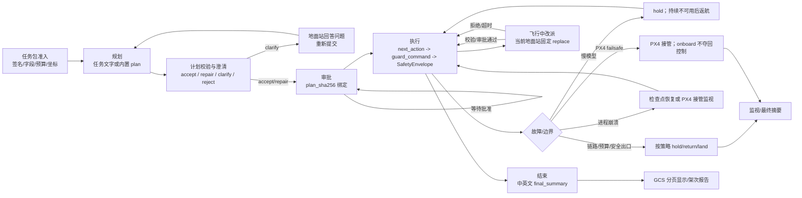

# 机载自主任务安全总览（2026-10-24）

这是一页式入口。它描述一次机载任务从任务包进入到最终摘要的实际路径；参数以当前代码为准。SIM、离线 harness 和 replay 只能证明各自文档声明的范围，不能把真实飞机能力扩大。

## 端到端路径

| 环节 | 详细文档 | 实现入口 |
| --- | --- | --- |
| 任务包准入、签名、TUNNEL 与 GCS | [gcs-mission-package-workflow](gcs-mission-package-workflow.md) | [`mission_package.py`](../src/multidetect/autonomy/mission_package.py)、[`mission_operator_protocol.py`](../src/multidetect/autonomy/mission_operator_protocol.py) |
| 规划与多用途任务 | [onboard-multipurpose-mission-design](onboard-multipurpose-mission-design.md) | [`onboard_policy.py`](../scripts/onboard_policy.py)、[`mission_planner.py`](../src/multidetect/autonomy/mission_planner.py) |
| 计划校验/澄清 | [plan-validation-clarification](plan-validation-clarification.md) | [`plan_validation.py`](../src/multidetect/autonomy/plan_validation.py) |
| 执行与统一安全出口 | [autonomy-architecture](autonomy-architecture.md) | [`mission_executor.py`](../src/multidetect/autonomy/mission_executor.py)、[`motion_intent.py`](../src/multidetect/autonomy/motion_intent.py)、[`safety_envelope.py`](../src/multidetect/autonomy/safety_envelope.py) |
| 慢模型失效保护 | [autonomy-architecture](autonomy-architecture.md) 的故障矩阵 | [`onboard_policy.py`](../scripts/onboard_policy.py) |
| 链路/监督器策略 | [gcs-mission-package-workflow](gcs-mission-package-workflow.md)、[data-link-alerts](data-link-alerts.md) | [`mission_supervisor.py`](../src/multidetect/autonomy/mission_supervisor.py) |
| 崩溃恢复与 PX4 边界 | [crash-resume](crash-resume.md) | [`crash_resume.py`](../src/multidetect/autonomy/crash_resume.py) |
| 飞行中改派 | [mid-mission-retask](mid-mission-retask.md) | [`mission_supervisor.py`](../src/multidetect/autonomy/mission_supervisor.py)、[`mission_executor.py`](../src/multidetect/autonomy/mission_executor.py) |
| follow 加固 | [onboard-multipurpose-mission-design](onboard-multipurpose-mission-design.md) | [`mission_executor.py`](../src/multidetect/autonomy/mission_executor.py) |
| 中英文摘要与地面站分页 | [gcs-mission-package-workflow](gcs-mission-package-workflow.md) | [`mission_summary.py`](../src/multidetect/autonomy/mission_summary.py) |
| 真机离线边界 | [real-mode-offline-harness](real-mode-offline-harness.md) | [`onboard_main.py`](../scripts/onboard_main.py)、[`run_real_mode_harness.py`](../scripts/run_real_mode_harness.py) |
| 执行器 fuzz/变异与 gate | [mission-executor-fuzz-findings](mission-executor-fuzz-findings.md)、[onboard-gate-flaky-tests](onboard-gate-flaky-tests.md) | `tests/` 中对应测试 |
| 黄金/真实计划 replay | [golden-replay](golden-replay.md)、[onboard-episode-replay](onboard-episode-replay.md) | `scripts/check_golden_replay.py`、`scripts/replay_onboard_episode.py` |
| 单架次报告与步骤计时 | [episode-report](episode-report.md)、[sim-step-timing-and-speedup-20261024](sim-step-timing-and-speedup-20261024.md) | `scripts/render_episode_report.py`、`scripts/analyze_step_timing.py` |

## 默认参数与依据

数值是默认值；任务包、airframe profile 或显式选项可以收紧边界。`步`不是`秒`，除非表中明确写秒。

| 参数 | 默认值 | 依据 |
| --- | ---: | --- |
| 慢模型单次请求超时 | 15 s | [`onboard_policy.py:1130`](../scripts/onboard_policy.py)；近期调用 p95/max 依据见 [`autonomy-architecture.md`](autonomy-architecture.md) |
| 慢模型首次启动 / 重启启动 | 180 s / 30 s | [`onboard_policy.py:1048-1055`](../scripts/onboard_policy.py) |
| 慢模型重启窗口 / 次数 / 间隔 / 关停等待 | 2 s / 1 / 5 s / 5 s | [`onboard_policy.py:1134-1145`](../scripts/onboard_policy.py) |
| 慢模型健康不可用升级 | 连续失败 1 次；持续 10 s 后返航 | [`onboard_policy.py:1154-1157`](../scripts/onboard_policy.py)、[`autonomy-architecture.md`](autonomy-architecture.md) |
| 检查点有效期 / 大小 | 60 s / 64 KiB | [`crash_resume.py:25,49,147`](../src/multidetect/autonomy/crash_resume.py) |
| 执行器 step/travel budget | 60 / 150 步 | [`mission_executor.py:63-75`](../src/multidetect/autonomy/mission_executor.py) |
| 多旋翼单次最大平移、默认 hover | 15 m / 1 s | [`safety_envelope.py:186-248`](../src/multidetect/autonomy/safety_envelope.py)、[`motion_intent.py:390-431`](../src/multidetect/autonomy/motion_intent.py) |
| follow 目标失鲜 | 3 s 或 2 个周期 | [`mission_executor.py:96-97`](../src/multidetect/autonomy/mission_executor.py) |
| follow 丢失重新获取 | 7 s、需 2 次确认 | [`mission_executor.py`](../src/multidetect/autonomy/mission_executor.py) |
| 降落等待 / deliver ACK | 15 步 / 10 s | [`mission_executor.py:120-128`](../src/multidetect/autonomy/mission_executor.py) |
| 计划高度轻微越界修复 | 最多 3 m；超过则 reject | [`plan_validation.py`](../src/multidetect/autonomy/plan_validation.py)、[计划校验文档](plan-validation-clarification.md) |
| 澄清问题上限 | 3 题 | [`plan_validation.py:232-237`](../src/multidetect/autonomy/plan_validation.py) |
| GCS 状态/摘要分页 | 1,200 字节状态；1,536 字节 UTF-8 分页；摘要 JSON 2,048 字节 | [gcs-mission-package-workflow](gcs-mission-package-workflow.md)、[`mission_summary.py:180-218`](../src/multidetect/autonomy/mission_summary.py) |
| 改派规划/审批超时 | 30 s / 600 s | [`mission_supervisor.py:284`](../src/multidetect/autonomy/mission_supervisor.py) |

包 `home` 是任务几何的权威基准，并在构造时绑定到 `SafetyEnvelope`；只有缺少包 home 时，首次 `next_action`/`observe` 的位姿才回退为执行器 home。回退时 envelope 的 down 固定为 0，表示地面基准，不是首个空中高度。所有执行动作都经过 `MissionExecutor.next_action -> AirframeMotionAdapter.guard_command -> SafetyEnvelope.apply`；固定翼/VTOL 的高层命令用同路径 probe，拒绝时立即使用机型 recovery，不能下发部分裁剪命令。

## 已修正的不一致

- GCS 文档原先把飞行中改派写成带 `retask_mode=append|replace`；当前地面站入口没有该字段，固定为 `replace`。`append` 仍是机载 API 能力，已在 [mid-mission-retask](mid-mission-retask.md) 和 GCS 文档中分开说明。
- 崩溃恢复原先把“有效检查点”概括为必然恢复；实际还必须通过 PX4 boot time、模式解码和允许模式检查。未知 boot/mode、RTL/LAND/FAILSAFE 或其他不允许模式只记录监视；检查点缺失/损坏/过期/摘要不符才进入 RTL（无 RTL 时按机型降落）。
- `resume_after_failsafe=true` 已明确为签名任务包的显式 opt-in，但不能绕过身份、摘要、序号、时间和 boot 校验；未知模式仍只监视。
- 真实模式离线 harness、黄金 replay、fuzz/gate 和单架次报告均标为验证/审计工具，不再与真实飞机执行能力混写。
