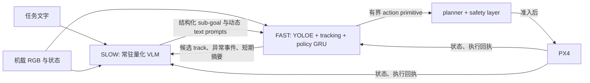

# 机载双系统设计与基准边界

日期：2026-10-11。目标硬件为 Jetson Orin 8 GB，共享 CPU/GPU 内存。无人机在机载端理解任意任务文字、持续观察并选择下一步；地面站负责监视和人工介入，不参与每次目标判断。本文描述拟接入的双系统和离线基准，不表示该组合已经在 Jetson、PX4 或实机飞行中验收。

## 数据流与执行权



SLOW 使用常驻的小型 GGUF VLM，异步、事件触发地读取下采样 RGB、原始任务、短记忆和候选检测；输出 `search_region`、`approach_track`、`follow_track`、`detour`、`hover`、`record`、`return_home` 等语义提案，或确认、拒绝候选。它不产生姿态、PWM、MAVLink 或电机指令。FAST 根据有效提案设定 YOLOE text prompts，例如从“找红色车辆”派生 `red vehicle`，并辅以 `car`、`truck` 等泛化词；prompt-free YOLOE 可作为发现未知物体的并行或降级路径。tracking 保持 track 身份，GRU 在固定频率上结合当前观测提出 `translate`、`turn`、`hold`、`stop` 等有界 primitive。目标类别和颜色词只是当前任务参数，不写死在模型的决策逻辑中。

目前 [policy v2 contract](../src/multidetect/autonomy/policy_v2/contracts.py) 已定义有界 primitive 和 truth-free `StructuredSceneState`；[GRU baseline](../src/multidetect/autonomy/policy_v2/model.py) 是 2 层模型；[rollout](../src/multidetect/autonomy/policy_v2/rollout.py) 检查动作边界并对非法动作回退 `HOLD`。这些现有软件部件不是本设计的 Jetson 并行部署证明。新 SLOW→FAST 接口须经过适配与来源绑定，再进入现有 planner／safety 路径。

### SLOW→FAST 决策

本轮基准使用以下严格 JSON 对象；生产适配层还须在对象之外绑定 `task_id`、`vehicle_id`、`frame_id`、`captured_at`、请求序号和过期时间，均由 host 创建，不能信任模型回填。模型只输出这三个顶层字段，未知字段、重复键、非有限数、超长文本和不匹配的参数均拒绝。

```json
{
  "decision": "approach_track",
  "args": {"track_id": "track-7", "region": null, "duration_s": 3.0},
  "reason": "Candidate matches task color and remains visible."
}
```

`decision` 只允许 `search_region`、`approach_track`、`confirm_target`、`reject_track`、`follow_track`、`detour`、`hover`、`record`、`return_home`、`ask_clarify`。`args` 只含 `track_id`（string 或 null）、`region`（string 或 null）、`duration_s`（0–30 秒的 finite number 或 null）；依赖 track 的动作必须引用当前有效 `track_id`，`search_region` 必须指定 `region`。`reason` 限 20 个词以内，只供审计，不能改变安全准入。`confirm_target` 是视觉语义确认提案，不能直接证明 GPS 坐标、目标身份或任务完成；`record` 也必须等待实际存储回执。空目标或含糊任务可选 `search_region` 或 `ask_clarify`，不能凭空制造 track。

FAST 接收该对象后按任务更新 prompt set 和 sub-goal。只有与当前任务、观测和 track 仍匹配的结果能消费一次；`reject_track` 标记当前候选，不能把整个类别永久加入黑名单。`return_home` 和 `hover` 是请求，安全层可根据车辆状态覆盖。现有 [VLM ready-only provider](../src/multidetect/autonomy/onboard_vlm_provider.py) 已有异步提交、单次消费及精确来源校验思路；接入本 JSON 需要专门 adapter，不能把基准脚本的输出直接当作现有 `OnboardVlmRuntimeResponse`。

### FAST→SLOW 事件与短记忆

事件由 FAST／车辆监测器产生，包含 `event_id`、`kind`、单调时间、来源 frame/track、严重度和可用状态；去重、节流并对同任务只保留最新未处理普通观察。触发包括：新候选或置信度跨阈值、track 移动／丢失／重现、类别或颜色冲突、持续误检、搜索区域完成、障碍或路线改变、定位劣化、电量风险、任务阶段变化、模型超时／内存压力。重大安全事件立刻送 safety layer，不等待 SLOW；普通帧不能每张都取消正在运行的 VLM 请求。现有 [OnboardEventKind](../src/multidetect/autonomy/onboard_agent.py) 已含 `target_moved`、`target_lost`、`gps_degraded`、`battery_low`、`obstacle_risk`、`inference_fault`、`mission_complete`，新增语义事件要映射到这个入口或经版本化扩展。

记忆摘要必须短、有界并与任务和时间绑定，例如 `last_valid_decision`、已搜索区域、最近可见 track 及最后时间、已拒绝 track 的理由、已确认目标的证据、尚未完成的记录／返航请求、实际执行回执。记忆分开记录 **proposed → accepted → executed → completed**；模型提议或上传 ACK 不等于执行完成。只将真实观测和 host 审核过的回执送给 VLM；SIM truth、评测标签、world 文件、未来帧和教师动作都不能进入推理输入。现有 [runtime contract](../src/multidetect/autonomy/onboard_vlm_runtime_contract.py) 已执行类似的 truth 隔离和回执审查。

## 安全层与故障处理

planner／safety layer 对导航、geofence、定位、障碍、速度、续航和 track 新鲜度有最终否决权；PX4 保持底层飞行稳定与自身 failsafe。SLOW 不直接运行在控制循环内；FAST 即使没有新 VLM 输出仍按最近一次**未过期且已准入**的决策继续，且每个 primitive 都重新校验。过期决策、失联 track 或任务切换时撤销该提案。VLM JSON 无效、请求超时、worker 崩溃或 OOM 时记录 `inference_fault`，短暂保留仍有效且安全的 sub-goal；没有有效决策则 `hover`，按定位、电量和 watchdog 规则升级 `return_home`。如果定位已不可用于返航，遵循现有 PX4／平台 failsafe，而非强行生成返航路线。现有 [OnboardAIExecutor](../src/multidetect/autonomy/onboard_agent.py) 已将 GPS／低电量／推理故障映射到 `RETURN`，障碍风险映射到 `HOLD`；现场阈值与降级时序仍需独立验证。

## 性能与 8 GB 共享内存预算

本轮 4060 脚本产生的 detector 和 VLM 数字应分别记录在基准报告中：样本数、真值投影和 IoU、每类／高度 recall 与 precision、目标空帧误检、640 FP16 推理 p50/p95、VLM 图像编码到最终 JSON 的 p50/p95、输出 token、JSON 有效率、候选真假判断、CUDA 峰值与进程 RAM。**4060 独立显存、Windows 内存和 Orin 统一内存不能直接相加或按算力比换算延迟。** 若某项基准尚未完成，该项为未测量，不补造数值。

### 本地已完成的测量

FAST 报告为 [`open-vocab-detector-360.json`](../artifacts/benchmarks/open-vocab-detector-360.json)，命令为：

```powershell
C:/Users/admin/AppData/Local/Programs/Python/Python312/python.exe scripts/bench_open_vocab_detector.py --frames 360 --seed 20261011 --conf 0.25 --output artifacts/benchmarks/open-vocab-detector-360.json
```

样本是 r2、r3、r4 各 120 帧（低空 240、高空 120），含 216 个投影 truth box 和 180 张目标空帧。投影框只在离线计分中使用，IoU 门槛为 0.3。当前本地 `yoloe-11s-seg-pf.pt` 的 prompt-free 输出按 class-agnostic proposal 计为 TP/FP/FN **91/1189/125**，precision/recall **7.11%/42.13%**；180/180 目标空帧有原始框，共 603 个框。高空 proposal recall 为 30.99%，低空为 47.59%。按 `vehicle`、`rover`、`cargo_cart` 语义标签过滤后是 **0/216 recall**，因为原始标签主要是 `sky`、`summer evening` 等无关词，不能把 proposal 命中当作正确分类。同步 640 FP16 `predict` wall latency 为 **31.43/42.42 ms (p50/p95)**，Ultralytics inference 为 **25.00/35.61 ms**，PyTorch peak allocated 为 **262.78 MiB**。这些数是在 4060 与 Gazebo 并行负载上测的，不是 Orin TRT 数字。

YOLOE text prompt 的代码路径会从任务文字生成 `red vehicle`、`rover`、`cargo cart`、`car`、`truck` 等 prompt，并记录 prompt-free 与语义计分；但本机没有 YOLOE 所需的 `clip` tokenizer 和 MobileCLIP-BLT 权重。脚本关闭自动安装和网络，因此 text-prompt precision/recall、latency 与 baked-prompt ONNX 结果均明确为 **unavailable**，没有用不兼容的 CLIP embedding 冒充测量。4 帧 smoke 的 prompt-free ONNX 导出成功（45.492 MiB，SHA256 `917145554521c97401e02445690967e85d951ea598d0c0f601e37f78bbcfaf38`；导出后删除产物）；有 encoder 后在 Jetson 上的路径是先导出带 embedding 的 ONNX，再用 `trtexec --onnx=... --saveEngine=... --fp16` 构建 TensorRT engine，尚未测量。

SLOW 报告为 [`onboard-vlm-20261011-final.json`](../artifacts/benchmarks/onboard-vlm-20261011-final.json)，命令为：

```powershell
C:/Users/admin/AppData/Local/Programs/Python/Python312/python.exe scripts/bench_onboard_vlm.py --models qwen3-vl-2b qwen2.5-vl-3b --frames 40 --lever-frames 8 --output artifacts/benchmarks/onboard-vlm-20261011-final.json
```

每个模型使用 40 张互不重复的对齐帧（20 个真目标、20 个不同颜色 distractor，覆盖 r2/r3/r4）。这是带 **oracle projected candidate box** 的隔离候选判断测量：模型看到任务文字、448 px 图像、框坐标和短记忆，truth 的 class、color、target ID 没有进入 prompt；因此它高估了真实 detector→VLM 链路，不能视为整机成功率。

| 模型（warm server，448 px） | JSON 有效 | 正确 | 真目标确认 | distractor reject | 端到端 p50/p95 | server RSS peak | 总 GPU used* |
| --- | ---: | ---: | ---: | ---: | ---: | ---: | ---: |
| Qwen3-VL-2B Q4_K_M | 39/40 | 19/40 | 19/20 | 0/20 | 1.140/2.082 s | 2751 MiB | 3489 MiB |
| Qwen2.5-VL-3B Q4_K_M | 39/40 | 20/40 | 19/20 | 1/20 | 1.328/3.012 s | 2839 MiB | 4609 MiB |

\* `nvidia-smi` 的总设备占用，包含并行 Gazebo，不是 VLM 进程 VRAM。2B 的 image encode p50/p95 是 7.1/19.3 ms，3B 是 6.5/10.8 ms；生成 token p50/p95 分别为 70/77 和 67/94。server prompt/decode 的 p50/p95 分别为 92.6/446.0 ms、974.9/1927.8 ms（2B）以及 134.6/152.4 ms、1158.7/2267.5 ms（3B）。320 px full prompt、96 token cap 在两模型上都是 8/8 JSON 有效但只有 4/8 正确；短 prompt 或 64 token cap 会截断 JSON 或显著降低有效率。当前两模型都严重偏向 `confirm_target`，所以 target confirm 不能直接准入 safety/planner。

上述 4060 结果是实测；下表和后文的 Orin 数字是工程预算或用户提供的外部基准，不能互相替代。

| 项目 | Orin 8 GB 规划占用 | 证据与限制 |
| --- | ---: | --- |
| OS、JetPack、camera、视频缓冲及后台服务 | 1.0–1.5 GB | 工程预留，未在目标机测量 |
| YOLOE TensorRT engine、输入／输出及 workspace | 0.5–1.2 GB | 工程预留；PyTorch FP16 4060 延迟不能充当 TRT 延迟 |
| tracking、GRU、状态与 mission adapter | 0.2–0.5 GB | 工程预留；具体实现和峰值未测 |
| Qwen3-VL-2B Q4_K_M + mmproj + KV／视觉工作区 | 3.0–4.5 GB | 保守规划区间；本地两个 GGUF 文件合计 1,552,463,168 字节，仅为磁盘体积 |
| 并发峰值、内存碎片和安全余量 | 0.5–1.0 GB | 必须保留；不能依赖 swap 充当高速 GPU 内存 |
| **2B 合计** | **5.2–8.7 GB** | 上界超 8 GB，必须在 Orin 上实测并缩短 context／图像、限制并发 |
| Qwen2.5-VL-3B Q4_K_M + mmproj + KV／视觉工作区 | 约 5 GB 峰值（外部案例） | 用户提供的 [hokwangchoi VLM benchmark](https://hokwangchoi.com/blog/vlm-benchmarks) 数字，本地未核验，配置未与本栈对齐；本地 GGUF 磁盘合计 2,774,658,784 字节 |
| **3B 加其余 4 项** | **约 7.2–9.2 GB** | 从外部单模型峰值加工程预留的粗估；接近或超过共享内存上限 |

外部延迟参照也需拆开：[Jetson AI Lab 的 Orin Nano 教程](https://www.jetson-ai-lab.com/tutorials/openclaw/) 在本仓库 [模型调查](research/onboard-vlm-candidates-20261007.md) 中记录 **Qwen3.5-2B Q8_0 纯文本**约 4.6 GB、20 token/s、warm 首响应约 3 秒；这不是 Qwen3-VL 看图基准。用户给出的 hokwangchoi 案例为 **Qwen2.5-VL-3B Q4_K_M** 约 1.7 秒 preprocessing、2.5 秒 prefill、0.7 秒 decode，合计约 **4.9 秒／次**，约 5 GB peak；原始网页未在本地核验，也没有 YOLOE 并发。两组数字不能混作本机测量或 Orin 验收结果。

初始选择 **Qwen3-VL-2B Q4_K_M** 作为 SLOW 候选，3B 保留为离线质量对照；这仅是 8 GB 共存的工程选择，需以目标机的并发峰值和任务判断质量决定。由于本轮隔离候选测试的 distractor reject 只有 0/20（2B）和 1/20（3B），两者都不能直接为 `confirm_target` 提供准入，必须先做 SIM fine-tune、困难负样本和 safety-layer 阈值验证。SLOW 采用 warm server、事件触发与最短输出，普通状态按约 3–5 秒最小间隔请求一次，重大新候选或异常可立即触发但同一时间最多一个在途请求；以实测 p95、过期率和热状态负载调整 cadence。FAST 的检测、tracking、GRU 和 safety 连续运行，不能因 SLOW 的数秒 prefill 阻塞。优先比较 448 与更小图像、精简 prompt、`n_predict` cap、JSON schema constrained decoding、KV／prompt cache；每项同时看延迟与判断质量，不能只挑最快设置。

## 训练与验证顺序

1. 用隔离的生成 world 和已完成 SIM teacher episode，按 `search`、`approach`、`track`、`avoid`、`record`、`return` 等 phase 对齐实际 RGB、当前可见 track、host 状态和真实执行回执。phase 到上述决策是**待审标签映射**：`confirm_target`／`reject_track` 需要颜色、类别及目标指代证据，不能只由 phase 自动推出。排除无图、时间错位或只有提案而无执行事实的 step。
2. 将 task、frame、候选和历史摘要作为 truth-free student 输入；teacher label 独立保存。按 world／路线／目标配置划分 train、validation、test，冻结独立测试集。比较 2B 与 3B 的 JSON 有效、目标确认误判、复杂任务泛化和事件响应，不以训练集一致率代替任务成功率。
3. 先离线 behavior cloning，再在 Gazebo shadow rollout 中收集 student 实际到达的状态，使用 teacher 重新标注并作 DAgger。统计错误 sub-goal、安全层拒绝率、超时、误返航及完整任务结果；通过 HIL 和 Jetson 并发资源门槛后才考虑真实适配。

本文件的接口是机载双系统的设计与基准契约；任何模型、engine 或策略的晋升都需要独立的目标机测量、安全准入和真实执行证据。

CPU schema validator 位于 [`onboard_decision.py`](../src/multidetect/autonomy/onboard_decision.py)，覆盖未知字段、重复键、非有限数、参数约束、track／region 前置条件和 20 词 `reason` 限制的测试位于 [`test_onboard_decision.py`](../tests/test_onboard_decision.py)。
